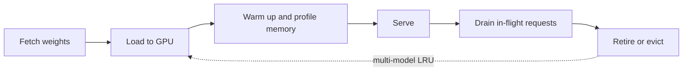

The HelpDesk assistant from [§1](/c/llm-serving/01-repository-tour) is ready to launch on Gemma 3 12B. Finance asks two questions: what does a million output tokens cost, and how many GPUs does the 10 requests/s peak need? Chapter 1 of the book is the vocabulary for answering — serving paradigms, the model lifecycle, why optimisation matters — and this page turns its two central claims into numbers you can defend.

**Covers:** anatomy of a model, the model lifecycle, what serving is, why we optimise it, serving paradigms (edge, single-model, multi-model), serving platforms.

**In the repository:** no code; there is no `ch01/` directory. What the repository shows is the *shape* of the chapter's taxonomy, visible in how the code is organised.

:::key[First principle]
A served token costs GPU-hours divided by tokens, so every optimisation is ultimately a throughput change at a fixed latency target. And because requests arrive randomly, a server run close to full capacity makes users wait in a queue whose length grows like \(1/(1-\rho)\): the cheapest configuration on paper is never run at 100% utilisation.
:::

## 3.1 Serving paradigms, as the repository implements them

The chapter separates single-model from multi-model serving, and the repository implements both side by side, plus two ways of letting a vendor do it.

| Paradigm | Where | What makes it that paradigm |
| --- | --- | --- |
| Single-model | `ch03/single_model_llm_serving/` | One model loaded at startup, a workload manager batching requests against it, no residency decisions |
| Multi-model | `ch03/multi_model_serving/` | An LRU cache holding at most two models (`max_models: int = 2`), loading and evicting on demand |
| Cloud-managed | `ch04/bedrock/`, `ch04/jumpstart/` | No serving code at all — the vendor owns the model, the notebook owns the request |
| Container-served | `ch04/dlc/`, `ch04/dlc_customization/` | You ship a model definition and a container image; SageMaker runs it |

Reading the two `ch03` services against each other is the fastest way to feel what "paradigm" means. The single-model service spends its complexity on queues, batching and process isolation; the multi-model service spends it on metadata, a cache, and a factory that decides which kind of worker to build. Same problem, opposite distribution of effort. HelpDesk is a single-model deployment: one model, high traffic, and every byte of GPU memory not holding weights should hold KV cache.

## 3.2 The lifecycle

The chapter's lifecycle — fetch, load, warm up, serve, retire — shows up in the code as concerns rather than directories:



```python
# ch03/single_model_llm_serving/llm/model_manager.py
def load_model(self, model_name: str = "facebook/opt-125m") -> tuple[AutoModelForCausalLM, AutoTokenizer]:
    os.makedirs(self.model_dir, exist_ok=True)
    model = AutoModelForCausalLM.from_pretrained(model_name)
    tokenizer = AutoTokenizer.from_pretrained(model_name)
    return model, tokenizer
```

That is the whole of "fetch and load" in the repository: a cache directory that is created but never populated, and `from_pretrained` doing the work. The lifecycle engineering of a real system — revision pinning, integrity checks, partial downloads, atomic swaps, draining before shutdown — is not here, because the chapter is about serving rather than distribution. Retirement exists only in the multi-model service, as LRU eviction (`popitem(last=False)` in `manager.py`).

Loading is not free, and the three numbers from §1 say how much. Gemma 3 12B's 23.53 GB of bf16 weights take about 1.9 s to read at an illustrative 12.5 GB/s from local NVMe and 188 s at an illustrative 1 Gbit/s download; chapter 9's notebook records load time and memory in the server log for exactly this reason. Cold starts set how fast you can scale out.

## 3.3 What a token costs

A GPU costs the same per hour whether it emits 37 tokens per second or 1,273. The cost per token is therefore

$$
\text{USD per 1M output tokens} = \frac{\text{GPU price (USD/hour)}}{\text{output tok/s} \times 3600} \times 10^6 .
$$

Prices below are illustrative ($2.00 per L40S-hour, $4.00 per A100-hour). The throughputs are the batch-1 decode floor from §1 (bandwidth ÷ weight bytes) and the SLO-limited operating points from the [§2 model](/c/llm-serving/02-benchmarks).

```python run
"""Dollars per million output tokens, from GPU price and throughput.
Prices are ILLUSTRATIVE; throughputs are the section 2 model or the batch-1 decode floor."""
import math

PRICE = {"L40S": 2.00, "A100": 4.00}             # USD per GPU-hour, illustrative
CASES = [  # (label, GPU, output tokens/s per GPU)
    ("12B bf16, batch 1 (decode floor)", "L40S", 864e9 / 23.53e9),
    ("12B bf16, batch 1 (decode floor)", "A100", 1555e9 / 23.53e9),
    ("12B int4, batch 1 (decode floor)", "L40S", 864e9 / 7.73e9),
    ("12B bf16, C=22 at TPOT SLO", "L40S", 444),
    ("12B bf16 + prefix cache, C=35", "L40S", 703),
    ("12B int4 + prefix cache, C=63", "L40S", 1273),
]
print(f"{'configuration':34s} {'GPU':5s} {'tok/s':>7} {'USD/1M out':>11}")
for label, gpu, tps in CASES:
    usd = PRICE[gpu] / (tps * 3600) * 1e6
    print(f"{label:34s} {gpu:5s} {tps:7.1f} {usd:11.2f}")

# HelpDesk: peak 10 req/s; replicas sized so each runs at <= 70% of its SLO-limited rate
PEAK_RPS, RHO = 10, 0.70
for label, rps_per_gpu in (("bf16, no cache", 1.74), ("int4 + prefix cache", 4.97)):  # section 2
    n = math.ceil(PEAK_RPS / (RHO * rps_per_gpu))
    usd_h = n * PRICE["L40S"]
    print(f"HelpDesk {label:20s}: {rps_per_gpu:4.2f} req/s per L40S -> {n:2d} GPUs, "
          f"USD {usd_h:5.2f}/h, USD {usd_h / (PEAK_RPS * 3600) * 1000:.3f} per 1,000 requests at peak")
```

```output
configuration                      GPU     tok/s  USD/1M out
12B bf16, batch 1 (decode floor)   L40S     36.7       15.13
12B bf16, batch 1 (decode floor)   A100     66.1       16.81
12B int4, batch 1 (decode floor)   L40S    111.8        4.97
12B bf16, C=22 at TPOT SLO         L40S    444.0        1.25
12B bf16 + prefix cache, C=35      L40S    703.0        0.79
12B int4 + prefix cache, C=63      L40S   1273.0        0.44
HelpDesk bf16, no cache      : 1.74 req/s per L40S ->  9 GPUs, USD 18.00/h, USD 0.500 per 1,000 requests at peak
HelpDesk int4 + prefix cache : 4.97 req/s per L40S ->  3 GPUs, USD  6.00/h, USD 0.167 per 1,000 requests at peak
```

:::chart[Cost per million output tokens, Gemma 3 12B (illustrative prices, modelled throughput)]{type="bar" x="configuration" y="USD per 1M output tokens" prefix="$" yfmt="dec2" labels="true"}
configuration, USD per 1M output tokens
bf16 batch 1 L40S, 15.13
bf16 batch 1 A100, 16.81
int4 batch 1 L40S, 4.97
bf16 C=22 L40S, 1.25
bf16 + cache C=35 L40S, 0.79
int4 + cache C=63 L40S, 0.44
:::

What the table says:

- **Batching is the optimisation.** One user at a time costs $15.13 per million tokens; 63 concurrent users inside the same latency SLO cost $0.44 — 34× cheaper on the same GPU. Every later chapter is a way to move further down this table without breaking the SLO.
- **The faster GPU can be the more expensive one.** The A100 decodes 1.8× faster (1,555 vs 864 GB/s) but costs 2× as much per hour, so at batch 1 its tokens cost more. Compare GPUs on tokens per dollar at your operating point, never on speed alone.
- **The SLO decides the GPU count.** At 70% of each GPU's SLO-limited rate, the 10 req/s peak needs 9 L40S GPUs in bf16 without caching and 3 with int4 plus a cached system prompt: $18.00 against $6.00 an hour.

:::warn[Cost per token at peak is not cost per token]
The $0.167 per 1,000 requests assumes the fleet runs at peak all day. If average traffic is a third of peak and the fleet doesn't scale down, the real cost per request is three times higher. Report both, and price autoscaling and cold starts (§3.2) against idle GPUs.
:::

## 3.4 Serving is a queueing problem

Requests don't arrive evenly. In the simplest model — Poisson arrivals at rate $\lambda$, one server, exponential service times with mean $S$ (M/M/1) — utilisation is $\rho = \lambda S$ and the time a request spends in the system is exponential with rate \(1/S - \lambda\):

$$
\overline{T} = \frac{S}{1-\rho}, \qquad T_{p99} = \frac{S \ln 100}{1-\rho}.
$$

At $\rho = 0.5$ the mean response is twice the service time; at 0.9 it is ten times; at 0.95, twenty. The formula is checked here against a direct simulation (Lindley's recursion: each job waits for whatever work the previous job left behind):

```python run
"""Why serving is a queueing problem: M/M/1 response time vs utilisation, formula and simulation."""
import math
import numpy as np

S = 1.0                                   # mean service time (time unit)
print("rho, mean T/S, p99 T/S")
for rho in (0.1, 0.3, 0.5, 0.6, 0.7, 0.8, 0.85, 0.9, 0.95):
    t_mean = S / (1 - rho)                # M/M/1 mean time in system
    t_p99 = S * math.log(100) / (1 - rho) # sojourn time is exponential with rate mu - lambda
    print(f"{rho}, {t_mean:.2f}, {t_p99:.2f}")

rng = np.random.default_rng(3)
n = 400_000
print("\nsimulation check (Lindley recursion, 400k jobs):")
for rho in (0.5, 0.8, 0.9):
    arrive = rng.exponential(S / rho, n)  # inter-arrival gaps
    serve = rng.exponential(S, n)
    wait = np.zeros(n)
    for i in range(1, n):                 # wait_i = max(0, wait_{i-1} + serve_{i-1} - gap_i)
        wait[i] = max(0.0, wait[i - 1] + serve[i - 1] - arrive[i])
    t = (wait + serve)[n // 10:]          # drop warm-up
    print(f"  rho {rho}: mean T/S {t.mean():.2f} (formula {1 / (1 - rho):.2f}), "
          f"p99 {np.percentile(t, 99):.2f} (formula {math.log(100) / (1 - rho):.2f})")
```

```output
rho, mean T/S, p99 T/S
0.1, 1.11, 5.12
0.3, 1.43, 6.58
0.5, 2.00, 9.21
0.6, 2.50, 11.51
0.7, 3.33, 15.35
0.8, 5.00, 23.03
0.85, 6.67, 30.70
0.9, 10.00, 46.05
0.95, 20.00, 92.10

simulation check (Lindley recursion, 400k jobs):
  rho 0.5: mean T/S 2.00 (formula 2.00), p99 9.33 (formula 9.21)
  rho 0.8: mean T/S 5.09 (formula 5.00), p99 22.94 (formula 23.03)
  rho 0.9: mean T/S 9.86 (formula 10.00), p99 44.11 (formula 46.05)
```

:::chart[M/M/1 response time in units of service time]{type="line" x="utilisation ρ" y="response time ÷ service time" ylog="true" xfmt="dec2" marks="0.7:HelpDesk sizing target" band="0.85:0.95:knee"}
rho, mean, p99
0.1, 1.11, 5.12
0.3, 1.43, 6.58
0.5, 2.00, 9.21
0.6, 2.50, 11.51
0.7, 3.33, 15.35
0.8, 5.00, 23.03
0.85, 6.67, 30.70
0.9, 10.00, 46.05
0.95, 20.00, 92.10
:::

An LLM server is not M/M/1: it batches, so its service rate rises with load until the KV pool or the SLO caps it (the §2 curve), and its service times are far from exponential. The shape survives anyway. For any single queue, Kingman's approximation gives the mean wait as

$$
W_q \approx \frac{\rho}{1-\rho} \cdot \frac{c_a^2 + c_s^2}{2} \cdot S,
$$

where $c_a$ and $c_s$ are the coefficients of variation of inter-arrival and service times. Bursty traffic and long-tailed output lengths raise both, which makes the knee arrive *earlier* than in M/M/1. What changes for an LLM server is where the wait shows up: requests that can't get a KV slot sit in the scheduler's waiting queue, and that wait is added to TTFT, not TPOT.

:::example[Worked example · why HelpDesk is sized at 70%]
With int4 and a cached prefix, §2's model gives 4.97 req/s per L40S inside the TPOT SLO. Three GPUs at the 10 req/s peak run at \(10 / (3 \times 4.97)\) = 67% of that rate. Two would run at 101% — the queue grows without bound and TTFT with it. Treating the admission queue as M/M/1 for intuition: at 67% the response time averages about 3× the service time and about 14× at p99 (\(1/0.33\) and \(\ln 100 / 0.33\)); at 90% those become 10× and 46×. The p99 TTFT SLO of 500 ms is spent long before the mean looks bad.
:::

| Utilisation target | Mean response ÷ service | p99 ÷ service | Use when |
| ---: | ---: | ---: | --- |
| 0.5 | 2.0 | 9.2 | Tight p99 SLO, bursty traffic, slow scale-out |
| 0.7 | 3.3 | 15.4 | Default for interactive serving with autoscaling |
| 0.85 | 6.7 | 30.7 | Batch or offline jobs where only throughput matters |
| ≥ 0.95 | ≥ 20 | ≥ 92 | Never, for anything with a latency SLO |

## 3.5 Two ideas that survive into every later chapter

**Optimisation is a trade, not a speed-up.** Chapter 3's two services make it concrete: the single-model service batches to raise throughput, which raises per-token latency (the §2 TPOT curve); the multi-model service keeps two models warm to cut cold-start latency, which costs memory that could have held KV cache. Neither is "better"; each moves along a cost–latency curve.

**Serving is a queueing problem.** The single-model service's `WorkloadManager` exists because requests arrive faster than the model can serve them, and something has to decide who goes next and how many go together (`batch_size = 4`). Every framework in chapter 8 is, at bottom, a better answer to that question: continuous batching, paged KV memory and prefix sharing all raise the service rate so the same traffic runs at a lower $\rho$.

## 3.6 Check yourself

:::qa[An L40S at $2.00/hour serves 700 output tokens/s. What does a million output tokens cost, and what if the price drops to $1.50?]
\(2.00 / (700 \times 3600) \times 10^6\) = $0.79. At $1.50 it is $0.60. A 25% price cut and a 33% throughput gain have the same effect on cost per token.
:::

:::qa[Traffic grows from 10 to 13 req/s on the 3-GPU int4 HelpDesk fleet. What happens?]
Utilisation of the SLO-limited rate goes from 67% to \(13 / 14.91\) = 87%. In M/M/1 terms mean response grows from about 3× to 7.8× the service time and p99 from about 14× to 36×. TTFT p99 will breach 500 ms well before throughput looks saturated; add a fourth GPU (65% utilisation).
:::

:::qa[Where in the repository is the retire half of the lifecycle, and what's missing from it?]
Only in the multi-model service: LRU eviction with `popitem(last=False)`, and Triton unload in `TritonWorker.__del__`. There is no draining of in-flight requests, no version pinning and no atomic swap — the pieces a production rollout needs.
:::

:::qa[Output lengths get more variable: the service-time coefficient of variation goes from 1 to 2. By Kingman, what happens to the mean wait at 70% utilisation?]
The variability factor \((c_a^2 + c_s^2)/2\) goes from \((1 + 1)/2 = 1\) to \((1 + 4)/2 = 2.5\), so the mean wait goes from \(0.7/0.3 \times S\) = 2.33 S to 5.83 S. Same traffic, same GPUs, 2.5× the queueing delay — which is why long-tailed output lengths call for a lower utilisation target or a cap on `max_tokens`.
:::

Next: [Chapter 2 — LLM serving](/c/llm-serving/04-llm-serving).
