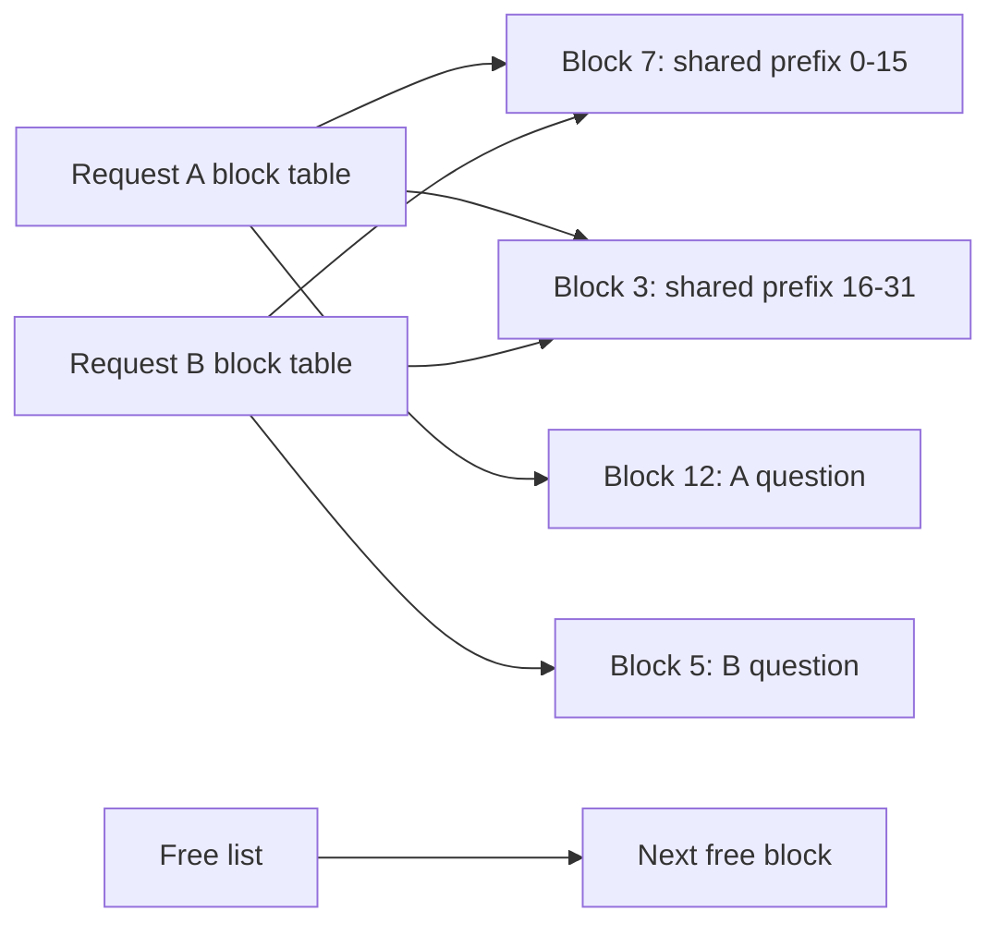

A support team wants to serve the HelpDesk assistant — 1,024-token prompts of which 768 are a shared system prompt and tool schema, 256-token answers, a peak of 10 requests a second, p99 TTFT ≤ 500 ms and mean TPOT ≤ 50 ms — with Gemma 3 12B on AWS g6e (one NVIDIA L40S, 48 GB). In bf16 the weights alone are 23.53 GB, almost half the card. Chapter 6's techniques each attack a different cost: quantisation shrinks the weight bytes read on every decode step, continuous batching shares that read across many sequences, paged attention stops the KV cache from wasting the memory those sequences need, and prefix caching skips the 768 tokens every request has in common. This page derives what each one buys and ends with the half the repository's lab does not measure: quality.

:::key[First principle]
Every decode step reads every weight once and every live KV byte once, so decode time is bytes ÷ bandwidth until the batch is very large. Shrinking bytes (quantisation) buys speed; sharing and packing them (batching, prefix caching, paging) buys concurrent sequences. Prefill is the opposite — FLOPs, not bytes — and the cheapest prefill is the one you skip.
:::

## 8.1 What the repository measures

**Covers:** request batching and scheduling, scalable attention and kernel fusion, model compression (quantisation, distillation, pruning), prefix caching and RadixAttention.

**In the repository:** `ch06/quantization_3way_300.ipynb` — one model, three precisions, one benchmark script, a concurrency sweep, four charts. The notebook uses a different open-weight model; this guide re-derives the numbers on Gemma 3 so they stay consistent across the course.

| Run | Precision | What is quantised |
| --- | --- | --- |
| 1 | fp16 | Nothing — the baseline checkpoint |
| 2 | GPTQ int4 | Weights only, 4 bits with per-group scales; activations and KV stay 16-bit |
| 3 | FP8-dynamic | Weights to 8-bit float offline; activation scales computed per token at run time, so no calibration set |

Each run is the same four steps: start `vllm serve` in the background with `--disable-log-requests`, wait until it answers, benchmark it, then `pkill -f "vllm serve"` and confirm it is gone. The benchmark is the script bundled with vLLM itself — the notebook pins `vllm==0.8.5.post1` and clones the vLLM repository to get `benchmarks/benchmark_serving.py` — run on ShareGPT prompts:

```bash
!python3 {benchmark_script} \
  --backend vllm --model {hf_model_id} --endpoint /v1/completions \
  --dataset-name sharegpt --dataset-path ShareGPT_V3_unfiltered_cleaned_split.json \
  --num-prompts 100 --max-concurrency 100 \
  --save-result --append-result --result-filename vllm_bench.json
```

The sweep repeats this at `--max-concurrency` 1, 10 and 100 for each precision. `--append-result` adds each run to the same JSON file instead of overwriting it, so all nine runs (three precisions × three concurrencies) land in one place, and the final cells load that file and draw four comparison charts.

What the notebook does not contain: a summary table, any evaluation of output quality (§8.7), and labs for distillation or pruning. The chapter covers those two, but they need a training loop; quantisation applies to a checkpoint you downloaded.

## 8.2 Bytes per weight set the decode floor and the KV pool

Gemma 3 12B has \(N = 11.765\)B text parameters: \(N_{\text{body}} = 10.758\)B in the 48 transformer layers and \(N_{\text{emb}} = 1.007\)B in the tied embedding, which every scheme here keeps in bf16. With \(b\) bits per body weight:

$$
W = N_{\text{body}}\,\frac{b}{8} + 2\,N_{\text{emb}},
\qquad
t_{\text{floor}} = \frac{W}{\text{BW}},
\qquad
\text{KV pool} = 0.90 \times 46{,}068\ \text{MiB} - W - \text{reserve}.
$$

int4 with group size 128 stores a 16-bit scale and a 16-bit zero point per 128 weights, so \(b = 4 + 32/128 = 4.25\). FP8 adds one scale per output channel, which is negligible. A decode step stays memory-bound until the matmul FLOPs, \(2 N_{\text{body}}\) per sequence, take as long as the weight read:

$$
B_{\text{ridge}} = \frac{W/\text{BW}}{2\,N_{\text{body}}/\text{PEAK}} .
$$

```python run
"""Gemma 3 12B on one L40S: bytes per precision -> decode floor -> KV pool -> max concurrency."""
GiB, MiB = 2**30, 2**20
L, N_GLOBAL, KV_HEADS, HEAD_DIM, WINDOW = 48, 8, 8, 256, 1024
EMB = 262_208 * 3840                 # tied embedding, kept bf16 in every scheme
BODY = 10_758_389_760                # attention + MLP weights of the 48 layers
BW, PEAK = 864e9, 362e12             # L40S spec: bytes/s, dense bf16 FLOP/s
POOL_BUDGET = 46_068 * MiB * 0.90 - 2 * GiB   # gpu_memory_utilization 0.9, 2 GiB reserve
SEQ = 1024 + 256                     # HelpDesk prompt + output

kv_layer_tok = 2 * KV_HEADS * HEAD_DIM * 2          # K and V, bf16, one layer, one token
kv_full = L * kv_layer_tok * SEQ                     # every layer keeps every token
kv_window = (N_GLOBAL * SEQ + (L - N_GLOBAL) * min(SEQ, WINDOW)) * kv_layer_tok
print(f"KV per HelpDesk sequence ({SEQ} tok): all layers {kv_full / MiB:.0f} MiB,"
      f" window-aware {kv_window / MiB:.0f} MiB")
print()
print(f"{'scheme':>8} {'bits':>5} {'weights GB':>10} {'GiB':>6} {'floor ms':>8} "
      f"{'ridge B':>7} {'KV pool GiB':>11} {'max seqs':>9}")
for name, bits in (("bf16", 16), ("FP8", 8), ("int4g128", 4 + 32 / 128)):
    w = BODY * bits / 8 + EMB * 2
    floor = w / BW * 1e3
    ridge_b = (w / BW) / (2 * BODY / PEAK)          # batch where weight reads = matmul time
    pool = POOL_BUDGET - w
    seqs = f"{int(pool // kv_full)}-{int(pool // kv_window)}"
    print(f"{name:>8} {bits:5.2f} {w / 1e9:10.2f} {w / GiB:6.2f} {floor:8.1f} "
          f"{ridge_b:7.0f} {pool / GiB:11.2f} {seqs:>9}")
```

```output
KV per HelpDesk sequence (1280 tok): all layers 480 MiB, window-aware 400 MiB

  scheme  bits weights GB    GiB floor ms ridge B KV pool GiB  max seqs
    bf16 16.00      23.53  21.91     27.2     458       16.57     35-42
     FP8  8.00      12.77  11.89     14.8     249       26.59     56-68
int4g128  4.25       7.73   7.20      8.9     151       31.29     66-80
```

:::example[Worked example · int4 g128 on one L40S]
- **Weights:** \(10.758 \times 4.25/8 = 5.72\) GB of body plus \(2 \times 1.007 = 2.01\) GB of embedding = **7.73 GB** (7.20 GiB).
- **Floor:** 7.73 GB ÷ 864 GB/s = **8.9 ms** per token at batch 1, against 27.2 ms in bf16 — 3.0× from bytes alone.
- **KV pool:** \(0.90 \times 46{,}068\) MiB = 40.49 GiB, minus 7.20 GiB of weights, minus a 2 GiB activation and CUDA-graph reserve (illustrative) = **31.29 GiB**.
- **Sequences:** a HelpDesk sequence holds 1,280 tokens × 384 KiB = 480 MiB if every layer keeps every token, so 31.29 GiB ÷ 480 MiB = **66**. If the engine trims the 40 sliding-window layers to their last 1,024 tokens it is 400 MiB and **80**. Which one you get depends on the engine — read the KV-cache size line in the server's startup log.
:::

Two consequences shape the rest of the page. The ridge batch is 151–458 sequences, far beyond the 35–80 the KV pool can hold, so for this workload **decode is memory-bound at every batch that fits**. And weight-only quantisation does not touch the KV cache: int4 nearly doubles the pool (16.57 → 31.29 GiB) only because the weights got out of the way.

## 8.3 The concurrency sweep: where quantisation's win goes

At batch \(B\) a decode step reads the weights once and each sequence's KV once. Attention on the 40 local layers reaches back only 1,024 tokens, so at the mean decode context of 1,152 tokens (the 1,024-token prompt plus half the answer) each sequence reads

$$
K_{\text{read}} = (8 \times 1{,}152 + 40 \times 1{,}024) \times 8\ \text{KiB} = 411\ \text{MB},
\qquad
\text{TPOT}(B) \approx \max\!\left(\frac{W + B\,K_{\text{read}}}{\text{BW}},\ \frac{2 N_{\text{body}}\,B}{\text{PEAK}}\right),
$$

where 8 KiB is one layer's K and V for one token (\(2 \times 8\) heads \(\times\, 256 \times 2\) bytes). The model below also adds an FP8 KV cache, which halves both \(K_{\text{read}}\) and the memory each sequence holds. A dash means the KV pool cannot hold that many sequences (all-layers allocation, the conservative bound).

```python run
"""Decode step time vs concurrency for Gemma 3 12B on one L40S (roofline model)."""
GiB, MiB = 2**30, 2**20
BODY, EMB = 10_758_389_760, 262_208 * 3840
BW, PEAK = 864e9, 362e12
POOL_BUDGET = 46_068 * MiB * 0.90 - 2 * GiB
LAYER_TOK = 2 * 8 * 256 * 2                          # bf16 K+V bytes, one layer, one token
CTX = 1024 + 128                                     # mean context while decoding 256 tokens
KV_READ = (8 * CTX + 40 * min(CTX, 1024)) * LAYER_TOK  # bytes attention reads per sequence/step
KV_HOLD = 48 * 1280 * LAYER_TOK                       # allocation, all layers full (upper bound)

CONFIGS = {  # name: (weight bytes, KV bytes multiplier)
    "bf16": (BODY * 2 + EMB * 2, 1.0),
    "FP8": (BODY * 1 + EMB * 2, 1.0),
    "int4": (BODY * 4.25 / 8 + EMB * 2, 1.0),
    "int4 + FP8 KV": (BODY * 4.25 / 8 + EMB * 2, 0.5),
}


def tpot(b, w, kvm):
    mem = (w + b * KV_READ * kvm) / BW
    flops = b * 2 * BODY / PEAK
    return max(mem, flops)


max_b = {k: int((POOL_BUDGET - w) // (KV_HOLD * m)) for k, (w, m) in CONFIGS.items()}
print(f"KV read per sequence per step: {KV_READ / 1e6:.0f} MB")
print(f"decode ceiling as B grows: bf16 KV {BW / KV_READ:.0f} tok/s, FP8 KV {2 * BW / KV_READ:.0f} tok/s")
print("max concurrent sequences: " + ", ".join(f"{k} {v}" for k, v in max_b.items()))
print()
print("B, " + ", ".join(f"{k} TPOT ms" for k in CONFIGS))
grid = sorted({1, 4, 10, 16, 32, 48, 64, 100, *max_b.values()})
for b in grid:
    cells = [f"{tpot(b, w, m) * 1e3:.1f}" if b <= max_b[k] else "-" for k, (w, m) in CONFIGS.items()]
    print(f"{b}, " + ", ".join(cells))
print()
print("B, " + ", ".join(f"{k} tok/s" for k in CONFIGS))
for b in grid:
    cells = [f"{b / tpot(b, w, m):.0f}" if b <= max_b[k] else "-" for k, (w, m) in CONFIGS.items()]
    print(f"{b}, " + ", ".join(cells))
```

```output
KV read per sequence per step: 411 MB
decode ceiling as B grows: bf16 KV 2102 tok/s, FP8 KV 4204 tok/s
max concurrent sequences: bf16 35, FP8 56, int4 66, int4 + FP8 KV 133

B, bf16 TPOT ms, FP8 TPOT ms, int4 TPOT ms, int4 + FP8 KV TPOT ms
1, 27.7, 15.3, 9.4, 9.2
4, 29.1, 16.7, 10.8, 9.9
10, 32.0, 19.5, 13.7, 11.3
16, 34.8, 22.4, 16.6, 12.8
32, 42.5, 30.0, 24.2, 16.6
35, 43.9, 31.4, 25.6, 17.3
48, -, 37.6, 31.8, 20.4
56, -, 41.4, 35.6, 22.3
64, -, -, 39.4, 24.2
66, -, -, 40.3, 24.6
100, -, -, -, 32.7
133, -, -, -, 40.6

B, bf16 tok/s, FP8 tok/s, int4 tok/s, int4 + FP8 KV tok/s
1, 36, 66, 106, 109
4, 137, 240, 369, 404
10, 313, 512, 730, 883
16, 459, 714, 966, 1255
32, 754, 1066, 1324, 1933
35, 798, 1113, 1367, 2026
48, -, 1276, 1510, 2357
56, -, 1352, 1574, 2515
64, -, -, 1625, 2648
66, -, -, 1636, 2678
100, -, -, -, 3055
133, -, -, -, 3277
```

:::chart[Decode TPOT vs concurrency — Gemma 3 12B, one L40S (roofline model)]{type="line" x="concurrent sequences B" y="TPOT" unit=" ms" yfmt="dec1" hmarks="50:TPOT SLO" marks="10:notebook 10;100:notebook 100" note="Lines end where the KV pool (all layers, 1,280 tokens per sequence) is full."}
B, bf16, FP8, int4, int4 + FP8 KV
1, 27.7, 15.3, 9.4, 9.2
4, 29.1, 16.7, 10.8, 9.9
10, 32.0, 19.5, 13.7, 11.3
16, 34.8, 22.4, 16.6, 12.8
32, 42.5, 30.0, 24.2, 16.6
35, 43.9, 31.4, 25.6, 17.3
48, -, 37.6, 31.8, 20.4
56, -, 41.4, 35.6, 22.3
64, -, -, 39.4, 24.2
66, -, -, 40.3, 24.6
100, -, -, -, 32.7
133, -, -, -, 40.6
:::

:::chart[Decode throughput vs concurrency — the KV read sets the ceiling]{type="line" x="concurrent sequences B" y="output tokens per second" yfmt="int" hmarks="2560:HelpDesk peak need (10 × 256)" note="Decode only; prefill time not included. bf16-KV lines approach 2,102 tok/s however the weights are stored."}
B, bf16, FP8, int4, int4 + FP8 KV
1, 36, 66, 106, 109
4, 137, 240, 369, 404
10, 313, 512, 730, 883
16, 459, 714, 966, 1255
32, 754, 1066, 1324, 1933
35, 798, 1113, 1367, 2026
48, -, 1276, 1510, 2357
56, -, 1352, 1574, 2515
64, -, -, 1625, 2648
66, -, -, 1636, 2678
100, -, -, -, 3055
133, -, -, -, 3277
:::

Read the two charts together and the notebook's three concurrency levels stop being arbitrary:

| `--max-concurrency` | What dominates the bytes read per step (int4) | int4 vs bf16 TPOT | What the run really measures |
| ---: | --- | ---: | --- |
| 1 | Weights: 7.73 GB vs 0.41 GB of KV | 9.4 vs 27.7 ms (2.9×) | Weight bytes — quantisation's best case |
| 10 | Weights still lead: 7.73 GB vs \(10 \times 0.411\) = 4.1 GB | 13.7 vs 32.0 ms (2.3×) | A mix of weights and KV |
| 100 | KV: \(100 \times 0.411\) = 41 GB; only the FP8-KV configuration even fits | — | KV capacity and the scheduler |

KV reads overtake int4 weights at \(B = 7.73 / 0.411 \approx 19\). Past that point weight quantisation has done its job, and the remaining lever is the KV cache: as \(B\) grows, decode throughput approaches \(\text{BW}/K_{\text{read}}\) = 2,102 tokens/s whatever precision the weights are in. An FP8 KV cache doubles both that ceiling (4,204) and the number of sequences that fit (66 → 133). Weight quantisation's real gift at high load is capacity: int4 runs 66 sequences at 1,636 tokens/s where bf16 tops out at 35 sequences and 798 tokens/s.

:::warn[A concurrency the pool cannot hold looks like latency, not an error]
If the KV pool holds fewer sequences than `--max-concurrency`, a vLLM-style scheduler queues or preempts the rest. The benchmark does not fail; TTFT climbs. A run at concurrency 100 on a model that fits 66 sequences is measuring the queue.
:::

## 8.4 Quantisation error, from a random matrix

Round-to-nearest (RTN) asymmetric int4 maps each group of \(g\) weights onto 16 levels between its own minimum and maximum:

$$
s = \frac{\max - \min}{15}, \qquad q = \operatorname{round}\!\left(\frac{w - \min}{s}\right), \qquad \hat w = q\,s + \min, \qquad \text{RMS error} \approx \frac{s}{\sqrt{12}} .
$$

The error scales with the group's range. The largest of \(g\) Gaussian draws grows like \(\sigma\sqrt{2 \ln g}\), so bigger groups mean a wider range and coarser steps; and a single outlier stretches the range for every weight in its group. Measure both effects on a 1,024 × 4,096 Gaussian matrix, with and without 0.1% of weights scaled 20× to mimic outliers, against FP8 E4M3 with one scale per row:

```python run
"""Round-to-nearest int4 with group scales on a random Gaussian weight matrix."""
import numpy as np

rng = np.random.default_rng(0)
W = rng.standard_normal((1024, 4096)).astype(np.float32) * 0.02
X = rng.standard_normal((4096, 64)).astype(np.float32)
W_out = W.copy()
idx = rng.choice(W.size, W.size // 1000, replace=False)   # 0.1% outlier weights
W_out.flat[idx] *= 20


def int4_rtn(w, g):
    """Asymmetric 4-bit, one (scale, zero) pair per g consecutive input weights."""
    r = w.reshape(w.shape[0], -1, g)
    lo, hi = r.min(-1, keepdims=True), r.max(-1, keepdims=True)
    s = (hi - lo) / 15
    q = np.clip(np.round((r - lo) / s), 0, 15)
    return (q * s + lo).reshape(w.shape)


def fp8_e4m3(w):
    """FP8 E4M3 with one scale per output row: 3 mantissa bits, max 448."""
    s = np.abs(w).max(1, keepdims=True) / 448
    y = w / s
    m, e = np.frexp(y)
    yq = np.where(np.abs(y) >= 2.0**-6, np.ldexp(np.round(m * 16) / 16, e), np.round(y * 512) / 512)
    return np.clip(yq, -448, 448) * s


def rel(a, b):
    return np.linalg.norm(a - b) / np.linalg.norm(a)


print(f"{'scheme':>16} {'bits/weight':>11} {'weight err':>10} {'output err':>10} {'with outliers':>13}")
for g in (32, 64, 128, 256, 1024, 4096):
    q, qo = int4_rtn(W, g), int4_rtn(W_out, g)
    print(f"{'int4 g' + str(g):>16} {4 + 32 / g:11.3f} {rel(W, q):10.2%} "
          f"{rel(W @ X, q @ X):10.2%} {rel(W_out @ X, qo @ X):13.2%}")
q, qo = fp8_e4m3(W), fp8_e4m3(W_out)
print(f"{'fp8 e4m3 / row':>16} {8 + 16 / 4096:11.3f} {rel(W, q):10.2%} "
      f"{rel(W @ X, q @ X):10.2%} {rel(W_out @ X, qo @ X):13.2%}")
```

```output
          scheme bits/weight weight err output err with outliers
        int4 g32       5.000      7.82%      7.79%         9.00%
        int4 g64       4.500      8.97%      8.90%        11.66%
       int4 g128       4.250      9.98%      9.95%        15.13%
       int4 g256       4.125     10.90%     10.89%        20.18%
      int4 g1024       4.031     12.52%     12.50%        37.76%
      int4 g4096       4.008     13.97%     13.96%        73.06%
  fp8 e4m3 / row       8.004      2.65%      2.63%         2.40%
```

:::chart[Relative output error of y = Wx after round-to-nearest quantisation]{type="bar" x="scheme" y="relative output error" unit="%" yfmt="dec1" labels="true"}
scheme, Gaussian weights, with 0.1% outliers (20×)
int4 g32, 7.79, 9.00
int4 g64, 8.90, 11.66
int4 g128, 9.95, 15.13
int4 g256, 10.89, 20.18
int4 g1024, 12.50, 37.76
int4 per row, 13.96, 73.06
FP8 per row, 2.63, 2.40
:::

- **Groups matter most when weights have outliers.** On Gaussian weights, going from one scale per row (g4096) to g128 cuts the output error from 13.96% to 9.95% for 0.24 extra bits per weight. With outliers the same step goes from 73.06% to 15.13%. That is why every int4 format in serving use is group-wise, and g128 is the usual compromise.
- **FP8 barely notices outliers** (2.63% → 2.40%): a floating-point format spends bits on the exponent, so relative precision is the same at every magnitude. It also runs on the L40S's FP8 tensor-core mode, so FP8 weights plus FP8 activations can cut prefill FLOP time too, whereas int4 weight-only kernels dequantise to 16-bit and help decode (bytes) but not prefill (FLOPs).
- **RTN is the worst sensible quantiser.** GPTQ uses a calibration set to choose roundings that minimise each layer's output error, compensating every rounding with the weights not yet quantised; AWQ rescales the input channels that see large activations before rounding. Both target the layer output, not the weight. Google also publishes quantisation-aware-trained (QAT) int4 Gemma 3 checkpoints, where the model was trained to tolerate the rounding — the natural starting point if you need int4.

None of this tells you whether the model still answers HelpDesk tickets correctly. Only an evaluation does (§8.7).

## 8.5 Continuous batching and paged attention

**Static batching** forms a batch, runs it until the longest output finishes, then forms the next. Every slot whose sequence finished early idles. **Continuous batching** (iteration-level scheduling) re-forms the batch at every decode step: finished sequences leave, waiting ones join, and occupancy is limited by the queue rather than the longest answer.

**Paged attention** stores KV in fixed-size blocks — 16 tokens is vLLM's usual default — and gives each sequence a block table mapping its logical blocks to physical ones, like virtual-memory pages. A sequence wastes less than one block, about \((b-1)/2\) tokens on average, instead of everything it reserved but did not use. Shared blocks are reference-counted, which is what prefix caching (§8.6) builds on.



Compare allocation schemes on 100,000 HelpDesk-shaped requests (illustrative length distribution: 768 shared tokens plus an exponential question of mean 256, exponential answers of mean 256 capped by `max_tokens` = 1,024), each caught at a random point mid-answer, in the 31.29 GiB int4 pool:

```python run
"""KV memory reserved vs used: contiguous preallocation vs paged blocks (HelpDesk traffic)."""
import numpy as np

rng = np.random.default_rng(42)
n = 100_000
prompt = 768 + np.clip(rng.exponential(256, n), 16, 3000).astype(int)    # shared 768 + question
out_len = np.clip(rng.exponential(256, n), 1, 1024).astype(int)          # max_tokens = 1024
used = prompt + (rng.random(n) * out_len).astype(int)                    # snapshot mid-generation
KV_TOK = 393_216                                                         # Gemma 3 12B, bf16, all layers
POOL = 31.29 * 2**30                                                     # int4 weights on L40S


def report(name, reserved):
    waste = 1 - used.sum() / reserved.sum()
    seqs = POOL / (reserved.mean() * KV_TOK)
    print(f"{name:>32} {reserved.mean():9.0f} {waste:8.1%} {seqs:9.0f}")


print(f"mean prompt {prompt.mean():.0f}, mean output {out_len.mean():.0f}, "
      f"mean tokens held at snapshot {used.mean():.0f}")
print(f"{'allocation':>32} {'tok/seq':>9} {'waste':>8} {'max seqs':>9}")
report("contiguous, max_model_len 8192", np.full(n, 8192))
report("contiguous, prompt + max_tokens", prompt + 1024)
for b in (256, 128, 32, 16):
    report(f"paged, block {b}", np.ceil(used / b) * b)
report("ideal (no waste)", used.astype(float))
for size in (8, 32):
    batches = out_len[: n - n % size].reshape(-1, size)
    print(f"static batch of {size:2d}: {batches.sum() / (size * batches.max(1)).sum():.0%} of slot-steps "
          "produce a token (the rest wait for the longest output)")
```

```output
mean prompt 1025, mean output 250, mean tokens held at snapshot 1149
                      allocation   tok/seq    waste  max seqs
  contiguous, max_model_len 8192      8192    86.0%        10
 contiguous, prompt + max_tokens      2049    43.9%        42
                paged, block 256      1281    10.3%        67
                paged, block 128      1213     5.3%        70
                 paged, block 32      1165     1.3%        73
                 paged, block 16      1157     0.6%        74
                ideal (no waste)      1149     0.0%        74
static batch of  8: 38% of slot-steps produce a token (the rest wait for the longest output)
static batch of 32: 28% of slot-steps produce a token (the rest wait for the longest output)
```

:::chart[Concurrent HelpDesk sequences that fit in a 31.29 GiB KV pool]{type="bar" x="allocation" y="sequences" yfmt="int" labels="true"}
allocation, sequences
contiguous 8192, 10
prompt + max_tokens, 42
paged b256, 67
paged b128, 70
paged b32, 73
paged b16, 74
:::

- **Contiguous allocation at the model's context length wastes 86%** and fits 10 sequences. Reserving only prompt + `max_tokens` still wastes 43.9% (42 sequences), because the average answer is a quarter of its cap.
- **Paging with 16-token blocks wastes 0.6%** and fits 74 — 7.4× the naive scheme, with no change to the model. Larger blocks mean fewer table entries and longer contiguous reads per block; 256-token blocks already waste 10.3%.
- **Static batching keeps 38% of slots busy** at batch 8 and 28% at batch 32: with skewed answer lengths, most slots wait for one long answer. Continuous batching recovers that time.
- The 74 here and the 66 in §8.2 measure different moments: §8.2 sizes every sequence at its final 1,280 tokens, this snapshot catches sequences mid-answer (1,149 tokens held on average). A live server sits between the two.

## 8.6 Prefix caching: 768 tokens every request already paid for

Prefix caching hashes each full KV block together with everything before it. A new request whose leading blocks match reuses those physical blocks (reference-counted) and starts prefill at the first miss. The 768-token HelpDesk prefix is exactly 48 blocks of 16. SGLang's RadixAttention reaches the same result with a radix tree over token sequences. Prefill cost for positions \(n_0\) to \(n_1\) is the matmul FLOPs plus attention over each position's visible context:

$$
F(n_0, n_1) = (n_1 - n_0)\,2N_{\text{body}} + \sum_{i=n_0}^{n_1-1} 4 \cdot 16 \cdot 256 \cdot \big(8\,(i+1) + 40\min(i+1,\ 1{,}024)\big).
$$

The script below then asks the question the team actually has: can one L40S, or two, serve 10 req/s within the SLO? It treats prefill as stealing a share \(\rho\) of GPU time from decode at an illustrative 50% MFU, and solves Little's law, \(B = \lambda\,(\text{TTFT} + 255\,\text{TPOT}(B))\), for the concurrency the load creates.

```python run
"""Prefix caching for HelpDesk on L40S: prefill compute, KV sharing, and the 10 req/s check."""
GiB, MiB = 2**30, 2**20
BODY, EMB = 10_758_389_760, 262_208 * 3840
BW, PEAK, MFU = 864e9, 362e12, 0.5          # MFU 0.5 is ILLUSTRATIVE
RATE, PROMPT, PREFIX, OUT = 10, 1024, 768, 256
W = BODY * 4.25 / 8 + EMB * 2               # int4 g128 weights
POOL = 46_068 * MiB * 0.90 - 2 * GiB - W
LAYER_TOK = 2 * 8 * 256 * 2


def prefill_flops(start, end):
    """Matmul + attention FLOPs to prefill positions start..end-1 (16 q-heads x 256 dims)."""
    att = sum(8 * (i + 1) + 40 * min(i + 1, 1024) for i in range(start, end)) * 4 * 16 * 256
    return (end - start) * 2 * BODY + att


def tpot(b, kvm):
    ctx = PROMPT + OUT // 2
    kv_read = (8 * ctx + 40 * min(ctx, 1024)) * LAYER_TOK * kvm
    return max((W + b * kv_read) / BW, b * 2 * BODY / PEAK)


for cached in (False, True):
    f = prefill_flops(PREFIX if cached else 0, PROMPT)
    print(f"prefix cache {'on ' if cached else 'off'}: {f / 1e12:4.1f} TFLOP/request; "
          f"{RATE * f / 1e12:3.0f} TFLOP/s at {RATE} req/s = {RATE * f / PEAK:3.0%} of peak; "
          f"{f / (PEAK * MFU) * 1e3:3.0f} ms at MFU {MFU}")
print()
print(f"{'config':>24} {'GPUs':>4} {'KV/seq MiB':>10} {'max seqs':>8} {'prefill busy':>12} "
      f"{'B':>4} {'TPOT ms':>7}  verdict")
for name, cached, kvm in (("bf16 KV, no prefix cache", False, 1.0),
                          ("bf16 KV, prefix cache", True, 1.0),
                          ("FP8 KV, prefix cache", True, 0.5)):
    per_seq = 48 * (PROMPT + OUT - (PREFIX if cached else 0)) * LAYER_TOK * kvm
    max_seqs = int((POOL - (48 * PREFIX * LAYER_TOK * kvm if cached else 0)) // per_seq)
    for gpus in (1, 2):
        rate = RATE / gpus
        rho = rate * prefill_flops(PREFIX if cached else 0, PROMPT) / (PEAK * MFU)
        b, t, verdict = 1.0, None, "prefill saturates the GPU"
        if rho < 1:
            for _ in range(500):  # Little's law: B = rate x (TTFT + (OUT - 1) x TPOT)
                b = rate * (rho / rate + (OUT - 1) * tpot(b, kvm) / (1 - rho))
            if b > 10 * max_seqs:
                verdict = "decode cannot keep up"
            else:
                t = tpot(b, kvm) / (1 - rho) * 1e3
                verdict = ("KV pool too small" if b > max_seqs else
                           "misses TPOT SLO" if t > 50 else "OK")
        bs, ts = (f"{b:.0f}", f"{t:.1f}") if t else ("-", "-")
        print(f"{name:>24} {gpus:4d} {per_seq / MiB:10.0f} {max_seqs:8d} {rho:12.0%} "
              f"{bs:>4} {ts:>7}  {verdict}")
```

```output
prefix cache off: 22.4 TFLOP/request; 224 TFLOP/s at 10 req/s = 62% of peak; 124 ms at MFU 0.5
prefix cache on :  5.7 TFLOP/request;  57 TFLOP/s at 10 req/s = 16% of peak;  31 ms at MFU 0.5

                  config GPUs KV/seq MiB max seqs prefill busy    B TPOT ms  verdict
bf16 KV, no prefix cache    1        480       66         124%    -       -  prefill saturates the GPU
bf16 KV, no prefix cache    2        480       66          62%    -       -  decode cannot keep up
   bf16 KV, prefix cache    1        192      165          31%    -       -  decode cannot keep up
   bf16 KV, prefix cache    2        192      165          16%   49    38.2  OK
    FP8 KV, prefix cache    1         96      332          31%  291   114.0  misses TPOT SLO
    FP8 KV, prefix cache    2         96      332          16%   21    16.6  OK
```

:::example[Worked example · what the shared prefix is worth]
- **Compute.** Without the cache, prefill at 10 req/s needs 224 TFLOP/s — 62% of the L40S's dense bf16 peak before a single token is decoded. At the illustrative 50% MFU that is 124% of the GPU. With the cache only the 256 new tokens are computed: 5.7 TFLOP per request, 31 ms, 16% of peak.
- **Memory.** The 768 shared tokens are stored once, so each sequence holds 512 tokens of its own: 192 MiB instead of 480 MiB, and the int4 pool fits 165 sequences instead of 66.
- **Verdict.** One L40S cannot serve the HelpDesk peak in any configuration modelled: with a bf16 KV cache the decode ceiling (2,102 tokens/s, less the time prefill takes) is below the 2,560 tokens/s needed, and with FP8 KV it keeps up only at 291 concurrent sequences and 114 ms TPOT. Two L40S at 5 req/s each pass — 38.2 ms TPOT with bf16 KV, 16.6 ms with FP8 KV — and only with prefix caching on.
:::

:::warn[What silently breaks a prefix cache]
A timestamp, user name or request id at the top of the system prompt; tool schemas serialised in nondeterministic key order; a template change that moves one whitespace character. Each makes the hash differ from the first block, and every request pays the full 22.4 TFLOP prefill again. Put variable content after the shared part, and watch the prefix-cache hit rate the server reports. Chapter 9's prefix-repetition workload exists to isolate exactly this effect.
:::

## 8.7 Quality evaluation: the missing half

The notebook measures speed. Whether the int4 model still writes correct tool calls is a separate measurement, and it needs more examples than people expect. For an illustrative bf16 tool-call accuracy of 0.90, the number of examples per model to detect a drop with a two-sided test at 5% significance and 80% power:

```python run
from statistics import NormalDist

z = NormalDist().inv_cdf


def n_per_model(p1, p2, alpha=0.05, power=0.80):
    """Examples per model to detect p1 -> p2 with a two-sided test on two independent samples."""
    return (z(1 - alpha / 2) + z(power)) ** 2 * (p1 * (1 - p1) + p2 * (1 - p2)) / (p1 - p2) ** 2


BASE = 0.90                       # bf16 tool-call accuracy: ILLUSTRATIVE
for drop in (0.10, 0.05, 0.02, 0.01):
    print(f"detect {BASE:.2f} -> {BASE - drop:.2f}: {n_per_model(BASE, BASE - drop):6.0f} examples per model")
```

```output
detect 0.90 -> 0.80:    196 examples per model
detect 0.90 -> 0.85:    683 examples per model
detect 0.90 -> 0.88:   3838 examples per model
detect 0.90 -> 0.89:  14748 examples per model
```

A 200-example spot check only catches a 10-point collapse. Running both models on the *same* prompts and comparing them pairwise helps, because only the examples where they disagree carry information — another reason to start with greedy decoding.

- [ ] Freeze an evaluation set drawn from real HelpDesk traffic, with references or a rubric, before choosing a precision.
- [ ] Greedy-decode bf16 and the candidate on identical prompts, chat template and engine version; record the share of outputs that differ and where they first diverge.
- [ ] Score the task, not perplexity: tool-call exact match, JSON-schema validity, answer correctness, refusal rate — each with a confidence interval.
- [ ] Slice by what quantisation hurts first: long contexts near the limit, numbers and arithmetic, code, non-English text.
- [ ] Use perplexity on held-out in-domain text only as a cheap first screen.
- [ ] Fix the acceptance margin before you see results, and re-run the evaluation on every engine upgrade — kernels change numerics.

| Choice on one L40S | Weights | Floor | Sequences (all-layers KV) | Use when |
| --- | ---: | ---: | ---: | --- |
| bf16 | 23.53 GB | 27.2 ms | 35 | Quality reference; the baseline every other row is evaluated against |
| FP8 | 12.77 GB | 14.8 ms | 56 | First step: 2.6% RTN error in §8.4, no calibration, FP8 tensor cores help prefill |
| int4 g128 | 7.73 GB | 8.9 ms | 66 | Low-concurrency latency or memory pressure; evaluate first, prefer a QAT checkpoint |
| int4 + FP8 KV | 7.73 GB | 8.9 ms | 133 | High concurrency, where KV bytes dominate (B above about 19) |

## 8.8 Check yourself

:::qa[Why does int4's TPOT advantage over bf16 fall from 2.9× at B = 1 to 1.76× at B = 32?]
At B = 1 a step reads 7.73 GB of int4 weights against 23.53 GB of bf16 weights plus 0.41 GB of KV, so the ratio is close to the weight ratio. At B = 32 both read \(32 \times 0.411\) = 13.2 GB of KV, which weight quantisation does not shrink: (23.53 + 13.2) / (7.73 + 13.2) ≈ 1.76.
:::

:::qa[The team raises max_model_len to 32,768 and the engine allocates contiguously. How many HelpDesk sequences fit in the int4 pool?]
Each sequence reserves 32,768 × 384 KiB = 12 GiB, and 31.29 GiB ÷ 12 GiB = 2.6, so 2. With 16-token paging the context limit does not change the allocation: still about 74 at the §8.5 snapshot.
:::

:::qa[A product manager adds the current time, to the second, as the first line of the system prompt. What does it cost?]
The first block's hash now differs between almost any two requests, and nothing after a mismatch can be reused, so every request prefills all 1,024 tokens: 22.4 TFLOP instead of 5.7, 62% of the GPU's peak at 10 req/s, and 480 MiB of KV per sequence instead of 192. Moving the timestamp after the 768 shared tokens keeps all 48 shared blocks.
:::

:::qa[You move from int4 g128 to g64 to reduce error. What does it cost in bytes and decode floor?]
Bits per weight go from 4.25 to 4.5: \(10.758 \times 4.5/8 = 6.05\) GB of body + 2.01 GB of embedding = 8.07 GB, so the floor rises from 8.9 to about 9.3 ms. In the §8.4 test, Gaussian-weight output error falls from 9.95% to 8.90%; with outliers, from 15.13% to 11.66%.
:::

:::qa[What does --append-result give the notebook, and why does it matter for the sweep?]
Each run appends its metrics to the same JSON file rather than overwriting it, so nine runs — three precisions at concurrency 1, 10 and 100 — sit in one file that the plotting cells read. Without it you compare whichever run happened last.
:::

Next: [Chapter 7 — Advanced techniques](/c/llm-serving/09-advanced-techniques).
