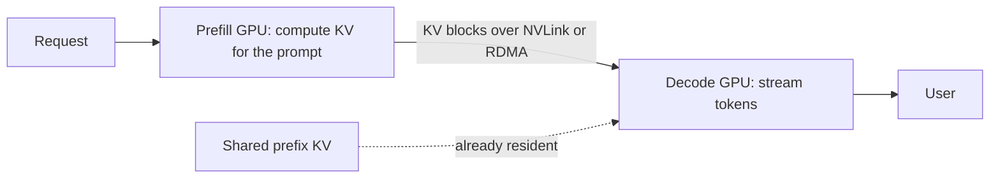

**Covers:** speculative decoding, multi-GPU and multinode inference, prefill–decode disaggregation, advanced KV caching for long context.

The HelpDesk team has moved its escalation tier to Gemma 3 27B, quantised to int4 so it fits one L40S. At batch 1 every token costs a full read of 16.42 GB of weights plus the sequence's KV — about 19.6 ms — while the tensor cores sit almost idle. Meanwhile the 768-token shared prefix is evicted whenever the server restarts, and long document-QA prompts stall every decoding user for a tenth of a second at a time. Chapter 7's three techniques each spend a resource that is idle to save one that is scarce. This page derives the exchange rate for each, so you can tell from a spec sheet whether the trade is worth making.

:::key[First principle]
Each advanced technique trades an idle resource for a scarce one. Speculative decoding spends idle compute to cut memory-bound decode steps — so it pays only while decode is memory-bound. A KV tier spends link bandwidth to skip prefill FLOPs — so it pays only when the link moves the KV faster than the GPU can recompute it. Disaggregation spends network bandwidth to keep prefill from stalling decode — so it pays only when those stalls break the SLO.
:::

## 9.1 What the repository contains

Two notebooks in `ch07/`, both of which measure something that only pays off under specific conditions.

| Notebook | What it varies | What it measures |
| --- | --- | --- |
| `ch07/SpecDecode.ipynb` | Four configurations of one target model: vanilla vLLM (no speculation), n-gram, a tuned n-gram, and EAGLE-3 (a trained draft head) | Spec-Bench (cloned from `hemingkx/Spec-Bench`) at concurrency 1; the server is torn down and restarted between runs, GPU state checked with `nvidia-smi`, results summarised with numpy |
| `ch07/LMCache.ipynb` | The same benchmark loop against vLLM with LMCache and against plain vLLM | 30 cold and 30 warm samples each, TTFT distributions plotted side by side |

`SpecDecode.ipynb` pins `vllm==0.11.0`. `LMCache.ipynb` pins `lmcache==0.3.5` with `vllm==0.10.1` and starts the server with `LMCACHE_USE_EXPERIMENTAL=True`. The notebook uses a different open-weight model; this guide re-derives the numbers on Gemma 3 so they stay consistent with the rest of the course.

Two scope choices in the notebooks are deliberate and §9.3 and §9.5 explain them: speculation is benchmarked at **concurrency 1**, and LMCache is judged on **TTFT**, not throughput. Neither notebook implements prefill–decode disaggregation; §9.6 sizes it from first principles.

## 9.2 Speculative decoding: expected tokens per target step

A small draft model proposes $k$ tokens; the target scores all $k+1$ positions in one forward pass and keeps the longest prefix it agrees with, plus one token of its own. With rejection sampling the output distribution is exactly the target's — speculation is lossless; with greedy decoding a draft token is kept when it equals the target's argmax.

If each draft token is accepted with probability $\alpha$, independently, the target emits position $i$ only if all earlier drafts were accepted:

$$
E(\alpha, k) = \sum_{i=0}^{k} \alpha^{i} = \frac{1 - \alpha^{k+1}}{1 - \alpha}
\quad\text{tokens per target step.}
$$

At batch 1 both models are memory-bound, so a step costs its bytes ÷ bandwidth. Scoring $k+1 = 5$ tokens costs the same weight read as scoring 1 — the target's matmuls only become the bottleneck past about 67 tokens per step (§9.3). With $c$ the draft-to-target cost ratio,

$$
c \approx \frac{W_{\text{draft}}}{W_{\text{target}}},
\qquad
S(\alpha, k) = \frac{E(\alpha, k)}{1 + k\,c}.
$$

Gemma 3 1B is the natural draft for 12B and 27B: same tokenizer family, 2.00 GB in bf16. Its vocabulary is 262,144 ids against the targets' 262,208; the extra 64 are image and special ids the draft never proposes, but the engine must accept the size mismatch — check that yours does before benchmarking.

```python run
"""Speculative decoding at batch 1: draft cost ratio c, expected tokens E, speed-up E/(1+kc)."""


def params(L, H, KV, D, HID, FF, V):
    """Gemma 3 text weights: (transformer body, tied embedding) parameter counts."""
    return L * (2 * HID * H * D + 2 * HID * KV * D + 3 * HID * FF), V * HID


G1B = params(26, 4, 1, 256, 1152, 6912, 262_144)
TARGETS = {"12B": params(48, 16, 8, 256, 3840, 15360, 262_208),
           "27B": params(62, 32, 16, 128, 5376, 21504, 262_208)}


def nbytes(m, prec):
    body, emb = m
    return 2 * (body + emb) if prec == "bf16" else body * 4.25 / 8 + 2 * emb  # int4 g128


def expected(a, k):
    """Tokens per verify step: accepted prefix of k drafts plus one target token."""
    return (1 - a ** (k + 1)) / (1 - a)


def speedup(a, k, c):
    return expected(a, k) / (1 + k * c)


draft = nbytes(G1B, "bf16")
print(f"draft Gemma 3 1B bf16: {draft / 1e9:.2f} GB")
for name, m in TARGETS.items():
    for prec in ("bf16", "int4"):
        w = nbytes(m, prec)
        print(f"target {name} {prec}: {w / 1e9:5.2f} GB  c = {draft / w:.3f}"
              f"  speed-up a=0.7 k=4: {speedup(0.7, 4, draft / w):.2f}x")

C = draft / nbytes(TARGETS["27B"], "int4")   # 27B int4 fits one L40S; bf16 does not
print(f"\n27B int4 target, c = {C:.3f}: E tokens per step | speed-up")
print(f"{'alpha':>5} " + " ".join(f"{'k=' + str(k):>12}" for k in (2, 4, 8)) + f" {'best k':>7}")
for a in (0.5, 0.6, 0.7, 0.8, 0.9):
    cells = " ".join(f"{expected(a, k):5.2f} {speedup(a, k, C):5.2f}x" for k in (2, 4, 8))
    best = max(range(1, 13), key=lambda k: speedup(a, k, C))
    print(f"{a:5.1f} {cells} {best:7d}")
for k in (2, 4, 8):
    lo = next(i / 100 for i in range(1, 100) if speedup(i / 100, k, C) >= 1)
    print(f"k={k}: speculation breaks even at alpha = {lo:.2f}")
```

```output
draft Gemma 3 1B bf16: 2.00 GB
target 12B bf16: 23.53 GB  c = 0.085  speed-up a=0.7 k=4: 2.07x
target 12B int4:  7.73 GB  c = 0.259  speed-up a=0.7 k=4: 1.36x
target 27B bf16: 54.02 GB  c = 0.037  speed-up a=0.7 k=4: 2.42x
target 27B int4: 16.42 GB  c = 0.122  speed-up a=0.7 k=4: 1.86x

27B int4 target, c = 0.122: E tokens per step | speed-up
alpha          k=2          k=4          k=8  best k
  0.5  1.75  1.41x  1.94  1.30x  2.00  1.01x       2
  0.6  1.96  1.58x  2.31  1.55x  2.47  1.25x       3
  0.7  2.19  1.76x  2.77  1.86x  3.20  1.62x       4
  0.8  2.44  1.96x  3.36  2.26x  4.33  2.19x       5
  0.9  2.71  2.18x  4.10  2.75x  6.13  3.10x       9
k=2: speculation breaks even at alpha = 0.21
k=4: speculation breaks even at alpha = 0.34
k=8: speculation breaks even at alpha = 0.50
```

:::example[Worked example · Gemma 3 1B drafting for 27B int4, α = 0.7 (illustrative), k = 4]
- **Cost ratio:** 2.00 GB ÷ 16.42 GB = **c = 0.122**. Four draft steps cost \(4 \times 0.122\) = 0.49 of a target step, so one speculative round costs 1.49 target steps.
- **Tokens per round:** \(E = (1 - 0.7^5)/(1 - 0.7) = (1 - 0.168)/0.3\) = **2.77**.
- **Speed-up:** 2.77 ÷ 1.49 = **1.86×**. A HelpDesk escalation answer at batch 1 drops from about 19.6 ms per token (weights plus the sequence's KV read) to about 10.5 ms.
- **The same draft for 12B int4 is a worse deal:** the target is only 7.73 GB, so \(c\) = 0.259 and the speed-up falls to 1.36×. A draft must be cheap *relative to the target* — speculation favours the biggest model you serve.
:::

:::chart[Speculation speed-up vs acceptance rate — Gemma 3 1B drafting for 27B int4, batch 1]{type="line" x="acceptance rate α" y="speed-up" yfmt="dec2" hmarks="1:break-even" note="S = E/(1+kc) with c = 0.122. Acceptance rate is a property of your traffic, not of the models."}
alpha, k=2, k=4, k=8
0.30, 1.118, 0.958, 0.724
0.35, 1.184, 1.029, 0.779
0.40, 1.254, 1.109, 0.844
0.45, 1.329, 1.200, 0.920
0.50, 1.407, 1.303, 1.011
0.55, 1.490, 1.419, 1.120
0.60, 1.576, 1.550, 1.254
0.65, 1.667, 1.698, 1.417
0.70, 1.761, 1.865, 1.620
0.75, 1.860, 2.051, 1.874
0.80, 1.962, 2.260, 2.193
0.85, 2.069, 2.494, 2.595
0.90, 2.179, 2.754, 3.103
0.95, 2.294, 3.042, 3.746
:::

Read the chart as a rule: **long drafts are a bet on high acceptance.** k = 8 loses below α = 0.50 and only beats k = 4 above about 0.82; k = 2 is the safe choice when you do not yet know α. The notebook's other two proposers sit at the extremes of $c$: n-gram lookup in the prompt costs almost nothing (\(c \approx 0\)), so any acceptance helps, and acceptance is high only where the answer copies the prompt; an EAGLE-style head is one extra layer on the target's own hidden states, so \(c\) is small and acceptance is trained in.

## 9.3 Where speculation stops paying: the verify step hits the roofline

At batch $B$, a speculative round scores \(B(k+1)\) tokens in one target pass. The pass costs the larger of its memory time and its compute time:

$$
t_{\text{verify}}(B) = \max\!\left(\frac{W + B\,K_{\text{read}}}{\text{BW}},\ B\,(k+1)\,t_f\right),
\qquad
t_f = \frac{2\,N_{\text{body}}}{\text{PEAK} \times \text{MFU}},
$$

where \(K_{\text{read}}\) is the KV one sequence reads per step. Speculation is free only while the max is the memory term. Setting the two equal gives the batch where verification turns compute-bound:

$$
B^{*} = \frac{W/\text{BW}}{(k+1)\,t_f - K_{\text{read}}/\text{BW}} .
$$

Past \(B^{*}\) every extra drafted token costs real matmul time, while the baseline still pays only a memory read per token. The script models 27B int4 plus the 1B draft on one L40S for three context lengths, with an illustrative MFU of 0.5 and α = 0.7.

```python run
"""When does speculation stop paying? Gemma 3 27B int4 + 1B draft on one L40S, roofline."""
BW, FLOPS = 864e9, 362e12 * 0.5             # spec bandwidth; MFU 0.5 is ILLUSTRATIVE
ALPHA, K = 0.7, 4                            # acceptance rate ILLUSTRATIVE
T_BODY, T_EMB = 25_598_361_600, 262_208 * 5376
D_BODY, D_EMB = 697_761_792, 262_144 * 1152
T_W, D_W = T_BODY * 4.25 / 8 + 2 * T_EMB, 2 * (D_BODY + D_EMB)
POOL = 46_068 * 2**20 * 0.90 - 2 * 2**30 - T_W - D_W
HELD = 62 * 8192 + 26 * 1024                 # KV bytes per held token, both models, all layers


def kv_read(ctx, glob, loc, win, layer_tok):
    """KV bytes one sequence reads per decode step (local layers see the last win tokens)."""
    return (glob * ctx + loc * min(ctx, win)) * layer_tok


def step(w, kv, flop_tok, b, n_tok):
    return max((w + b * kv) / BW, n_tok * flop_tok / FLOPS)


def speedup(b, ctx, k=K):
    t_kv, d_kv = kv_read(ctx, 10, 52, 1024, 8192), kv_read(ctx, 4, 22, 512, 1024)
    base = step(T_W, t_kv, 2 * T_BODY, b, b)
    spec = k * step(D_W, d_kv, 2 * D_BODY, b, b) + step(T_W, t_kv, 2 * T_BODY, b, b * (k + 1))
    return (1 - ALPHA ** (k + 1)) / (1 - ALPHA) * base / spec


t_f = 2 * T_BODY / FLOPS
print(f"weights {T_W / BW * 1e3:.1f} ms per step; matmul {t_f * 1e3:.3f} ms per token scored")
print(f"{'workload':<22} {'KV ms/seq':>9} {'B*':>4} {'pool':>4}  speed-up at B = 1, 8, 32, 96   < 1 at B")
for name, ctx in (("short chat, ctx 256", 256), ("HelpDesk, ctx 1,152", 1152),
                  ("long doc, ctx 4,096", 4096)):
    t_kv = kv_read(ctx, 10, 52, 1024, 8192) / BW
    b_star = (T_W / BW) / ((K + 1) * t_f - t_kv)     # verify step turns compute-bound
    fits = int(POOL // ((ctx + 128) * HELD))
    sp = ", ".join(f"{speedup(b, ctx):.2f}" for b in (1, 8, 32, 96))
    lose = next((b for b in range(1, 2049) if speedup(b, ctx) < 1), None)
    print(f"{name:<22} {t_kv * 1e3:9.3f} {b_star:4.0f} {fits:4d}  {sp:<26} {lose or '-':>5}")
```

```output
weights 19.0 ms per step; matmul 0.283 ms per token scored
workload               KV ms/seq   B* pool  speed-up at B = 1, 8, 32, 96   < 1 at B
short chat, ctx 256        0.150   15  111  1.87, 1.89, 1.19, 0.63        43
HelpDesk, ctx 1,152        0.614   24   33  1.88, 1.96, 1.88, 1.42         -
long doc, ctx 4,096        0.893   36   10  1.88, 1.99, 2.16, 1.84         -
```

:::chart[Speculation speed-up vs concurrency — 27B int4 target, 1B draft, one L40S (roofline model)]{type="line" x="concurrent sequences B" y="speed-up" yfmt="dec2" xlog="true" hmarks="1:break-even" marks="15:B* chat;24:B* HelpDesk;33:pool full" dash="HelpDesk k=8" note="MFU 0.5 and α = 0.7 illustrative. Pool full marks where one L40S runs out of KV for HelpDesk sequences; read points beyond it as a second GPU's worth of KV."}
B, short chat k=4, HelpDesk k=4, long doc k=4, HelpDesk k=8
1, 1.87, 1.88, 1.88, 1.64
2, 1.87, 1.89, 1.90, 1.66
4, 1.88, 1.92, 1.93, 1.69
8, 1.89, 1.96, 1.99, 1.75
12, 1.90, 2.00, 2.03, 1.66
16, 1.83, 2.03, 2.07, 1.50
24, 1.43, 2.08, 2.12, 1.30
32, 1.19, 1.88, 2.16, 1.18
48, 0.92, 1.66, 2.06, 1.05
64, 0.78, 1.55, 1.95, 0.98
96, 0.63, 1.42, 1.84, 0.90
128, 0.55, 1.35, 1.79, 0.86
:::

:::example[Worked example · the HelpDesk crossover, k = 4]
- **Weights:** 16.42 GB ÷ 864 GB/s = 19.0 ms per step, paid once however many tokens are scored.
- **Matmul:** \(2 \times 25.6\)B FLOPs ÷ (362 TFLOPS × 0.5) = 0.283 ms per scored token. Weights alone stay the bottleneck up to \(19.0 / 0.283\) ≈ 67 tokens per step — that is why scoring 5 tokens at batch 1 is free.
- **KV:** at a mean context of 1,152 tokens each sequence reads \((10 \times 1{,}152 + 52 \times 1{,}024) \times 8\) KiB = 531 MB, or 0.614 ms.
- **Crossover:** \(B^{*} = 19.0 / (5 \times 0.283 - 0.614)\) = **24**. Above it the speed-up falls, but it never reaches 1: the baseline is still paying 0.614 ms of KV per sequence, so the ratio tends to about \(2.77 \times 0.614 / 1.415\) ≈ 1.2 before the draft's own cost. The KV pool holds only 33 HelpDesk sequences anyway.
- **Short chat is different:** at 256 tokens of context the KV read is 0.150 ms, \(B^{*}\) = 15, and speculation **loses from B = 43** — inside the 111 sequences the pool can hold.
:::

So "speculation fades with concurrency" is true, but the concurrency where it fades is set by context length: long contexts make decode KV-bound and keep the tensor cores idle, which is exactly the resource speculation spends. That is also why `SpecDecode.ipynb` benchmarks at concurrency 1 — it isolates the technique where it is cleanest, and leaves the crossover for you to find on your traffic. Real engines lose some of this to scheduling overhead and imperfect verify kernels, so treat \(B^{*}\) as an upper bound and measure.

## 9.4 Multi-GPU and multinode: split the model only when it does not fit

Splitting a model buys capacity, and sometimes latency; it never buys free throughput. For Gemma 3 the question is narrow: 27B in bf16 is 54.02 GB, more than one L40S (46,068 MiB visible) or one A100 40GB holds, so it needs two GPUs; every other configuration in this course fits on one.

| Split | What crosses the link per decode step | Gemma 3 27B, batch 16 | Use |
| --- | --- | --- | --- |
| Tensor parallel (TP) | 2 all-reduces per layer = 124 per step, each \(5{,}376 \times 2 \times 16\) = 172 kB | latency-bound on PCIe; derived in [§11.7](/c/llm-serving/11-in-practice) | Inside one NVLink node, to cut TPOT |
| Pipeline parallel (PP) | One activation per stage boundary: \(5{,}376 \times 2\) = 10,752 B per token, 172 kB per step | 172 kB over 12.5 GB/s (100 Gb/s, illustrative) ≈ 14 µs plus one hop | Across PCIe or nodes, to fit a model |
| Replicas | Nothing | Each GPU serves its own copy | Whenever the model fits — the default |

PP's traffic is tiny: a 1,024-token prefill sends \(1{,}024 \times 10{,}752\) = 11.0 MB per boundary, 0.88 ms at 12.5 GB/s. But each token still passes through the stages in sequence, so PP does not cut batch-1 TPOT; it only lets micro-batches overlap. TP cuts TPOT but pays 124 synchronisations per step, which is why chapter 9's distributed phase found it hurt on PCIe-only `g6e` and helped on NVLink `p4d`. **Multinode**, for a model the size of Gemma 3, means more replicas behind a router, not one model across machines — and then the interesting traffic between nodes is KV, the subject of the next two sections.

## 9.5 KV beyond GPU memory: load it or recompute it?

vLLM's prefix cache ([§8.6](/c/llm-serving/08-essential-techniques)) lives in GPU memory and dies with the process or under memory pressure. LMCache keeps KV blocks in tiers that survive — CPU RAM, local disk, a remote store — so a request whose prefix was computed by an earlier process, or another replica, can load it instead of prefilling again. Loading wins when moving the bytes is faster than producing them:

$$
\underbrace{\frac{n \cdot k_{\text{tok}}}{\text{BW}_{\text{link}}}}_{\text{load}}
<
\underbrace{\frac{F_{\text{prefill}}(n)}{\text{PEAK} \times \text{MFU}}}_{\text{recompute}}
\quad\Longleftrightarrow\quad
\text{BW}_{\text{link}} > \frac{k_{\text{tok}}}{t_{\text{prefill/token}}} ,
$$

with \(k_{\text{tok}}\) = 384 KiB per token for Gemma 3 12B (all layers). Because attention FLOPs grow with position, the right-hand side falls slowly for longer prefixes: long prefixes favour loading even more.

```python run
"""Load a cached prefix's KV or recompute it? Gemma 3 12B, bf16 KV, one L40S."""
BODY, FLOPS = 10_758_389_760, 362e12 * 0.5          # MFU 0.5 is ILLUSTRATIVE
LAYER_TOK = 2 * 8 * 256 * 2                          # K+V bytes, one layer, one token
LINKS = {"PCIe Gen4 x16": 25e9, "100 Gb/s network": 12.5e9,   # effective rates:
         "NVMe SSD": 5e9, "10 Gb/s network": 1.25e9}           # ILLUSTRATIVE


def kv_bytes(n, window_aware=False):
    """KV a request needs to resume after an n-token prefix (all layers, or last 1,024 on local)."""
    return (8 * n + 40 * (min(n, 1024) if window_aware else n)) * LAYER_TOK


def prefill_s(n):
    """Matmul + attention FLOPs for n positions (16 q-heads x 256 dims), at FLOPS."""
    att = sum(8 * (i + 1) + 40 * min(i + 1, 1024) for i in range(n)) * 4 * 16 * 256
    return (n * 2 * BODY + att) / FLOPS


per_tok = prefill_s(768) / 768
print(f"recompute costs {per_tok * 1e3:.3f} ms per prefix token; KV is {48 * LAYER_TOK} B/token")
print(f"break-even link bandwidth = {48 * LAYER_TOK / per_tok / 1e9:.2f} GB/s")
for n in (768, 4096):
    full, win = kv_bytes(n), kv_bytes(n, True)
    print(f"\nprefix {n} tok: KV {full / 2**20:.0f} MiB (window-aware {win / 2**20:.0f} MiB),"
          f" recompute {prefill_s(n) * 1e3:.0f} ms")
    for name, bw in LINKS.items():
        t = full / bw
        print(f"  {name:<17} load {t * 1e3:7.1f} ms   recompute/load = {prefill_s(n) / t:4.1f}")
HOST = 256e9                                         # host RAM for the KV tier: ILLUSTRATIVE
print(f"\n{HOST / 1e9:.0f} GB host tier holds {HOST // kv_bytes(4096):.0f} 4,096-token histories,"
      f" or {HOST // kv_bytes(768):.0f} distinct 768-token prefixes")
```

```output
recompute costs 0.121 ms per prefix token; KV is 393216 B/token
break-even link bandwidth = 3.26 GB/s

prefix 768 tok: KV 288 MiB (window-aware 288 MiB), recompute 93 ms
  PCIe Gen4 x16     load    12.1 ms   recompute/load =  7.7
  100 Gb/s network  load    24.2 ms   recompute/load =  3.8
  NVMe SSD          load    60.4 ms   recompute/load =  1.5
  10 Gb/s network   load   241.6 ms   recompute/load =  0.4

prefix 4096 tok: KV 1536 MiB (window-aware 576 MiB), recompute 506 ms
  PCIe Gen4 x16     load    64.4 ms   recompute/load =  7.9
  100 Gb/s network  load   128.8 ms   recompute/load =  3.9
  NVMe SSD          load   322.1 ms   recompute/load =  1.6
  10 Gb/s network   load  1288.5 ms   recompute/load =  0.4

256 GB host tier holds 158 4,096-token histories, or 847 distinct 768-token prefixes
```

:::chart[Load vs recompute a cached prefix — Gemma 3 12B on one L40S]{type="line" x="prefix tokens" y="time to have the KV" unit=" ms" xlog="true" ylog="true" marks="768:HelpDesk prefix" dash="recompute" note="Recompute at MFU 0.5 (illustrative); link rates are illustrative effective bandwidths; all-layers KV. Below the recompute line, loading wins."}
prefix tokens, recompute, PCIe Gen4 x16, 100 Gb/s network, NVMe SSD, 10 Gb/s network
256, 30.58, 4.027, 8.053, 20.13, 80.53
512, 61.44, 8.053, 16.11, 40.27, 161.1
1024, 124, 16.11, 32.21, 80.53, 322.1
2048, 250.7, 32.21, 64.42, 161.1, 644.2
4096, 506.3, 64.42, 128.8, 322.1, 1288
8192, 1027, 128.8, 257.7, 644.2, 2577
16384, 2104, 257.7, 515.4, 1288, 5154
32768, 4404, 515.4, 1031, 2577, 10308
:::

:::example[Worked example · the HelpDesk prefix after a restart]
- **Bytes:** 768 tokens × 384 KiB = **288 MiB** (the prefix is shorter than the 1,024-token window, so both KV bounds agree).
- **Recompute:** 768 tokens × 0.121 ms = **93 ms** of prefill at the illustrative MFU.
- **Load:** over host-to-GPU PCIe at an effective 25 GB/s, 12.1 ms — 7.7× faster. From local NVMe at 5 GB/s, 60 ms — still 1.5×. Over a 10 Gb/s network, 242 ms — recompute wins.
- **Break-even:** 384 KiB ÷ 0.121 ms = **3.26 GB/s**. Any tier slower than that is a cache that costs more than it saves.
- **Capacity:** an illustrative 256 GB of host RAM holds 847 distinct 768-token prefixes, or 158 full 4,096-token conversation histories — far more than the 31.29 GiB GPU pool of [§8.2](/c/llm-serving/08-essential-techniques).
:::

That explains the notebook's metric. A KV tier changes how much prefill a request skips, which is TTFT; throughput moves only if prefill was the bottleneck. With the HelpDesk prefix already hot in GPU memory, a host tier adds nothing — it pays after restarts, across replicas, and for multi-turn histories that the GPU pool evicts between turns.

## 9.6 Prefill–decode disaggregation: ship the KV, not the stall

On one GPU, prefill and decode share the step. A 1,024-token prefill scheduled between decode steps stalls every decoding sequence for its full duration; chunked prefill bounds the stall by splitting prompts. Disaggregation goes further: prefill runs on its own GPUs, and the finished KV is shipped to a decode GPU. The cost is that shipment:

$$
\text{KV}_{\text{ship}} = L \times (n - n_{\text{cached}}) \times k_{\text{layer}},
\qquad
\text{link load} = \lambda \times \text{KV}_{\text{ship}},
\qquad
\Delta\text{TTFT} = \frac{\text{KV}_{\text{ship}}}{\text{BW}_{\text{link}}},
$$

where every one of the \(L = 48\) layers is shipped (the decode GPU needs the whole prompt's KV) and \(n_{\text{cached}}\) is a prefix the decode side already holds.



```python run
"""Prefill-decode disaggregation for Gemma 3 12B: KV per request vs the link that carries it."""
BODY, FLOPS = 10_758_389_760, 362e12 * 0.5          # MFU 0.5 is ILLUSTRATIVE
LAYER_TOK = 2 * 8 * 256 * 2                          # K+V bytes, one layer, one token
LINKS = {"NVLink": 600e9, "400G RDMA": 50e9, "PCIe Gen4": 25e9, "100G": 12.5e9}
WORKLOADS = {"HelpDesk 1,024": (1024, 0, 10),        # (prompt, prefix cached on decode side, req/s)
             "HelpDesk, prefix on decode": (1024, 768, 10),
             "agent step 1,500": (1500, 0, 10),
             "document QA 8,192": (8192, 0, 2)}


def prefill_ms(n):
    att = sum(8 * (i + 1) + 40 * min(i + 1, 1024) for i in range(n)) * 4 * 16 * 256
    return (n * 2 * BODY + att) / FLOPS * 1e3


print(f"{'workload':<27} {'KV MB':>6} {'prefill':>8} {'GB/s':>5} | "
      + " | ".join(f"{k:>9}" for k in LINKS))
for name, (n, cached, rate) in WORKLOADS.items():
    kv = 48 * (n - cached) * LAYER_TOK               # every layer's KV for the uncached tokens
    pre = prefill_ms(n) - prefill_ms(cached) if cached else prefill_ms(n)
    times = " | ".join(f"{kv / bw * 1e3:6.1f} ms" for bw in LINKS.values())
    print(f"{name:<27} {kv / 1e6:6.0f} {pre:5.0f} ms {kv * rate / 1e9:5.1f} | {times}")
print()
for chunk in (1024, 512, 256):
    print(f"co-located: a {chunk:4d}-token prefill chunk stalls decode {prefill_ms(chunk):4.0f} ms"
          f" (TPOT SLO 50 ms)")
```

```output
workload                     KV MB  prefill  GB/s |    NVLink | 400G RDMA | PCIe Gen4 |      100G
HelpDesk 1,024                 403   124 ms   4.0 |    0.7 ms |    8.1 ms |   16.1 ms |   32.2 ms
HelpDesk, prefix on decode     101    31 ms   1.0 |    0.2 ms |    2.0 ms |    4.0 ms |    8.1 ms
agent step 1,500               590   183 ms   5.9 |    1.0 ms |   11.8 ms |   23.6 ms |   47.2 ms
document QA 8,192             3221  1027 ms   6.4 |    5.4 ms |   64.4 ms |  128.8 ms |  257.7 ms

co-located: a 1024-token prefill chunk stalls decode  124 ms (TPOT SLO 50 ms)
co-located: a  512-token prefill chunk stalls decode   61 ms (TPOT SLO 50 ms)
co-located: a  256-token prefill chunk stalls decode   31 ms (TPOT SLO 50 ms)
```

:::chart[KV shipment time per request, Gemma 3 12B (bf16 KV, all layers)]{type="bar" x="link (illustrative effective rate)" y="added TTFT" unit=" ms" yfmt="dec1" note="Link rates: NVLink 600 GB/s spec; RDMA, PCIe and 100G effective rates illustrative. The HelpDesk TTFT budget is 500 ms."}
link, HelpDesk 1024-token prompt, HelpDesk prefix on decode, agent step 1500-token prompt
NVLink, 0.7, 0.2, 1.0
400G RDMA, 8.1, 2.0, 11.8
PCIe Gen4, 16.1, 4.0, 23.6
100G, 32.2, 8.1, 47.2
:::

:::example[Worked example · does disaggregation pay for HelpDesk?]
- **Shipment:** 48 layers × 1,024 tokens × 8 KiB = **403 MB** per request, 4.0 GB/s at 10 req/s. Over PCIe that adds 16.1 ms to a 500 ms TTFT budget; if the decode side already holds the 768-token prefix, only 101 MB and 4.0 ms.
- **The stall it removes:** co-located, an unchunked 1,024-token prefill freezes every decoding user for 124 ms — 2.5× the 50 ms TPOT SLO. But 256-token chunks cost 31 ms each, inside the SLO, and with prefix caching only one 256-token chunk is left per request.
- **Verdict:** with prefix caching plus chunked prefill, [§8.6](/c/llm-serving/08-essential-techniques) already serves the peak on two co-located L40S. Disaggregating would add a prefill GPU (busy only 31% of the time at 10 req/s) without removing a decode GPU — the decode side still needs two cards for 2,560 tokens per second. **It does not pay here.**
- **Where it does:** document QA. Each 8,192-token prompt is 1,027 ms of prefill; at 2 req/s that is 2.05 GPU-seconds per second of prefill interrupting decode. A dedicated prefill pool removes those interruptions, and the 3.2 GB shipment costs 5.4 ms on NVLink or 64 ms on 400G RDMA — but 258 ms on 100 Gb/s, half the TTFT budget.
:::

## 9.7 Choosing among them

| Technique | Pays when | Stops paying when | On the running example |
| --- | --- | --- | --- |
| Speculative decoding | Batch below \(B^{*}\); α ≥ 0.5; draft cost ratio \(c\) ≤ ~0.15 | Verify step is compute-bound; α falls with temperature or domain shift | 27B int4 + 1B draft: 1.86× at B = 1; short chat loses from B = 43 |
| n-gram speculation | Answers copy the prompt (quoting KB articles, editing code) | Free-form generation, where acceptance is near zero | \(c \approx 0\): any acceptance is profit, try it first |
| Tensor parallel | Model does not fit, or TPOT SLO unmet, **and** NVLink | PCIe-only hosts, small per-step messages | See [§11.7](/c/llm-serving/11-in-practice) |
| KV tier (LMCache) | Link ≥ 3.26 GB/s for 12B; prefixes evicted by restarts, replicas or turn gaps | Link slower than break-even; prefix already hot in GPU | HelpDesk prefix: 12 ms to load vs 93 ms to recompute over PCIe |
| Disaggregation | Long uncached prompts, tight TPOT, NVLink or RDMA between pools | Short prompts with prefix caching; slow network | Pays for 8,192-token document QA, not for HelpDesk |

:::warn[Failure modes]
- **Acceptance rate measured on the wrong traffic.** Spec-Bench mixes tasks; your α depends on your prompts, your temperature (sampling at 1.0 accepts less than greedy) and your output format. A drop from 0.7 to 0.4 turns k = 8 from 1.62× into a 16% slowdown. Log the engine's acceptance metric in production.
- **Speculation left on at peak load.** It helps the p50 user at night and can slow everyone at peak. Gate it on batch size, or set k from the live batch.
- **Draft and target out of step.** A draft fine-tuned on different data, a tokenizer or chat-template mismatch, or the 1B/27B vocabulary-size difference handled wrongly silently drives α towards zero — the output stays correct, only slower.
- **Cached KV is not portable.** KV computed by bf16 weights is not valid for an int4 model, a different engine version, a different chat template, or a different RoPE configuration. Key the KV store on all of them.
- **A KV tier on a slow link.** Below the break-even bandwidth every hit costs more than a miss; at high hit rates it can also saturate the network other replicas use.
:::

## 9.8 Check yourself

:::qa[A 1B draft for 27B int4 measures α = 0.6. Which k should you configure, and what speed-up do you expect at batch 1?]
k = 3 is best (table's best-k column); among the tabulated options k = 2 gives 1.58× and k = 4 gives 1.55×. E(0.6, 2) = 1.96 tokens per round at a cost of \(1 + 2 \times 0.122\) = 1.24 target steps.
:::

:::qa[Why does the same 1B draft give 1.86× for 27B int4 but only 1.36× for 12B int4 at α = 0.7, k = 4?]
Expected tokens are the same, 2.77. The cost differs: the draft's 2.00 GB is 12% of the 27B's 16.42 GB but 26% of the 12B's 7.73 GB, so four draft steps cost 0.49 versus 1.04 target steps. 2.77 / 1.49 = 1.86; 2.77 / 2.04 = 1.36.
:::

:::qa[A chat service with 256-token contexts runs 27B int4 at 64 concurrent sequences. Should speculation stay on?]
No. The verify step turns compute-bound at \(B^{*}\) = 15 for this context; the model predicts 0.78× at B = 64 and a loss from B = 43. Turn it off above about 40 sequences, or cut k.
:::

:::qa[Your LMCache tier is a remote store reached over 10 Gb/s. Is it worth using for the 768-token HelpDesk prefix?]
No. The 288 MiB of KV takes 242 ms at 1.25 GB/s, while recomputing it takes 93 ms. The link is below the 3.26 GB/s break-even; put the tier in host RAM (12 ms over PCIe) or on local NVMe (60 ms).
:::

:::qa[Why does `SpecDecode.ipynb` benchmark at concurrency 1, and why does `LMCache.ipynb` measure TTFT?]
Concurrency 1 is where decode is purely memory-bound, so speculation's gain is isolated from batching (§9.3 shows how the gain depends on batch and context). A KV tier removes prefill work, and prefill is what TTFT measures; throughput changes only if prefill was the bottleneck.
:::

Next: [Chapter 8 — Frameworks](/c/llm-serving/10-frameworks).

