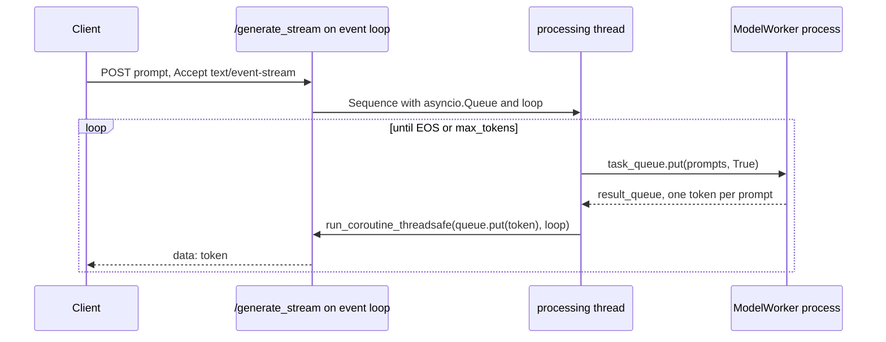

`ch03/single_model_llm_serving/` is a FastAPI service that serves `facebook/opt-125m`: a workload manager, a separate worker process, a streaming path and a vLLM path, in about 580 lines of Python across six files. It runs on a laptop and every line is readable in an afternoon. Two of its choices are deliberately naive — streaming recomputes the whole prefix on every token, and requests are batched in fixed groups of four. Swap the 125M demo model for the course's running example, Gemma 3 12B on an L40S serving the HelpDesk shape (1,024 prompt tokens, 256 output tokens), and those two lines decide whether the service meets a 50 ms TPOT target at all. This page walks the code and puts numbers on both.

:::key[First principle]
A serving loop is a queue, a scheduler and a forward pass. The forward pass should touch each token once (that is what the KV cache is for), and the scheduler should refill a slot the moment a sequence finishes (that is what continuous batching is for). This service does neither, on purpose, so you can see what each one buys.
:::

## 13.1 Run it, then follow one request

```bash
cd ch03/single_model_llm_serving
pip install -r requirements.txt
python main.py          # http://localhost:8000
```

:::mermaid[The /generate path: four hops, each with one job]
flowchart TD
    A[POST /generate] --> B[main.py generate]
    B --> C[LLMEngine.generate]
    C --> D[WorkloadManager.add_request<br/>queue]
    D --> E[get_next_batch<br/>up to 4 sequences]
    E --> F[ModelExecutor.execute_batch]
    F --> G[mp.Queue → ModelWorker<br/>separate process]
    G --> H[transformers generate]
    H --> F
:::

The design summary for this service and its multi-model sibling is in [Chapter 3 — System design](/c/llm-serving/05-system-design).

## 13.2 `main.py` — the API layer

Four endpoints, one dependency, and a lock:

```python
_llm = None
_llm_lock = multiprocessing.Lock()

def get_llm():
    global _llm
    with _llm_lock:
        if _llm is None:
            _llm = LLMEngine()
            atexit.register(cleanup)
        return _llm
```

| Endpoint | Path | Behaviour |
| --- | --- | --- |
| `/basic_generate` | No queue | One prompt, executed directly through the executor |
| `/generate` | Batched | Many prompts, routed through the workload manager |
| `/generate_stream` | SSE | One prompt, tokens pushed as `text/event-stream` |
| `/generate_vllm` | Batched | The same batch through the vLLM model object |

The service runs on `0.0.0.0:8000` via `uvicorn.run(app, host="0.0.0.0", port=8000)`, with `SIGINT` and `SIGTERM` handlers that call `cleanup()`.

The lock makes the engine a lazily built singleton: the first call to `get_llm()` pays for loading (two copies of the model, 13.3) and every later request shares the result — a cold start inside the request path, which a production service moves to a startup hook plus a readiness probe.

## 13.3 `llm/llm.py` — orchestration and the thread-to-loop bridge

`LLMEngine.__init__` does three things: it starts a worker process for `facebook/opt-125m`, it loads a second copy of the same model through vLLM, and it starts a daemon thread running `requests_processing_loop`.

```python
self.model_executor.setup_worker("facebook/opt-125m")
self.vllm_model = VLLM(model="facebook/opt-125m")
self.thread = threading.Thread(target=self.requests_processing_loop, daemon=True)
self.thread.start()
```

Two full copies of the model are resident — one in the worker process, one in vLLM. At 125M parameters that is a demo convenience. At Gemma 3 12B it is a design error: two bf16 copies are \(2 \times 23.53\) = 47.06 GB, more than an L40S's 48 GB card can give once the CUDA context and a KV pool are counted.

The loop is the streaming path: pull a batch of streaming sequences, run one forward pass for the batch, then push each result back to its own client queue. The pushing is the subtle part. The endpoint lives on uvicorn's event loop; the loop thread has no event loop; and `asyncio.Queue` is not thread-safe — calling `queue.put_nowait` from another thread neither locks the queue nor wakes the coroutine waiting on it. `asyncio.run_coroutine_threadsafe(queue.put(token), loop)` schedules the `put` on the endpoint's own loop and wakes it. Each `Sequence` therefore carries both its queue and the loop that owns it.



`loop.call_soon_threadsafe(queue.put_nowait, token)` is an equivalent fix; a plain `queue.put_nowait` from the thread is the classic bug. Chapter 2's `streaming.py` avoids the problem by letting vLLM's async engine own the loop ([Chapter 2](/c/llm-serving/04-llm-serving)).

## 13.4 `llm/workload_manager.py` — queueing and a fixed batch of four

Two queues, because streaming and non-streaming requests have different lifecycles:

```python
self.incoming_queue: Queue[Sequence] = Queue()
self.active_sequences: List[Sequence] = []
self.incoming_streaming_queue: Queue[Sequence] = Queue()
self.active_streaming_sequences: List[Sequence] = []
self.batch_size = 4
```

`get_next_batch()` tops the active list up to `batch_size` from the incoming queue and returns it. A `Sequence` carries its id, prompt, output list, token count, and — for streaming — the client's queue and event loop. `update_sequence_output` is where the autoregressive loop actually lives:

```python
sequence.output.append(token)
sequence.prompt += token
sequence.token_count += 1
```

The prompt grows by one token each step — a correct mental model of generation and an expensive implementation of it (13.6).

**Static versus continuous batching.** The batch path hands a whole batch to `model.generate`, which returns only when the longest sequence in it has finished; the three shorter ones sit in finished slots, padded, until then. That is *static* (request-level) batching, and the cost is head-of-line blocking: one long answer holds three slots and three clients. *Continuous* (iteration-level) batching refills a slot on the very next step. With output lengths $\ell_1, \dots, \ell_B$ in a batch, static slot utilisation is

$$
U_{\text{static}} = \frac{\mathbb{E}\left[\sum_j \ell_j\right]}{B\,\mathbb{E}\left[\max_j \ell_j\right]} = \frac{\mathbb{E}[\ell]}{\mathbb{E}[\max_j \ell_j]} ,
$$

and for exponentially distributed lengths $\mathbb{E}[\max_j \ell_j] = \mathbb{E}[\ell]\,H_B$ with $H_B = 1 + \tfrac12 + \dots + \tfrac1B$, so \(U_{\text{static}} = 1/H_B\): 0.48 at four, falling slowly as the batch grows. Decode is memory-bound, so a step costs about the same with one useful slot as with four — utilisation converts directly into throughput.

The simulation below queues 400 requests with geometric output lengths (mean 256, the HelpDesk mean, capped at 1,024) and serves them both ways:

```python run
import numpy as np

# 400 queued requests, output lengths ~ geometric with mean 256, capped at 1,024
rng = np.random.default_rng(13)
out = np.minimum(rng.geometric(1 / 256, size=400), 1024)


def static(lens, B):
    """Fixed batches in arrival order; a batch ends when its longest member ends."""
    t, done = 0, np.empty(len(lens))
    for k in range(0, len(lens), B):
        g = lens[k:k + B]
        t += g.max()
        done[k:k + B] = t
    return t, done


def continuous(lens, B):
    """B slots; a finished slot takes the next queued request at the next step."""
    free, done = np.zeros(B), np.empty(len(lens))
    for k, n in enumerate(lens):
        s = free.argmin()
        free[s] += n
        done[k] = free[s]
    return free.max(), done


useful = out.sum()
print(f"requests {len(out)}, mean output {out.mean():.1f}, max {out.max()}, tokens {useful:,}")
print(" B  policy      steps  slot util  mean done (steps)")
for B in (4, 16, 64):
    for name, f in (("static", static), ("continuous", continuous)):
        steps, done = f(out, B)
        print(f"{B:2d}  {name:10s} {int(steps):6,}  {useful / (B * steps):9.1%}  {done.mean():12,.0f}")

print("exponential-length theory, static util = 1/H_B: " +
      ", ".join(f"B={B} {1 / sum(1 / k for k in range(1, B + 1)):.3f}" for B in (4, 16, 64)))
step = 23.53e9 / 864e9  # Gemma 3 12B bf16 decode step floor on an L40S, seconds
for name, f in (("static", static), ("continuous", continuous)):
    steps, _ = f(out, 4)
    print(f"batch 4 {name:10s}: {useful / (steps * step):6.1f} tok/s at {step * 1e3:.1f} ms/step")

print("chart: batch size, static util, continuous util")
for B in (1, 2, 4, 8, 16, 32, 64):
    s, _ = static(out, B)
    c, _ = continuous(out, B)
    print(f"{B}, {useful / (B * s):.3f}, {useful / (B * c):.3f}")
```

```output
requests 400, mean output 258.8, max 1024, tokens 103,535
 B  policy      steps  slot util  mean done (steps)
 4  static     53,908      48.0%        26,666
 4  continuous 26,557      97.5%        12,975
16  static     21,095      30.7%        10,631
16  continuous  7,164      90.3%         3,260
64  static      6,999      23.1%         3,578
64  continuous  2,396      67.5%           843
exponential-length theory, static util = 1/H_B: B=4 0.480, B=16 0.296, B=64 0.211
batch 4 static    :   70.5 tok/s at 27.2 ms/step
batch 4 continuous:  143.2 tok/s at 27.2 ms/step
chart: batch size, static util, continuous util
1, 1.000, 1.000
2, 0.675, 0.992
4, 0.480, 0.975
8, 0.363, 0.952
16, 0.307, 0.903
32, 0.267, 0.809
64, 0.231, 0.675
```

:::chart[Slot utilisation vs batch size: static batches vs continuous refill]{type="line" x="batch size B" y="useful slot-steps / total slot-steps" xlog="true" yfmt="pct" ymin="0" ymax="1" marks="4:repo batch_size" note="400 queued requests, geometric output lengths, mean 256, capped at 1,024, seed 13. Continuous falls at large B only because 400 requests drain unevenly at the end."}
batch size, static, continuous
1, 1.000, 1.000
2, 0.675, 0.992
4, 0.480, 0.975
8, 0.363, 0.952
16, 0.307, 0.903
32, 0.267, 0.809
64, 0.231, 0.675
:::

:::example[Worked example · batch of four, Gemma 3 12B on an L40S]
One decode step reads all 23.53 GB of bf16 weights: \(23.53 / 864\) GB/s = 27.2 ms, nearly independent of whether one or four sequences ride along. At batch four, static batching keeps 48.0% of slots busy and delivers 70.5 tok/s; continuous refill keeps 97.5% busy and delivers 143.2 tok/s — **2.0x the throughput on the same GPU**, and the mean request finishes in 12,975 steps instead of 26,666. The theory line agrees with the simulation at B = 4 (0.480 both); at larger B the 1,024-token cap shortens the longest outputs, so simulated static utilisation sits a little above \(1/H_B\).
:::

Because `get_next_batch()` tops the active list up each time it is called, the streaming loop can replace a finished sequence on the next step — iteration-level scheduling capped at four. The `/generate` path, which hands the whole completion to `model.generate`, cannot. Production engines drop the cap, admit by free KV memory and mix prefill chunks into decode steps ([Chapter 6](/c/llm-serving/08-essential-techniques)).

:::warn[A fixed batch size is a guess about traffic]
`batch_size = 4` is too large at night (requests wait for company that never comes, unless the loop also has a timeout) and too small at peak (the GPU is memory-bound, so four sequences use about the same step time as sixteen). The real limit is KV memory, not a constant: size the batch from free KV blocks.
:::

## 13.5 `llm/model_executor.py` — process isolation

Two `mp.Queue` objects, one `mp.Process`, and two methods that differ only in a flag:

```python
self.task_queue.put((prompts, False))   # execute_batch  → (results)
self.task_queue.put((prompts, True))    # execute_forward_batch → ('stream', results)
```

The batch path returns a completed result; the streaming path returns one token per prompt. The `__del__` terminates and joins the worker.

A separate process buys two things: a CUDA crash or out-of-memory kills the worker, not the API server; and the forward pass does not hold the API process's GIL. The price is that every request and every token is pickled across a pipe. For strings of a few hundred bytes that is negligible next to a 27 ms decode step; it stops being negligible if you ever pass tensors or logits through the queue.

## 13.6 `llm/model_worker.py` — the `use_cache=False` line

Two generation methods, and the difference between them is the most instructive thing in the directory:

```python
# batch: the whole completion, in one call
outputs = self.model.generate(inputs.input_ids, attention_mask=..., max_new_tokens=50, ...)

# streaming: exactly one token, recomputed from scratch
outputs = self.model(input_ids=encoded.input_ids, attention_mask=..., use_cache=False)
next_token_logits = outputs.logits[:, -1, :]
next_token = torch.multinomial(torch.softmax(next_token_logits / 0.7, dim=-1), num_samples=1)
```

`use_cache=False` disables the KV cache: each streaming step re-runs the full forward pass over the entire prompt, which has grown by one token per step (13.4). The `stream_states` dictionary is initialised in `__init__` with a comment about `(input_ids, attention_mask, past_key_values)` but is never used.

**The cost, from first principles.** With a $p$-token prompt and $n$ generated tokens, step $i$ (from 0) without a cache pushes the whole prefix, $p + i$ tokens, through every layer. With a cache, step 0 prefills $p$ tokens and every later step pushes one:

$$
T_{\text{no cache}} = \sum_{i=0}^{n-1} (p + i) = np + \frac{n(n-1)}{2},
\qquad
T_{\text{cache}} = p + (n - 1).
$$

The first is quadratic in sequence length, the second linear. The ratio is close to $n$ when the prompt dominates and close to $n/2$ when the output does. Weight FLOPs scale with tokens processed — about $2N$ per token for $N$ non-embedding parameters, 21.5 GFLOP for Gemma 3 12B — and attention FLOPs grow faster still, since step $i$ attends over $p + i$ positions for each of $p + i$ queries.

```python run
# Tokens pushed through the model to stream n tokens after a p-token prompt.
def no_cache(p, n):   # step i re-reads the whole prefix: p + i tokens
    return sum(p + i for i in range(n))


def with_cache(p, n):  # prefill p once, then one new token per step
    return p + (n - 1)


for name, p, n in (("opt-125m demo (16 in, 20 out)", 16, 20),
                   ("HelpDesk (1,024 in, 256 out)", 1024, 256)):
    a, b = no_cache(p, n), with_cache(p, n)
    print(f"{name:31s} no cache {a:>8,} tok   cache {b:>6,} tok   ratio {a / b:6.1f}x")

# Gemma 3 12B on one L40S: ~21.5 GFLOP per token (2 x non-embedding params)
FLOP_TOK, PEAK, BW, WEIGHTS = 21.5e9, 362e12, 864e9, 23.53e9
p, n = 1024, 256
for label, toks in (("no cache", no_cache(p, n)), ("cache", with_cache(p, n))):
    print(f"12B {label:8s}: {toks * FLOP_TOK / 1e12:8.1f} TFLOP for one request")

floor_bw = WEIGHTS / BW  # every step reads all weights once
print(f"bandwidth floor per step: {floor_bw * 1e3:.1f} ms")
print("step  tokens(no cache)  floor ms(no cache)  floor ms(cache)")
for i in (1, 64, 128, 255):
    t = max((p + i) * FLOP_TOK / PEAK, floor_bw)
    print(f"{i:4d} {p + i:17,} {t * 1e3:19.1f} {floor_bw * 1e3:16.1f}")
mean_nc = sum(max((p + i) * FLOP_TOK / PEAK, floor_bw) for i in range(1, n)) / (n - 1)
print(f"mean TPOT floor, steps 1..255: no cache {mean_nc * 1e3:.1f} ms, cache {floor_bw * 1e3:.1f} ms")
b4_nc = max(4 * (p + 1) * FLOP_TOK / PEAK, floor_bw)
b4_c = max(4 * FLOP_TOK / PEAK, floor_bw)
print(f"batch of 4, step 1: no cache {b4_nc * 1e3:.1f} ms, cache {b4_c * 1e3:.1f} ms")

print("chart: step, tokens per step (no cache), tokens per step (cache)")
for i in (0, 1, 64, 128, 192, 255):
    print(f"{i}, {p + i}, {p if i == 0 else 1}")
```

```output
opt-125m demo (16 in, 20 out)   no cache      510 tok   cache     35 tok   ratio   14.6x
HelpDesk (1,024 in, 256 out)    no cache  294,784 tok   cache  1,279 tok   ratio  230.5x
12B no cache:   6337.9 TFLOP for one request
12B cache   :     27.5 TFLOP for one request
bandwidth floor per step: 27.2 ms
step  tokens(no cache)  floor ms(no cache)  floor ms(cache)
   1             1,025                60.9             27.2
  64             1,088                64.6             27.2
 128             1,152                68.4             27.2
 255             1,279                76.0             27.2
mean TPOT floor, steps 1..255: no cache 68.4 ms, cache 27.2 ms
batch of 4, step 1: no cache 243.5 ms, cache 27.2 ms
chart: step, tokens per step (no cache), tokens per step (cache)
0, 1024, 1024
1, 1025, 1
64, 1088, 1
128, 1152, 1
192, 1216, 1
255, 1279, 1
```

:::chart[Tokens pushed through the model per decode step, HelpDesk shape]{type="line" x="decode step i" y="tokens processed this step" ylog="true" note="1,024-token prompt, 256 output tokens. Step 0 is the prefill in both cases."}
step, no cache, KV cache
0, 1024, 1024
1, 1025, 1
64, 1088, 1
128, 1152, 1
192, 1216, 1
255, 1279, 1
:::

:::example[Worked example · what the line costs on the HelpDesk shape]
On the demo — a 16-token prompt, the engine's 20-token streaming limit — the cache-free loop processes 510 tokens instead of 35, 14.6x. Nobody notices at 125M parameters. On the HelpDesk shape with Gemma 3 12B it processes 294,784 tokens instead of 1,279 — **230.5x** — or 6,337.9 TFLOP of weight math instead of 27.5 per request.

The latency consequence is worse than "slower". With a cache, a decode step is memory-bound at the 27.2 ms bandwidth floor. Without one, every step is a 1,000-plus-token prefill, compute-bound even at 100% of the L40S's 362 TFLOPS: 60.9 ms at step 1, 76.0 ms at step 255, 68.4 ms on average. **The 50 ms TPOT target is unreachable at any utilisation.** And batching no longer helps: four sequences make step 1 cost 243.5 ms instead of 27.2 ms, because compute-bound work scales with tokens.
:::

Chapter 2's per-token timing chart shows a tall prefill bar and a flat decode tail — what a KV cache buys. Remove the cache and every bar is as tall as a prefill, and growing.

Two smaller details worth noticing:

- The batch path generates up to 50 new tokens (`max_new_tokens=50`) while the engine's streaming loop stops at `max_tokens = 20`. Two different limits, set in two different files.
- End-of-sequence detection decodes the sampled token and compares it to the EOS token *string*: `'is_finished': token == self.tokenizer.eos_token`. Comparing ids would be more robust, since decoding can drop or alter special tokens.

## 13.7 `llm/model_manager.py` — loading

Fifteen lines: create `model_cache/`, `from_pretrained` twice, return the pair. The cache directory is created and never used — there is no local model store, which is why the chapter's "fetch" stage is effectively delegated to the Hub's own cache. For a 125M-parameter demo model that is fine; for Gemma 3 12B it means a cold start downloads 23.53 GB of bf16 weights unless the Hub cache is already warm (load-time arithmetic is in the [multi-model walkthrough](/c/llm-serving/14-multi-model-service)).

## 13.8 Tests

Three artefacts, each testing a different layer:

| File | Layer | How |
| --- | --- | --- |
| `tests/test_api.py` | HTTP | `fastapi.testclient.TestClient` with a session-scoped event loop fixture |
| `tests/test_vllm.py` | vLLM path | Exercises `/generate_vllm` |
| `tests/test_stream.sh` | Streaming | Boots the real server, waits up to 30 s for it, sends a streaming request, and parses each `data:` line with `jq` |

`test_stream.sh` is the interesting one, because streaming is exactly what in-process tests miss: a response that buffers instead of streaming passes a TestClient assertion and fails a human watching `curl -N`.

```bash
curl -N -H "Accept: text/event-stream" \
     -H "Content-Type: application/json" \
     -d '{"prompt": "Hello, I am"}' \
     http://localhost:8000/generate_stream
```

A test none of the three makes, and the one that would have caught 13.6: time each streamed token and assert that the gap between tokens does not grow with position.

## 13.9 What you would change first

1. **Turn the KV cache on** in `generate_forward_batch` and thread `past_key_values` through `stream_states`. The worker then needs the new token, not the regrown prompt, so `Sequence.prompt += token` stops being the protocol.
2. **Unify the token limits** — one parameter, threaded from the request.
3. **One model copy, not two.** Pick vLLM or the worker, not both.
4. **Make `batch_size` adaptive**, or at least configurable, instead of a constant 4 in `WorkloadManager.__init__` — and refill finished slots every step on every path.

A sketch of change 1 for a single stream (not runnable as-is; the executor protocol must also send sequence ids):

```python
# model_worker.py: keep each stream's KV cache between steps instead of use_cache=False
@torch.no_grad()
def generate_forward_step(self, seq_id, prompt=None):
    state = self.stream_states.get(seq_id)
    if state is None:                                   # step 0: prefill the whole prompt
        enc = self.tokenizer(prompt, return_tensors="pt").to(self.device)
        input_ids, mask, past = enc.input_ids, enc.attention_mask, None
    else:                                               # later steps: feed one new token
        input_ids, mask, past = state
        mask = torch.cat([mask, mask.new_ones((mask.shape[0], 1))], dim=-1)
    out = self.model(input_ids=input_ids, attention_mask=mask,
                     past_key_values=past, use_cache=True)
    logits = out.logits[:, -1, :] / 0.7
    next_id = torch.multinomial(torch.softmax(logits, dim=-1), num_samples=1)
    done = next_id.item() == self.tokenizer.eos_token_id  # compare ids, not strings
    if done:
        self.stream_states.pop(seq_id, None)            # free the cache with the stream
    else:
        self.stream_states[seq_id] = (next_id, mask, out.past_key_values)
    return next_id.item(), done
```

Batching several cached streams of different lengths needs padded or ragged caches, and that bookkeeping is exactly what paged KV memory in vLLM-style engines exists to do. Keeping the cache also has a memory bill the cache-free loop never paid: at Gemma 3 12B's 393,216 bytes per token (all 48 layers held in full, the upper bound), one 1,279-token HelpDesk stream holds 502,923,264 bytes = 479.6 MiB. The window-aware lower bound is smaller, because 40 of the 48 layers keep only the last 1,024 tokens ([KV sizing in Chapter 5](/c/llm-serving/07-challenges)).

## 13.10 Check yourself

:::qa[A 2,048-token prompt streams 512 tokens through the cache-free loop. How many tokens are processed, and what is the ratio to a cached run?]
$T = np + n(n-1)/2 = 512 \times 2048 + 512 \times 511 / 2 = 1{,}048{,}576 + 130{,}816 = 1{,}179{,}392$. Cached: $2048 + 511 = 2{,}559$. Ratio ≈ 461x — close to $n = 512$, because the prompt dominates.
:::

:::qa[Why does batching four streams not help the cache-free loop on an L40S, when it helps the cached one almost 4x?]
Cached decode is memory-bound: a step reads 23.53 GB of weights in 27.2 ms whether it carries one token or four, so four streams cost about the same step time. Cache-free steps process 1,000+ tokens each and are compute-bound; four streams quadruple the FLOPs and the step time (60.9 ms → 243.5 ms at 100% of peak).
:::

:::qa[Output lengths are exponential with mean 256. What slot utilisation does a static batch of 8 give, and what does continuous batching give?]
$U = 1/H_8 = 1/2.718 \approx 0.368$; the simulation (capped lengths) gives 0.363. Continuous refill gives 0.952 at B = 8 in the same simulation — the remaining gap is the end-of-run drain, not head-of-line blocking.
:::

:::qa[The processing thread calls queue.put_nowait(token) directly instead of run_coroutine_threadsafe. What breaks?]
`asyncio.Queue` is not thread-safe and the call does not wake the event loop. The waiting `queue.get()` may not resume until something else wakes the loop, so tokens arrive late or in bursts, and concurrent access can corrupt the queue's internal state. Use `run_coroutine_threadsafe` or `loop.call_soon_threadsafe(queue.put_nowait, token)`.
:::

Next: [the multi-model service, file by file](/c/llm-serving/14-multi-model-service).

