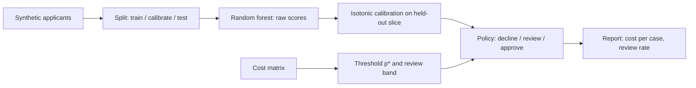

You have a classifier that scores loan applicants and a manager asking "is it good enough to ship?". Accuracy will not answer that. What answers it is a pipeline that turns scores into actions and reports what those actions cost — and the gap between that pipeline and a model is five short steps. This section builds all five on synthetic data, on CPU, with numpy and scikit-learn, and prints the numbers a launch review needs.

Later sections swap the random forest for a distilled SLM and the synthetic table for your data. Nothing else in the script changes, which is the point of keeping the decision layer separate from the model.

:::key[First principle]
Order matters: **costs → model → calibration → threshold → review band**. The cost matrix fixes the threshold before the model exists; calibration makes the model's probabilities mean what the threshold assumes; the review band is priced, not tuned.
:::

## 2.1 The pipeline at a glance



Three splits, each with one job: **train** fits the classifier, **calibrate** fits the score-to-probability map on cases the model never saw, **test** measures cost. Calibrating on training data re-learns the model's own over-fitting and fixes nothing.

Install (CPU only, no downloads):

```bash
python -m venv .venv && source .venv/bin/activate
pip install numpy scikit-learn
```

## 2.2 The whole pipeline, runnable

The data stand in for loan applications: 20 features, about 79% of applicants repay, 5% label noise. `y = 1` means good.

```python run
"""Quick start: train -> calibrate -> cost threshold -> evaluate -> abstain band."""
import numpy as np
from sklearn.datasets import make_classification
from sklearn.ensemble import RandomForestClassifier
from sklearn.isotonic import IsotonicRegression
from sklearn.metrics import roc_auc_score

C_APPROVE_BAD, C_DECLINE_GOOD = 120_000, 24_000          # INR, from the cost matrix

# 1. synthetic applicants: y = 1 means "repaid" (good), ~80% good
X, y = make_classification(n_samples=30_000, n_features=20, n_informative=6,
                           weights=[0.2, 0.8], flip_y=0.05, class_sep=0.8, random_state=0)
idx = np.random.default_rng(0).permutation(len(y))
tr, cal, te = idx[:15_000], idx[15_000:21_000], idx[21_000:]

# 2. a small classifier
clf = RandomForestClassifier(n_estimators=200, min_samples_leaf=5, n_jobs=-1, random_state=0)
clf.fit(X[tr], y[tr])
raw_cal, raw_te = clf.predict_proba(X[cal])[:, 1], clf.predict_proba(X[te])[:, 1]

# 3. calibrate on a held-out slice the model never trained on
iso = IsotonicRegression(out_of_bounds="clip").fit(raw_cal, y[cal])
p_te, y_te = iso.predict(raw_te), y[te]


def ece(p, y, bins=10):
    b = np.minimum((p * bins).astype(int), bins - 1)
    return sum(abs(p[b == k].mean() - y[b == k].mean()) * (b == k).mean()
               for k in range(bins) if (b == k).any())


def cost_two(p, y, t):
    """Approve if p >= t, else decline. Mean realised cost per case."""
    return np.where(p >= t, (1 - y) * C_APPROVE_BAD, y * C_DECLINE_GOOD).mean()


def cost_three(p, y, review):
    """Decline / review / approve with the band derived from the review price."""
    lo, hi = review / C_DECLINE_GOOD, 1 - review / C_APPROVE_BAD
    cost = np.select([p >= hi, p >= lo], [(1 - y) * C_APPROVE_BAD, review], y * C_DECLINE_GOOD)
    return cost.mean(), ((p >= lo) & (p < hi)).mean()


# 4. the threshold comes from the costs, not from the data
p_star = C_APPROVE_BAD / (C_APPROVE_BAD + C_DECLINE_GOOD)

print(f"test cases {len(y_te)}, base rate good {y_te.mean():.3f}, AUC {roc_auc_score(y_te, p_te):.3f}")
print(f"ECE raw {ece(raw_te, y_te):.4f} -> calibrated {ece(p_te, y_te):.4f}")
print(f"p* = {p_star:.4f}")
print()
print(f"{'policy':36s} {'INR/case':>9s} {'review':>7s}")
rows = [("always approve", cost_two(p_te, y_te, 0.0), 0.0),
        ("always decline", cost_two(p_te, y_te, 1.1), 0.0),
        ("naive 0.5, raw scores", cost_two(raw_te, y_te, 0.5), 0.0),
        ("p* on raw scores", cost_two(raw_te, y_te, p_star), 0.0),
        ("p* on calibrated scores", cost_two(p_te, y_te, p_star), 0.0),
        ("+ review band, review = 6,000", *cost_three(p_te, y_te, 6_000)),
        ("+ review band, review = 900", *cost_three(p_te, y_te, 900))]
for name, c, r in rows:
    print(f"{name:36s} {c:9,.0f} {r:7.1%}")
```

```output
test cases 9000, base rate good 0.788, AUC 0.909
ECE raw 0.0462 -> calibrated 0.0108
p* = 0.8333

policy                                INR/case  review
always approve                          25,413    0.0%
always decline                          18,917    0.0%
naive 0.5, raw scores                    9,952    0.0%
p* on raw scores                         7,552    0.0%
p* on calibrated scores                  7,365    0.0%
+ review band, review = 6,000            4,431   39.6%
+ review band, review = 900                888   98.4%
```

That table is the launch review. The rest of this section reads it row by row.

## 2.3 The cost ladder, row by row

**Constant policies set the floor to beat.** With no model at all, always declining costs ₹18,917 per case (you lose the margin on the 78.8% who would repay) and always approving costs ₹25,413 (you eat the 21.2% who default). Any model that cannot beat ₹18,917 is subtracting value.

**The naive 0.5 rule halves that — and leaves ₹2,587 per case on the table.** It is what `clf.predict()` does. It approves anyone the forest thinks is more likely good than bad, which is the wrong question when a bad approval costs five times a wrong decline.

:::example[Worked example · where the naive rule loses money]
On the 9,000 test cases, the two policies make these mistakes:

| Policy | Bad cases approved (₹120,000 each) | Good cases declined (₹24,000 each) | Cost per case |
| --- | ---: | ---: | ---: |
| naive 0.5, raw | 711 | 177 | $(711 \times 120{,}000 + 177 \times 24{,}000) / 9{,}000 = 9{,}952$ |
| $p^*$ = 0.833, calibrated | 422 | 652 | $(422 \times 120{,}000 + 652 \times 24{,}000) / 9{,}000 = 7{,}365$ |

The cost policy makes **186 more mistakes** (1,074 vs 888), so its accuracy is lower. It trades 289 fewer bad approvals (₹34.7M saved) for 475 more wrong declines (₹11.4M lost). Net: ₹23.3M on 9,000 cases, ₹2,587 per case.
:::

:::warn[An accuracy gate would block the cheaper model]
If your release rule is "accuracy must not drop", the cost policy fails it and the expensive one ships. Gate on cost per case (and review volume), report accuracy as a diagnostic.
:::

**Calibration is worth ₹187 per case here.** Applying $p^*$ to raw forest scores costs ₹7,552; to calibrated scores, ₹7,365. The derivation of $p^*$ assumes that a score of 0.83 means "83% of such applicants repay"; the raw scores do not mean that, as the next subsection shows.

**The review band is worth another ₹2,934 per case — at a price.** Pricing a review at an illustrative ₹6,000 gives the band $[6{,}000/24{,}000,\; 1 - 6{,}000/120{,}000) = [0.25, 0.95)$, and 39.6% of applicants land in it. Cost per case falls to ₹4,431. Whether that is a win depends on whether operations can review four applications in ten.

**The ₹900 row is a warning, not a result.** At ₹900 the band is $[0.0375, 0.9925)$ and 98.4% of cases go to humans. The ₹888 per case is "cheap" only because ₹900 understates what a review costs ([§1.4](/c/practical-slm-decision-models/01-what-a-decision-model-is)). Never report this row as savings.

## 2.4 Calibration: making 0.83 mean 83%

A random forest averages votes from trees that each saw a bootstrap sample, so its scores are pulled towards the middle: very good applicants are scored a little too low and very bad ones a little too high. Isotonic regression fits a non-decreasing step function from raw score to observed repayment rate on the calibration slice, so ranking is preserved and only the scale moves.

The reliability diagram plots, for each score bin, the mean predicted probability against the observed fraction of good applicants. Perfect calibration is the diagonal.

:::chart[Reliability on 9,000 test cases: raw forest scores vs isotonic-calibrated]{type="line" diag="true" x="mean predicted P(good) in bin" y="observed fraction good" xmin="0" xmax="1" ymin="0" ymax="1" xfmt="dec1" yfmt="dec1" points="true" dash="raw forest"}
p, raw forest, calibrated
0.057, , 0.051
0.071, 0.024,
0.121, , 0.143
0.146, 0.043,
0.246, 0.094,
0.250, , 0.321
0.348, 0.180,
0.451, 0.328,
0.462, , 0.568
0.518, , 0.545
0.551, 0.551,
0.650, , 0.611
0.656, 0.631,
0.752, , 0.738
0.758, 0.812,
0.860, 0.909, 0.846
0.945, 0.970,
0.958, , 0.955
:::

Two things to read:

- **The raw curve is S-shaped around the diagonal.** In the bin where the forest averages 0.146, only 4.3% repay; in the bin averaging 0.860, 90.9% do. Below 0.5 the forest overstates P(good); above it, it understates it. ECE (the bin-weighted mean gap) is 0.046.
- **Calibrated points hug the diagonal** (ECE 0.011). The remaining wobble in the middle bins is noise: the bins between 0.1 and 0.8 hold only 88–411 cases each, because isotonic regression pushes most scores towards the ends — 47.4% of calibrated scores are ≥ 0.95.

:::tip[Check calibration on the slice that matters]
The bins near $p^*$ (0.75–0.90) decide approve versus decline; the bins near the band edges (0.25 and 0.95) decide automate versus review. A good overall ECE can hide a bad gap exactly there. Print per-bin counts and gaps, not just the scalar.
:::

## 2.5 The threshold is a curve, not a number

Sweep the approve threshold across $[0.05, 0.98]$ and compute cost per case on the test set for both score scales:

:::chart[Cost per case vs approve threshold on 9,000 test cases (two actions, no review)]{type="line" x="approve if score ≥ t" y="cost per case" prefix="₹" marks="0.5:naive 0.5;0.833:p* from costs" ymin="0" dash="raw forest scores"}
t, raw forest scores, calibrated scores
0.05, 24827, 23896
0.10, 22136, 15139
0.15, 19821, 12523
0.20, 18000, 12523
0.25, 16101, 11576
0.30, 14723, 9963
0.35, 13219, 9963
0.40, 12045, 9963
0.45, 11040, 9963
0.50, 9952, 9461
0.55, 9307, 9117
0.60, 8725, 9056
0.65, 8237, 8176
0.70, 7541, 7592
0.72, 7403, 7595
0.74, 7309, 7595
0.76, 7267, 7365
0.78, 7267, 7365
0.80, 7299, 7365
0.82, 7395, 7365
0.84, 7613, 7365
0.86, 8053, 7379
0.88, 8803, 7381
0.90, 9867, 7568
0.92, 11461, 8072
0.94, 13608, 8976
0.96, 16080, 13744
0.98, 18155, 15611
:::

Three readings:

1. **On calibrated scores the minimum sits on $p^*$.** Every threshold from 0.76 to 0.84 gives ₹7,365 — the arithmetic put the threshold in the right place without looking at test labels. The steps in the curve are isotonic regression's plateaus.
2. **On raw scores the minimum is elsewhere** — ₹7,267 at $t \approx 0.77$, slightly below the calibrated cost. You could only find 0.77 by sweeping on labelled data, and it moves every time the model is retrained. Calibration buys a threshold you can derive and defend; on these data the price is ₹98 per case of isotonic coarseness, which a larger calibration slice reduces.
3. **The minimum is broad, the edges are steep.** A threshold a few hundredths off costs nothing; 0.5 costs ₹2,096 (calibrated) to ₹2,685 (raw) per case more than the respective minimum. Get the cost matrix roughly right and stop tuning.

## 2.6 Invariants before headlines

Append this to the script. Every number in §2.2 is meaningless if one of these fails, so they run first in CI:

```python
# 5. invariants to assert before reading any headline number
order = np.argsort(raw_te, kind="stable")
assert np.all(np.diff(p_te[order]) >= -1e-12), "calibrator reordered cases"
assert 0.0 <= p_te.min() and p_te.max() <= 1.0, "probability outside [0, 1]"
assert abs(p_star - 120_000 / 144_000) < 1e-12, "threshold not derived from the cost matrix"

naive = cost_two(raw_te, y_te, 0.5)
policy = cost_two(p_te, y_te, p_star)
banded, review_rate = cost_three(p_te, y_te, 6_000)
assert policy < naive, "cost threshold is not cheaper than 0.5"
assert banded < policy, "review band does not pay for itself"
assert review_rate <= 0.40, "review volume exceeds what operations agreed to staff"
print(f"ok: naive {naive:,.0f} -> p* {policy:,.0f} -> band {banded:,.0f} INR/case,"
      f" review {review_rate:.1%}, saving {naive - banded:,.0f} INR/case")
```

```output
ok: naive 9,952 -> p* 7,365 -> band 4,431 INR/case, review 39.6%, saving 5,521 INR/case
```

The monotonicity assertion is the one teams skip. A calibrator that reorders cases (an over-fitted non-monotone map, or one fitted per segment and then concatenated) silently attaches every derived threshold to different applicants. The `review_rate <= 0.40` line is not a statistical test; it is a contract with whoever staffs the review queue, written down where it fails loudly.

## 2.7 When a number looks wrong

| Reading | Likely cause | Check |
| --- | --- | --- |
| Cost policy no cheaper than always-decline | Model has little signal, or costs are mis-entered | AUC on test; print the cost matrix next to the result |
| ECE barely moves after calibration | Scores already calibrated, or calibration slice too small | Per-bin counts; refit with a larger slice |
| Review rate near 100% | Review priced too low (₹900 here gives 98.4%) | Recompute the band from a fully loaded review price |
| Review rate far above what can be staffed | Scores pile up in the middle | Score histogram; apply a capacity cap (§4) |
| Calibrated cost worse than raw at $p^*$ | Calibrator fitted on training data or a leaky split | Confirm the calibration slice is disjoint from training |
| Test cost much lower than production | Rows from one customer in both train and test | Split by customer or application ID, not by row |

## 2.8 Day-one checklist

- [ ] Write the cost matrix (approve-bad, decline-good, review) and get it signed off by risk and operations.
- [ ] Compute $p^*$ and the review band by hand before training anything (0.833 and $[0.25, 0.95)$ here).
- [ ] Compute the two constant policies' cost per case on your data; that is the bar (₹18,917 here).
- [ ] Split three ways by entity — train, calibrate, test — and never reuse the calibration slice for training.
- [ ] Train the simplest model that might clear the bar; calibrate it; plot the reliability curve.
- [ ] Report cost per case for naive 0.5, $p^*$ raw, $p^*$ calibrated and $p^*$ + band, plus review rate.
- [ ] Agree the maximum review rate with operations and assert it in code.
- [ ] Log `p_good`, action, expected costs, model version and policy version for every decision.

## 2.9 Check yourself

:::qa[The calibrated cost-threshold policy makes 1,074 mistakes and the naive policy 888. How can it be ₹2,587 per case cheaper?]
The mistakes have different prices. The cost policy cuts bad approvals from 711 to 422 (−289 × ₹120,000 = −₹34.68M) and accepts 475 more wrong declines (+475 × ₹24,000 = +₹11.40M). Net −₹23.28M over 9,000 cases = −₹2,587 per case. Counting mistakes treats a ₹120,000 error and a ₹24,000 error as equal.
:::

:::qa[Why calibrate on a separate slice instead of on the training data?]
On training data the forest's scores are over-fitted: it has seen those applicants, so their scores are more extreme and more often right than on new cases. A calibrator fitted there learns "scores are trustworthy" and leaves the test-time distortion in place. The calibration slice must look like production: data the model has not seen.
:::

:::qa[Raw scores achieve ₹7,267 at t = 0.77, calibrated scores only ₹7,365 at p*. Should you skip calibration and use 0.77?]
Only if you are willing to re-sweep the threshold on fresh labelled data every time the model, the data or the costs change, and to explain to risk why the threshold is 0.77 when the costs say 0.833. Calibration keeps the threshold a function of the costs alone. The ₹98 gap is isotonic coarseness on a 6,000-case slice; it shrinks with more calibration data or a smoother method (Platt scaling, covered in §7).
:::

:::qa[Operations can staff 25% review, not 39.6%. What changes in the pipeline?]
Not the threshold or the model. Add a capacity cap: of the cases in the band, keep for review those where review saves the most expected cost and send the rest to their cheaper automatic action. Cost per case rises above ₹4,431 by exactly the value of the reviews you cannot afford — §4 computes that "constraint regret".
:::

Next: what a small language model costs to run, from first principles — memory, KV cache and latency — in [SLM fundamentals](/c/practical-slm-decision-models/03-slm-fundamentals).
