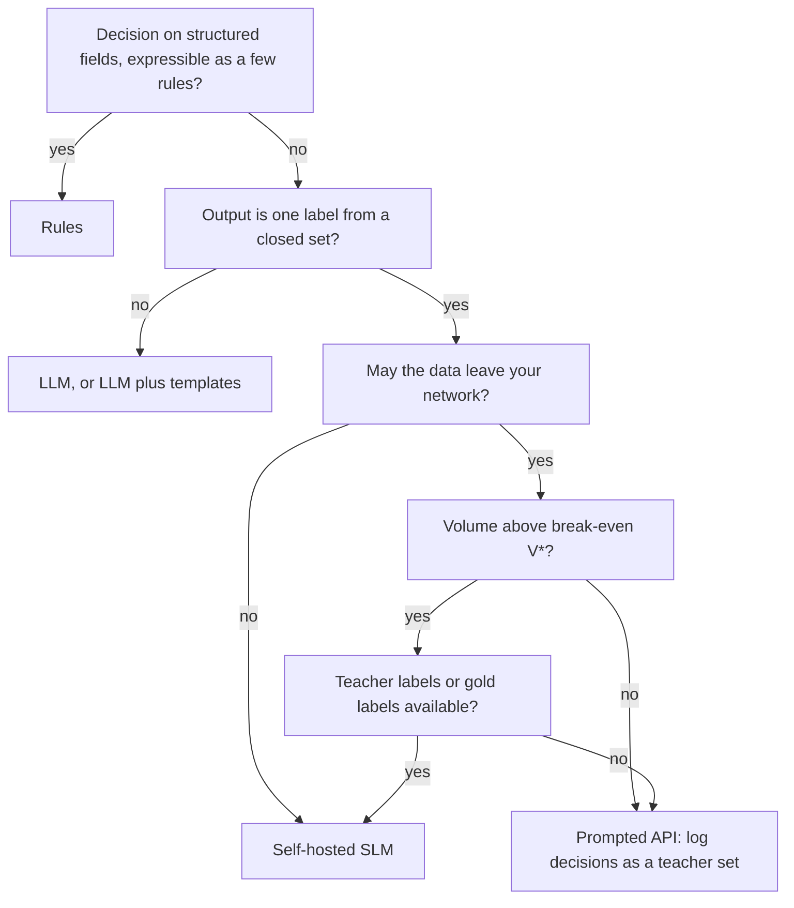

The loan triage from [§4](/c/practical-slm-decision-models/04-decision-theory) and the ticket router from [§6](/c/practical-slm-decision-models/06-distillation) both emit one label from a closed set, thousands of times an hour, under a latency budget, on data that often may not leave your network. That shape — short input, one-token-sized output, high volume, auditable — is what makes a small self-hosted model attractive. It does not make it automatically cheaper or better. This section turns the choice into arithmetic you can redo with your own prices.

:::key[First principle]
An API bills **per decision**; a self-hosted model bills **per hour of capacity**, whether or not traffic arrives. So the API wins at low volume and the self-hosted model wins above a break-even volume $V^* = F / c_{\text{API}}$, where $F$ is the self-hosted monthly floor and $c_{\text{API}}$ the API cost per decision. Everything else in this section is estimating those two numbers honestly, then checking the four non-cost criteria that can overrule them.
:::

## 5.1 Three ways to make the same decision

| | Rules | Fine-tuned SLM, self-hosted | LLM API |
| --- | --- | --- | --- |
| What it is | Hand-written conditions on structured fields | 66M encoder or 0.5B decoder trained on your labels (§6, §8) | Prompted general model behind a vendor endpoint |
| Bills by | Engineer time | Instance-hours + people | Tokens |
| Learns from data | No | Yes, from labels or a teacher | Only through the prompt |
| Output | Action | Probability over actions | Text you parse into an action |

All illustrative inputs used below, in one place — swap in your own:

| Input | Value | Basis |
| --- | --- | --- |
| Tokens per API decision | 600 in, 12 out | Instructions + case; JSON label out |
| API small tier | $0.15 / $0.60 per 1M tokens in/out | Illustrative price |
| API frontier tier | $3.00 / $15.00 per 1M tokens in/out | Illustrative price |
| Retries and fallbacks | +2% calls | Illustrative |
| FX | ₹88 per USD | Illustrative |
| CPU instance (4 vCPU) | $0.17/hour, 300 GFLOP/s sustained int8 | Illustrative |
| GPU instance (T4 class) | $0.53/hour, 16 TFLOP/s sustained fp16 | Illustrative (~25% of the T4's 65 TFLOP/s fp16 peak) |
| Self-hosted people + monitoring | ₹80,000/month | Illustrative (≈4 engineer-days) |
| Rules maintenance | ₹40,000/month | Illustrative (≈2 engineer-days) |
| Peak-to-mean traffic | 3× | Provision for the busy hour |
| Minimum replicas | 2 | One can fail without an outage |

## 5.2 Cost per decision, from first principles

**API.** Per decision the bill is tokens times price:

$$
c_{\text{API}} = \frac{t_{in}\,P_{in} + t_{out}\,P_{out}}{10^6}\,(1 + \rho)\,\text{FX}
$$

For the small tier: $(600 \times 0.15 + 12 \times 0.60)/10^6 = 9.72\times10^{-5}$ USD, times 1.02 times 88 = ₹0.0087 per decision, **₹8,725 per million**. The frontier tier: $(600 \times 3 + 12 \times 15)/10^6 = 1.98\times10^{-3}$ USD → ₹0.178 per decision, **₹177,725 per million**. Note that 91% of the frontier cost is the 600 input tokens: a fine-tuned model that does not need the instructions in every call removes the biggest term.

**Self-hosted.** The capacity of one replica comes from FLOPs. A forward pass costs about \(2 \times (\text{parameters}) \times (\text{tokens})\) FLOPs ([§3](/c/practical-slm-decision-models/03-slm-fundamentals)):

$$
\text{req/s per replica} = \frac{\text{sustained FLOP/s}}{2\,N_{\text{params}}\,t},
\qquad
\text{replicas}(V) = \max\!\left(m,\ \left\lceil \frac{k\,V / S}{\text{req/s per replica}} \right\rceil\right)
$$

with $V$ decisions per month, $S = 2.628\times10^6$ seconds per month, peak factor $k = 3$ and minimum $m = 2$. Monthly cost is $F_{\text{ops}} + \text{replicas}(V) \times 730\,\text{h} \times \text{hourly price}$.

:::example[Worked example · capacity of the two self-hosted shapes]
**66M encoder on CPU.** The embedding table (30,522 × 768 ≈ 23.4M) is a lookup, so count the 42.5M non-embedding parameters. A ticket is about 128 tokens without instructions: \(2 \times 42.5\text{M} \times 128 = 10.9\) GFLOP per request. At 300 GFLOP/s: **36 ms** of compute, **28 requests/s** per replica.

**0.5B decoder on a T4-class GPU**, scoring the label in a single prefill of 300 tokens: \(2 \times 0.5\text{B} \times 300 = 300\) GFLOP. At 16 TFLOP/s: **19 ms**, **53 requests/s** per replica. (Reading 1 GB of fp16 weights at the T4's 320 GB/s takes 3 ms, so the prefill is compute-bound.)

**Floors.** Two CPU replicas: \(2 \times 730 \times 0.17 \times 88\) = ₹21,842/month, plus ₹80,000 people = **₹101,842**. Two GPU replicas: ₹68,094 + ₹80,000 = **₹148,094**.
:::

```python run
"""Monthly cost of a decision service vs volume: API tiers, self-hosted SLMs, rules."""
import math

INR_PER_USD = 88.0                  # illustrative FX
SEC_PER_MONTH = 730 * 3600          # 730 h = average month
PEAK_TO_MEAN = 3.0                  # provision for the busy hour, not the average


def api(usd_in, usd_out, tok_in=600, tok_out=12, retry=0.02):
    """Pure per-call pricing: INR per decision."""
    per = (tok_in * usd_in + tok_out * usd_out) / 1e6
    return lambda v: v * per * (1 + retry) * INR_PER_USD


def self_hosted(gflop_per_req, sustained_gflops, usd_per_hour, fixed_inr, min_replicas=2):
    """Replicas sized for peak; idle replicas still bill. fixed_inr = people + monitoring."""
    rps_per_replica = sustained_gflops / gflop_per_req
    def monthly(v):
        peak_rps = PEAK_TO_MEAN * v / SEC_PER_MONTH
        replicas = max(min_replicas, math.ceil(peak_rps / rps_per_replica))
        return fixed_inr + replicas * 730 * usd_per_hour * INR_PER_USD
    return monthly, rps_per_replica


# encoder ~66M (DistilBERT shape): 42.5M non-embedding params, 128 tokens, int8 CPU
enc, enc_rps = self_hosted(2 * 42.5e6 * 128 / 1e9, 300, 0.17, 80_000)
# 0.5B decoder scoring the label in one prefill of 300 tokens on a T4-class GPU
dec, dec_rps = self_hosted(2 * 0.5e9 * 300 / 1e9, 16_000, 0.53, 80_000)
OPTIONS = {
    "API frontier tier": api(3.00, 15.00),
    "API small tier": api(0.15, 0.60),
    "SLM 0.5B on GPU": dec,
    "SLM 66M on CPU": enc,
    "rules": lambda v: 40_000.0,
}
print("replica capacity: 66M CPU %.0f req/s, 0.5B GPU %.0f req/s" % (enc_rps, dec_rps))
print()
print("%-20s %12s %12s %12s" % ("INR per 1M decisions", "at 1M/mo", "10M/mo", "100M/mo"))
for name, f in OPTIONS.items():
    print("%-20s" % name + "".join("%13s" % f"{f(v) / (v / 1e6):,.0f}" for v in (1e6, 1e7, 1e8)))


def break_even(api_f, slm_f, lo=1e3, hi=1e11):
    """Monthly volume where the SLM becomes cheaper (bisection; the gap is monotone)."""
    for _ in range(200):
        mid = math.sqrt(lo * hi)
        lo, hi = (mid, hi) if slm_f(mid) >= api_f(mid) else (lo, mid)
    return hi


print()
for a in ("API frontier tier", "API small tier"):
    for s in ("SLM 66M on CPU", "SLM 0.5B on GPU"):
        print("%-15s beats %-17s above %11s decisions/month" %
              (s, a, f"{break_even(OPTIONS[a], OPTIONS[s]):,.0f}"))

BUILD = 20_000 * OPTIONS["API frontier tier"](1) + 2_000 * 50 + 15 * 20_000   # see 5.3
print("\none-off build INR %s; payback at 5M decisions/month:" % f"{BUILD:,.0f}")
for a in ("API frontier tier", "API small tier"):
    saving = OPTIONS[a](5e6) - OPTIONS["SLM 66M on CPU"](5e6)
    print("  vs %-17s %s" % (a, "%.1f months" % (BUILD / saving) if saving > 0 else "never"))
```

```output
replica capacity: 66M CPU 28 req/s, 0.5B GPU 53 req/s

INR per 1M decisions     at 1M/mo       10M/mo      100M/mo
API frontier tier         177,725      177,725      177,725
API small tier              8,725        8,725        8,725
SLM 0.5B on GPU           148,094       14,809        1,821
SLM 66M on CPU            101,842       10,184        1,346
rules                      40,000        4,000          400

SLM 66M on CPU  beats API frontier tier above     573,030 decisions/month
SLM 0.5B on GPU beats API frontier tier above     833,279 decisions/month
SLM 66M on CPU  beats API small tier    above  11,672,829 decisions/month
SLM 0.5B on GPU beats API small tier    above  16,974,208 decisions/month

one-off build INR 403,554; payback at 5M decisions/month:
  vs API frontier tier 0.5 months
  vs API small tier    never
```

Read the per-million table across a row. The API rows are flat — the price per decision does not depend on volume. The self-hosted rows fall roughly 10× per 10× volume until the minimum replicas fill up: the floor is being shared over more decisions. At 10M decisions a month **the small API tier (₹8,725 per million) is still cheaper than the self-hosted 66M (₹10,184)**; at 100M it costs 6.5× more.

## 5.3 The break-even volume

While the self-hosted service is at its minimum replica count its monthly cost is a constant $F$, and the API cost is linear in volume. Setting them equal:

$$
V^* = \frac{F}{c_{\text{API}}} = \frac{F_{\text{ops}} + m \times 730 \times h \times \text{FX}}{c_{\text{API}}}
$$

:::example[Worked example · 66M on CPU against the small API tier]
$F = 80{,}000 + 2 \times 730 \times 0.17 \times 88$ = ₹101,842 per month. $c_{\text{API}}$ = ₹0.0087247 per decision.

$$
V^* = \frac{101{,}842}{0.0087247} = 11{,}672{,}829 \text{ decisions per month}
$$

Check the assumption: at that volume the busy-hour rate is \(3 \times 11.67\text{M} / 2.628\text{M s} = 13.3\) req/s, well inside two replicas (55 req/s), so the floor really is constant there. The code's bisection agrees to the decision. Against the frontier tier the same floor breaks even at \(101{,}842 / 0.17772\) = 573,030 per month.
:::

:::chart[Monthly cost vs monthly volume (illustrative prices; formula in 5.3)]{type="line" x="decisions per month" y="cost per month" prefix="₹" xlog="true" ylog="true" marks="573030:66M beats frontier API;11672829:66M beats small API" dash="rules" points="false"}
volume, API frontier tier, API small tier, SLM 0.5B on GPU, SLM 66M on CPU, rules
10000, 1777, 87, 148094, 101842, 40000
15849, 2817, 138, 148094, 101842, 40000
25119, 4464, 219, 148094, 101842, 40000
39811, 7075, 347, 148094, 101842, 40000
63096, 11214, 550, 148094, 101842, 40000
100000, 17772, 872, 148094, 101842, 40000
158489, 28167, 1383, 148094, 101842, 40000
251189, 44642, 2192, 148094, 101842, 40000
398107, 70754, 3473, 148094, 101842, 40000
630957, 112137, 5505, 148094, 101842, 40000
1000000, 177725, 8725, 148094, 101842, 40000
1584893, 281675, 13828, 148094, 101842, 40000
2511886, 446425, 21915, 148094, 101842, 40000
3981072, 707535, 34734, 148094, 101842, 40000
6309573, 1121368, 55049, 148094, 101842, 40000
10000000, 1777248, 87247, 148094, 101842, 40000
15848932, 2816748, 138277, 148094, 101842, 40000
25118864, 4464245, 219154, 148094, 101842, 40000
39810717, 7075352, 347335, 148094, 101842, 40000
63095734, 11213677, 550490, 148094, 112762, 40000
100000000, 17772480, 872467, 182142, 134604, 40000
158489319, 28167483, 1382767, 216189, 156446, 40000
251188643, 44642451, 2191539, 284283, 200129, 40000
398107171, 70753517, 3473354, 386425, 265654, 40000
630957344, 112136768, 5504896, 556661, 374862, 40000
1000000000, 177724800, 8724672, 829038, 538674, 40000
:::

On a log-log plot the API lines are straight with slope 1; the self-hosted lines are flat until the replica count starts to grow (the 66M service needs a third replica above about 48M decisions a month), then rise with a much smaller per-decision slope. Rules are flat at the maintenance cost — if a rule set can make the decision well enough, nothing else on the chart is cheaper.

**How sensitive is $V^*$?** It is a ratio, so it moves proportionally with both inputs:

```python run
"""Break-even sensitivity: V* = monthly floor of the SLM / API cost per decision."""
INR_PER_USD = 88.0
api_small = (600 * 0.15 + 12 * 0.60) / 1e6 * 1.02 * INR_PER_USD    # INR per decision
replicas = 2 * 730 * 0.17 * INR_PER_USD                            # two CPU replicas, INR/month

print("break-even, decisions/month (66M on CPU vs small API tier)")
print("%15s" % "ops INR/month" + "".join("%16s" % f"API price x{m:g}" for m in (0.5, 1, 2)))
for ops in (40_000, 80_000, 160_000):
    print("%15s" % f"{ops:,}" + "".join("%16s" % f"{(ops + replicas) / (api_small * m):,.0f}"
                                        for m in (0.5, 1, 2)))
```

```output
break-even, decisions/month (66M on CPU vs small API tier)
  ops INR/month  API price x0.5    API price x1    API price x2
         40,000      14,176,258       7,088,129       3,544,064
         80,000      23,345,657      11,672,829       5,836,414
        160,000      41,684,455      20,842,228      10,421,114
```

The people line dominates the floor (₹80,000 of ₹101,842), so the break-even is mostly a question of **who runs the service**, not which instance it runs on. An API price cut of 50% doubles $V^*$. Re-run this table whenever the vendor's price list changes.

:::warn[Comparing list prices to an idle instance]
The most common error in these business cases is dividing an instance's hourly price by its *maximum* throughput. Replicas are provisioned for the busy hour and kept warm at night; in the model above, at 10M decisions a month the two CPU replicas run at an average of \(3.8 / 55 \approx 7\%\) of capacity. Use provisioned capacity, not peak throughput, and count the people.
:::

**The one-off build** in the code is itemised so it can be challenged:

| Item | Quantity × unit (illustrative) | ₹ |
| --- | --- | ---: |
| Teacher labels from the frontier API | 20,000 × ₹0.178 | 3,554 |
| Human gold labels for evaluation and calibration | 2,000 × ₹50 | 100,000 |
| Engineering: data, training, evaluation, serving | 15 days × ₹20,000 | 300,000 |
| **Total** | | **403,554** |

Teacher labelling is under 1% of the build; people are 74%. Against the frontier tier at 5M decisions a month the build pays back in half a month. Against the small tier at the same volume it never does — the SLM is more expensive to run there.

## 5.4 The four criteria that can overrule cost

**Latency.** The self-hosted numbers are derived from FLOPs above (36 ms and 19 ms of compute, plus tokenisation and in-network hops of a few milliseconds). An API call adds network round-trip, provider queueing, a 600-token prefill and 12 decode steps on someone else's hardware; budget something like 300–1,500 ms (illustrative) and measure p95 from your own region before promising an SLA. Rules run in well under a millisecond.

**Data residency.** Rules and a self-hosted model process the case inside your network and region. An API sends it to a vendor: check where it is processed, whether it is retained or used for training, and whether your contracts and regulators allow it. If the answer is no, the cost comparison is moot.

**Controllability.** A self-hosted model changes only when you deploy a new weight hash; you can reproduce any past decision exactly ([§13](/c/practical-slm-decision-models/13-serving-and-deployment)). An API model can change behind a model alias, and versioned snapshots are eventually deprecated on the vendor's schedule. Rules are the most controllable of all — every decision traces to a line of code.

**Calibration.** The cost formulas in §4 consume probabilities.

- A **fine-tuned classifier** is trained with log-loss, a proper scoring rule, so its softmax is a probability estimate you can check and fix post-hoc on your own labels — §6.6 took a distilled student from ECE 0.081 to 0.021 with 1,000 gold labels.
- An **LLM's verbalised confidence** ("confidence: 0.9") is generated text, not a quantity trained against your outcomes. Token log-probabilities, where a vendor exposes them, can be calibrated the same way — until the vendor updates the model and the mapping moves.
- **Rules** produce no probability, but each rule's historical hit rate is one: the fraction of past cases matching the rule that turned out good. That is calibrated by construction on past data, and coarse.

| Criterion | Rules | Fine-tuned SLM, self-hosted | LLM API |
| --- | --- | --- | --- |
| ₹ per 1M decisions at 10M/month | 4,000 | 10,184 (66M CPU) | 8,725 small / 177,725 frontier |
| ₹ per 1M decisions at 100M/month | 400 | 1,346 (66M CPU) | 8,725 / 177,725 |
| Latency | < 1 ms | ~20–40 ms compute (derived) | ~300–1,500 ms (illustrative) |
| Data leaves your network | No | No | Yes |
| Behaviour changes only when you deploy | Yes | Yes | No |
| Calibrated probability | Per-rule hit rate | Yes, after post-hoc calibration | Only via log-probs, unstable across versions |
| Handles unstructured text | Poorly | Yes, in-domain | Yes, broadly |

## 5.5 When not to use an SLM



| Situation | Why an SLM loses | Do this instead |
| --- | --- | --- |
| Volume below $V^*$ (here < 11.7M/month vs the small tier) | The monthly floor is shared over too few decisions | API now; log its decisions; distil when volume crosses $V^*$ |
| A short, auditable rule set already decides well | A model adds training, drift and explanation work for no gain | Rules; keep a model only for the cases the rules route to review |
| The output is prose a person reads | Small models write less fluent long text; a decision needs a label anyway | LLM for the prose, or SLM label plus templated text |
| The decision depends on facts newer than the training data | Weights are frozen at training time | Retrieval or fresh features feeding the model, or rules on live data |
| The label set changes every few weeks | Each change means relabel, retrain, recalibrate, re-gate | Prompted model until the taxonomy stabilises, then distil |
| Few labels and no teacher | Nothing to learn from; §6.4: 500 noisy gold labels gave 70.5% vs 81.1% with a teacher | Prompted API or rules; collect labels first |
| Multi-step reasoning or tool use over long context | Errors compound across steps in a small model | LLM planner; SLM for individual closed decisions within it |
| Nobody can own a service (on-call, drift, retraining) | The ₹80,000/month people line is real; unowned models rot | API, which outsources the operations |

:::tip[The order to do it in]
Start with the cost matrix (§4). Try rules. If they fall short, prompt an API and log every decision with its probability. Once volume passes $V^*$ — or the data must stay in-house — distil those logs into a small model (§6), calibrate it (§7), and gate it on cost regret (§11). Each step produces the data the next one needs.
:::

## 5.6 Check yourself

:::qa[Your API call uses 1,200 input and 20 output tokens at $0.15/$0.60 per million, with 2% retries at ₹88/USD. What is the cost per decision, and what is the break-even against a ₹101,842/month self-hosted floor?]
$(1{,}200 \times 0.15 + 20 \times 0.60)/10^6 = 1.92\times10^{-4}$ USD; × 1.02 × 88 = ₹0.01723 per decision. $V^* = 101{,}842 / 0.01723 \approx 5.91$ million decisions per month. Doubling the prompt roughly halved the break-even.
:::

:::qa[A team quotes self-hosted cost as hourly price ÷ (28 req/s × 3,600). What is wrong?]
It assumes every replica runs at full throughput every hour. Replicas are provisioned for the busy hour, at least two are kept warm, and people cost ₹80,000 a month. At 10M decisions a month the two CPU replicas average about 7% utilisation, so the honest per-decision cost is many times the quoted one.
:::

:::qa[Why does a fine-tuned 66M encoder need 128 tokens per decision while the API needs 600?]
The instructions, label definitions and examples are learned into the weights during fine-tuning, so each request carries only the case. The API model has to be told the task on every call, and those input tokens are 91% of the frontier-tier bill.
:::

:::qa[At 2M decisions a month, data may leave your network, and you have no labels. SLM or API?]
API. 2M is far below the 11.7M break-even against the small tier, and without labels there is nothing to train on yet. Log every API decision with its probability; those logs become the teacher set for distillation when volume grows.
:::

Next: [§6 Distillation](/c/practical-slm-decision-models/06-distillation) — how to train the small model from a large one's decisions.
