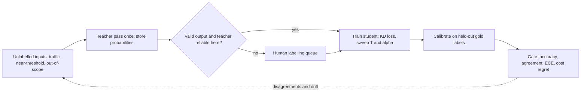

You route 100,000 support tickets a month into four queues: `billing`, `account_access`, `technical`, `orders`. A large model routes them well but costs too much per call ([§5](/c/practical-slm-decision-models/05-why-slms)). You have 500 human-labelled tickets and a million unlabelled ones. Distillation answers: what should the small model learn from — the 500 gold labels, the large model's label on each unlabelled ticket, or the large model's full probability vector? This section measures all three.

:::key[First principle]
A teacher's probability vector is the **expected value** of the label it would emit. Training on the vector instead of a sampled label removes the sampling noise from every gradient step and passes on how close the other classes were — which is exactly the information a decision model needs near its thresholds. Distillation is a **label-efficiency** technique first and a compression technique second.
:::

## 6.1 What a soft target carries that a label does not

Take one ticket — "I was charged twice and now I'm locked out" — and a teacher's logits $z = (4.0,\ 2.5,\ 1.0,\ -1.0)$ over (`billing`, `account_access`, `technical`, `orders`). The softmax gives $p_t = (0.781,\ 0.174,\ 0.039,\ 0.005)$.

**Bits.** A four-way hard label carries at most $\log_2 4 = 2$ bits, and it carries them about *which class*, nothing about the rest. The soft target fixes three independent log-ratios, $\ln(p_k / p_{\text{billing}})$. As a back-of-envelope figure (not a theorem): if each is meaningful to about ±0.1 nats over a ±5 nat range, that is $\log_2(100) \approx 6.6$ bits each, about 20 bits per example against at most 2. The exact number depends on how trustworthy the teacher's small probabilities are; the order of magnitude is the point.

**Gradient noise — the exact version.** For a softmax student with output $p_s$, the cross-entropy gradient with respect to the logits is $p_s - e_y$ for a hard label $y$, and $p_s - p_t$ for a soft target. If the hard label is a sample from the teacher, $y \sim p_t$, then

$$
\mathbb{E}_{y \sim p_t}\left[p_s - e_y\right] = p_s - p_t,
\qquad
\mathbb{E}\,\big\lVert (p_s - e_y) - (p_s - p_t) \big\rVert^2 = 1 - \sum_k p_{t,k}^2 .
$$

The soft-target gradient is the hard-label gradient with the noise averaged out. For this ticket the noise variance is \(1 - (0.781^2 + 0.174^2 + 0.039^2 + 0.005^2) = 0.357\); averaging $m$ independently sampled hard labels only shrinks it to \(0.357/m\).

```python run
"""Soft targets at different temperatures, and what each carries."""
import numpy as np

QUEUES = ["billing", "account_access", "technical", "orders"]
z = np.array([4.0, 2.5, 1.0, -1.0])          # teacher logits: "charged twice, now locked out"


def softmax(v, T=1.0):
    e = np.exp((v - v.max()) / T)
    return e / e.sum()


def bits(p):
    p = p[p > 0]
    return float(-(p * np.log2(p)).sum())


print("%-15s" % "queue" + "".join("%9s" % f"T={T}" for T in (1, 2, 4)))
for k, q in enumerate(QUEUES):
    print("%-15s" % q + "".join("%9.3f" % softmax(z, T)[k] for T in (1, 2, 4)))
print("%-15s" % "entropy (bits)" + "".join("%9.3f" % bits(softmax(z, T)) for T in (1, 2, 4)))
print("%-15s" % "2nd/1st ratio" + "".join("%9.3f" % (np.sort(softmax(z, T))[-2] / softmax(z, T).max())
                                          for T in (1, 2, 4)))

# a hard label is one draw from the teacher; its gradient is noisy around the soft one
p = softmax(z)
var_hard = 1 - (p ** 2).sum()                # E||onehot(y) - p||^2 with y ~ p
print()
print("max information in a 4-way hard label: %.3f bits" % np.log2(len(QUEUES)))
print("gradient variance of one hard label vs its soft target: %.3f (soft: 0)" % var_hard)
for n in (1, 4, 16):
    print("  averaging %2d sampled hard labels leaves variance %.3f" % (n, var_hard / n))
```

```output
queue                T=1      T=2      T=4
billing            0.781    0.563    0.409
account_access     0.174    0.266    0.281
technical          0.039    0.126    0.193
orders             0.005    0.046    0.117
entropy (bits)     0.939    1.556    1.863
2nd/1st ratio      0.223    0.472    0.687

max information in a 4-way hard label: 2.000 bits
gradient variance of one hard label vs its soft target: 0.357 (soft: 0)
  averaging  1 sampled hard labels leaves variance 0.357
  averaging  4 sampled hard labels leaves variance 0.089
  averaging 16 sampled hard labels leaves variance 0.022
```

:::example[Worked example · what the vector says about this ticket]
The label says `billing`. The vector says `billing` at 0.781 **and** `account_access` at 0.174 — 4.5× more plausible than `technical` (0.039) and 33× more than `orders` (0.005; the exact ratio is $e^{3.5}$). A student trained on the vector learns that "charged twice" tickets sit near the billing/account boundary, which is where a routing policy needs a review band. A student trained on the label learns only that this point is billing.
:::

## 6.2 Temperature: making small probabilities visible

At $T = 1$ the teacher's small probabilities are tiny (0.005 for `orders`); their contribution to a cross-entropy loss is tiny too. Dividing the logits by a temperature $T > 1$ before the softmax flattens the distribution without changing its ranking:

$$
q_k(T) = \frac{\exp(z_k / T)}{\sum_j \exp(z_j / T)},
\qquad
\frac{q_j(T)}{q_k(T)} = \exp\!\left(\frac{z_j - z_k}{T}\right).
$$

Every ratio between two classes is the $T=1$ ratio raised to the power \(1/T\). At $T = 4$ the `account_access`/`billing` ratio goes from 0.223 to \(0.223^{1/4} = 0.687\), and entropy rises from 0.94 to 1.86 bits (the maximum for four classes is 2).

:::chart[One ticket's teacher distribution at three temperatures]{type="bar" y="probability" yfmt="dec2" labels="true"}
queue, T=1, T=2, T=4
billing, 0.781, 0.563, 0.409
account_access, 0.174, 0.266, 0.281
technical, 0.039, 0.126, 0.193
orders, 0.005, 0.046, 0.117
:::

Temperature is applied **identically** to teacher and student during training and removed ($T = 1$) at inference. It changes what the loss pays attention to, not what the student predicts.

## 6.3 The distillation loss and the T² factor

With student logits $z_s$, teacher logits $z_t$, gold label $y$ (if you have one), weight $\alpha \in [0, 1]$ and temperature $T$:

$$
\mathcal{L} = \alpha\, \mathrm{CE}\big(y,\ \sigma(z_s)\big) + (1-\alpha)\, T^2\, \mathrm{KL}\Big(\sigma(z_t / T)\ \big\Vert\ \sigma(z_s / T)\Big)
$$

where $\sigma$ is the softmax. The KL term and $\mathrm{CE}(\sigma(z_t/T), \sigma(z_s/T))$ differ by the teacher's entropy, which does not depend on the student, so they have the same gradient.

**Why $T^2$.** Write $q_s = \sigma(z_s/T)$ and $q_t = \sigma(z_t/T)$. The chain rule through $z_s/T$ gives

$$
\frac{\partial\, \mathrm{KL}(q_t \Vert q_s)}{\partial z_{s,k}} = \frac{1}{T}\,\big(q_{s,k} - q_{t,k}\big).
$$

For large $T$, $\exp(z/T) \approx 1 + z/T$, so with logits centred to zero mean $q_k \approx \frac{1}{K} + \frac{z_k}{K\,T}$ and

$$
\frac{\partial\, \mathrm{KL}}{\partial z_{s,k}} \approx \frac{1}{T}\cdot\frac{z_{s,k} - z_{t,k}}{K\,T} = \frac{z_{s,k} - z_{t,k}}{K\,T^2}.
$$

The soft-target gradient shrinks as \(1/T^2\). Multiplying the term by $T^2$ makes its gradient $\approx (z_{s,k} - z_{t,k})/K$, independent of $T$ — so you can change $T$ without silently re-weighting it against the hard-label term, and $\alpha$ keeps its meaning. The same limit shows what high-temperature distillation becomes: squared-error matching of centred logits.

:::details[The same loss in torch — the only part of a training loop that differs from fine-tuning]
```python
import torch
import torch.nn.functional as F


def distill_loss(s_logits, t_logits, labels=None, T=2.0, alpha=0.3):
    """alpha * CE(gold) + (1 - alpha) * T^2 * KL(teacher_T || student_T)."""
    soft = F.kl_div(F.log_softmax(s_logits / T, dim=-1),
                    F.softmax(t_logits / T, dim=-1),
                    reduction="batchmean") * T ** 2
    if labels is None:                       # no gold labels: pure distillation
        return soft
    return alpha * F.cross_entropy(s_logits, labels) + (1 - alpha) * soft


def train_epoch(student, loader, optimiser, T=2.0, alpha=0.3, grad_clip=1.0):
    """loader yields input_ids, attention_mask, pre-computed teacher_logits, optional labels."""
    student.train()
    for batch in loader:
        s_logits = student(input_ids=batch["input_ids"],
                           attention_mask=batch["attention_mask"]).logits
        loss = distill_loss(s_logits, batch["teacher_logits"], batch.get("labels"), T, alpha)
        optimiser.zero_grad(set_to_none=True)
        loss.backward()
        torch.nn.utils.clip_grad_norm_(student.parameters(), grad_clip)
        optimiser.step()
```
`F.kl_div` takes the student's **log**-probabilities as input and the teacher's probabilities as target; swapping them is the most common silent bug.
:::

## 6.4 The experiment: hard labels versus soft targets across label budgets

The setup isolates the three things a student can learn from, on the same inputs:

- **gold hard** — human labels, with 10% of them random (realistic annotation noise);
- **teacher hard** — the teacher's argmax on each input;
- **teacher soft** — the teacher's full probability vector.

The teacher is a 2-layer MLP trained on its own 15,000 gold-labelled examples. The student is softmax regression on 90 quadratic features — deliberately smaller in capacity, so it cannot copy the teacher exactly. Each budget $n$ is averaged over 5 random subsets; accuracy is against gold test labels, agreement is with the teacher's argmax.

```python run
"""Hard labels vs teacher soft targets: same student, same inputs, growing label budget."""
import numpy as np
from sklearn.datasets import make_classification
from sklearn.neural_network import MLPClassifier
from sklearn.preprocessing import PolynomialFeatures, StandardScaler

K = 4                                                     # four ticket queues
X, y = make_classification(n_samples=40_000, n_features=12, n_informative=8, n_redundant=2,
                           n_classes=K, n_clusters_per_class=2, class_sep=1.0, flip_y=0.10,
                           random_state=0)               # flip_y: 10% of gold labels are random
Xt, yt = X[:15_000], y[:15_000]                           # the teacher's own training set
Xp, yp = X[15_000:30_000], y[15_000:30_000]               # student pool
Xe, ye = X[30_000:], y[30_000:]                           # test set

teacher = MLPClassifier((128, 64), max_iter=300, early_stopping=True, random_state=0).fit(Xt, yt)
t_pool, t_test = teacher.predict_proba(Xp), teacher.predict_proba(Xe)
print("teacher test accuracy %.3f" % (t_test.argmax(1) == ye).mean())

feats = PolynomialFeatures(2, include_bias=False)        # student: linear on 90 quadratic features
scale = StandardScaler().fit(feats.fit_transform(Xp))
Fp, Fe = (scale.transform(feats.transform(A)) for A in (Xp, Xe))


def softmax(z):
    e = np.exp(z - z.max(1, keepdims=True))
    return e / e.sum(1, keepdims=True)


def fit(Fx, target, T=1.0, steps=400, lr=0.3, l2=1e-3):
    """Softmax regression trained on T^2 * CE(target_T, student_T); returns weights."""
    q = softmax(np.log(np.clip(target, 1e-9, 1)) / T)    # soften the target at the same T
    W = np.zeros((Fx.shape[1], K))
    for _ in range(steps):
        g = T * (softmax(Fx @ W / T) - q) / len(Fx)       # d(T^2 * CE)/dz
        W -= lr * (Fx.T @ g + l2 * W)
    return W


def run(n, seeds=5):
    """Mean test accuracy and teacher agreement for the three kinds of target."""
    res = {"gold hard": [], "teacher hard": [], "teacher soft": []}
    for seed in range(seeds):
        i = np.random.default_rng(seed).permutation(len(Fp))[:n]
        tgts = {"gold hard": np.eye(K)[yp[i]], "teacher hard": np.eye(K)[t_pool[i].argmax(1)],
                "teacher soft": t_pool[i]}
        for name, tgt in tgts.items():
            pred = (Fe @ fit(Fp[i], tgt)).argmax(1)
            res[name].append(((pred == ye).mean(), (pred == t_test.argmax(1)).mean()))
    return {k: np.mean(v, axis=0) for k, v in res.items()}


print("%6s %10s %13s %13s %12s %12s" % ("n", "gold hard", "teacher hard", "teacher soft",
                                         "agree hard", "agree soft"))
for n in (50, 100, 200, 500, 1000, 2000, 5000, 15000):
    r = run(n)
    print("%6d %10.3f %13.3f %13.3f %12.3f %12.3f" % (n, r["gold hard"][0], r["teacher hard"][0],
          r["teacher soft"][0], r["teacher hard"][1], r["teacher soft"][1]))
```

```output
teacher test accuracy 0.867
     n  gold hard  teacher hard  teacher soft   agree hard   agree soft
    50      0.499         0.575         0.597        0.617        0.647
   100      0.545         0.628         0.657        0.681        0.718
   200      0.619         0.693         0.717        0.755        0.786
   500      0.705         0.761         0.779        0.837        0.859
  1000      0.752         0.786         0.795        0.866        0.878
  2000      0.781         0.797         0.803        0.881        0.888
  5000      0.798         0.806         0.807        0.892        0.893
 15000      0.805         0.810         0.811        0.897        0.897
```

:::chart[Student test accuracy vs number of labelled examples]{type="line" x="labelled training examples" y="test accuracy" xlog="true" yfmt="pct" ymin="0.45" ymax="0.9" hmarks="0.867:teacher" dash="gold hard"}
n, gold hard, teacher hard, teacher soft
50, 0.499, 0.575, 0.597
100, 0.545, 0.628, 0.657
200, 0.619, 0.693, 0.717
500, 0.705, 0.761, 0.779
1000, 0.752, 0.786, 0.795
2000, 0.781, 0.797, 0.803
5000, 0.798, 0.806, 0.807
15000, 0.805, 0.810, 0.811
:::

:::chart[Student agreement with the teacher's decision]{type="line" x="labelled training examples" y="agreement with teacher argmax" xlog="true" yfmt="pct" ymin="0.55" ymax="0.95"}
n, teacher hard, teacher soft
50, 0.617, 0.647
100, 0.681, 0.718
200, 0.755, 0.786
500, 0.837, 0.859
1000, 0.866, 0.878
2000, 0.881, 0.888
5000, 0.892, 0.893
15000, 0.897, 0.897
:::

## 6.5 Reading the curves

**Soft beats hard at the same budget, and the gap closes.** Soft targets add 2.2–2.9 points of accuracy at $n \le 200$, 1.8 at 500, 0.9 at 1,000 and nothing measurable from 5,000 up. Interpolating the teacher-hard curve in $\log n$, the soft student at $n = 100$ matches a hard student trained on about 136 examples, and at $n = 500$ one trained on about 820 — soft targets are worth roughly 1.4–1.6× as many labels in this range.

**Cleaner labels matter more than softer ones here.** The jump from gold-hard to teacher-hard (8.3 points at $n = 100$) is about three times the jump from teacher-hard to teacher-soft (2.9). The gold labels carry 10% random noise; the teacher, trained on 15,000 of them, has averaged most of it away. In your data the ratio depends on how noisy your annotation is — measure both gaps.

**Nobody reaches the teacher.** The best student sits at 81.1% against the teacher's 86.7% and agrees with it 89.7% of the time. The ceiling is set by the student's capacity, not by the loss. Distillation moves you along the curve faster; it does not raise the curve.

**The budget that matters is teacher calls on unlabelled inputs.** With 500 gold labels the best you can do is 70.5%. With 15,000 unlabelled tickets labelled by a teacher, the same student reaches 81.1%. That — not the soft/hard gap — is the main economic argument for distillation.

## 6.6 Temperature, filtering and calibration on the same data

The next block continues from the one above (it reuses `fit`, `Fp`, `t_pool` and friends).

```python run
"""Continues from the block above: temperature, confidence filtering, calibration."""
from sklearn.isotonic import IsotonicRegression


def acc_agree(W):
    pred = (Fe @ W).argmax(1)
    return (pred == ye).mean(), (pred == t_test.argmax(1)).mean()


print("temperature sweep at n=200 (mean of 5 subsets): accuracy / agreement")
for T in (1.0, 2.0, 4.0, 8.0):
    r = np.mean([acc_agree(fit(Fp[i], t_pool[i], T=T)) for i in
                 (np.random.default_rng(s).permutation(len(Fp))[:200] for s in range(5))], axis=0)
    print("  T=%-3g %.3f / %.3f" % (T, *r))

print("\nfilter the 15k teacher-labelled pool by teacher confidence")
conf = t_pool.max(1)
for tau in (0.0, 0.5, 0.7, 0.9):
    keep = conf >= tau
    hard = acc_agree(fit(Fp[keep], np.eye(K)[t_pool[keep].argmax(1)]))[0]
    soft = acc_agree(fit(Fp[keep], t_pool[keep]))[0]
    print("  tau=%.1f keeps %5.1f%%  hard acc %.3f  soft acc %.3f" % (tau, 100 * keep.mean(), hard, soft))


def ece(conf, correct, bins=10):
    """Top-label expected calibration error."""
    idx = np.minimum((conf * bins).astype(int), bins - 1)
    return sum(abs(correct[idx == b].mean() - conf[idx == b].mean()) * (idx == b).mean()
               for b in range(bins) if (idx == b).any())


def nll(p, y):
    return -np.log(np.clip(p[np.arange(len(y)), y], 1e-12, 1)).mean()


W = fit(Fp[:2000], t_pool[:2000])                        # a distilled student
val, val_y = Fp[2000:3000], yp[2000:3000]                # 1,000 gold labels held out for calibration
temps = np.linspace(0.5, 3.0, 51)
T_star = temps[np.argmin([nll(softmax(val @ W / t), val_y) for t in temps])]
p_val, p_test = softmax(val @ W), softmax(Fe @ W)
iso = IsotonicRegression(out_of_bounds="clip").fit(p_val.max(1), p_val.argmax(1) == val_y)

print("\ncalibration against gold labels (test set)")
for name, p in (("teacher", t_test), ("student", p_test), ("student, T=%.2f" % T_star,
                                                            softmax(Fe @ W / T_star))):
    print("  %-22s ECE %.3f  NLL %.3f" % (name, ece(p.max(1), p.argmax(1) == ye), nll(p, ye)))
print("  %-22s ECE %.3f" % ("student, isotonic top", ece(iso.predict(p_test.max(1)),
                                                        p_test.argmax(1) == ye)))
```

```output
temperature sweep at n=200 (mean of 5 subsets): accuracy / agreement
  T=1   0.717 / 0.786
  T=2   0.712 / 0.780
  T=4   0.705 / 0.773
  T=8   0.701 / 0.769

filter the 15k teacher-labelled pool by teacher confidence
  tau=0.0 keeps 100.0%  hard acc 0.810  soft acc 0.811
  tau=0.5 keeps  96.0%  hard acc 0.809  soft acc 0.811
  tau=0.7 keeps  83.0%  hard acc 0.807  soft acc 0.808
  tau=0.9 keeps  48.8%  hard acc 0.797  soft acc 0.800

calibration against gold labels (test set)
  teacher                ECE 0.055  NLL 0.513
  student                ECE 0.081  NLL 0.676
  student, T=1.10        ECE 0.096  NLL 0.676
  student, isotonic top  ECE 0.021
```

Three results, each against a common assumption:

**Higher temperature did not help this student.** Accuracy fell monotonically from 71.7% at $T = 1$ to 70.1% at $T = 8$. High $T$ asks the student to match the teacher's smallest logits too; a low-capacity student spends capacity on them that it needs for the boundary. Treat $T$ as a hyperparameter to sweep on a validation slice (1, 2, 4 is enough), not a constant to copy from a paper.

**Confidence filtering cost accuracy.** Keeping only examples where the teacher is ≥ 0.9 confident threw away 51% of the pool and lost 1.1 points (81.1% → 80.0%). The discarded examples are the boundary cases — the ones that teach where the boundary is. Filter only when low-confidence teacher outputs are measurably *worse* than their confidence says (check on a gold sample), or are malformed; route them to human labelling rather than dropping them.

**Distillation copies the teacher's miscalibration, and one temperature cannot fix it.** The student's reliability curve bends both ways, so the NLL-optimal temperature is $T = 1.10$, NLL does not move (0.676), and ECE gets *worse* (0.081 → 0.096). An isotonic map on the top-label confidence, fitted on 1,000 held-out gold labels, cuts ECE to 0.021.

:::chart[Reliability of the distilled student (bins of 0.1, labelled by midpoint)]{type="line" x="predicted confidence" y="observed accuracy" diag="true" xmin="0.4" xmax="1" ymin="0.4" ymax="1" xfmt="dec2" yfmt="dec2"}
confidence, raw student, after isotonic
0.45, 0.596, 0.511
0.55, 0.658, 0.610
0.65, 0.781, 0.675
0.75, 0.841, 0.822
0.85, 0.881, 0.868
0.95, 0.911, 0.914
:::

The raw student is **underconfident** between 0.4 and 0.8 (it says 0.55, it is right 66% of the time) and **overconfident** above 0.9 (says 0.96, right 91%). A temperature stretches or squeezes all confidences in one direction, so it cannot fix both. For a decision model this matters directly: every threshold in [§4](/c/practical-slm-decision-models/04-decision-theory) assumes the probabilities are calibrated. Calibration methods and their checks are in [§7](/c/practical-slm-decision-models/07-probabilities-and-calibration).

## 6.7 The practical recipe



1. **Collect inputs, not labels.** Sample real traffic, then over-sample the cases near your decision thresholds and add out-of-scope inputs the student must learn to send to review. The inputs you choose are the design decision; the student only ever sees what the teacher labelled.
2. **Run the teacher once and store the distribution.** Four queues in float16 cost 8 bytes per example — 8 MB for a million tickets. Train the student as many times as you like without paying for the teacher again.
3. **Get a distribution even from a generative teacher.** If the teacher is an LLM API, use the log-probabilities of the label tokens when they are exposed. Otherwise sample it $m$ times and use the empirical frequencies: from §6.1, that leaves gradient variance \(0.357/m\) for the example ticket — 16 samples reach 0.022, at 16× the teacher cost. Decide $m$ with the cost numbers in §5.
4. **Filter on validity, not on confidence.** Drop unparseable or out-of-schema teacher outputs. Do not drop low-confidence ones by default (§6.6 lost 1.1 points doing so); send them to humans if the teacher is unreliable there.
5. **Hold back gold labels for evaluation and calibration.** Even 1,000 is enough to fit an isotonic calibrator and to check that the student is not just faithfully copying teacher errors. Never evaluate the student only against the teacher.
6. **Sweep $T \in \{1, 2, 4\}$ and $\alpha \in \{0, 0.3, 0.5\}$** on a validation slice. Use $\alpha > 0$ only when you have gold labels for the training inputs.
7. **Calibrate after distillation, then re-derive the thresholds** from the cost matrix. Gate the release on cost regret, not accuracy alone.

:::warn[Diagnosing a student]
| Symptom | Likely cause | Fix |
| --- | --- | --- |
| Good agreement on train, collapses on validation | Input distribution too narrow | Add real traffic and near-threshold slices |
| Agreement plateaus well below 1 | Student capacity ceiling (§6.5: 89.7%) | Larger student, or accept and measure the cost |
| Higher $T$ makes it worse | Small student spending capacity on tiny logits | Lower $T$; sweep 1, 2, 4 |
| Rare queue near zero recall | Teacher probabilities inherit class imbalance | Over-sample rare-class inputs before the teacher pass |
| Confident and wrong on odd inputs | No out-of-scope inputs in the teacher pass | Add them, with a review/abstain target |
| Probabilities off after distillation | Teacher miscalibration copied (§6.6) | Isotonic or per-class calibration on gold labels |
| Student "beats" the teacher on gold | Teacher worse than assumed on this slice | Re-check the teacher; you cannot rely on its labels here |
:::

## 6.8 Check yourself

:::qa[A teacher outputs (0.6, 0.3, 0.1) for a ticket. What is the gradient-noise variance of training on one sampled hard label instead, and how many sampled labels would bring it below 0.05?]
\(1 - (0.36 + 0.09 + 0.01) = 0.54\). Averaging $m$ samples gives \(0.54/m < 0.05\), so $m \ge 11$. The soft target gives zero sampling variance in one teacher pass.
:::

:::qa[At T = 2, what happens to a teacher ratio p_j/p_k of 0.04?]
Ratios are raised to the power \(1/T\): \(0.04^{1/2} = 0.2\). The rarer class becomes five times more visible relative to the top class; the ranking does not change.
:::

:::qa[Why multiply the soft term by T²? What goes wrong if you drop it and move from T = 1 to T = 4?]
The soft-term gradient scales as roughly \(1/T^2\) for large $T$. Without the factor, going from $T=1$ to $T=4$ shrinks the soft gradient by about 16×, so a fixed $\alpha = 0.3$ effectively becomes almost pure hard-label training, and you would wrongly conclude that higher $T$ hurts or helps.
:::

:::qa[You have 300 gold labels and 200,000 unlabelled tickets. What do you train on?]
Teacher distributions on the unlabelled tickets (pure KD, $\alpha = 0$), keeping the 300 gold labels for evaluation and calibration. In §6.4 the step from a small gold set to a large teacher-labelled pool (70.5% → 81.1%) was far larger than any soft-versus-hard gap.
:::

:::qa[After distillation, temperature scaling leaves NLL unchanged and makes ECE worse. What does that tell you?]
The miscalibration is not a uniform over- or under-confidence; the reliability curve bends both ways (underconfident mid-range, overconfident at the top). A single scalar cannot fix it — use a monotone non-parametric map such as isotonic regression on held-out gold labels, then re-derive the decision thresholds.
:::

Next: [§7 Probabilities, thresholds, and calibration](/c/practical-slm-decision-models/07-probabilities-and-calibration) — turning the student's scores into probabilities the cost formulas can use.
