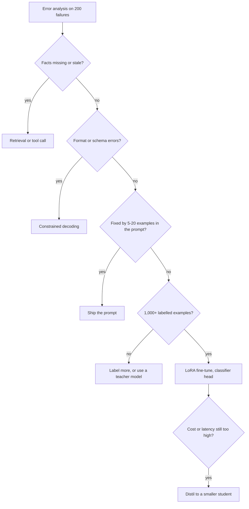

The support-ticket router handles 100,000 tickets a month across four queues. A prompted SLM gets the easy tickets right and keeps confusing `billing` with `account_access` whenever a refund is tied to a login problem. You have 20,000 historically routed tickets. The question is not "should we fine-tune?" but **which intervention removes this particular error at the lowest total cost** — and, if it is fine-tuning, how big the update, the GPU and the dataset need to be.

:::key[First principle]
Fine-tuning changes the **mapping** from input to output; it does not reliably add facts and it cannot add capacity the base model lacks. LoRA constrains that change to a low-rank update $\Delta W = BA$, which cuts trainable parameters by ~100× and optimizer memory with it. How far the mapping can move is set by the labels: their count, their noise and their class balance — and all three show up in the probabilities you threshold.
:::

## 8.1 Diagnose before you train

| Observed failure | First intervention | Why | Fine-tune? |
|---|---|---|---|
| Missing or changing facts (prices, policies, account state) | Retrieval / tool call | Facts change weekly; weights do not | No |
| Output format drifts, invalid JSON | Schema-constrained decoding (§9) | A grammar fixes format with zero training | No |
| Consistent confusion between two labels | Few-shot examples, then fine-tune on labelled data | The mapping itself is wrong | Yes, if examples don't fix it |
| Domain vocabulary, internal jargon | Fine-tune (LoRA) | Behaviour change over many inputs | Yes |
| Good accuracy, too slow or expensive at volume | Distil into a smaller student (§6) | Same mapping, cheaper model | Yes (student) |
| Needs multi-step reasoning the model fails at | Larger model or task decomposition | Fine-tuning cannot add capacity | Rarely |
| Closed label set, labelled data, need calibrated $P(y \mid x)$ | Classification head on the SLM | Direct probabilities, one forward pass | Yes (head ± LoRA) |



Read the "1,000+" as a starting heuristic, not a law; §8.5 shows how to measure what your task actually needs.

## 8.2 What training optimises

**Generative fine-tuning (SFT).** The model predicts the next token. For a training sequence of prompt tokens followed by target tokens $x_1, \dots, x_T$, with a mask $m_t = 1$ only on target tokens:

$$
\mathcal{L}(\theta) = -\frac{1}{\sum_t m_t}\sum_{t=1}^{T} m_t \log P_\theta(x_t \mid x_{<t}).
$$

Masking the prompt matters: without it, most of the gradient teaches the model to reproduce ticket text instead of choosing the queue.

**Classification head.** For a closed label set, put a linear layer on the final hidden state $h(x) \in \mathbb{R}^d$ and train with cross-entropy over $K$ classes:

$$
P_\theta(y = k \mid x) = \operatorname{softmax}\bigl(W_{\text{head}}\, h(x) + b\bigr)_k, \qquad
\mathcal{L} = -\frac{1}{N}\sum_{i} \log P_\theta(y_i \mid x_i).
$$

For a decision model this is usually the better shape: one forward pass, no parsing, no output-format failures, and a probability vector you can calibrate directly (§7). The head adds $K(d+1)$ parameters — $4 \times 2049 = 8{,}196$ for a 2048-wide model.

## 8.3 LoRA from first principles

A linear layer computes $h = W x$ with $W \in \mathbb{R}^{d_{out} \times d_{in}}$. Full fine-tuning learns a dense update $\Delta W$ with $d_{out} d_{in}$ entries. LoRA freezes $W$ and learns the update as a product of two thin matrices:

$$
h = W x + \frac{\alpha}{r} B A x, \qquad A \in \mathbb{R}^{r \times d_{in}},\; B \in \mathbb{R}^{d_{out} \times r},\; r \ll \min(d_{in}, d_{out}).
$$

- **Parameters:** $r(d_{in} + d_{out})$ instead of $d_{in} d_{out}$. For a square layer the ratio is $2r/d$.
- **Initialisation:** $A$ random, $B = 0$, so $\Delta W = 0$ at step 0 and training starts exactly at the base model.
- **Scaling:** $\alpha / r$ keeps the update's magnitude roughly stable when you change $r$, so the learning rate does not need re-tuning for every rank.
- **Inference:** merge once, $W' = W + \frac{\alpha}{r}BA$, and the served model has exactly the base architecture — zero added latency. Keep adapters unmerged only if you hot-swap several of them on one base.

:::example[Worked example · one 2048 × 2048 projection]
Full update: $2048 \times 2048 = 4{,}194{,}304$ parameters.

- $r = 8$: $8 \times (2048 + 2048) = 32{,}768$ parameters — $0.78\%$ of the layer ($2r/d = 16/2048$).
- $r = 16$: $16 \times 4096 = 65{,}536$ — $1.56\%$.

The update is restricted to rank $\le r$: it can move the layer along at most $r$ directions in input space. The bet behind LoRA is that a task adaptation needs few directions; a task that needs many (new language, new modality) is where low rank starts to cost quality.
:::

Scaling the same arithmetic to whole models, using the published shapes of Llama-3.2-1B (hidden 2048, 16 layers, MLP 8192, grouped-query attention with 512-wide K/V projections, 128,256-token tied embedding) and Llama-3.2-3B (hidden 3072, 28 layers, MLP 8192, 1024-wide K/V):

```python run
GB = 1e9
configs = {   # published shapes: hidden, layers, MLP width, KV width, vocab (embeddings tied)
    "Llama-3.2-1B": dict(d=2048, L=16, ff=8192, kv=512, V=128256),
    "Llama-3.2-3B": dict(d=3072, L=28, ff=8192, kv=1024, V=128256),
}

def shapes(c):                 # (d_in, d_out) of every linear layer in one block
    d, ff, kv = c["d"], c["ff"], c["kv"]
    attn = {"q": (d, d), "k": (d, kv), "v": (d, kv), "o": (d, d)}
    mlp = {"gate": (d, ff), "up": (d, ff), "down": (ff, d)}
    return attn, mlp

print("one d x d layer, d=2048: full", 2048 * 2048, "| r=8:", 8 * (2048 + 2048), "| r=16:", 16 * 4096)
for name, c in configs.items():
    attn, mlp = shapes(c)
    per_block = sum(i * o for i, o in {**attn, **mlp}.values()) + 2 * c["d"]
    emb = c["V"] * c["d"]
    total = c["L"] * per_block + emb + c["d"]
    print(f"\n{name}: {total / 1e9:.3f}B params ({emb / 1e6:.0f}M of them in the embedding)")
    for r in (8, 16, 64):
        lora_attn = c["L"] * sum(r * (i + o) for i, o in attn.values())
        lora_all = c["L"] * sum(r * (i + o) for i, o in {**attn, **mlp}.values())
        print(f"  LoRA r={r:2d}: attention-only {lora_attn / 1e6:6.2f}M ({lora_attn / total:.2%})"
              f" | all linear {lora_all / 1e6:6.2f}M ({lora_all / total:.2%})")
    r16 = c["L"] * sum(16 * (i + o) for i, o in {**attn, **mlp}.values())
    body = total - emb
    # bytes per param: bf16 weight 2, bf16 grad 2, fp32 master 4, Adam m and v 4 + 4
    full = dict(weights=2 * total, grads=2 * total, optimizer=12 * total)
    lora = dict(weights=2 * total + 2 * r16, grads=2 * r16, optimizer=12 * r16)
    # NF4 = 4 bits + ~0.127 bits of double-quantised block scales; embedding stays bf16
    qlora = dict(weights=body * 4.127 / 8 + 2 * emb + 2 * r16, grads=2 * r16, optimizer=12 * r16)
    for label, m in (("full FT", full), ("LoRA r=16", lora), ("QLoRA r=16", qlora)):
        print(f"  {label:11s} weights {m['weights'] / GB:5.2f}  grads {m['grads'] / GB:5.2f}"
              f"  optimizer {m['optimizer'] / GB:5.2f}  = {sum(m.values()) / GB:5.2f} GB + activations")
```

```output
one d x d layer, d=2048: full 4194304 | r=8: 32768 | r=16: 65536

Llama-3.2-1B: 1.236B params (263M of them in the embedding)
  LoRA r= 8: attention-only   1.70M (0.14%) | all linear   5.64M (0.46%)
  LoRA r=16: attention-only   3.41M (0.28%) | all linear  11.27M (0.91%)
  LoRA r=64: attention-only  13.63M (1.10%) | all linear  45.09M (3.65%)
  full FT     weights  2.47  grads  2.47  optimizer 14.83  = 19.77 GB + activations
  LoRA r=16   weights  2.49  grads  0.02  optimizer  0.14  =  2.65 GB + activations
  QLoRA r=16  weights  1.05  grads  0.02  optimizer  0.14  =  1.21 GB + activations

Llama-3.2-3B: 3.213B params (394M of them in the embedding)
  LoRA r= 8: attention-only   4.59M (0.14%) | all linear  12.16M (0.38%)
  LoRA r=16: attention-only   9.18M (0.29%) | all linear  24.31M (0.76%)
  LoRA r=64: attention-only  36.70M (1.14%) | all linear  97.26M (3.03%)
  full FT     weights  6.43  grads  6.43  optimizer 38.55  = 51.40 GB + activations
  LoRA r=16   weights  6.47  grads  0.05  optimizer  0.29  =  6.81 GB + activations
  QLoRA r=16  weights  2.29  grads  0.05  optimizer  0.29  =  2.63 GB + activations
```

## 8.4 Memory: where the bytes go

Mixed-precision training with Adam keeps, for every **trainable** parameter: a bf16 weight (2 bytes), a bf16 gradient (2), an fp32 master copy (4), and Adam's first and second moments (4 + 4) — **16 bytes per trainable parameter**. Frozen parameters cost only their storage.

$$
\begin{aligned}
\text{Full FT, 1.236B:}\quad & 1.236 \times 10^9 \times 16\ \text{B} = 19.77\ \text{GB} \\
\text{LoRA } r{=}16\text{:}\quad & \underbrace{1.236 \times 10^9 \times 2}_{\text{frozen bf16}} + \underbrace{11.27 \times 10^6 \times 16}_{\text{adapters}} = 2.47 + 0.18 = 2.65\ \text{GB} \\
\text{QLoRA } r{=}16\text{:}\quad & \underbrace{0.973 \times 10^9 \times \tfrac{4.127}{8}}_{\text{NF4 blocks}} + \underbrace{0.263 \times 10^9 \times 2}_{\text{bf16 embedding}} + 0.18 = 0.50 + 0.53 + 0.18 = 1.21\ \text{GB}
\end{aligned}
$$

The 4.127 bits are QLoRA's 4-bit NormalFloat weights plus ~0.127 bits per parameter for the double-quantised block scales (Dettmers et al., 2023). The embedding stays in bf16 because quantisation libraries typically quantise only linear layers — for small models with large vocabularies that is a fifth of the parameters and nearly half of the QLoRA footprint.

:::chart[Training memory before activations]{type="bar" stacked="true" y="GB" note="16 bytes per trainable parameter (bf16 weight + bf16 grad + fp32 master + Adam m, v); LoRA/QLoRA adapters on all linear layers at r=16."}
setup, weights, gradients, optimizer state
1B full FT, 2.47, 2.47, 14.83
1B LoRA, 2.49, 0.02, 0.14
1B QLoRA, 1.05, 0.02, 0.14
3B full FT, 6.43, 6.43, 38.55
3B LoRA, 6.47, 0.05, 0.29
3B QLoRA, 2.29, 0.05, 0.29
:::

**Activations** are the missing term: they scale with batch size × sequence length × layers × hidden width and often dominate LoRA runs. Two levers: gradient checkpointing (recompute activations during the backward pass — one extra forward, roughly a third more compute when backward costs about twice forward) and shorter sequences — activation memory grows at least linearly with length, so tickets truncated at 512 tokens need at most a quarter of what 2,048 does.

:::tip[What the arithmetic says]
A 1B model can be fully fine-tuned on a single 24 GB GPU only with small batches and checkpointing (19.8 GB before activations); LoRA makes it comfortable at 2.7 GB; QLoRA fits a 3B model's training state in 2.6 GB, about a seventh of what full fine-tuning of the 1B needs. QLoRA trades memory for speed — the dequantisation in every forward and backward pass is extra compute — so use it when memory, not time, is the constraint.
:::

## 8.5 How much data: learning curves

The only reliable answer to "how many labels?" is your own learning curve: train on 250, 500, 1k, 2k, 4k examples, plot held-out quality against $n$ on a log axis, and extrapolate. Below is the shape of that experiment on a cheap **analogue** — a linear classifier on synthetic 4-class features standing in for the ticket router, *not* an SLM — with three kinds of training labels: clean, 20% randomly flipped to another queue, and *systematic* noise where 40% of queue-0 tickets are filed under queue 1 (10% of all labels).

:::details[Show the learning-curve code]
```python run
import numpy as np
from sklearn.datasets import make_classification
from sklearn.linear_model import LogisticRegression

# 4-queue ticket router as a linear model on synthetic features - an ANALOGUE, not an SLM.
X, y = make_classification(n_samples=40000, n_features=40, n_informative=12, n_redundant=8,
                           n_classes=4, n_clusters_per_class=1, class_sep=0.9, random_state=3)
X_pool, y_pool, X_te, y_te = X[:30000], y[:30000], X[30000:], y[30000:]

def corrupt(y, kind, rate, rng):
    y = y.copy()
    if kind == "random":                      # flip to a uniformly random other queue
        m = rng.random(len(y)) < rate
        y[m] = (y[m] + rng.integers(1, 4, m.sum())) % 4
    elif kind == "systematic":                # 40% of queue-0 tickets filed under queue 1
        m = (y == 0) & (rng.random(len(y)) < 2 * rate)
        y[m] = 1
    return y

sizes = (50, 100, 200, 500, 1000, 2000, 5000, 10000, 30000)
print(f"{'':6s} {'test accuracy':^31s} {'queue-0 recall':^19s}")
print(f"{'n':>6s} {'clean':>7s} {'20% random':>11s} {'systematic':>11s} {'clean':>9s} {'system.':>9s}")
for n in sizes:
    acc, rec = {}, {}
    for kind in ("clean", "random", "systematic"):
        a, r = [], []
        for seed in range(3):
            rng = np.random.default_rng(seed)
            idx = rng.choice(len(y_pool), n, replace=False)
            clf = LogisticRegression(max_iter=2000).fit(X_pool[idx], corrupt(y_pool[idx], kind, 0.20, rng))
            pred = clf.predict(X_te)
            a.append(np.mean(pred == y_te))
            r.append(np.mean(pred[y_te == 0] == 0))
        acc[kind], rec[kind] = np.mean(a), np.mean(r)
    print(f"{n:6d} {acc['clean']:7.3f} {acc['random']:11.3f} {acc['systematic']:11.3f}"
          f" {rec['clean']:9.3f} {rec['systematic']:9.3f}")
```
:::

```output
                test accuracy            queue-0 recall   
     n   clean  20% random  systematic     clean   system.
    50   0.598       0.426       0.525     0.543     0.290
   100   0.663       0.580       0.573     0.690     0.381
   200   0.690       0.556       0.628     0.717     0.497
   500   0.749       0.688       0.685     0.771     0.479
  1000   0.778       0.742       0.708     0.802     0.497
  2000   0.785       0.761       0.703     0.812     0.462
  5000   0.792       0.777       0.715     0.815     0.488
 10000   0.795       0.782       0.715     0.820     0.491
 30000   0.796       0.788       0.716     0.823     0.494
```

:::chart[Learning curves on the analogue task (linear model, synthetic 4-class data — not an SLM)]{type="line" xlog="true" x="training examples n" y="test accuracy (10,000 clean cases)" xfmt="int" yfmt="pct" ymin="0.4" ymax="0.85" dash="systematic noise"}
n, clean labels, 20% random noise, systematic noise
50, 0.598, 0.426, 0.525
100, 0.663, 0.580, 0.573
200, 0.690, 0.556, 0.628
500, 0.749, 0.688, 0.685
1000, 0.778, 0.742, 0.708
2000, 0.785, 0.761, 0.703
5000, 0.792, 0.777, 0.715
10000, 0.795, 0.782, 0.715
30000, 0.796, 0.788, 0.716
:::

Three lessons transfer to SLM fine-tuning, even though the numbers do not:

1. **Curves flatten.** Clean accuracy gains 15 points from 50 to 500 examples and 1.1 points from 2,000 to 30,000. When your curve is flat, more of the same data will not help; a bigger model, better features or a better label definition might.
2. **Random noise costs data, not the ceiling.** At 1,000–5,000 examples, 20% random noise matches clean data with roughly 3–5× fewer examples (noisy at 5,000 ≈ clean at 1,000: 0.777 vs 0.778), and by 30,000 the gap is under a point. Errors that point in random directions average out.
3. **Systematic noise sets a new ceiling.** The systematic curve plateaus at 0.716 and queue-0 recall stays near 0.49 (clean: 0.82) no matter how much data you add. The model faithfully learns the annotators' habit. Audit for *confusions*, not just error rates: one adjudicated batch of 200 queue-0/queue-1 tickets is worth more than 20,000 more labels.

:::warn[Teacher labels are systematic noise by construction]
Labels generated by a larger model (§6) carry that model's confusions consistently. Treat them like the "systematic" curve: measure the teacher's per-class confusion against a human-adjudicated gold set before training on them, and keep the gold set out of training.
:::

## 8.6 Splits: train, validation, calibration, test

Each split answers one question and must not be reused for another:

| Split | Used for | 20,000 tickets → |
|---|---|---:|
| Train | Gradient updates | 14,000 |
| Validation | Early stopping, hyperparameters, checkpoint choice | 2,000 |
| Calibration | Fitting $T$ / Platt / isotonic (§7) and the threshold check | 2,000 |
| Test | One final estimate, touched once per release | 2,000 |

Why 2,000 for test: at 85% accuracy the 95% interval half-width is $1.96\sqrt{0.85 \times 0.15 / 2000} = 0.016$, i.e. ±1.6 points. Halve the test set and it becomes ±2.2 points — too wide to see most fine-tuning gains.

**Split by group, then by time.** Tickets from the same customer, thread or template are near-duplicates; a random row split puts them on both sides and inflates the test score. Assign whole customers (or threads) to one split, and for anything time-dependent hold out the most recent weeks as test so the evaluation sees the drift production will.

:::warn[Leakage checks before the first training step]
- Exact and near-duplicate text across splits (hash normalised text; MinHash for near-duplicates).
- The same customer ID or thread ID in two splits.
- Features that encode the label: the final queue name in an internal note, a resolution code written after routing.
- Future information: for a ticket at time $t$, nothing created after $t$.
:::

## 8.7 Class imbalance and the threshold

A rare class tempts you to rebalance — `class_weight="balanced"`, oversampling, or undersampling the majority. All three train the model on a population where classes are (roughly) equal, so its outputs are calibrated for a **50% base rate**. Apply the §7 cost threshold to those outputs and you flag far too much.

The fix is §7's prior correction with $\pi_{\text{train}} = 0.5$ and $\pi = $ the true rate:

$$
\frac{p'}{1-p'} = \frac{p}{1-p}\times\frac{\pi/(1-\pi)}{0.5/0.5}.
$$

:::example[Worked example · a legal-complaint detector]
3.45% of training tickets are legal complaints. Illustrative costs: a missed legal ticket ₹5,000; an unnecessary legal-team review ₹400. Threshold $t = 400/(400 + 5000) = 0.0741$.

The balanced model outputs $p = 0.30$ for a ticket. Corrected: odds $0.30/0.70 = 0.4286$; times $0.0345/0.9655 = 0.03573$ gives $0.01531$; $p' = 0.01531/1.01531 = 0.0151$. Raw, it would be flagged ($0.30 > 0.074$); corrected, it is not ($0.015 < 0.074$).
:::

```python run
import numpy as np
from sklearn.datasets import make_classification
from sklearn.linear_model import LogisticRegression

# "Is this ticket a legal complaint?" - 3% of tickets. Illustrative costs:
# a missed legal ticket INR 5,000; a needless legal-team review INR 400.
C_FN, C_FP = 5000, 400
t = C_FP / (C_FP + C_FN)
X, y = make_classification(n_samples=60000, n_features=20, n_informative=6, weights=[0.97, 0.03],
                           n_clusters_per_class=1, class_sep=1.0, random_state=5)
tr, te = slice(0, 30000), slice(30000, None)
pi = y[tr].mean()

def shift(p, pi_old, pi_new):
    odds = p / (1 - p) * (pi_new / (1 - pi_new)) / (pi_old / (1 - pi_old))
    return odds / (1 + odds)

def report(name, p, yt, thr=t):
    flag = p > thr
    cost = np.mean(np.where(flag, (1 - yt) * C_FP, yt * C_FN))
    print(f"{name:36s} {p.mean():7.3f} {thr:6.3f} {flag.mean():8.1%} "
          f"{flag[yt == 1].mean():7.3f} {cost:8.1f}")

print(f"threshold t = {C_FP}/({C_FP}+{C_FN}) = {t:.4f}; train base rate {pi:.4f}; test n = {len(y[te])}")
print(f"{'model':36s} {'mean p':>7s} {'thr':>6s} {'flagged':>8s} {'recall':>7s} {'INR/tkt':>8s}")
plain = LogisticRegression(max_iter=2000).fit(X[tr], y[tr]).predict_proba(X[te])[:, 1]
bal = LogisticRegression(max_iter=2000, class_weight="balanced").fit(X[tr], y[tr]).predict_proba(X[te])[:, 1]
report("unweighted", plain, y[te])
report("class_weight='balanced'", bal, y[te])
report("balanced + prior correction 0.5->pi", shift(bal, 0.5, pi), y[te])
report("balanced, default 0.5 threshold", bal, y[te], 0.5)
```

```output
threshold t = 400/(400+5000) = 0.0741; train base rate 0.0345; test n = 30000
model                                 mean p    thr  flagged  recall  INR/tkt
unweighted                             0.034  0.074     5.6%   0.866     33.4
class_weight='balanced'                0.180  0.074    60.5%   0.940    239.4
balanced + prior correction 0.5->pi    0.024  0.074     4.1%   0.852     30.2
balanced, default 0.5 threshold        0.180  0.500     8.0%   0.868     42.6
```

The balanced model with the cost threshold flags 60.5% of all tickets and costs ₹239.4 per ticket — ₹23.9M a month at 100,000 tickets, against ₹3.0M for the corrected model. Note that the corrected mean probability (0.024) undershoots the true rate (0.0345): the reweighting is only approximately a prior change, so after correcting, **recalibrate on the calibration split** like any other model. The unweighted model needed no correction at all; with a cost-derived threshold, rebalancing is rarely necessary — the threshold already encodes how much you care about the rare class.

## 8.8 A practical recipe

1. **Freeze the evaluation first.** Gold test set, metrics (per-class recall, cost per ticket at the derived threshold, ECE), and the baseline: the prompted model's numbers on that set.
2. **Pick the shape.** Closed label set → classification head (+ LoRA on the body). Free-form extraction → SFT with prompt-masked loss.
3. **Start small.** LoRA on all linear layers, $r = 16$, 1–3 epochs on the training split. Evaluate on validation every few hundred steps.
4. **Learning curve.** Repeat at 25%, 50%, 100% of the training data. If the last doubling bought less than a point, stop labelling volume; fix label quality or try a larger base.
5. **Calibrate and threshold.** Fit $T$ on the calibration split, apply the cost threshold, report cost per ticket on test — once.
6. **Ship the triple.** Base checkpoint hash + adapter + calibration parameters are one versioned artefact; so is the tokenizer and the data snapshot.

Starting points — **typical ranges** reported across LoRA practice, not tuned values for your task:

| Hyperparameter | Typical range | First try | Notes |
|---|---|---|---|
| LoRA rank $r$ | 8–64 | 16 | Raise only if the learning curve says capacity, not data, is the limit |
| $\alpha$ | $r$ to $2r$ | 32 | Effective scale is $\alpha/r$ |
| LoRA dropout | 0–0.1 | 0.05 | More on small datasets |
| Target modules | attention only … all linear | all linear | All-linear costs 3.3× the parameters of attention-only (1B, §8.3) |
| Learning rate (LoRA) | 1e-4 – 3e-4 | 2e-4 | Full fine-tuning: ~10× lower (1e-5 – 5e-5) |
| Schedule | linear or cosine decay | cosine, 3–5% warm-up | |
| Effective batch | 16–128 sequences | 32 | Use gradient accumulation to reach it |
| Epochs | 1–5 | 2 | Stop on validation loss, not training loss |
| Max sequence length | task-dependent | p99 of ticket length | Truncation is a silent label-noise source |

The library sketch for a 4-way classifier with QLoRA (not run here; API per Hugging Face `transformers`, `peft`, `bitsandbytes`):

```python
import torch
from transformers import AutoModelForSequenceClassification, AutoTokenizer, BitsAndBytesConfig
from peft import LoraConfig, get_peft_model, prepare_model_for_kbit_training

base = "meta-llama/Llama-3.2-1B"
bnb = BitsAndBytesConfig(load_in_4bit=True, bnb_4bit_quant_type="nf4",
                         bnb_4bit_use_double_quant=True, bnb_4bit_compute_dtype=torch.bfloat16)
tok = AutoTokenizer.from_pretrained(base)
tok.pad_token = tok.eos_token
model = AutoModelForSequenceClassification.from_pretrained(
    base, num_labels=4, quantization_config=bnb, torch_dtype=torch.bfloat16)
model.config.pad_token_id = tok.pad_token_id
model = prepare_model_for_kbit_training(model)

lora = LoraConfig(r=16, lora_alpha=32, lora_dropout=0.05, task_type="SEQ_CLS",
                  target_modules=["q_proj", "k_proj", "v_proj", "o_proj",
                                  "gate_proj", "up_proj", "down_proj"])
model = get_peft_model(model, lora)      # the classification head is trained in full
model.print_trainable_parameters()
# then: Trainer / custom loop with cross-entropy, eval on validation every N steps,
# save adapter + head, fit temperature on the calibration split (§7).
```

:::warn[When not to fine-tune]
- The behaviour is achievable with a parser, a schema constraint, retrieval or a handful of examples.
- The facts change faster than you can retrain.
- You have no frozen test set — you will not be able to tell whether it worked.
- The data has not been reviewed for personal or sensitive content. Fine-tuned weights can reproduce training text; deleting a record later means retraining.
:::

## 8.9 Check yourself

:::qa[How many trainable parameters does LoRA r=8 add to one 3072 × 3072 projection, and what fraction is that?]
$8 \times (3072 + 3072) = 49{,}152$ against $3072^2 = 9{,}437{,}184$ — $2r/d = 16/3072 = 0.52\%$.
:::

:::qa[Why does full fine-tuning of a 1.24B model need ~20 GB before activations when the bf16 weights are only 2.5 GB?]
Every trainable parameter carries 16 bytes: bf16 weight (2) + bf16 gradient (2) + fp32 master (4) + Adam $m$ and $v$ (8). $1.236 \times 10^9 \times 16 = 19.8$ GB. LoRA pays the 16 bytes only for the ~11M adapter parameters.
:::

:::qa[Your learning curve went from 0.84 at 4k labels to 0.845 at 8k. The PM asks for 16k more labels. What do you say?]
The last doubling bought half a point; the next one will likely buy less. Spend the labelling budget on an error audit instead: look at the confusion matrix for a systematic confusion (§8.5) and adjudicate those pairs, or test a larger base model on the same 8k.
:::

:::qa[A rebalanced model outputs p = 0.5 for a ticket; the true base rate is 2%. What is the corrected probability?]
Odds $1 \times (0.02/0.98) = 0.0204$, so $p' = 0.0204/1.0204 = 0.020$. A 0.5 from a balanced model is "base rate" — exactly as informative as no model.
:::

:::qa[The test score jumped 6 points after fine-tuning. Name two checks before you believe it.]
(1) Group leakage: are customers or threads shared across train and test? Re-split by group and re-score. (2) Near-duplicate text across splits. Also confirm the test set was not used for checkpoint selection.
:::

Next: [§9 Prompt engineering as interface design](/c/practical-slm-decision-models/09-prompt-engineering) — when you are not training, the prompt is the interface, and it has to produce probabilities too.
