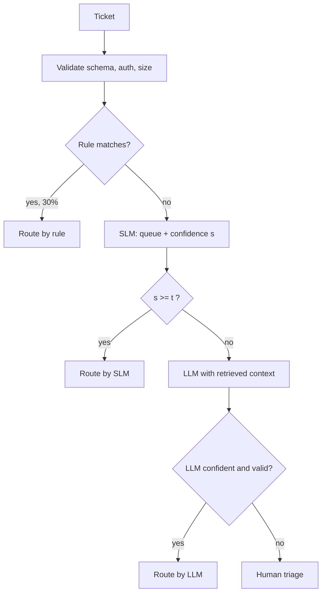

A support desk receives 100,000 tickets a month and must route each to one of four queues: billing, technical, account access, or general. A large model routes well but costs ₹2 a ticket and takes over a second. A fine-tuned small model costs a few paise and answers in 40 ms, but it is wrong more often on ambiguous tickets. A regex can route "password reset" requests perfectly and for free. People route everything correctly at ₹40 a ticket. No single component is best; the question is how to chain them so each ticket is resolved by the cheapest component that is good enough *for that ticket*.

:::key[First principle]
A cascade stage should accept a case when the expected cost of its own answer is lower than the price of asking the next stage **plus** the next stage's expected error cost on that case. Everything else in this section — cost formulas, thresholds, failure modes — follows from that one comparison.
:::

## 10.1 The cascade



Each stage has a job it is unusually good at:

| Stage | Good at | Cost / ticket (illustrative) | Latency | Typical failure |
|---|---|---:|---:|---|
| Rules | Exact patterns, permissions, arithmetic, state | ₹0.001 | ~2 ms | Stale rules silently shadow the model |
| SLM | High-volume, in-distribution classification | ₹0.05 | ~40 ms | Overconfident on shifted inputs |
| LLM | Ambiguous text, long context, rare intents | ₹2.00 | ~1.2 s | Same blind spots as the SLM on hard cases |
| Human | Anything, with accountability | ₹40 | hours | Queue capacity; inconsistency between reviewers |

The prices are illustrative, not quotes. Replace them with yours: SLM cost per ticket is (instance cost per hour) ÷ (tickets per hour at your batch size); LLM cost is tokens per ticket × price per token; human cost is loaded salary per hour ÷ tickets per hour.

Two rules keep the picture honest:

- **Gates use calibrated probabilities**, not raw softmax or a self-reported "confidence" field ([§7](/c/practical-slm-decision-models/07-probabilities-and-calibration)). A threshold of 0.92 on an uncalibrated score is a number with no meaning.
- **Confidence is never authorisation.** A 0.99 "account_access" prediction does not let the system reset a password. Permissions are checked by deterministic code before and after the model.

## 10.2 Expected cost of a cascade

Let stage $k$ cost $c_k$ per case it sees, and let $q_k$ be the fraction of the cases reaching stage $k$ that it passes on. The first stage sees everything; the second sees $q_1$; the third sees $q_1 q_2$. Expected running cost per case is therefore

$$
E[C] = c_1 + q_1 c_2 + q_1 q_2 c_3 + q_1 q_2 q_3 c_4
     = \sum_{k} c_k \prod_{j<k} q_j .
$$

This is only the *running* cost. The decision cost adds the errors each stage lets through:

$$
E[\text{total}] = E[C] + C_{\text{err}} \cdot P(\text{misroute}),
$$

where $C_{\text{err}}$ is the cost of a misrouted ticket (re-triage time, SLA delay, an annoyed customer). Keep the two terms separate when you report: one is a bill, the other is a quality outcome.

:::example[Worked example · four-stage cascade, 100,000 tickets/month]
Assume (illustrative): rules resolve 30% ($q_1 = 0.70$), the SLM escalates 15% of what it sees ($q_2 = 0.15$), the LLM sends 20% of its cases to people ($q_3 = 0.20$).

$$
\begin{aligned}
E[C] &= 0.001 + 0.70(0.05) + 0.70(0.15)(2.00) + 0.70(0.15)(0.20)(40)\\
     &= 0.001 + 0.035 + 0.210 + 0.840 = ₹1.086 \text{ per ticket}
\end{aligned}
$$

That is ₹108,600 a month. Sending every ticket to the LLM (with the same 20% human fallback) costs $2.00 + 0.20 \times 40 = ₹10.00$ per ticket — 9.2× more.

Two things the arithmetic shows that intuition misses:

1. **The rarest stage dominates the bill.** Only 2.1% of tickets reach a person, yet they are ₹0.84 of ₹1.086 — 77% of running cost. Shaving the human share from 2.1% to 1.5% saves more than making the SLM free.
2. **The human share is a capacity number.** 2.1% of 100,000 is 2,100 tickets a month. If the team can triage 1,500, the cascade as designed does not fit, whatever its average cost.
:::

```python run
import numpy as np

# stage: (name, cost ₹/ticket, fraction passed on to the next stage) - illustrative prices
stages = [("rules", 0.001, 0.70), ("SLM", 0.05, 0.15),
          ("LLM", 2.00, 0.20), ("human", 40.0, 0.0)]

reach, cost = 1.0, 0.0
for name, c, q in stages:
    cost += reach * c
    print(f"{name:6s} sees {reach:6.1%}  adds ₹{reach * c:.3f}")
    reach *= q
print(f"E[C] = ₹{cost:.3f}/ticket = ₹{cost * 100_000:,.0f}/month at 100k tickets")
print(f"LLM on every ticket (+20% to humans): ₹{2.0 + 0.2 * 40:.2f}/ticket")

# automated-path latency: sample where each ticket stops (human time is async)
rng = np.random.default_rng(1)
n = 200_000
reaches_slm = rng.random(n) < 0.70
reaches_llm = reaches_slm & (rng.random(n) < 0.15)
lat = 2 * rng.lognormal(0, 0.2, n)
lat += reaches_slm * 40 * rng.lognormal(0, 0.3, n)
lat += reaches_llm * 1200 * rng.lognormal(0, 0.3, n)
print(f"share reaching LLM: {reaches_llm.mean():.3f}")
pct = {q: np.percentile(lat, q) for q in (50, 90, 95, 99)}
print(f"latency ms: mean={lat.mean():.0f} " +
      " ".join(f"p{q}={v:.0f}" for q, v in pct.items()))
```

```output
rules  sees 100.0%  adds ₹0.001
SLM    sees  70.0%  adds ₹0.035
LLM    sees  10.5%  adds ₹0.210
human  sees   2.1%  adds ₹0.840
E[C] = ₹1.086/ticket = ₹108,600/month at 100k tickets
LLM on every ticket (+20% to humans): ₹10.00/ticket
share reaching LLM: 0.105
latency ms: mean=164 p50=37 p90=781 p95=1269 p99=1820
```

## 10.3 Latency: the mean hides the escalation path

Sequential stages add. With median latencies $\ell_k$, the same reach weights give the mean:

$$
E[L] \approx \ell_1 + q_1 \ell_2 + q_1 q_2 \ell_3 = 2 + 0.70(40) + 0.105(1200) = 156 \text{ ms}.
$$

The simulation reports 164 ms because log-normal latencies have a mean above their median ($1200\,e^{0.3^2/2} \approx 1255$ ms). Either way the mean is misleading. A percentile is decided by *which path* the tail tickets take:

$$
\text{If } P(\text{reach stage } k) > 1 - \alpha, \text{ the } \alpha\text{-quantile lies on the stage-}k\text{ path.}
$$

10.5% of tickets reach the LLM, which is more than the 5% that p95 excludes, so p95 (1,269 ms) sits on the LLM path even though nearly nine tickets in ten never touch the LLM and finish in well under 100 ms.

:::chart[Latency of the four-stage cascade (simulated, illustrative stage latencies)]{type="bar" y="latency" unit=" ms" labels="true"}
statistic, latency
p50, 37
mean, 164
p90, 781
p95, 1269
p99, 1820
:::

Practical consequences:

- Set the SLO per path: e.g. "SLM path p95 ≤ 80 ms; LLM path p95 ≤ 2.5 s", and report the share of traffic on each.
- To bring the overall p95 under the LLM's latency, the LLM share must drop below 5% — or run the LLM in parallel for tickets the router *predicts* will escalate (paying for wasted calls on those that don't).
- Give every request a deadline and propagate the remainder ([§13](/c/practical-slm-decision-models/13-serving-and-deployment)). A timed-out LLM call falls through to a defined safe route, not to "retry until it works".

## 10.4 Choosing the escalation threshold

### The per-case rule

The SLM returns a queue and a calibrated confidence $s = P(\text{SLM is right} \mid x)$. Accepting costs $(1-s)\,C_{\text{err}}$ in expectation. Escalating costs the LLM price plus the LLM's own expected error, $c_L + (1-a(x))\,C_{\text{err}}$, where $a(x)$ is the LLM's accuracy *on this kind of case*. Accept when

$$
(1-s)\,C_{\text{err}} \le c_L + (1-a)\,C_{\text{err}}
\quad\Longleftrightarrow\quad
s \ge a - \frac{c_L}{C_{\text{err}}}.
$$

Read it as a purchase: escalating buys an accuracy gain of $a - s$, worth $(a-s)\,C_{\text{err}}$, at a price of $c_L$. Escalate only when the gain is worth the price.

:::example[Worked example · the threshold from three numbers]
With $c_L = ₹2$, $C_{\text{err}} = ₹60$ (illustrative) and an LLM that is 96.1% accurate overall:

$$
t = 0.961 - \frac{2}{60} = 0.961 - 0.033 = 0.928 .
$$

If instead the LLM's accuracy depends on how hard the case is — modelled below as $a(s) = 0.70 + 0.28\,s$, so it is weaker exactly where the SLM is unsure — substitute and solve:

$$
(1-s)60 \le 2 + (0.30 - 0.28s)60 \;\Longrightarrow\; 43.2\,s \ge 40 \;\Longrightarrow\; s \ge 0.926 .
$$

The threshold barely moves (0.928 vs 0.926). What moves a lot is the *predicted cost* of the cascade — see §10.5.
:::

### Coverage, risk and cost on a simulated workload

The simulation below makes the assumptions explicit: 85% of tickets are easy (SLM confidence near 0.98), 15% are genuinely ambiguous (confidence spread around 0.67), the SLM's confidence is calibrated, and the LLM's accuracy degrades with difficulty as above. For each threshold $t$ it reports

- **coverage** — share of tickets the SLM answers itself;
- **risk** — error rate among those accepted answers;
- **escalation rate** $= 1 - \text{coverage}$, and the running, error and total cost per ticket.

```python run
import numpy as np

rng = np.random.default_rng(10)
n = 100_000
hard = rng.random(n) < 0.15                  # 15% of tickets are genuinely ambiguous
s = np.where(hard, rng.beta(4, 2, n), rng.beta(40, 1, n))  # SLM calibrated confidence
slm_ok = rng.random(n) < s
llm_ok = rng.random(n) < 0.70 + 0.28 * s     # LLM is also weaker where the SLM is unsure
C_SLM, C_LLM, C_ERR = 0.05, 2.00, 60.0       # ₹/ticket; C_ERR = cost of one misroute

def evaluate(t):
    acc = s >= t
    errors = (acc & ~slm_ok).sum() + (~acc & ~llm_ok).sum()
    run = C_SLM + (~acc).mean() * C_LLM
    return dict(coverage=acc.mean(), risk=(~slm_ok[acc]).mean(),
                esc=(~acc).mean(), run=run, err=C_ERR * errors / n,
                total=run + C_ERR * errors / n)

ts = np.round(np.arange(0.50, 0.995, 0.005), 3)
best_t = min(ts, key=lambda t: evaluate(t)["total"])
print("  t    cover  risk    esc   run₹  err₹  total₹")
for t in (0.5, 0.7, 0.8, 0.85, 0.9, best_t, 0.95, 0.97, 0.99):
    r = evaluate(t)
    print(f"{t:.3f} {r['coverage']:6.1%} {r['risk']:5.1%} {r['esc']:6.1%} "
          f"{r['run']:5.2f} {r['err']:5.2f} {r['total']:6.2f}")
print(f"best t = {best_t:.3f}   analytic t* = 40/43.2 = {40 / 43.2:.3f}")
print(f"SLM-only ₹{C_SLM + C_ERR * (~slm_ok).mean():.2f}   "
      f"LLM-only ₹{C_LLM + C_ERR * (~llm_ok).mean():.2f}")

esc = s < best_t
print(f"LLM accuracy: all tickets {llm_ok.mean():.3f}, escalated {llm_ok[esc].mean():.3f}")
planned = esc.sum() * (1 - llm_ok.mean())
print(f"LLM errors on escalations: planned {planned:.0f}, actual {(~llm_ok[esc]).sum()}")
```

```output
  t    cover  risk    esc   run₹  err₹  total₹
0.500  97.2%  5.5%   2.8%  0.11  3.54   3.64
0.700  92.1%  3.7%   7.9%  0.21  2.75   2.96
0.800  89.0%  2.9%  10.9%  0.27  2.46   2.73
0.850  87.4%  2.6%  12.6%  0.30  2.34   2.64
0.900  85.1%  2.3%  14.9%  0.35  2.24   2.58
0.920  82.8%  2.2%  17.2%  0.39  2.18   2.57
0.950  74.6%  1.8%  25.4%  0.56  2.05   2.60
0.970  60.0%  1.2%  40.0%  0.85  1.96   2.81
0.990  28.2%  0.4%  71.8%  1.49  2.04   3.53
best t = 0.920   analytic t* = 40/43.2 = 0.926
SLM-only ₹4.31   LLM-only ₹4.32
LLM accuracy: all tickets 0.961, escalated 0.894
LLM errors on escalations: planned 664, actual 1828
```

The grid search lands at $t = 0.920$, within one grid step of the analytic 0.926. The cascade costs ₹2.57 a ticket against ₹4.31 for the SLM alone and ₹4.32 for the LLM alone — a 40% reduction **under these simulated assumptions**. The two single-model options tie only by coincidence of the chosen numbers; the shape of the result (cascade beats both) is the general lesson.

:::chart[Coverage vs risk of accepted SLM answers (each point is a threshold)]{type="line" x="coverage (share answered by the SLM)" y="error rate among accepted" xfmt="pct" yfmt="pct" marks="0.828:t = 0.92 (min cost)" hmarks="0.03:risk budget 3%"}
coverage, risk of accepted
0.156, 0.0022
0.282, 0.0038
0.472, 0.0087
0.600, 0.0121
0.688, 0.0151
0.746, 0.0176
0.784, 0.0192
0.811, 0.0208
0.828, 0.0218
0.841, 0.0227
0.851, 0.0235
0.862, 0.0247
0.874, 0.0263
0.890, 0.0293
0.906, 0.0326
0.921, 0.0367
0.950, 0.0464
0.972, 0.0552
0.995, 0.0677
1.000, 0.0710
:::

The coverage/risk curve is the product owner's view: every extra point of coverage is bought with accepted-answer risk. Above roughly 89% coverage the curve steepens — the SLM is now answering the ambiguous tickets.

:::chart[Cost per ticket vs escalation rate]{type="line" x="escalation rate (share sent to the LLM)" y="₹ per ticket" xfmt="pct" prefix="₹" marks="0.172:t = 0.92" dash="running cost,error cost"}
escalation, running cost, error cost, total
0.000, 0.050, 4.259, 4.309
0.005, 0.059, 4.106, 4.166
0.028, 0.106, 3.539, 3.645
0.050, 0.150, 3.167, 3.317
0.079, 0.207, 2.754, 2.961
0.094, 0.238, 2.590, 2.828
0.110, 0.269, 2.458, 2.727
0.126, 0.301, 2.337, 2.638
0.138, 0.325, 2.277, 2.602
0.149, 0.349, 2.236, 2.584
0.159, 0.368, 2.209, 2.577
0.172, 0.393, 2.178, 2.571
0.189, 0.429, 2.149, 2.578
0.216, 0.482, 2.098, 2.579
0.254, 0.557, 2.046, 2.603
0.312, 0.674, 1.996, 2.670
0.400, 0.849, 1.956, 2.805
0.528, 1.105, 1.951, 3.056
0.718, 1.486, 2.044, 3.530
0.844, 1.738, 2.163, 3.901
:::

Two practical readings of the cost curve:

- **The bottom is flat.** Escalation anywhere from 15% to 22% costs ₹2.57–2.58. Inside the flat region, choose by the *other* constraints — LLM rate limits, latency, the risk budget — rather than chasing the third decimal.
- **Error cost rises again on the right.** Past ~50% escalation, error cost *increases* (₹1.95 → ₹2.16) because the LLM is now answering easy tickets on which it is less accurate than the SLM: $0.70 + 0.28s < s$ whenever $s > 0.70/0.72 = 0.972$. Escalating is not automatically safer.

### Constrained choice

Real systems choose under limits, so state the optimisation explicitly:

$$
t^\star = \arg\min_t \; E[\text{total}](t)
\quad\text{s.t.}\quad \text{risk}(t) \le \rho,\;\; \text{esc}(t)\cdot N \le K_{\text{LLM}} .
$$

With a 3% risk budget ($\rho$) and an LLM quota of 25,000 calls/month ($K_{\text{LLM}}$, illustrative), every threshold from 0.79 to 0.945 is feasible on a 0.005 grid, and the unconstrained optimum $t = 0.92$ (17,165 calls) is inside it. If the quota were 12,000 calls, the best feasible point would be $t = 0.83$ (11,886 calls, ₹2.67 a ticket) — a ₹0.10 premium, ₹9,600 a month, that you can now quote to whoever sets the quota.

## 10.5 Failure modes

### Correlated errors between stages

The last line of the simulation output is the most important. If you plan the cascade with the LLM's *average* accuracy (96.1%), you expect 664 LLM errors on the 17,200 escalated tickets. The actual count is 1,828 — 2.75× more — because the escalated tickets are exactly the hard ones, where the LLM is only 89.4% accurate. The plan underestimates error cost by $(1828 - 664) \times 60 / 100{,}000 = ₹0.70$ per ticket, a 27% miss on the total.

:::warn[Measure the next stage on the escalated slice]
A stage's accuracy on your benchmark is not its accuracy on the traffic you send it. Build the LLM's evaluation set *from escalated tickets*, and report cascade quality end-to-end, not as a product of independently measured stages.
:::

Mitigations, in order of cost:

1. Evaluate each stage on the slice it actually receives (sample escalations into a labelled set every week).
2. Make stage 2 *different*, not just bigger: retrieval of the customer's account state, a different model family, or a structured form the customer fills in. Same-family models trained on similar data tend to share blind spots.
3. Route "both uncertain" cases (low SLM confidence *and* low LLM confidence) to people rather than trusting the LLM's answer.

### Escalation storms

The escalation rate is set by the input distribution. When traffic drifts — a product launch, an outage, a new language — confidence falls and escalations climb, multiplying LLM calls, tail latency and the human queue at the same moment.

:::example[Worked example · what a drift does to the bill]
In the §10.2 cascade, suppose a new product launch pushes the SLM's escalation share $q_2$ from 0.15 to 0.45:

$$
E[C] = 0.001 + 0.70(0.05) + 0.70(0.45)(2.00) + 0.70(0.45)(0.20)(40) = 0.001 + 0.035 + 0.630 + 2.520 = ₹3.186
$$

Running cost rises 2.9×, LLM traffic triples (31.5% of tickets), and the human queue grows from 2,100 to 6,300 tickets a month — on a team that can handle 1,500. Nothing broke; the system did exactly what it was told.
:::

Contain storms with an **escalation budget**: escalate at most a fixed share of a sliding window, send the overflow to a safe default (here a general-triage queue that people work in priority order), and alarm on the *wanted* escalation rate, not the allowed one — otherwise the cap hides the drift.

```python run
from collections import deque
import numpy as np

class Router:
    """Escalate low-confidence tickets, but never more than `budget` of the last `window`."""
    def __init__(self, threshold=0.92, budget=0.25, window=1000, alarm=1.5, base_rate=0.172):
        self.t, self.budget, self.alarm_at = threshold, budget, alarm * base_rate
        self.sent, self.wanted = deque(maxlen=window), deque(maxlen=window)
        self.alarm_tick = None

    def route(self, s, tick):
        want = s < self.t
        self.wanted.append(want)
        full = len(self.wanted) == self.wanted.maxlen
        if self.alarm_tick is None and full and np.mean(self.wanted) > self.alarm_at:
            self.alarm_tick = tick                    # page a human: demand has drifted
        allowed = want and (not self.sent or np.mean(self.sent) < self.budget)
        self.sent.append(allowed)
        if allowed:
            return "llm"
        return "fallback_queue" if want else "slm"    # fallback = safe general queue

rng = np.random.default_rng(3)
n = 10_000
hard = rng.random(n) < np.where(np.arange(n) < 5_000, 0.15, 0.45)   # drift at 5,000
s = np.where(hard, rng.beta(4, 2, n), rng.beta(40, 1, n))

r = Router()
routes = np.array([r.route(x, i) for i, x in enumerate(s)])
for name, sl in (("before drift", slice(0, 5_000)), ("after drift", slice(5_000, n))):
    seg = routes[sl]
    print(f"{name:12s} wanted {np.mean(s[sl] < 0.92):5.1%}  llm {np.mean(seg == 'llm'):5.1%}"
          f"  fallback {np.mean(seg == 'fallback_queue'):5.1%}")
print("alarm raised at ticket", r.alarm_tick)
```

```output
before drift wanted 18.3%  llm 18.3%  fallback  0.0%
after drift  wanted 45.5%  llm 25.0%  fallback 20.5%
alarm raised at ticket 5271
```

After the drift, demand for escalation jumps to 45.5%; the budget holds LLM traffic at 25.0% and sends 20.5% to the fallback queue, and the alarm fires 271 tickets after the drift began. The budget converts an unbounded cost spike into a bounded, visible quality degradation — which is the trade you want while someone recalibrates.

### Other failure modes

| Failure | Symptom | Mitigation |
|---|---|---|
| Stale rules shadow the model | Rule-routed share is stable while rule accuracy decays | Sample rule-routed tickets into the labelled set; give every rule an owner and expiry date |
| Timeouts read as "low confidence" | Escalations spike during an SLM latency incident | Distinguish *uncertain* from *failed*; failed calls go to the safe default, not the LLM |
| Routing loops | A ticket bounces LLM → SLM → LLM | Attempt counter and reason code on every transition; hard limit of one pass per stage |
| Duplicate side effects on retry | Two tickets created, two refunds issued | Idempotency key per request; persist the decision trace before acting |
| Fallback lowers the bar | Unavailable LLM ⇒ accept SLM answer anyway | Fallbacks must preserve safety: fail closed to review for privileged actions |

## 10.6 Design checklist

- [ ] Every stage has a written cost per case, latency per case, and owner.
- [ ] $E[C]$ and the human-queue volume are computed for expected traffic **and** for 3× the expected escalation rate.
- [ ] The threshold comes from $s \ge a - c_L / C_{\text{err}}$ or a cost curve, with $a$ measured on escalated traffic.
- [ ] Risk budget and escalation quota are stated as numbers; the operating point sits inside both.
- [ ] Per-path latency SLOs and an end-to-end deadline exist.
- [ ] Escalation budget, safe fallback queue and an alarm on the wanted escalation rate are in place.
- [ ] Authorisation is enforced by code, independent of any confidence value.

## 10.7 Check yourself

:::qa[Rules resolve 40% of tickets, the SLM escalates 10% of the rest to an LLM, and the LLM escalates 25% of its cases to people. With costs ₹0.001, ₹0.05, ₹2 and ₹40, what is E[C] and how many tickets reach people out of 100,000?]
$q_1 = 0.60$, $q_2 = 0.10$, $q_3 = 0.25$.
$E[C] = 0.001 + 0.60(0.05) + 0.06(2) + 0.015(40) = 0.001 + 0.030 + 0.120 + 0.600 = ₹0.751$.
People see $0.60 \times 0.10 \times 0.25 = 1.5\%$, i.e. 1,500 tickets. People are still 80% of running cost.
:::

:::qa[Only 8% of requests reach a 900 ms LLM stage and the rest finish in 50 ms. Where does p95 sit?]
On the LLM path. 8% > 5%, so the 95th percentile is among the escalated requests: roughly 50 + 900 ms, not 50 ms. Bring the LLM share below 5% or set separate SLOs per path.
:::

:::qa[The LLM costs ₹3 per call, a misroute costs ₹50, and the LLM is 90% accurate on the cases you escalate. Below what SLM confidence should you escalate?]
$t = a - c_L / C_{\text{err}} = 0.90 - 3/50 = 0.84$. Escalate when $s < 0.84$. Note that $a$ is the accuracy on the escalated slice, not the LLM's benchmark accuracy.
:::

:::qa[After a launch, the LLM call count doubles but the routing error rate looks unchanged. What should you check first?]
Whether the wanted escalation rate has drifted (input shift lowering SLM confidence) and whether the escalation budget is now sending overflow to the fallback queue. An unchanged error rate with doubled calls usually means the cascade is spending more to stand still — recalibrate the SLM on new traffic.
:::

:::qa[Why does raising the threshold from 0.98 to 0.995 *increase* error cost in the simulation (₹1.95 → ₹2.16)?]
The extra escalations are tickets with $s$ between 0.98 and 0.995. On them the LLM's accuracy is $0.70 + 0.28s \approx 0.974$–$0.979$, slightly *below* the SLM's own $s$, so each extra escalation adds expected error as well as ₹2. The crossover is $s = 0.70/0.72 = 0.972$: escalation reduces error only while $a > s$.
:::

Next: how to prove offline that a new model or threshold is actually better before it touches traffic — [Evaluation and release gates](/c/practical-slm-decision-models/11-evaluation-and-release-gates).
