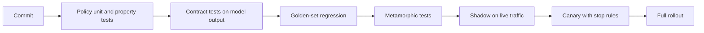

The loan policy from [§11](/c/practical-slm-decision-models/11-evaluation-and-release-gates) passed its release gate. Over the following months, three changes land: a refactor rewrites `p >= t` as `p > t`; a prompt update makes the model occasionally return `"p_good": "0.97"` as a string; a new extractor reads the "12" in "Missed payments (12m): 0" as twelve missed payments. None of these is a modelling problem, none moves an offline AUC, and each changes real decisions. Each is caught in milliseconds by a test that never loads a model.

:::key[First principle]
Split the system into what is **deterministic** (policy arithmetic, parsing, contracts, routing) and what is **statistical** (the model's predictions). Test the deterministic parts exactly and exhaustively; test the statistical parts against tolerances derived from sampling noise; and test the seam between them so that anything unexpected fails *closed* — to review, never to approve.
:::

## 12.1 The test pyramid for a decision service



| Layer | What it checks | Needs a model? | Runs | Typical size |
|---|---|---|---|---|
| Policy unit / property | Thresholds, review band, ties, invalid inputs | No | Every commit, < 1 s | Dozens of tests, thousands of generated inputs |
| Contract | Schema, types, ranges, unknown fields, refusals | No (recorded or synthetic outputs) | Every commit, < 1 s | One case per failure shape |
| Golden-set regression | Actions on a reviewed, versioned set | Yes | On model, prompt or extractor change | Hundreds to a few thousand cases |
| Metamorphic | Invariance and direction under controlled edits | Yes | Same as golden | Variants × a sample of golden |
| Shadow | Live-traffic behaviour without acting | Yes, in prod | Days | All or a share of traffic |
| Canary | Live outcomes while acting on a small share | Yes, in prod | Days to weeks | 1–20% of traffic |

The bottom two layers are fast and exact; they should run on a laptop without a GPU or an API key. Everything above them is statistical and needs a tolerance.

## 12.2 Policy unit tests: properties, not examples

The policy is pure arithmetic over a probability and a cost matrix, so its correctness can be stated as properties and checked over thousands of inputs.

With $c_{BA}$ = cost of approving a bad applicant, $c_{GD}$ = cost of declining a good one, and $c_R$ = cost of a review, the expected cost of each action at $p = P(\text{good})$ is

$$
E[\text{approve}] = (1-p)\,c_{BA},\qquad
E[\text{decline}] = p\,c_{GD},\qquad
E[\text{review}] = c_R .
$$

Decline beats review when $p < c_R / c_{GD}$; approve beats review when $p > 1 - c_R / c_{BA}$. Those two edges are all the policy *is*, and they imply four testable properties:

1. **Regions tile $[0,1]$ in order.** Every $p$ gets exactly one action, and the actions appear as decline → review → approve with exactly the two edges above.
2. **Monotone in $p$.** For $p_1 \le p_2$, the action at $p_2$ is never "worse" than at $p_1$. This follows because approve's cost falls in $p$, decline's rises, and review's is flat — true for *any* non-negative cost matrix of this shape, so it can be tested on random matrices.
3. **Scale invariant.** Multiplying every cost by $k > 0$ (₹ → paise, ₹ → USD) changes no decision.
4. **Fails closed.** `None`, NaN, ±∞, values outside $[0,1]$, booleans and strings all map to review.

:::example[Worked example · the review band for a ₹3,000 review]
Price a review at ₹3,000 — [§4](/c/practical-slm-decision-models/04-decision-theory)'s estimate once queue loss is included, against ₹900 on the ops sheet.

$$
\text{decline if } p < \frac{3{,}000}{24{,}000} = 0.125, \qquad
\text{approve if } p > 1 - \frac{3{,}000}{120{,}000} = 0.975 .
$$

Review covers $[0.125, 0.975]$. At ₹900 the same formulas give $[0.0375, 0.9925]$ — the band §4 warned about. The band disappears when the two edges meet, i.e. when $c_R/c_{GD} + c_R/c_{BA} \ge 1$, which here is $c_R \ge ₹20{,}000$; at exactly ₹20,000 both edges equal 0.833, the approve/decline threshold.
:::

```python run
import math
import numpy as np

ACTIONS = ("decline", "manual_review", "auto_approve")      # ordered: worst case -> best case

def costs(review=3_000, bad_approve=120_000, good_decline=24_000):
    # (cost if applicant is bad, cost if good); review price is illustrative
    return {"auto_approve": (bad_approve, 0), "decline": (0, good_decline),
            "manual_review": (review, review)}

def policy(p_good, c):
    if not isinstance(p_good, (int, float)) or isinstance(p_good, bool) \
            or math.isnan(p_good) or not 0.0 <= p_good <= 1.0:
        return "manual_review"                               # fail closed
    exp = {a: (1 - p_good) * c[a][0] + p_good * c[a][1] for a in ACTIONS}
    return min(ACTIONS, key=lambda a: (exp[a], a != "manual_review"))  # ties -> review

GRID = np.linspace(0, 1, 10_001)

def test_closed_form_threshold_without_review():
    c = costs(review=10**9)                                  # review never chosen
    assert policy(0.833, c) == "decline" and policy(0.834, c) == "auto_approve"

def test_regions_tile_unit_interval_in_order():
    acts = [policy(float(p), costs()) for p in GRID]
    assert set(acts) <= set(ACTIONS)                         # every p gets a valid action
    ranks = [ACTIONS.index(a) for a in acts]
    assert all(r1 <= r2 for r1, r2 in zip(ranks, ranks[1:]))  # decline -> review -> approve
    edges = [GRID[i] for i in range(1, len(acts)) if acts[i] != acts[i - 1]]
    assert len(edges) <= 2 and abs(edges[0] - 0.125) < 1e-3 and abs(edges[1] - 0.975) < 1e-3

def test_monotone_in_p_for_random_cost_matrices():
    rng = np.random.default_rng(12)
    for _ in range(300):
        ba, gd = rng.uniform(1e3, 1e6, 2)
        c = costs(review=rng.uniform(0, min(ba, gd)), bad_approve=ba, good_decline=gd)
        ranks = [ACTIONS.index(policy(float(p), c)) for p in GRID[::50]]
        assert all(r1 <= r2 for r1, r2 in zip(ranks, ranks[1:])), c

def test_invariant_to_currency_scale():
    for k in (0.001, 83.0, 1e4):                             # ₹ -> $ or paise: same decisions
        scaled = {a: (k * x, k * y) for a, (x, y) in costs().items()}
        assert all(policy(float(p), scaled) == policy(float(p), costs()) for p in GRID[::97])

def test_invalid_probabilities_fail_closed():
    for bad in (None, float("nan"), -0.01, 1.01, True, "0.9", float("inf")):
        assert policy(bad, costs()) == "manual_review", bad

def test_ties_go_to_review():
    c = costs(review=3_000)
    assert policy(0.125, c) == "manual_review" and policy(0.975, c) == "manual_review"

tests = [f for name, f in sorted(globals().items()) if name.startswith("test_")]
for t in tests:
    t()
print(f"{len(tests)} policy tests passed; review band at review=₹3,000: [0.125, 0.975]")
```

```output
6 policy tests passed; review band at review=₹3,000: [0.125, 0.975]
```

Under pytest, delete the last four lines; the `test_` functions are already in pytest's format. Notes on the less obvious tests:

- **Ties are a decision, so test them.** At $p = 0.125$ decline and review both cost ₹3,000. The policy breaks ties toward review — the conservative action — and `test_ties_go_to_review` pins it. The `>=` → `>` refactor from the opening changes the action at an exact tie; a tie test is the only kind that notices.
- **`isinstance(True, int)` is `True` in Python.** Without the explicit `bool` check, a model emitting `true` would be read as $p = 1$ and auto-approved.
- **The random-matrix test is the strongest one.** It checks monotonicity for 300 cost matrices you did not think of, which is what catches a sign error introduced when someone adds a fourth action.

## 12.3 Contract tests: model output is untrusted input

A language model's output is text from a component you do not control. Parse it, validate its shape, validate its semantics, and only then let the policy see it. Every failure maps to the safe action with a reason code you can count in monitoring.

```python run
import json

REASONS = {"stable_income", "high_dti", "missed_payments", "thin_file", "other"}
FIELDS = {"p_good", "reason_codes"}

class ContractError(ValueError):
    pass

def _reject_constant(name):                    # json.loads accepts NaN/Infinity by default
    raise ContractError(f"non-finite constant {name}")

def parse(raw):
    try:
        obj = json.loads(raw, parse_constant=_reject_constant)
    except (json.JSONDecodeError, TypeError) as e:
        raise ContractError(f"not json: {e.__class__.__name__}") from None
    if not isinstance(obj, dict) or set(obj) != FIELDS:
        raise ContractError("wrong field set")
    p = obj["p_good"]
    if isinstance(p, bool) or not isinstance(p, (int, float)) or not 0 <= p <= 1:
        raise ContractError("p_good must be a number in [0, 1]")
    rc = obj["reason_codes"]
    if not isinstance(rc, list) or not rc or not set(rc) <= REASONS:
        raise ContractError("reason_codes must be a non-empty list of known codes")
    return {"p_good": float(p), "reason_codes": rc}

def decide(raw):
    try:
        out = parse(raw)
    except ContractError as e:
        return "manual_review", str(e)
    return ("auto_approve" if out["p_good"] >= 0.975 else
            "decline" if out["p_good"] < 0.125 else "manual_review"), "ok"

CASES = [   # (raw model output, expected action, expected reason prefix)
    ('{"p_good": 0.99, "reason_codes": ["stable_income"]}', "auto_approve", "ok"),
    ('{"p_good": 0.10, "reason_codes": ["high_dti", "missed_payments"]}', "decline", "ok"),
    ('{"p_good": 0.99}', "manual_review", "wrong field set"),
    ('{"p_good": 0.99, "reason_codes": ["vip"]}', "manual_review", "reason_codes"),
    ('{"p_good": 0.99, "reason_codes": []}', "manual_review", "reason_codes"),
    ('{"p_good": "0.97", "reason_codes": ["other"]}', "manual_review", "p_good"),
    ('{"p_good": true, "reason_codes": ["other"]}', "manual_review", "p_good"),
    ('{"p_good": 1.7, "reason_codes": ["other"]}', "manual_review", "p_good"),
    ('{"p_good": NaN, "reason_codes": ["other"]}', "manual_review", "non-finite"),
    ('{"p_good": 0.99, "reason_codes": ["other"], "approve": true}',
     "manual_review", "wrong field set"),
    ('{"p_good": 0.99, "reason_co', "manual_review", "not json"),
    ('Sure! Here is the JSON: {"p_good": 0.99}', "manual_review", "not json"),
    (None, "manual_review", "not json"),
]

def test_contract_cases():
    for raw, action, reason in CASES:
        got_action, got_reason = decide(raw)
        assert got_action == action and got_reason.startswith(reason), (raw, got_reason)

def test_no_malformed_output_is_ever_auto_approved():
    approved = [raw for raw, *_ in CASES if decide(raw)[0] == "auto_approve"]
    assert approved == [CASES[0][0]]

test_contract_cases()
test_no_malformed_output_is_ever_auto_approved()
print(f"{len(CASES)} contract cases passed")
print("note: json.loads('NaN') ->", json.loads("NaN"))
```

```output
13 contract cases passed
note: json.loads('NaN') -> nan
```

:::warn[Two Python defaults that approve loans]
`json.loads` accepts `NaN`, `Infinity` and `-Infinity` and returns floats, and every comparison with NaN is `False` — so a range check written as `if p < 0 or p > 1: reject` lets NaN straight through. And `True` is an `int`. Reject non-finite constants at parse time and exclude `bool` explicitly.
:::

Design choices worth copying:

- **Strict field set.** An unexpected `"approve": true` is rejected, not ignored. Extra fields are how prompt-injected text tries to smuggle in an action ([§16](/c/practical-slm-decision-models/16-security-privacy-and-governance)).
- **Prose around JSON is a contract failure**, not something to regex out. If the model does this often, fix the prompt or use constrained decoding; do not widen the parser.
- **Reason codes are counted.** "non-finite" at 0.01% is noise; at 2% after a deploy it is the first sign of a broken release.

## 12.4 Golden-set regression with a tolerance

A golden set is a versioned file of inputs with **reviewed** expected actions. It answers "did this change move decisions it should not have?" Two kinds of check live in it:

- **Known-answer cases** — a handful of cases a person has signed off, with zero tolerance. An applicant earning ₹2,00,000 a month with no EMI and no missed payments is approved; one with an 83% debt-to-income ratio and four missed payments is declined.
- **Churn against the reviewed actions** — a model update is *expected* to change some decisions, so the test bounds how many and which kind.

Not all changes are equal. A move between a decision and review is a **soft move** (a person will look); approve ↔ decline is a **hard flip** (no one will). Gate them separately: zero hard flips, soft moves ≤ 3% (an example threshold).

### Where the tolerance comes from

The golden set is a sample. If a model's true churn on traffic is $r$, the number of changed actions on 400 golden cases is $\text{Binomial}(400, r)$, so a fixed limit has a false-alarm rate you can compute. With a limit of 12 changes (3%):

| True churn $r$ | $P(\text{more than 12 changed})$ |
|---:|---:|
| 1.5% | 0.8% |
| 2.25% | 12.2% |
| 3.0% | 42.4% |
| 5.0% | 96.5% |

A model at the limit fails almost half the time, which is what "at the limit" should mean. If you need a model with 2.25% churn to pass reliably, the golden set must grow (the noise shrinks as $1/\sqrt{n}$) or the limit must move. Choose deliberately; do not tune the limit until today's model passes.

```python run
import math
import re
import numpy as np

def extract(text):
    t = " ".join(text.lower().replace(",", "").split())
    num = lambda key: float(re.search(key + r"[^:]*:\s*(?:₹|rs)?\s*(\d+)", t).group(1))
    return num("income"), num("emi"), num("missed payments")

def make_model(w0, w_dti, w_missed):
    def p_good(text):
        income, emi, missed = extract(text)
        return 1 / (1 + math.exp(-(w0 - w_dti * emi / income - w_missed * missed)))
    return p_good

def action(p):
    return "auto_approve" if p >= 0.975 else "decline" if p < 0.125 else "manual_review"

def application(name, income, emi, missed):
    return (f"Applicant: {name}. Monthly income: ₹{income:,}. "
            f"Existing EMI: ₹{emi:,}. Missed payments (12m): {missed}.")

rng = np.random.default_rng(5)
golden = [application("A. Applicant", int(i), int(e), int(m)) for i, e, m in zip(
    rng.integers(20, 300, 400) * 1000, rng.integers(0, 120, 400) * 500, rng.poisson(0.6, 400))]
baseline = make_model(5.0, 8.0, 1.6)
expected = [action(baseline(x)) for x in golden]         # stands in for a reviewed, versioned file
candidate = make_model(5.1, 8.2, 1.6)                     # the new model under test
CRITICAL = [(application("K. Known", 200000, 0, 0), "auto_approve"),   # reviewed by a person
            (application("K. Known", 30000, 25000, 4), "decline")]

def test_golden_set_within_tolerance():
    for x, want in CRITICAL:                              # known answers: zero tolerance
        assert action(candidate(x)) == want, x
    got = [action(candidate(x)) for x in golden]
    changed = [(e, g) for e, g in zip(expected, got) if e != g]
    hard_flips = [c for c in changed if "manual_review" not in c]
    print(f"golden: {len(changed)}/{len(golden)} changed, {len(hard_flips)} hard flips")
    assert not hard_flips                                 # approve<->decline: zero tolerance
    assert len(changed) / len(golden) <= 0.03             # moves via review: <= 3%

def test_invariance_to_irrelevant_edits():
    x = application("Priya Sharma", 120000, 30000, 0)
    variants = [x.upper(), "  " + x.replace(" ", "   "),
                x.replace("Priya Sharma", "Rahul Verma"),
                x.replace("₹120,000", "Rs 1,20,000"),
                ". ".join(reversed(x.rstrip(".").split(". "))) + "."]
    for v in variants:
        assert action(candidate(v)) == action(candidate(x)), v

def test_directional_monotonicity():
    rank = {"decline": 0, "manual_review": 1, "auto_approve": 2}.get
    for x in golden[:200]:
        income, emi, missed = map(int, extract(x))
        richer = application("A. Applicant", int(income * 1.1), emi, missed)
        worse = application("A. Applicant", income, emi, missed + 1)
        assert candidate(richer) >= candidate(x) >= candidate(worse)
        assert rank(action(candidate(richer))) >= rank(action(candidate(x)))

for t in (test_golden_set_within_tolerance, test_invariance_to_irrelevant_edits,
          test_directional_monotonicity):
    t()
print("golden, invariance and directional tests passed")
```

```output
golden: 10/400 changed, 0 hard flips
golden, invariance and directional tests passed
```

The "model" here is a deterministic stand-in (an extractor plus a logistic score) so the tests run anywhere; with a real SLM the same tests call the model adapter instead. The candidate changes 10 of 400 actions (2.5%), all soft moves, and passes.

:::note[A bug this file actually had]
The first draft of `extract` used the pattern `[^0-9]*(\d+)` after each key. For "Missed payments (12m): 0" that captures the **12**, so every applicant looked twelve payments behind and all 400 golden cases came out `decline`. The policy tests passed — the policy was correct. The churn test passed too, because the "expected" actions were generated by the same broken extractor. The known-answer case (₹2,00,000 income, no debt, approve) failed immediately. This is why expected actions must be reviewed by a person and checked into the repo, never regenerated from current code.
:::

## 12.5 Metamorphic tests: when there is no single gold answer

For most inputs you cannot say what $p$ *should* be. You can say how it should **relate** to $p$ on a transformed input. Two families:

**Invariance** — edits that must not change the action:

| Edit | Why it must not matter |
|---|---|
| Case, extra whitespace | Formatting, not content |
| Applicant name swapped (Priya Sharma → Rahul Verma) | Names carry no credit information; sensitivity here is a fairness defect |
| "₹120,000" → "Rs 1,20,000" | Same amount, Indian digit grouping and currency abbreviation |
| Sentence order reversed | Fields are independent facts |

**Directional** — edits with a known sign:

$$
\text{income} \uparrow \;\Rightarrow\; p \text{ does not fall};\qquad
\text{missed payments} \uparrow \;\Rightarrow\; p \text{ does not rise};
$$

and, through the monotone policy of §12.2, the action does not move toward decline when income rises.

For a deterministic stand-in these hold exactly. A real SLM is not perfectly invariant — whitespace changes tokenisation — so test it statistically: run each variant over a sample of golden cases and require, as an example threshold, ≥ 99% unchanged actions and **zero** hard flips. A name swap that flips any decision is a release blocker, not a tolerance question.

## 12.6 Shadow and canary

Offline tests use yesterday's inputs. Two production stages close the gap:

- **Shadow.** The candidate runs on live requests; its output is logged, never acted on. Compare against the incumbent on the *same* requests (paired, as in §11.4): action agreement, hard flips, contract-failure rate, escalation rate, p95 latency, memory. Shadow carries no decision risk, so it can run on 100% of traffic for as long as you need.
- **Canary.** The candidate acts on a small share of traffic. This is the first time its decisions have consequences, so it needs **stop rules** written in advance.

How small is too small? For the support-ticket router of [§10](/c/practical-slm-decision-models/10-hybrid-architectures) (100,000 tickets a month, misroute rate 3.6%), the smallest misroute increase a canary detects with 80% power at $\alpha = 0.05$ is

$$
\Delta_{\min} = (z_{0.975} + z_{0.80})\sqrt{p(1-p)\left(\frac{1}{n_c} + \frac{1}{n_b}\right)},
$$

with $n_c$ canary tickets and $n_b$ baseline tickets over the same period.

```python run
from math import sqrt
from statistics import NormalDist

z = NormalDist().inv_cdf
k = z(0.975) + z(0.80)
p = 0.036                     # cascade misroute rate from section 10's simulation
monthly = 100_000

def mde(canary_share, days):
    n_total = monthly * days / 30
    n_c, n_b = n_total * canary_share, n_total * (1 - canary_share)
    return k * sqrt(p * (1 - p) * (1 / n_c + 1 / n_b)), n_c

for share in (0.05, 0.20, 0.50):
    for days in (7, 28):
        d, n_c = mde(share, days)
        print(f"canary {share:4.0%} for {days:2d} d: {n_c:7,.0f} tickets  "
              f"detects +{d:.2%} (3.6% -> {p + d:.1%})")
```

```output
canary   5% for  7 d:   1,167 tickets  detects +1.57% (3.6% -> 5.2%)
canary   5% for 28 d:   4,667 tickets  detects +0.78% (3.6% -> 4.4%)
canary  20% for  7 d:   4,667 tickets  detects +0.85% (3.6% -> 4.5%)
canary  20% for 28 d:  18,667 tickets  detects +0.43% (3.6% -> 4.0%)
canary  50% for  7 d:  11,667 tickets  detects +0.68% (3.6% -> 4.3%)
canary  50% for 28 d:  46,667 tickets  detects +0.34% (3.6% -> 3.9%)
```

:::chart[Smallest detectable misroute increase vs canary duration (baseline 3.6%, 100k tickets/month)]{type="line" x="days of canary" y="detectable increase (percentage points)" yfmt="pct" hmarks="0.01:+1 pp"}
days, 5% canary, 20% canary, 50% canary
1, 0.0415, 0.0226, 0.0181
2, 0.0293, 0.0160, 0.0128
3, 0.0239, 0.0130, 0.0104
5, 0.0185, 0.0101, 0.0081
7, 0.0157, 0.0085, 0.0068
10, 0.0131, 0.0071, 0.0057
14, 0.0111, 0.0060, 0.0048
21, 0.0091, 0.0049, 0.0039
28, 0.0078, 0.0043, 0.0034
:::

A week-long 5% canary only notices the misroute rate going from 3.6% to 5.2% — a 44% relative increase. That shapes what each stage is for:

- **Quality claims come from offline evaluation and shadow** (paired, large $n$). The canary is not powered to prove a small quality improvement.
- **The canary catches operational and gross failures fast**: contract errors, latency, escalation storms, crashes, hard flips on known-answer cases. Those have large effects and need few samples.
- **Delayed labels.** Loan outcomes take months; ticket misroutes take hours (an agent re-routes). Where labels lag, the canary can only watch proxies.

Example stop rules (thresholds are illustrative; write yours before the canary starts):

- [ ] Contract-failure rate > 0.5% over any 1,000 requests → roll back
- [ ] Wanted escalation rate > 1.5× the 7-day baseline → page, hold rollout ([§10.5](/c/practical-slm-decision-models/10-hybrid-architectures))
- [ ] p95 latency above the path SLO for 15 consecutive minutes → roll back
- [ ] Any hard flip on the known-answer set replayed hourly → roll back
- [ ] Misroute rate more than 1.6 pp above baseline after day 7 (the 5% canary's detectable effect) → roll back

## 12.7 Failure injection

Decision services fail at their seams. Inject each failure in an integration test with a fake model adapter and assert the *defined* behaviour:

| Injected failure | Required behaviour |
|---|---|
| Model timeout / deadline exceeded | Safe default action, reason `timeout`, no retry past the deadline |
| Provider 429 / 5xx | Bounded retries with exponential backoff and jitter, then safe default |
| Empty or stale retrieval | Abstain to review; never answer from no evidence |
| Duplicate request delivery | Same idempotency key → same decision, one side effect |
| Review queue full | Escalation budget applies; overflow to the defined fallback, alarm |
| Calibration artifact missing at startup | Refuse to serve (fail health check), do not fall back to raw scores |

## 12.8 Which test catches which failure

| Failure | Example | Caught by |
|---|---|---|
| Boundary changed by a refactor | `>=` → `>` at the threshold | Tie test (§12.2) |
| Review band wrong or missing | ₹120,000 typed as ₹12,000 moves the approve edge from 0.975 to 0.75 | Regions-tile test with expected edges |
| Non-monotone policy | Sign error after adding a fourth action | Random-matrix monotonicity property |
| Unit change | Costs entered in lakh instead of ₹ for one action | Scale-invariance test catches only a uniform change; a partial one moves the edges and fails the regions test |
| NaN / None / bool reaches policy | `p_good: true` read as 1.0 | Invalid-input test; contract `bool` check |
| Model returns string, prose or extra fields | `"0.97"`, "Sure! Here is…", `"approve": true` | Contract tests (§12.3) |
| Extractor misreads input | "(12m)" read as 12 missed payments | Known-answer golden cases (§12.4) |
| Model update moves many decisions | 6% churn, or any approve ↔ decline flip | Golden churn and hard-flip limits |
| Spurious sensitivity | Name or formatting changes the action | Invariance tests (§12.5) |
| Wrong-sign dependence | Higher income → decline | Directional tests (§12.5) |
| Live input drift, latency at real load | New product launch; longer tickets | Shadow comparison (§12.6) |
| Live harm, escalation storm | Misroutes or LLM calls climb | Canary stop rules (§12.6) |
| Dependency outage | LLM provider down | Failure injection (§12.7) |

## 12.9 Check yourself

:::qa[Reviews are re-priced at ₹8,000. What are the new review-band edges, and what should test_regions_tile_unit_interval_in_order assert?]
Decline below $8{,}000/24{,}000 = 0.333$; approve above $1 - 8{,}000/120{,}000 = 0.933$. Update the expected edges to 0.333 and 0.933 — and treat the test change as a reviewed policy change, not a fix to make CI green.
:::

:::qa[At what review price does the review band vanish, and where do the edges meet?]
When $c_R / c_{GD} + c_R / c_{BA} = 1$: $c_R = 1 / (1/24{,}000 + 1/120{,}000) = ₹20{,}000$. Both edges equal $20{,}000/24{,}000 = 1 - 20{,}000/120{,}000 = 0.833$, the plain approve/decline threshold.
:::

:::qa[Your parser uses json.loads and then checks `if p < 0 or p > 1: reject`. What gets through?]
NaN (every comparison with NaN is False, so neither condition fires) and booleans (`True` compares as 1). Reject non-finite constants with `parse_constant` and exclude `bool` before the range check.
:::

:::qa[The golden gate allows 12 changed actions out of 400. A model whose true churn is 3% fails about 42% of runs. Is the gate broken?]
No — a model *at* the limit should fail roughly half the time. If the limit is right, the model is borderline. If you need to distinguish 2.25% from 3% reliably, enlarge the golden set; at 400 cases even a 2.25%-churn model fails 12% of runs.
:::

:::qa[A 5% canary runs for a week and the misroute rate is unchanged. Can you claim the new router is no worse?]
Only that it is not worse by more than about 1.6 percentage points (3.6% → 5.2%). Claims about smaller differences need a paired offline or shadow comparison, or a larger and longer canary (20% for 28 days detects about +0.4 pp).
:::

Next: packaging the tested model and policy into a service with budgets, deadlines and rollback — [Serving and deployment](/c/practical-slm-decision-models/13-serving-and-deployment).
