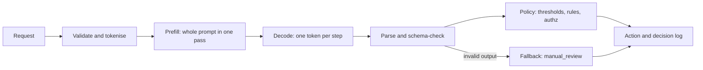
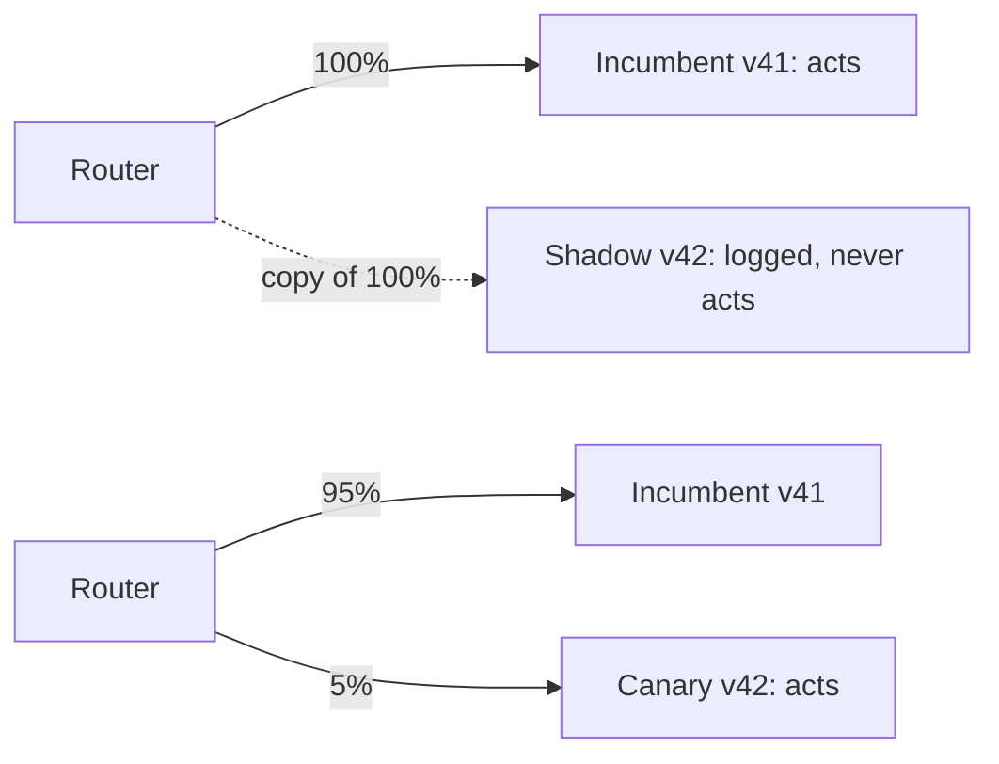
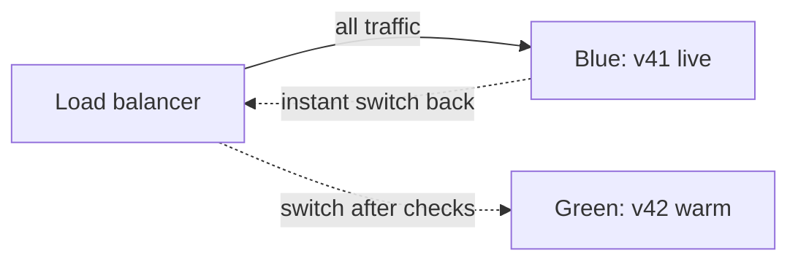
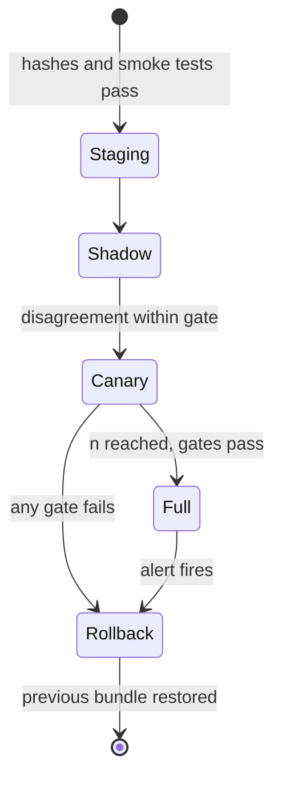

The loan pre-approval policy from §4 is calibrated and tested. Now partner apps will call it: peak traffic is 40 requests/s (illustrative), the contract says p95 ≤ 300 ms, and finance wants a cost per 1,000 decisions. Every one of those numbers can be estimated before you rent a machine — and the estimate tells you whether to use a CPU, a GPU, or a different model.

:::key[First principle]
A replica is a queue in front of a server. Its service time is set by physics (bytes read ÷ bandwidth, FLOPs ÷ compute); its latency is set by how busy you let it get. Size for the tail at a utilisation well below 1, not for the mean at 100%.
:::

## 13.1 The request path

A decision request is not "a model call". It is five stages, and only two of them are the model:



The two model stages have different physics:

- **Prefill** processes all $n_{\text{prompt}}$ tokens in parallel. It does $\approx 2P$ FLOPs per token, so it is **compute-bound**.
- **Decode** produces one token per step and must read every weight to do so. At batch 1 it is **bandwidth-bound**.

$$
t_{\text{prefill}} \approx \frac{2P\,n_{\text{prompt}}}{F_{\text{eff}}}, \qquad
t_{\text{decode}} \approx n_{\text{out}} \cdot \frac{P \cdot b_w}{BW_{\text{eff}}}
$$

where $P$ is parameters, $b_w$ bytes per weight, $F_{\text{eff}}$ effective FLOP/s and $BW_{\text{eff}}$ effective memory bandwidth. An encoder classifier has no decode loop: one pass, one label distribution. Tokenise, parse and policy are ordinary code — budget them at a couple of milliseconds and measure.

:::example[Worked example · the dec d960 decoder on a GPU]
Using the §3 config (401.1M parameters, int8 weights = 401 MB) on an illustrative T4-class card with 300 GB/s and 20 TFLOP/s *effective*:

- prefill, 300 prompt tokens: $2 \times 401.1\text{M} \times 300 / 20\times10^{12} = 12.0$ ms
- decode, 12 output tokens (constrained JSON): $12 \times 401\,\text{MB} / 300\,\text{GB/s} = 12 \times 1.34 = 16.0$ ms
- plus 2 ms for tokenise/parse/policy → **30.1 ms floor**.
:::

The API around this path should expose task semantics, never the prompt or a reasoning trace. The caller sends a `request_id`, the case fields and a deadline; it gets back `action`, `reason_code`, `bundle_id` (§13.9) and `latency_ms`. Validate input length, content type, authentication, tenant and rate limits *before* tokenising — rejected requests should cost microseconds, not a prefill.

## 13.2 CPU or GPU: derive it, don't guess it

The same two formulas, over three model shapes from §3 and two illustrative machines (8-vCPU VM at 25 GB/s and 0.4 TFLOP/s effective, ₹30/h; T4-class GPU at 300 GB/s and 20 TFLOP/s effective, ₹50/h). Prices and effective rates are assumptions — replace them with your own measurements.

```python run
"""Latency floor per request from first principles: prefill is compute-bound, decode is bandwidth-bound."""
# illustrative hardware: effective (not peak) numbers
HW = {"cpu-8vcpu": dict(bw=25e9, flops=0.4e12, inr_h=30),
      "gpu-t4cls": dict(bw=300e9, flops=20e12, inr_h=50)}
# int8 weights (1 byte/param); params from the section 3 sizing table
MODELS = {"enc d768 L6":   dict(params=65.9e6,  prompt=128, out=0),
          "dec d960 L32":  dict(params=401.1e6, prompt=300, out=12),
          "dec d2048 L24": dict(params=1711.3e6, prompt=300, out=12)}
FIXED_MS = 2.0   # tokenise + parse + policy, illustrative


def service_ms(m, hw):
    prefill = 2 * m["params"] * m["prompt"] / hw["flops"]      # compute-bound
    passes = max(1, m["out"])                                  # encoder: one pass
    decode = passes * m["params"] * 1.0 / hw["bw"]             # read all weights per step
    return 1e3 * prefill, 1e3 * decode, 1e3 * prefill + 1e3 * decode + FIXED_MS


print("%-14s %-10s %9s %9s %9s %9s %12s" % ("model", "hardware", "prefill", "decode",
      "total", "req/s", "INR/1k@60%"))
for mname, m in MODELS.items():
    for hname, hw in HW.items():
        p, d, s = service_ms(m, hw)
        mu = 1e3 / s                                   # one request at a time
        cost = hw["inr_h"] / (3600 * 0.6 * mu) * 1000
        print("%-14s %-10s %7.1fms %7.1fms %7.1fms %9.1f %12.2f" % (mname, hname, p, d, s, mu, cost))
```

```output
model          hardware     prefill    decode     total     req/s   INR/1k@60%
enc d768 L6    cpu-8vcpu     42.2ms     2.6ms    46.8ms      21.4         0.65
enc d768 L6    gpu-t4cls      0.8ms     0.2ms     3.1ms     326.5         0.07
dec d960 L32   cpu-8vcpu    601.6ms   192.5ms   796.2ms       1.3        11.06
dec d960 L32   gpu-t4cls     12.0ms    16.0ms    30.1ms      33.2         0.70
dec d2048 L24  cpu-8vcpu   2566.9ms   821.4ms  3390.4ms       0.3        47.09
dec d2048 L24  gpu-t4cls     51.3ms    68.5ms   121.8ms       8.2         2.82
```

For the encoder, the "decode" column is its single weight read. The GPU encoder figure is a floor: real kernel-launch and transfer overheads add milliseconds the formula ignores.

| Situation | Choose | Reason from the table |
|---|---|---|
| Closed label set, encoder fits | CPU | 47 ms floor, 21 req/s per replica, no idle GPU to pay for |
| Decoder ≤ 0.5B, p95 SLO under ~1 s | GPU | CPU floor is 796 ms *before any queueing* |
| Decoder 1–2B | GPU | CPU floor 3.4 s; GPU 122 ms |
| Under ~1 req/s at peak | cheapest box that meets the SLO | utilisation, not speed, sets cost (below) |
| Prefill dominates (long prompt, short output) | shorten or cache the prompt first | prefill is 76% of the CPU decoder's floor |

:::warn[The "per 1,000 at 60%" column assumes you have the traffic]
Ticket routing peaks at 0.505 req/s (§13.3). A ₹50/h GPU serving 0.505 × 3600 = 1,818 requests/h costs ₹27.5 per 1,000 decisions; the ₹30/h CPU running the encoder costs ₹16.5 — even though the GPU is 15× faster. At low volume you pay for the hour, not the request.
:::

## 13.3 Little's law: how many replicas

For any stable system, the average number of requests in it equals arrival rate times time spent:

$$
L = \lambda W
$$

No distributional assumptions — it holds for any queue that is not growing. Apply it to the *servers* alone ($W = S$, the service time) and $L$ is the average number of busy servers. Divide by the utilisation you are willing to run at:

$$
N_{\text{replicas}} = \left\lceil \frac{\lambda S}{\rho_{\text{target}}} \right\rceil
$$

```python run
"""Little's law: busy servers L = lambda * S. Replicas = ceil(L / target utilisation)."""
import math

S = {"enc d768 L6 / cpu": 0.0468, "dec d960 L32 / cpu": 0.7962,
     "dec d960 L32 / gpu": 0.0301, "dec d2048 L24 / gpu": 0.1218}   # seconds, from the table above
RHO = 0.6                                                           # target utilisation

# ticket routing: 100,000/month, mostly in 22 working days x 10 hours, peak hour 4x the average
avg = 100_000 / (22 * 10 * 3600)
scenarios = {"ticket routing (peak)": 4 * avg, "loan pre-approval API (peak)": 40.0}

for name, lam in scenarios.items():
    print("%s: lambda = %.3f req/s" % (name, lam))
    for k, s in S.items():
        busy = lam * s                       # L = lambda * W, with W = service time
        replicas = max(1, math.ceil(busy / RHO))
        print("   %-20s S=%6.1f ms  busy=%6.2f  replicas@60%%=%3d" % (k, 1e3 * s, busy, replicas))
```

```output
ticket routing (peak): lambda = 0.505 req/s
   enc d768 L6 / cpu    S=  46.8 ms  busy=  0.02  replicas@60%=  1
   dec d960 L32 / cpu   S= 796.2 ms  busy=  0.40  replicas@60%=  1
   dec d960 L32 / gpu   S=  30.1 ms  busy=  0.02  replicas@60%=  1
   dec d2048 L24 / gpu  S= 121.8 ms  busy=  0.06  replicas@60%=  1
loan pre-approval API (peak): lambda = 40.000 req/s
   enc d768 L6 / cpu    S=  46.8 ms  busy=  1.87  replicas@60%=  4
   dec d960 L32 / cpu   S= 796.2 ms  busy= 31.85  replicas@60%= 54
   dec d960 L32 / gpu   S=  30.1 ms  busy=  1.20  replicas@60%=  3
   dec d2048 L24 / gpu  S= 121.8 ms  busy=  4.87  replicas@60%=  9
```

Two lessons. Ticket routing (100,000/month; the 4× peak factor is an assumption) never needs more than one replica of anything — its engineering problem is rollout and fallback, not capacity; run two for availability. The loan API at 40 req/s needs 54 CPU replicas for the decoder versus 3 GPUs, or 4 CPUs running an encoder: the model choice moved the bill by an order of magnitude before any tuning.

Why 0.6 and not 0.95? That is what the next subsection answers.

## 13.4 Utilisation and the hockey stick

Requests arrive randomly, so even below capacity they sometimes collide and wait. For one replica with Poisson arrivals and service time of mean $\bar S$ and coefficient of variation $c_s$ (an M/G/1 queue), the Pollaczek–Khinchine formula gives the mean time in system:

$$
W = \bar S + \frac{\rho\,\bar S\,(1 + c_s^2)}{2(1-\rho)}, \qquad \rho = \lambda \bar S
$$

The $\frac{1}{1-\rho}$ factor is the hockey stick: it doubles from $\rho = 0.5$ to $0.75$ and doubles again by $0.875$, without limit as $\rho \to 1$. Tails are worse than the mean. A discrete-event simulation (Lindley's recursion: each request waits for whatever work the previous one left behind) gives the percentiles, and checks itself against the formula:

```python run
"""One replica, Poisson arrivals, variable service time (M/G/1): latency vs utilisation."""
import numpy as np

rng = np.random.default_rng(13)
MEAN_S, CV = 0.030, 0.5                      # 30 ms mean service, CV 0.5 (output length varies)
sig = np.sqrt(np.log(1 + CV**2))
mu_log = np.log(MEAN_S) - sig**2 / 2         # lognormal with the requested mean
N = 200_000

print("rho   p50_ms  p95_ms  p99_ms  mean_sim  mean_PK")
for rho in [0.1, 0.3, 0.5, 0.6, 0.7, 0.8, 0.85, 0.9, 0.95, 0.97]:
    lam = rho / MEAN_S
    gaps = rng.exponential(1 / lam, N)
    serv = rng.lognormal(mu_log, sig, N)
    wait = np.empty(N)
    w = 0.0
    for i in range(N):                       # Lindley: W_{n+1} = max(0, W_n + S_n - A_{n+1})
        wait[i] = w
        w = max(0.0, w + serv[i] - gaps[i])
    lat = (wait + serv)[N // 10:]            # drop the first 10% (queue warm-up)
    pk = MEAN_S + rho * MEAN_S * (1 + CV**2) / (2 * (1 - rho))   # Pollaczek-Khinchine
    p50, p95, p99 = 1e3 * np.percentile(lat, [50, 95, 99])
    print("%.2f  %6.1f  %6.1f  %6.1f  %8.1f  %7.1f" % (rho, p50, p95, p99, 1e3 * lat.mean(), 1e3 * pk))
```

```output
rho   p50_ms  p95_ms  p99_ms  mean_sim  mean_PK
0.10    28.1    65.1    91.3      32.1     32.1
0.30    31.9    83.9   121.9      38.1     38.0
0.50    39.0   116.9   170.3      48.8     48.8
0.60    45.4   146.6   215.3      58.5     58.1
0.70    56.2   192.1   289.3      74.2     73.7
0.80    79.2   295.1   450.7     107.8    105.0
0.85    98.1   371.8   571.1     134.6    136.2
0.90   145.3   571.2   856.1     201.0    198.8
0.95   259.6   978.7  1287.8     349.0    386.2
0.97   400.8  1562.3  2018.6     543.8    636.2
```

The simulated mean matches the formula to within 3% up to $\rho = 0.9$; above that, a finite run has not yet seen the rare long busy periods that dominate the true mean, so it under-reads. That is itself a lesson for §14: near saturation, short benchmarks are optimistic.

:::chart[One replica, 30 ms mean service: latency percentiles vs utilisation]{type="line" x="utilisation ρ" y="latency" unit=" ms" marks="0.6:sizing target" hmarks="300:p95 SLO" xmin="0" xmax="1"}
rho, p50, p95, p99
0.10, 28.1, 65.1, 91.3
0.30, 31.9, 83.9, 121.9
0.50, 39.0, 116.9, 170.3
0.60, 45.4, 146.6, 215.3
0.70, 56.2, 192.1, 289.3
0.80, 79.2, 295.1, 450.7
0.85, 98.1, 371.8, 571.1
0.90, 145.3, 571.2, 856.1
0.95, 259.6, 978.7, 1287.8
0.97, 400.8, 1562.3, 2018.6
:::

Read the chart against the 300 ms SLO: p95 crosses it at $\rho \approx 0.8$. Sizing at 0.6 leaves room for a 30% traffic spike (0.6 → 0.78) before the SLO breaks. Pooling several replicas behind one queue (rather than random load balancing to independent queues) lowers waits at the same $\rho$, so the single-replica curve is the conservative bound.

## 13.5 Batching: throughput against latency

A decode step reads every weight once whether it serves 1 sequence or 16, so batching shares the bandwidth-bound part. Prefill is per request and is not shared. For the dec d960 GPU case that gives a batch service time of

$$
S(b) \approx \underbrace{18\ \text{ms}}_{\text{12 decode steps + fixed}} + \underbrace{12\ \text{ms}}_{\text{prefill}} \times b
$$

so capacity $b / S(b)$ rises from 33 req/s at $b=1$ toward $1/12\,\text{ms} = 83$ req/s. The cost is that each request in a batch of 4 takes 66 ms instead of 30. The simulation below batches "whatever is waiting, up to $B$" (no fill timer) with deterministic $S(b)$, to isolate the batching effect:

```python run
"""Dynamic batching on one GPU replica: take up to B queued requests whenever the model is free."""
import numpy as np

rng = np.random.default_rng(7)
N = 60_000


def s_batch(b):
    # decode steps are shared by the batch (weights read once per step); prefill is per request
    return 0.018 + 0.012 * b                  # seconds, from the dec d960 / gpu floor


def simulate(lam, B):
    arr = np.cumsum(rng.exponential(1 / lam, N))
    lat = np.empty(N)
    i, free = 0, 0.0
    while i < N:
        start = max(free, arr[i])
        j = i + 1
        while j < N and j - i < B and arr[j] <= start:   # everything already waiting, up to B
            j += 1
        free = start + s_batch(j - i)
        lat[i:j] = free - arr[i:j]
        i = j
    lat = lat[N // 10:]
    return 1e3 * np.percentile(lat, 50), 1e3 * np.percentile(lat, 95)


print("capacity req/s: " + "  ".join("B=%d: %.1f" % (b, b / s_batch(b)) for b in (1, 4, 16)))
print("lam   " + "".join("%14s" % ("B=%d p50/p95" % b) for b in (1, 4, 16)))
for lam in [5, 10, 20, 25, 30, 32, 40, 50, 55, 60, 65, 70, 74]:
    row = []
    for B in (1, 4, 16):
        if lam >= 0.98 * B / s_batch(B):
            row.append("%14s" % "unstable")
            continue
        p50, p95 = simulate(lam, B)
        row.append("%7.0f/%-6.0f" % (p50, p95))
    print(("%-5d " % lam + "".join(row)).rstrip())
```

```output
capacity req/s: B=1: 33.3  B=4: 60.6  B=16: 76.2
lam      B=1 p50/p95   B=4 p50/p95  B=16 p50/p95
5          30/52         30/51         30/52
10         30/62         30/59         30/59
20         41/114        35/74         35/74
25         58/182        45/82         45/83
30        119/473        52/93         52/95
32        229/811        55/97         54/100
40          unstable     66/125        65/121
50          unstable     89/208        83/162
55          unstable    120/292        98/195
60          unstable      unstable    118/245
65          unstable      unstable    149/309
70          unstable      unstable    224/552
74          unstable      unstable    376/834
```

:::chart[p95 latency vs arrival rate for three batch limits (one GPU replica)]{type="line" x="arrival rate (req/s)" y="p95 latency" unit=" ms" hmarks="300:p95 SLO" ymax="900"}
lambda, B=1, B=4, B=16
5, 52, 51, 52
10, 62, 59, 59
20, 114, 74, 74
25, 182, 82, 83
30, 473, 93, 95
32, 811, 97, 100
40, -, 125, 121
50, -, 208, 162
55, -, 292, 195
60, -, -, 245
65, -, -, 309
70, -, -, 552
74, -, -, 834
:::

Each curve is the same hockey stick, moved right by the extra capacity. Under the 300 ms SLO one replica sustains about 25 req/s at $B=1$, 55 at $B=4$ and 60 at $B=16$. Going from 4 to 16 buys little because prefill (not shared) dominates a short-output decision request — batching pays most for long outputs.

:::tip[Two batching rules]
1. **No fill timer for decision traffic.** A "wait up to 20 ms to fill the batch" policy adds up to 20 ms to every request at low load, when there is nothing to batch with. Take what is queued.
2. **Cap $B$ by the SLO, not by memory.** At 40 req/s, $B=4$ on 2 replicas (one for redundancy) replaces 3 replicas at $B=1$.
:::

## 13.6 Memory budget per replica

Weights are fixed; the KV cache grows with every concurrent sequence:

$$
M \approx \underbrace{P\,b_w}_{\text{weights}} + \underbrace{0.18\,P\,b_w}_{\text{runtime}} + B \cdot n_{\text{ctx}} \cdot \underbrace{2\,n_{\text{layer}}\,h_{kv}\,d_{\text{head}}\,b_{kv}}_{\text{KV bytes per token}} + \text{activations}
$$

```python run
"""Memory per replica: weights + runtime overhead + KV cache per concurrent sequence."""
MODELS = {"dec d960 L32":  dict(params=401.1e6, layers=32, n_kv=5, head_dim=64, d=960, inter=2560),
          "dec d2048 L24": dict(params=1711.3e6, layers=24, n_kv=4, head_dim=128, d=2048, inter=8192)}
CTX = 512                      # allocated context per sequence (300 prompt + 12 out, rounded up)
KV_BYTES = 2                   # fp16 cache even with int8 weights


def replica_mb(m, batch):
    weights = m["params"] * 1.0                        # int8
    overhead = 0.18 * weights                          # same factor as section 3
    kv_tok = 2 * m["layers"] * m["n_kv"] * m["head_dim"] * KV_BYTES
    kv = kv_tok * CTX * batch
    act = batch * CTX * m["inter"] * 2                 # widest MLP buffer during prefill
    return kv_tok, (weights + overhead + kv + act) / 1e6, kv / 1e6, act / 1e6


for name, m in MODELS.items():
    kv_tok = replica_mb(m, 1)[0]
    print("%s: KV %.1f KB/token, %.1f MB per %d-token sequence" % (name, kv_tok / 1e3, kv_tok * CTX / 1e6, CTX))
    for b in (1, 8, 32, 128):
        _, tot, kv, act = replica_mb(m, b)
        print("   batch %4d: total %7.0f MB  (kv %6.0f, activations %5.0f)" % (b, tot, kv, act))
    usable = 0.9 * 16e3                                # 16 GB card, keep 10% headroom
    b = 1
    while replica_mb(m, b + 1)[1] < usable:
        b += 1
    print("   max concurrent sequences in 16 GB (90%% usable): %d" % b)
```

```output
dec d960 L32: KV 41.0 KB/token, 21.0 MB per 512-token sequence
   batch    1: total     497 MB  (kv     21, activations     3)
   batch    8: total     662 MB  (kv    168, activations    21)
   batch   32: total    1228 MB  (kv    671, activations    84)
   batch  128: total    3493 MB  (kv   2684, activations   336)
   max concurrent sequences in 16 GB (90% usable): 590
dec d2048 L24: KV 49.2 KB/token, 25.2 MB per 512-token sequence
   batch    1: total    2053 MB  (kv     25, activations     8)
   batch    8: total    2288 MB  (kv    201, activations    67)
   batch   32: total    3093 MB  (kv    805, activations   268)
   batch  128: total    6314 MB  (kv   3221, activations  1074)
   max concurrent sequences in 16 GB (90% usable): 368
```

For short-context decision models, memory is rarely the binding constraint on a 16 GB card — the SLO caps $B$ at 4–16 long before 590 sequences. Memory binds in two other places: CPU sidecars with a hard container limit (§3's 1.5 GB), and long contexts, where KV grows linearly ($n_{\text{ctx}} = 4096$ makes each dec d960 sequence 168 MB). The activation term is a rough upper bound; measure peak RSS on your runtime.

## 13.7 Deadlines, admission control and fallback

Little's law also bounds the queue. If a replica serves one request every $S$ seconds and the deadline is $D$, a request that finds $q$ others ahead waits about $qS$; anything beyond

$$
q_{\max} = \left\lfloor \frac{D - S}{S} \right\rfloor
$$

will miss its deadline anyway. For $D = 300$ ms, $S = 30.1$ ms: $q_{\max} = \lfloor 269.9/30.1 \rfloor = 8$. Reject or fall back at the door when 8 are queued, rather than doing work whose answer arrives after the caller gave up.

- Propagate the *remaining* deadline downstream; stop work when it expires.
- Retry only transient errors, with exponential backoff, jitter and a retry budget (e.g. ≤ 10% extra load).
- The fallback is a **decision**, not an error: for the loan policy it is `manual_review`; for tickets, the triage desk. Never skip a policy gate to stay available.

## 13.8 Rollout patterns

Three patterns, each answering a different question. Shadow and canary:



Blue/green:



| Pattern | Question it answers | Blast radius | Cost | Rollback |
|---|---|---|---|---|
| Shadow | Same inputs: how often do v41 and v42 disagree, and on what? | none — outputs discarded | 2× inference | nothing to roll back |
| Canary | Do real outcomes, latency and errors hold up on live traffic? | canary share | ~1× | route 0% to canary |
| Blue/green | Can we switch the whole fleet atomically? | 100% after switch | 2× fleet during cutover | flip the balancer back (seconds) |

A canary must run long enough to *detect* the regression you care about. For an error rate rising from 2% to 3%, at a 5% false-alarm rate and 80% power:

$$
n \approx \frac{(z_{0.975} + z_{0.8})^2\,[p_0(1-p_0) + p_1(1-p_1)]}{(p_1 - p_0)^2}
$$

```python run
"""How long must a canary run to see an error-rate regression?"""
import math

z_a, z_b = 1.96, 0.84            # two-sided 5% false alarm, 80% power
p0, p1 = 0.02, 0.03              # incumbent vs regressed error rate
n = (z_a + z_b) ** 2 * (p0 * (1 - p0) + p1 * (1 - p1)) / (p1 - p0) ** 2
print("decisions needed per arm: %d" % math.ceil(n))
for lam, share in [(40.0, 0.05), (40.0, 0.20), (0.505, 0.05), (0.505, 0.50)]:
    hours = n / (lam * share) / 3600
    print("lambda=%6.3f/s canary=%3.0f%% -> %7.1f hours of peak traffic" % (lam, 100 * share, hours))
```

```output
decisions needed per arm: 3819
lambda=40.000/s canary=  5% ->     0.5 hours of peak traffic
lambda=40.000/s canary= 20% ->     0.1 hours of peak traffic
lambda= 0.505/s canary=  5% ->    42.0 hours of peak traffic
lambda= 0.505/s canary= 50% ->     4.2 hours of peak traffic
```

The loan API gets its answer in about half an hour at 5%. Ticket routing would need 42 *peak* hours at 5% — about 17 working days at average business-hour traffic — so for low-volume services, lean on shadow mode and offline replay of the frozen evaluation set (§11), and use the canary as a final smoke test. And "error" must be observable quickly: loan defaults take months, so the canary watches proxies (agreement with the incumbent, review rate, latency, parse failures) while the outcome metric is monitored afterwards.



## 13.9 Versioning and rollback: ship a bundle

The decision depends on more than weights. A tokenizer change shifts token boundaries; a calibration change moves every probability; a policy change moves thresholds. Version them together as one immutable **bundle**, identified by the hash of its manifest:

```json
{
  "bundle_id": "sha256:9f2c…",
  "model": {"weights_sha256": "…", "arch": "dec-d960-L32", "quant": "int8"},
  "tokenizer": {"revision": "…", "sha256": "…"},
  "prompt_template": {"version": "loan-v7", "sha256": "…"},
  "calibration": {"method": "temperature", "params": {"T": 1.31}, "fit_set": "eval-2026-09"},
  "policy": {"version": "policy-4", "approve_if_p_good_ge": 0.833, "review_band": [0.0375, 0.9925]},
  "eval_report": "reports/loan-v42.json",
  "runtime": {"image_digest": "sha256:…", "threads": 8}
}
```

The temperature is a placeholder, not a recommendation. Rules that follow from the bundle:

- **Pin by digest, never by tag.** `latest` is not a deployment identifier.
- **Rollback restores the whole bundle.** Rolling back weights alone leaves a new policy running on old probabilities.
- **Keep the previous bundle warm.** A cold restore must reload weights (401 MB at an illustrative 200 MB/s ≈ 2 s) and then warm up (§14.2); a warm blue/green flip takes seconds.
- **Build the image like any service:** pinned base-image digest, non-root user, dependency scan, SBOM, no credentials in layers.
- **Log the `bundle_id` on every decision** so any decision can be replayed against the exact bundle that made it.

## 13.10 What to log per decision

| Field | Why |
|---|---|
| `request_id`, timestamp, caller | idempotency, audit trail |
| `bundle_id` | reproduce the decision exactly |
| input hash (and redacted features, not raw PII) | replay and drift analysis without storing secrets |
| token counts (prompt, output) | prefill/decode cost attribution |
| calibrated probabilities | re-threshold offline; reliability diagrams (§7) |
| action, policy rule fired, threshold | why this action, not just which |
| fallback reason, if any | parse failure vs timeout vs out-of-scope |
| latency per stage: queue, prefill, decode, parse, policy | find the stage that moved p95 |
| replica id, queue depth at admission | separate model slowness from overload |
| outcome, joined later | the only way to measure realised cost |

At roughly 1 KB per record (illustrative), ticket routing's 100,000 decisions/month is 100 MB/month — storage is never the reason to skip a field. Retention and access control for these logs are §16's subject.

:::exercise[Exercise 13.1 · Deployment readiness]{id="checklist" items="Latency floor computed from bytes and FLOPs;Replicas sized with Little's law at a stated utilisation;p95 measured at the target utilisation, not idle;Batch limit chosen against the SLO;Fallback action defined and tested;Canary length computed for the regression you care about;Rollback restores the full bundle;bundle_id logged on every decision" grades="A,B,C,D,F"}
:::

## 13.11 Check yourself

:::qa[A 1.7B int8 decoder must answer in under 1 s on an 8-vCPU VM (25 GB/s, 0.4 TFLOP/s effective) with a 300-token prompt and 12 output tokens. Feasible?]
No. Prefill alone is $2 \times 1.711\text{B} \times 300 / 0.4\times10^{12} = 2.57$ s, and decode adds $12 \times 1.711\,\text{GB}/25\,\text{GB/s} = 0.82$ s — a 3.4 s floor before any queueing. Use a GPU (122 ms floor), a smaller model, or an encoder.
:::

:::qa[Peak traffic is 40 req/s and service time is 46.8 ms. How many replicas at a 60% utilisation target, and how many requests are in service on average?]
Busy servers $L = \lambda S = 40 \times 0.0468 = 1.87$. Replicas $= \lceil 1.87/0.6 \rceil = 4$, each about 47% utilised. Add one if you need to survive a replica failure at peak.
:::

:::qa[Why does p95 more than double between ρ = 0.6 and ρ = 0.85 when traffic only grew by 42%?]
Waiting time scales with $\rho/(1-\rho)$: that factor is 1.5 at 0.6 and 5.7 at 0.85. In the simulation p95 went from 147 ms to 372 ms. The service time did not change; the collisions did.
:::

:::qa[A shadow run shows v42 disagrees with v41 on 3% of loan cases. Is v42 worse?]
Unknown. Shadow measures disagreement, not correctness. Pull the disagreements, label them (or wait for outcomes), and compute the cost difference with the §4 matrix. Disagreements concentrated near $p^* = 0.833$ are expected; disagreements far from it point to a calibration or tokenizer change.
:::

:::qa[A rollback restored v41 weights but kept policy-5. What can go wrong?]
policy-5's thresholds were set on v42's calibrated probabilities. Applied to v41's probabilities, the approve/review/decline boundaries no longer sit at the intended expected-cost crossings, so the approval rate shifts silently. Roll back the bundle, not a file.
:::

Next: measuring all of this honestly — [§14 Benchmarking and performance](/c/practical-slm-decision-models/14-benchmarking-and-performance).
