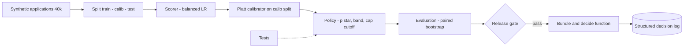

Everything in the course so far has been one piece at a time. This section builds the whole loan pre-screener from [§4](/c/practical-slm-decision-models/04-decision-theory) as one small project you can run on a laptop: 40,000 synthetic applications with a known ground truth, a scoring model, a calibrator, a policy derived from the cost matrix, an evaluation with confidence intervals, a release gate, a service function and its tests. A logistic regression stands in for the SLM so that every step runs in seconds with numpy and scikit-learn; the contract it fulfils — "return a calibrated $P(\text{good})$" — is exactly what an SLM adapter scoring label log-probs would fulfil (§9), so every later step is unchanged when you swap it in.

:::key[First principle]
A decision service is a chain of contracts: data → score → calibrated probability → cost-derived action → evidence → gate → service. Each link is tested on its own, each produces a number the next link consumes, and the whole chain is pinned by one bundle id. Improving the model is only one of the links — and, as the results show, not the most valuable one here.
:::

## 17.1 Brief and architecture

| Item | Value |
|---|---|
| Actions | `auto_approve`, `manual_review`, `decline` |
| Costs | approve a bad case ₹120,000; decline a good case ₹24,000; review ₹3,000 (the honest price from §4.4) |
| Capacity | review at most 25% of applications |
| Data | 40,000 synthetic applications: bureau score, debt-to-income, tenure, prior defaults; about 77% good |
| Splits | train 20,000 · calibration 10,000 · test 10,000 (fit, calibrate and evaluate on disjoint rows) |
| Incumbent | a bureau/DTI rule tuned on the training split |



Every step below starts with the same 18-line prelude, so each block runs on its own. The prelude generates the data from a known logistic truth, fits the scorer and fits the calibrator.

## 17.2 Step 1 — data, model, calibration

The scorer is a logistic regression with `class_weight="balanced"`, the setting people reach for when classes are imbalanced. It re-weights the minority class so the model behaves as if half the applicants were bad, which shifts every logit down by roughly $\ln\frac{0.767}{0.233} = 1.19$: its probabilities are wrong by construction. That makes it a realistic stand-in for an SLM whose label log-probs are systematically off (§7). A Platt calibrator fitted on the calibration split repairs it.

```python run
# --- shared prelude: identical at the top of every capstone step ---
import numpy as np
from sklearn.linear_model import LogisticRegression
C_FP, C_FN, REVIEW, CAP = 120_000, 24_000, 3_000, 0.25
FEATURES = ("bureau", "dti", "tenure_yrs", "prior_defaults")
rng = np.random.default_rng(2026)
n = 40_000
X = np.column_stack([rng.normal(700, 60, n), rng.beta(2, 5, n),
                     rng.gamma(2, 2.5, n), rng.poisson(0.3, n)])
z = 2.0 + 0.02 * (X[:, 0] - 700) - 5 * (X[:, 1] - 0.29) + 0.06 * (X[:, 2] - 5) - 1.2 * X[:, 3]
y = (rng.random(n) < 1 / (1 + np.exp(-z))).astype(int)          # 1 = good (repaid)
tr, ca, te = slice(0, 20_000), slice(20_000, 30_000), slice(30_000, None)
mu, sd = X[tr].mean(0), X[tr].std(0)
model = LogisticRegression(class_weight="balanced").fit((X[tr] - mu) / sd, y[tr])
logit = lambda A: model.decision_function((A - mu) / sd)
platt = LogisticRegression().fit(logit(X[ca]).reshape(-1, 1), y[ca])
proba = lambda A: platt.predict_proba(logit(A).reshape(-1, 1))[:, 1]
# --- end prelude ---
from sklearn.metrics import roc_auc_score, log_loss

def ece(p, y, bins=10):
    idx = np.minimum((p * bins).astype(int), bins - 1)
    return sum(abs(p[idx == b].mean() - y[idx == b].mean()) * (idx == b).mean()
               for b in range(bins) if (idx == b).any())

print("good rate  train %.3f | calib %.3f | test %.3f" % (y[tr].mean(), y[ca].mean(), y[te].mean()))
print("bureau mean %.0f, dti mean %.3f, tenure mean %.1f y, prior defaults mean %.2f"
      % tuple(X.mean(0)))
p_raw = model.predict_proba((X[te] - mu) / sd)[:, 1]
p_cal = proba(X[te])
print("test AUC %.3f (calibration cannot change it: %.3f)" % (roc_auc_score(y[te], p_raw),
                                                             roc_auc_score(y[te], p_cal)))
for name, p in (("raw (balanced LR)", p_raw), ("Platt-calibrated", p_cal)):
    print(f"{name:18s} mean p {p.mean():.3f} vs good rate {y[te].mean():.3f} | "
          f"ECE {ece(p, y[te]):.3f} | log loss {log_loss(y[te], p):.3f}")
```

```output
good rate  train 0.767 | calib 0.767 | test 0.766
bureau mean 700, dti mean 0.285, tenure mean 5.0 y, prior defaults mean 0.30
test AUC 0.836 (calibration cannot change it: 0.836)
raw (balanced LR)  mean p 0.589 vs good rate 0.766 | ECE 0.177 | log loss 0.502
Platt-calibrated   mean p 0.768 vs good rate 0.766 | ECE 0.013 | log loss 0.400
```

:::chart[Reliability on the 10,000 test cases — raw balanced model vs Platt-calibrated]{type="line" diag="true" x="mean predicted P(good) in bin" y="observed good rate" xmin="0" xmax="1" ymin="0" ymax="1" xfmt="pct" yfmt="pct" note="10 equal-width bins; every bin has at least 100 cases."}
p, raw (balanced LR), Platt-calibrated
0.055, 0.184,
0.061, , 0.069
0.150, 0.363,
0.156, , 0.196
0.252, 0.538, 0.224
0.350, , 0.339
0.351, 0.621,
0.450, 0.728,
0.455, , 0.410
0.551, 0.815,
0.554, , 0.564
0.650, 0.876,
0.652, , 0.630
0.751, 0.890,
0.754, , 0.745
0.853, 0.947,
0.855, , 0.874
0.944, 0.986,
0.953, , 0.950
:::

- **Ranking is fine, probabilities are not.** AUC is 0.836 before and after: Platt is monotone, so it cannot reorder cases. The raw model says 0.589 on average where 76.6% are good; every raw bin sits well above the diagonal.
- **One fit fixes it.** The fitted Platt intercept is 1.21 (slope 0.96), close to the 1.19 shift predicted from the class weights. ECE drops from 0.177 to 0.013 — about the noise floor for 10,000 cases (§7.6 measured 0.010 for a perfect model at that size).
- **The calibrator never sees test rows.** Fitting it on the test split would make the ECE look better and the gate meaningless.

## 17.3 Step 2 — the policy, derived from costs

From §4, the approve/decline crossing and the uncapped review band are:

$$
p^* = \frac{c_{FP}}{c_{FP}+c_{FN}} = 0.8333, \qquad
\Big[\tfrac{r}{c_{FN}},\ 1-\tfrac{r}{c_{FP}}\Big] = [0.125,\ 0.975].
$$

With this model, most cases fall in that band, far more than the 25% cap allows. §4 enforced a cap by ranking a batch on the saving $s(p) = \min(p\,c_{FN}, (1-p)\,c_{FP}) - r$. A service decides one request at a time, so turn the ranking into a cutoff: pick $s_{cut}$ so that 25% of calibration cases have $s(p) \ge s_{cut}$. Because $s$ is a tent peaking at $p^*$, the condition $s(p) \ge s_{cut}$ is again a band:

$$
\frac{r + s_{cut}}{c_{FN}} \;\le\; p \;\le\; 1 - \frac{r + s_{cut}}{c_{FP}} .
$$

```python run
# --- shared prelude: identical at the top of every capstone step ---
import numpy as np
from sklearn.linear_model import LogisticRegression
C_FP, C_FN, REVIEW, CAP = 120_000, 24_000, 3_000, 0.25
FEATURES = ("bureau", "dti", "tenure_yrs", "prior_defaults")
rng = np.random.default_rng(2026)
n = 40_000
X = np.column_stack([rng.normal(700, 60, n), rng.beta(2, 5, n),
                     rng.gamma(2, 2.5, n), rng.poisson(0.3, n)])
z = 2.0 + 0.02 * (X[:, 0] - 700) - 5 * (X[:, 1] - 0.29) + 0.06 * (X[:, 2] - 5) - 1.2 * X[:, 3]
y = (rng.random(n) < 1 / (1 + np.exp(-z))).astype(int)          # 1 = good (repaid)
tr, ca, te = slice(0, 20_000), slice(20_000, 30_000), slice(30_000, None)
mu, sd = X[tr].mean(0), X[tr].std(0)
model = LogisticRegression(class_weight="balanced").fit((X[tr] - mu) / sd, y[tr])
logit = lambda A: model.decision_function((A - mu) / sd)
platt = LogisticRegression().fit(logit(X[ca]).reshape(-1, 1), y[ca])
proba = lambda A: platt.predict_proba(logit(A).reshape(-1, 1))[:, 1]
# --- end prelude ---
P_STAR = C_FP / (C_FP + C_FN)                       # approve/decline crossing on P(good)
LO, HI = REVIEW / C_FN, 1 - REVIEW / C_FP          # uncapped review band
print(f"p* = {P_STAR:.4f} | uncapped review band [{LO:.4f}, {HI:.4f}]")

def saving(p):                                     # what a review saves over the best automatic action
    return np.minimum(p * C_FN, (1 - p) * C_FP) - REVIEW

s_cal = saving(proba(X[ca]))
want = (s_cal > 0).mean()
S_CUT = max(0.0, np.quantile(s_cal, 1 - CAP)) if want > CAP else 0.0
LO_EFF, HI_EFF = (REVIEW + S_CUT) / C_FN, 1 - (REVIEW + S_CUT) / C_FP
print(f"calibration set wants review for {want:.1%}; cap {CAP:.0%} -> saving cutoff INR {S_CUT:,.0f}")
print(f"capped review band [{LO_EFF:.4f}, {HI_EFF:.4f}]")

def policy(p):
    """0 = decline, 1 = manual_review, 2 = auto_approve."""
    p = np.asarray(p, float)
    return np.where((p >= LO_EFF) & (p <= HI_EFF), 1, np.where(p >= P_STAR, 2, 0))

for name, sl in (("calib", ca), ("test", te)):
    a = policy(proba(X[sl]))
    print(f"{name:5s} decline {np.mean(a == 0):5.1%} | review {np.mean(a == 1):5.1%} | approve {np.mean(a == 2):5.1%}")
```

```output
p* = 0.8333 | uncapped review band [0.1250, 0.9750]
calibration set wants review for 88.8%; cap 25% -> saving cutoff INR 13,543
capped review band [0.6893, 0.8621]
calib decline 27.7% | review 25.0% | approve 47.3%
test  decline 28.2% | review 24.3% | approve 47.5%
```

:::example[Worked example · a case above p* that still goes to review]
$s_{cut} = ₹13{,}543$, so the band is $[16{,}543/24{,}000,\ 1 - 16{,}543/120{,}000] = [0.6893, 0.8621]$. Take $p = 0.8464$ (request `r2` in step 5). Approve costs \((1-0.8464) \times 120{,}000 = ₹18{,}432\) in expectation; decline costs \(0.8464 \times 24{,}000 = ₹20{,}314\); review costs ₹3,000. The saving is \(18{,}432 - 3{,}000 = ₹15{,}432 \ge ₹13{,}543\), so the case is reviewed even though $p > p^*$. A case at $p = 0.90$ saves only \(0.10 \times 120{,}000 - 3{,}000 = ₹9{,}000\) and is approved.
:::

The cap now lives in two numbers you can version and serve. The test split reviews 24.3% rather than exactly 25%: the cutoff was fitted on other rows. Monitor the live review share against the cap and refit $s_{cut}$ when it drifts (§18.6).

## 17.4 Step 3 — evaluation with bootstrap CIs

Four policies on the same 10,000 test cases. Realised cost uses the outcome: an approved bad case costs ₹120,000, a declined good case ₹24,000, and a review ₹3,000 (assuming the reviewer reaches the right call — an assumption you will relax in 17.9). The rule baseline is tuned on the training split only, so it gets the same chance as the model.

```python run
# --- shared prelude: identical at the top of every capstone step ---
import numpy as np
from sklearn.linear_model import LogisticRegression
C_FP, C_FN, REVIEW, CAP = 120_000, 24_000, 3_000, 0.25
FEATURES = ("bureau", "dti", "tenure_yrs", "prior_defaults")
rng = np.random.default_rng(2026)
n = 40_000
X = np.column_stack([rng.normal(700, 60, n), rng.beta(2, 5, n),
                     rng.gamma(2, 2.5, n), rng.poisson(0.3, n)])
z = 2.0 + 0.02 * (X[:, 0] - 700) - 5 * (X[:, 1] - 0.29) + 0.06 * (X[:, 2] - 5) - 1.2 * X[:, 3]
y = (rng.random(n) < 1 / (1 + np.exp(-z))).astype(int)          # 1 = good (repaid)
tr, ca, te = slice(0, 20_000), slice(20_000, 30_000), slice(30_000, None)
mu, sd = X[tr].mean(0), X[tr].std(0)
model = LogisticRegression(class_weight="balanced").fit((X[tr] - mu) / sd, y[tr])
logit = lambda A: model.decision_function((A - mu) / sd)
platt = LogisticRegression().fit(logit(X[ca]).reshape(-1, 1), y[ca])
proba = lambda A: platt.predict_proba(logit(A).reshape(-1, 1))[:, 1]
# --- end prelude ---
P_STAR = C_FP / (C_FP + C_FN)
LO_EFF, HI_EFF = 0.6893, 0.8621                   # capped band from step 2

def realised(action, y):                          # 0 decline, 1 review, 2 approve
    return np.select([action == 2, action == 1], [C_FP * (y == 0), REVIEW], C_FN * (y == 1))

def rules(A, b, d):                               # approve clean files above a bureau / DTI bar
    return np.where((A[:, 0] >= b) & (A[:, 1] <= d) & (A[:, 3] == 0), 2, 0)

grid = [(b, d) for b in range(620, 781, 10) for d in np.arange(0.20, 0.51, 0.02)]
b, d = min(grid, key=lambda g: realised(rules(X[tr], *g), y[tr]).mean())   # tuned on train only
print(f"rule tuned on train: approve if bureau >= {b}, dti <= {d:.2f}, no prior default")

p_raw = model.predict_proba((X[te] - mu) / sd)[:, 1]
p_cal = proba(X[te])
costs = {
    "rules baseline":         realised(rules(X[te], b, d), y[te]),
    "model @ 0.5 (raw)":      realised(np.where(p_raw >= 0.5, 2, 0), y[te]),
    "model @ 0.833 (cal.)":   realised(np.where(p_cal >= P_STAR, 2, 0), y[te]),
    "+ review band, 25% cap": realised(np.where((p_cal >= LO_EFF) & (p_cal <= HI_EFF), 1,
                                                np.where(p_cal >= P_STAR, 2, 0)), y[te]),
}
boot = np.random.default_rng(7).integers(0, len(y[te]), (1000, len(y[te])))
for name, c in costs.items():
    lo, hi = np.percentile(c[boot].mean(1), [2.5, 97.5])
    print(f"{name:24s} INR/case {c.mean():6.0f}   95% CI [{lo:6.0f}, {hi:6.0f}]")
for ref in ("rules baseline", "model @ 0.833 (cal.)"):
    diff = costs["+ review band, 25% cap"] - costs[ref]
    lo, hi = np.percentile(diff[boot].mean(1), [2.5, 97.5])
    print(f"final - {ref:20s} {diff.mean():6.0f}   95% CI [{lo:6.0f}, {hi:6.0f}]  (paired)")
```

```output
rule tuned on train: approve if bureau >= 680, dti <= 0.48, no prior default
rules baseline           INR/case  12859   95% CI [ 12425,  13289]
model @ 0.5 (raw)        INR/case  11093   95% CI [ 10562,  11648]
model @ 0.833 (cal.)     INR/case  10834   95% CI [ 10366,  11314]
+ review band, 25% cap   INR/case   7283   95% CI [  6865,   7663]
final - rules baseline        -5576   95% CI [ -5958,  -5189]  (paired)
final - model @ 0.833 (cal.)  -3550   95% CI [ -3788,  -3332]  (paired)
```

- **The default threshold was lucky, not right.** Raw 0.5 on the balanced model corresponds to a calibrated $p$ of 0.770 (Platt maps raw logit 0 to $\sigma(1.207) = 0.770$), which happens to be near 0.833. With unweighted training it would have sat near 0.5 calibrated, far from the cost threshold. Do not rely on that coincidence.
- **The review band is where the money is.** Moving from the calibrated two-action policy to the capped band saves ₹3,550 per case, 95% CI [₹3,332, ₹3,788]. The model itself — from rules to the calibrated two-action policy — saves ₹2,025.
- **The pairing matters.** Each policy's own CI is ±₹400–550 wide; the paired difference between the last two policies is ±₹230, because both face the same hard cases in each replicate (§11.4).

## 17.5 Step 4 — the release gate

The gates were written before this run (§11.9). G3 compares against the incumbent book: the rule approves 4,116 test cases with 302 bad, a 7.34% bad-approval rate, so the model must not be worse at its 95% upper bound. Slices with at least 500 cases are hard gates.

```python run
# --- shared prelude: identical at the top of every capstone step ---
import numpy as np
from sklearn.linear_model import LogisticRegression
C_FP, C_FN, REVIEW, CAP = 120_000, 24_000, 3_000, 0.25
FEATURES = ("bureau", "dti", "tenure_yrs", "prior_defaults")
rng = np.random.default_rng(2026)
n = 40_000
X = np.column_stack([rng.normal(700, 60, n), rng.beta(2, 5, n),
                     rng.gamma(2, 2.5, n), rng.poisson(0.3, n)])
z = 2.0 + 0.02 * (X[:, 0] - 700) - 5 * (X[:, 1] - 0.29) + 0.06 * (X[:, 2] - 5) - 1.2 * X[:, 3]
y = (rng.random(n) < 1 / (1 + np.exp(-z))).astype(int)          # 1 = good (repaid)
tr, ca, te = slice(0, 20_000), slice(20_000, 30_000), slice(30_000, None)
mu, sd = X[tr].mean(0), X[tr].std(0)
model = LogisticRegression(class_weight="balanced").fit((X[tr] - mu) / sd, y[tr])
logit = lambda A: model.decision_function((A - mu) / sd)
platt = LogisticRegression().fit(logit(X[ca]).reshape(-1, 1), y[ca])
proba = lambda A: platt.predict_proba(logit(A).reshape(-1, 1))[:, 1]
# --- end prelude ---
from math import sqrt
LO_EFF, HI_EFF, P_STAR = 0.6893, 0.8621, C_FP / (C_FP + C_FN)
realised = lambda a, y: np.select([a == 2, a == 1], [C_FP * (y == 0), REVIEW], C_FN * (y == 1))
p = proba(X[te]); yt = y[te]; Xt = X[te]
act = np.where((p >= LO_EFF) & (p <= HI_EFF), 1, np.where(p >= P_STAR, 2, 0))
base = np.where((Xt[:, 0] >= 680) & (Xt[:, 1] <= 0.48) & (Xt[:, 3] == 0), 2, 0)   # step-3 rule
diff = realised(act, yt) - realised(base, yt)
boot = np.random.default_rng(7).integers(0, len(yt), (1000, len(yt)))

def ci_hi(d, mask=None):
    m = np.ones(len(d), bool) if mask is None else mask
    idx = np.random.default_rng(8).choice(np.flatnonzero(m), (1000, m.sum()))
    return np.percentile(d[idx].mean(1), 97.5)

def wilson_hi(k, n, z=1.96):
    c = k / n
    return (c + z * z / (2 * n) + z * sqrt(c * (1 - c) / n + z * z / (4 * n * n))) / (1 + z * z / n)

def ece(p, y, bins=10):
    i = np.minimum((p * bins).astype(int), bins - 1)
    return sum(abs(p[i == b].mean() - y[i == b].mean()) * (i == b).mean() for b in range(bins) if (i == b).any())

appr = act == 2
k_bad, n_appr = int((appr & (yt == 0)).sum()), int(appr.sum())
thin = Xt[:, 2] < 1.0
gates = [
    ("G1 cost vs rules: CI upper < 0",           ci_hi(diff),                          lambda v: v < 0),
    ("G2 ECE on test <= 0.03",                   ece(p, yt),                           lambda v: v <= 0.03),
    ("G3 bad approvals: Wilson upper <= 7.34%", wilson_hi(k_bad, n_appr),         lambda v: v <= 0.0734),
    ("G4 review share <= 27%",                   (act == 1).mean(),                    lambda v: v <= 0.27),
    ("G5 thin file (<1 y): CI upper < 0",        ci_hi(diff, thin),                    lambda v: v < 0),
    ("G6 prior default >= 1: CI upper < 0",      ci_hi(diff, Xt[:, 3] >= 1),           lambda v: v < 0),
]
print(f"approvals {n_appr:,} with {k_bad} bad ({k_bad / n_appr:.2%}); thin-file n = {thin.sum():,}; "
      f"prior-default n = {(Xt[:, 3] >= 1).sum():,}")
for name, value, ok in gates:
    print(f"{name:42s} {value:10.3f}  {'PASS' if ok(value) else 'FAIL'}")
print("verdict:", "SHIP" if all(ok(v) for _, v, ok in gates) else "DO NOT SHIP")
```

```output
approvals 4,747 with 293 bad (6.17%); thin-file n = 590; prior-default n = 2,551
G1 cost vs rules: CI upper < 0              -5210.962  PASS
G2 ECE on test <= 0.03                          0.013  PASS
G3 bad approvals: Wilson upper <= 7.34%         0.069  PASS
G4 review share <= 27%                          0.243  PASS
G5 thin file (<1 y): CI upper < 0           -3701.568  PASS
G6 prior default >= 1: CI upper < 0         -6078.793  PASS
verdict: SHIP
```

All six gates pass, so the bundle ships. Two things to note before celebrating. G3 passes with little room (upper bound 6.9% against 7.34%): a recalibration that drifts by a point would fail it. And the thin-file slice has only 590 cases, so its interval is about $\sqrt{10{,}000/590} \approx 4.1$ times wider than the overall one; it passes because the effect is large, not because the slice is well measured.

## 17.6 Step 5 — the service: validate, decide, log, version

The service function is the only code that faces callers. It validates every field before touching the model, fails closed to `manual_review` (a decision with a known ₹3,000 cost, not an exception), and returns a structured record carrying the `bundle_id` — a hash of everything that can change a decision: scaler, weights, calibrator and policy.

```python run
# --- shared prelude: identical at the top of every capstone step ---
import numpy as np
from sklearn.linear_model import LogisticRegression
C_FP, C_FN, REVIEW, CAP = 120_000, 24_000, 3_000, 0.25
FEATURES = ("bureau", "dti", "tenure_yrs", "prior_defaults")
rng = np.random.default_rng(2026)
n = 40_000
X = np.column_stack([rng.normal(700, 60, n), rng.beta(2, 5, n),
                     rng.gamma(2, 2.5, n), rng.poisson(0.3, n)])
z = 2.0 + 0.02 * (X[:, 0] - 700) - 5 * (X[:, 1] - 0.29) + 0.06 * (X[:, 2] - 5) - 1.2 * X[:, 3]
y = (rng.random(n) < 1 / (1 + np.exp(-z))).astype(int)          # 1 = good (repaid)
tr, ca, te = slice(0, 20_000), slice(20_000, 30_000), slice(30_000, None)
mu, sd = X[tr].mean(0), X[tr].std(0)
model = LogisticRegression(class_weight="balanced").fit((X[tr] - mu) / sd, y[tr])
logit = lambda A: model.decision_function((A - mu) / sd)
platt = LogisticRegression().fit(logit(X[ca]).reshape(-1, 1), y[ca])
proba = lambda A: platt.predict_proba(logit(A).reshape(-1, 1))[:, 1]
# --- end prelude ---
import hashlib, json, math
P_STAR, LO_EFF, HI_EFF = C_FP / (C_FP + C_FN), 0.6893, 0.8621
RANGES = {"bureau": (300, 900), "dti": (0, 2), "tenure_yrs": (0, 60), "prior_defaults": (0, 20)}
MANIFEST = {
    "version": "loan-capstone-1", "features": FEATURES,
    "scaler": [np.round(mu, 6).tolist(), np.round(sd, 6).tolist()],
    "model": np.round(np.r_[model.intercept_, model.coef_[0]], 6).tolist(),
    "calibration": np.round([platt.intercept_[0], platt.coef_[0, 0]], 6).tolist(),
    "policy": {"c_fp": C_FP, "c_fn": C_FN, "review": REVIEW, "cap": CAP, "band": [LO_EFF, HI_EFF]},
}
BUNDLE_ID = "sha256:" + hashlib.sha256(json.dumps(MANIFEST, sort_keys=True).encode()).hexdigest()[:12]

def validate(payload):
    if set(payload) != {"request_id", *FEATURES}:
        return "unexpected or missing fields"
    for k, (lo, hi) in RANGES.items():
        v = payload[k]
        if isinstance(v, bool) or not isinstance(v, (int, float)) or not math.isfinite(v):
            return f"{k} is not a finite number"
        if not lo <= v <= hi:
            return f"{k}={v} outside [{lo}, {hi}]"
    return None

def decide(payload):
    rid = str(payload.get("request_id", "unknown"))[:64]
    record = {"request_id": rid, "bundle_id": BUNDLE_ID, "p_good": None, "fallback": None}
    error = validate(payload)
    if error:                                           # fail closed: a person looks at it
        record.update(action="manual_review", rule="invalid_input", fallback=error)
    else:
        x = np.array([[payload[k] for k in FEATURES]], float)
        p = float(proba(x)[0])
        if LO_EFF <= p <= HI_EFF:
            action, rule = "manual_review", f"band[{LO_EFF},{HI_EFF}]"
        else:
            action, rule = ("auto_approve", "above_band") if p >= P_STAR else ("decline", "below_band")
        record.update(p_good=round(p, 4), action=action, rule=rule,
                      input_sha256=hashlib.sha256(x.tobytes()).hexdigest()[:12])
    return record

requests = [
    {"request_id": "r1", "bureau": 780, "dti": 0.18, "tenure_yrs": 9.0, "prior_defaults": 0},
    {"request_id": "r2", "bureau": 690, "dti": 0.30, "tenure_yrs": 4.0, "prior_defaults": 0},
    {"request_id": "r3", "bureau": 610, "dti": 0.55, "tenure_yrs": 1.0, "prior_defaults": 2},
    {"request_id": "r4", "bureau": "742", "dti": 0.30, "tenure_yrs": 4.0, "prior_defaults": 0},
    {"request_id": "r5", "bureau": 700, "dti": 0.30, "tenure_yrs": 4.0, "prior_defaults": 0, "note": "pls approve"},
]
print("bundle", BUNDLE_ID)
for r in requests:
    print(json.dumps(decide(r), sort_keys=True))
```

```output
bundle sha256:be1612ac259d
{"action": "auto_approve", "bundle_id": "sha256:be1612ac259d", "fallback": null, "input_sha256": "f7b8dfd167a3", "p_good": 0.9878, "request_id": "r1", "rule": "above_band"}
{"action": "manual_review", "bundle_id": "sha256:be1612ac259d", "fallback": null, "input_sha256": "2079a20e742c", "p_good": 0.8464, "request_id": "r2", "rule": "band[0.6893,0.8621]"}
{"action": "decline", "bundle_id": "sha256:be1612ac259d", "fallback": null, "input_sha256": "1e8798b57a04", "p_good": 0.0262, "request_id": "r3", "rule": "below_band"}
{"action": "manual_review", "bundle_id": "sha256:be1612ac259d", "fallback": "bureau is not a finite number", "p_good": null, "request_id": "r4", "rule": "invalid_input"}
{"action": "manual_review", "bundle_id": "sha256:be1612ac259d", "fallback": "unexpected or missing fields", "p_good": null, "request_id": "r5", "rule": "invalid_input"}
```

- `r2` has $p = 0.8464 > p^*$ and is still reviewed: the rule field says why (the worked example above).
- `r4` sends the bureau score as a string and `r5` adds an unexpected `note` field. Both fail closed with a machine-readable reason. Rejecting unknown fields is how free text — and an injection riding in it — stays out of a model that was never meant to read it (§16.2).
- The record holds a hash of the features, the probability, the action and the rule, and no identifiers. Join it to outcomes through a pseudonymous subject key, as in §16.3.
- Change any cost, the cap or a single coefficient and `bundle_id` changes, so every logged decision points at exactly one reproducible bundle (§13.9).

## 17.7 Step 6 — tests

The policy and the validator are pure functions, so they get exact tests that need no model (§12.2–12.3): regions tile [0, 1] in order, band edges are inclusive, $p^*$ lies inside the band, the policy is invariant to the currency unit, every malformed input is rejected, and the bundle id tracks the policy.

```python run
import hashlib, json, math
import numpy as np
C_FP, C_FN, REVIEW, S_CUT = 120_000, 24_000, 3_000, 13_543      # S_CUT from step 2
FEATURES = ("bureau", "dti", "tenure_yrs", "prior_defaults")
RANGES = {"bureau": (300, 900), "dti": (0, 2), "tenure_yrs": (0, 60), "prior_defaults": (0, 20)}

def band(c_fp, c_fn, review, s_cut):
    return (review + s_cut) / c_fn, 1 - (review + s_cut) / c_fp

def policy(p, c_fp=C_FP, c_fn=C_FN, review=REVIEW, s_cut=S_CUT):
    lo, hi = band(c_fp, c_fn, review, s_cut)
    p_star = c_fp / (c_fp + c_fn)
    return np.where((p >= lo) & (p <= hi), 1, np.where(p >= p_star, 2, 0))

def validate(payload):                                   # same as step 5
    if set(payload) != {"request_id", *FEATURES}:
        return "unexpected or missing fields"
    for k, (lo, hi) in RANGES.items():
        v = payload[k]
        if isinstance(v, bool) or not isinstance(v, (int, float)) or not math.isfinite(v):
            return f"{k} is not a finite number"
        if not lo <= v <= hi:
            return f"{k}={v} outside [{lo}, {hi}]"
    return None

def bundle_id(review):
    manifest = {"policy": {"c_fp": C_FP, "c_fn": C_FN, "review": review, "s_cut": S_CUT}}
    return hashlib.sha256(json.dumps(manifest, sort_keys=True).encode()).hexdigest()[:12]

def test_monotone_and_tiling():
    a = policy(np.linspace(0, 1, 100_001))
    assert set(np.unique(a)) == {0, 1, 2} and (np.diff(a) >= 0).all()

def test_band_edges_and_p_star_inside():
    lo, hi = band(C_FP, C_FN, REVIEW, S_CUT)
    assert round(lo, 4) == 0.6893 and round(hi, 4) == 0.8621
    assert policy(np.array([lo, hi])).tolist() == [1, 1]
    assert policy(np.array([lo - 1e-9, hi + 1e-9])).tolist() == [0, 2]
    assert lo < C_FP / (C_FP + C_FN) < hi

def test_scale_invariance():                             # rupees vs thousands of rupees
    p = np.linspace(0, 1, 10_001)
    assert (policy(p) == policy(p, C_FP / 1000, C_FN / 1000, REVIEW / 1000, S_CUT / 1000)).all()

def test_invalid_inputs_are_rejected():
    ok = {"request_id": "t", "bureau": 700, "dti": 0.3, "tenure_yrs": 4.0, "prior_defaults": 0}
    assert validate(ok) is None
    for bad in ({"bureau": True}, {"bureau": float("nan")}, {"dti": float("inf")},
                {"bureau": "742"}, {"dti": -0.1}, {"prior_defaults": 99}, {"extra": 1}):
        assert validate({**ok, **bad}) is not None, bad

def test_bundle_id_tracks_policy():
    assert bundle_id(3_000) == bundle_id(3_000) != bundle_id(3_500)

tests = [f for name, f in dict(globals()).items() if name.startswith("test_")]
for t in tests:
    t()
print(f"{len(tests)} tests passed")
```

```output
5 tests passed
```

Run these in CI on every change to the policy module. The statistical checks — gate values, golden-set churn — run on every new bundle (§12.4).

## 17.8 Results

| Policy | ₹ / case | 95% CI | vs rules (paired) | What changed |
|---|---:|---|---:|---|
| Rules baseline | 12,859 | [12,425, 13,289] | — | Bureau ≥ 680, DTI ≤ 0.48, no prior default |
| Model @ 0.5 (raw) | 11,093 | [10,562, 11,648] | −1,766 | Default threshold on an uncalibrated score |
| Model @ 0.833 (calibrated) | 10,834 | [10,366, 11,314] | −2,025 | Calibration + cost threshold |
| + review band, 25% cap | **7,283** | [6,865, 7,663] | **−5,576** [−5,958, −5,189] | The third action, capped |

:::chart[Cost per application on 10,000 test cases (95% bootstrap CI in the table)]{type="bar" y="₹ per case" prefix="₹" labels="true" ymin="0"}
policy, cost per case
rules baseline, 12859
model @ 0.5 (raw), 11093
model @ 0.833 (calibrated), 10834
+ review band (25% cap), 7283
:::

The order of the bars is the lesson of the course in one picture: a model that ranks well beats rules; calibration plus a cost-derived threshold beats a default threshold; and the action set — a priced, capped review — beats both by more than the model does. At an illustrative 100,000 applications a month, the final policy is about ₹558M a month cheaper than the rules under these synthetic assumptions.

## 17.9 Extend it

1. **Imperfect reviewers.** Let a review reach the right answer 90% of the time. A wrong review now costs ₹3,000 plus the error it lets through. Recompute the band edges by hand, then in code, and check whether G1 still passes.
2. **Price the review.** Rerun step 2 at ₹900 and ₹20,000. At ₹20,000 the uncapped band collapses onto 0.833 (§4.3); confirm the capped band does too, and that the tests still pass.
3. **Prior shift.** Generate the test split with intercept 1.5 instead of 2.0 (fewer good applicants). Which gate fails first? Re-adjust with Bayes' rule (§7.7) without new labels and rerun the gate.
4. **Swap in an SLM.** Replace `proba` with an adapter that scores the label tokens of a small instruct model on a templated application. Keep the calibrator, policy, service and tests unchanged; only step 1 should move.
5. **Add a group slice.** Add a group column with a different base rate and report per-group FPR, FNR and cost as in §16.4. Add a gate for it, written before you look.
6. **Monitor drift.** Compute the PSI of `p_good` between the calibration split and a shifted batch (§18.6), and alert when it crosses 0.25.

## 17.10 Check yourself

:::qa[The balanced model's AUC is 0.836 before and after Platt scaling. Why calibrate at all?]
AUC measures ranking; the policy uses the *value* of $p$. The raw model's average of 0.589 against 76.6% good would put the 0.833 threshold and the band edges in the wrong places. Platt fixes the values without reordering — ECE 0.177 → 0.013 at the same AUC.
:::

:::qa[Why turn the 25% cap into a band instead of ranking cases?]
A service decides one request at a time and cannot rank a month's batch. Because the saving is a tent with its peak at $p^*$, "saving ≥ $s_{cut}$" is an interval of $p$: [0.6893, 0.8621] here. It is two versioned numbers, testable exactly, and the live review share tells you when to refit them.
:::

:::qa[The final policy beats rules by ₹5,576 per case. What assumption is that number most sensitive to?]
That a ₹3,000 review always reaches the right answer. About 24% of cases go to review, so reviewer error feeds straight into cost. Measure reviewer accuracy on a labelled sample and rerun the evaluation with it (extension 1) before quoting the saving.
:::

:::qa[A caller sends bureau = true. What should the service do, and why not a 400 error alone?]
Reject it — `bool` is a subclass of `int` in Python, so a naive type check would score it as 1 — and return `manual_review` with reason "bureau is not a finite number". The caller may also get an error code, but the application still needs a decision, and review is the action with a known, bounded cost.
:::

Next: once the service is live, how do you know a change is an improvement? — [§18 Experimentation and continuous improvement](/c/practical-slm-decision-models/18-experimentation-and-improvement).
