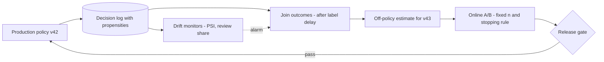

Ticket router v43 passed its offline gate: on 10,000 held-out tickets it misroutes fewer than v42. The product owner asks the obvious follow-ups. Will it be better on live traffic? How long must the test run? Can we look at the dashboard every day and stop when it is clearly winning? And could we have known without exposing customers to v43 at all? On the loan side, the same questions are harder: the outcome arrives a year later and only for applicants who were approved. This section turns each question into arithmetic.

:::key[First principle]
An online experiment is a measurement of cost per case under a policy, with noise you can compute in advance. Decide the metric, the unit, the sample size and the stopping rule before the first case is assigned; reduce noise with information that existed before assignment; and remember that a policy only produces labels for the actions it takes, so learning requires deliberately logged exploration.
:::



## 18.1 The metric and the unit

The primary metric is the one the policy optimises: **realised cost per case**, from the same cost matrix as the gate (§11). Accuracy, approval rate and review share are guardrails, not the target.

Randomise at the level where outcomes are independent. Tickets from one account share writing style and difficulty, so a ticket-level split puts correlated cases in both arms and understates variance. Randomise **accounts**, and analyse cost per account. Loan applications are usually one per person, so the application is a fine unit — but changing who gets credit is itself a decision with governance and regulatory weight (§16), so an online credit test needs the same sign-off as a release.

## 18.2 How many cases?

For two independent arms, a two-sided test at level $\alpha$ with power $1-\beta$ needs, per arm (the unpaired form of §11.5):

$$
n = \frac{\big(z_{1-\alpha/2} + z_{1-\beta}\big)^2\,\big(\sigma_A^2 + \sigma_B^2\big)}{\delta^2}, \qquad (1.960 + 0.842)^2 = 7.849 .
$$

The hard part is $\sigma$. A per-case decision cost is a mixture of many small numbers and a few huge ones (one bad approval is ₹120,000), so its standard deviation is several times its mean.

```python run
from math import ceil, sqrt
from statistics import NormalDist
import numpy as np

z = NormalDist().inv_cdf
K = (z(0.975) + z(0.80)) ** 2                          # 7.849 for alpha 0.05, power 0.8
rng = np.random.default_rng(0)
C_FP, C_FN, R, CAP, N = 120_000, 24_000, 3_000, 0.25, 200_000

good = rng.random(N) < 0.80                            # the calibrated population of §4
p = 1 / (1 + np.exp(-(np.log(4) + 2 * rng.normal(np.where(good, 1.0, -1.0), 1.0))))
saving = np.minimum(p * C_FN, (1 - p) * C_FP) - R
review = saving >= np.quantile(saving, 1 - CAP)
cost = np.where(review, R, np.where(p >= 0.8333, C_FP * ~good, C_FN * good))
sd = cost.std()
print(f"loan policy: mean INR {cost.mean():,.0f}/case, sd INR {sd:,.0f}")
for delta in (100, 250, 500, 1000):
    n = ceil(K * 2 * sd ** 2 / delta ** 2)
    print(f"  detect INR {delta:5,d}: {n:10,d} per arm = {2 * n / 100_000:5.1f} months of 100k applications")

m0, m1, c_err = 0.036, 0.030, 60                       # ticket misroute rates, INR per misroute
s0, s1 = c_err * sqrt(m0 * (1 - m0)), c_err * sqrt(m1 * (1 - m1))
n = ceil(K * (s0 ** 2 + s1 ** 2) / (c_err * (m0 - m1)) ** 2)
print(f"tickets: sd INR {s0:.2f} vs {s1:.2f}; detect 3.6% -> 3.0% (INR {c_err * (m0 - m1):.2f}/ticket): "
      f"{n:,d} per arm = {2 * n / 100_000:.2f} months of 100k tickets")
```

```output
loan policy: mean INR 3,450/case, sd INR 15,261
  detect INR   100:    365,606 per arm =   7.3 months of 100k applications
  detect INR   250:     58,497 per arm =   1.2 months of 100k applications
  detect INR   500:     14,625 per arm =   0.3 months of 100k applications
  detect INR 1,000:      3,657 per arm =   0.1 months of 100k applications
tickets: sd INR 11.18 vs 10.24; detect 3.6% -> 3.0% (INR 0.36/ticket): 13,911 per arm = 0.28 months of 100k tickets
```

:::example[Worked example · sizing a loan test and a ticket test]
**Loans.** Under the capped ₹3,000 policy the cost per case has mean ₹3,450 and $\sigma$ = ₹15,261. To detect ₹250:
$$
n = \frac{7.849 \times 2 \times 15{,}261^2}{250^2} = \frac{7.849 \times 4.658 \times 10^{8}}{62{,}500} \approx 58{,}500 \text{ per arm},
$$
1.2 months of enrolment at 100,000 applications a month — **and then a 12-month wait** for the outcomes to mature (§18.7). Detecting ₹100 takes 7.3 months of enrolment. An online test is the wrong tool for small loan-policy changes; evaluate those offline on matured labels and use online tests for large changes and operational guardrails.

**Tickets.** A misroute costs ₹60 and v42 misroutes 3.6%, so $\sigma = 60\sqrt{0.036 \times 0.964}$ = ₹11.18. Detecting 3.6% → 3.0% (₹0.36 a ticket) needs 13,911 tickets per arm: about a week of traffic, with labels in days. Ticket routing is where online tests pay.
:::

:::chart[Loan policy: cases per arm to detect a cost difference (α = 0.05, power 0.8, σ = ₹15,261)]{type="line" x="difference to detect (₹ per case)" y="cases per arm" xlog="true" ylog="true" yfmt="int" xprefix="₹" hmarks="50000:one month of traffic per arm"}
delta, cases per arm
50, 1462424
100, 365606
150, 162492
200, 91402
300, 40623
400, 22851
500, 14625
750, 6500
1000, 3657
1500, 1625
2000, 915
:::

Halving $\delta$ quadruples $n$. Before running anything, write down the smallest difference worth shipping — in rupees per case — and check that the traffic and label delay can resolve it.

## 18.3 CUPED: subtract what you already knew

Much of the variance in a per-account cost is *who the account is*: heavy users file many tickets, some write ambiguous ones. That was true before the test started. CUPED (controlled experiments using pre-experiment data) removes it. For a covariate $X$ measured before assignment:

$$
Y^{cv}_i = Y_i - \theta\,(X_i - \bar X), \qquad \theta = \frac{\operatorname{Cov}(X, Y)}{\operatorname{Var}(X)}, \qquad
\operatorname{Var}\big(\bar Y^{cv}\big) = \operatorname{Var}\big(\bar Y\big)\,(1 - \rho^2),
$$

where $\rho$ is the correlation between $X$ and $Y$. Because $X$ was fixed before randomisation, its arm means differ only by chance, so the adjusted difference has the same expectation as the plain one — it is unbiased — but less noise. Use the same $\theta$ for both arms.

```python run
import numpy as np
rng = np.random.default_rng(18)
C_RUN, C_ERR, ACCOUNTS = 1.086, 60, 20_000        # INR per ticket (§10), INR per misroute; accounts per arm

def arm(treated):
    tickets = rng.gamma(0.6, 2.5 / 0.6, ACCOUNTS)    # monthly ticket rate per account: mean 2.5, heavy tail
    logit = np.log(0.036 / 0.964) + rng.normal(0, 0.8, ACCOUNTS) - 0.3   # some accounts are hard to route
    m_old = 1 / (1 + np.exp(-logit))
    m_now = 1 / (1 + np.exp(-(logit + (np.log(0.83) if treated else 0))))   # v43 cuts misroute odds 17%
    def month_cost(m, months=1):
        t = rng.poisson(tickets * months)
        return (C_RUN * t + C_ERR * rng.binomial(t, m)) / months
    return month_cost(m_old, months=3), month_cost(m_now)   # pre-period (3 months on v42), experiment month

plain, cuped, rhos = [], [], []
for _ in range(400):
    (xA, yA), (xB, yB) = arm(False), arm(True)
    x, y = np.r_[xA, xB], np.r_[yA, yB]
    theta = np.cov(x, y)[0, 1] / x.var(ddof=1)      # one theta, pooled over both arms
    plain.append(yB.mean() - yA.mean())
    cuped.append((yB - theta * (xB - x.mean())).mean() - (yA - theta * (xA - x.mean())).mean())
    rhos.append(np.corrcoef(x, y)[0, 1])
rho = np.mean(rhos)
print(f"control INR/account/month {yA.mean():.2f}; corr(pre-period, experiment) = {rho:.3f}")
print(f"predicted variance kept 1 - rho^2 = {1 - rho ** 2:.3f}")
for name, est in (("plain difference", plain), ("CUPED", cuped)):
    lo, hi = np.percentile(est, [2.5, 97.5])
    print(f"{name:16s} mean {np.mean(est):6.3f}  sd {np.std(est):.3f}  middle 95% [{lo:6.3f}, {hi:6.3f}]")
print(f"observed variance ratio CUPED/plain = {np.var(cuped) / np.var(plain):.3f}")
```

```output
control INR/account/month 8.20; corr(pre-period, experiment) = 0.435
predicted variance kept 1 - rho^2 = 0.811
plain difference mean -0.875  sd 0.234  middle 95% [-1.354, -0.434]
CUPED            mean -0.875  sd 0.202  middle 95% [-1.260, -0.495]
observed variance ratio CUPED/plain = 0.741
```

With a three-month pre-period cost as the covariate, $\rho = 0.435$. The $1-\rho^2$ guide predicts keeping 81% of the variance; across 400 simulated experiments the measured ratio is 0.74. Both estimators centre on the same −₹0.875 per account; CUPED's standard deviation is 14% smaller (0.202 vs 0.234). Equivalently, CUPED reaches the same power with roughly three-quarters of the accounts.

:::details[Why CUPED does little for one-shot loan applications]
A first-time applicant has no pre-period. The best pre-assignment covariate is v42's own expected cost for the case, computed in shadow for both arms. It correlates weakly with realised cost because a single ₹120,000 outcome dominates the variance:

```python run
import numpy as np
rng = np.random.default_rng(18)
C_FP, C_FN, R, CAP = 120_000, 24_000, 3_000, 0.25
sig = lambda t: 1 / (1 + np.exp(-t))

def cases(n):
    good = rng.random(n) < 0.80
    mu = np.where(good, 1.0, -1.0)
    s1, s2 = rng.normal(mu, 1.0), rng.normal(mu, 1.6)          # v42 sees s1; v43 also sees s2
    p_old = sig(np.log(4) + 2 * s1)                             # both models are calibrated
    p_new = sig(np.log(4) + 2 * s1 + 2 * s2 / 1.6 ** 2)
    return good, p_old, p_new

def act_cost(p, good, expected=False):
    saving = np.minimum(p * C_FN, (1 - p) * C_FP) - R
    review = saving >= np.quantile(saving, 1 - CAP)
    if expected:                                               # cost the policy *expects* from p
        return np.where(review, R, np.minimum(p * C_FN, (1 - p) * C_FP))
    return np.where(review, R, np.where(p >= 0.8333, C_FP * ~good, C_FN * good))

g, po, pn = cases(1_000_000)
print("true effect v43 - v42: INR %.0f per case" % (act_cost(pn, g).mean() - act_cost(po, g).mean()))

n, plain, cuped, rhos = 20_000, [], [], []
for _ in range(400):
    gA, poA, _ = cases(n); gB, poB, pnB = cases(n)
    yA, yB = act_cost(poA, gA), act_cost(pnB, gB)               # A runs v42, B runs v43
    xA, xB = act_cost(poA, gA, True), act_cost(poB, gB, True)   # covariate: v42's expected cost, both arms
    x, y = np.r_[xA, xB], np.r_[yA, yB]
    theta = np.cov(x, y)[0, 1] / x.var(ddof=1)
    plain.append(yB.mean() - yA.mean())
    cuped.append((yB - theta * (xB - x.mean())).mean() - (yA - theta * (xA - x.mean())).mean())
    rhos.append(np.corrcoef(x, y)[0, 1])
rho = np.mean(rhos)
print(f"corr(covariate, cost) = {rho:.3f} -> predicted variance kept 1 - rho^2 = {1 - rho ** 2:.3f}")
for name, est in (("plain difference", plain), ("CUPED", cuped)):
    print(f"{name:16s} mean {np.mean(est):6.0f}  sd {np.std(est):5.0f}  (400 experiments, {n:,} per arm)")
print("observed variance ratio CUPED/plain = %.3f" % (np.var(cuped) / np.var(plain)))
```

```output
true effect v43 - v42: INR -1220 per case
corr(covariate, cost) = 0.136 -> predicted variance kept 1 - rho^2 = 0.982
plain difference mean  -1221  sd   144  (400 experiments, 20,000 per arm)
CUPED            mean  -1222  sd   138  (400 experiments, 20,000 per arm)
observed variance ratio CUPED/plain = 0.929
```

$\rho = 0.136$ predicts keeping 98% of the variance; the simulation measured 93%. Worth having, not worth relying on.
:::

:::tip[Choosing the covariate]
The covariate must be fixed before assignment and unaffected by the treatment: pre-period cost, account age, ticket volume last quarter. Never use something measured during the experiment — a post-treatment covariate can absorb part of the effect and bias the estimate.
:::

## 18.4 Peeking: the dashboard that lies

A fixed-$n$ test controls false positives at 5% *if you look once*. Looking after every batch and stopping at the first $|z| \ge 1.96$ gives chance many more opportunities. Simulate an A/A test — two identical arms — and count how often it declares a winner:

```python run
import numpy as np
rng = np.random.default_rng(18)
SIMS, MAX_LOOKS = 20_000, 50

# A/A test: no true difference. Each look adds an equal batch, so the running z-statistic is
# S_k / sqrt(k) with S_k a sum of k independent N(0, 1) batch statistics.
steps = rng.standard_normal((SIMS, MAX_LOOKS))
def false_positive_rate(looks, crit=1.96):
    idx = np.linspace(MAX_LOOKS / looks, MAX_LOOKS, looks).astype(int) - 1   # equally spaced looks
    k = idx + 1
    z = np.cumsum(steps, axis=1)[:, idx] / np.sqrt(k)
    return (np.abs(z) >= crit).any(axis=1).mean()

print("looks  P(declare a winner in an A/A test)")
for looks in (1, 2, 5, 10, 25, 50):
    print(f"{looks:5d}  {false_positive_rate(looks):.3f}")

# the constant boundary that holds the overall false-positive rate at 5% for 10 equally spaced looks
idx = np.arange(5, 51, 5) - 1
zmax = np.abs(np.cumsum(steps, axis=1)[:, idx] / np.sqrt(idx + 1)).max(axis=1)
c = np.quantile(zmax, 0.95)
print(f"10 looks: |z| >= {c:.2f} at every look keeps the overall rate at {(zmax >= c).mean():.3f}")
```

```output
looks  P(declare a winner in an A/A test)
    1  0.051
    2  0.085
    5  0.141
   10  0.194
   25  0.264
   50  0.319
10 looks: |z| >= 2.56 at every look keeps the overall rate at 0.050
```

:::chart[A/A test: chance of declaring a winner vs number of interim looks at |z| ≥ 1.96]{type="line" x="number of equally spaced looks" y="false-positive rate" xlog="true" yfmt="pct" ymin="0" hmarks="0.05:nominal 5%"}
looks, stop at first |z| ≥ 1.96
1, 0.051
2, 0.085
3, 0.108
5, 0.141
10, 0.194
15, 0.228
25, 0.264
50, 0.319
:::

Ten looks turn a 5% test into a 19% one; daily looks over seven weeks give about 32%. Three honest options:

| Option | How | Cost |
|---|---|---|
| Fixed horizon | Compute $n$ (§18.2), look once | No early stop, even for a disaster — pair it with guardrail alarms |
| Constant boundary (Pocock-style) | Stop only if $\lvert z \rvert \ge 2.56$ at any of 10 planned looks (simulated above) | More cases than a fixed test for the same power |
| Alpha spending (O'Brien–Fleming-style) | Very strict early, close to 1.96 at the end | Planned looks; little extra $n$ |

Guardrails are different from the primary decision. Stopping early because bad approvals or misroutes blew past a safety limit is fine at any look — you are stopping to prevent harm, not declaring a winner.

## 18.5 Off-policy evaluation: learn from the logs

An A/B test costs traffic and time. If the production policy **logs the probability of the action it took** — its propensity $\pi_0(a_i \mid x_i)$ — you can estimate a new policy's cost from logs alone. Inverse propensity scoring reweights the cases where the logged action is the one the new policy would have taken:

$$
\hat V_{\text{IPS}}(\pi_1) = \frac{1}{n}\sum_{i=1}^{n} \frac{\mathbb{1}[\pi_1(x_i) = a_i]}{\pi_0(a_i \mid x_i)}\, c_i .
$$

It is unbiased only if $\pi_0(a \mid x) > 0$ for every action $\pi_1$ might choose (*overlap*). A deterministic production policy gives zero propensity to every action it did not take, so the cases where v43 disagrees with v42 — the only ones that matter — carry no information. Simulated on the ticket router (50,000 logged tickets, ₹60 per misroute):

```python run
import numpy as np
rng = np.random.default_rng(18)
Q, N, C_ERR = 4, 50_000, 60                           # queues, logged tickets, INR per misroute

def softmax(z):
    e = np.exp(z - z.max(1, keepdims=True)); return e / e.sum(1, keepdims=True)

y = rng.integers(0, Q, N)                             # true queue
signal = np.eye(Q)[y] * 4.0
a_old = softmax(signal + rng.normal(0, 1.285, (N, Q))).argmax(1)   # v42, in production
a_new = softmax(signal + rng.normal(0, 1.24, (N, Q))).argmax(1)    # v43, candidate (scored in shadow)
truth = (C_ERR * (a_new != y)).mean()
print(f"misroute v42 {np.mean(a_old != y):.2%}, v43 {np.mean(a_new != y):.2%}; "
      f"true v43 cost INR {truth:.3f}/ticket; models disagree on {np.mean(a_new != a_old):.2%}")

def logging_policy(kind, eps=0.0):
    prop = np.full((N, Q), eps / Q); prop[np.arange(N), a_old] += 1 - eps
    if kind == "targeted":                            # coin flip between v42 and v43 where they disagree
        d = a_old != a_new
        prop[d] = 0; prop[d, a_old[d]] = 0.5; prop[d, a_new[d]] = 0.5
    return prop

for name, prop in (("uniform eps=0.10", logging_policy("eps", 0.10)),
                   ("uniform eps=0.02", logging_policy("eps", 0.02)),
                   ("no exploration  ", logging_policy("eps", 0.0)),
                   ("targeted 50/50  ", logging_policy("targeted"))):
    u = rng.random(N)[:, None]
    a = (u > prop.cumsum(1)).sum(1)                   # sample the logged action from its propensities
    cost = C_ERR * (a != y)                           # observed for the logged action only
    w = (a == a_new) / prop[np.arange(N), a]          # importance weight for the target policy
    ips, half = (w * cost).mean(), 1.96 * (w * cost).std() / np.sqrt(N)
    match = cost[a == a_new].mean()                   # naive replay: keep rows where actions agree
    print(f"{name}: logging INR {cost.mean():4.2f} | IPS {ips:5.3f} +/- {half:5.3f} | "
          f"naive replay {match:5.3f} | max weight {w.max():3.0f}")
```

```output
misroute v42 3.56%, v43 3.19%; true v43 cost INR 1.913/ticket; models disagree on 6.62%
uniform eps=0.10: logging INR 6.36 | IPS 2.078 +/- 0.617 | naive replay 0.075 | max weight  40
uniform eps=0.02: logging INR 2.96 | IPS 1.693 +/- 1.244 | naive replay 0.023 | max weight 200
no exploration  : logging INR 2.13 | IPS 0.013 +/- 0.008 | naive replay 0.014 | max weight   1
targeted 50/50  : logging INR 2.01 | IPS 1.856 +/- 0.130 | naive replay 0.967 | max weight   2
```

Read it row by row against the true v43 cost of ₹1.913 a ticket:

- **No exploration** estimates ₹0.013, because it can only see agreement cases and those are almost always routed right. The "naive replay" — keep the rows where the logged action matches v43 — is just as wrong in every row: the rows it keeps are not a random sample.
- **Uniform ε = 0.10** is unbiased but pays for it: logging costs ₹6.36 a ticket instead of ₹2.13, because 7.5% of tickets are routed at random, and the weights reach 40, so the 95% half-width is ₹0.62.
- **ε = 0.02** halves the exploration bill but weights reach 200 and the half-width doubles to ₹1.24 — useless.
- **Targeted exploration** — flip a fair coin between v42 and v43 only on the 6.6% of tickets where they disagree — gets ₹1.856 ± 0.130, and the logging policy is *cheaper* than v42 alone (₹2.01), because half the disagreements now take the better model's action.

:::warn[Log the propensity at decision time]
IPS needs $\pi_0(a_i \mid x_i)$ as it was when the decision was made. Reconstructing it later from a model that has since been retrained gives the wrong weights. Add `propensity` and `candidate_action` (what the shadow model would have done) to the decision record of §13.10.
:::

## 18.6 Drift monitoring: PSI, read properly

The **population stability index** compares a baseline distribution with a current window, binned on baseline quantiles:

$$
\text{PSI} = \sum_{b=1}^{B} (a_b - e_b)\,\ln\frac{a_b}{e_b},
$$

with $e_b$ and $a_b$ the expected (baseline) and actual (current) shares in bin $b$. It is a symmetrised KL divergence, so it is always $\ge 0$.

:::example[Worked example · four bins by hand]
Baseline shares $e = (0.10, 0.20, 0.30, 0.40)$, current $a = (0.15, 0.25, 0.30, 0.30)$:

$$
\begin{aligned}
\text{PSI} &= 0.05\ln 1.5 + 0.05\ln 1.25 + 0 + (-0.10)\ln 0.75 \\
&= 0.02027 + 0.01116 + 0 + 0.02877 = 0.0602 .
\end{aligned}
$$
:::

A common rule of thumb reads PSI below 0.1 as no significant shift, 0.1–0.25 as moderate and above 0.25 as major. Treat those as conventions, not calibrated thresholds — the code shows why:

```python run
import numpy as np
rng = np.random.default_rng(18)
sig = lambda t: 1 / (1 + np.exp(-t))

def scores(n, good_rate=0.80, sep=1.0):              # calibrated P(good) for the §4 population
    good = rng.random(n) < good_rate
    return sig(np.log(4) + 2 * rng.normal(np.where(good, sep, -sep), 1.0))

def psi(expected, actual, bins=10):
    edges = np.quantile(expected, np.linspace(0, 1, bins + 1)); edges[[0, -1]] = 0, 1
    e = np.histogram(expected, edges)[0] / len(expected)
    a = np.histogram(actual, edges)[0] / len(actual)
    e, a = np.clip(e, 1e-6, None), np.clip(a, 1e-6, None)      # guard empty bins
    return np.sum((a - e) * np.log(a / e))

hand_e, hand_a = np.array([0.10, 0.20, 0.30, 0.40]), np.array([0.15, 0.25, 0.30, 0.30])
print("hand example PSI = %.4f" % np.sum((hand_a - hand_e) * np.log(hand_a / hand_e)))

base = scores(50_000)
print("noise floor: PSI between two samples of the SAME population (mean of 200)")
for n in (500, 2_000, 10_000):
    vals = [psi(base, scores(n)) for _ in range(200)]
    print(f"  window n={n:6,d}: mean {np.mean(vals):.4f}, 99th pct {np.percentile(vals, 99):.4f}"
          f"   (B-1)(1/n_e + 1/n_a) = {9 * (1 / 50_000 + 1 / n):.4f}")

print("shifts (window n = 10,000):")
for label, kw in (("good rate 0.80 -> 0.75", dict(good_rate=0.75)), ("good rate 0.80 -> 0.70", dict(good_rate=0.70)),
                  ("good rate 0.80 -> 0.60", dict(good_rate=0.60)), ("weaker signal, sep 1.0 -> 0.7", dict(sep=0.7))):
    x = scores(10_000, **kw)
    print(f"  {label:30s} PSI {psi(base, x):.3f} | approve share (p >= 0.8333) "
          f"{np.mean(base >= 0.8333):.3f} -> {np.mean(x >= 0.8333):.3f}")

x = scores(200_000, good_rate=0.70)                  # p was fitted when 80% were good
q = sig(np.log(x / (1 - x)) + np.log((0.70 / 0.30) / (0.80 / 0.20)))   # Bayes re-adjustment (§7.7)
cost = lambda approve: np.where(approve, (1 - q) * 120_000, q * 24_000).mean()   # true expected cost
print(f"0.80 -> 0.70 shift, two-action policy: stale p INR {cost(x >= 0.8333):,.0f}/case, "
      f"re-adjusted INR {cost(q >= 0.8333):,.0f}/case")
```

```output
hand example PSI = 0.0602
noise floor: PSI between two samples of the SAME population (mean of 200)
  window n=   500: mean 0.0188, 99th pct 0.0379   (B-1)(1/n_e + 1/n_a) = 0.0182
  window n= 2,000: mean 0.0044, 99th pct 0.0120   (B-1)(1/n_e + 1/n_a) = 0.0047
  window n=10,000: mean 0.0011, 99th pct 0.0023   (B-1)(1/n_e + 1/n_a) = 0.0011
shifts (window n = 10,000):
  good rate 0.80 -> 0.75         PSI 0.010 | approve share (p >= 0.8333) 0.679 -> 0.636
  good rate 0.80 -> 0.70         PSI 0.029 | approve share (p >= 0.8333) 0.679 -> 0.611
  good rate 0.80 -> 0.60         PSI 0.108 | approve share (p >= 0.8333) 0.679 -> 0.542
  weaker signal, sep 1.0 -> 0.7  PSI 0.057 | approve share (p >= 0.8333) 0.679 -> 0.617
0.80 -> 0.70 shift, two-action policy: stale p INR 7,937/case, re-adjusted INR 7,515/case
```

- **Small windows are noisy.** Between two samples of the *same* population, PSI averages about $(B-1)(1/n_e + 1/n_a)$: 0.019 for a 500-case window. Set alert thresholds above the 99th percentile of this noise for your window size, not at a universal number.
- **"No significant shift" can be expensive.** A drop in the good rate from 80% to 70% gives PSI 0.029, well under 0.1, yet the approve share falls from 67.9% to 61.1%, and running the stale probabilities costs ₹7,937 a case against ₹7,515 after the Bayes re-adjustment of §7.7 — ₹422 a case, ₹42.2M a month at 100,000 applications.
- **So monitor in rupees.** Alongside PSI on $p$ and on key inputs, track the action shares, the review share against its cap (§17.3), the share of cases within ±0.05 of each cut point, and — once labels arrive — calibration and realised cost per case. Alert when the *cost* implication crosses the smallest difference worth acting on.

:::note[Where the noise floor comes from]
[§19.3](/c/practical-slm-decision-models/19-troubleshooting-and-failure-modes) derives $\mathbb{E}[\text{PSI} \mid \text{no drift}] \approx (B-1)(1/n_{ref} + 1/n_{cur})$ from the chi-square approximation, and replays a base-rate drift that the 0.1 rule of thumb misses while a noise-floor alarm catches it within weeks.
:::

## 18.7 Feedback loops and label delay

**Label delay.** A loan's outcome — say, 90 days past due within 12 months — matures over a year. If defaults arrived evenly across those months (an illustrative assumption), three months after launch only a quarter of eventual bads would be visible: the §17 policy's 6.17% bad-approval rate would show as about 1.5%. Compare cohorts at the **same age** (vintage curves), use leading indicators such as early missed payments that you have calibrated against matured outcomes, and never compare a young cohort's bad rate with an old one's.

**Selective labels.** Declined applicants never produce an outcome, and reviewed ones produce an outcome only if approved. Training the next model on approved cases teaches it about the population the *old* policy approved; the declined region stays unknown and can drift silently. Learning about it costs money. Approving a case the policy would decline costs, in expectation,

$$
\Delta(p) = (1-p)\,c_{FP} - p\,c_{FN} = 120{,}000 - 144{,}000\,p ,
$$

which is ₹33,600 at $p = 0.60$, ₹62,400 at $p = 0.40$ and zero at $p^* = 0.833$. Exploration near the band edge is cheapest; with an illustrative budget of 280 exploratory approvals a month at $p \approx 0.645$ (₹27,120 each), the bill is about ₹7.6M a month. Put that number in front of the risk owner as the price of keeping the decline region observable, and log those approvals with their propensities so §18.5 can use them.

**Feedback through people and policy.** Reviewers who see the model score drift toward it, so reviewed labels inherit the model's errors (§16.7). A support team that learns which phrasing gets routed to billing changes the input distribution. Keep a small random sample of cases labelled independently of the model — double-blind review, audit samples — as the anchor every other label is checked against.

## 18.8 Diagnose before you change the model

When cost per case rises, find the link that broke before reaching for a fine-tune:

| Measured symptom | First intervention to test | Section |
|---|---|---|
| PSI on inputs up, calibration still fine | Nothing yet; watch cost and action shares | §18.6 |
| Base rate moved, ranking unchanged | Bayes re-adjustment, then recalibrate on fresh labels | §7.7 |
| Good AUC, poor reliability diagram | Recalibrate (temperature or Platt) | §7.4 |
| Good probabilities, wrong action mix | Revisit costs, review price or cap | §4 |
| Review share above cap | Refit the saving cutoff, or raise capacity | §17.3 |
| One slice regressed | Slice data coverage; slice gate | §11.7 |
| Invalid outputs or fallbacks rising | Contract tests, constrained decoding | §12.3 |
| Tail latency up | Runtime, batching, utilisation | §13.4 |
| Ranking genuinely worse on fresh labels | More or better labels, then fine-tune | §8 |

The least complex intervention that addresses the measured failure is usually the right first experiment — and each of them is itself a policy change that goes through §18.2–18.5 before it ships.

## 18.9 Check yourself

:::qa[Per-case loan cost has σ = ₹15,261. How many applications per arm detect a ₹500 difference, and is an online test sensible?]
$n = 7.849 \times 2 \times 15{,}261^2 / 500^2 \approx 14{,}625$ per arm — about nine days of enrolment at 100,000 a month. But outcomes take a year to mature, so the test reads out in a year. Prefer offline evaluation on matured labels for anything this size and use the online test as a guardrail.
:::

:::qa[Your CUPED covariate has ρ = 0.6 with the metric. How many fewer accounts do you need for the same power?]
Variance is multiplied by $1 - 0.6^2 = 0.64$, so you need about 64% of the accounts — 36% fewer. With ρ = 0.136, as for one-shot loans, you would save under 2%.
:::

:::qa[A PM checks the A/B dashboard every working day for two weeks and stops when p < 0.05. What false-positive rate is that?]
Ten looks at 1.96 give about 19% in the simulation, not 5%. Either fix the horizon and look once, or plan the ten looks with a boundary of |z| ≥ 2.56.
:::

:::qa[The router logs only the chosen queue, with no propensities and no exploration. Can you estimate v43's cost from those logs?]
No. Wherever v43 disagrees with v42 the logs never show what v43's queue would have cost, and that is exactly where the two differ. The simulation's no-exploration estimate is ₹0.013 against a truth of ₹1.913. Start logging propensities and randomise between v42 and v43 on disagreement cases.
:::

:::qa[Weekly PSI on p is 0.03. Do you act?]
Not because of the rule of thumb alone. Check it against the noise floor for your window, then price it: a 10-point base-rate drop produced PSI 0.029 and still cost ₹422 a case until probabilities were re-adjusted. Look at action shares and, as labels arrive, calibration and realised cost.
:::

Next: when something does go wrong in production, how to find it fast — [§19 Troubleshooting and failure modes](/c/practical-slm-decision-models/19-troubleshooting-and-failure-modes).
