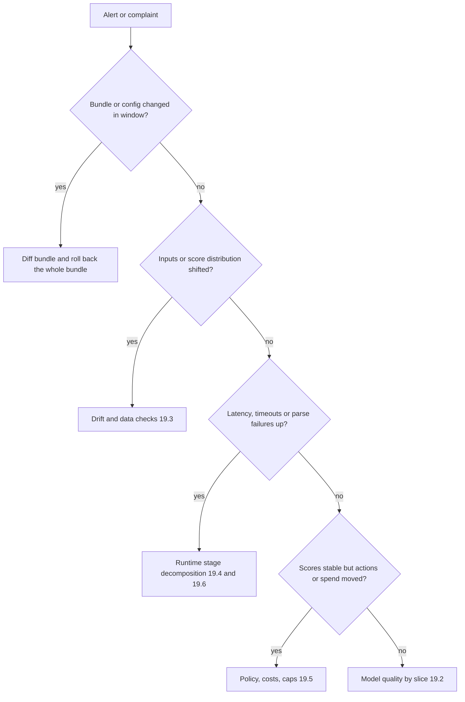

Monday morning brings three alerts. The ticket router's p95 has gone from 130 ms to 400 ms. The loan model's approve rate has slid from 55% to 44% over a month with no release. And the agents on the billing queue say "more tickets are landing here that shouldn't". The tempting response is to edit the prompt, retrain, and nudge the threshold — all at once, so nobody will ever know which change mattered. Each of these alerts has a different owner and a different first measurement, and each can be localised in under an hour if you know what to look at. This section is that lookup.

:::key[First principle]
A decision system fails in one **layer** — inputs, model scores, calibration, policy and costs, runtime, or spend — and every layer leaves a measurable trace that changes before or with the failure. Compare that trace against a frozen reference, localise the failure to one layer, contain it on a safe decision path, then change **one** thing and re-measure.
:::

## 19.1 Preserve evidence, then localise

Before diagnosing anything:

1. **Freeze the bundle.** Record the `bundle_id` (weights, tokenizer, prompt template, calibrator, policy — [§13.9](/c/practical-slm-decision-models/13-serving-and-deployment)) that served the affected window, and the last known-good one.
2. **Pull the logs you already write** ([§13.10](/c/practical-slm-decision-models/13-serving-and-deployment)): calibrated probabilities, action and rule fired, per-stage latency, fallback reason, queue depth at admission.
3. **Pick the comparison window** — same weekday and hours from the last known-good period — and keep it fixed for every chart.
4. **Change one thing at a time.** Two simultaneous changes make every later measurement ambiguous.

Each layer has a signal that is available *without* waiting for labels, and one that needs them:

| Layer | Label-free signal (minutes) | Label-based signal (hours to months) | Owner |
|---|---|---|---|
| Inputs | input length, null/default rates, PSI per feature | — | data/platform |
| Model scores | PSI on scores, mean predicted $p$ | AUC, per-class recall | ML |
| Calibration | mean $p$ vs EM-estimated base rate ([§7.7](/c/practical-slm-decision-models/07-probabilities-and-calibration)) | ECE, reliability diagram, Brier | ML |
| Policy and costs | action shares, review share vs band $[p_{lo}, p_{hi}]$ | realised cost per case | product / risk |
| Runtime | per-stage latency, queue depth, parse-failure rate | — | platform |
| Spend | calls per decision, escalation share, tokens per call | — | platform / finance |

The triage order follows cost-to-check: configuration diffs are free, input statistics are cheap, labels are slow.



## 19.2 Quality drop

Quality is defined by the decision metric — realised cost per case ([§11.3](/c/practical-slm-decision-models/11-evaluation-and-release-gates)) — not accuracy. Two traps make quality drops hard to see: realised cost is **noisy** (in §19.3's synthetic loan book, six weeks of 5,000 cases with nothing changed range from ₹7,056 to ₹7,670 per case), and labels are **slow** (loan defaults take months; ticket misroutes take hours).

| Symptom | Likely cause | Diagnostic | Fix |
|---|---|---|---|
| Cost per case up, accuracy flat | Threshold no longer at the cost ratio; cost matrix changed and policy not updated | Recompute $p^*$, $p_{lo}$, $p_{hi}$ from today's signed costs; sweep cost vs threshold on recent labels ([§4.5](/c/practical-slm-decision-models/04-decision-theory)) | Re-derive thresholds; ship as a new policy version in the bundle |
| Overall fine, one segment worse | New segment, changed product, thin data | Paired cost difference per pre-registered slice with CI ([§11.7](/c/practical-slm-decision-models/11-evaluation-and-release-gates)) | Route that slice to the incumbent or to review; label it |
| Validation good, production poor from day one | Leakage via random split; near-duplicate customers on both sides | Re-evaluate on a group- or time-split ([§11.8](/c/practical-slm-decision-models/11-evaluation-and-release-gates)) | Retrain on the honest split; the old score was never real |
| One class/queue collapses | Upstream taxonomy or label-definition change | Per-class recall by week; confusion-matrix diff vs reference | Update label map and policy; relabel the affected weeks |
| Errors concentrated in escalated cases | Correlated errors between stages ([§10.5](/c/practical-slm-decision-models/10-hybrid-architectures)) | Stage-2 accuracy on *escalated* slice vs overall (89.4% vs 96.1% in §10) | Evaluate and improve stage 2 on the slice it receives |
| Quality drop right after quantisation or distillation | Logits rescaled; ranking intact but probabilities moved | Reliability diagram before/after; AUC unchanged? | Refit the calibrator on the calibration split ([§7.4](/c/practical-slm-decision-models/07-probabilities-and-calibration)) |

:::warn[Do not repair the evaluation instead of the system]
Removing "hard" examples from the test set, relabelling disputed cases to agree with the model, or re-tuning thresholds on the test set all make the dashboard recover while the decisions stay wrong. Every fix must be re-validated on data that did not choose it.
:::

## 19.3 Calibration drift and silent data issues

The loan model's approve rate fell from 55% to 44% with no release. The likeliest cause is **prior shift**: fewer applicants are good, the model still believes the training base rate, and its probabilities are now too optimistic ([§7.7](/c/practical-slm-decision-models/07-probabilities-and-calibration)). You want to detect that the week it starts, not when defaults arrive.

### Population stability index, derived

Bin the score distribution of a reference window into $B$ bins (deciles of the reference, so each holds $e_i = 0.1$). For the current window, let $a_i$ be the share in bin $i$. PSI is the symmetric Kullback–Leibler divergence between the two binned distributions:

$$
\text{PSI} = \mathrm{KL}(a \Vert e) + \mathrm{KL}(e \Vert a) = \sum_i a_i \ln\frac{a_i}{e_i} + \sum_i e_i \ln\frac{e_i}{a_i} = \sum_{i=1}^{B} (a_i - e_i)\,\ln\frac{a_i}{e_i}.
$$

Each term is non-negative (both factors share a sign), so PSI is zero only when every bin matches. For small differences, $\ln(a_i/e_i) \approx (a_i - e_i)/e_i$, so

$$
\text{PSI} \approx \sum_i \frac{(a_i - e_i)^2}{e_i},
$$

a chi-square distance. That approximation gives the **noise floor**: if nothing changed, $a_i - e_i$ is pure sampling noise with variance $e_i(1-e_i)\left(\frac{1}{n_{ref}} + \frac{1}{n_{cur}}\right)$, so

$$
\mathbb{E}[\text{PSI} \mid \text{no drift}] \approx \sum_i (1 - e_i)\left(\frac{1}{n_{ref}} + \frac{1}{n_{cur}}\right) = (B-1)\left(\frac{1}{n_{ref}} + \frac{1}{n_{cur}}\right).
$$

:::example[Worked example · how big is a PSI of 0.04?]
Ten deciles at 10% each. Half of them drop to 8%, half rise to 12% — a two-point shift in every bin:

$\text{PSI} = 5 \times (-0.02)\ln(0.8) + 5 \times 0.02 \ln(1.2) = 0.0223 + 0.0182 = 0.0405$.

Noise floor for a 20,000-case reference and 5,000-case weekly windows: $9 \times (1/20{,}000 + 1/5{,}000) = 9 \times 0.00025 = 0.00225$. A PSI of 0.04 is 18× the floor — a real shift, even though the folklore thresholds (0.1 "investigate", 0.25 "act") call it nothing.
:::

### A runnable drift detector

A synthetic loan book whose scores are calibrated at the training base rate 0.70; from week 7 the true base rate falls to 0.55 over four weeks (illustrative). Each week has 5,000 cases. PSI and mean $p$ need no labels; ECE and realised cost do.

```python run
"""Drift detector: PSI on the score distribution (no labels) vs ECE and cost (needs labels)."""
import numpy as np

rng = np.random.default_rng(7)
D, PI_TRAIN, T = 2.0, 0.70, 0.8333           # class separation, training base rate, approve cut


def week(n, pi):
    good = rng.random(n) < pi
    x = rng.normal(np.where(good, D / 2, -D / 2), 1.0)
    p = 1 / (1 + np.exp(-(np.log(PI_TRAIN / (1 - PI_TRAIN)) + D * x)))  # calibrated at pi=0.70
    return p, good


def psi(ref, cur, edges):
    a = np.histogram(ref, edges)[0] / len(ref)
    b = np.histogram(cur, edges)[0] / len(cur)
    a, b = np.clip(a, 1e-6, None), np.clip(b, 1e-6, None)
    return np.sum((b - a) * np.log(b / a))


def ece(p, y, bins=10):
    idx = np.minimum((p * bins).astype(int), bins - 1)
    return sum(np.mean(idx == k) * abs(p[idx == k].mean() - y[idx == k].mean())
               for k in range(bins) if np.any(idx == k))


ref, _ = week(20_000, PI_TRAIN)                              # reference window at launch
edges = np.quantile(ref, np.linspace(0, 1, 11))
edges[0], edges[-1] = 0.0, 1.0
rates = [0.70] * 6 + [0.66, 0.62, 0.58, 0.55, 0.55, 0.55]   # base rate by week (illustrative)
print("week  base   PSI    ECE   mean p  approve  INR/case")
for w, pi in enumerate(rates, 1):
    p, y = week(5_000, pi)
    cost = np.mean(np.where(p >= T, (~y) * 120_000, y * 24_000))
    print("%4d  %.2f  %.3f  %.3f  %.3f   %5.1f%%  %8.0f"
          % (w, pi, psi(ref, p, edges), ece(p, y), p.mean(), 100 * np.mean(p >= T), cost))
null = [psi(ref, week(5_000, PI_TRAIN)[0], edges) for _ in range(200)]
print("PSI with no drift, 200 weeks: median %.4f  99th pct %.4f" % tuple(np.percentile(null, [50, 99])))
```

```output
week  base   PSI    ECE   mean p  approve  INR/case
   1  0.70  0.004  0.013  0.709    55.0%      7397
   2  0.70  0.005  0.012  0.699    53.9%      7632
   3  0.70  0.003  0.012  0.707    54.8%      7565
   4  0.70  0.004  0.010  0.697    52.8%      7670
   5  0.70  0.002  0.007  0.699    53.7%      7248
   6  0.70  0.002  0.011  0.697    53.6%      7056
   7  0.66  0.005  0.021  0.678    51.1%      7781
   8  0.62  0.013  0.048  0.660    49.3%      7877
   9  0.58  0.030  0.058  0.638    46.3%      8011
  10  0.55  0.051  0.067  0.619    43.6%      8448
  11  0.55  0.046  0.076  0.622    43.8%      8376
  12  0.55  0.050  0.075  0.620    43.8%      7574
PSI with no drift, 200 weeks: median 0.0022  99th pct 0.0067
```

:::chart[Weekly drift signals — PSI needs no labels, ECE needs outcomes]{type="line" x="week" y="value" yfmt="dec3" marks="6.5:base rate starts falling" hmarks="0.0067:PSI alarm (99th pct, no drift)" xmin="1" xmax="12"}
week, PSI on scores, ECE
1, 0.004, 0.013
2, 0.005, 0.012
3, 0.003, 0.012
4, 0.004, 0.010
5, 0.002, 0.007
6, 0.002, 0.011
7, 0.005, 0.021
8, 0.013, 0.048
9, 0.030, 0.058
10, 0.051, 0.067
11, 0.046, 0.076
12, 0.050, 0.075
:::

What the run shows:

- **The derived floor is right.** The simulated no-drift median, 0.0022, matches $(B-1)(1/n_{ref} + 1/n_{cur}) = 0.00225$. Set the alarm at the empirical 99th percentile, **0.0067**, not at 0.1. The PSI alarm fires in week 8 (0.013), when the base rate has moved eight points.
- **A 0.1 rule would never fire.** A fifteen-point fall in the base rate tops out at PSI 0.051, while ECE goes from about 0.01 to 0.075 and the approve rate drops eleven points. Prior shift moves the *mixture* of two unchanged score distributions, which is a gentle change in the histogram and a large change in what the scores mean.
- **Realised cost is too noisy to be the alarm.** Weeks 1–6 span ₹7,056–₹7,670 with no drift; week 12 (fully drifted) is ₹7,574. Weekly cost confirms a problem after the fact; it does not detect one.
- **Mean $p$ is the cheapest calibration check.** It falls from 0.70 to 0.62 while the true rate falls to 0.55 — the 7-point gap is the miscalibration, and the EM estimate in §7.7 recovers the true rate without labels. The fix is the Bayes prior correction, not a retrain.

:::tip[PSI in practice]
- Compute PSI on the **calibrated score** first (one number per model), then on each input feature to locate the cause.
- Fix the reference window and bin edges in the bundle; re-binning every week makes PSI drift by itself.
- Derive the alarm from the no-drift distribution at *your* window sizes: halving the weekly volume doubles the floor's second term.
- PSI detects that something moved, not whether decisions got worse. Follow it with the label-free calibration check (mean $p$ vs EM base rate) and, when labels arrive, cost per case.
:::

| Symptom | Likely cause | Diagnostic | Fix |
|---|---|---|---|
| Mean $p$ above the realised (or EM-estimated) base rate; approve rate sliding | Prior shift | EM base-rate estimate ([§7.7](/c/practical-slm-decision-models/07-probabilities-and-calibration)); PSI on scores | Bayes prior correction in the calibrator; new bundle |
| ECE up after a release, AUC unchanged | Logit scale changed (new weights, prompt, quantisation) | Reliability diagram vs previous bundle on the same cases | Refit temperature/Platt/isotonic on the calibration split |
| Calibrated overall, off in one segment | Segment mix differs from calibration set | Per-segment reliability with Wilson intervals | Segment-specific calibrator, or route the segment |
| PSI up on scores and features, labels later disagree with EM | Likelihood shift (new channel, new product, adversaries) | PSI per feature; AUC on the first matured labels | Fresh labels and full recalibration; prior correction is not enough |
| Score histogram spikes at one value | Constant or empty input (truncated payload, missing text) | Input-length histogram; share of identical input hashes | Reject at schema validation; route to safe fallback |
| PSI ≈ 0 but cost jumps once labels arrive | A feature silently defaulted (missing income imputed as 0) or label pipeline changed | Null and default-value rate per feature per day | Fix the pipeline; replay affected decisions from logs |
| Offline replay of logged inputs gives different scores | Training–serving skew (preprocessing, tokenizer revision) | Replay 1,000 logged requests through the offline pipeline; compare scores | Pin the tokenizer and preprocessing in the bundle |

## 19.4 Latency spikes

End-to-end latency of one request is the sum of its stages:

$$
T_{\text{total}} = \sum_i T_i = T_{\text{net}} + T_{\text{queue}} + T_{\text{pre}} + T_{\text{retrieve}} + T_{\text{prefill}} + T_{\text{decode}} + T_{\text{parse+policy}} .
$$

Means add, so the mean decomposes exactly. **Percentiles do not add**: the p95 of the sum is not the sum of stage p95s, because the slow requests are slow in *one* stage, rarely all. The tool that does decompose the tail is conditional: take the requests whose total is at or above p95 and average each stage *over those requests*. Those stage means add up to the tail's mean, and they tell you which stage builds it.

The simulation below uses illustrative stage times for a ticket-router-like service on one replica: 8% of requests arrive behind a batch and wait (exponential, mean 60 ms), 5% of outputs include a 40-token rationale instead of an 8–12 token label, decode is 2.5 ms per token and prefill 0.04 ms per prompt token.

```python run
"""Where does p95 come from? Per-stage latency, typical vs tail requests (illustrative stages)."""
import numpy as np

rng = np.random.default_rng(19)
n = 200_000
ln = lambda med, sig: med * rng.lognormal(0, sig, n)          # median `med` ms, spread `sig`
prompt = rng.lognormal(np.log(350), 0.45, n)                  # prompt tokens per request
out_tok = rng.choice([8, 12, 40], n, p=[0.6, 0.35, 0.05])     # 5% write a long rationale
busy = rng.random(n) < 0.08                                   # 8% arrive behind a batch
stages = {
    "network": ln(3, 0.3),
    "queue": np.where(busy, rng.exponential(60, n), rng.exponential(2, n)),
    "preprocess": ln(2, 0.2),
    "retrieval": ln(8, 0.5),
    "prefill": prompt * 0.04 * rng.lognormal(0, 0.1, n),        # 0.04 ms per prompt token
    "decode": out_tok * 2.5 * rng.lognormal(0, 0.1, n),         # 2.5 ms per output token
    "parse+policy": ln(0.8, 0.2),
}
total = sum(stages.values())
p50, p95, p99 = np.percentile(total, [50, 95, 99])
print("total ms: p50 %.1f  p95 %.1f  p99 %.1f  mean %.1f" % (p50, p95, p99, total.mean()))
groups = {"typical": (total >= np.percentile(total, 45)) & (total <= np.percentile(total, 55)),
          "tail>=p95": total >= p95, "tail>=p99": total >= p99}
print("%-13s" % "stage (ms)" + "".join("%11s" % g for g in groups) + "   own p95")
for name, t in stages.items():
    print("%-13s" % name + "".join("%11.1f" % t[m].mean() for m in groups.values())
          + "%10.1f" % np.percentile(t, 95))
print("%-13s" % "sum" + "".join("%11.1f" % total[m].mean() for m in groups.values())
      + "%10.1f" % sum(np.percentile(t, 95) for t in stages.values()))
tail = groups["tail>=p95"]
for name in ("queue", "decode", "retrieval"):
    print("tail mean without %-10s %6.1f ms" % (name + ":", (total[tail] - stages[name][tail]).mean()))
print("arrived behind a batch: %.1f%% of all, %.1f%% of tail" % (100 * busy.mean(), 100 * busy[tail].mean()))
print("40-token output:        %.1f%% of all, %.1f%% of tail"
      % (100 * (out_tok == 40).mean(), 100 * (out_tok[tail] == 40).mean()))
```

```output
total ms: p50 57.0  p95 131.3  p99 189.5  mean 65.0
stage (ms)       typical  tail>=p95  tail>=p99   own p95
network              3.2        3.2        3.1       4.9
queue                2.2       65.3      180.4      28.6
preprocess           2.0        2.0        2.0       2.8
retrieval            9.1        9.9        9.6      18.3
prefill             15.2       17.6       16.6      29.9
decode              24.5       69.6       36.9      42.9
parse+policy         0.8        0.8        0.8       1.1
sum                 57.0      168.4      249.4     128.5
tail mean without queue:      103.1 ms
tail mean without decode:      98.8 ms
tail mean without retrieval:  158.5 ms
arrived behind a batch: 8.0% of all, 51.5% of tail
40-token output:        5.0% of all, 55.8% of tail
```

:::chart[Mean time per stage, typical requests vs the slowest 5% and 1% (simulated, illustrative stage times)]{type="bar" stacked="true" y="mean latency of requests in the group" unit=" ms"}
group, queue, decode, prefill, retrieval, other
typical (p45–p55), 2.2, 24.5, 15.2, 9.1, 6.0
tail ≥ p95, 65.3, 69.6, 17.6, 9.9, 6.0
tail ≥ p99, 180.4, 36.9, 16.6, 9.6, 5.9
:::

"Other" is network + preprocess + parse/policy. Reading the decomposition:

- **A typical request is a model request**: decode and prefill are 40 of its 57 ms. Optimising the model helps the median.
- **The p95 tail is two minorities.** 8% of requests that queued behind a batch make up 51.5% of the tail; 5% that wrote a rationale make up 55.8%. In the tail, queue (65.3 ms) and decode (69.6 ms) replace retrieval and prefill as the cost.
- **The p99 tail is almost all queue** (180.4 of 249.4 ms). A faster model cannot fix it; admission control, batch caps or another replica can ([§13.4–13.7](/c/practical-slm-decision-models/13-serving-and-deployment)).
- **Retrieval looks guilty and isn't.** Its own p95 (18.3 ms) is the third largest, but removing it entirely cuts the tail mean only from 168.4 to 158.5 ms.
- **Stage p95s don't add.** Their sum (128.5 ms) happens to land near the true p95 (131.3 ms) here; in general it can be far off in either direction. Always decompose the tail conditionally.

| Symptom | Likely cause | Diagnostic | Fix |
|---|---|---|---|
| p95/p99 up, p50 flat | Queueing at high utilisation; a minority of long outputs | Conditional tail decomposition (above); queue depth at admission | Cap output tokens; drop free-text rationale; batch cap; replica |
| p50 and p95 up together | Service time up: longer prompts, bigger model, CPU throttling, new tokenizer | Prompt tokens per request; ms per decode step vs bundle baseline | Shorten prompt (prefill is linear in tokens); revert |
| Latency rises sharply with traffic | Utilisation past the knee: wait $\propto \rho/(1-\rho)$ | p95 vs $\rho$; Little's law $L = \lambda W$ on replicas | Size replicas at target $\rho$ ([§13.3](/c/practical-slm-decision-models/13-serving-and-deployment)) |
| Periodic spikes | Cold starts, autoscaling, model reload, GC | Correlate spikes with deploy/scale events | Keep a warm replica; pre-load weights; warm-up requests |
| p95 from the cascade path | Escalation share above 5% puts p95 on the LLM path ([§10.3](/c/practical-slm-decision-models/10-hybrid-architectures)) | Latency by path; escalation share | Per-path SLOs; lower escalation; parallel LLM call |
| p99 differs run to run | Too few samples beyond p99 | Samples per run vs 100 × $1/(1-q)$ ([§14.4](/c/practical-slm-decision-models/14-benchmarking-and-performance)) | ≥ 10,000 steady-state requests per p99 |

## 19.5 Cost blow-up and review-rate explosion

Cost per decision has four parts ([§14.7](/c/practical-slm-decision-models/14-benchmarking-and-performance)):

$$
C_{\text{effective}} = C_{\text{inference}} + r_{\text{review}}\,C_{\text{review}} + C_{\text{retry}} + \mathbb{E}[C_{\text{error}}] .
$$

A blow-up is almost always one term moving by a multiple, and the multiple usually comes from a *share* (escalation share, review share, retries per call), not a price.

:::example[Worked example · an escalation storm in the ticket cascade]
From [§10.5](/c/practical-slm-decision-models/10-hybrid-architectures): a product launch pushes the SLM's escalation share from 0.15 to 0.45. Running cost goes from

$$
0.001 + 0.70(0.05) + 0.70(0.15)(2.00) + 0.70(0.15)(0.20)(40) = ₹1.086
$$

to ₹3.186 per ticket (2.9×), and the human queue from 2,100 to 6,300 tickets a month against a capacity of 1,500. No price changed. The diagnostic is the *wanted* escalation share by day; the containment is the escalation budget from §10.5.
:::

The loan policy's review band is the three-action version of the same failure. The band is $[p_{lo}, p_{hi}] = [r/c_{FN},\ 1 - r/c_{FP}]$ ([§4.3](/c/practical-slm-decision-models/04-decision-theory)); the review share is the fraction of calibrated scores inside it. It explodes for three distinct reasons:

1. **The band widened** — someone priced the review lower. At ₹3,000 the band is $[0.125, 0.975]$ and the review share in §4.4 is 58.6%; a config that reverts to the ops-sheet ₹900 widens it to $[0.0375, 0.9925]$ and 79.7%. Check the policy version before the model.
2. **The scores moved toward the middle** — recalibration (a larger temperature makes scores less extreme) or drift. Check the score histogram around $p_{lo}$ and $p_{hi}$, and PSI.
3. **Bug: a band where none should exist.** If $r \ge r_{max} = c_{FP}c_{FN}/(c_{FP}+c_{FN})$ = ₹20,000, review is never optimal; any review share at all is a policy bug.

| Symptom | Likely cause | Diagnostic | Fix |
|---|---|---|---|
| LLM calls per ticket up 2–3× | Escalation storm from input drift | Wanted vs allowed escalation share by day | Escalation budget; fallback queue; recalibrate SLM |
| Calls per decision > 1 on the SLM | Unbounded retries on parse failure or timeout | Calls per `request_id`; retry reason | Bound retries to one; then the defined fallback |
| Inference ₹/decision up, volume flat | Longer prompts (template grew, tokenizer change), lower batch size | Prompt tokens per call; achieved batch size | Trim template; restore batching; re-benchmark |
| Spend up with no traffic change | API price or FX change; model swapped to larger tier | Bill line items vs bundle | Re-run break-even ([§5](/c/practical-slm-decision-models/05-why-slms)) |
| Review share jumps overnight | Review price or thresholds changed in config | Diff $p_{lo}$, $p_{hi}$ against the bundle's policy | Restore the policy version; re-price formally |
| Review share creeps up over weeks | Scores drifting into the band | PSI; histogram near the cut points | Recalibrate; temporary cap with constraint regret reported ([§4.6](/c/practical-slm-decision-models/04-decision-theory)) |
| Review queue overflows, SLA misses | Review share × volume > reviewer throughput | Volume × share ÷ throughput vs headcount | Price review honestly, cap the band, or add staff — decide by regret |

## 19.6 Parse failures

A parse failure is a decision event with a price, not a log line ([§9.4](/c/practical-slm-decision-models/09-prompt-engineering)):

$$
\Delta C = f \cdot \bigl(c_{\text{fallback}} - \mathbb{E}[c \mid \text{parsed}]\bigr) + \text{retry calls} \times c_{\text{call}} .
$$

:::example[Worked example · a truncation bug in the ticket cascade]
A new bundle lowers the output cap to 16 tokens. Answers that include a rationale are cut mid-JSON and the parse-failure rate goes from 0.5% to 4.0%. Each failure goes to the human triage desk at ₹40 instead of the cascade's ₹2.57 per ticket (§10, illustrative prices). Extra cost: \(0.035 \times (40 - 2.57) = ₹1.31\) per ticket — ₹131,000 a month at 100,000 tickets, more than the whole cascade's running cost, and 3,500 extra tickets for a desk sized for 1,500.
:::

| Symptom | Likely cause | Diagnostic | Fix |
|---|---|---|---|
| Invalid-JSON spike right after a deploy | Prompt template and model out of sync | Failure rate by type and by `bundle_id`; raw output samples | Roll back the bundle; ship template and weights together |
| Outputs cut off mid-object | Output token cap below the schema's length | Output-length histogram vs cap | Raise the cap or remove free-text fields |
| Labels outside the action set | No constrained decoding; tokenizer change split a label | Probability mass outside the label set | Grammar/JSON-schema decoding, or score only the label tokens |
| Quoted evidence not in the input | Hallucinated evidence | Substring-check failure rate | Treat as parse failure; never execute on it |
| Failures rise with input length | Context overflow truncates the instruction | Failure rate by prompt-token bucket | Truncate the input, not the instruction; enforce a max input length |

:::warn[A schema-valid answer is not an authorised action]
Parsing proves the output is well-formed. It does not prove the action is permitted for this user, idempotent, or within policy. Those checks stay in deterministic code before and after the model, and they must keep working when the model is the thing that is broken.
:::

## 19.7 Containment: keep a safe decision path

While the cause is being found, contain the damage with the action that preserves the most value and is easiest to undo:

| Situation | Containment | What it costs |
|---|---|---|
| Wrong automatic actions on a slice | Route the slice to review or the incumbent | Review cost × slice volume; capacity |
| Calibration drift detected, cause known (prior shift) | Ship a prior-corrected calibrator as a new bundle | One release; verify on matured labels |
| Release-correlated failure | Roll back the **whole bundle** | Lose the release's gains |
| Escalation or review storm | Budget the share; overflow to a safe default queue; alarm on wanted share | Bounded quality loss instead of unbounded cost |
| Runtime overload | Admission control and deadline-aware fallback ([§13.7](/c/practical-slm-decision-models/13-serving-and-deployment)) | Some decisions take the fallback action |
| Unknown cause, high-impact actions | Disable automatic execution of the risky action; keep the model in shadow | Full review cost until fixed |

Record the impact in rupees with the same cost matrix the policy uses. An incident report that says "accuracy dipped" cannot be compared with the cost of the fix; one that says "₹131,000 over nine days, contained by rollback" can.

## 19.8 Troubleshooting checklist

- [ ] `bundle_id` for the bad window and the last good window recorded; configs diffed
- [ ] One comparison window fixed for every chart
- [ ] Label-free signals checked first: PSI on scores (alarm from the no-drift floor), mean $p$ vs EM base rate, input lengths and null rates
- [ ] Action shares and review share compared with the policy's $[p_{lo}, p_{hi}]$
- [ ] Tail latency decomposed conditionally (requests ≥ p95), not by adding stage percentiles
- [ ] Calls per decision, escalation share and parse-failure rate by type checked
- [ ] A safe decision path is live before any fix is attempted
- [ ] Exactly one change per experiment, validated on data that did not choose it
- [ ] Impact recorded in currency with the policy's cost matrix

## 19.9 Check yourself

:::qa[PSI on the loan score is 0.03 this week. Your team's rule says "investigate above 0.1". Do you act?]
Yes. With a 20,000-case reference and 5,000-case weeks, the no-drift floor is $9 \times (1/20{,}000 + 1/5{,}000) = 0.00225$ and the simulated 99th percentile is 0.0067; 0.03 is about 13× the floor. In §19.3 PSI 0.030 corresponded to the base rate falling from 0.70 to 0.58 and ECE rising from ~0.01 to 0.058. The 0.1 rule is folklore that ignores sample size and the kind of shift.
:::

:::qa[p95 went from 130 ms to 400 ms but p50 is unchanged. Should you move to a smaller model?]
Probably not. A flat median means the service time of a typical request did not change; the tail did. Decompose the requests above p95 by stage: if queue time dominates (as at p99 in §19.4, 180 of 249 ms), the fix is capacity or admission control; if decode dominates, cap the output length. A smaller model speeds up every request a little and the tail a little.
:::

:::qa[The approve rate fell 11 points in a month with no release, and labels won't arrive for months. What are the first two measurements?]
PSI on the calibrated score against the launch reference (is the input population moving?), and mean predicted $p$ against the EM-estimated base rate (are the probabilities still calibrated?). In §19.3 the mean $p$ was 0.62 while the true rate was 0.55: a prior shift, fixed by a Bayes prior correction rather than a retrain.
:::

:::qa[The loan review share is 0% after a config change, though review costs ₹3,000. Is that plausible?]
No. With $c_{FP}$ = ₹120,000 and $c_{FN}$ = ₹24,000 the band is $[0.125, 0.975]$ at ₹3,000 and held 58.6% of cases in §4.4. A band only vanishes when $r \ge r_{max}$ = ₹20,000. Diff the policy: the review price or thresholds in the bundle are wrong.
:::

:::qa[Parse failures rose from 0.5% to 4% and each falls back to a ₹40 human route instead of a ₹2.57 automatic one. What does it cost per month at 100,000 tickets?]
\(0.035 \times (40 - 2.57) \times 100{,}000\) ≈ ₹131,000 a month, plus 3,500 extra tickets for the triage desk. Find the failure type first (truncation, out-of-set labels, invalid JSON); the fix differs for each.
:::

Next: every formula and number from the course in one place — [§20 Engineering reference and final review](/c/practical-slm-decision-models/20-engineering-reference-and-review).
