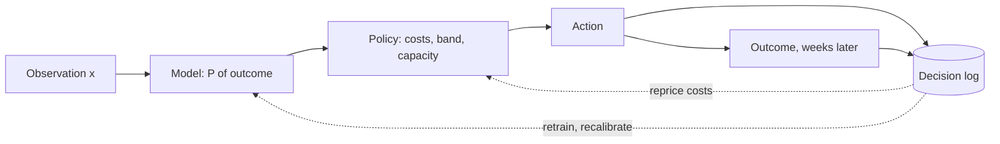

A lender pre-screens 100,000 loan applications a month. The first system was a classifier: it labelled each applicant `good` or `bad` and approved every `good`. Six months later defaults are too high, the model's accuracy is fine, and nobody can say which number to change. The classifier answered the question it was asked. Nobody had asked the real one: *what does a wrong approval cost compared with a wrong decline, and what should we do about this case?* This handbook is about systems that answer the real question.

:::key[First principle]
A decision model outputs an **action**, not a label. It combines a probability over outcomes with a cost for every (action, outcome) pair and picks the action with the lowest expected cost. The model supplies the probability; the costs and the action set are business inputs written down before training.
:::

## 1.1 The five parts of a decision

| Part | Symbol | Loan triage (running example) | If it is missing |
| --- | --- | --- | --- |
| **Observation** | $x$ | Application form, bureau features, bank-statement summary | Nothing to decide on |
| **Action set** (closed) | $\mathcal{A}$ | `auto_approve`, `manual_review`, `decline` | Downstream code cannot branch on free text |
| **Outcomes** | $y$ | `good` (repays), `bad` (defaults) | No definition of "right" |
| **Cost matrix** | $C(a, y)$ | below | Every threshold is a guess |
| **Policy** | $\pi(x)$ | Cheapest action in expectation, within review capacity | The score never becomes an action |

The cost matrix for the loan example, in INR:

| Action \ outcome | `good` | `bad` |
| --- | ---: | ---: |
| `auto_approve` | 0 | 120,000 (loss on a default) |
| `manual_review` | $r$ | $r$ |
| `decline` | 24,000 (lost margin) | 0 |

The review row is flat: a reviewer costs the same whatever the applicant turns out to be. The ops sheet says $r$ = ₹900 (reviewer time); priced honestly — salary, queue delay, applicants who leave while waiting — it is nearer ₹3,000 (illustrative, itemised in [the deep course](/c/practical-slm-decision-models/04-decision-theory)).

The policy is one line:

$$
\pi(x) = \arg\min_{a \in \mathcal{A}} \sum_{y} P(y \mid x)\, C(a, y)
$$

Only $P(y \mid x)$ comes from a model. Everything else is a decision someone signs.

## 1.2 Worked example: same label, different actions

With $p = P(\text{good} \mid x)$, the three expected costs are straight lines in $p$: approve costs $(1-p) \times 120{,}000$, decline costs $p \times 24{,}000$, review costs $r$.

:::example[Worked example · two applicants an argmax classifier both labels "good"]
| Applicant | $p$ | Label | Approve | Decline | Review (₹3,000) | Two actions | Three actions |
| --- | ---: | --- | ---: | ---: | ---: | --- | --- |
| A | 0.62 | good | ₹45,600 | ₹14,880 | ₹3,000 | **decline** | **review** |
| B | 0.97 | good | ₹3,600 | ₹23,280 | ₹3,000 | **approve** | **review** |

Same label, different actions. A has a 38% chance of default, so approving costs three times what declining does. B is a close call: approving costs ₹3,600 against a ₹3,000 review — at $p$ = 0.98 approval would win (₹2,400).
:::

The label rounded each probability to one bit at 0.5 and threw away exactly the number the decision needs. Keep the probability; let the costs set the cut.

## 1.3 Decision model vs classifier

| | Classifier | Decision model |
| --- | --- | --- |
| Output | A label (`good`) | An action (`manual_review`) plus $p$ and the expected costs |
| Threshold | 0.5, implicitly (argmax) | Derived from costs: $p^* = c_{AB}/(c_{AB}+c_{DG})$ |
| Uncertainty | Discarded | Used: calibrated $p$, an explicit review action |
| Judged by | Accuracy, F1 | Cost per case, review volume, regret |
| Changes when | Model or data change | Model, data **or costs** change |
| Owner | ML team | ML + product + risk + operations |

Here $c_{AB}$ is the cost of approving a bad case and $c_{DG}$ of declining a good one. Approve beats decline when $(1-p)\,c_{AB} < p\,c_{DG}$, i.e. when

$$
p > p^* = \frac{c_{AB}}{c_{AB} + c_{DG}} = \frac{120{,}000}{144{,}000} = 0.833 .
$$

A bad approval costs five times a wrong decline, so the model must be 5:1 confident before approving. Shipping `argmax` (0.5) approves every case in $[0.5, 0.833)$ — each one a loss by the team's own numbers. On the [quick-start](/c/slm-decision-models/02-quick-start) data that costs ₹917 per case, and the 0.5 rule is the *more accurate* of the two.

:::pull
`argmax` is a policy that assumes every mistake costs the same.
:::

## 1.4 Review is an action with a price

Review wins where it undercuts both sloped lines: $r < p\,c_{DG}$ and $r < (1-p)\,c_{AB}$. So the band is

$$
\frac{r}{c_{DG}} < p < 1 - \frac{r}{c_{AB}}, \qquad \text{which exists only while } r < \frac{c_{AB}\,c_{DG}}{c_{AB} + c_{DG}} = 20{,}000 .
$$

| Review price $r$ | Decline below | Approve above | What it means |
| ---: | ---: | ---: | --- |
| ₹900 (ops sheet) | 0.0375 | 0.9925 | 95.5% of the $p$-range goes to humans |
| ₹3,000 (honest, illustrative) | 0.125 | 0.975 | Narrower, still wide |
| ₹20,000 | 0.833 | 0.833 | Band vanishes: pure approve/decline |

:::warn[A cheap review is a trap]
At ₹900 the arithmetic sends most traffic to people — 91.8% of cases on the quick-start data. Price the review at what it costs the business, then multiply the review share by monthly volume before promising an automation rate. Capacity caps and what they cost are in [§4](/c/slm-decision-models/04-decision-theory).
:::

## 1.5 The decision loop



The model owns one arrow. The loop has two feedback edges with different owners: outcomes retrain and recalibrate the model (ML team), and outcomes also reveal whether the costs were right — the real loss on a default, the real price of a review — which reprices the policy (product, risk, operations).

## 1.6 What every decision must log

| Field | Example | Why |
| --- | --- | --- |
| `request_id`, `ts` | `app-81723`, ISO timestamp | Join to the outcome when it arrives |
| `p_good` | 0.62 | Recompute the action under new costs without re-running the model |
| `expected_cost` | `{decline: 14880, review: 3000, approve: 45600}` | A near-tie and a landslide look identical in `action` alone |
| `action`, `reason` | `manual_review`, `p in review band [0.125, 0.975)` | What was done and which rule fired |
| `model_version` | `loan-clf-2026-11-01` | Which weights produced $p$ |
| `policy_version` | `costs-v3:120000/24000/3000` | Which cost matrix turned $p$ into an action |

Version the model and the policy **separately**. Repricing the review from ₹900 to ₹3,000 changes thousands of actions without touching a weight.

## 1.7 The section in one script

```python run
"""Five parts of a decision, two applicants, one log record."""
import json

C_AB, C_DG, REVIEW = 120_000, 24_000, 3_000      # approve-bad, decline-good, review (INR)


def expected_costs(p):
    return {"decline": p * C_DG, "manual_review": REVIEW, "auto_approve": (1 - p) * C_AB}


def decide(p, actions=("decline", "manual_review", "auto_approve")):
    costs = {a: c for a, c in expected_costs(p).items() if a in actions}
    return min(costs, key=costs.get), costs


p_star = C_AB / (C_AB + C_DG)
print(f"p* = {p_star:.4f}; review band [{REVIEW / C_DG:.4f}, {1 - REVIEW / C_AB:.4f}); "
      f"band vanishes at r = {C_AB * C_DG / (C_AB + C_DG):,.0f}")
for name, p in (("A", 0.62), ("B", 0.97)):
    two, _ = decide(p, ("decline", "auto_approve"))
    three, _ = decide(p)
    print(f"{name}: p={p:.2f} argmax label={'good' if p > 0.5 else 'bad'} "
          f"two actions -> {two}, three actions -> {three}")

action, costs = decide(0.62)
record = {"request_id": "app-81723", "p_good": 0.62, "action": action,
          "expected_cost": {a: round(c) for a, c in costs.items()},
          "model_version": "loan-clf-2026-11-01", "policy_version": "costs-v3:120000/24000/3000"}
print(json.dumps(record))
```

```output
p* = 0.8333; review band [0.1250, 0.9750); band vanishes at r = 20,000
A: p=0.62 argmax label=good two actions -> decline, three actions -> manual_review
B: p=0.97 argmax label=good two actions -> auto_approve, three actions -> manual_review
{"request_id": "app-81723", "p_good": 0.62, "action": "manual_review", "expected_cost": {"decline": 14880, "manual_review": 3000, "auto_approve": 45600}, "model_version": "loan-clf-2026-11-01", "policy_version": "costs-v3:120000/24000/3000"}
```

## 1.8 Practical rules

- **Write the cost matrix before the model.** In currency, signed by whoever owns the loss. Derive $p^*$ and the band by hand on day one.
- **Keep the probability.** Never pass a label downstream when a calibrated $p$ is available; calibration metrics are in [performance metrics](/c/slm-decision-models/29-metrics).
- **Price review honestly** and convert its share into headcount before shipping.
- **Gate releases on cost per case**; report accuracy as a diagnostic.
- **Log enough to replay**: $p$, expected costs, action, model and policy versions.

For the longer derivations — why the cut point is where the lines cross, and how the band moves with $r$ — see [the deep course §1](/c/practical-slm-decision-models/01-what-a-decision-model-is).

## 1.9 Check yourself

:::qa[A fraud team says a missed fraud costs ₹50,000 and blocking a legitimate payment costs ₹2,000. What block threshold on P(fraud) follows?]
Block when $P(\text{fraud}) \times 50{,}000 > (1 - P(\text{fraud})) \times 2{,}000$, i.e. $P(\text{fraud}) > 2{,}000/52{,}000 = 0.038$. A 4% fraud probability is enough to block — nowhere near 0.5.
:::

:::qa[Why log p_good when you already log the action?]
Costs change. With $p$ logged you can recompute every past action under a new cost matrix (say review repriced from ₹900 to ₹3,000) and measure the impact offline, without re-running the model.
:::

:::qa[The review costs ₹25,000 per case. Should the policy ever review?]
No. The band exists only while $r < c_{AB}c_{DG}/(c_{AB}+c_{DG})$ = ₹20,000, the worst expected cost of the cheaper automatic action (at $p^* = 0.833$). Above that, approve or decline is always cheaper.
:::

:::qa[A retrained model's accuracy rises from 0.86 to 0.90. Ship it?]
Not on accuracy. In the quick start, the 0.5 rule is more accurate on automated cases (0.902) than the cost threshold (0.865) yet costs ₹917 more per case. Compare cost per case and review share under the same cost matrix.
:::

## Where to go next

- **Run it**: [Quick start](/c/slm-decision-models/02-quick-start) — data to cost-optimal policy in one script.
- **Pick an engine**: [SLM fundamentals](/c/slm-decision-models/03-slm-fundamentals), then [why SLMs](/c/slm-decision-models/05-why-slms).
- **Frame decisions rigorously**: [Decision theory](/c/slm-decision-models/04-decision-theory).
- **Ship it**: [Docker](/c/slm-decision-models/25-docker), [CI/CD](/c/slm-decision-models/28-cicd), [edge cases](/c/slm-decision-models/23-edge-cases).

Next: [Quick start](/c/slm-decision-models/02-quick-start).
