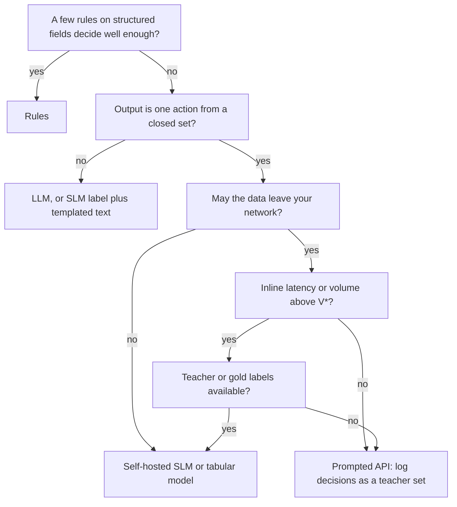

The ticket router handles 100,000 tickets a month; loan triage scores 100,000 applications a month. Both need a calibrated probability over a closed set of actions ([§4](/c/slm-decision-models/04-decision-theory)). Three engines can produce it: hand-written rules, a prompted model behind a vendor API, or a small model you fine-tune and host. "SLMs are cheaper" is true only above a volume you can compute — and at 100,000 a month you are usually below it. This section is the arithmetic, with every price labelled illustrative so you can swap in your own.

:::key[First principle]
An API bills **per decision**; a self-hosted model bills **per hour of capacity**, whether or not traffic arrives. So the API wins below a break-even volume $V^* = F / c_{\text{API}}$ and the self-hosted model wins above it, where $F$ is the self-hosted monthly floor and $c_{\text{API}}$ the API cost per decision. Residency, latency, control and calibration can overrule the cost answer in either direction.
:::

## 5.1 Three engines for the same decision

| | Rules | Prompted LLM API | Fine-tuned SLM, self-hosted |
| --- | --- | --- | --- |
| What it is | Conditions on structured fields | General model told the task in every call | 66M encoder or 0.5B decoder trained on your labels ([§6](/c/slm-decision-models/06-distillation), [§7](/c/slm-decision-models/07-fine-tuning)) |
| Bills by | Engineer time | Tokens | Instance-hours + people |
| Output | An action | Text you parse into an action | A probability over actions |
| Learns from data | No | Only via the prompt | Yes |

Illustrative inputs, the same as the [deep course](/c/practical-slm-decision-models/05-why-slms) so the numbers agree:

| Input | Value |
| --- | --- |
| Tokens per API decision | 600 in (instructions + case), 12 out (JSON label) |
| API small tier / frontier tier | $0.15 / $0.60 and $3.00 / $15.00 per 1M tokens in / out |
| Retries, FX | +2% calls; ₹88 per USD |
| CPU replica (4 vCPU) | $0.17/hour; 28 requests/s for a 66M encoder on 128-token tickets |
| People + monitoring for a self-hosted service | ₹80,000/month (≈4 engineer-days) |
| Rules maintenance | ₹40,000/month (≈2 engineer-days) |
| Provisioning | 3× peak-to-mean traffic, at least 2 replicas |

## 5.2 Cost per decision and the monthly floor

**API.** Tokens times price:

$$
c_{\text{API}} = \frac{t_{in} P_{in} + t_{out} P_{out}}{10^6}\,(1+\rho)\,\text{FX}
$$

Small tier: $(600 \times 0.15 + 12 \times 0.60)/10^6 = 9.72 \times 10^{-5}$ USD, × 1.02 × 88 = **₹0.0087 per decision**. Frontier tier: **₹0.178**. In the frontier price, 91% is the 600 input tokens — the instructions you resend on every call.

**Self-hosted.** Replicas are sized for the busy hour and kept warm at night, so at low volume the bill is a constant floor:

$$
F = F_{\text{ops}} + m \times 730\,\text{h} \times \text{price/hour} \times \text{FX} = 80{,}000 + 2 \times 730 \times 0.17 \times 88 = ₹101{,}842 \text{ per month}
$$

The replica capacity comes from FLOPs: \(2 \times 42.5\text{M} \times 128\) ≈ 10.9 GFLOP per ticket at a conservative 300 GFLOP/s sustained is 36 ms, 28 requests/s ([derivation](/c/practical-slm-decision-models/05-why-slms)). Two replicas carry 55 requests/s at peak — about 48M decisions a month at 3× peak-to-mean — before a third is needed.

:::example[Worked example · the running examples at 100,000 decisions a month]
| Engine | ₹ per month | ₹ per 1,000 decisions |
| --- | ---: | ---: |
| API small tier | 872 | 8.72 |
| API frontier tier | 17,772 | 177.7 |
| Self-hosted 66M on CPU | 101,842 | 1,018 |
| Rules | 40,000 | 400 |

At this volume the self-hosted SLM costs **117× the small API tier** and 5.7× the frontier tier. The two replicas average \(3 \times 100{,}000 / 2.628\text{M s} = 0.11\) requests/s against 55 of capacity — 0.2% utilisation. Cost alone says: rules if they decide well enough, otherwise the API.
:::

## 5.3 The break-even volume

While the floor is constant and the API is linear in volume, the two cross at

$$
V^* = \frac{F}{c_{\text{API}}} = \frac{101{,}842}{0.0087247} = 11{,}672{,}829 \text{ decisions/month (small tier)}, \qquad \frac{101{,}842}{0.17772} = 573{,}030 \text{ (frontier tier)}
$$

:::chart[Cost per 1,000 decisions vs monthly volume (illustrative prices)]{type="line" x="decisions per month" y="cost per 1,000 decisions" prefix="₹" xlog="true" ylog="true" marks="100000:running examples;573030:V* frontier;11672829:V* small" dash="rules" points="false"}
volume, API frontier tier, API small tier, SLM 66M on CPU, rules
10000, 177.7, 8.72, 10184.16, 4000.00
17783, 177.7, 8.72, 5726.97, 2249.37
31623, 177.7, 8.72, 3220.51, 1264.91
56234, 177.7, 8.72, 1811.03, 711.31
100000, 177.7, 8.72, 1018.42, 400.00
177828, 177.7, 8.72, 572.70, 224.94
316228, 177.7, 8.72, 322.05, 126.49
562341, 177.7, 8.72, 181.10, 71.13
1000000, 177.7, 8.72, 101.84, 40.00
1778279, 177.7, 8.72, 57.27, 22.49
3162278, 177.7, 8.72, 32.21, 12.65
5623413, 177.7, 8.72, 18.11, 7.11
10000000, 177.7, 8.72, 10.18, 4.00
17782794, 177.7, 8.72, 5.73, 2.25
31622777, 177.7, 8.72, 3.22, 1.26
56234133, 177.7, 8.72, 2.01, 0.71
100000000, 177.7, 8.72, 1.35, 0.40
177827941, 177.7, 8.72, 0.94, 0.22
316227766, 177.7, 8.72, 0.70, 0.13
562341325, 177.7, 8.72, 0.59, 0.07
1000000000, 177.7, 8.72, 0.53, 0.04
:::

The API lines are flat: price per decision does not depend on volume. The SLM line falls 10× per 10× volume while the floor is being shared, then flattens once replicas start to scale (above ~48M a month). Rules are the cheapest line on the chart — **if** a rule set can make the decision; they are dashed because for free-text tickets it usually cannot.

$V^*$ is a ratio, so it moves proportionally with both inputs. The two that move it most:

| Change | $V^*$ vs small tier |
| --- | ---: |
| Baseline (600-token prompt, ₹80,000 people) | 11.7M/month |
| API prompt grows to 1,200 tokens (more few-shot examples) | 6.1M |
| API prompt grows to 2,400 tokens (retrieved policy text) | 3.1M |
| People line ₹40,000 (shared platform team) | 7.1M |
| People line ₹160,000 (dedicated on-call) | 20.8M |

The people line is ₹80,000 of the ₹101,842 floor: the break-even is mostly a question of **who runs the service**, not which instance it runs on.

```python run
"""Rules vs self-hosted SLM vs API: cost per month, break-even volume, prompt-length sensitivity."""
import math

FX, HOURS = 88.0, 730                         # illustrative INR/USD; hours in an average month
SEC = HOURS * 3600


def api_per_call(usd_in, usd_out, tok_in=600, tok_out=12, retry=0.02):
    return (tok_in * usd_in + tok_out * usd_out) / 1e6 * (1 + retry) * FX


def slm_month(v, rps_per_replica=28, usd_hour=0.17, ops=80_000, peak=3.0, min_rep=2):
    replicas = max(min_rep, math.ceil(peak * v / SEC / rps_per_replica))
    return ops + replicas * HOURS * usd_hour * FX


small, frontier = api_per_call(0.15, 0.60), api_per_call(3.00, 15.00)
floor = slm_month(0)
print(f"API per decision: small INR {small:.4f}, frontier INR {frontier:.4f}; SLM floor INR {floor:,.0f}/month")
print(f"break-even V* = floor / c_API: small {floor / small:,.0f}, frontier {floor / frontier:,.0f} per month")
print(f"\n{'volume/month':>13s} {'API small':>10s} {'API frontier':>13s} {'SLM 66M CPU':>12s} {'rules':>7s}")
for v in (1e5, 1e6, 5e6, 2e7, 1e8):
    print(f"{v:13,.0f} {v * small:10,.0f} {v * frontier:13,.0f} {slm_month(v):12,.0f} {40_000:7,}")
print(f"\nINR per 1,000 decisions at 100,000/month: small {small * 1e3:.2f}, frontier {frontier * 1e3:.1f}, "
      f"SLM {slm_month(1e5) / 100:.0f}, rules {40_000 / 100:.0f}")

print("\nV* vs the small tier as the API prompt grows (the fine-tuned SLM needs no instructions):")
for tok in (300, 600, 1200, 2400):
    c = api_per_call(0.15, 0.60, tok_in=tok)
    print(f"  {tok:5d} input tokens: INR {c:.4f}/call, V* {floor / c:12,.0f}/month")

print("\nV* vs the small tier as the people line changes:")
for ops in (20_000, 40_000, 80_000, 160_000):
    print(f"  ops INR {ops:7,}/month: V* {slm_month(0, ops=ops) / small:12,.0f}")
```

```output
API per decision: small INR 0.0087, frontier INR 0.1777; SLM floor INR 101,842/month
break-even V* = floor / c_API: small 11,672,829, frontier 573,030 per month

 volume/month  API small  API frontier  SLM 66M CPU   rules
      100,000        872        17,772      101,842  40,000
    1,000,000      8,725       177,725      101,842  40,000
    5,000,000     43,623       888,624      101,842  40,000
   20,000,000    174,493     3,554,496      101,842  40,000
  100,000,000    872,467    17,772,480      134,604  40,000

INR per 1,000 decisions at 100,000/month: small 8.72, frontier 177.7, SLM 1018, rules 400

V* vs the small tier as the API prompt grows (the fine-tuned SLM needs no instructions):
    300 input tokens: INR 0.0047/call, V*   21,735,612/month
    600 input tokens: INR 0.0087/call, V*   11,672,829/month
   1200 input tokens: INR 0.0168/call, V*    6,060,892/month
   2400 input tokens: INR 0.0330/call, V*    3,089,866/month

V* vs the small tier as the people line changes:
  ops INR  20,000/month: V*    4,795,779
  ops INR  40,000/month: V*    7,088,129
  ops INR  80,000/month: V*   11,672,829
  ops INR 160,000/month: V*   20,842,228
```

## 5.4 The four criteria that overrule cost

| Criterion | Rules | Fine-tuned SLM, self-hosted | LLM API |
| --- | --- | --- | --- |
| Latency (floor) | < 1 ms | 66M encoder, 128 tokens: 17 ms on [§3's](/c/slm-decision-models/03-slm-fundamentals) illustrative CPU; 0.5B decoder with a 600-token prompt: 673 ms CPU, 25 ms GPU | Network + vendor queue + prefill: ~300–1,500 ms (illustrative; measure p95 from your region) |
| Data leaves your network | No | No | Yes |
| Behaviour changes only when you deploy | Yes | Yes — pinned weights, tokenizer and calibration | No — aliases move, snapshots are deprecated on the vendor's schedule |
| Calibrated probability | Per-rule historical hit rate (coarse) | Yes, after post-hoc calibration on your labels ([§6](/c/slm-decision-models/06-distillation)) | Only via label log-probs where exposed ([§8](/c/slm-decision-models/08-prompt-engineering)); refit when the vendor updates |
| Handles free text | Poorly | In-domain | Broadly |

How this settles the running examples:

- **Loan triage.** The inputs are mostly structured fields (income, bureau score, obligations) and the data is regulated financial information. Rules for policy limits plus a tabular model or a small self-hosted model for $P(\text{good})$; an API is ruled out by residency before cost is computed.
- **Ticket routing.** Free text, low stakes per error, 100,000 a month. Cost says API; latency says nothing (tickets are asynchronous). Use the API now, log every decision with its probability, and distil when volume or residency changes ([§6](/c/slm-decision-models/06-distillation)).

:::tip[Latency changes the product, not just the bill]
A 17 ms decision can sit inline — score a transaction while it authorises, route a ticket before the form is submitted. A 1-second API call cannot. If the product needs the inline path, the cost comparison is secondary.
:::

## 5.5 Recipe: which engine?



Checklist with numbers:

1. Compute $c_{\text{API}}$ from your real token counts (count tokens on 1,000 real inputs, not characters).
2. Compute $F$ with **provisioned** replicas (≥ 2) and the people line. If $V < V^*/3$, cost will not justify building yet.
3. Re-run $V^*$ whenever the vendor price list or your prompt length changes — a 4× longer prompt cuts $V^*$ about 4×.
4. Check residency, then the latency SLO, then reproducibility requirements; any hard "no" ends the comparison.
5. If you choose the API, log input, output and label probabilities from day one — they are the distillation set.

:::warn[Failure modes in the business case]
- **Dividing the hourly price by peak throughput.** Replicas idle at night; at 100,000 decisions a month they run at 0.2% utilisation. Use provisioned capacity.
- **Forgetting the people line.** It is 79% of the floor here; an unowned model rots (drift, stale calibration, no retraining).
- **Comparing a 600-token API call with a 128-token SLM call and stopping there.** True, the fine-tuned model drops the instructions — but the build costs ~₹4 lakh one-off (illustrative, mostly people; [itemised](/c/practical-slm-decision-models/05-why-slms)) and that must be paid back.
- **Assuming the SLM is as accurate.** A narrow student usually agrees with its teacher less than 100% of the time (89.7% in the [deep course experiment](/c/practical-slm-decision-models/06-distillation)); price the gap in cost per case, not accuracy.
:::

## 5.6 Check yourself

:::qa[Your API call uses 1,200 input and 12 output tokens at $0.15/$0.60 per million, 2% retries, ₹88/USD. Cost per decision and break-even against a ₹101,842 floor?]
$(1{,}200 \times 0.15 + 12 \times 0.60)/10^6 = 1.872 \times 10^{-4}$ USD × 1.02 × 88 = ₹0.0168. $V^* = 101{,}842 / 0.0168 \approx 6.06$ million a month — doubling the prompt roughly halved the break-even.
:::

:::qa[At 100,000 tickets a month, what does the self-hosted 66M router cost per 1,000 tickets, and why so much?]
₹1,018 per 1,000 (₹101,842 / 100). The floor — two warm replicas and ₹80,000 of people — is shared over too few decisions; the replicas run at about 0.2% utilisation.
:::

:::qa[A shared platform team cuts the people line to ₹40,000. New V* against the small tier?]
$F = 40{,}000 + 21{,}842 = 61{,}842$; $V^* = 61{,}842 / 0.0087247 \approx 7.09$ million a month.
:::

:::qa[Loan applications: 100,000 a month, data may not leave the bank. API or SLM?]
Not the API — residency rules it out regardless of cost. Self-host: rules for hard policy limits, a tabular model or small self-hosted model for $P(\text{good})$, calibrated before the [§4 thresholds](/c/slm-decision-models/04-decision-theory) are applied. Accept that at this volume it costs more than an API would.
:::

Next: [Distillation](/c/slm-decision-models/06-distillation) — training the small model from a large one's decisions.
