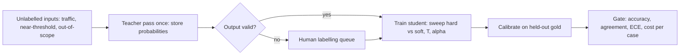

The ticket router has 300 human-labelled tickets, a few hundred thousand unlabelled ones, and access to a large model that routes well but costs ₹0.178 a call at frontier-tier prices ([§5](/c/slm-decision-models/05-why-slms), illustrative). Distillation answers three questions with numbers: what should the small model learn from — the 300 gold labels, the large model's label on each unlabelled ticket, or its full probability vector? How much does each buy? And what has to be fixed before the student's probabilities drive a routing decision?

:::key[First principle]
A teacher's probability vector is the **expected value** of the label it would emit. Training on the vector instead of a label removes sampling noise from every gradient step and keeps how close the other classes were — the information a decision model needs near its thresholds. Distillation is a **label-efficiency** technique first and a compression technique second; it moves the student along its learning curve, it does not raise the curve, and it copies the teacher's miscalibration.
:::

## 6.1 What a soft target carries

One ticket — "I was charged twice and now I'm locked out" — with teacher logits $z = (4.0, 2.5, 1.0, -1.0)$ over (`billing`, `account_access`, `technical`, `orders`). Dividing by a temperature $T$ before the softmax flattens the distribution without changing its ranking; every ratio between two classes becomes the $T = 1$ ratio raised to \(1/T\):

$$
q_k(T) = \frac{e^{z_k/T}}{\sum_j e^{z_j/T}}, \qquad \frac{q_j(T)}{q_k(T)} = \left(\frac{q_j(1)}{q_k(1)}\right)^{1/T}
$$

| Queue | $T = 1$ | $T = 2$ | $T = 4$ |
| --- | ---: | ---: | ---: |
| billing | 0.781 | 0.563 | 0.409 |
| account_access | 0.174 | 0.266 | 0.281 |
| technical | 0.039 | 0.126 | 0.193 |
| orders | 0.005 | 0.046 | 0.117 |
| entropy (bits) | 0.939 | 1.556 | 1.863 |

:::chart[One ticket's teacher distribution at three temperatures]{type="bar" y="probability" yfmt="dec2" labels="true"}
queue, T=1, T=2, T=4
billing, 0.781, 0.563, 0.409
account_access, 0.174, 0.266, 0.281
technical, 0.039, 0.126, 0.193
orders, 0.005, 0.046, 0.117
:::

:::example[Worked example · the label vs the vector]
The label says `billing`. The vector says `billing` 0.781 **and** `account_access` 0.174 — 4.5× more plausible than `technical`. A student trained on the vector learns that "charged twice" tickets sit near the billing/account boundary, which is exactly where a routing policy needs a review band.

**Gradient noise.** For a softmax student the cross-entropy gradient is $p_s - e_y$ for a hard label and $p_s - p_t$ for a soft target. If the label is a draw from the teacher, the soft gradient is the hard one's expectation and the noise variance is \(1 - \sum_k p_{t,k}^2 = 1 - (0.781^2 + 0.174^2 + 0.039^2 + 0.005^2) = 0.357\). Averaging $m$ sampled labels only cuts it to \(0.357/m\): 0.089 at 4, 0.022 at 16. One soft target gives zero.
:::

## 6.2 The loss in one line

With student logits $z_s$, teacher logits $z_t$, an optional gold label $y$, weight $\alpha$ and temperature $T$:

$$
\mathcal{L} = \alpha\,\mathrm{CE}\big(y, \sigma(z_s)\big) + (1-\alpha)\,T^2\,\mathrm{KL}\big(\sigma(z_t/T)\,\Vert\,\sigma(z_s/T)\big)
$$

The $T^2$ is there because the soft term's gradient shrinks as about \(1/T^2\) for large $T$; multiplying it back keeps $\alpha$ meaning the same thing when you change $T$. Use $\alpha = 0$ (pure distillation) when the training inputs have no gold labels. [Derivation and the large-$T$ limit](/c/practical-slm-decision-models/06-distillation).

```python
import torch.nn.functional as F

def distill_loss(s_logits, t_logits, labels=None, T=2.0, alpha=0.3):
    soft = F.kl_div(F.log_softmax(s_logits / T, -1),      # student LOG-probs as input
                    F.softmax(t_logits / T, -1),          # teacher probs as target
                    reduction="batchmean") * T ** 2
    return soft if labels is None else alpha * F.cross_entropy(s_logits, labels) + (1 - alpha) * soft
```

Swapping the two arguments of `F.kl_div` is the most common silent bug. Temperature is applied to both models in training and removed ($T = 1$) at inference.

## 6.3 Measured: gold labels vs teacher labels vs soft targets

You do not need a deep-learning stack to test whether distillation helps on your data. Any classifier that accepts sample weights can train on soft targets: repeat each row $K$ times, once per class, weighted by the teacher's $p_k$ — the weighted log-loss is exactly the cross-entropy against the vector. The setup below: 4 queues, 10% of gold labels randomised (annotation noise), an MLP teacher trained on its own 15,000 gold labels, a deliberately smaller student (logistic regression on 90 quadratic features), averages of 3 random subsets per budget.

```python run
"""Distil a teacher into a small student with scikit-learn: soft targets via sample weights."""
import numpy as np
from sklearn.datasets import make_classification
from sklearn.isotonic import IsotonicRegression
from sklearn.linear_model import LogisticRegression
from sklearn.neural_network import MLPClassifier
from sklearn.preprocessing import PolynomialFeatures, StandardScaler

K = 4                                                   # billing, account_access, technical, orders
X, y = make_classification(n_samples=40_000, n_features=12, n_informative=8, n_redundant=2,
                           n_classes=K, n_clusters_per_class=2, class_sep=1.0, flip_y=0.10,
                           random_state=0)             # flip_y: 10% of gold labels are random
teacher = MLPClassifier((128, 64), max_iter=300, early_stopping=True,
                        random_state=0).fit(X[:15_000], y[:15_000])
t_all = teacher.predict_proba(X)
pool, cal, test = slice(15_000, 30_000), slice(30_000, 31_000), slice(31_000, None)
phi = PolynomialFeatures(2, include_bias=False).fit(X[pool])      # student: linear on 90 features
F = StandardScaler().fit(phi.transform(X[pool])).transform(phi.transform(X))
Fp, yp, tp = F[pool], y[pool], t_all[pool]              # pool: teacher probs; gold only as baseline
Fc, yc, Fe, ye, te = F[cal], y[cal], F[test], y[test], t_all[test]
print(f"teacher test accuracy {(te.argmax(1) == ye).mean():.3f}")


def student(Fs, target):
    """Hard labels as usual; soft targets = each row repeated K times, weighted by p_k."""
    if target.ndim == 1:
        return LogisticRegression(max_iter=2000).fit(Fs, target)
    return LogisticRegression(max_iter=2000).fit(np.repeat(Fs, K, axis=0),
                                                 np.tile(np.arange(K), len(Fs)),
                                                 sample_weight=target.ravel())


print(f"{'n':>6s} {'gold hard':>10s} {'teacher hard':>13s} {'teacher soft':>13s}")
for n in (100, 300, 1000, 3000, 15000):
    acc = np.zeros(3)
    for seed in range(3):
        i = np.random.default_rng(seed).permutation(len(Fp))[:n]
        for j, tgt in enumerate((yp[i], tp[i].argmax(1), tp[i])):
            acc[j] += student(Fp[i], tgt).score(Fe, ye) / 3
    print(f"{n:6d} {acc[0]:10.3f} {acc[1]:13.3f} {acc[2]:13.3f}")


def ece(conf, correct, bins=10):
    idx = np.minimum((conf * bins).astype(int), bins - 1)
    return sum(abs(correct[idx == b].mean() - conf[idx == b].mean()) * (idx == b).mean()
               for b in range(bins) if (idx == b).any())


s = student(Fp, tp)                                     # distil on the full 15,000 pool
pc, pe = s.predict_proba(Fc), s.predict_proba(Fe)
iso = IsotonicRegression(out_of_bounds="clip").fit(pc.max(1), pc.argmax(1) == yc)
right = pe.argmax(1) == ye
print(f"\nstudent: accuracy {right.mean():.3f}, agreement with teacher {(pe.argmax(1) == te.argmax(1)).mean():.3f}")
print(f"ECE vs gold: teacher {ece(te.max(1), te.argmax(1) == ye):.3f}, student raw {ece(pe.max(1), right):.3f}, "
      f"student isotonic {ece(iso.predict(pe.max(1)), right):.3f}")
print(f"float16 teacher probs: {K * 2} bytes/ticket = {K * 2:.0f} MB per million tickets")
```

```output
teacher test accuracy 0.867
     n  gold hard  teacher hard  teacher soft
   100      0.538         0.634         0.663
   300      0.642         0.731         0.761
  1000      0.750         0.788         0.799
  3000      0.793         0.811         0.808
 15000      0.811         0.823         0.815

student: accuracy 0.815, agreement with teacher 0.902
ECE vs gold: teacher 0.054, student raw 0.083, student isotonic 0.040
float16 teacher probs: 8 bytes/ticket = 8 MB per million tickets
```

:::chart[Student test accuracy vs training examples (synthetic, mean of 3 subsets)]{type="line" x="training examples" y="test accuracy (gold labels)" xlog="true" yfmt="pct" ymin="0.5" ymax="0.9" hmarks="0.867:teacher" dash="gold hard"}
n, gold hard, teacher hard, teacher soft
100, 0.538, 0.634, 0.663
300, 0.642, 0.731, 0.761
1000, 0.750, 0.788, 0.799
3000, 0.793, 0.811, 0.808
15000, 0.811, 0.823, 0.815
:::

## 6.4 Reading the result

- **Cleaner labels first, softer labels second.** At 300 examples, gold → teacher-hard adds 8.9 points (the teacher has averaged away the 10% annotation noise); teacher-hard → teacher-soft adds 3.0 more.
- **Soft targets help only while labels are scarce.** +2.9 points at 100, +3.0 at 300, +1.1 at 1,000, and slightly *negative* from 3,000 up (−0.3, −0.8). With plenty of data a small student is capacity-bound, not label-bound. Sweep hard vs soft at your budget; do not assume.
- **The real lever is volume of teacher-labelled inputs.** 300 gold labels: 64.2%. 15,000 unlabelled tickets labelled by the teacher: 81.5–82.3%. That — not the soft/hard gap — is the economic case for distillation.
- **Nobody reaches the teacher.** The best student is 4.4 points below it (82.3% vs 86.7%) and the soft one agrees with it 90.2% of the time. The ceiling is the student's capacity.
- **The student is worse calibrated than the teacher** (ECE 0.083 vs 0.054). Isotonic regression on 1,000 held-out gold labels brings it to 0.040. A single temperature often cannot fix it, because a distilled student is typically underconfident in the middle and overconfident at the top ([deep course §6.6](/c/practical-slm-decision-models/06-distillation)).

The same comparison on a larger grid, plus temperature sweeps and confidence filtering, is in [the notebook](/c/slm-decision-models/11-notebook-distillation) and the [deep course](/c/practical-slm-decision-models/06-distillation).

## 6.5 What the teacher pass costs

| Teacher setup | Calls per input | 15,000 tickets at ₹0.178/call (frontier, illustrative) | Gradient-noise variance on the example ticket |
| --- | ---: | ---: | ---: |
| Label log-probs exposed | 1 | ₹2,666 | 0 (exact vector) |
| Sample $m = 8$ answers, use frequencies | 8 | ₹21,326 | \(0.357/8 = 0.045\) |
| One sampled label (teacher-hard) | 1 | ₹2,666 | 0.357 |
| Small tier, log-probs (₹0.0087/call) | 1 | ₹131 | 0 |

Teacher labels are cheap next to the rest of the build — under 1% in the [deep course itemisation](/c/practical-slm-decision-models/05-why-slms), where 2,000 human gold labels for evaluation cost ₹100,000 (illustrative). Spend on gold labels for **evaluation and calibration**, and on the teacher for **training volume**. Store the teacher's vectors once (float16: 8 bytes per ticket for 4 queues) and retrain the student as often as you like without calling the teacher again.

## 6.6 Recipe



1. **Choose inputs, not labels.** Illustrative starting mix (tune it, it is not a measured optimum): ~60% sampled production traffic, ~20% over-sampled cases near your decision thresholds, ~10% rare-but-expensive classes, ~10% out-of-scope or malformed inputs with a `needs_review` target. The student only ever learns what the teacher was shown.
2. **Get a distribution from the teacher.** Label log-probs if exposed; otherwise sample $m$ times (the variance falls as \(1/m\), the bill rises as $m$).
3. **Filter on validity, not confidence.** Drop unparseable or out-of-schema teacher outputs. Keep low-confidence ones: they are the boundary cases (dropping teacher outputs below 0.9 confidence lost 1.1 points in the [deep course](/c/practical-slm-decision-models/06-distillation)).
4. **Hold back ≥ 1,000 gold labels** for calibration and evaluation; never let them into training or teacher selection.
5. **Train and sweep** hard vs soft, $T \in \{1, 2, 4\}$, $\alpha \in \{0, 0.3, 0.5\}$ (α > 0 only if the training inputs have gold labels). Expect soft to help below ~1,000 examples and not above.
6. **Calibrate** (isotonic or temperature, whichever lowers NLL on the gold slice), then re-derive the thresholds from the cost matrix ([§4](/c/slm-decision-models/04-decision-theory)).
7. **Gate on cost per case**, not agreement: agreement measures imitation, including imitation of the teacher's errors.

:::warn[Diagnosing a student]
| Symptom | Likely cause | Fix |
| --- | --- | --- |
| Good on validation from the teacher pool, poor on real traffic | Teacher inputs too narrow | Re-sample from production; add near-threshold slices |
| Agreement plateaus around 0.90 | Student capacity ceiling | Larger student, or accept and price the gap |
| Soft targets worse than teacher-hard | Budget large enough that labels are not the bottleneck (here ≥ 3,000) | Use teacher-hard, or lower $T$ |
| Rare queue near-zero recall | Rare class under-represented in teacher inputs | Over-sample rare-class inputs before the teacher pass |
| Confident and wrong on odd inputs | No out-of-scope inputs in the teacher pass | Add them with a `needs_review` target |
| ECE worse than the teacher's | Miscalibration copied and amplified | Isotonic calibration on held-out gold |
| Student "beats" the teacher on gold | Teacher worse than assumed on this slice | Audit teacher labels on that slice before trusting them |
:::

DistilBERT is the familiar existence proof at scale: about 40% fewer parameters than BERT-base, about 60% faster, keeping about 97% of its GLUE score (Sanh et al., 2019). Your ratio depends on your task and student; measure it with §6.3.

## 6.7 Check yourself

:::qa[A teacher outputs (0.6, 0.3, 0.1). Gradient-noise variance of one sampled hard label, and how many samples bring it below 0.05?]
\(1 - (0.36 + 0.09 + 0.01) = 0.54\). Averaging $m$ samples gives \(0.54/m < 0.05\), so $m \ge 11$ — 11× the teacher bill to approach what one soft vector gives for free.
:::

:::qa[At T = 2, what happens to a teacher ratio p_j/p_k of 0.04?]
It becomes \(0.04^{1/2} = 0.2\): the rarer class is five times more visible relative to the top class, and the ranking is unchanged.
:::

:::qa[You have 300 gold labels and 200,000 unlabelled tickets. What do you train on, and what do you do with the gold labels?]
Teacher vectors on the unlabelled tickets ($\alpha = 0$). Keep all 300 gold labels for evaluation and calibration. In §6.3, going from 300 gold labels (64.2%) to a large teacher-labelled pool (~82%) was worth far more than any soft-vs-hard gap.
:::

:::qa[With 15,000 teacher-labelled tickets, soft targets scored 0.8 points below teacher-hard labels. Bug?]
Not necessarily. At large budgets the small student is capacity-bound; matching the teacher's small probabilities spends capacity the decision boundary needs. Use whichever wins on your validation set — here, teacher-hard.
:::

:::qa[After distillation the student's ECE is 0.083 against the teacher's 0.054. Ship it with the §4 thresholds?]
No. Calibrate on held-out gold labels first (isotonic took it to 0.040 here), then recompute the cut points. Thresholds applied to miscalibrated probabilities land on the wrong cases.
:::

Next: [Fine-tuning](/c/slm-decision-models/07-fine-tuning) — adapting a pretrained model to your labels with LoRA, and what it costs in parameters and memory.
