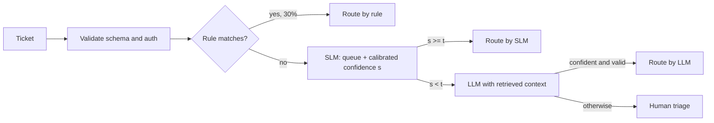

A support desk routes 100,000 tickets a month into four queues. A regex routes "password reset" perfectly and for free; a fine-tuned SLM costs paise and answers in ~40 ms but is wrong on ambiguous tickets; an LLM costs about ₹2 and takes over a second; a person costs ₹40 a ticket (all prices illustrative). No single component is best. The design question is the order in which to ask them and when to stop asking.

:::key[First principle]
A stage should keep a case when the expected cost of its own answer is lower than the next stage's price **plus** the next stage's expected error cost on that case. Cost formulas, thresholds and failure modes all follow from that one comparison.
:::

## 9.1 The cascade



| Stage | Good at | ₹ per ticket (illustrative) | Median latency | Typical failure |
| --- | --- | ---: | ---: | --- |
| Rules | Exact patterns, permissions, arithmetic | 0.001 | ~2 ms | Stale rules silently shadow the model |
| SLM | High-volume, in-distribution cases | 0.05 | ~40 ms | Overconfident on shifted input |
| LLM | Ambiguous text, long context, rare intents | 2.00 | ~1,200 ms | Shares the SLM's blind spots on hard cases |
| Human | Anything, with accountability | 40 | hours | Queue capacity, reviewer inconsistency |

Replace the prices with yours: SLM cost = instance ₹/hour ÷ tickets/hour at your batch size; LLM cost = tokens per ticket × price per token; human cost = loaded ₹/hour ÷ tickets/hour. Gates must use **calibrated** probabilities ([§4](/c/slm-decision-models/04-decision-theory)), and confidence is never authorisation — a 0.99 `account_access` prediction does not reset a password.

## 9.2 Expected cost and latency

Stage $k$ costs $c_k$ per case it sees and passes on a share $q_k$ of them. The first stage sees everything, the second $q_1$, the third $q_1 q_2$:

$$
E[C] = \sum_k c_k \prod_{j<k} q_j, \qquad
E[L] \approx \sum_k \ell_k \prod_{j<k} q_j, \qquad
E[\text{total}] = E[C] + C_{\text{err}}\,P(\text{misroute})
$$

Report the running bill $E[C]$ and the error term separately — one is a cost, the other a quality outcome.

:::example[Worked example · four stages, 100,000 tickets a month]
Rules settle 30% ($q_1 = 0.70$), the SLM escalates 15% of what it sees ($q_2 = 0.15$), the LLM sends 20% of its cases to people ($q_3 = 0.20$):

$$
E[C] = 0.001 + 0.70(0.05) + 0.105(2.00) + 0.021(40) = ₹1.086 \text{ per ticket}
$$

₹108,600 a month, against ₹10.00 per ticket for "LLM on everything, 20% to people" — 9.2× cheaper. Two things intuition misses: people see only 2.1% of tickets but are ₹0.84 of ₹1.086 (77%) of the bill, and 2.1% is **2,100 tickets a month** — a staffing number that must fit the team.
:::

```python run
"""Expected running cost and mean latency of a four-stage cascade (illustrative prices)."""
# stage: (name, ₹ per ticket it sees, share it passes on, median latency in ms)
stages = [("rules", 0.001, 0.70, 2), ("SLM", 0.05, 0.15, 40),
          ("LLM", 2.00, 0.20, 1200), ("human", 40.0, 0.0, 0)]   # human time is async

reach, cost, latency = 1.0, 0.0, 0.0
for name, c, q, ms in stages:
    cost += reach * c
    latency += reach * ms
    print(f"{name:6s} sees {reach:6.1%}  adds ₹{reach * c:.3f}")
    reach *= q
print(f"E[C] = ₹{cost:.3f}/ticket = ₹{cost * 100_000:,.0f}/month at 100,000 tickets")
print(f"mean automated latency ≈ {latency:.0f} ms; LLM on every ticket: ₹{2 + 0.2 * 40:.2f}/ticket")
```

```output
rules  sees 100.0%  adds ₹0.001
SLM    sees  70.0%  adds ₹0.035
LLM    sees  10.5%  adds ₹0.210
human  sees   2.1%  adds ₹0.840
E[C] = ₹1.086/ticket = ₹108,600/month at 100,000 tickets
mean automated latency ≈ 156 ms; LLM on every ticket: ₹10.00/ticket
```

**The mean latency hides the escalation path.** $E[L] = 2 + 0.70(40) + 0.105(1200) = 156$ ms, but percentiles are set by *which path* the tail takes: if the share of traffic reaching a stage exceeds the share a percentile excludes, that percentile lies on that stage's path. 10.5% of tickets reach the LLM and p95 excludes only 5%, so p95 is an LLM-path latency (~1.2 s+), even though ~90% of tickets finish in under 100 ms. The [deep course](/c/practical-slm-decision-models/10-hybrid-architectures) simulates the full distribution. Set SLOs per path, and to pull p95 under the LLM's latency get the LLM share below 5%.

## 9.3 The escalation threshold

The SLM returns a queue and a calibrated confidence $s$. Keeping the answer costs $(1-s)\,C_{\text{err}}$; escalating costs $c_L + (1-a)\,C_{\text{err}}$, where $a$ is the LLM's accuracy **on the cases you escalate**. Keep when

$$
s \;\ge\; t = a - \frac{c_L}{C_{\text{err}}}
$$

— escalation buys an accuracy gain $a - s$ worth $(a-s)\,C_{\text{err}}$ at price $c_L$.

:::example[Worked example · the threshold from three numbers]
$c_L$ = ₹2, $C_{\text{err}}$ = ₹60 per misroute (illustrative), LLM 96.1% accurate: $t = 0.961 - 2/60 = 0.928$. If the LLM is weaker exactly where the SLM is unsure, $a(s) = 0.70 + 0.28\,s$, then $(1-s)60 \le 2 + (0.30 - 0.28s)60 \Rightarrow s \ge 40/43.2 = 0.926$. The threshold barely moves; the *cost estimate* moves a lot (§9.5).
:::

The simulation below makes those assumptions explicit — 85% easy tickets (confidence near 0.98), 15% ambiguous (confidence around 0.67), calibrated SLM, LLM accuracy $0.70 + 0.28s$ — and sweeps $t$. **Coverage** is the share the SLM keeps; **risk** is the error rate among kept answers.

```python run
"""Coverage, risk and total cost of the SLM -> LLM step as the threshold moves."""
import numpy as np

rng = np.random.default_rng(10)
n = 100_000
hard = rng.random(n) < 0.15                                 # 15% of tickets are ambiguous
s = np.where(hard, rng.beta(4, 2, n), rng.beta(40, 1, n))  # calibrated SLM confidence
slm_ok = rng.random(n) < s
llm_ok = rng.random(n) < 0.70 + 0.28 * s                   # LLM also weaker where SLM is unsure
C_SLM, C_LLM, C_ERR = 0.05, 2.00, 60.0                     # ₹; C_ERR = one misroute

print("    t  coverage  risk  total ₹/ticket")
for t in (0.5, 0.7, 0.8, 0.9, 0.92, 0.95, 0.97, 0.99):
    acc = s >= t
    errors = (acc & ~slm_ok).sum() + (~acc & ~llm_ok).sum()
    total = C_SLM + (~acc).mean() * C_LLM + C_ERR * errors / n
    print(f"{t:5.2f} {acc.mean():8.1%} {(~slm_ok[acc]).mean():6.2%} {total:8.2f}")
print(f"SLM only ₹{C_SLM + C_ERR * (~slm_ok).mean():.2f}, LLM only ₹{C_LLM + C_ERR * (~llm_ok).mean():.2f}")
esc = s < 0.92
print(f"LLM accuracy: all tickets {llm_ok.mean():.3f}, escalated slice {llm_ok[esc].mean():.3f}")
```

```output
    t  coverage  risk  total ₹/ticket
 0.50    97.2%  5.52%     3.64
 0.70    92.1%  3.67%     2.96
 0.80    89.0%  2.93%     2.73
 0.90    85.1%  2.35%     2.58
 0.92    82.8%  2.18%     2.57
 0.95    74.6%  1.76%     2.60
 0.97    60.0%  1.21%     2.81
 0.99    28.2%  0.38%     3.53
SLM only ₹4.31, LLM only ₹4.32
LLM accuracy: all tickets 0.961, escalated slice 0.894
```

:::chart[Coverage vs risk of kept SLM answers (each point is a threshold, simulated)]{type="line" x="coverage (share kept by the SLM)" y="error rate among kept answers" xfmt="pct" yfmt="pct" marks="0.828:t = 0.92 (min cost)" hmarks="0.03:risk budget 3%"}
coverage, risk of kept answers
0.282, 0.0038
0.472, 0.0087
0.600, 0.0121
0.688, 0.0151
0.746, 0.0176
0.784, 0.0192
0.828, 0.0218
0.851, 0.0235
0.862, 0.0247
0.874, 0.0263
0.890, 0.0293
0.906, 0.0326
0.921, 0.0367
0.950, 0.0464
0.972, 0.0552
:::

Reading it:

- **Minimum cost at $t = 0.92$** (₹2.57), next to the analytic 0.926, against ₹4.31 for the SLM alone and ₹4.32 for the LLM alone — a 40% saving *under these simulated assumptions*.
- **The bottom is flat**: $t$ from 0.90 to 0.95 costs ₹2.57–2.60. Inside the flat region, choose by the other limits — LLM quota, latency, the risk budget.
- **The knee is near 89% coverage.** Past it the SLM starts keeping ambiguous tickets and risk climbs steeply (2.9% → 5.5%). A 3% risk budget allows coverage up to ~89% ($t \approx 0.79$ or higher).
- **Stated as an optimisation:** minimise $E[\text{total}](t)$ subject to $\text{risk}(t) \le \rho$ and $\text{esc}(t) \cdot N \le K_{\text{LLM}}$. At $t = 0.92$, $\text{esc} = 17.2\%$ → 17,200 LLM calls a month; check that against the quota.

## 9.4 Rules before and after the model

Deterministic rules beat models where the constraint is legible and must be reproducible:

| Case | Rule | Why not the model |
| --- | --- | --- |
| Sanctions / blocklist match | Decline, log reason | Must be explainable and 100% reproducible |
| Amount above a policy limit | Manual review | Policy, not prediction |
| Missing required field | Return to sender / review | Deterministic data check |
| Duplicate submission | Hash match → reject | Exact match beats inference |
| Privileged action (refund, reset) | Permission check in code | Confidence is not authorisation |

Rules also run **after** the model as guardrails: a model that approves a blocklisted entity is an incident regardless of its accuracy. Give every rule an owner and an expiry date, and sample rule-routed cases into the labelled set — stale rules decay silently.

## 9.5 Failure modes worth designing for

**Correlated errors.** The last output line is the key one. Planned with the LLM's average accuracy (96.1%), the 17,200 escalations would produce ~670 LLM errors; on the escalated slice it is only 89.4% accurate, so the real count is ~1,820 — 2.7× more. Evaluate each stage **on the slice it actually receives**, and make stage 2 *different* (retrieved account state, another model family), not just bigger.

**Escalation storms.** Escalation share is set by the input. If a launch pushes $q_2$ from 0.15 to 0.45, $E[C]$ rises from ₹1.086 to $0.001 + 0.035 + 0.630 + 2.520$ = ₹3.186 and the human queue from 2,100 to 6,300 tickets a month. Nothing broke; the cascade did what it was told. Cap escalations with a budget per sliding window, send overflow to a safe default queue, and alarm on the *wanted* escalation rate ([runnable router in the deep course](/c/practical-slm-decision-models/10-hybrid-architectures)).

**Retrieval and tools.** Retrieval gives the SLM facts it cannot know (policy text, account state). Keep the context short and measure accuracy against context length — small models often get *worse* as context grows past a point, and the point is model-specific. Tool use: few tools (≤ 5), flat schemas, one call per step, a hard step cap:

```python
MAX_STEPS = 2
for _ in range(MAX_STEPS):
    out = slm(scratchpad)                        # schema-validated output
    if out.is_final:
        return out.action
    result = TOOLS[out.tool](**out.args)         # allow-listed tool, validated args
    scratchpad += f"\nObservation: {result}"
return ABSTAIN                                   # never loop past the cap
```

## 9.6 Routing rules

| Rule | Number to set | Example (this section) |
| --- | --- | --- |
| Escalate when $s < a - c_L / C_{\text{err}}$ | $a$ measured on escalated traffic | $t = 0.92$ |
| Keep coverage inside the risk budget | $\rho$ | 3% → coverage ≤ ~89% |
| Fit the LLM quota | $K_{\text{LLM}}$ per month | 17,200 calls at $t = 0.92$ |
| Fit the human queue | tickets/month the team can triage | 2,100 planned; check at 3× escalation |
| Per-path latency SLO | p95 per path, plus an end-to-end deadline | SLM path ≤ 80 ms, LLM path ≤ 2.5 s (illustrative) |
| Escalation budget + alarm | max share per window; alarm at 1.5× base | budget 25% of last 1,000 |
| Failed ≠ uncertain | timeouts go to the safe default, not the LLM | — |
| One pass per stage | attempt counter + reason code | no LLM → SLM → LLM loops |

:::warn[When to stop adding stages]
Each stage adds a failure mode, a latency hop and an on-call surface. Add one only if it lowers $E[\text{total}]$ by more than its operating cost. Two model stages plus deterministic gates is usually enough; beyond that you are running a distributed system.
:::

## 9.7 Check yourself

:::qa[Rules settle 40%, the SLM escalates 10% of the rest, the LLM sends 25% of its cases to people. Costs ₹0.001, ₹0.05, ₹2, ₹40. E[C] and human tickets per 100,000?]
$E[C] = 0.001 + 0.60(0.05) + 0.06(2) + 0.015(40) = 0.001 + 0.030 + 0.120 + 0.600 = ₹0.751$. People see $0.60 \times 0.10 \times 0.25 = 1.5\%$ → 1,500 tickets, and are 80% of the bill.
:::

:::qa[8% of requests reach a 900 ms LLM stage; the rest finish in 50 ms. Where is p95?]
On the LLM path (~950 ms): 8% > 5%, so the 95th percentile falls among escalated requests. Get the LLM share under 5% or set per-path SLOs.
:::

:::qa[LLM ₹3 per call, misroute ₹50, LLM 90% accurate on escalated cases. Escalate below what SLM confidence?]
$t = 0.90 - 3/50 = 0.84$. Use the accuracy on escalated cases, not the benchmark number.
:::

:::qa[LLM calls doubled after a launch, error rate unchanged. First check?]
The wanted escalation rate and SLM calibration on new traffic. Doubled calls at a flat error rate means the cascade is paying more to stand still; recalibrate before raising the quota.
:::

Next: [The Python library](/c/slm-decision-models/10-python-library) — the API these sections use, with a runnable reference implementation.
