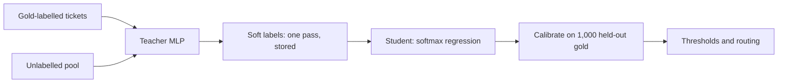

You have 1,000 human-labelled support tickets, thousands of unlabelled ones, and access to a strong but expensive teacher model. This notebook answers, with numbers you can reproduce on a laptop in under a minute: what should a small student learn from, how much does it buy, and what must you fix before the student's probabilities drive a routing decision? The derivations (why soft targets reduce gradient noise, the $T^2$ factor) are in the [deep course](/c/practical-slm-decision-models/06-distillation); this is the hands-on version.

:::key[First principle]
A teacher's probability vector is the expected value of the label it would emit. Training on the vector instead of a label removes sampling noise and keeps how close the other classes were — most valuable when labelled data is scarce. Distillation moves the student along its learning curve faster; it does not raise the curve, and it does not make the probabilities trustworthy.
:::

**Setup.** Python with numpy and scikit-learn. The cells share one session — run them top to bottom (in Jupyter, or paste them into one script). The data are synthetic: 4 ticket queues, 12 features, 10% of gold labels randomised to mimic annotation noise. The "teacher" is an MLP, the student a softmax regression on quadratic features — deliberately smaller, so it cannot copy the teacher exactly.



## 11.1 Cell 1 · Data and teacher

Four disjoint slices: the teacher's own training set, the student's pool (its gold labels are used only as a baseline), 1,000 gold labels held back for calibration, and a test set.

```python run
import numpy as np
from sklearn.datasets import make_classification
from sklearn.neural_network import MLPClassifier

K = 4                                       # queues: billing, account_access, technical, orders
X, y = make_classification(n_samples=24_000, n_features=12, n_informative=8, n_redundant=2,
                           n_classes=K, n_clusters_per_class=2, class_sep=1.0, flip_y=0.10,
                           random_state=1)  # flip_y: 10% of gold labels are random
Xt, yt = X[:10_000], y[:10_000]             # teacher's own gold-labelled training set
Xp, yp = X[10_000:18_000], y[10_000:18_000] # student pool (yp = gold, used only as a baseline)
Xv, yv = X[18_000:19_000], y[18_000:19_000] # 1,000 gold labels held back for calibration
Xe, ye = X[19_000:], y[19_000:]             # 5,000 test cases

teacher = MLPClassifier((128, 64), max_iter=300, early_stopping=True, random_state=0)
teacher.fit(Xt, yt)
print(f"teacher test accuracy {(teacher.predict(Xe) == ye).mean():.3f}")
print(f"pool {len(Xp):,} | calibration {len(Xv):,} | test {len(Xe):,}")
```

```output
teacher test accuracy 0.840
pool 8,000 | calibration 1,000 | test 5,000
```

The teacher is right 84.0% of the time on gold test labels — the 10% label noise caps everyone well below 100%.

## 11.2 Cell 2 · Soft labels

One teacher pass over the pool gives a probability vector per ticket. Temperature $T$ re-softens it without changing the ranking: $q_k(T) \propto \exp(\log p_k / T)$, so every ratio $p_j/p_k$ becomes $(p_j/p_k)^{1/T}$.

```python run
QUEUES = ["billing", "account_access", "technical", "orders"]


def softmax(z, T=1.0):
    z = np.asarray(z) / T
    e = np.exp(z - z.max(-1, keepdims=True))
    return e / e.sum(-1, keepdims=True)


t_pool, t_test = teacher.predict_proba(Xp), teacher.predict_proba(Xe)   # one teacher pass
z = np.log(np.clip(t_pool, 1e-9, 1))        # log-probs act as logits for re-softening
i = int(np.argmin(np.abs(t_pool.max(1) - 0.6)))                        # one borderline ticket
print(" " * 5 + "".join(f"{q:>15s}" for q in QUEUES))
for T in (1, 2, 4):
    print(f"T={T}: " + "".join(f"{v:15.3f}" for v in softmax(z[i], T)))

top = t_pool.max(1)
ent = -(t_pool * np.log2(np.clip(t_pool, 1e-12, 1))).sum(1)
print(f"pool: mean entropy {ent.mean():.2f} bits (hard label: 0); "
      f"top prob < 0.7 on {(top < 0.7).mean():.1%} of tickets")
print(f"storage at float16: {t_pool.astype(np.float16).nbytes / 1e3:.0f} kB for {len(t_pool):,} tickets")
```

```output
             billing account_access      technical         orders
T=1:           0.225          0.139          0.036          0.600
T=2:           0.262          0.206          0.105          0.427
T=4:           0.263          0.233          0.167          0.336
pool: mean entropy 0.76 bits (hard label: 0); top prob < 0.7 on 25.1% of tickets
storage at float16: 64 kB for 8,000 tickets
```

:::example[Worked example · what one borderline ticket carries]
The label would say `orders`. The vector says `orders` 0.600, `billing` 0.225 (1.6× more plausible than `account_access`, 6.3× more than `technical`). At $T = 4$ the `billing`/`orders` ratio rises from $0.225/0.600 = 0.375$ to \(0.375^{1/4} = 0.78\) — the printed 0.263/0.336. A quarter of the pool (25.1%) has a top probability below 0.7: those boundary tickets are where a vector teaches far more than a label. Storing all of it costs 8 bytes per ticket.
:::

## 11.3 Cell 3 · One student, three kinds of target

Same 300 tickets, same student, same optimiser; only the target changes: the noisy gold label, the teacher's argmax, or the teacher's full vector. The loss is cross-entropy against the target, $-\sum_k q_k \log \hat p_k$, which reduces to ordinary cross-entropy for a one-hot $q$.

```python run
from sklearn.preprocessing import PolynomialFeatures, StandardScaler

poly = PolynomialFeatures(2, include_bias=False)            # student: linear on 90 features
scale = StandardScaler().fit(poly.fit_transform(Xp))
Fp, Fv, Fe = (scale.transform(poly.transform(A)) for A in (Xp, Xv, Xe))


def fit(F, target, steps=400, lr=0.3, l2=1e-3):
    """Softmax regression trained on cross-entropy against a (soft or one-hot) target."""
    W = np.zeros((F.shape[1], K))
    for _ in range(steps):
        W -= lr * (F.T @ (softmax(F @ W) - target) / len(F) + l2 * W)
    return W


def score(W):
    pred = (Fe @ W).argmax(1)
    return (pred == ye).mean(), (pred == t_test.argmax(1)).mean()


idx = np.random.default_rng(0).permutation(len(Fp))[:300]   # a 300-ticket budget
targets = {"gold hard": np.eye(K)[yp[idx]],
           "teacher hard": np.eye(K)[t_pool[idx].argmax(1)],
           "teacher soft": t_pool[idx]}
for name, tgt in targets.items():
    acc, agree = score(fit(Fp[idx], tgt))
    print(f"{name:13s} test acc {acc:.3f}   agreement with teacher {agree:.3f}")
```

```output
gold hard     test acc 0.611   agreement with teacher 0.665
teacher hard  test acc 0.695   agreement with teacher 0.766
teacher soft  test acc 0.719   agreement with teacher 0.799
```

At 300 labels, cleaner labels are worth more than softer ones: gold → teacher-hard adds 8.4 points of accuracy, teacher-hard → teacher-soft another 2.4. The soft student also agrees with the teacher most often (0.799), which is what a distilled router is supposed to do.

## 11.4 Cell 4 · Compare across label budgets

Repeat for five budgets, averaging three random subsets each.

```python run
print(f"{'n':>5s} {'gold hard':>10s} {'teacher hard':>13s} {'teacher soft':>13s}")
for n in (100, 300, 1000, 3000, 8000):
    res = []
    for seed in range(3):                                   # mean of 3 random subsets
        j = np.random.default_rng(seed).permutation(len(Fp))[:n]
        res.append([score(fit(Fp[j], t))[0] for t in
                    (np.eye(K)[yp[j]], np.eye(K)[t_pool[j].argmax(1)], t_pool[j])])
    print(f"{n:5d} " + " ".join(f"{v:{w}.3f}" for v, w in zip(np.mean(res, 0), (10, 13, 13))))
```

```output
    n  gold hard  teacher hard  teacher soft
  100      0.539         0.594         0.605
  300      0.608         0.686         0.712
 1000      0.709         0.738         0.744
 3000      0.748         0.760         0.752
 8000      0.764         0.763         0.755
```

:::chart[Student test accuracy vs labelled tickets (synthetic, mean of 3 subsets)]{type="line" x="tickets in the student's training set" y="test accuracy (gold labels)" xlog="true" yfmt="pct" ymin="0.5" ymax="0.86" hmarks="0.84:teacher" dash="gold hard"}
n, gold hard, teacher hard, teacher soft
100, 0.539, 0.594, 0.605
300, 0.608, 0.686, 0.712
1000, 0.709, 0.738, 0.744
3000, 0.748, 0.760, 0.752
8000, 0.764, 0.763, 0.755
:::

Reading the curves:

- **Soft targets help when labels are scarce**: +1.1 points at 100, +2.6 at 300, +0.6 at 1,000 over teacher-hard labels.
- **The advantage closes — and here slightly reverses**: at 3,000 and 8,000 the soft student is 0.8 points *behind*. A low-capacity student asked to match every small teacher probability spends capacity it needs for the boundary. Don't assume soft is always better; measure on your data.
- **Teacher labels are the real lever at small budgets.** With 300 gold labels the student reaches 60.8%; with 300 teacher-labelled tickets, 68.6–71.2%. The economic case for distillation is "label many unlabelled tickets with the teacher", not the soft/hard gap.
- **Nobody reaches the teacher.** The best student sits at 76.4% against 84.0%: the ceiling is the student's capacity. Distillation moves along the curve; a bigger student raises it.

## 11.5 Cell 5 · Calibrate the student

A routing threshold assumes "0.8" means right 80% of the time. Check, then fix, using the 1,000 held-out gold labels — never the teacher's labels.

```python run
from sklearn.isotonic import IsotonicRegression


def ece(conf, correct, bins=10):
    b = np.minimum((conf * bins).astype(int), bins - 1)
    return sum(abs(correct[b == k].mean() - conf[b == k].mean()) * (b == k).mean()
               for k in np.unique(b))


W = fit(Fp, t_pool)                                         # student on the full soft pool
pv, pe = softmax(Fv @ W), softmax(Fe @ W)
nll = lambda p, y: -np.log(np.clip(p[np.arange(len(y)), y], 1e-12, 1)).mean()
Ts = np.linspace(0.5, 3, 51)
T_best = Ts[np.argmin([nll(softmax(Fv @ W, t), yv) for t in Ts])]
iso = IsotonicRegression(out_of_bounds="clip").fit(pv.max(1), pv.argmax(1) == yv)

conf, ok = pe.max(1), pe.argmax(1) == ye
cal = iso.predict(conf)
print(f"student acc {ok.mean():.3f}; teacher ECE {ece(t_test.max(1), t_test.argmax(1) == ye):.3f}")
print(f"student ECE raw {ece(conf, ok):.3f} | temperature T={T_best:.2f} "
      f"{ece(softmax(Fe @ W, T_best).max(1), ok):.3f} | isotonic {ece(cal, ok):.3f}")
edges = (0.25, 0.6, 0.8, 0.9, 1.0)
for lo, hi in zip(edges, edges[1:]):
    m = (conf >= lo) & (conf <= hi) if hi == 1.0 else (conf >= lo) & (conf < hi)
    print(f"raw conf [{lo:.2f}, {hi:.1f}]: share {m.mean():5.1%}  says {conf[m].mean():.3f}  "
          f"right {ok[m].mean():.3f}  isotonic says {cal[m].mean():.3f}")
```

```output
student acc 0.755; teacher ECE 0.061
student ECE raw 0.072 | temperature T=1.05 0.082 | isotonic 0.017
raw conf [0.25, 0.6]: share 34.6%  says 0.482  right 0.570  isotonic says 0.579
raw conf [0.60, 0.8]: share 26.9%  says 0.701  right 0.801  isotonic says 0.776
raw conf [0.80, 0.9]: share 14.5%  says 0.850  right 0.861  isotonic says 0.891
raw conf [0.90, 1.0]: share 24.0%  says 0.960  right 0.904  isotonic says 0.926
```

- **Distillation copies (and adds to) miscalibration**: student ECE 0.072 vs the teacher's 0.061.
- **One temperature cannot fix it.** The student is *under*confident in the middle (says 0.70, right 0.80) and *over*confident at the top (says 0.96, right 0.90). The NLL-optimal $T = 1.05$ barely moves and makes ECE worse (0.082).
- **Isotonic regression on the top-label confidence cuts ECE to 0.017.** It is a monotone step map, so the ranking is preserved and only the numbers change. Re-derive thresholds after this step, not before ([§4](/c/slm-decision-models/04-decision-theory)).

## 11.6 Recipe

1. Collect **inputs**, not labels: real traffic, plus extra near-threshold and out-of-scope cases.
2. Run the teacher once; store the probability vector (8 bytes per ticket for 4 classes in float16).
3. Drop teacher outputs that are invalid (unparseable, out of schema); keep low-confidence ones — they are the boundary.
4. Train the student; compare gold-hard, teacher-hard and teacher-soft at your budget. Sweep $T \in \{1, 2, 4\}$ only if soft wins.
5. Hold back ≥ 1,000 gold labels; calibrate the student on them; report ECE before and after.
6. Gate on cost per case and agreement, not accuracy alone ([§2](/c/slm-decision-models/02-quick-start)).

:::warn[Never evaluate a student only against its teacher]
Agreement measures imitation, including imitation of the teacher's errors. Accuracy and calibration must be measured on gold labels the teacher never produced.
:::

## 11.7 Exercises

1. **Noise-free gold.** Set `flip_y=0.0` in Cell 1 and re-run. Predict first: does the gold-hard vs teacher-hard gap at 300 labels shrink, and why?
2. **Temperature.** Add a `T` argument to `fit` — soften the target with `softmax(np.log(np.clip(target, 1e-9, 1)), T)` and train on `softmax(F @ W / T)` with the gradient multiplied by `T`. Sweep $T \in \{1, 2, 4\}$ at 300 and 3,000 tickets. Does the best $T$ change with the budget?
3. **Confidence filtering.** Train on the full pool keeping only tickets where `t_pool.max(1) >= 0.9`. What share is dropped, and what happens to accuracy?
4. **Capacity.** Remove `PolynomialFeatures` (a linear student on 12 features). Where does the agreement ceiling move?
5. **Decision impact.** Convert the calibrated student's confidence into an escalate-below-$t$ rule with $t = a - c_L/C_{\text{err}}$ from [§9](/c/slm-decision-models/09-hybrid-systems), using $a = 0.84$, $c_L$ = ₹2, $C_{\text{err}}$ = ₹60. What share of test tickets escalates before and after calibration?

## 11.8 Check yourself

:::qa[Why hold back gold labels instead of calibrating on teacher labels?]
Calibrating against the teacher makes the student's probabilities mean "chance the teacher agrees", not "chance the routing is right". Thresholds need the second.
:::

:::qa[Soft targets lost 0.8 points at 8,000 tickets. Should you switch to hard teacher labels?]
At that budget, yes if the gap is stable across seeds — but first check whether a lower $T$ or a slightly larger student removes it. The important result is that both are far above the 300-gold-label student.
:::

:::qa[Temperature scaling made ECE worse. Is calibration hopeless?]
No — the reliability curve bends both ways, which a single scalar cannot fix. A monotone non-parametric map (isotonic) did: 0.072 → 0.017.
:::

Next: [Notebook: triage under costs](/c/slm-decision-models/12-notebook-triage) — from calibrated scores to a capped, cost-optimal three-action policy.
