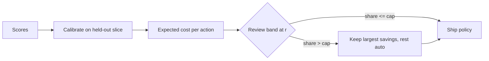

The loan-triage model scores each application with $p = P(\text{good})$; operations can review a limited share; the business has priced its mistakes: approving a bad case ₹120,000, declining a good one ₹24,000, a review ₹3,000 fully loaded (illustrative — the ops sheet says ₹900). This notebook takes you from scores to a shippable policy and a one-table answer to "what does each option cost per case, and how many reviewers does it need?". Theory is in [§4](/c/slm-decision-models/04-decision-theory); this is the runnable path.

:::key[First principle]
Thresholds come from the cost matrix, the review band from the review price, and the cap from headcount. The model's only job is a calibrated $p$; everything after that is arithmetic you can check by hand.
:::

**Setup.** numpy + scikit-learn; the cells share one session — run them top to bottom. The data are a synthetic stand-in for 20,000 applications (~79% repay), so levels are illustrative; the orderings and the method are the point.



## 12.1 Cell 1 · Calibrated scores

Train on 8,000, calibrate with isotonic regression on 4,000 the model never saw, evaluate on 8,000.

```python run
import numpy as np
from sklearn.datasets import make_classification
from sklearn.isotonic import IsotonicRegression
from sklearn.linear_model import LogisticRegression

X, y = make_classification(n_samples=20_000, n_features=20, n_informative=6, weights=[0.2, 0.8],
                           flip_y=0.02, class_sep=1.0, random_state=0)   # y = 1: repays (good)
tr, cal, te = slice(0, 8_000), slice(8_000, 12_000), slice(12_000, None)
clf = LogisticRegression(max_iter=1_000).fit(X[tr], y[tr])
raw = clf.predict_proba(X)[:, 1]
iso = IsotonicRegression(out_of_bounds="clip").fit(raw[cal], y[cal])   # unseen by the model
p, yt = iso.predict(raw[te]), y[te]                                    # P(good), 8,000 test cases


def ece(p, y, bins=10):
    b = np.minimum((p * bins).astype(int), bins - 1)
    return sum(abs(p[b == k].mean() - y[b == k].mean()) * (b == k).mean() for k in np.unique(b))


print(f"test {len(yt):,}, good rate {yt.mean():.3f}; ECE raw {ece(raw[te], yt):.3f} -> calibrated {ece(p, yt):.3f}")
print("P(good) quantiles 10/50/90%:", np.round(np.quantile(p, [0.1, 0.5, 0.9]), 3))
```

```output
test 8,000, good rate 0.794; ECE raw 0.025 -> calibrated 0.010
P(good) quantiles 10/50/90%: [0.026 0.967 0.978]
```

Calibration cut ECE from 0.025 to 0.010. Half the applicants score above 0.967 — close to the 0.975 approve cut point — so small calibration errors there move many cases between review and approve.

## 12.2 Cell 2 · The cost matrix

| Action \ outcome | bad | good |
| --- | ---: | ---: |
| `decline` | 0 | 24,000 |
| `manual_review` | $r$ | $r$ |
| `auto_approve` | 120,000 | 0 |

Expected cost is linear in $p$: $E[c \mid a] = (1-p)\,c(a, \text{bad}) + p\,c(a, \text{good})$. Pick the minimum.

```python run
ACT = np.array(["decline", "manual_review", "auto_approve"])
C_FP, C_FN, REVIEW = 120_000, 24_000, 3_000       # INR; review priced fully (illustrative)


def cost_matrix(review):
    """Rows = actions, columns = outcome (bad, good)."""
    return np.array([[0, C_FN], [review, review], [C_FP, 0]], float)


def expected(p, review=REVIEW):
    """n x 3 expected cost: E[c | a] = (1 - p) c(a, bad) + p c(a, good)."""
    M = cost_matrix(review)
    return np.outer(1 - p, M[:, 0]) + np.outer(p, M[:, 1])


for q in (0.05, 0.30, 0.71, 0.90, 0.99):
    e = expected(np.array([q]))[0]
    print(f"p={q:.2f}  " + "  ".join(f"{a} {v:7,.0f}" for a, v in zip(ACT, e)) + f"  -> {ACT[e.argmin()]}")
print(f"p* = {C_FP / (C_FP + C_FN):.4f}; band [{REVIEW / C_FN:.3f}, {1 - REVIEW / C_FP:.3f}]")
```

```output
p=0.05  decline   1,200  manual_review   3,000  auto_approve 114,000  -> decline
p=0.30  decline   7,200  manual_review   3,000  auto_approve  84,000  -> manual_review
p=0.71  decline  17,040  manual_review   3,000  auto_approve  34,800  -> manual_review
p=0.90  decline  21,600  manual_review   3,000  auto_approve  12,000  -> manual_review
p=0.99  decline  23,760  manual_review   3,000  auto_approve   1,200  -> auto_approve
p* = 0.8333; band [0.125, 0.975]
```

The cut points are $p_{lo} = r/c_{FN} = 3{,}000/24{,}000 = 0.125$ and $p_{hi} = 1 - r/c_{FP} = 0.975$; without review, $p^* = 120{,}000/144{,}000 = 0.833$. A case at $p = 0.90$ — "90% likely to repay" — is still reviewed: approving it carries \(0.10 \times 120{,}000\) = ₹12,000 of expected loss.

## 12.3 Cell 3 · The two-action threshold

Before adding review, compare the naive 0.5 cut with $p^*$ on realised test outcomes.

```python run
def realised(a, review=REVIEW):
    """Mean INR per case actually paid; a: 0 decline, 1 review, 2 approve."""
    return cost_matrix(review)[a, yt].mean()


def two_action(t):
    return np.where(p >= t, 2, 0)


p_star = C_FP / (C_FP + C_FN)
for t in (0.5, 0.7, 0.8, p_star, 0.9, 0.95):
    print(f"approve if p >= {t:.3f}: {realised(two_action(t)):7,.0f} per case")
grid = np.round(np.arange(0.50, 0.99, 0.01), 2)
costs = [realised(two_action(t)) for t in grid]
print(f"best on grid (tuned on test labels!) t={grid[np.argmin(costs)]:.2f}: {min(costs):,.0f}")
```

```output
approve if p >= 0.500:   6,192 per case
approve if p >= 0.700:   5,421 per case
approve if p >= 0.800:   5,187 per case
approve if p >= 0.833:   5,202 per case
approve if p >= 0.900:   5,163 per case
approve if p >= 0.950:   5,985 per case
best on grid (tuned on test labels!) t=0.89: 5,163
```

- $p^*$ costs ₹5,202 per case against ₹6,192 at 0.5 — ₹990 cheaper, ₹9.9 crore a month at 100,000 applications.
- The grid optimum (0.89, ₹5,163) is only ₹39 (0.8%) better and was **tuned on test labels**; it would move with every retrain. $p^*$ moves only when costs do.
- The curve is flat from 0.8 to 0.9 and steep beyond 0.95 — get the cost ratio roughly right and stop tuning.

## 12.4 Cell 4 · Review band and capacity cap

The uncapped band reviews every case in $[0.125, 0.975]$. If that exceeds capacity, review only the cases where review saves the most, $\text{saving} = \min(p\,c_{FN},\ (1-p)\,c_{FP}) - r$, and send the rest to their cheaper automatic action.

```python run
def policy(p, review=REVIEW, cap=None):
    """Cost-optimal action; if the review share exceeds `cap`, review only the biggest savings."""
    e = expected(p, review)
    a = e.argmin(1)
    if cap is not None and (a == 1).mean() > cap:
        saving = e[:, [0, 2]].min(1) - review          # what a review saves over the best auto action
        a = np.where(e[:, 0] <= e[:, 2], 0, 2)
        a[np.argsort(-saving)[: int(cap * len(p))]] = 1
    return a


band = policy(p)
print(f"uncapped band: review share {(band == 1).mean():.1%} "
      f"= {(band == 1).mean() * 100_000:,.0f} reviews/month at 100,000 applications")
for cap in (0.25, 0.10):
    a = policy(p, cap=cap)
    lo, hi = p[a == 1].min(), p[a == 1].max()
    print(f"cap {cap:.0%}: reviewed p in [{lo:.3f}, {hi:.3f}], cost {realised(a):,.0f} per case")
```

```output
uncapped band: review share 37.0% = 37,050 reviews/month at 100,000 applications
cap 25%: reviewed p in [0.182, 0.964], cost 3,117 per case
cap 10%: reviewed p in [0.490, 0.905], cost 3,849 per case
```

37.0% of applications is about 37,050 reviews a month. A 25% cap keeps the reviews with the biggest savings — the cases nearest $p^* = 0.833$, where both automatic actions are most expensive — and spreads over $[0.182, 0.964]$; a 10% cap narrows to $[0.490, 0.905]$.

## 12.5 Cell 5 · Cost per case, every policy

```python run
rows = {"always decline": np.zeros(len(p), int), "always approve": np.full(len(p), 2),
        "approve if p >= 0.5": two_action(0.5), "p* = 0.833 (no review)": two_action(p_star),
        "band, uncapped": policy(p), "band, cap 25%": policy(p, cap=0.25),
        "band, cap 10%": policy(p, cap=0.10),
        "band sized at 900, paid 3,000": policy(p, review=900)}
print(f"{'policy':30s} {'INR/case':>9s} {'review':>7s} {'auto acc':>9s}")
for name, a in rows.items():
    auto = a != 1
    acc = ((a == 2) == (yt == 1))[auto].mean()
    print(f"{name:30s} {realised(a):9,.0f} {(a == 1).mean():7.1%} {acc:9.3f}")

caps = (0, 0.05, 0.10, 0.15, 0.20, 0.25, 0.30, 0.40, 0.50, 0.60, (band == 1).mean())
print("\ncap -> INR/case:", ", ".join(f"{c:.3f}:{realised(policy(p, cap=c)):,.0f}" for c in caps))
```

```output
policy                          INR/case  review  auto acc
always decline                    19,050    0.0%     0.206
always approve                    24,750    0.0%     0.794
approve if p >= 0.5                6,192    0.0%     0.936
p* = 0.833 (no review)             5,202    0.0%     0.913
band, uncapped                     2,698   37.0%     0.975
band, cap 25%                      3,117   25.0%     0.969
band, cap 10%                      3,849   10.0%     0.958
band sized at 900, paid 3,000      2,682   88.5%     0.990

cap -> INR/case: 0.000:5,202, 0.050:4,464, 0.100:3,849, 0.150:3,444, 0.200:3,222, 0.250:3,117, 0.300:2,982, 0.400:2,698, 0.500:2,698, 0.600:2,698, 0.370:2,698
```

:::chart[Cost per case vs review capacity (synthetic, 8,000 test cases)]{type="line" x="review cap (share of applications)" y="cost per case" prefix="₹" xfmt="pct" marks="0.25:cap 25%;0.3705:uncapped band" ymin="0"}
cap, cost per case
0.00, 5202
0.05, 4464
0.10, 3849
0.15, 3444
0.20, 3222
0.25, 3117
0.30, 2982
0.3705, 2698
0.40, 2698
:::

What the table and curve say:

- **Constants set the bar.** Always declining costs ₹19,050; always approving ₹24,750. Every model policy must beat ₹19,050.
- **Cheaper is not more accurate.** $p^*$ is ₹990 cheaper than 0.5 with *lower* automatic accuracy (0.913 vs 0.936): it declines more good applicants (₹24,000 each) to avoid bad approvals (₹120,000 each).
- **Review halves the cost** — ₹2,698 uncapped vs ₹5,202 without review — at 37,050 reviews a month.
- **Capacity has a price, and it falls with volume.** The first 5% of review capacity saves ₹738 per case — about ₹14,800 per review after paying its ₹3,000. The last 7 points (30% → 37%) save ₹284 per case, about ₹4,000 per review. That marginal number is what to put in front of whoever approves headcount.
- **The ₹900 trap.** Sizing the band with the ops-sheet ₹900 sends 88.5% of applications to review — about 51,000 *more* reviews a month — for a realised cost of ₹2,682 vs ₹2,698: no measurable saving (0.6%, within the noise of isotonic plateaus near 0.975). Price review honestly before you size a team.

:::warn[Before shipping]
Multiply review share by monthly volume and divide by reviewer throughput. Check calibration near 0.125, 0.833 and 0.975 specifically, not just overall ECE. Log $p$, the action, the expected costs and the policy version for every case.
:::

## 12.6 Exercises

Drag the costs and $p$. Reproduce the band $[0.125, 0.975]$ at ₹3,000; then try ₹900 (band $[0.0375, 0.9925]$) and ₹20,000 (the band collapses onto 0.833).

:::exercise[Exercise 12.1 · Threshold lab]{id="threshold" fp="120000" fn="24000" review="3000" actions="decline,manual_review,auto_approve" currency="₹"}
:::

1. **Review price.** Set `REVIEW = 12_000` in Cell 2 and re-run. Predict the band first ($[0.5, 0.9]$) and the review share's direction.
2. **Skip calibration.** In Cell 1 use `p = raw[te]`. Which rows of the Cell 5 table move most, and why are they the band-edge policies?
3. **Find the cap.** Which cap first brings cost per case under ₹3,000? Convert it into reviewers at 400 reviews per reviewer per month (illustrative).
4. **Asymmetric change.** Raise the bad-approval cost to ₹200,000. Recompute $p^*$ by hand (0.893) and check Cell 3.
5. **Your matrix.** Replace the costs with your own decision's numbers and write down which policy you would ship and the monthly review volume it implies.

## 12.7 Check yourself

:::qa[A case has p = 0.90. Approve, review or decline at a ₹3,000 review?]
Review: decline ₹21,600, review ₹3,000, approve ₹12,000. It is "90% good" and still not approved, because 10% of ₹120,000 is four times the review price.
:::

:::qa[Why does the capped policy keep reviews near 0.833 rather than near the band edges?]
Saving $= \min(p\,c_{FN}, (1-p)\,c_{FP}) - r$ peaks at $p^* = 0.833$, where both automatic actions cost ₹20,000. Near 0.125 or 0.975 a review saves almost nothing.
:::

:::qa[Ops can staff 10%. What does that cost relative to uncapped review?]
₹3,849 vs ₹2,698 per case: ₹1,151 per case, about ₹11.5 crore a month at 100,000 applications — the price of the capacity limit, owned by whoever sets headcount.
:::

Next: [Notebook: prompting](/c/slm-decision-models/13-notebook-prompting).
