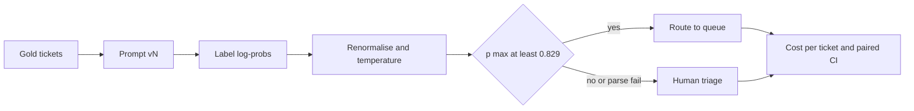

Four prompt variants route support tickets into `billing`, `technical` or `account_access`; anything the model is unsure of goes to a human triage desk. You have a 3,000-ticket labelled set and 100,000 tickets a month. Which prompt ships, and what is each change worth in rupees? This notebook answers with one table and one chart. The concepts are in [§8](/c/slm-decision-models/08-prompt-engineering); the derivations in the deep course's [prompt engineering](/c/practical-slm-decision-models/09-prompt-engineering) section.

:::key[First principle]
A prompt is one component of a decision policy. Compare variants on **cost per case at a cost-derived threshold, on the same tickets, with an interval** — not on accuracy from a handful of examples you read by eye.
:::

**Setup.** numpy only; the cells share one session — run them top to bottom. The labeller is **simulated**: a stand-in that emits first-token label log-probs with a known accuracy, confidence and parse-failure rate per prompt, so every result reproduces without a GPU. The costs are illustrative: a misroute costs ₹350 of rework, human triage ₹60. To use your own model, replace `LP` in Cell 1 with real log-probs; Cells 2–5 run unchanged.

The variants: **P0** zero-shot; **P1** adds label definitions and tie-breakers; **P2** adds four similarity-selected examples; **P3** is P2 with a JSON schema — the same beliefs as P2, far fewer parse failures.



## 13.1 Cell 1 · Label set, variants and a simulated labeller

Each ticket gets a shared difficulty term (`common`) so the variants are paired: a hard ticket is hard for every prompt. P3 reuses P2's seed, so its log-probs are identical — a schema changes the output format, not what the model believes.

```python run
import numpy as np

QUEUES = np.array(["billing", "technical", "account_access"])
MIX = [0.45, 0.35, 0.20]                     # share of tickets per queue
C_WRONG, C_TRIAGE = 350.0, 60.0              # INR, illustrative: misroute rework, human triage
# Simulated labeller, one row per prompt variant. Every number here is an assumption of the simulation:
# margin = how strongly the prompt points at the true label, sharp = logit scale (confidence),
# other = logit of the non-label vocabulary, fail = parse-failure rate per call, call = INR per call.
VARIANTS = {
    "P0 zero-shot":     dict(margin=1.2, sharp=2.6, other=0.5, fail=0.060, call=0.010, seed=0),
    "P1 + definitions": dict(margin=1.7, sharp=2.2, other=0.0, fail=0.050, call=0.020, seed=1),
    "P2 + 4 examples":  dict(margin=2.3, sharp=1.8, other=-1.0, fail=0.040, call=0.040, seed=2),
    "P3 = P2 + schema": dict(margin=2.3, sharp=1.8, other=-1.0, fail=0.005, call=0.045, seed=2),
}
N = 3_000                                    # 1,000 calibration + 2,000 gold test tickets
rng = np.random.default_rng(13)
y = rng.choice(3, size=N, p=MIX)
common = rng.normal(size=(N, 3))             # ticket difficulty shared by every prompt


def label_logprobs(margin, sharp, other, seed, **_):
    """First-token log-probs of the 3 labels; the rest of the vocabulary is one 'other' bucket."""
    own = np.random.default_rng(seed).normal(size=(N, 3))
    z = sharp * (margin * np.eye(3)[y] + 0.8 * common + 0.6 * own)
    z = np.column_stack([z, np.full(N, other)])
    return (z - np.logaddexp.reduce(z, axis=1, keepdims=True))[:, :3]


LP = {v: label_logprobs(**kw) for v, kw in VARIANTS.items()}
print("ticket 0, truth:", QUEUES[y[0]])
for v, lp in LP.items():
    acc = (lp.argmax(1) == y).mean()
    print(f"{v:17s} logprobs {np.round(lp[0], 2)}  greedy accuracy {acc:.3f}  parse-fail {VARIANTS[v]['fail']:.1%}")
```

```output
ticket 0, truth: account_access
P0 zero-shot      logprobs [-7.25 -5.52 -0.01]  greedy accuracy 0.688  parse-fail 6.0%
P1 + definitions  logprobs [-6.55 -4.11 -0.02]  greedy accuracy 0.804  parse-fail 5.0%
P2 + 4 examples   logprobs [-5.8  -5.09 -0.01]  greedy accuracy 0.908  parse-fail 4.0%
P3 = P2 + schema  logprobs [-5.8  -5.09 -0.01]  greedy accuracy 0.908  parse-fail 0.5%
```

Greedy accuracy rises 0.688 → 0.804 → 0.908 because the simulation says so (`margin`); those are inputs. Everything below measures what they are worth once probabilities, thresholds, parse failures and sampling noise are included.

## 13.2 Cell 2 · Log-probs to probabilities

At the label position the model has a distribution over its whole vocabulary. Keep the label tokens, renormalise, then fit one temperature on the 1,000 calibration tickets:

$$
P_T(k \mid x) = \frac{e^{\ell_k / T}}{\sum_{j \in \text{labels}} e^{\ell_j / T}} .
$$

$T = 1$ is plain renormalisation; $T > 1$ softens an overconfident prompt, $T < 1$ sharpens an underconfident one. The derivation and a hand-worked table are in [deep §9.2](/c/practical-slm-decision-models/09-prompt-engineering).

```python run
cal, te = slice(0, 1_000), slice(1_000, None)


def softmax_T(lp, T=1.0):
    """Renormalise label log-probs over the label set (T = 1) or temperature-scale them."""
    z = lp / T
    e = np.exp(z - z.max(1, keepdims=True))
    return e / e.sum(1, keepdims=True)


def nll(P, yy):
    return -np.log(P[np.arange(len(yy)), yy]).mean()


def ece(P, yy, bins=10):
    conf, hit = P.max(1), P.argmax(1) == yy
    b = np.minimum((conf * bins).astype(int), bins - 1)
    return sum(abs(conf[b == k].mean() - hit[b == k].mean()) * (b == k).mean() for k in np.unique(b))


grid = np.round(np.arange(0.5, 4.01, 0.05), 2)
PROB = {}
for v, lp in LP.items():
    T = grid[np.argmin([nll(softmax_T(lp[cal], t), y[cal]) for t in grid])]   # fit on calibration only
    PROB[v] = softmax_T(lp, T)
    raw = softmax_T(lp)
    print(f"{v:17s} label mass {np.exp(lp).sum(1).mean():.3f}  T={T:.2f}  "
          f"ECE renormalised {ece(raw[te], y[te]):.3f} -> scaled {ece(PROB[v][te], y[te]):.3f}")
print("ticket 0, P2 renormalised:", np.round(softmax_T(LP['P2 + 4 examples'][:1])[0], 3),
      " scaled:", np.round(PROB['P2 + 4 examples'][0], 3))
```

```output
P0 zero-shot      label mass 0.909  T=2.05  ECE renormalised 0.153 -> scaled 0.022
P1 + definitions  label mass 0.954  T=1.15  ECE renormalised 0.056 -> scaled 0.034
P2 + 4 examples   label mass 0.988  T=0.75  ECE renormalised 0.036 -> scaled 0.016
P3 = P2 + schema  label mass 0.988  T=0.75  ECE renormalised 0.036 -> scaled 0.016
ticket 0, P2 renormalised: [0.003 0.006 0.991]  scaled: [0.    0.001 0.998]
```

- **The mass outside the label set is a signal.** P0 puts 9.1% of its probability on non-label tokens (label mass 0.909): the prompt is not constraining the output. P2 leaks 1.2%.
- **Each prompt needs its own temperature.** P0 is badly overconfident ($T = 2.05$, ECE 0.153 → 0.022); P2 is mildly underconfident ($T = 0.75$, ECE 0.036 → 0.016). A temperature fitted for one prompt is wrong for the next — refit on every prompt change.
- Temperature never changes the argmax, so accuracy is untouched; it changes which tickets clear the routing threshold.

## 13.3 Cell 3 · Self-consistency voting

The routing rule comes from the costs. Routing the top label costs \((1-p) \times 350\) in expectation; triage costs ₹60. Route when

$$
(1 - p)\,350 < 60 \iff p > 1 - \tfrac{60}{350} = 0.829 .
$$

When log-probs are unavailable (some hosted APIs, or the label comes after a reasoning step), the fallback is to sample $k$ answers and vote. Cell 3 compares that with the log-prob policy for P2, using the model's own temperature-1 distribution as the sampler.

```python run
P_ROUTE = 1 - C_TRIAGE / C_WRONG            # route when (1 - p) * 350 < 60, i.e. p > 0.829
yt = y[te]


def route_cost(p_max, pred, calls, call_inr):
    """INR per ticket: route the top label if p_max >= P_ROUTE, else human triage; plus call cost."""
    routed = p_max >= P_ROUTE
    return np.where(routed, np.where(pred == yt, 0.0, C_WRONG), C_TRIAGE) + calls * call_inr, routed


v = "P2 + 4 examples"
P, call = PROB[v][te], VARIANTS[v]["call"]
c, r = route_cost(P.max(1), P.argmax(1), 1, call)
print(f"P_ROUTE = {P_ROUTE:.3f}")
print(f"{'method':22s} {'calls':>5s} {'acc':>6s} {'routed':>7s} {'acc|routed':>10s} {'INR/tkt':>8s}")
print(f"{'logprobs, scaled':22s} {1:5d} {(P.argmax(1) == yt).mean():6.3f} {r.mean():7.1%} "
      f"{(P.argmax(1) == yt)[r].mean():10.3f} {c.mean():8.2f}")
q = softmax_T(LP[v])[te]                     # the model's own sampling distribution (temperature 1)
srng = np.random.default_rng(7)
for k in (1, 5, 10, 20):
    votes = np.array([srng.multinomial(k, qi) for qi in q])
    pred, share = votes.argmax(1), votes.max(1) / k
    c, r = route_cost(share, pred, k, call)
    print(f"{f'vote, k={k}':22s} {k:5d} {(pred == yt).mean():6.3f} {r.mean():7.1%} "
          f"{(pred == yt)[r].mean():10.3f} {c.mean():8.2f}")
```

```output
P_ROUTE = 0.829
method                 calls    acc  routed acc|routed  INR/tkt
logprobs, scaled           1  0.904   82.2%      0.969    19.68
vote, k=1                  1  0.848  100.0%      0.848    53.41
vote, k=5                  5  0.892   64.9%      0.976    26.68
vote, k=10                10  0.908   71.2%      0.975    24.01
vote, k=20                20  0.905   73.2%      0.975    23.36
```

- **One sample is the expensive default.** A single sampled answer has a vote share of 1, so everything is routed at sampled accuracy (0.848) — ₹53.41 per ticket, 2.7× the log-prob policy.
- **Voting recovers the greedy answer; it does not beat it.** At $k = 10$ the majority vote reaches 0.908, the greedy accuracy from Cell 1. Independent samples from one distribution can only estimate its argmax. (Sampling *different reasoning paths* can change the distribution itself — measure that on your gold set; don't assume it.)
- **Vote shares are coarse and uncalibrated.** At $k = 5$ only a 5-of-5 vote clears 0.829, so 35% of tickets go to triage even though their calibrated probability would route them. Even $k = 20$ costs ₹23.36 against ₹19.68 — and 20× the decode compute. If you must vote, calibrate the vote share on labelled data at the same $k$ ([deep §9.3](/c/practical-slm-decision-models/09-prompt-engineering)).

## 13.4 Cell 4 · Parse failures

A parse failure (truncated JSON, unknown label) needs a policy. Three options: a **silent default** to the biggest queue, **fail closed** to triage, or **retry once** with a repair prompt and then fail closed. The cell treats each call's failure as independent with the variant's rate — an assumption; check it on your model, since a deterministic decoder can fail the same way twice.

```python run
def policy_cost(v, on_fail="triage", retries=1):
    """Per-ticket INR on the test set, with parse failures handled by `on_fail` after `retries`."""
    kw, P = VARIANTS[v], PROB[v][te]
    frng = np.random.default_rng([kw["seed"], retries])
    fails = frng.random((len(yt), retries + 1)) < kw["fail"]     # independent per call (assumption)
    ok_at = np.where(fails.all(1), -1, fails.argmin(1))           # first parsed attempt, -1 = never
    calls = np.where(ok_at < 0, retries + 1, ok_at + 1)
    cost, routed = route_cost(P.max(1), P.argmax(1), calls, kw["call"])
    failed = ok_at < 0
    if on_fail == "default_billing":                              # the silent-default anti-pattern
        cost[failed] = np.where(yt[failed] == 0, 0.0, C_WRONG) + calls[failed] * kw["call"]
        routed[failed] = True
    else:                                                         # fail closed: a human triages it
        cost[failed] = C_TRIAGE + calls[failed] * kw["call"]
        routed[failed] = False
    return cost, routed, failed


print(f"{'variant / policy':38s} {'fail':>6s} {'auto':>6s} {'INR/tkt':>8s}")
for v in ("P2 + 4 examples", "P3 = P2 + schema"):
    for on_fail, retries in (("default_billing", 0), ("triage", 0), ("triage", 1)):
        c, r, f = policy_cost(v, on_fail, retries)
        print(f"{v[:2]} {f'{retries} retry, then {on_fail}':35s} {f.mean():6.2%} {r.mean():6.1%} {c.mean():8.2f}")
```

```output
variant / policy                         fail   auto  INR/tkt
P2 0 retry, then default_billing        3.70%  82.9%    26.23
P2 0 retry, then triage                 3.70%  79.2%    21.27
P2 1 retry, then triage                 0.15%  82.0%    19.74
P3 0 retry, then default_billing        0.65%  82.3%    20.64
P3 0 retry, then triage                 0.65%  81.7%    19.98
P3 1 retry, then triage                 0.00%  82.2%    19.68
```

For P2, the silent default has the **highest automation rate (82.9%) and the highest cost (₹26.23)** — ₹4.96 per ticket above failing closed, because 55% of defaulted tickets are not billing tickets and each costs ₹350 instead of ₹60. One retry cuts failures from 3.70% to 0.15% and the cost to ₹19.74. With P3's schema the failure rate is 0.65% before retries, so the policy matters far less: ₹19.68–20.64 across all three.

:::warn[Automation rate is not a quality metric]
A policy can raise automation by guessing. Report cost per case, accuracy on the automated subset and the parse-failure rate by type side by side. A schema-valid answer can still be wrong.
:::

## 13.5 Cell 5 · Compare variants with paired intervals

Every variant is scored with retry-once-then-triage. The bootstrap resamples the **same** tickets for every variant in each replicate, so shared difficulty cancels in the differences.

```python run
COST = {v: policy_cost(v)[0] for v in VARIANTS}    # retry once, then fail closed
brng = np.random.default_rng(11)
idx = brng.integers(0, len(yt), (2_000, len(yt)))  # the SAME resampled tickets for every variant
ci = lambda x: np.percentile(x, [2.5, 97.5])

print(f"{'variant':17s} {'acc':>6s} {'auto':>6s} {'INR/tkt':>8s}  95% CI")
for v, c in COST.items():
    lo, hi = ci(c[idx].mean(1))
    acc, auto = (PROB[v][te].argmax(1) == yt).mean(), policy_cost(v)[1].mean()
    print(f"{v:17s} {acc:6.3f} {auto:6.1%} {c.mean():8.2f}  [{lo:.2f}, {hi:.2f}]")

names = list(COST)
print("\npaired differences (positive = the later variant is cheaper)")
for a, b in zip(names, names[1:]):
    d = COST[a] - COST[b]
    lo, hi = ci(d[idx].mean(1))
    print(f"{a[:2]} -> {b[:2]}: {d.mean():6.2f} INR/tkt [{lo:.3f}, {hi:.3f}]  "
          f"= INR {d.mean() * 100_000:,.0f}/month at 100,000 tickets")
```

```output
variant              acc   auto  INR/tkt  95% CI
P0 zero-shot       0.681  27.8%    52.99  [50.56, 55.41]
P1 + definitions   0.795  60.6%    41.69  [38.30, 45.25]
P2 + 4 examples    0.904  82.0%    19.74  [17.32, 22.20]
P3 = P2 + schema   0.904  82.2%    19.68  [17.27, 22.17]

paired differences (positive = the later variant is cheaper)
P0 -> P1:  11.30 INR/tkt [7.799, 14.670]  = INR 1,129,955/month at 100,000 tickets
P1 -> P2:  21.95 INR/tkt [18.409, 25.280]  = INR 2,194,911/month at 100,000 tickets
P2 -> P3:   0.06 INR/tkt [-0.003, 0.147]  = INR 5,669/month at 100,000 tickets
```

:::chart[Cost per ticket by prompt variant, 95% paired-bootstrap CI (2,000 simulated gold tickets)]{type="bar" y="₹ per ticket" prefix="₹" yfmt="dec1" labels="true" ymin="0" note="Simulated labeller; retry once, then human triage. Costs illustrative: misroute ₹350, triage ₹60."}
variant, CI low, estimate, CI high
P0 zero-shot, 50.56, 52.99, 55.41
P1 + definitions, 38.30, 41.69, 45.25
P2 + 4 examples, 17.32, 19.74, 22.20
P3 = P2 + schema, 17.27, 19.68, 22.17
:::

How to read it:

- **Examples beat wording.** P1 → P2 saves ₹21.95 per ticket [18.41, 25.28], about ₹21.9 lakh a month at 100,000 tickets; P0 → P1 saves ₹11.30 [7.80, 14.67]. Both intervals are well clear of zero.
- **A weak prompt hands work to people.** P0 auto-routes only 27.8% of tickets: after calibration its probabilities rarely clear 0.829. That, not its 0.681 accuracy, is why it costs ₹52.99.
- **The schema is a reliability fix, not an accuracy fix.** P2 → P3 saves ₹0.06 per ticket with an interval of [−0.003, 0.147] — indistinguishable from zero on 2,000 tickets. Ship P3 for its 0.5% failure rate and simpler parsing, not for a cost claim the data cannot support.
- **Call cost is noise here.** The per-call prices (₹0.01–0.045, illustrative for a self-hosted SLM) are three orders of magnitude below a single misroute. Prompt length matters for latency and for API-priced models; for this decision, the routing outcome dominates.

## 13.6 Practical rules

| Question | Rule | Evidence above |
| --- | --- | --- |
| Which probability? | Label log-probs, renormalised, one temperature per prompt | P0: ECE 0.153 → 0.022 |
| No log-probs? | Vote with $k \ge 10$ and calibrate the share at that $k$ | $k = 1$ costs 2.7× |
| Parse failures? | Retry once, then fail closed; never a silent default | +₹4.96 per ticket for the default |
| Which variant ships? | Lowest cost per case; paired CI must exclude zero to claim a gain | P2 → P3 CI includes 0 |
| How big a gold set? | Size it for the smallest difference worth shipping ([§14](/c/slm-decision-models/14-notebook-evaluation)) | 2,000 tickets cannot see ₹0.06 |

## 13.7 Exercises

:::exercise[Exercise 13.1 · Audit your prompt experiment]{id="checklist" items="Variants run on the same frozen gold set;Temperature refit for every prompt on a calibration split;Routing threshold derived from the costs;Parse failures retried once then failed closed;Cost per case reported with a paired interval;Automation rate shown next to cost, never alone"}
:::

1. **Cheaper triage.** Set `C_TRIAGE = 30` in Cell 1. Predict the new routing threshold (0.914) and which variant's auto share falls most; re-run Cells 3–5.
2. **Skip calibration.** In Cell 2 set `PROB[v] = raw` (renormalised, $T = 1$). Which variant's cost moves most, and in which direction? (Hint: P0 is overconfident.)
3. **Correlated failures.** In Cell 4 make the retry fail whenever the first call failed (`fails[:, 1] = fails[:, 0]`). How much of the retry's value survives?
4. **Smaller gold set.** Resample only 500 test tickets in Cell 5. Which of the three paired differences still excludes zero?

## 13.8 Check yourself

:::qa[Why does voting with k = 10 not beat the calibrated log-prob policy from the same model?]
Ten independent samples from the same distribution estimate that distribution; their majority converges on its argmax (0.908, the greedy accuracy). The vote share is also coarse (multiples of 0.1) and uncalibrated, so fewer tickets clear 0.829. Result: ₹24.01 vs ₹19.68 per ticket, at 10× the calls.
:::

:::qa[P3 removed almost every parse failure. Why is its cost gain not significant?]
Its log-probs are identical to P2's, so the only difference is the 0.15% of P2 tickets that still fail after one retry and go to triage. That moves ₹0.06 per ticket; the paired interval [−0.003, 0.147] includes zero at n = 2,000.
:::

Next: [Notebook: evaluation metrics](/c/slm-decision-models/14-notebook-evaluation).
