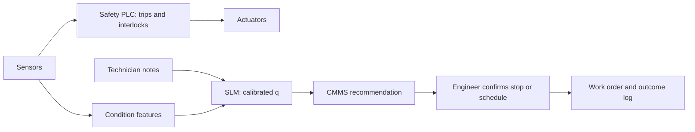

A plant runs 2,000 pumps, motors and gearboxes. Every week each asset gets a condition review: vibration features from the online monitoring system, the last technician note ("slight whine at drive end, grease looked dark"), and its work-order history. Today a reliability engineer reads the alarms and decides. The proposal is an SLM that reads the same evidence and recommends one of three actions — keep running, inspect in the next planned window, or stop the line now. The money is in downtime; the risk is in anything that touches a safety function. This section prices the first and fences off the second.

:::key[First principle]
In industry the model advises the maintenance plan; it never sits in the safety loop. Interlocks and trips are hard-wired or PLC logic that acts in milliseconds without the model. Inside that boundary the decision is ordinary expected cost: downtime is priced per hour, so the cut points, the queue sizes and the value of a better model all follow from arithmetic.
:::

## 17.1 Where SLMs fit

The deep course's [domain-fit rubric](/c/practical-slm-decision-models/15-use-cases-and-domain-fit) applies unchanged: closed actions, bounded costs, observed outcomes. Industrial decisions usually pass on all three — a failure is loud and logged — and the SLM's edge is reading the free text that tabular condition monitoring ignores.

| Decision | Actions | SLM role | Fit |
| --- | --- | --- | --- |
| Condition-based maintenance | continue · schedule · stop_now | Reads technician notes + work-order history; fused with sensor features | Good: priced downtime, failures observed |
| Work-order triage | 4 priority queues + `planner_review` | Classifies free-text fault reports | Good: high volume, misroutes visible in hours |
| Quality hold | release · rework · scrap · `hold_for_QA` | Reads inspection notes against the batch record | Conditional: escape cost can be a recall |
| Supplier exception | accept · expedite · substitute · escalate | Reads emails and EDI exceptions | Good: text-heavy, bounded costs |
| Interlocks, trips, permissives | — | **None** | Safety function: deterministic and certified only |

## 17.2 Cost matrix and cut points

Price each cell from plant numbers. All figures are illustrative: unplanned downtime at ₹1,20,000 per hour, a run-to-failure event costing 6 hours plus ₹2,80,000 of secondary damage, a planned-window inspection ₹15,000, a repair ₹60,000, an unplanned stop 1.5 hours.

| Action ↓ / outcome → | healthy | failing (fails before next window if untreated) |
| --- | ---: | ---: |
| `continue` | 0 | 10,00,000 (6 h × ₹1.2 L + ₹2.8 L damage) |
| `schedule` (inspect next window) | 15,000 | 3,42,000 (30% fail first: \(0.3 \times 10\text{ L} + 0.7 \times 60{,}000\)) |
| `stop_now` | 1,95,000 (1.5 h + inspection) | 2,40,000 (1.5 h + repair) |

With $q = P(\text{failing})$, each boundary is where two expected costs cross ([derivation](/c/practical-slm-decision-models/04-decision-theory)):

$$
\begin{aligned}
\text{continue} \leftrightarrow \text{schedule}:&\quad 10^6 q = 15{,}000(1-q) + 342{,}000q \;\Rightarrow\; q = \tfrac{15{,}000}{673{,}000} = 0.022 \\
\text{schedule} \leftrightarrow \text{stop\_now}:&\quad 15{,}000(1-q) + 342{,}000q = 195{,}000(1-q) + 240{,}000q \;\Rightarrow\; q = \tfrac{180{,}000}{282{,}000} = 0.638
\end{aligned}
$$

:::example[Worked example · two assets]
- **Pump P-114, q = 0.05** (a dark-grease note, vibration normal). Continue: \(0.05 \times 10{,}00{,}000\) = ₹50,000. Schedule: \(0.95 \times 15{,}000 + 0.05 \times 3{,}42{,}000\) = ₹31,350. Stop now: ₹1,97,250. **Schedule.** A 5% failure risk is too high to ignore and far too low to stop a line for.
- **Gearbox G-07, q = 0.70** (bearing defect frequency rising, "grinding noise" in the note). Schedule: ₹2,43,900. Stop now: \(0.30 \times 1{,}95{,}000 + 0.70 \times 2{,}40{,}000\) = ₹2,26,500. **Stop now** — but only by ₹17,400, because a stop costs ₹1,95,000 even when nothing is wrong.
:::

:::chart[Expected cost of each action as P(failing) rises]{type="line" x="P(failing)" y="expected cost per asset-week" prefix="₹" xlog="true" ylog="true" marks="0.0223:continue | schedule;0.638:schedule | stop_now" note="Illustrative costs from the matrix above. The lowest line is the decision."}
q, continue, schedule, stop_now
0.001, 1000, 15327, 195045
0.001334, 1334, 15436, 195060
0.001778, 1778, 15581, 195080
0.002371, 2371, 15775, 195107
0.003162, 3162, 16034, 195142
0.004217, 4217, 16379, 195190
0.005623, 5623, 16839, 195253
0.007499, 7499, 17452, 195337
0.01, 10000, 18270, 195450
0.01334, 13335, 19361, 195600
0.01778, 17783, 20815, 195800
0.02371, 23714, 22754, 196067
0.03162, 31623, 25341, 196423
0.04217, 42170, 28789, 196898
0.05623, 56234, 33389, 197531
0.07499, 74989, 39522, 198375
0.1, 100000, 47700, 199500
0.1334, 133352, 58606, 201001
0.1778, 177828, 73150, 203002
0.2371, 237137, 92544, 205671
0.3162, 316228, 118406, 209230
0.4217, 421697, 152895, 213976
0.5623, 562341, 198886, 220305
0.7499, 749894, 260215, 228745
1, 1000000, 342000, 240000
:::

The `schedule` band is wide (0.022 to 0.638) because a planned-window inspection is cheap insurance. That makes calibration around $q \approx 0.02$ the part that matters: most of the fleet sits near the lower cut point, and a model that reports 0.01 when the truth is 0.04 leaves a fault running.

## 17.3 A year of decisions, with capped crews and slots

Simulate 2,000 assets for 52 weekly reviews with an illustrative 0.5% of asset-weeks carrying a developing fault, and a calibrated condition score with separation $d' = 2.5$ (AUC 0.961). Compare constant policies, a fixed vibration-alarm rule, the cost policy, and the cost policy under two capacity limits: an emergency crew that can do at most 2 unplanned stops a week, and a limited number of inspection slots in each planned window. Over-cap cases fall back one step (stop → schedule, schedule → continue), keeping the ones with the largest saving.

```python run
import numpy as np

# Rotating-equipment condition decision; INR per asset per weekly review (illustrative).
ACT = ("continue", "schedule", "stop_now")
COST = np.array([[0, 1_000_000],          # (healthy, failing): run to failure = unplanned outage + damage
                 [15_000, 342_000],       # inspect in next planned window; 30% fail before it
                 [195_000, 240_000]],     # stop the line now for 1.5 h (+ repair if failing)
                float)


def cut(a, b):
    """q = P(failing) at which actions a and b cost the same."""
    (a0, a1), (b0, b1) = COST[a], COST[b]
    return (b0 - a0) / ((a1 - a0) - (b1 - b0))


print(f"cut points: continue|schedule q = {cut(0, 1):.4f}, schedule|stop_now q = {cut(1, 2):.3f}")

rng = np.random.default_rng(17)
ASSETS, WEEKS, PREV, D = 2_000, 52, 0.005, 2.5    # fleet, horizon, weekly failing share, score separation
n = ASSETS * WEEKS
failing = rng.random(n) < PREV
s = rng.normal(size=n) + D * failing              # condition score from vibration features + notes
lr = np.exp(D * s - D * D / 2)
q = PREV * lr / (PREV * lr + 1 - PREV)            # calibrated P(failing)
E = np.outer(1 - q, COST[:, 0]) + np.outer(q, COST[:, 1])   # expected cost of each action


def decide(crew=None, slots=None):
    """Argmin per case; per week keep at most `crew` stops and `slots` inspections by largest saving."""
    a = E.argmin(1)
    for w in range(WEEKS):
        idx = np.arange(w * ASSETS, (w + 1) * ASSETS)
        for act, cap, fallback in ((2, crew, 1), (1, slots, 0)):
            pick = idx[a[idx] == act]
            if cap is not None and len(pick) > cap:
                drop = pick[np.argsort(E[pick, fallback] - E[pick, act])[: len(pick) - cap]]
                a[drop] = fallback
    return a


def report(name, a):
    c = COST[a, failing.astype(int)].mean()
    print(f"{name:22s} INR {c:6,.0f}/asset-wk  faults left running {(a[failing] == 0).mean():6.1%}  "
          f"stops/wk {(a == 2).sum() / WEEKS:4.1f}  inspections/wk {(a == 1).sum() / WEEKS:6.1f}")


report("continue everything", np.zeros(n, int))
report("inspect everything", np.ones(n, int))
report("alarm rule (s > 2.5)", np.where(s > 2.5, 2, 0))
report("cost policy", decide())
report("cost policy, crew 2/wk", decide(crew=2))
for slots in (40, 20, 10):
    report(f"crew 2/wk, {slots} slots/wk", decide(crew=2, slots=slots))
```

```output
cut points: continue|schedule q = 0.0223, schedule|stop_now q = 0.638
continue everything    INR  5,298/asset-wk  faults left running 100.0%  stops/wk  0.0  inspections/wk    0.0
inspect everything     INR 16,732/asset-wk  faults left running   0.0%  stops/wk  0.0  inspections/wk 2000.0
alarm rule (s > 2.5)   INR  4,428/asset-wk  faults left running  48.8%  stops/wk 17.6  inspections/wk    0.0
cost policy            INR  3,162/asset-wk  faults left running  26.7%  stops/wk  1.8  inspections/wk   68.7
cost policy, crew 2/wk INR  3,165/asset-wk  faults left running  26.7%  stops/wk  1.2  inspections/wk   69.3
crew 2/wk, 40 slots/wk INR  3,269/asset-wk  faults left running  35.8%  stops/wk  1.2  inspections/wk   40.0
crew 2/wk, 20 slots/wk INR  3,527/asset-wk  faults left running  47.2%  stops/wk  1.2  inspections/wk   20.0
crew 2/wk, 10 slots/wk INR  3,833/asset-wk  faults left running  57.9%  stops/wk  1.2  inspections/wk   10.0
```

- **The cost policy beats both the constants and the alarm rule.** ₹3,162 per asset-week against ₹5,298 for running everything to failure (40% lower) and ₹4,428 for the alarm rule (29% lower). The alarm rule stops the line 17.6 times a week and still leaves 48.8% of faults running, because it has only two actions and no notion of price.
- **The emergency crew cap barely binds.** Capping stops at 2 a week costs ₹3 per asset-week: when a stop is refused, the next-best action (schedule) is almost as good, as the narrow ₹17,400 margin in the G-07 example showed.
- **Inspection slots are the real constraint.** The policy wants 68.7 inspections a week. Cut the planned window to 20 slots and cost rises 11% while the share of faults left running goes from 26.7% to 47.2%. This is the number to take to the maintenance planner, not the crew roster.

:::chart[Cost per asset-week vs planned-window inspection slots (emergency crew capped at 2 stops/week)]{type="line" x="inspection slots per week" y="cost per asset-week" prefix="₹" xfmt="int" marks="68.7:uncapped demand" note="Synthetic fleet: 2,000 assets × 52 weeks, 0.5% faulty asset-weeks, AUC 0.961; costs illustrative."}
slots, cost per asset-week
0, 4891
5, 4210
10, 3833
15, 3632
20, 3527
25, 3415
30, 3356
35, 3335
40, 3269
45, 3261
50, 3253
55, 3245
60, 3222
70, 3160
80, 3170
:::

The first 5 slots a week are worth \((4{,}891 - 4{,}210) \times 2{,}000 / 5\) ≈ ₹2.7 lakh each per week, net of the ₹15,000 inspection; going from 60 to 70 slots is worth about ₹12,400 per slot. Beyond the uncapped demand of about 69 the curve is flat within simulation noise.

## 17.4 Safety interlocks and the edge

Two constraints shape industrial deployments more than model quality: the **safety boundary** and the **plant network**.

**The safety boundary.** Trips, interlocks and permissives (over-temperature trip, vibration high-high, guard-door interlock, lockout/tagout) are safety functions under the plant's functional-safety regime. They run in hard-wired logic or a safety PLC with scan times on the order of milliseconds and are validated independently of any model. The SLM's outputs go to the maintenance system (CMMS) as recommendations, never to a PLC tag:



- **One-way data flow.** The model reads historian and CMMS data; nothing it emits can write a setpoint, reset a trip or bypass a permissive.
- **Stopping is not automatically safe.** Halting some processes (a reactor, a furnace, a kiln) is itself hazardous; `stop_now` means "recommend a controlled stop by the standard procedure", executed by a person.
- **Rules first, model second.** A high-high alarm or a listed failure phrase ("smoke", "smell of burning") forces `stop_now` review regardless of the model's $q$. The model can raise priority; it cannot lower a rule's.

**The edge.** Plant networks are segmented and often air-gapped, so inference runs on-site. Size it from first principles ([§3](/c/slm-decision-models/03-slm-fundamentals)): decode time ≥ bytes read per token ÷ bandwidth; prefill ≈ 2 × parameters × prompt tokens ÷ FLOP/s. On an illustrative fanless industrial PC (25 GB/s, 0.3 TFLOP/s effective):

```python run
"""Sizing floors on an illustrative fanless industrial PC: 25 GB/s memory bandwidth, 0.3 TFLOP/s effective."""
BW, FLOPS = 25e9, 0.3e12
CANDIDATES = [  # name, parameters, bytes per parameter, output tokens decoded
    ("66M encoder int8", 66e6, 1, 0),
    ("0.5B decoder int8", 0.49e9, 1, 5),
    ("1.5B decoder int4", 1.54e9, 0.5, 5),
    ("3B decoder int4", 3.09e9, 0.5, 5),
]


def seconds(params, bpp, out, prompt):
    prefill = 2 * params * prompt / FLOPS               # compute-bound: ~2 FLOPs per parameter per token
    decode = out * params * bpp / BW                    # memory-bound: every weight read per output token
    return prefill + decode


print(f"{'model':18s} {'weights':>7s} {'ms/tok':>6s} {'note only':>9s} {'+manual':>8s} {'2,000/wk':>9s}")
for name, params, bpp, out in CANDIDATES:
    note = seconds(params, bpp, out, 384)               # 384-token technician note + asset fields
    manual = seconds(params, bpp, out, 1384) if out else None   # + 1,000 tokens of retrieved procedure
    week = (manual or note) * 2000 / 60                 # one review per asset per week, minutes
    print(f"{name:18s} {params * bpp / 1e9:5.2f}GB {params * bpp / BW * 1e3:6.1f} {note:8.2f}s "
          f"{'-' if manual is None else f'{manual:7.2f}s':>8s} {week:7.0f}min")
```

```output
model              weights ms/tok note only  +manual  2,000/wk
66M encoder int8    0.07GB    2.6     0.17s        -       6min
0.5B decoder int8   0.49GB   19.6     1.35s    4.62s     154min
1.5B decoder int4   0.77GB   30.8     4.10s   14.36s     479min
3B decoder int4     1.54GB   61.8     8.22s   28.82s     961min
```

- **Latency does not bind this decision; the safety loop is out of reach of all of them.** A weekly review can wait seconds, and even the 3B model clears 2,000 reviews in 16 hours. But the fastest option, 0.17 s, is still about 17 cycles of a 10 ms PLC scan: no model here belongs in a trip path.
- **Retrieval costs prefill.** Adding 1,000 tokens of the maintenance procedure multiplies a decoder's time by about 3.4–3.5. Retrieve the relevant section, not the chapter, and keep the retrieved context well under the window.
- **The encoder is the default.** At 66 MB and 0.17 s it fits alongside the historian on existing hardware; use a decoder only if the note needs reading against a procedure.

Operational rules for an air-gapped site:

- Model, tokenizer, calibration map and thresholds ship as **one signed artefact**, verified on load; the plant runs exactly what was validated.
- **Fallback is the rule table.** If the model fails to load, times out or flags the input as out-of-distribution, the decision falls back to the alarm rules the plant used before — never to `continue` by default.
- **Store-and-forward logging.** Decisions are logged locally and synced when the link allows; no decision waits on the network.
- **Offline rollback in one step**, rehearsed before go-live.

## 17.5 Drift and change control

Industrial data drifts for physical reasons, and labels (failures) are rare and slow.

| Signal | Leading or lagging | Typical cause | Action |
| --- | --- | --- | --- |
| Feature distribution per sensor (PSI on deciles) | leading | sensor replaced or recalibrated, new mounting | check instrument records before blaming the model |
| Share of assets per action per week | leading | seasonal load, new product mix | review against inspection-slot capacity (§17.3) |
| Mean predicted $q$ vs observed fault rate | lagging | training data enriched with failures | prior-shift correction ([§16.5](/c/slm-decision-models/16-finance)), then recalibrate |
| Engineer override rate and reason | leading | model misses a failure mode the notes describe | add labelled cases; review the phrase rules |
| Out-of-distribution rate | leading | new asset class or vendor | route to engineer; never extrapolate |

:::warn[Failure-enriched training data]
Run-to-failure tests and incident archives are full of failures; the fleet is not. A model trained at a 10% failure rate and deployed where 0.5% of asset-weeks are faulty over-predicts the odds of failure about 22-fold, \((0.1/0.9) / (0.005/0.995)\),, pushing healthy assets into the `schedule` band and burning inspection slots. Calibrate on a sample with the fleet's real base rate.
:::

Treat every model, threshold or cost change as a **management-of-change** item: what changes, which assets it affects, the shadow-mode evidence, who approved it, and the rollback. Show the engineer the evidence span from the note and the sensor trend behind each recommendation; an override with a reason is the best label the plant produces.

## 17.6 Check yourself

:::exercise[Exercise 17.1 · Industrial deployment pre-flight]{id="checklist" items="Every cost cell priced from plant data and signed off by operations;Model outputs cannot write to any PLC or safety tag;Rule-based alarms run before the model and cannot be lowered by it;Inspection-slot and crew capacity enforced per week;Signed artefact with offline rollback rehearsed;Fallback to the pre-existing rule table on any failure;Calibration checked against the fleet base rate;Drift signals and engineer overrides reviewed weekly"}
:::

:::qa[Unplanned downtime rises from ₹1.2 lakh to ₹2.4 lakh per hour. Where does the schedule/stop_now cut point move?]
Re-price the hours: run-to-failure becomes 6 × 2.4 L + 2.8 L = ₹17.2 L; schedule-if-failing \(0.3 \times 17.2\text{ L} + 0.7 \times 60{,}000\) = ₹5,58,000; a stop costs 1.5 h × 2.4 L = ₹3.6 L, so ₹3,75,000 if healthy and ₹4,20,000 if failing. Schedule ↔ stop: \(15{,}000(1-q) + 558{,}000q = 375{,}000(1-q) + 420{,}000q\) gives $q = 360{,}000/498{,}000 = 0.723$. Costlier downtime makes stopping *less* attractive relative to waiting for the planned window, because the stop itself is downtime.
:::

:::qa[The plant can only offer 20 inspection slots a week. What do you tell the planner?]
From §17.3: cost rises from ₹3,162 to ₹3,527 per asset-week and the share of faults left running from 26.7% to 47.2%. At about 69 slots the curve flattens; each slot between 20 and 40 is worth roughly \((3{,}527 - 3{,}269) \times 2{,}000 / 20\) ≈ ₹25,800 a week net of the inspection itself.
:::

:::qa[Why not let the SLM issue the stop directly, since stopping is the cautious action?]
Because stopping is not always safe (some processes are hazardous to halt abruptly), because the model's latency and failure modes are not validated as a safety function, and because a model that can stop a line can also be wrong in ways nobody tested. It recommends; an engineer executes the standard procedure; trips stay in certified logic.
:::

Next: [Gaming](/c/slm-decision-models/18-gaming).
