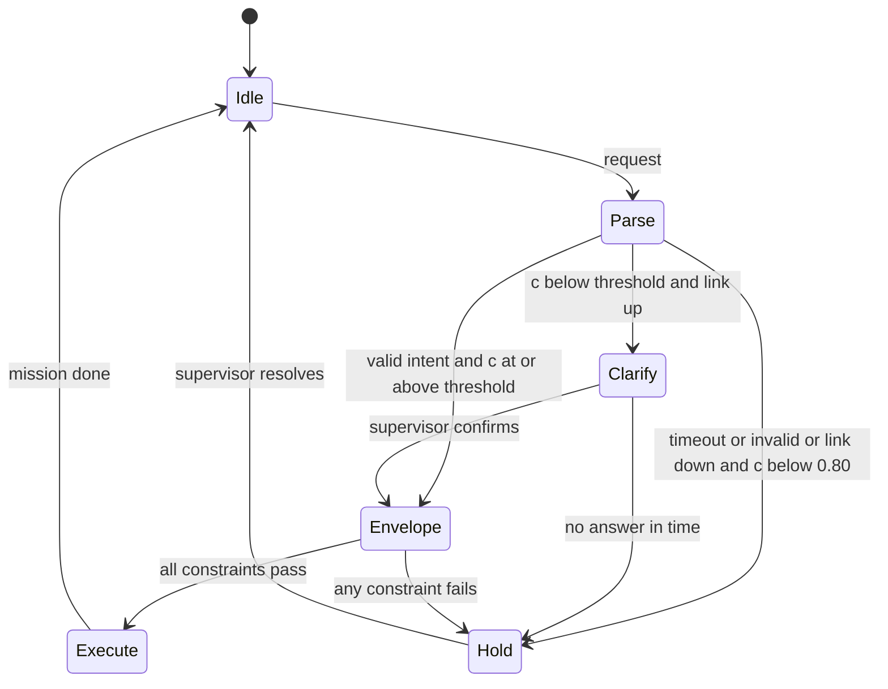

A warehouse runs 20 autonomous mobile robots moving totes between docks, aisles and packing stations. Floor staff give them instructions in plain language — "take the spare totes to dock B, but stay out of aisle 4 until noon" — and today a remote supervisor translates each request into a mission by hand. The proposal is an SLM that parses the request into a structured intent the fleet planner can execute. Mobile robots share space with people and forklifts, so the design question is not only "how accurate is the parser" but "what happens when it is wrong", and the answer must never depend on the parser being right.

:::key[First principle]
In an autonomous system the SLM proposes intent; deterministic, verified layers decide what moves. The model's output passes through a safety envelope and an independent safety controller, each able to stop the robot on its own, and every failure of the model — wrong, late, malformed, missing — lands in a defined safe state. Only because those layers exist can the cost of a wrong intent be bounded and priced at all.
:::

## 20.1 Where SLMs fit

| Layer | Decides | Rate | Built from | Verified by |
| --- | --- | --- | --- | --- |
| Safety controller | emergency stop, speed limit near people | 100–1000 Hz | certified sensors + logic | functional-safety process |
| Motion control and planner | trajectory, path, speed | 10–50 Hz | deterministic algorithms | simulation, reachability, testing |
| Safety envelope | which missions and zones are allowed now | per mission | rules: geofences, keep-outs, payload limits | code review, tests, formal checks |
| **SLM intent layer** | which mission, which destination, which constraint | ≤ 1 per request | closed-set intent from language | statistics + shadow mode |

Decisions the SLM can reasonably make, all upstream of the envelope:

| Decision | Actions | SLM role |
| --- | --- | --- |
| Operator request interpretation | execute intent · clarify · hold | Parse free text into a schema-valid intent |
| Exception triage | continue · reroute · hold · call_operator | Read fault codes and operator notes |
| Remote-assist summarisation | — | Summarise the scene for a human; the human decides |
| Fleet maintenance routing | continue · service_next · ground | Read fault logs (see [§17](/c/slm-decision-models/17-industrial)) |

The deep course's [domain-fit](/c/practical-slm-decision-models/15-use-cases-and-domain-fit) gates apply: a decision whose worst case is unbounded harm is not an SLM decision. The envelope is what turns "robot drives into a person" (unbounded) into "robot goes to the wrong dock" (bounded, ₹2,000 of rework).

## 20.2 The intent decision and its two cut points

Price the three actions per request (illustrative). Safety is deliberately **not** in this matrix: hazardous motion is blocked by the layers below, so a wrong intent costs rework.

| Action ↓ / outcome → | parsed intent correct | parsed intent wrong |
| --- | ---: | ---: |
| `execute` | 0 | 2,000 (wrong mission, rework, delayed totes) |
| `clarify` (supervisor confirms) | 30 | 30 |
| `hold` (pause, supervisor takes over) | 400 | 400 |

With $c = P(\text{intent correct})$, executing beats a fallback with cost $f$ when $2{,}000(1-c) < f$:

$$
c^*_{\text{clarify}} = 1 - \frac{30}{2{,}000} = 0.985, \qquad c^*_{\text{hold}} = 1 - \frac{400}{2{,}000} = 0.80 .
$$

`clarify` needs the supervisor link. When the network is down, the only fallback is `hold`, and the threshold drops to 0.80 — so **the fallback's availability is an input to the policy**, not a constant baked into it.

:::example[Worked example · "move the blue cart to dock B" at c = 0.97]
Execute: \(0.03 \times 2{,}000\) = ₹60. With the supervisor reachable, clarify costs ₹30: **clarify**. With the link down, hold costs ₹400: **execute** — and the safety envelope still applies, because it never depended on the parser.
:::

## 20.3 Thresholds, fallbacks and layered risk

Simulate 100,000 requests with calibrated confidence drawn from an illustrative Beta(60, 1) (mean 0.984). Sweep the execute threshold with each fallback, then follow the wrong executions at $c^* = 0.985$ through two safety layers using illustrative failure rates — the arithmetic, not the rates, is the point.

```python run
import numpy as np

# Delivery-robot command interpreter: the SLM maps an operator's words to one intent from a closed set.
# INR per command, illustrative. Safety is NOT priced here: the planner's envelope enforces it separately.
C_WRONG, C_CLARIFY, C_HOLD = 2_000.0, 30.0, 400.0   # wrong mission (rework), ask operator, pause + takeover
print(f"execute if P(correct) > {1 - C_CLARIFY / C_WRONG:.3f} (clarify available), "
      f"> {1 - C_HOLD / C_WRONG:.3f} (comms down: hold only)")
rng = np.random.default_rng(20)
N = 100_000
conf = rng.beta(60, 1.0, N)                     # calibrated confidence that the parsed intent is right
correct = rng.random(N) < conf


def policy(t, fallback_cost):
    ex = conf >= t
    cost = np.where(ex, np.where(correct, 0, C_WRONG), fallback_cost).mean()
    return ex.mean(), (ex & ~correct).mean() * 1e4, cost


print(f"{'threshold':>9s} {'executed':>8s} {'wrong/10k':>9s} {'INR comms up':>12s} {'INR comms down':>14s}")
for t in (0.0, 0.8, 0.9, 0.95, 0.97, 0.985, 0.99, 0.995):
    ex, wrong, c_up = policy(t, C_CLARIFY)
    print(f"{t:9.3f} {ex:8.1%} {wrong:9.1f} {c_up:12.2f} {policy(t, C_HOLD)[2]:14.2f}")

# Defence in depth for hazardous intents. Every rate below is an illustrative assumption.
wrong = policy(0.985, C_CLARIFY)[1] / 1e4       # wrong executions per command at t*
P_HAZ = 0.02         # share of wrong intents that would be hazardous if carried out
P_ENV_MISS = 1e-3    # deterministic safety envelope (geofence, speed, keep-out) fails to block
P_STOP_MISS = 1e-2   # independent safety controller (lidar / bumper stop) fails to stop
P_SHARED = 1e-6      # per command: one map fault defeats envelope and stop together
layers = [("SLM intent only", wrong * P_HAZ), ("+ safety envelope", wrong * P_HAZ * P_ENV_MISS),
          ("+ safety controller", wrong * P_HAZ * P_ENV_MISS * P_STOP_MISS)]
for name, rate in layers:
    print(f"{name:22s} hazards reaching the world: {rate * 1e6:10.5f} per 1M commands")
print(f"common-cause map fault: {P_SHARED * 1e6:.5f} per 1M -> {P_SHARED / layers[-1][1]:,.0f}x the layered rate")
```

```output
execute if P(correct) > 0.985 (clarify available), > 0.800 (comms down: hold only)
threshold executed wrong/10k INR comms up INR comms down
    0.000   100.0%     164.3        32.86          32.86
    0.800   100.0%     164.3        32.86          32.86
    0.900    99.8%     162.7        32.60          33.29
    0.950    95.4%     132.9        27.95          44.89
    0.970    84.0%      87.4        22.27          81.29
    0.985    59.6%      36.2        19.35         168.65
    0.990    45.2%      19.9        20.41         223.11
    0.995    25.7%       5.5        23.39         298.26
SLM intent only        hazards reaching the world:   72.40000 per 1M commands
+ safety envelope      hazards reaching the world:    0.07240 per 1M commands
+ safety controller    hazards reaching the world:    0.00072 per 1M commands
common-cause map fault: 1.00000 per 1M -> 1,381x the layered rate
```

:::chart[Cost per request vs execute threshold, with and without the supervisor link]{type="line" x="execute threshold on P(intent correct)" y="cost per request" prefix="₹" yfmt="dec1" marks="0.8:c* comms down;0.985:c* comms up" note="Synthetic, 100,000 requests; confidence ~ Beta(60, 1); costs illustrative. Comms down: the only fallback is hold (₹400)."}
threshold, supervisor reachable (clarify ₹30), link down (hold ₹400)
0.8, 32.86, 32.86
0.85, 32.86, 32.88
0.9, 32.60, 33.29
0.92, 31.80, 34.32
0.94, 29.97, 38.95
0.95, 27.95, 44.89
0.96, 25.08, 56.91
0.97, 22.27, 81.29
0.975, 21.11, 102.18
0.98, 20.10, 130.32
0.985, 19.35, 168.65
0.99, 20.41, 223.11
0.993, 21.81, 265.39
0.995, 23.39, 298.26
0.997, 25.51, 334.91
0.999, 28.35, 377.25
:::

- **With the link up, 0.985 is the minimum.** ₹19.35 per request, executing 59.6% and asking about the rest — against ₹32.86 for executing everything. Wrong executions fall from 164.3 to 36.2 per 10,000.
- **With the link down, keeping 0.985 is the expensive mistake.** It holds 40% of requests at ₹400 each, for ₹168.65 per request; switching to 0.80 executes almost everything for ₹32.86. A policy that cannot see the link state picks the wrong threshold in one of the two modes.
- **Layers multiply — if they are independent.** Of 72.4 hazardous intents per million requests, the envelope lets through 0.0724 and the safety controller 0.00072. But one map error that misplaces a keep-out zone defeats *both* layers at once: at an illustrative one per million requests it is 1,381 times the layered rate. Independence is a design property you must build (separate sensors, separate map sources, separate code paths), not an assumption.

## 20.4 Never the last line of defence

The rules that keep the SLM out of the safety path:

- **Closed intent schema.** The model can emit only a validated object: mission type from an enumeration, destinations from the site map, constraints from a fixed list. Anything else is `hold`.
- **The envelope re-checks everything.** Every intent is validated against current geofences, keep-outs, payload limits and zone schedules before the planner sees it. The envelope never trusts the model's confidence.
- **Independent stop.** The safety controller's sensors and logic share nothing with the SLM, and as little as possible with the envelope.
- **Fail to a defined safe state.** Timeout, parse failure, low confidence with no supervisor, out-of-distribution input: each maps to `hold` (stop at a safe point, announce, wait), never to "continue with the last intent".
- **No model update without the scenario suite** — adversarial phrasings, contradictory constraints, unknown locations, injected instructions ("ignore the keep-out") — and a shadow-mode period.



A sketch of the guard (not runnable — `slm`, `envelope` and `link` are your components):

```python
INTENTS = {"deliver", "fetch", "return_to_base", "park"}

def interpret(request, site, deadline_ms=250):
    try:
        out = slm.parse(request, timeout_ms=deadline_ms)       # schema-constrained decoding
    except (TimeoutError, ValueError):
        return HOLD                                            # fail to the safe state, not open
    if out.intent not in INTENTS or out.destination not in site.locations:
        return HOLD
    threshold = 0.985 if link.supervisor_reachable() else 0.80
    if out.p_correct < threshold:
        return CLARIFY if link.supervisor_reachable() else HOLD
    return envelope.check(out, site.current_constraints())     # deterministic veto: EXECUTE or HOLD
```

## 20.5 Timing, shadow mode and evidence

Why the model sits above the planner and not in it, and how much evidence enabling actuation needs:

```python run
from math import sqrt

# Timing floor for the interpreter on an illustrative embedded module: 100 GB/s, 5 TFLOP/s effective.
BW, FLOPS = 100e9, 5e12
params, bpp, prompt, out = 1.54e9, 0.5, 150, 6        # 1.5B int4, 150-token command + context, 6-token intent
prefill = 2 * params * prompt / FLOPS * 1e3
decode = out * params * bpp / BW * 1e3
print(f"intent floor: prefill {prefill:.0f} ms + decode {decode:.0f} ms = {prefill + decode:.0f} ms "
      f"= {(prefill + decode) / 10:.0f} cycles of a 100 Hz control loop")


def wilson(k, n, z=1.96):
    c = (k + z * z / 2) / (n + z * z)
    h = z * sqrt(k * (n - k) / n + z * z / 4) / (n + z * z)
    return c - h, c + h


shadow = rng.choice(N, 10_000, replace=False)  # shadow mode: intents logged, never actuated
ex = conf[shadow] >= 0.985
k, n = int((ex & ~correct[shadow]).sum()), int(ex.sum())
lo, hi = wilson(k, n)
print(f"shadow: {k} wrong of {n:,} would-be executions = {k / n:.2%} (95% Wilson [{lo:.2%}, {hi:.2%}])")
FLEET, CMD_PER_HOUR = 20, 12                    # robots, operator commands per robot-hour (illustrative)
for target in (1e-2, 1e-3, 1e-4):
    need = 3 / target                           # rule of three: zero events in n -> 95% bound ~ 3/n
    print(f"show wrong-execute rate < {target:.2%} with zero errors: {need:>7,.0f} executions "
          f"~ {need / n * 1e4 / (FLEET * CMD_PER_HOUR):>6,.0f} fleet-hours of shadow mode")
```

```output
intent floor: prefill 92 ms + decode 46 ms = 139 ms = 14 cycles of a 100 Hz control loop
shadow: 44 wrong of 6,043 would-be executions = 0.73% (95% Wilson [0.54%, 0.98%])
show wrong-execute rate < 1.00% with zero errors:     300 executions ~      2 fleet-hours of shadow mode
show wrong-execute rate < 0.10% with zero errors:   3,000 executions ~     21 fleet-hours of shadow mode
show wrong-execute rate < 0.01% with zero errors:  30,000 executions ~    207 fleet-hours of shadow mode
```

- **139 ms is a floor, and it is 14 control cycles.** Real kernels are slower and latency varies with load and temperature; a controller needs a bounded worst case every 10 ms. The SLM belongs at request rate, with a hard deadline (250 ms above) after which the answer is `hold`.
- **Shadow mode measures the rate you will actually get.** Logging intents without actuating them, and comparing with what the supervisor did, gives 44 wrong in 6,043 would-be executions: 0.73%, with a 95% interval of 0.54–0.98%. That supports "below 1%".
- **Better targets need a better model, not more hours.** A rule-of-three claim of "below 0.1%" needs 3,000 executions with *zero* errors — 21 fleet-hours — but a parser that is wrong 0.73% of the time will never produce that run. Raise the threshold or improve the parser, then collect the evidence.

## 20.6 Drift and governance

| Signal | What it catches | Action |
| --- | --- | --- |
| Clarify and hold rate per site and shift | new vocabulary, new staff, new locations | add phrasings to the labelled set; update the site map |
| Supervisor override of executed intents | wrong executions the envelope allowed | label, retrain, and review the envelope rule that passed it |
| Envelope rejection rate of SLM intents | the parser proposing out-of-bounds missions | investigate before it becomes normal |
| Deadline misses (p99 latency) | load or thermal throttling | more compute or a smaller model; never a longer deadline |
| Map and constraint version mismatches | common-cause risk between layers | block deployment until versions agree |

- **Standards.** Functional-safety standards such as IEC 61508, ISO 26262 and DO-178C were written around deterministic, specified software; ISO 21448 (SOTIF) addresses hazards from performance limitations such as perception, and guidance specific to machine-learned components is still maturing. Keep the learned component outside the safety function and get safety-engineering advice for your sector before deployment.
- **Every request logged**: model and prompt hashes, input, parsed intent, $c$, threshold, link state, envelope verdict, action, supervisor outcome.
- **Safety case owner, not model owner, approves releases.** A better model that changes the envelope's rejection rate is a safety change.

## 20.7 Check yourself

:::exercise[Exercise 20.1 · Autonomy pre-flight]{id="checklist" items="SLM output is a closed, schema-validated intent and nothing else;Envelope re-checks every intent and never reads model confidence;Independent safety controller shares no inputs with the SLM;Every failure mode maps to a defined hold state;Threshold switches with supervisor-link state;Scenario suite includes injected and contradictory instructions;Shadow-mode error rate reported with an interval before actuation;Map and constraint versions checked across layers"}
:::

:::qa[A hold costs ₹1,000 instead of ₹400 because the site has fewer supervisors. What is the comms-down threshold?]
$c^* = 1 - 1{,}000/2{,}000 = 0.50$. The robot executes more of its own interpretations when the link is down — which is acceptable only because the envelope and the safety controller do not depend on the parser.
:::

:::qa[The safety controller's miss rate improves from 1e-2 to 1e-3. How much does residual hazard fall?]
Under independence, tenfold: from 0.00072 to 0.000072 per million requests. But the illustrative common-cause map fault (1.0 per million) is unchanged and already 1,381 times larger, so overall risk barely moves. Spend the effort on removing the shared dependency first.
:::

:::qa[Why is "wrong intent costs ₹2,000" a legitimate number here but "missed emergency costs X" was not in healthcare?]
Because the envelope and the safety controller bound the consequence of a wrong intent to rework: unsafe motion is blocked whatever the parser says. Without those layers the worst case is unbounded, the domain-fit gate fires, and the SLM may not decide at all.
:::

Next: [Unit testing](/c/slm-decision-models/21-unit-testing).
