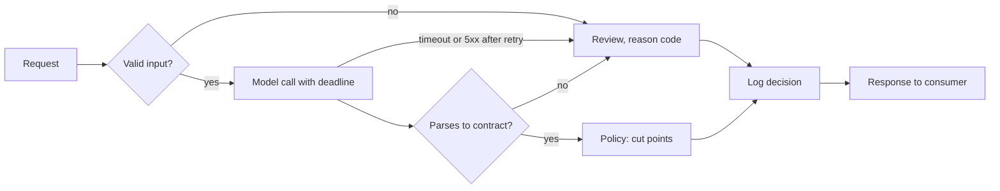

Every unit test from [§21](/c/slm-decision-models/21-unit-testing) passes, and the first week in staging still produces three incidents: a model replica stalls for 900 ms and the HTTP client's default 30 s timeout holds the request open; a provider returns `503` and the retry loop calls it 40 times; the downstream case system rejects responses because a field was renamed from `p` to `p_good`. None of these lives in a single function. They live in the seams between the request, the model call, the policy and the consumer — which is what an integration test exercises.

:::key[First principle]
An integration test drives the real decision path with a **fake model adapter** that can be told to be slow, down, wrong-shaped or duplicated, and asserts the defined outcome for each: a safe action, a reason code, a bounded latency, one decision per request. Statistical checks (golden set, shadow) get tolerances computed from sampling noise, like every other model test.
:::

## 22.1 The path under test



Every arrow into **F** is a branch production will take; the happy path is one route of five. The deep course lists the full failure-injection matrix ([§12.7](/c/practical-slm-decision-models/12-testing-decision-systems)) and the serving side — deadlines, admission control, bundles ([Serving and deployment](/c/practical-slm-decision-models/13-serving-and-deployment)).

## 22.2 Failure injection with a fake adapter

The service below is the loan decision path in miniature. The model is any callable returning `(latency_ms, raw_text)` or raising; time is simulated so the test is deterministic and fast. The deadline is 300 ms for the whole model step, with at most one retry, and only connection failures are retried — a timeout has already used the budget.

```python run
import json

POLICY_VERSION = "band-0.125-0.975@2026-10"
RESPONSE_FIELDS = {"request_id": str, "action": str, "reason": str, "p_good": (float, type(None)),
                   "policy": str, "latency_ms": (int, float)}
ACTIONS = {"decline", "manual_review", "auto_approve"}


class Service:
    """Request -> validate -> model (deadline, one retry) -> parse -> policy -> response + log."""

    def __init__(self, model, deadline_ms=300, retries=1):
        self.model, self.deadline, self.retries = model, deadline_ms, retries
        self.calls, self.seen, self.log = 0, {}, []

    def decide(self, req):
        if req["request_id"] in self.seen:                    # duplicate delivery: same answer
            return self.seen[req["request_id"]]
        p, reason, spent = None, "ok", 0.0
        if not req.get("text", "").strip():
            reason = "empty_input"                            # no model call at all
        else:
            for _ in range(1 + self.retries):
                self.calls += 1
                try:
                    ms, raw = self.model(req["text"])
                except ConnectionError:
                    reason = "model_unavailable"
                    continue                                  # retry while budget remains
                if spent + ms > self.deadline:                # simulated clock: no real sleeping
                    spent, reason = self.deadline, "timeout"
                    break                                     # no retry past the deadline
                spent += ms
                try:
                    obj = json.loads(raw)
                    p = obj["p_good"] if set(obj) == {"p_good"} and type(obj["p_good"]) is float else None
                    reason = "ok" if p is not None and 0 <= p <= 1 else "contract"
                except json.JSONDecodeError:
                    reason = "contract"
                break
        ok = reason == "ok"
        action = ("auto_approve" if p >= 0.975 else "decline" if p < 0.125 else "manual_review") \
            if ok else "manual_review"                        # every failure fails closed
        resp = {"request_id": req["request_id"], "action": action, "reason": reason,
                "p_good": p if ok else None, "policy": POLICY_VERSION, "latency_ms": spent}
        self.seen[req["request_id"]] = resp
        self.log.append(resp)
        return resp


def consumer_contract(resp):
    """What the downstream case system relies on - shared by producer and consumer test suites."""
    assert set(resp) == set(RESPONSE_FIELDS), sorted(set(resp) ^ set(RESPONSE_FIELDS))
    assert all(isinstance(resp[k], t) for k, t in RESPONSE_FIELDS.items())
    assert resp["action"] in ACTIONS and (resp["action"] == "manual_review" or resp["reason"] == "ok")


print("response contract:", ", ".join(RESPONSE_FIELDS))
```

```output
response contract: request_id, action, reason, p_good, policy, latency_ms
```

Now one fake adapter per failure, each run twice with the same `request_id` to check idempotency:

```python run
def flaky(n_failures):
    state = {"left": n_failures}
    def model(text):
        if state["left"] > 0:
            state["left"] -= 1
            raise ConnectionError
        return 40, '{"p_good": 0.99}'
    return model


FAKES = {   # fake model adapters: (latency ms, raw output) or an exception
    "healthy, confident": (lambda t: (40, '{"p_good": 0.99}'), "loan text"),
    "healthy, unsure": (lambda t: (40, '{"p_good": 0.60}'), "loan text"),
    "slow (900 ms)": (lambda t: (900, '{"p_good": 0.99}'), "loan text"),
    "one 503 then ok": (flaky(1), "loan text"),
    "down (always 503)": (flaky(99), "loan text"),
    "prose, not JSON": (lambda t: (40, 'Sure! {"p_good": 0.99}'), "loan text"),
    "p_good as string": (lambda t: (40, '{"p_good": "0.99"}'), "loan text"),
    "empty input": (lambda t: (40, '{"p_good": 0.99}'), "   "),
}
print(f"{'injected':20s} {'action':14s} {'reason':18s} {'calls':>5s} {'ms':>5s}")
for i, (name, (model, text)) in enumerate(FAKES.items()):
    svc = Service(model)
    r = svc.decide({"request_id": f"r{i}", "text": text})
    consumer_contract(r)
    again = svc.decide({"request_id": f"r{i}", "text": text})
    assert again == r and len(svc.log) == 1                   # idempotent: one decision, one log row
    print(f"{name:20s} {r['action']:14s} {r['reason']:18s} {svc.calls:5d} {r['latency_ms']:5.0f}")
```

```output
injected             action         reason             calls    ms
healthy, confident   auto_approve   ok                     1    40
healthy, unsure      manual_review  ok                     1    40
slow (900 ms)        manual_review  timeout                1   300
one 503 then ok      auto_approve   ok                     2    40
down (always 503)    manual_review  model_unavailable      2     0
prose, not JSON      manual_review  contract               1    40
p_good as string     manual_review  contract               1    40
empty input          manual_review  empty_input            0     0
```

What each row pins:

- **Slow model → review at exactly 300 ms**, one call. Without a deadline the request waits as long as the HTTP client's default; with a retry after a timeout it waits twice.
- **Outage → two calls, then review.** The retry count is bounded and asserted; a loop that retries 40 times turns a provider incident into a self-inflicted load spike.
- **Malformed output and empty input never reach the policy.** Empty input costs no model call at all.
- **Every response passes the consumer contract**, including failures — `p_good` is `null`, never a guessed number, and any automatic action must carry reason `ok`.
- **A duplicate delivery returns the stored decision** and writes one log row. Queues redeliver; without this, one application can be decided twice, differently.

:::tip[One contract, two test suites]
Keep `consumer_contract` (or a JSON Schema) in a shared package. The producer's CI runs it against every response its tests generate; the consumer's CI runs it against recorded responses. A rename like `p` → `p_good` then fails in the producer's PR, not in production. Version the contract and support the previous version for one release.
:::

## 22.3 Golden-set gate: what the tolerance actually does

The golden set is a versioned file of reviewed inputs and expected actions. On a model, prompt or extractor change the integration suite replays it and gates on two counts ([§12.4 of the deep course](/c/practical-slm-decision-models/12-testing-decision-systems)):

- **Hard flips** (approve ↔ decline) — zero allowed.
- **Soft moves** (to or from review) — at most 3% of cases (an example threshold).

A limit on a sample is a test with an error rate. If the true churn on traffic is $r$, the number of changed cases on $n$ golden cases is $\text{Binomial}(n, r)$, and the gate fails with probability $P(X > 0.03n)$:

```python run
from math import exp, lgamma, log


def binom_sf(k, n, p):
    """P(X > k), X ~ Binomial(n, p)."""
    if p <= 0:
        return 0.0
    lp, lq = log(p), log(1 - p)
    return sum(exp(lgamma(n + 1) - lgamma(i + 1) - lgamma(n - i + 1) + i * lp + (n - i) * lq)
               for i in range(k + 1, n + 1))


for n in (400, 1_600):
    k = int(0.03 * n)                         # soft moves allowed: 3% of the golden set
    row = ", ".join(f"{r:.2%}: {binom_sf(k, n, r):.1%}" for r in (0.015, 0.02, 0.025, 0.03, 0.035, 0.04, 0.05))
    print(f"n={n:5,d} limit {k:3d} changed -> P(gate fails) at true churn  {row}")
for n in (400, 1_600):
    print(f"n={n:5,d} zero hard flips -> P(caught) when true hard-flip rate is "
          + ", ".join(f"{r:.2%}: {1 - (1 - r) ** n:.0%}" for r in (0.0005, 0.001, 0.0025, 0.005)))
```

```output
n=  400 limit  12 changed -> P(gate fails) at true churn  1.50%: 0.8%, 2.00%: 6.2%, 2.50%: 20.6%, 3.00%: 42.4%, 3.50%: 64.5%, 4.00%: 81.2%, 5.00%: 96.4%
n=1,600 limit  48 changed -> P(gate fails) at true churn  1.50%: 0.0%, 2.00%: 0.3%, 2.50%: 9.0%, 3.00%: 46.2%, 3.50%: 84.7%, 4.00%: 97.9%, 5.00%: 100.0%
n=  400 zero hard flips -> P(caught) when true hard-flip rate is 0.05%: 18%, 0.10%: 33%, 0.25%: 63%, 0.50%: 87%
n=1,600 zero hard flips -> P(caught) when true hard-flip rate is 0.05%: 55%, 0.10%: 80%, 0.25%: 98%, 0.50%: 100%
```

:::chart[Golden-set churn gate (limit 3%): probability the gate fails vs true churn]{type="line" x="true churn on traffic" y="P(gate fails)" xfmt="pct" yfmt="pct" ymin="0" ymax="1" marks="0.03:the limit" note="Exact binomial. A steeper curve is a sharper gate: it passes 2% churn and fails 4% more reliably."}
true churn, n = 400 (limit 12), n = 1600 (limit 48)
0.005, 0.000, 0.000
0.010, 0.000, 0.000
0.015, 0.008, 0.000
0.020, 0.062, 0.003
0.025, 0.206, 0.090
0.030, 0.424, 0.462
0.035, 0.645, 0.847
0.040, 0.812, 0.979
0.045, 0.913, 0.999
0.050, 0.964, 1.000
0.055, 0.987, 1.000
0.060, 0.996, 1.000
:::

- **Every gate is a curve, not a line.** At 400 cases a model with 2.5% churn — inside the limit — fails 20.6% of runs, and one at 4% — outside it — passes 18.8%. Quadrupling the set to 1,600 cuts those to 9.0% and 2.1%.
- **"Zero hard flips" is weak evidence on a small set.** At 400 cases a model that hard-flips 0.1% of traffic (100 loans a month at 100,000 applications) passes two runs in three. Hard flips are better caught on shadow traffic (§22.5), where $n$ is tens of thousands.
- **Never tune the limit until today's model passes.** Write the limit and the set size from the curve, then run.

## 22.4 Timeouts, retries and fallbacks are priced decisions

A timeout turns a slow call into a fallback, and a fallback has a price. For the support-ticket router (100,000 tickets a month), take an illustrative latency profile: a lognormal body with median 40 ms, 2% of calls on a slow path (150–600 ms: GC, cold cache, noisy neighbour), 0.2% that hang. A timed-out ticket goes to human triage at ₹40 instead of the automated cascade's ₹1.086 ([§9](/c/slm-decision-models/09-hybrid-systems)) — ₹38.91 extra each.

```python run
import numpy as np

rng = np.random.default_rng(22)
N = 200_000


def attempt():
    """Latency (ms) of one model call: SLM router, median 40 ms; 2% slow path; 0.2% hang (illustrative)."""
    t = rng.lognormal(np.log(40), 0.35, N)
    slow = rng.random(N) < 0.02                               # GC, cold cache, noisy neighbour
    t[slow] = rng.uniform(150, 600, slow.sum())
    t[rng.random(N) < 0.002] = 5_000                          # hung connection
    return t


lat, retry = attempt(), attempt()                             # retry: an independent second attempt
EXTRA = 40 - 1.086          # INR per fallback: human triage vs automated cascade (section 9)
TICKETS = 100_000           # per month

print(f"{'timeout':>7s} {'fallback':>8s} {'p50':>5s} {'p99':>6s} {'max':>6s} {'INR/month':>10s}")
for T in (60, 80, 100, 150, 200, 300, 600, 1_000, None):
    t = lat if T is None else np.minimum(lat, T)
    fb = np.zeros(N, bool) if T is None else lat > T
    print(f"{str(T or 'none'):>7s} {fb.mean():8.2%} {np.percentile(t, 50):5.0f} "
          f"{np.percentile(t, 99):6.0f} {t.max():6.0f} {fb.mean() * TICKETS * EXTRA:10,.0f}")
T = 100
first_to = lat > T
both = first_to & (retry > T)
t2 = np.where(first_to, T + np.minimum(retry, T), lat)
print(f"T=100 + one retry: fallback {both.mean():.2%}, p99 {np.percentile(t2, 99):.0f} ms, "
      f"max {t2.max():.0f} ms, extra calls {first_to.mean():.1%}, INR/month {both.mean() * TICKETS * EXTRA:,.0f}")
```

```output
timeout fallback   p50    p99    max  INR/month
     60   14.39%    40     60     60    559,895
     80    4.61%    40     80     80    179,238
    100    2.68%    40    100    100    104,173
    150    2.23%    40    150    150     86,681
    200    2.02%    40    200    200     78,762
    300    1.56%    40    300    300     60,706
    600    0.20%    40    432    600      7,763
   1000    0.20%    40    432   1000      7,763
   none    0.00%    40    432   5000          0
T=100 + one retry: fallback 0.07%, p99 145 ms, max 200 ms, extra calls 2.7%, INR/month 2,899
```

:::chart[Share of tickets that fall back vs model-call timeout (illustrative latency profile)]{type="line" x="timeout (ms)" y="share of tickets sent to fallback" xlog="true" yfmt="pct" band="150:600:slow path" marks="100:T = 100 ms" note="Median call 40 ms; 2% slow (150–600 ms); 0.2% hang. Each fallback costs ₹38.91 extra."}
timeout ms, fallback share
50, 0.2784
60, 0.1439
70, 0.0768
80, 0.0461
90, 0.0326
100, 0.0268
125, 0.0228
150, 0.0223
200, 0.0202
250, 0.0179
300, 0.0156
400, 0.0113
500, 0.0067
600, 0.0020
800, 0.0020
1000, 0.0020
:::

- **Below ~80 ms the timeout cuts into the healthy body** and cost explodes: ₹5.6 lakh a month at 60 ms.
- **Between 150 and 600 ms you are paying for the slow path.** Waiting longer saves money only by making 2% of users wait up to 600 ms.
- **Without any timeout, p99 is 432 ms and 0.2% of tickets wait 5 s** — and a real hung connection may never return.
- **A short timeout plus one retry dominates here:** 100 ms + retry gives 0.07% fallback, p99 145 ms, a hard ceiling of 200 ms and ₹2,899 a month, for 2.7% extra model calls. It works because a slow *attempt* is mostly bad luck that a second attempt avoids.

:::warn[When the retry makes it worse]
The retry result assumes the second attempt is independent of the first. If slowness is correlated — the replica is overloaded, the provider is degraded — the retry adds load exactly when the system is saturated. Bound retries per request *and* per service (a retry budget, e.g. ≤ 10% extra calls per minute), add jitter, and fall back immediately on 429. Test that budget with an injected outage, as in §22.2.
:::

## 22.5 Shadow traffic: integration at production scale

Shadow runs the candidate on live requests, logs its decision and never acts on it. It is the integration test with real inputs, real lengths and real concurrency — and, being paired (same request, both models), it is the cheapest place to measure churn and hard flips.

:::example[Worked example · what three days of zero hard flips proves]
At 100,000 loan applications a month the service sees about 3,333 a day. After 3 days of 100% shadow, 10,000 paired decisions with **zero** hard flips bound the true hard-flip rate at \(1 - 0.05^{1/10{,}000} = 0.030\%\) (95% one-sided; the "rule of three", \(3/n\), gives the same). After 7 days (23,333 decisions) the bound is 0.013%. Compare §22.3: a 400-case golden set could not even reliably catch 0.1%.

If shadow shows 210 disagreements in 10,000 (2.1%), the Wilson 95% interval is [1.84%, 2.40%] — inside a 3% soft-move budget with room to spare.
:::

What to assert on a shadow run, with the reason for each:

| Signal | Gate (example) | Why |
| --- | --- | --- |
| Hard flips vs incumbent | 0 observed over ≥ 10,000 paired | Bounds the rate at ≤ 0.03% |
| Soft moves | Wilson upper bound ≤ 3% | Review capacity |
| Contract-failure rate, by reason | ≤ 0.5%, no new reason codes | Prompt/model drift, truncation |
| p95 / p99 end-to-end, fallback share | within SLO; fallback ≤ 0.1% | §22.4 trade-off at real load |
| Calls per decision | ≤ 1.05 | Retry storms show up here first |

## 22.6 Staging that resembles production

- [ ] Same bundle bytes (weights, tokenizer, prompt, calibrator, policy) as production — verify the hash at startup.
- [ ] Same quantisation and hardware class; an int8 staging run says nothing about fp16 production latency.
- [ ] A replay of at least a day of production inputs (redacted) through staging, diffed against production actions.
- [ ] Concurrency and queue limits exercised, not only single requests.
- [ ] Downstream consumer (or its recorded contract tests) in the loop, including its failure responses.
- [ ] Startup refuses to serve if the calibrator or policy file is missing — never falls back to raw scores.

:::exercise[Exercise 22.1 · Integration-suite pre-flight]{id="checklist" items="A fake adapter injects timeout, outage, malformed output and duplicate delivery;Every failure asserts action, reason code, call count and latency;One shared response contract runs in producer and consumer CI;Golden-set limit chosen from the binomial curve, not from today's model;Timeout and retry budget derived from the latency profile and fallback price;Shadow run sized to bound hard flips;Staging runs the production bundle hash" grades="A,B,C,D,F"}
:::

## 22.7 Check yourself

:::qa[The model step has a 300 ms deadline and one retry. A call times out at 300 ms. Should the service retry?]
No. The deadline covers the whole model step, and the timeout has spent it; a retry would take the request to 600 ms or more. Retry only failures that return quickly (connection refused, 503) and only while budget remains — the `slow (900 ms)` row in §22.2 shows one call and 300 ms.
:::

:::qa[A golden set of 400 cases passes a candidate with 0 hard flips and 10 changed actions. Is the candidate's hard-flip rate below 0.1%?]
Not established. With 400 cases, a model at 0.1% hard flips shows zero flips \(0.999^{400} = 67\%\) of the time. The 95% bound after 0 of 400 is about \(3/400 = 0.75\%\). Use shadow: 0 in 10,000 bounds it at 0.03%.
:::

:::qa[Using §22.4's profile, the team wants p99 ≤ 120 ms without a retry. What does that cost?]
Without a retry, the timeout itself must be ≤ 120 ms. At 100 ms the fallback share is 2.68% — ₹104,173 a month at 100,000 tickets. With one retry at 100 ms, p99 is 145 ms (over the target) for ₹2,899 a month. Either relax the target to ~150 ms with the retry, or pay ~₹1 lakh a month; the choice is a business one, and the table makes it explicit.
:::

:::qa[A downstream team renames `reason` to `reason_code` in their parser. Where should that fail first?]
In their CI, against the shared consumer contract and recorded producer responses — before any deploy. If it fails only in production, the contract is not shared or not versioned.
:::

Next: the inputs that break these paths on purpose and by accident — [Edge cases](/c/slm-decision-models/23-edge-cases).
