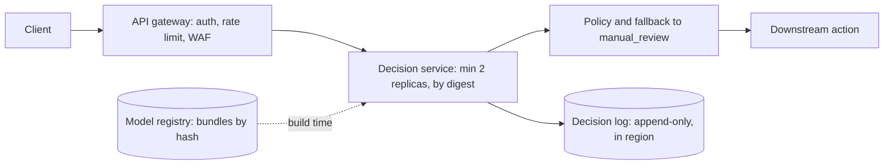

Two services from this handbook are going to the cloud. The **loan pre-approval API** peaks at 40 requests/s (illustrative, as in the deep course) with a p95 SLO of 300 ms. **Support-ticket routing** handles 100,000 tickets a month. Finance asks the same question of both: what does a decision cost, and on what hardware? The answer is not a provider comparison — it is four pieces of arithmetic: memory, capacity per replica, replica count, and price per hour divided by decisions per hour.

:::key[First principle]
Memory decides whether a model fits on a machine; bytes and FLOPs decide how many decisions a replica can serve; traffic and the minimum replica count decide how busy you keep it. **Cost per decision = price per hour ÷ decisions served per hour**, so an idle GPU is the most expensive way to make a decision and a saturated one the cheapest.
:::

## 26.1 Memory: weights plus the KV cache

A decoder caches, for every token in context and every layer, one key vector and one value vector per key/value head. Each vector has $d_h$ numbers of $b_{kv}$ bytes:

$$
\text{KV bytes per token} = \underbrace{2}_{K,\,V} \times L \times h_{kv} \times d_h \times b_{kv},
\qquad
M_{\text{replica}} \approx P\,b_w + M_{\text{runtime}} + n_{\text{seq}} \cdot n_{\text{ctx}} \cdot \text{KV per token}
$$

:::example[Worked example · Qwen2.5-7B on a 24 GB card]
Config: $L = 28$, $h_{kv} = 4$, $d_h = 128$, bf16 cache. KV per token \(= 2 \times 28 \times 4 \times 128 \times 2\) = 57,344 bytes = 56 KiB; a 4,096-token sequence holds 235 MB. Weights in bf16 are 15.23 GB. With 10% of the card kept free and an illustrative 1 GB runtime, \(0.9 \times 24 - 1 - 15.23\) = 5.37 GB is left for cache: **22 concurrent 4k sequences**. Grouped-query attention is why it is not 3: with one KV head per query head (28 instead of 4) the cache would be 7× larger, 1.6 GB per sequence.
:::

```python run
"""GPU memory per replica: weights + runtime + KV cache per concurrent sequence."""
# Qwen2.5 configs (section 3): params, layers, kv_heads, head_dim
CFG = {"0.5B": (0.494e9, 24, 2, 64), "1.5B": (1.544e9, 28, 2, 128),
       "3B": (3.086e9, 36, 2, 128), "7B": (7.615e9, 28, 4, 128)}
W_BYTES, KV_BYTES = 2, 2            # bf16 weights and cache on GPU
RUNTIME = 1.0e9                     # CUDA context + allocator slack, illustrative
CARD, USABLE = 24e9, 0.90           # 24 GB card, keep 10% free


def kv_per_token(layers, kv_heads, head_dim, b=KV_BYTES):
    return 2 * layers * kv_heads * head_dim * b         # K and V, every layer


print(f"{'model':5s} {'weights':>8s} {'KV/token':>9s} {'KV/2k seq':>10s} {'KV/4k seq':>10s}"
      f" {'max seqs@2k':>11s} {'max seqs@4k':>11s}")
for name, (p, L, kv, hd) in CFG.items():
    w, t = p * W_BYTES, kv_per_token(L, kv, hd)
    free = CARD * USABLE - RUNTIME - w
    print(f"{name:5s} {w / 1e9:6.2f}GB {t / 1024:7.0f}KiB {t * 2048 / 1e6:8.0f}MB {t * 4096 / 1e6:8.0f}MB"
          f" {int(free // (t * 2048)):11d} {int(free // (t * 4096)):11d}")

print("total GB vs concurrent 4k-token sequences:")
for n in (0, 16, 32, 64, 128, 192, 256):
    row = [(CFG[m][0] * W_BYTES + RUNTIME + n * kv_per_token(*CFG[m][1:]) * 4096) / 1e9 for m in ("1.5B", "7B")]
    print(f"  {n:3d}  1.5B {row[0]:5.1f}   7B {row[1]:5.1f}")
```

```output
model  weights  KV/token  KV/2k seq  KV/4k seq max seqs@2k max seqs@4k
0.5B    0.99GB      12KiB       25MB       50MB         779         389
1.5B    3.09GB      28KiB       59MB      117MB         298         149
3B      6.17GB      36KiB       75MB      151MB         191          95
7B     15.23GB      56KiB      117MB      235MB          45          22
total GB vs concurrent 4k-token sequences:
    0  1.5B   4.1   7B  16.2
   16  1.5B   6.0   7B  20.0
   32  1.5B   7.8   7B  23.7
   64  1.5B  11.6   7B  31.3
  128  1.5B  19.1   7B  46.3
  192  1.5B  26.6   7B  61.3
  256  1.5B  34.2   7B  76.4
```

:::chart[Replica memory vs concurrent 4,096-token sequences (bf16 weights and cache)]{type="line" x="concurrent sequences" y="memory" unit=" GB" hmarks="21.6:90% of a 24 GB card" note="Illustrative 1 GB runtime. Weights are the intercept; KV cache is the slope."}
sequences, Qwen2.5-1.5B, Qwen2.5-7B
0, 4.1, 16.2
16, 6.0, 20.0
32, 7.8, 23.7
64, 11.6, 31.3
128, 19.1, 46.3
192, 26.6, 61.3
256, 34.2, 76.4
:::

Reading it: the intercept is the weights, the slope is KV per sequence. For short decision prompts (600 tokens + a few output tokens) the cache is small and **the SLO caps the batch long before memory does** — the deep course finds batch limits of 4–16 at a 300 ms p95 ([§13.5](/c/practical-slm-decision-models/13-serving-and-deployment)). Memory binds for 7B-class models, long contexts (the slope scales with $n_{\text{ctx}}$) and CPU containers with hard limits ([§25.3](/c/slm-decision-models/25-docker)).

## 26.2 Capacity per replica

Service time comes from the same two floors as [§3](/c/slm-decision-models/03-slm-fundamentals): prefill is compute-bound ($2P\,n_{\text{prompt}}/F$), decode is bandwidth-bound (bytes read per step ÷ $BW$). On a GPU, a batch of $b$ requests shares each decode step's weight read but not its prefill:

$$
S(b) \approx n_{\text{out}} \cdot \frac{P\,b_w + b \cdot n_{\text{ctx}} \cdot \text{KV}}{BW} + b\left(\frac{2P\,n_{\text{prompt}}}{F} + t_{\text{fixed}}\right),
\qquad \mu = \frac{b}{S(b)}
$$

Replicas follow from Little's law at a target utilisation $\rho$: $N = \max\!\big(N_{\min}, \lceil \lambda / (\rho\,\mu) \rceil\big)$. The deep course shows why $\rho \approx 0.6$: on one replica the p95 crosses a 300 ms SLO near $\rho = 0.8$, and 0.6 leaves room for a 33% spike ([queueing derivation](/c/practical-slm-decision-models/13-serving-and-deployment)). $N_{\min} = 2$ keeps one replica alive through a node or zone failure.

Hardware is the §3 illustrative pair — a CPU node at 50 GB/s and 1 TFLOP/s effective, a GPU at 300 GB/s and 50 TFLOP/s effective — priced at an **illustrative ₹30/h and ₹90/h**. Replace both with your measured rates and quotes; the shape of the result is what transfers.

## 26.3 Cost per 1,000 decisions vs traffic

$$
\text{₹ per 1,000} = \frac{N(\lambda) \times \text{₹ per hour}}{3600\,\lambda} \times 1000
$$

```python run
"""Cost per 1,000 decisions vs traffic: replicas = max(min, ceil(lambda / (rho * capacity)))."""
import math

CPU = dict(bw=50e9, flops=1e12, inr_h=30)    # illustrative node, effective rates and price
GPU = dict(bw=300e9, flops=50e12, inr_h=90)
RHO, MIN_REPLICAS, FIXED = 0.6, 2, 0.002     # target utilisation, availability floor, s per request


def capacity(params, kv_tok, prompt, out, hw, batch=1):
    """Requests/s of one replica: prefill per request, decode steps shared across the batch."""
    prefill = 2 * params * prompt / hw["flops"]
    steps = max(1, out)                                   # encoder: one weight read
    decode = steps * (params + batch * kv_tok * (prompt + out)) / hw["bw"]
    return batch / (decode + batch * (prefill + FIXED))


SETUPS = {"encoder 66M / CPU": (capacity(66e6, 0, 128, 0, CPU), CPU),
          "0.5B int8 / CPU": (capacity(0.494e9, 12_288, 600, 8, CPU), CPU),
          "0.5B int8 / GPU, B=8": (capacity(0.494e9, 12_288, 600, 8, GPU, 8), GPU),
          "1.5B int8 / GPU, B=8": (capacity(1.544e9, 28_672, 600, 8, GPU, 8), GPU)}


def inr_per_1k(lam, mu, hw):
    replicas = max(MIN_REPLICAS, math.ceil(lam / (RHO * mu)))
    return replicas * hw["inr_h"] / (3.6 * lam), replicas


for name, (mu, hw) in SETUPS.items():
    print(f"{name:21s} capacity {mu:7.1f} req/s per replica, {RHO * mu:7.1f} at rho={RHO}")
print(f"{'req/s':>6s}" + "".join(f"{n.split(',')[0]:>18s}" for n in SETUPS))
for lam in (0.04, 0.5, 1, 5, 10, 40, 100, 400):
    cells = [inr_per_1k(lam, mu, hw) for mu, hw in SETUPS.values()]
    print(f"{lam:6g}" + "".join(f"{c:>12.2f} ({r:3d})" for c, r in cells))

cpu, gpu = SETUPS["0.5B int8 / CPU"], SETUPS["0.5B int8 / GPU, B=8"]
lam = 0.1
while inr_per_1k(lam, *cpu)[0] <= inr_per_1k(lam, *gpu)[0]:
    lam += 0.01
print(f"0.5B: GPU becomes cheaper than CPU above {lam:.2f} req/s")
month = 100_000 / (30 * 86_400)
print(f"ticket routing, 100k/month = {month:.3f} req/s average: 2 always-on CPU replicas "
      f"cost INR {2 * 30 * 720:,}/month = INR {2 * 30 * 720 / 100:,.0f} per 1k decisions")
```

```output
encoder 66M / CPU     capacity    49.5 req/s per replica,    29.7 at rho=0.6
0.5B int8 / CPU       capacity     1.5 req/s per replica,     0.9 at rho=0.6
0.5B int8 / GPU, B=8  capacity    63.7 req/s per replica,    38.2 at rho=0.6
1.5B int8 / GPU, B=8  capacity    22.4 req/s per replica,    13.4 at rho=0.6
 req/s encoder 66M / CPU   0.5B int8 / CPU   0.5B int8 / GPU   1.5B int8 / GPU
  0.04      416.67 (  2)      416.67 (  2)     1250.00 (  2)     1250.00 (  2)
   0.5       33.33 (  2)       33.33 (  2)      100.00 (  2)      100.00 (  2)
     1       16.67 (  2)       16.67 (  2)       50.00 (  2)       50.00 (  2)
     5        3.33 (  2)       10.00 (  6)       10.00 (  2)       10.00 (  2)
    10        1.67 (  2)       10.00 ( 12)        5.00 (  2)        5.00 (  2)
    40        0.42 (  2)        9.58 ( 46)        1.25 (  2)        1.88 (  3)
   100        0.33 (  4)        9.42 (113)        0.75 (  3)        2.00 (  8)
   400        0.29 ( 14)        9.40 (451)        0.69 ( 11)        1.88 ( 30)
0.5B: GPU becomes cheaper than CPU above 5.34 req/s
ticket routing, 100k/month = 0.039 req/s average: 2 always-on CPU replicas cost INR 43,200/month = INR 432 per 1k decisions
```

Each cell is ₹ per 1,000 decisions with the replica count in brackets.

:::chart[Cost per 1,000 decisions vs traffic (illustrative ₹30/h CPU, ₹90/h GPU, ρ = 0.6, min 2 replicas)]{type="line" x="requests per second" y="cost per 1,000 decisions" prefix="₹" xlog="true" ylog="true" marks="0.505:ticket routing peak;5.34:CPU–GPU break-even (0.5B);40:loan API peak" points="false" note="Left: the 2-replica floor, cost ∝ 1/λ. Right: replicas scale with traffic and cost flattens at price ÷ (ρ × capacity)."}
req/s, encoder 66M / CPU, 0.5B int8 / CPU, 0.5B int8 / GPU, 1.5B int8 / GPU
0.1, 166.67, 166.67, 500.00, 500.00
0.14, 119.05, 119.05, 357.14, 357.14
0.18, 92.59, 92.59, 277.78, 277.78
0.25, 66.67, 66.67, 200.00, 200.00
0.34, 49.02, 49.02, 147.06, 147.06
0.46, 36.23, 36.23, 108.70, 108.70
0.63, 26.46, 26.46, 79.37, 79.37
0.86, 19.38, 19.38, 58.14, 58.14
1.17, 14.25, 14.25, 42.74, 42.74
1.59, 10.48, 10.48, 31.45, 31.45
2.16, 7.72, 11.57, 23.15, 23.15
2.93, 5.69, 11.38, 17.06, 17.06
3.99, 4.18, 10.44, 12.53, 12.53
5.42, 3.08, 10.76, 9.23, 9.23
7.37, 2.26, 10.18, 6.78, 6.78
10.03, 1.66, 9.97, 4.99, 4.99
13.63, 1.22, 9.78, 3.67, 3.67
18.53, 0.90, 9.44, 2.70, 2.70
25.2, 0.66, 9.59, 1.98, 1.98
34.26, 0.49, 9.49, 1.46, 2.19
46.58, 0.36, 9.48, 1.07, 2.15
63.33, 0.39, 9.47, 0.79, 1.97
86.1, 0.29, 9.39, 0.87, 2.03
117.06, 0.28, 9.40, 0.85, 1.92
159.16, 0.31, 9.42, 0.79, 1.88
216.39, 0.31, 9.40, 0.69, 1.96
294.21, 0.28, 9.40, 0.68, 1.87
400, 0.29, 9.40, 0.69, 1.88
:::

Every curve has two regimes:

- **Floor-bound (left).** Below the traffic two replicas can carry, you pay for two replicas whatever the volume, so cost falls as $1/\lambda$. Ticket routing lives here: 100,000 tickets a month is 0.039 req/s on average, and two always-on CPU replicas cost ₹43,200 a month — **₹432 per 1,000 tickets**. Hardware speed is irrelevant; utilisation is the problem.
- **Capacity-bound (right).** Cost flattens at price ÷ ($\rho\,\mu$ × 3,600) per decision: ₹9.40 per 1,000 for the 0.5B on CPU, ₹0.69 on GPU, ₹0.29 for the encoder on CPU. The sawtooth is replica rounding.

The **break-even** for the 0.5B decoder is 5.34 req/s: below it the CPU's lower price per hour wins, above it the GPU's 40×-plus capacity per replica (63.7 vs 1.5 req/s) wins. At the loan API's 40 req/s the CPU decoder would need 46 replicas (₹9.58 per 1,000) against 2 GPUs (₹1.25) — or 2 CPU replicas of a distilled encoder (₹0.42), the cheapest row by far ([§6](/c/slm-decision-models/06-distillation)).

| Traffic | Choose | Why |
| --- | --- | --- |
| < ~1 req/s, latency-tolerant (tickets, back office) | batch or queue-driven jobs; scale to zero; or share an existing cluster | the 2-replica floor is the whole bill |
| < ~1 req/s, interactive | smallest CPU replicas that meet the SLO, min 2 | speed cannot lower a floor-bound cost |
| Steady, closed label set | encoder on CPU | cheapest per decision at every traffic level above |
| Steady, needs a decoder, above the break-even | GPU with dynamic batching | capacity per replica dominates |
| Bursty with long idle periods | CPU floor + GPU burst pool, or async queue | pay for peak only while it lasts |

:::warn[Price per hour is the wrong comparison]
"The GPU is 3× the price" is irrelevant above the break-even, and "the GPU is 40× faster" is irrelevant below it. Compare cost per 1,000 decisions at *your* traffic, at the utilisation you will actually run, including the replica floor. Then add what the decision triggers — reviews and errors usually dwarf inference ([quality-adjusted cost](/c/practical-slm-decision-models/14-benchmarking-and-performance)).
:::

## 26.4 Autoscaling: signal, lag and headroom

A replica added now serves traffic only after the **scale-up lag**: detect + provision a node (illustrative 60 s) + cold start ([§25.2](/c/slm-decision-models/25-docker): 12.6 s for the 0.5B on a cold node, 4.5 s if the image is pre-pulled). Traffic keeps climbing during the lag, so the headroom you hold must cover it:

$$
\text{growth during lag} = (1 + r)^{t_{\text{lag}}/60}, \qquad \text{must stay below } \frac{\rho_{\text{SLO}}}{\rho_{\text{target}}} = \frac{0.8}{0.6} = 1.33
$$

:::example[Worked example · how fast a ramp can you absorb?]
Lag 60 + 12.6 = 72.6 s. At a ramp of 20% per minute, traffic grows \(1.2^{72.6/60}\) = 1.25× during the lag — inside the 1.33× headroom. At 30% per minute it grows 1.37× and the p95 breaches the SLO before the new replica is ready. Pre-pulling the image cuts the lag to 64.5 s and the growth to 1.33× — right on the edge. Faster ramps need a higher minimum replica count or scheduled scale-up before known peaks.
:::

| Signal | Use | Why |
| --- | --- | --- |
| In-flight requests per replica (or queue depth) | **primary** scale-out signal | by Little's law it is λ × W per replica, so it rises with both traffic and slowdown |
| p95 latency | alarm and secondary signal | lags: it moves only after the queue has formed |
| CPU or GPU utilisation | sanity check only | a GPU at "100%" can still have batch slots; a CPU at 60% can be thread-oversubscribed |
| Scheduled minimum | known daily peaks (loan applications at lunch, month-end) | removes the lag entirely for predictable load |

Scale in slowly (a cooldown of several minutes and one replica at a time): every replica you remove and then need again costs a cold start. Never let the minimum fall below 2 for an interactive service, spread across zones.

## 26.5 Platform shape and data residency

| Option | Fit for a decision model | Watch |
| --- | --- | --- |
| Managed containers (Cloud Run, Container Apps, ECS Fargate) | default for CPU encoders and small decoders | set min instances ≥ 2; cold start loads weights |
| Kubernetes (GKE, AKS, EKS) | many models, GPUs, an existing platform team | node provisioning dominates scale-up lag |
| Serverless functions | async or batch only | every cold start reloads the model (§25.2) |
| Managed inference endpoints | when you want their registry, monitoring and rollout tooling | price per hour vs the same container on your own nodes |
| Batch jobs on a schedule | ticket triage, back-office queues | cheapest for floor-bound workloads: pay per job, not per hour |



- **Region is a policy decision.** Payment-system data in India must be stored in India under RBI's storage directive, and personal data in decision logs falls under the DPDP Act: keep the service, the decision log and its backups in the required region, minimise and redact before logging, and set retention explicitly ([PII and audit trail](/c/practical-slm-decision-models/16-security-privacy-and-governance)). Confirm the specifics with compliance.
- **No credentials in images or config.** Use the platform's workload identity to reach the log store and registry; nothing in environment files.
- **Self-hosting a small model** in your own network keeps inputs away from third parties, which often simplifies legal review compared with a hosted API.
- **Multi-region** doubles the replica floor (and so the floor-bound cost); do it for a regulatory or hard availability requirement, with one region authoritative for the decision log.

## 26.6 Check yourself

:::qa[Ticket volume grows from 100,000 to 1,000,000 a month. What happens to cost per 1,000 on the 2-replica CPU encoder setup?]
Average traffic rises from 0.039 to 0.39 req/s — still far below one replica's 29.7 req/s at ρ = 0.6, so it stays at 2 replicas and ₹43,200 a month. Cost per 1,000 falls 10×, from ₹432 to ₹43.2. In the floor-bound regime more traffic is almost free.
:::

:::qa[A 7B model must serve 4,096-token contexts on a 24 GB card. How many concurrent sequences, and what would you change first?]
22 (5.37 GB free ÷ 235 MB per sequence). Shorten the context if the task allows (KV is linear in tokens), quantise the KV cache to 8 bits (halves the slope), or use int8 weights, which frees 7.6 GB — about 32 more sequences at 235 MB each. Then check that the SLO, not memory, sets the batch.
:::

:::qa[At 3 req/s, should the 0.5B decoder run on CPU or GPU?]
CPU: 3 req/s is below the 5.34 req/s break-even. The table near 3 req/s shows ₹11.38 per 1,000 on CPU (4 replicas) against ₹17.06 on GPU (2 replicas). Above ~5.3 req/s the order flips — and a distilled encoder would cost ₹5.69 at that traffic, cheaper than either.
:::

:::qa[Your autoscaler triggers on CPU utilisation above 70%. Why is that a weak signal for a GPU decoder service?]
GPU-side batching means host CPU load says little about queueing on the accelerator, and utilisation saturates before latency shows it. Scale on in-flight requests per replica (λ × W by Little's law), alarm on p95, and size headroom so traffic growth during the scale-up lag stays under 0.8/0.6 = 1.33×.
:::

Next: [Edge devices](/c/slm-decision-models/27-edge-devices).
