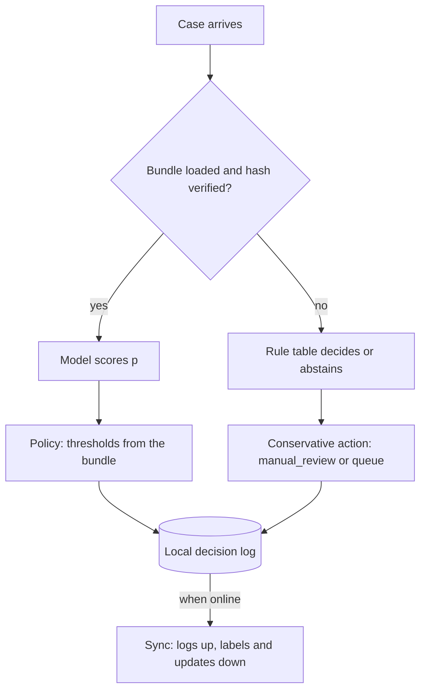
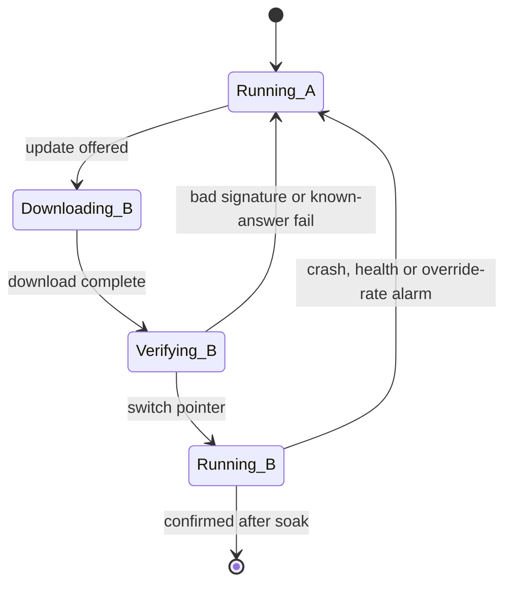

A lender's field agents pre-screen loan applications on a phone in villages with patchy coverage, and a plant runs ticket-style fault triage on a fanless box with no internet at all ([§17](/c/slm-decision-models/17-industrial)). There is no autoscaler, no GPU pool and often no network: the model has to fit in whatever memory the operating system will give an app, answer in about a second on a few watts, survive heat and a flat battery, and be updated over a slow link without ever bricking the device.

:::key[First principle]
On a device, **bytes are everything**: they decide whether the model fits (memory budget), how fast it decodes (tokens/s ≈ bandwidth ÷ model bytes) and how much energy each decision costs. Quantisation buys bytes with probability error, so measure it in flipped decisions and cost per case, not in accuracy alone.
:::

## 27.1 What fits: the memory budget

The number that matters is not the device's RAM but what the OS lets your process keep resident alongside everything else — on phones often a small fraction of physical memory. Size the model like the container in [§25.3](/c/slm-decision-models/25-docker): weights × allocator slack + runtime and tokenizer.

| Device class (illustrative) | App memory budget | Effective bandwidth | Effective compute | Power under load |
| --- | ---: | ---: | ---: | ---: |
| Single-board computer, Pi-class (4 GB) | 2 GB | 8 GB/s | 0.05 TFLOP/s | 5 W |
| Phone SoC (8 GB shared) | 2 GB | 30 GB/s | 0.5 TFLOP/s | 4 W |
| Edge GPU module (8 GB shared) | 4 GB | 60 GB/s | 5 TFLOP/s | 12 W |
| Industrial PC, fanless (16 GB) | 8 GB | 40 GB/s | 0.5 TFLOP/s | 20 W |

Every figure is an illustrative round number for a *class* of device, chosen to make the arithmetic visible — effective rates are well below datasheet peaks. Measure your device: a memory-bandwidth microbenchmark, a matmul FLOP test and a power meter take an afternoon and replace this whole table.

## 27.2 Speed: decode is bandwidth, prefill is compute

From [§3](/c/slm-decision-models/03-slm-fundamentals): each generated token reads every weight once, and the prompt is processed in one compute-bound pass.

$$
\text{tokens/s} \approx \frac{BW}{P\,b_w}, \qquad
t_{\text{call}} \approx \frac{2P\,n_{\text{prompt}}}{F} + n_{\text{out}}\,\frac{P\,b_w}{BW}, \qquad
E_{\text{call}} = W \times t_{\text{call}}
$$

```python run
"""Edge fit and speed from first principles: decode tokens/s ~ bandwidth / model bytes."""
# device classes, all illustrative: (app memory budget GB, effective GB/s, effective TFLOP/s, watts under load)
DEV = {"SBC, Pi-class": (2, 8, 0.05, 5), "phone SoC": (2, 30, 0.5, 4),
       "edge GPU module": (4, 60, 5, 12), "industrial PC": (8, 40, 0.5, 20)}
# (params, bytes/param, prompt tokens, output tokens); encoder = one pass over 128 tokens
MOD = {"encoder 66M int8": (66e6, 1.0, 128, 0), "0.5B int4": (0.494e9, 0.531, 300, 8),
       "0.5B int8": (0.494e9, 1.0, 300, 8), "1.5B int4": (1.544e9, 0.531, 300, 8),
       "3B int4": (3.086e9, 0.531, 300, 8)}
RUNTIME_GB, SLACK = 0.3, 1.3          # runtime + tokenizer resident memory; allocator slack


def call(p, bpp, prompt, out, bw, tf):
    prefill = 2 * p * prompt / (tf * 1e12)
    decode = max(1, out) * p * bpp / (bw * 1e9)
    return prefill + decode


print(f"{'device':16s} {'model':17s} {'RAM GB':>6s} {'fits':>4s} {'tok/s':>6s} {'call ms':>8s} {'mJ':>7s}")
for d, (budget, bw, tf, watts) in DEV.items():
    for m, (p, bpp, prompt, out) in MOD.items():
        gb = p * bpp / 1e9 * SLACK + RUNTIME_GB
        tok_s = f"{bw * 1e9 / (p * bpp):6.0f}" if out else f"{'-':>6s}"
        s = call(p, bpp, prompt, out, bw, tf)
        print(f"{d:16s} {m:17s} {gb:6.2f} {'yes' if gb <= budget else 'NO':>4s} {tok_s}"
              f" {1e3 * s:8.0f} {1e3 * watts * s:7.0f}")

BATTERY_WH, THROTTLE = 15, 0.6        # phone battery; sustained/burst speed after heat soak
for m in ("encoder 66M int8", "0.5B int4"):
    budget, bw, tf, watts = DEV["phone SoC"]
    j = watts * call(*MOD[m], bw, tf)
    print(f"phone, {m}: {BATTERY_WH * 3600 * 0.01 / j:,.0f} decisions per 1% battery; "
          f"sustained call {1e3 * call(*MOD[m], bw, tf) / THROTTLE:.0f} ms after throttling")
```

```output
device           model             RAM GB fits  tok/s  call ms      mJ
SBC, Pi-class    encoder 66M int8    0.39  yes      -      346    1731
SBC, Pi-class    0.5B int4           0.64  yes     30     6190   30952
SBC, Pi-class    0.5B int8           0.94  yes     16     6422   32110
SBC, Pi-class    1.5B int4           1.37  yes     10    19348   96739
SBC, Pi-class    3B int4             2.43   NO      5    38671  193353
phone SoC        encoder 66M int8    0.39  yes      -       36     144
phone SoC        0.5B int4           0.64  yes    114      663    2651
phone SoC        0.5B int8           0.94  yes     61      725    2898
phone SoC        1.5B int4           1.37  yes     37     2071    8286
phone SoC        3B int4             2.43   NO     18     4140   16561
edge GPU module  encoder 66M int8    0.39  yes      -        4      54
edge GPU module  0.5B int4           0.64  yes    229       94    1131
edge GPU module  0.5B int8           0.94  yes    121      125    1502
edge GPU module  1.5B int4           1.37  yes     73      295    3535
edge GPU module  3B int4             2.43  yes     37      589    7066
industrial PC    encoder 66M int8    0.39  yes      -       35     709
industrial PC    0.5B int4           0.64  yes    152      645   12905
industrial PC    0.5B int8           0.94  yes     81      692   13832
industrial PC    1.5B int4           1.37  yes     49     2017   40335
industrial PC    3B int4             2.43  yes     24     4031   80619
phone, encoder 66M int8: 3,751 decisions per 1% battery; sustained call 60 ms after throttling
phone, 0.5B int4: 204 decisions per 1% battery; sustained call 1105 ms after throttling
```

:::chart[Decode speed vs weight bytes per device class (tokens/s ≈ bandwidth ÷ bytes)]{type="line" x="weight bytes (GB)" y="tokens per second (ceiling)" xlog="true" ylog="true" points="true" dash="SBC 8 GB/s" note="Illustrative effective bandwidths. Points: 0.5B int4, 0.5B int8, 1.5B int4, 1.5B int8, 3B int4, 3B int8."}
GB, SBC 8 GB/s, phone 30 GB/s, edge GPU 60 GB/s, industrial PC 40 GB/s
0.262, 30.5, 114.5, 229.0, 152.7
0.494, 16.2, 60.7, 121.5, 81.0
0.82, 9.8, 36.6, 73.2, 48.8
1.544, 5.2, 19.4, 38.9, 25.9
1.639, 4.9, 18.3, 36.6, 24.4
3.086, 2.6, 9.7, 19.4, 13.0
:::

What the table says, device by device:

- **The 3B int4 does not fit** a 2 GB app budget (2.43 GB with slack and runtime), whatever its speed.
- **On CPU-class devices the prompt dominates.** On the phone, int4 halves decode (114 vs 61 tokens/s) but the 0.5B call only drops from 725 to 663 ms, because 300 prompt tokens cost \(2 \times 0.494 \times 10^9 \times 300 / 0.5 \times 10^{12}\) = 593 ms of prefill either way. Shorten the prompt before quantising further.
- **An encoder is a different league:** 36 ms and 0.14 J per decision on the phone, 4 ms on the edge GPU, against 663 ms and 2.65 J for the 0.5B. For a closed label set, [distil](/c/slm-decision-models/06-distillation) to an encoder for the device.
- **The Pi-class board is a 6-second-per-decision device for a 0.5B decoder** — fine for a nightly batch, useless at a counter. The encoder at 346 ms works.

## 27.3 Quantisation: bytes for probability error

Rounding weights to $k$ bits adds an error of up to half a quantisation step to each weight, where the step is the tensor's (or group's) largest magnitude ÷ $(2^{k-1}-1)$. One outlier weight stretches the step for the whole tensor; **group-wise scales** (one scale per small group of weights) keep the step small at a cost of a few bits per group. What matters for a decision model is not "accuracy" but how many decisions cross the threshold and what those flips cost.

The experiment below is deliberately small and fully runnable: a 20-feature loan-scoring MLP (two hidden layers of 64) on synthetic data, weights quantised after training, decisions at the course's $p^* = 0.833$ with costs ₹120,000 / ₹24,000.

```python run
"""Quantise a small loan-scoring MLP's weights and measure what the decisions lose."""
import numpy as np
from sklearn.datasets import make_classification
from sklearn.neural_network import MLPClassifier

X, y = make_classification(n_samples=24_000, n_features=20, n_informative=8, weights=[0.2, 0.8],
                           flip_y=0.02, random_state=27)               # y = 1: good (repays)
Xtr, ytr, Xte, yte = X[:12_000], y[:12_000], X[12_000:], y[12_000:]
mlp = MLPClassifier((64, 64), max_iter=300, random_state=0).fit(Xtr, ytr)
W0 = [w.copy() for w in mlp.coefs_]
P_STAR, C_FN, C_FP = 120_000 / 144_000, 120_000, 24_000                # approve if P(good) >= 0.833


def quantise(w, bits, group=None):
    """Symmetric round-to-nearest; one scale per tensor, or per `group` input rows per output column."""
    qmax = 2 ** (bits - 1) - 1
    if group is None:
        s = np.abs(w).max() / qmax
        return np.round(w / s).clip(-qmax, qmax) * s
    g = w.reshape(-1, group, w.shape[1])
    s = np.abs(g).max(1, keepdims=True) / qmax
    return (np.round(g / s).clip(-qmax, qmax) * s).reshape(w.shape)


def evaluate():
    p = mlp.predict_proba(Xte)[:, 1]
    approve = p >= P_STAR
    cost = np.where(approve & (yte == 0), C_FN, 0) + np.where(~approve & (yte == 1), C_FP, 0)
    return p, approve, cost.mean()


p0, a0, c0 = evaluate()
print(f"float32: accuracy {((p0 >= 0.5) == yte).mean():.4f}, approve {a0.mean():.3f}, "
      f"cost INR {c0:,.0f}/case")
print(f"{'weights':16s} {'mean |dp|':>9s} {'max |dp|':>8s} {'flipped':>8s} {'INR/case':>9s}")
for bits, group in ((8, None), (6, None), (4, None), (4, 4), (3, None), (3, 4), (2, None)):
    mlp.coefs_ = [quantise(w, bits, group) for w in W0]
    p, a, c = evaluate()
    name = f"int{bits} " + ("per-tensor" if group is None else f"group {group}")
    print(f"{name:16s} {np.abs(p - p0).mean():9.4f} {np.abs(p - p0).max():8.3f} "
          f"{(a != a0).mean():8.2%} {c:9,.0f}")
mlp.coefs_ = W0
```

```output
float32: accuracy 0.9557, approve 0.779, cost INR 3,166/case
weights          mean |dp| max |dp|  flipped  INR/case
int8 per-tensor     0.0023    0.249    0.26%     3,152
int6 per-tensor     0.0113    0.756    1.42%     3,186
int4 per-tensor     0.0422    1.000    4.90%     4,658
int4 group 4        0.0156    0.979    1.93%     3,312
int3 per-tensor     0.1920    1.000   21.24%     8,744
int3 group 4        0.0381    1.000    4.45%     4,354
int2 per-tensor     0.4847    0.806   77.93%    18,966
```

:::chart[Cost per case after weight quantisation (synthetic loan MLP, float32 = ₹3,166)]{type="bar" x="weights" y="cost per case" prefix="₹" labels="true" hmarks="3166:float32"}
weights, cost per case
int8 tensor, 3152
int6 tensor, 3186
int4 tensor, 4658
int4 group 4, 3312
int3 tensor, 8744
int3 group 4, 4354
int2 tensor, 18966
:::

- **int8 is free here**: 0.26% of decisions flip and cost per case is unchanged within noise (₹3,152 vs ₹3,166).
- **Per-tensor int4 is not**: 4.90% of decisions flip and cost per case rises 47%, to ₹4,658 — while accuracy at a 0.5 cut-off falls only 1.2 points (95.6% → 94.4%, checked separately). Group-wise int4 cuts the flips to 1.93% and the cost to ₹3,312 (+4.6%).
- **The mean |Δp| hides the damage**: 0.042 sounds small; the max of 1.000 says some applicants moved from certain-bad to certain-good. Flips cluster near $p^*$, which is exactly where the money is.

This MLP has 5,440 weights, so each one matters more than in a 0.5B transformer, where group-wise int4 is a common deployment choice. Transfer the **method**, not the numbers: quantise, re-fit calibration on held-out data, and gate on flipped decisions and cost per case on your own evaluation set ([§28](/c/slm-decision-models/28-cicd)).

:::warn[Re-calibrate after quantising]
Every threshold assumes calibrated probabilities. A quantised model that is slightly over-confident moves cases across $p^* = 0.833$ in one direction — a systematic bias, not noise. Refit temperature or isotonic calibration on the quantised model, then re-derive the review band.
:::

## 27.4 Battery and heat

Energy per decision is power × time, and battery is a budget in joules: a phone battery of an illustrative 15 Wh holds \(15 \times 3{,}600\) = 54,000 J, so 1% is 540 J.

:::example[Worked example · decisions per percent of battery (phone class)]
Encoder: 4 W × 36 ms = 0.144 J → **3,751 decisions per 1% of battery**. 0.5B int4 decoder: 4 W × 663 ms = 2.65 J → **204 decisions per 1%**. A field agent making 60 decisions a day spends 0.3% of a charge on the decoder — affordable; a background job re-scoring 5,000 cached cases nightly would spend 25%.
:::

Heat is the other budget. Sustained load on a passively cooled device raises the temperature until the SoC lowers its clock; the sustained rate can be a fraction of the burst rate. With an illustrative sustained/burst ratio of 0.6, the 0.5B call on the phone goes from 663 ms to 1,105 ms after a few minutes of continuous use.

- **Benchmark after a heat soak**: run continuously for 10 minutes and report the last minute, at the ambient temperature of the real site.
- **Run less, not just faster**: score on events (a new application, a sensor threshold), batch background work while charging, and cache decisions for unchanged inputs.
- **Encoders and short prompts save the most energy**, for the same reason they save the most latency: energy ∝ time at roughly fixed power.

## 27.5 Offline operation and fallback

A device decision path must answer with *something safe* when the model or the network is unavailable:



- **Fallback actions must be safe and reversible.** Offline, the field app may approve only through rules that policy already allows, and otherwise queues for `manual_review` on reconnect; it never auto-declines because the model is missing.
- **Everything the decision needs ships in the bundle**: tokenizer, calibration, thresholds, known-answer cases. Nothing is fetched at start-up.
- **Store-and-forward logging**: append decisions with `bundle_id`, input hash and a monotonic sequence number; sync when online. Device clocks drift, so record both device time and server receive time.
- **Abstention is a capacity number**: if 8% of offline cases queue for review, the review team must absorb them when the devices reconnect.

## 27.6 Updates: A/B slots, deltas and staged rollout

Never overwrite the only working model. Keep two slots; download into the inactive one, verify the signature and hashes, run the known-answer cases, then switch a pointer. If the new bundle fails on first load, or its health metrics fail after switching, the device flips back on its own — no network needed.



```python run
"""Over-the-air updates: full model vs adapter delta, and what a staged rollout can detect."""
LINK = 1e6                                  # bytes/s, illustrative cellular / plant uplink
D, LAYERS, KV_DIM, R = 896, 24, 128, 16     # Qwen2.5-0.5B hidden size, layers, K/V width; LoRA rank

lora = LAYERS * R * ((D + D) + 2 * (D + KV_DIM) + (D + D))   # q, k, v, o projections
for name, size in (("full 0.5B int8", 494e6), ("full 0.5B int4", 262e6),
                   (f"LoRA r={R} on q,k,v,o (fp16)", lora * 2)):
    print(f"{name:28s} {size / 1e6:7.1f} MB  {size / LINK:5.0f} s at 1 MB/s")
print(f"LoRA parameters: {lora:,} ({lora / 0.494e9:.2%} of the base)")

FLEET = 10_000
print("P(stage sees >= 1 failure) for a build that breaks a share q of devices:")
for share in (0.001, 0.01, 0.10):
    n = int(FLEET * share)
    row = "  ".join(f"q={q:.1%}: {1 - (1 - q) ** n:6.1%}" for q in (0.005, 0.02, 0.05))
    print(f"  stage {share:5.1%} = {n:5d} devices   {row}")
```

```output
full 0.5B int8                 494.0 MB    494 s at 1 MB/s
full 0.5B int4                 262.0 MB    262 s at 1 MB/s
LoRA r=16 on q,k,v,o (fp16)      4.3 MB      4 s at 1 MB/s
LoRA parameters: 2,162,688 (0.44% of the base)
P(stage sees >= 1 failure) for a build that breaks a share q of devices:
  stage  0.1% =    10 devices   q=0.5%:   4.9%  q=2.0%:  18.3%  q=5.0%:  40.1%
  stage  1.0% =   100 devices   q=0.5%:  39.4%  q=2.0%:  86.7%  q=5.0%:  99.4%
  stage 10.0% =  1000 devices   q=0.5%:  99.3%  q=2.0%: 100.0%  q=5.0%: 100.0%
```

- **Ship deltas when the base is stable.** A rank-16 LoRA adapter on the attention projections of the 0.5B is 2.16M parameters, 4.3 MB in fp16 — 4 s at 1 MB/s against 262–494 s for the full model. It requires a runtime that applies adapters at load, and the adapter must be validated against the exact base bundle hash it was trained on.
- **Size each stage to see the failure you fear.** With 100 devices (1% of a 10,000 fleet), a build that breaks 2% of devices shows at least one failure with 86.7% probability; one that breaks 0.5% is seen only 39.4% of the time. Ten devices are a smoke test, not a safety net. The probability is $1 - (1-q)^n$.
- **"Failure" includes silent ones**: crashes and load failures report themselves, but a quantised bundle that shifts the action mix or the reviewer override rate only shows in synced logs — hold each stage long enough for logs to come back.

## 27.7 Check yourself

:::qa[A phone app may keep 2 GB resident. Which decoders from the table fit, and which would you pick for a 1-second budget?]
0.5B int4 (0.64 GB), 0.5B int8 (0.94 GB) and 1.5B int4 (1.37 GB) fit; 3B int4 (2.43 GB) does not. Only the 0.5B variants meet one second (663 and 725 ms) — and only until the device throttles (1,105 ms sustained for int4). Shorten the prompt: prefill is 593 of the 663 ms.
:::

:::qa[A device has 60 GB/s of effective bandwidth. What is the decode ceiling for a 1.5B int4 model?]
Weight bytes \(1.544 \times 10^9 \times 0.531\) ≈ 0.82 GB; 60 / 0.82 ≈ 73 tokens/s. Real kernels are slower; KV reads add a little at long contexts.
:::

:::qa[int4 per-tensor quantisation lowers accuracy by about a point, yet cost per case rises 47%. How can both be true?]
Accuracy is measured at 0.5; the policy acts at 0.833, where many cases sit close to the threshold. Quantisation error moves those cases across it, and a bad loan approved costs five times a good one declined. Gate on flipped decisions and cost per case at the policy threshold, after re-calibrating.
:::

:::qa[Your fleet is 10,000 devices. How large must the first rollout stage be to see, with 95% probability, a build that breaks 1% of devices?]
Solve \(1 - 0.99^{n} \ge 0.95\): $n \ge \ln 0.05 / \ln 0.99$ = 298.07, so 299 devices — about 3% of the fleet.
:::

Next: [CI/CD](/c/slm-decision-models/28-cicd).
