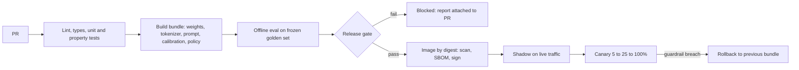

Candidate v42 of the loan-triage bundle changes the prompt and refits calibration. Unit tests are green. Is it safe to ship? Ordinary CI answers "the code runs"; a decision-model pipeline must also answer "it still decides at least as well, at an acceptable cost and latency, the artefact in production is the one we evaluated, and we can undo it in one step". Each of those is a measurable claim with a sample size behind it.

:::key[First principle]
A model release is a **statistical claim**, so the pipeline must be sized like an experiment: enough golden cases to detect the regression you care about, gates on confidence **bounds** (pass only if proven not worse), rollout stages with enough traffic to see a failure, and rollback of the **whole bundle** on thresholds set above the metric's noise.
:::

## 28.1 Pipeline stages



| What changed | Re-run | Why |
| --- | --- | --- |
| Application code only | tests, golden-set smoke (a few hundred cases), latency benchmark | the bundle hash is unchanged; prove the code still drives it correctly |
| Prompt, tokenizer, calibration, thresholds or policy | full offline eval + gate, shadow, canary | each moves probabilities or actions; [§3](/c/slm-decision-models/03-slm-fundamentals) and [§4](/c/slm-decision-models/04-decision-theory) assume they agree |
| Weights (retrain, distil, quantise) | everything above + slices + calibration + memory/latency | the largest change in behaviour and resources ([§27.3](/c/slm-decision-models/27-edge-devices)) |
| Golden set itself | re-baseline the incumbent on the new set first | otherwise a set change looks like a model change |
| Runtime or base image | tests, smoke eval, latency and memory benchmark | numerics and threads can shift outputs and the p95 |

Decide the path from **bundle hashes**, not file paths: if the manifest hash is unchanged, the model has not changed.

## 28.2 How many golden cases detect a 1-point regression?

Suppose the incumbent is right on 90% of golden cases (illustrative) and you want to catch a candidate that is 1 point worse, with a one-sided 5% false-alarm rate and 80% power.

**Unpaired** (each model on its own sample):

$$
n_{\text{arm}} = \frac{(z_{0.95} + z_{0.80})^2\,\big[p(1-p) + (p-\delta)(1-p+\delta)\big]}{\delta^2}
$$

**Paired** (both models on the *same* cases, McNemar): only the cases where exactly one model is right carry information. If a share $p_d$ of cases is discordant,

$$
n = \frac{\big(z_{0.95}\sqrt{p_d} + z_{0.80}\sqrt{p_d - \delta^2}\big)^2}{\delta^2}
$$

```python run
"""Eval cases needed to detect an accuracy regression: unpaired vs paired (McNemar), checked by simulation."""
import numpy as np
from statistics import NormalDist

z = NormalDist().inv_cdf
ZA, ZB = z(0.95), z(0.80)                 # one-sided 5% false alarm, 80% power
ACC = 0.90                                # incumbent accuracy, illustrative


def n_unpaired(d, p=ACC):                 # two independent eval sets, per arm
    return (ZA + ZB) ** 2 * (p * (1 - p) + (p - d) * (1 - p + d)) / d**2


def n_paired(d, disc):                    # same cases; disc = share where exactly one model is right
    return (ZA * disc**0.5 + ZB * (disc - d * d) ** 0.5) ** 2 / d**2


print(f"{'drop':>6s} {'unpaired/arm':>13s} {'paired 4% disc':>15s} {'paired 10% disc':>16s}")
for d in (0.005, 0.01, 0.02, 0.03, 0.05):
    print(f"{d:6.1%} {n_unpaired(d):13,.0f} {n_paired(d, 0.04):15,.0f} {n_paired(d, 0.10):16,.0f}")

# simulate: candidate is 1 pt worse, the two models disagree on correctness for 4% of cases
rng = np.random.default_rng(28)
d, disc = 0.01, 0.04
n = int(np.ceil(n_paired(d, disc)))


def alarms(p_b, p_c, sims=20_000):
    """b: incumbent right & candidate wrong; c: the reverse. Alarm if McNemar z > z_0.95."""
    b, c, _ = rng.multinomial(n, [p_b, p_c, 1 - p_b - p_c], sims).T
    return np.mean((b - c) / np.sqrt(np.maximum(b + c, 1)) > ZA)


print(f"n = {n:,}: simulated power {alarms((disc + d) / 2, (disc - d) / 2):.3f}, "
      f"false alarms with no regression {alarms(disc / 2, disc / 2):.3f}")
```

```output
  drop  unpaired/arm  paired 4% disc  paired 10% disc
  0.5%        45,497           9,890           24,728
  1.0%        11,617           2,471            6,180
  2.0%         3,023             616            1,544
  3.0%         1,395             273              685
  5.0%           538              97              245
n = 2,471: simulated power 0.802, false alarms with no regression 0.050
```

The simulation lands on the design: 80.2% power and a 5.0% false-alarm rate at $n$ = 2,471.

:::chart[Golden cases needed to detect an accuracy drop (one-sided α = 0.05, power 0.8, incumbent 90%)]{type="line" x="accuracy drop to detect (points)" y="cases needed" ylog="true" yfmt="int" marks="1:1-point drop" hmarks="5000:golden set in 28.3" note="Paired = same cases for both models; disc = share of cases where exactly one model is right."}
drop_pts, unpaired (per arm), paired (10% discordant), paired (4% discordant)
0.5, 45497, 24728, 9890
0.75, 20437, 10989, 4394
1, 11617, 6180, 2471
1.25, 7512, 3955, 1581
1.5, 5270, 2746, 1097
2, 3023, 1544, 616
2.5, 1972, 987, 394
3, 1395, 685, 273
4, 813, 384, 152
5, 538, 245, 97
:::

- **Always evaluate both models on the same frozen set.** At 4% discordance, pairing needs 2,471 cases for a 1-point drop against 11,617 per arm unpaired — 9.4× fewer labelled cases in total.
- **Discordance is the knob.** Similar models (a recalibration, a prompt tweak) disagree rarely and are cheap to compare; a new architecture may disagree on 10%+ and need 6,180 cases. Measure $p_d$ from the last release's eval and size from it.
- **Halving the detectable drop quadruples $n$**: 0.5 points needs 9,890 paired cases. Decide the smallest regression worth blocking *before* you build the set.
- The same logic applies to **cost per case**, the metric that should decide releases: the deep course sizes a paired cost comparison and finds ~16,500 cases to detect ₹240 per case ([§11.5](/c/practical-slm-decision-models/11-evaluation-and-release-gates)). Accuracy is the cheaper smoke test; cost is the verdict.

## 28.3 The gate: pass only if proven not worse

Two ways to write "no regression":

| Rule | Small golden set | Large golden set |
| --- | --- | --- |
| **Significance:** fail if the drop is significantly > 0 | passes almost anything — no power to prove harm | catches tiny, irrelevant drops |
| **Non-inferiority:** pass if the 95% *upper bound* of the drop is ≤ margin (e.g. 1 point) | fails safe — "not enough evidence" blocks | passes real improvements and tiny losses inside the margin |

Use non-inferiority with a margin agreed in advance, plus bounds on rare failures (Wilson upper bound on invalid outputs) and resource ratios.

```python run
"""A release gate on a frozen golden set: non-inferiority on accuracy, Wilson bound on invalid outputs."""
import numpy as np
from math import sqrt
from statistics import NormalDist

z95 = NormalDist().inv_cdf(0.95)
rng = np.random.default_rng(2028)
N = 5_000                                         # frozen golden set, same cases for both models
# synthetic correctness: 2.2% only incumbent right, 1.8% only candidate right -> true drop 0.4 pt
u = rng.random(N)
old_ok = (u < 0.880) | ((u >= 0.880) & (u < 0.902))
new_ok = (u < 0.880) | ((u >= 0.902) & (u < 0.920))
invalid = 9                                       # candidate outputs that failed schema validation
p95_old, p95_new = 38.0, 41.0                     # ms, from the benchmark job (illustrative)


def wilson_upper(k, n, zz=z95):
    c = (k + zz**2 / 2) / (n + zz**2)
    return c + zz * sqrt(k * (n - k) / n + zz**2 / 4) / (n + zz**2)


b, c = int((old_ok & ~new_ok).sum()), int((~old_ok & new_ok).sum())
drop = (b - c) / N                                # accuracy(old) - accuracy(new)
se = sqrt(b + c - (b - c) ** 2 / N) / N           # paired SE of the difference
gates = [
    ("accuracy drop, 95% upper bound <= 1.0 pt", drop + z95 * se, 0.010),
    ("invalid-output rate, Wilson upper <= 0.5%", wilson_upper(invalid, N), 0.005),
    ("p95 latency ratio <= 1.20", p95_new / p95_old, 1.20),
]
print(f"accuracy old {old_ok.mean():.4f} new {new_ok.mean():.4f}; discordant b={b} c={c}; "
      f"drop {drop:+.2%} (SE {se:.2%})")
for name, value, limit in gates:
    print(f"{'PASS' if value <= limit else 'FAIL'}  {name:44s} value {value:.4f}")
print("release:", "PASS" if all(v <= lim for _, v, lim in gates) else "BLOCKED")
```

```output
accuracy old 0.9006 new 0.8948; discordant b=111 c=82; drop +0.58% (SE 0.28%)
FAIL  accuracy drop, 95% upper bound <= 1.0 pt     value 0.0104
PASS  invalid-output rate, Wilson upper <= 0.5%    value 0.0031
PASS  p95 latency ratio <= 1.20                    value 1.0789
release: BLOCKED
```

The candidate is truly 0.4 points worse (by construction) and measured 0.58 points worse; the upper bound, 1.04 points, is just over the 1-point margin, so the gate **blocks**. That is the rule working as designed: 5,000 cases cannot prove this candidate is within a point. Quadrupling the set halves the standard error to about 0.14 points, and the same observed drop would give an upper bound of about 0.81 — a pass. A significance test on the same data (z = 2.09 for b − c = 29 discordant cases) would also flag it; on a 1,000-case set it would have passed silently.

The gate script, the margin and the golden-set version live in the repo and are reviewed like code. The full gate for the loan case — paired cost CI, slices, calibration — is worked end to end in the [evaluation notebook](/c/slm-decision-models/14-notebook-evaluation).

:::warn[Never tune on the golden set]
Every prompt or threshold chosen by looking at golden-set results turns it into a validation set, and the gate's error rates stop meaning anything. Tune on a separate validation split; freeze the golden set by hash; refresh it on a schedule, re-baselining the incumbent when you do.
:::

## 28.4 Shadow and canary: how long, and how much risk

**Shadow** runs the candidate on a copy of live traffic and only logs. It answers "how often, and on what, do the two bundles disagree?" To estimate a disagreement rate near 5% to ±0.5 points takes \(1.96^2 \times 0.05 \times 0.95 / 0.005^2\) = 7,299 decisions.

**Canary** lets the candidate act on a share $s$ of traffic. It must run until each arm has the $n$ that detects the regression you fear; the deep course's example is an error rate rising from 2% to 3% ([§13.8](/c/practical-slm-decision-models/13-serving-and-deployment)). Duration is $n / (\lambda s)$.

```python run
"""Canary sizing, blast radius and how big an action-mix shift is just noise."""
import math
from statistics import NormalDist

z = NormalDist().inv_cdf
k = (z(0.975) + z(0.80)) ** 2                    # two-sided 5%, power 80%
p0, p1 = 0.02, 0.03                              # error rate: incumbent vs a regressed candidate
n = math.ceil(k * (p0 * (1 - p0) + p1 * (1 - p1)) / (p1 - p0) ** 2)
print(f"decisions per arm to see 2% -> 3%: {n:,}; extra errors absorbed if the canary is bad: "
      f"{n * (p1 - p0):.0f}")
for name, lam in (("loan API, 40 req/s peak", 40.0), ("ticket routing, 0.505 req/s peak", 0.505)):
    row = "  ".join(f"{s:.0%}: {n / (lam * s) / 3600:6.1f} h" for s in (0.01, 0.05, 0.20, 0.50))
    print(f"{name:33s} {row}")

# action-mix guardrail: share of one action, per-hour windows, canary vs incumbent
share = 0.30
for per_hour in (200, 1_000, 10_000):
    se = math.sqrt(2 * share * (1 - share) / per_hour)
    print(f"{per_hour:6,} decisions/h per arm: SE of share difference {se:.2%}; "
          f"5-pt shift = {0.05 / se:.1f} SE; alarm at 3 SE = {3 * se:.1%}")

disagree, half = 0.05, 0.005                     # shadow mode: estimate disagreement to +-0.5 pt
print(f"shadow: {math.ceil(z(0.975) ** 2 * disagree * (1 - disagree) / half**2):,} decisions to estimate "
      f"a {disagree:.0%} disagreement rate to +-{half:.1%}")
```

```output
decisions per arm to see 2% -> 3%: 3,823; extra errors absorbed if the canary is bad: 38
loan API, 40 req/s peak           1%:    2.7 h  5%:    0.5 h  20%:    0.1 h  50%:    0.1 h
ticket routing, 0.505 req/s peak  1%:  210.3 h  5%:   42.1 h  20%:   10.5 h  50%:    4.2 h
   200 decisions/h per arm: SE of share difference 4.58%; 5-pt shift = 1.1 SE; alarm at 3 SE = 13.7%
 1,000 decisions/h per arm: SE of share difference 2.05%; 5-pt shift = 2.4 SE; alarm at 3 SE = 6.1%
10,000 decisions/h per arm: SE of share difference 0.65%; 5-pt shift = 7.7 SE; alarm at 3 SE = 1.9%
shadow: 7,299 decisions to estimate a 5% disagreement rate to +-0.5%
```

:::chart[Hours of peak traffic for a canary to reach 3,823 decisions]{type="line" x="canary share of traffic (%)" y="hours" xlog="true" ylog="true" points="true" hmarks="24:one day" note="Detects an error rate rising from 2% to 3% (two-sided 5%, power 80%)."}
share_pct, loan API (40 req/s), ticket routing (0.505 req/s)
1, 2.65, 210.3
2, 1.33, 105.1
5, 0.53, 42.1
10, 0.27, 21.0
20, 0.13, 10.5
50, 0.05, 4.2
:::

- **The blast radius is set by $n$, not by the share.** If the candidate really is worse, reaching a verdict exposes $n \times \Delta$ = \(3{,}823 \times 0.01\) ≈ 38 extra errors whatever the share; a smaller share only spreads them over more hours. Choose the share for how fast you need the answer, and the guardrails (28.5) to stop early on large regressions.
- **Low-volume services cannot canary quickly.** Ticket routing needs 42 peak hours at 5%. Lean on shadow mode and replay of the golden set, and treat the canary as a smoke test.
- **Outcomes arrive late.** Loan defaults take months, so the canary watches proxies — parse failures, agreement with the incumbent, review rate, reviewer overrides, latency — and the outcome metric is monitored afterwards.

## 28.5 Rollback criteria, agreed before the rollout

A rollback threshold below the metric's noise fires on every deploy; one far above it never fires. From the output above: comparing a 30% action share between arms, one hour of 1,000 decisions per arm has a standard error of 2.05 points, so a 5-point shift is 2.4 SE — not conclusive — while at 10,000 per hour it is 7.7 SE. Set alarms in SE units for your traffic, or widen the window.

| Guardrail | Trigger (example thresholds) | Window | Why |
| --- | --- | --- | --- |
| Invalid / unparseable output | Wilson upper bound > 0.5%, or any spike to > 2% | rolling 1,000 decisions | a schema failure is a bug, not noise |
| p95 latency | > SLO for 10 consecutive minutes | per replica and fleet | queueing collapses fast near saturation |
| Action mix vs incumbent | shift > 3 SE | hourly | catches threshold, calibration and prompt bugs early |
| Abstain / review rate | outside 0.8×–1.2× of plan | hourly | review capacity is finite ([§16.4](/c/slm-decision-models/16-finance)) |
| Reviewer override rate | up > 3 SE vs incumbent | daily | the earliest honest quality signal |
| Error / incident report | any confirmed harmful decision class | immediate | humans can always pull the cord |

Rollback is a **pointer flip to the previous bundle** (weights, tokenizer, prompt, calibration and policy together), kept warm so the flip takes seconds rather than a cold start ([§25.2](/c/slm-decision-models/25-docker)). Rolling back weights alone leaves a new policy running on old probabilities. Rehearse it in staging on every release; an unexercised rollback is a plan, not a control.

## 28.6 Versioning: one bundle, with its lineage

```json
{
  "bundle_id": "sha256:<manifest-hash>",
  "weights":     {"sha256": "<hash>", "base": "Qwen2.5-0.5B-Instruct@<revision>", "quant": "int8"},
  "tokenizer":   {"sha256": "<hash>"},
  "prompt":      {"version": "loan-v7", "sha256": "<hash>"},
  "calibration": {"method": "isotonic", "fit_set": "cal-2026-10@<hash>"},
  "policy":      {"version": "policy-4", "approve_if_p_good_ge": 0.833, "review_band": [0.125, 0.975]},
  "training_data": "train-2026-09@<hash>",
  "golden_set":  "golden-v7@<hash>",
  "eval_report": "reports/v42.json",
  "image":       "registry.example.com/loan-triage@sha256:<digest>",
  "git_commit":  "<sha>"
}
```

- **Everything by hash, nothing by name.** Tags and `latest` move; hashes do not. Log `bundle_id` on every decision so any decision can be replayed later against the exact bundle.
- **Data is versioned like code**: training, calibration and golden sets are immutable snapshots identified by content hash, stored with access controls and with personal data redacted ([governance](/c/practical-slm-decision-models/16-security-privacy-and-governance)) — not loose files in the repo.
- **The eval report travels with the bundle**, so "what did we know when we shipped v42?" has a file for an answer.

```yaml
# .github/workflows/release.yml (sketch)
name: release
on:
  pull_request:
  push: { branches: [main] }
permissions:
  contents: read                     # least privilege by default
jobs:
  test:
    runs-on: ubuntu-latest
    steps:
      - uses: actions/checkout@<full-commit-sha>        # pin third-party actions by SHA
      - uses: actions/setup-python@<full-commit-sha>
        with: { python-version: "3.12" }
      - run: pip install --require-hashes -r requirements.lock
      - run: ruff check . && pytest -q -m "not slow"
  eval-gate:
    needs: test
    runs-on: ubuntu-latest
    steps:
      - uses: actions/checkout@<full-commit-sha>
      - uses: actions/setup-python@<full-commit-sha>
        with: { python-version: "3.12" }
      - run: pip install --require-hashes -r requirements.lock
      - run: python ci/build_bundle.py --out bundle/            # writes manifest + SHA256SUMS
      - run: python ci/evaluate.py --bundle bundle/ --golden golden-v7 --baseline reports/prod.json --out eval.json
      - run: python ci/gate.py eval.json                         # exit 1 on any FAIL
      - uses: actions/upload-artifact@<full-commit-sha>
        with: { name: eval-report, path: eval.json }
  image:
    needs: eval-gate
    if: github.ref == 'refs/heads/main'
    runs-on: ubuntu-latest
    permissions: { contents: read, id-token: write, packages: write }   # OIDC, no stored cloud keys
    steps:
      - uses: actions/checkout@<full-commit-sha>
      - run: ci/build_image.sh       # build, scan, SBOM, sign, push; prints the image digest
```

No long-lived cloud credentials sit in repository secrets: the deploy job exchanges the workflow's OIDC token for short-lived cloud credentials scoped to one registry and one environment. Pull-request builds from forks get read-only permissions and never reach the `image` job.

## 28.7 Check yourself

:::qa[Your golden set has 1,500 cases and the models disagree on correctness for 4% of them. What is the smallest accuracy drop the gate can reliably detect?]
From the table, 1,581 paired cases detect a 1.25-point drop and 1,097 detect 1.5 points at 80% power, so with 1,500 the gate reliably detects drops of roughly 1.3 points and up. A 1-point regression would be caught well under 80% of the time. State that in the gate, or grow the set to ~2,500.
:::

:::qa[A team proposes "fail the build if accuracy is significantly lower (p < 0.05)" on a 300-case set. What is wrong?]
It has almost no power: at 4% discordance 300 cases detect only drops near 3 points (273 cases for 3 points). Small regressions pass by default — absence of evidence is treated as evidence of absence. Use a non-inferiority bound, which blocks when the set is too small to show the candidate is within the margin.
:::

:::qa[Halving the canary share from 10% to 5% — does it halve the risk?]
It halves the *rate* of extra errors, not their number before a verdict: reaching 3,823 decisions per arm exposes about 38 extra errors (at a 1-point error increase) either way, over twice as many hours. To lower exposure, stop early on large regressions with guardrails, or reduce $n$ by targeting a bigger detectable effect.
:::

:::qa[The incident review finds v42's weights were rolled back but its policy file was not. What went wrong?]
The weights and policy were versioned separately. Version them as one bundle with one `bundle_id`, deploy and roll back by that id, and log it per decision; the new thresholds were calibrated for v42's probabilities and are wrong for v41's.
:::

Next: [Metrics](/c/slm-decision-models/29-metrics).
