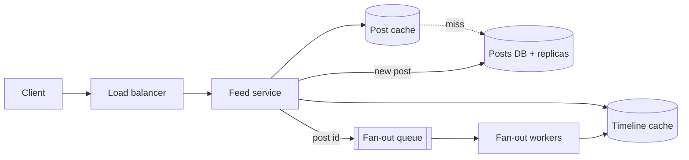

Most failed design interviews fail in one of two ways: the candidate designs before scoping, so the interviewer cannot tell which problem is being solved, or designs everything at once, so nothing gets depth. The framework below prevents both by fixing the order of work and the time each part gets. This section runs it end to end on **Pulse** — the course's feed example with 10M daily users — so every step ends with a concrete artefact and a number.

:::key[First principle]
Scope, then numbers, then design — and every design choice is stated with its cost. The order matters because each step's output is the next step's input: the numbers decide the architecture, and the architecture decides which failures are worth discussing.
:::

## 1.1 The six steps and their budget

| # | Step | Minutes | On the board when done | Opening sentence |
| ---: | --- | ---: | --- | --- |
| 1 | Scope | 0–5 | Three core flows, an out-of-scope list | "Let me restate it and cut it down…" |
| 2 | Numbers | 5–10 | Peak QPS, storage/year, latency target | "Let me put numbers on it…" |
| 3 | Interface | 10–13 | 3–5 API calls with shapes | "The calls that matter are…" |
| 4 | Data model | 13–15 | Tables/keys and the dominant query | "The hot query is…, so the key is…" |
| 5 | Happy path | 15–30 | One diagram, one request narrated | "Let me follow one read through…" |
| 6 | Bottlenecks and failures | 30–44 | Each fix with its cost | "The first thing to break is…" |
| — | Close | 44–45 | Metrics you would watch | "If this shipped tomorrow, I'd watch…" |

Steps 1–4 take a third of the time and produce almost no boxes. That is deliberate: they are what make the remaining two thirds defensible. The [interview format](/c/system-design/04-interview-format) section explains what each block is scored on.

## 1.2 Step 1 — Scope (5 min)

Restate the problem in one sentence, name the core flows, and say what you are leaving out.

> "So Pulse is a service where users post short text and follow each other, and the hard
> part is assembling a feed cheaply. I'll cover posting, following and reading the feed,
> and leave out ads, moderation and search — tell me if any of those is the point."

Then ask two or three questions. Only ask a question if its answer changes the design:

| Question | Assumed answer | Decision it changes |
| --- | --- | --- |
| How many users, and how often do they read vs post? | 10M DAU, 20 reads + 2 posts/day | Cache-and-replicas vs sharding (step 2) |
| How fresh must the feed be? | A new post may take a few seconds to appear | Asynchronous fan-out is allowed |
| How are followers distributed? | Average 200, a few accounts with millions | Hybrid fan-out for large accounts (step 6) |
| Ranked or chronological? | Chronological first | Simple merge; ranking deferred |

:::tip[Write the assumptions in a corner of the board]
Later you will point at them ("we said a few seconds of staleness is fine, so…"). Consulting your own estimate is the clearest signal that it was real.
:::

## 1.3 Step 2 — Numbers (5 min)

Derive the rates and sizes aloud. The method and the full derivation are in [back-of-the-envelope maths](/c/system-design/02-estimation); for Pulse:

:::example[Worked example · Pulse in five lines]
- **Reads**: \(10^7 \times 20 = 2 \times 10^8\)/day ÷ 10⁵ s = 2,000 QPS average, **6,000 peak** (3×).
- **Writes**: \(2 \times 10^7\) posts/day → 200 QPS average, **600 peak**.
- **Storage**: 20M × 1 KB = 20 GB/day → **7.3 TB/year**; the last 10 days (the hot set) is **200 GB**.
- **Fan-out** (assume 200 followers on average): each post lands in 200 timelines → \(2 \times 10^7 \times 200 = 4 \times 10^9\) timeline inserts/day → **40,000/s** average, **120,000 peak**.
- **Latency target** (assumed): feed p99 under 200 ms.
:::

Then say what the numbers mean — this is the sentence that earns the step:

> "600 write QPS and 7 TB a year fit one relational primary, so I won't shard posts. The
> load is 6,000 feed reads a second over a 200 GB hot set — a cache-and-replicas problem.
> The surprising number is fan-out: 120,000 timeline writes a second at peak, two hundred
> times the post rate. That's where the design effort goes."

## 1.4 Step 3 — Interface (3 min)

Only the calls the core flows need, with shapes. Pagination, idempotency and versioning surface here naturally.

```http
POST /v1/posts               Idempotency-Key: <uuid>   {text}  -> 201 {post_id, created_at}
GET  /v1/feed?cursor=<opaque>&limit=20                         -> 200 {items[], next_cursor}
PUT  /v1/follows/{user_id}                                     -> 204
```

Two choices to state aloud, with reasons:

- **Cursor, not offset.** An offset re-counts from the top on every page and skips or repeats items when new posts arrive; a cursor (last seen `created_at`, `post_id`) is stable and costs one index seek.
- **Idempotency key on post.** Mobile clients retry on timeouts; without a key, a retry double-posts. See [idempotency](/c/system-design/22-idempotency).

## 1.5 Step 4 — Data model (2 min)

Name the dominant query first, then the key that serves it, then the store.

| Data | Key | Size | Store |
| --- | --- | --- | --- |
| `posts` | `post_id`; index on (`author_id`, `created_at`) | 1 KB × 20M/day | Relational primary + read replicas |
| `follows` | (`follower_id`, `followee_id`) and the reverse | 16 B per edge | Same database |
| `timelines` | `user_id` → newest 800 (`post_id`, `ts`) | 16 B per entry | In-memory key-value store |

Timeline size: 10M users × 800 entries × 16 B = **128 GB** (800 and 16 B are assumptions: enough for ~40 pages; two 8-byte ids). Like the 200 GB hot set, it fits in memory across a few cache nodes.

> "The hot query is 'the newest 20 posts from people I follow'. I'll precompute it as a
> per-user timeline list, so a feed read is one key lookup plus a multi-get of 20 posts."

## 1.6 Step 5 — The happy path (15 min)

One diagram, then narrate one write and one read through it. Do not draw failure handling yet.



- **Write**: `POST /posts` inserts into the posts table (one write, 600/s at peak), enqueues the post id, and returns. Fan-out workers read the author's followers and push the id onto each follower's timeline — the 120,000 inserts/s happen off the request path.
- **Read**: `GET /feed` reads the timeline (one lookup, ~0.5 ms intra-DC), multi-gets 20 posts from the post cache (one more round trip), and falls through to a read replica only on a miss.

:::example[Worked example · why fan-out on write]
The alternative is **fan-out on read**: at read time, query each followee's recent posts and merge. At peak that is 6,000 reads/s × 200 followees = **1.2M index lookups/s**, every one on the latency-critical path. Fan-out on write instead does 120,000 small inserts/s asynchronously, and each read is two round trips. With a 10:1 read-to-write ratio, paying at write time is cheaper.

With a post cache in front, DB load is \((1-h) \times\) read QPS: at hit rate $h$ = 90%, 600 QPS reach the replicas; at 99%, 60. Going from 90% to 99% cuts DB load 10×. The derivation is in [caching](/c/system-design/07-caching).
:::

## 1.7 Step 6 — Bottlenecks and failures (14 min)

Walk the system with a checklist. Each answer is one or two sentences: the symptom with a number, the fix, and what the fix costs.

| Check | Pulse with numbers | Fix | Cost |
| --- | --- | --- | --- |
| [Reads slow?](/c/system-design/42-slow-reads-cache) | 6,000 peak feed reads | Timeline + post caches, then [replicas](/c/system-design/39-read-heavy-replicas) | Staleness; replica lag |
| [Writes spiking?](/c/system-design/47-write-spikes-queue) | 120,000 fan-out inserts/s | Queue + worker pool | Seconds of delay |
| [Celebrity fan-out](/c/system-design/54-news-feed) | 1M followers ÷ 50,000 inserts/s (illustrative) = 20 s | Pull path: merge large accounts at read time | Read-time merge for those accounts |
| [Queries slow?](/c/system-design/41-slow-queries-indexes) | Profile query by author + time | Composite index (`author_id`, `created_at`) | Write cost, index storage |
| [Entry overloaded?](/c/system-design/45-traffic-load-balancer) | 12 feed servers at 60% (from §2) | Load balancer, [rate limit](/c/system-design/44-too-many-requests-rate-limit) per user | Rejected requests under abuse |
| [Dependencies flaky?](/c/system-design/43-temporary-failures-retry) | Timeline cache node lost | Retry with backoff, fall back to pull | Higher latency in degraded mode |
| [Duplicates?](/c/system-design/37-duplicate-requests-idempotency) | Client retries a post | Idempotency key, 24 h TTL | One extra lookup per post |
| [Blind?](/c/system-design/35-cannot-see-what-broke-telemetry) | Is the fan-out falling behind? | Queue age, cache hit rate, feed p99 | Telemetry pipeline |

:::warn[Fix, then price]
"Add a cache" scores nothing; "add a cache — at 99% hit rate the replicas see 60 QPS instead of 6,000, and the price is a few seconds of staleness and a cold-start problem after a flush" scores well. The cost clause is the most reliable seniority signal in the room. Choosing between competing fixes is covered in [choosing between fixes](/c/system-design/36-choosing-between-fixes).
:::

## 1.8 The closing move (1 min)

Reserve the last minute for production:

> "If I shipped this tomorrow I'd watch feed p99, post-cache hit rate and fan-out queue
> age. The first thing I'd expect to break is a celebrity post — 1M timeline inserts takes
> 20 seconds at 50,000 a second — so the pull path for large accounts goes in before
> launch."

It shows you have thought past the diagram, which is what the *failure modes* row of the rubric is looking for.

## 1.9 Check yourself

:::qa[You have 45 minutes and are 20 minutes in, still discussing requirements. What do you do?]
Stop scoping: state your assumptions in one sentence ("I'll assume 10M DAU, chronological feed, a few seconds of staleness"), write them on the board and move to numbers. Requirements beyond five minutes read as stalling; an assumption the interviewer can correct costs ten seconds.
:::

:::qa[Pulse users follow 2,000 accounts on average instead of 200. What changes?]
Fan-out on write becomes \(2 \times 10^7 \times 2{,}000 = 4 \times 10^{10}\) inserts/day — 400,000/s average, 1.2M at peak. Fan-out on read would be 6,000 × 2,000 = 12M lookups/s. Both are 10× worse; write-time fan-out still wins on read latency, but the worker pool and the timeline store must be partitioned, and the threshold for the pull path drops.
:::

:::qa[Why is "use Kafka for the fan-out" a weak answer, and what makes it strong?]
It names a product, not a mechanism or a cost. Strong: "a durable queue between the post write and the fan-out, so a 120,000/s burst of timeline inserts drains over seconds instead of failing the post request; the price is that a new post appears in feeds a few seconds later, and I'd alert on queue age above 30 s."
:::

:::qa[Which single number from step 2 most influenced the design, and why?]
Fan-out: 120,000 timeline inserts/s at peak, 200× the post rate. It moved the effort from the posts database (600 writes/s, no sharding needed) to the asynchronous fan-out path and the celebrity case.
:::

Next: [§2 Back-of-the-envelope maths](/c/system-design/02-estimation) — the arithmetic behind every number above.
