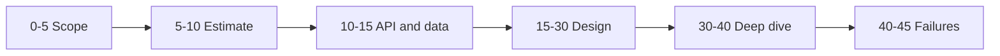

The interviewer has 45 minutes and a rubric. You have one problem statement and a whiteboard. Most candidates know enough components to pass; they lose because their time goes to the wrong places — fifteen minutes of requirements, no numbers, a diagram with no failure story. This section shows what is scored and how to spend the minutes against it.

:::key[First principle]
The rubric rewards reasoning more than recall: three of its five rows are about how you choose, not what you know. Spend time where reasoning is visible — numbers early, a cost on every choice, failure modes before being asked.
:::

## 4.1 What is scored

The exact wording varies by company, but the rows are stable:

| Dimension | What "strong" looks like | What sinks you |
| --- | --- | --- |
| **Problem navigation** | You drive: scope in ≤ 5 min, say what you defer, choose the deep dive | Waiting to be led; designing every feature at once |
| **Technical depth** | You explain how a component works and when it breaks | "Kafka handles that" |
| **Trade-off reasoning** | Every choice has a cost and a rejected alternative | Listing technologies without justification |
| **Quantitative reasoning** | Numbers by minute 10, used again later | Estimates only when asked, then abandoned |
| **Communication** | Diagram matches the narration; few interruptions needed | Silent drawing, unlabelled boxes |

Problem navigation, trade-offs and quantitative reasoning are reasoning rows. A candidate who knows fewer components but reasons visibly usually beats one who names more.

## 4.2 The 45 minutes

| Minutes | Phase | Output | Rubric rows it feeds |
| ---: | --- | --- | --- |
| 0–5 | Scope and clarify | Core flows, out-of-scope list, assumptions | Navigation |
| 5–10 | Estimate | Peak QPS, storage/yr, latency target | Quantitative |
| 10–15 | API and data model | 3–5 calls, keys for the hot query | Depth, navigation |
| 15–30 | High-level design | One diagram, one request narrated | Communication, depth |
| 30–40 | Deep dive on one part | Internals with numbers | Depth, trade-offs |
| 40–45 | Bottlenecks and failures | Fix + cost for each; what you'd monitor | Trade-offs, depth |

The two most common time failures:

- **Requirements past minute 10.** Each extra minute of scoping comes out of the deep dive, the part that scores depth. Four questions are enough (§4.3).
- **No estimate.** Without numbers every later decision is unfalsifiable — "add a cache" cannot be judged without "6,000 QPS over a 200 GB hot set". The arithmetic takes three minutes with the method in [§2](/c/system-design/02-estimation).

:::tip[Let the interviewer pick the deep dive — but offer two]
At minute 30: "I could go deeper on the fan-out path or on cache consistency — which is more useful?" You keep control of the agenda, and the interviewer steers to the row they still need evidence for.
:::

## 4.3 The four questions to ask first

Ask only what changes the design:

1. **Who uses it, and how much?** Daily active users and the read/write mix — this decides cache-and-replicas vs partitioning.
2. **What are the core flows?** Two or three, named — "post, follow, read feed".
3. **What can we leave out?** Authentication, analytics, admin tooling and billing are almost always deferrable; saying so buys time.
4. **What does "good" mean?** A latency target and a consistency requirement. "A new post may take five seconds to appear" permits asynchronous fan-out and is worth more than any box.

If the interviewer answers "you decide", decide aloud with a number ("I'll assume 10M DAU") and move on.

## 4.4 Levels, in practice

| Level | Expected | Distinguishing behaviour |
| --- | --- | --- |
| Junior / new grad | A working diagram with the right components | Can explain one request end to end |
| Mid-level | Justified choices and one solid deep dive | States the cost of each choice |
| Senior | Leads the session, quantifies, volunteers failures | Raises replication lag, retry storms, hot keys, stampedes unprompted |
| Staff | Frames the problem and the trade-off space | Says what to measure, what to build first and what to defer, with reasons |

The gap between mid-level and senior is rarely more knowledge. It is second-order consequences raised without prompting, each with a number: "the provider's p99 is 2 s, so at 2,000 orders/s we'd hold 4,000 calls in flight — I'd cap that with a timeout and a breaker."

## 4.5 Signals you can check in a mock

| Signal | Target |
| --- | --- |
| First number on the board | By minute 10 |
| Talking time | ≥ 30 of 45 minutes |
| Interruptions needed to follow you | Fewer than 3 |
| Choices stated with a cost | Every one |
| Failure modes raised before being asked | At least 2 |
| Numbers from step 2 reused later | At least twice |

These are coaching targets, not a published rubric — use them to score your own recordings.

## 4.6 Check yourself

:::qa[It is minute 12 and you have not estimated anything. What do you do?]
Say "let me put numbers on this before going further", and do the three lines: peak QPS, storage per year, the one ratio that matters (read:write or fan-out). It costs three minutes and makes the next 30 defensible. Skipping it to "save time" costs the quantitative row entirely.
:::

:::qa[The interviewer says "assume whatever you want" to every question. How do you proceed?]
Make the assumptions explicit, numeric and design-relevant ("10M DAU, 20 reads and 2 writes each, a few seconds of staleness is fine"), write them on the board and refer back to them. You are being scored on navigation — this is the chance to show it.
:::

:::qa[What turns "I'd use a queue" into a senior-level answer?]
The mechanism, a number and a cost: "a durable queue absorbs the flash sale's 2,000 orders/s against a backend sized for, say, 500 orders/s, draining the backlog after the spike; the cost is that confirmation becomes asynchronous, so I need an order status the client can poll, and I'd alert on queue age."
:::

Next: [§5 Study plan](/c/system-design/05-study-plan) — four weeks from vocabulary to a timed mock.
