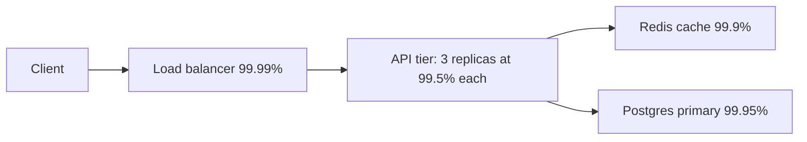

Pulse, the feed app from [§2](/c/system-design/02-estimation), serves 2,000 feed reads per second on average and 6,000 at peak. Every request crosses a load balancer, an API tier, a Redis cache and a Postgres primary. Each team quotes "three nines or better" for its own piece. What does the user actually get — and which single change buys the most uptime? This section answers with multiplication, not adjectives.

:::key[First principle]
Availability is a probability that composes: **dependencies in series multiply their availabilities; replicas in parallel multiply their unavailabilities.** Real systems are limited by the failures that are *not* independent, so the useful design question is "which failures are correlated, and what still works when they happen?"
:::

## 6.1 What the number means

**Availability** $A$ is the fraction of time (or of requests) the system serves correctly. **Reliability** is the probability it runs without failure for a given period. A system can be available and wrong — serving stale or corrupt data — so availability SLIs should count *good* responses, not just responses.

For a component that alternates between working and broken:

$$
A = \frac{\text{MTBF}}{\text{MTBF} + \text{MTTR}}, \qquad 1 - A \approx \frac{\text{MTTR}}{\text{MTBF}} \quad (\text{MTTR} \ll \text{MTBF})
$$

MTBF is mean time between failures; MTTR is mean time to repair (detect + diagnose + fix + verify).

:::example[Worked example · halving MTTR versus doubling MTBF]
A service fails once a month (MTBF = 720 h) and takes an hour to restore (MTTR = 1 h):

$$
A = \frac{720}{721} = 0.99861
$$

| Change | MTBF | MTTR | $A$ |
|---|---:|---:|---:|
| Baseline | 720 h | 1 h | 0.99861 |
| Halve MTTR (better alerts, one-click rollback) | 720 h | 0.5 h | 0.99931 |
| Double MTBF (fewer incidents) | 1,440 h | 1 h | 0.99931 |
| Slow diagnosis | 720 h | 4 h | 0.99448 |

Halving MTTR buys exactly what doubling MTBF does. MTTR is usually cheaper to cut: fast rollback, good dashboards and a practised runbook are weeks of work; making failures half as frequent is open-ended.
:::

The nines table converts targets into time. Work it out once and you never need to memorise it — downtime is $(1-A) \times \text{period}$:

| Availability | Per year | Per 30 days | Per 28 days | Per week |
|---|---:|---:|---:|---:|
| 99% | 3.65 days | 7.2 h | 6.7 h | 1.7 h |
| 99.9% | 8.76 h | 43.2 min | 40.3 min | 10.1 min |
| 99.95% | 4.38 h | 21.6 min | 20.2 min | 5.0 min |
| 99.99% | 52.6 min | 4.3 min | 4.0 min | 1.0 min |
| 99.999% | 5.3 min | 26 s | 24 s | 6 s |

:::tip[Read the table as an MTTR constraint]
99.99% allows 4.3 minutes a month. If detecting an incident takes 5 minutes, one incident per month already breaks the SLO. Four nines is a statement about automation — automatic failover, automatic rollback — not about care.
:::

## 6.2 Series: every hop multiplies

If a request needs components $1 \dots n$ all to work, and they fail independently:

$$
A_{\text{series}} = \prod_{i=1}^{n} A_i, \qquad 1 - A_{\text{series}} \approx \sum_{i=1}^{n} (1 - A_i)
$$

The approximation says unavailabilities *add*: five hops at 99.9% each lose about 5 × 0.1% = 0.5%.

:::example[Worked example · five "three-nines" services]
\(0.999^5 = 0.99501\). Downtime per year $= (1 - 0.99501) \times 525{,}600$ min = 2,623 min ≈ 43.7 h ≈ 1.8 days — with no component ever below its own SLO.
:::

:::chart[Path availability falls linearly with the number of serial dependencies]{type="line" x="serial dependencies on the request path" y="path availability (%)" ymin="98" ymax="100" yfmt="dec2" hmarks="99.9:three nines"}
n, each 99.9%, each 99.95%, each 99.99%
1, 99.900, 99.950, 99.990
2, 99.800, 99.900, 99.980
3, 99.700, 99.850, 99.970
4, 99.601, 99.800, 99.960
5, 99.501, 99.750, 99.950
6, 99.401, 99.700, 99.940
8, 99.203, 99.601, 99.920
10, 99.004, 99.501, 99.900
12, 98.807, 99.402, 99.880
15, 98.510, 99.253, 99.850
20, 98.019, 99.005, 99.800
:::

Two rules fall out:

- **A path can never be more available than its weakest hard dependency**, and is usually worse than all of them.
- **To offer $A$ end to end across $n$ hard dependencies, each needs roughly $1 - (1-A)/n$.** A 99.9% product over 10 synchronous services needs each at 99.99%. The cheaper move is to make some of those dependencies *soft* (§6.4).

## 6.3 Parallel: replicas multiply failures — until they are correlated

If any one of $n$ replicas can serve, the system fails only when all fail:

$$
A_{\text{parallel}} = 1 - \prod_{i=1}^{n} (1 - A_i)
$$

Two independent replicas at 99% give \(1 - 0.01^2 = 0.9999\). That independence assumption is where most designs break. Model it with a **common-mode fraction** $\beta$: of each replica's unavailability $u$, a share $\beta u$ comes from causes that hit every replica at once (a bad config push, a shared dependency, an expired certificate, a region outage) and $(1-\beta)u$ is independent:

$$
1 - A_n \approx \beta u + \big((1-\beta)\,u\big)^n
$$

The first term does not shrink with $n$. Redundancy drives the second term to zero and leaves you with $\beta u$.

:::example[Worked example · replicas at 99.9% each, u = 0.001]
| Replicas | $\beta = 0$ | $\beta = 0.01$ | $\beta = 0.1$ |
|---:|---:|---:|---:|
| 1 | 1.0e-3 | 1.0e-3 | 1.0e-3 |
| 2 | 1.0e-6 | 1.1e-5 | 1.0e-4 |
| 3 | 1.0e-9 | 1.0e-5 | 1.0e-4 |
| 4 | 1.0e-12 | 1.0e-5 | 1.0e-4 |

With 10% of failures shared, the third and fourth replicas buy nothing: the pair is already at the $\beta u = 10^{-4}$ floor (four nines). Every extra replica you add past two should come with a question: "what failure does this one survive that the others don't?"
:::

:::chart[Nines achieved vs replica count: correlation sets a ceiling]{type="line" x="replicas" y="nines (−log10 unavailability)" points="true"}
replicas, independent, beta 1%, beta 10%
1, 3.00, 3.00, 3.00
2, 6.00, 4.96, 4.00
3, 9.00, 5.00, 4.00
4, 12.00, 5.00, 4.00
:::

:::warn[Correlated failure is the whole game]
Two replicas in one rack share power; three zones share one deploy pipeline; five regions share one DNS provider and one config service. Spread replicas across **failure domains** (host → rack → zone → region) *and* across **change domains**: deploy to one zone, wait, then the next. Most large outages are a change applied everywhere at once, which is $\beta$ close to 1.
:::

## 6.4 Graceful degradation turns hard dependencies into soft ones

Pulse's read path, with illustrative component availabilities:



**Strict design** — every read needs the cache *and* the database:

$$
A = 0.9999 \times \big(1 - 0.005^3\big) \times 0.999 \times 0.9995 = 0.99840 \;\Rightarrow\; 69 \text{ min down per 30 days}
$$

**Degraded design** — when Redis is down, read Postgres (cache-aside already does this if the database has headroom); when Postgres is down, serve the last cached feed page, stale:

$$
A = 0.9999 \times \big(1 - 0.005^3\big) \times \big(1 - 0.001 \times 0.0005\big) = 0.99990 \;\Rightarrow\; 4.3 \text{ min per 30 days}
$$

The same hardware, a 16× reduction in downtime, from one product decision: *a stale feed is acceptable*. Note the precondition — Postgres must absorb the full 6,000 QPS peak when the cache is gone, or the "fallback" is a second outage. [§7](/c/system-design/07-caching) shows that's 10–100× its normal load.

Simulation checks the algebra and adds a correlated failure: a bad config push that takes out all three API replicas together, once every 90 days for 20 minutes (illustrative).

```python run
import numpy as np

rng = np.random.default_rng(7)
MIN = 10 * 365 * 24 * 60          # ten simulated years, one slot per minute


def timeline(avail, mttr_min):
    """Up/down minutes for one component with exponential up and down times."""
    mtbf = mttr_min * avail / (1 - avail)
    up = np.ones(MIN, dtype=bool)
    t = 0.0
    while t < MIN:
        t += rng.exponential(mtbf)                 # time until next failure
        d = rng.exponential(mttr_min)              # time to repair
        up[int(t):int(t + d) + 1] = False
        t += d
    return up


lb = timeline(0.9999, 10)
apis = [timeline(0.995, 30) for _ in range(3)]
cache = timeline(0.999, 20)
db = timeline(0.9995, 30)
bad_push = timeline(1 - 20 / (90 * 1440), 20)     # config push breaks all API replicas

api_any = apis[0] | apis[1] | apis[2]
cases = {
    "strict: lb, api, cache AND db": lb & api_any & cache & db,
    "degrade: cache OR db serves": lb & api_any & (cache | db),
    "degrade + bad config pushes": lb & api_any & bad_push & (cache | db),
}
print("%-31s %9s %14s" % ("read path", "measured", "down min/30d"))
for name, up in cases.items():
    a = up.mean()
    print("%-31s %9.5f %14.1f" % (name, a, (1 - a) * 30 * 1440))

theory_strict = 0.9999 * (1 - 0.005 ** 3) * 0.999 * 0.9995
theory_degrade = 0.9999 * (1 - 0.005 ** 3) * (1 - 0.001 * 0.0005)
print("theory strict %.5f, degrade %.5f" % (theory_strict, theory_degrade))
```

```output
read path                        measured   down min/30d
strict: lb, api, cache AND db     0.99844           67.2
degrade: cache OR db serves       0.99990            4.3
degrade + bad config pushes       0.99977           10.0
theory strict 0.99840, degrade 0.99990
```

One correlated event every 90 days more than doubles the degraded design's downtime (4.3 → 10.0 min per 30 days). Three API replicas contribute \(0.005^3 \approx 10^{-7}\) of unavailability; the shared deploy pipeline contributes ~1,000× more.

## 6.5 Retries help only with independent, transient failures

A retry is a second draw. If a call fails independently with probability $q$ and you allow $r$ retries:

$$
P(\text{success}) = 1 - q^{\,1+r}
$$

A dependency that drops 1% of calls at random becomes 99.99% with one retry. But if the dependency is *down*, every retry fails too — and each one adds load to something already struggling. Retries raise availability for transient errors and lower it during outages unless they are capped by a retry budget and backed off with jitter ([retry](/c/system-design/30-retry), [circuit breaker](/c/system-design/20-circuit-breaker)).

## 6.6 The mechanisms, ranked by cost-effectiveness

| Mechanism | What it changes in the model | Typical effect |
|---|---|---|
| **Timeouts** | Converts "hung" into "failed fast" so callers can fall back | Stops one slow dependency exhausting your threads |
| **Health checks + removal from rotation** | Makes replicas genuinely parallel; a sick one stops taking traffic | Without it, $n$ replicas behave like a series path |
| **Fast rollback, good alerting** | Cuts MTTR | Halving MTTR = doubling MTBF (§6.1) |
| **Graceful degradation** | Turns hard dependencies into soft ones | 69 → 4.3 min/month on Pulse (§6.4) |
| **Redundancy across failure domains** | Multiplies independent failures | Floors at $\beta u$; useless without the two above |
| **Staged rollouts (one zone at a time)** | Shrinks $\beta$, the common-mode fraction | Bounds a bad change to one zone |
| **Circuit breakers, bulkheads** | Stops a failure propagating into series neighbours | One dead dependency stays one |
| **Tested backups and restores** | Bounds data loss (RPO) and MTTR for the worst case | An untested backup is a hypothesis |

## 6.7 SLOs, SLIs and error budgets

- **SLI** — the measurement: "fraction of feed requests that return 200 within 300 ms".
- **SLO** — the target over a window: "99.9% over 28 days".
- **Error budget** — the allowed failure: $(1 - \text{SLO})$ of the window, in time or in requests.

:::example[Worked example · Pulse's feed budget]
Time: \(0.001 \times 28 \times 1{,}440\) = 40.3 minutes per 28 days.

Requests (more honest, because a partial outage at 3 a.m. is not the same as one at peak): \(2{,}000 \times 86{,}400 \times 28\) = 4.84 billion requests, so the budget is 4.84 million failed or slow requests.
:::

**Burn rate** $b$ is how fast you consume the budget relative to plan: $b = 1$ uses it exactly over the window; $b = 14.4$ exhausts a 28-day budget in \(28 / 14.4\) = 1.9 days. The fraction of budget consumed in a window of $w$ hours at burn rate $b$ is $b\,w / 672$ (672 hours in 28 days):

| Burn rate | Budget gone in | Consumed in 1 h | Consumed in 6 h |
|---:|---:|---:|---:|
| 1 | 28 days | 0.15% | 0.9% |
| 2 | 14 days | 0.30% | 1.8% |
| 6 | 4.7 days | 0.9% | 5.4% |
| 14.4 | 1.9 days | 2.1% | 12.9% |

:::chart[Error budget remaining over a 28-day window at constant burn rates]{type="line" x="day" y="budget remaining (%)" ymin="0" ymax="100" marks="14:half the window"}
day, burn 0.5, burn 1, burn 2, burn 4
0, 100.0, 100.0, 100.0, 100.0
2, 96.4, 92.9, 85.7, 71.4
4, 92.9, 85.7, 71.4, 42.9
6, 89.3, 78.6, 57.1, 14.3
8, 85.7, 71.4, 42.9, 0.0
10, 82.1, 64.3, 28.6, 0.0
12, 78.6, 57.1, 14.3, 0.0
14, 75.0, 50.0, 0.0, 0.0
16, 71.4, 42.9, 0.0, 0.0
18, 67.9, 35.7, 0.0, 0.0
20, 64.3, 28.6, 0.0, 0.0
22, 60.7, 21.4, 0.0, 0.0
24, 57.1, 14.3, 0.0, 0.0
26, 53.6, 7.1, 0.0, 0.0
28, 50.0, 0.0, 0.0, 0.0
:::

Practical alerting: page when a short window *and* a longer window both burn fast (e.g. $b > 14.4$ over 5 min and 1 h — 2% of budget gone in an hour); open a ticket when $b > 1$ over 1–3 days. The two-window rule keeps the page fast without paging on a 30-second blip. The policy that gives the budget teeth: **when the budget is spent, feature launches pause and reliability work takes the slot.**

:::warn[An SLO tighter than your dependencies is fiction]
Pulse's API cannot promise 99.99% while its database is 99.95% and a hard dependency (§6.2). Either make the dependency soft, or set the SLO at what the arithmetic allows.
:::

## 6.8 Recovery objectives: RTO and RPO

- **RTO** (recovery time objective): how long you may be down after a disaster — this is your worst-case MTTR.
- **RPO** (recovery point objective): how much recent data you may lose, measured in time.

RPO is set by replication. Asynchronous replication with lag $L$ loses up to $L$ seconds of writes on failover; synchronous replication loses none but adds a replica round trip to every write — about 0.5 ms within a region, ~150 ms across regions ([§2](/c/system-design/02-estimation) latency table).

:::example[Worked example · what an RPO costs checkout]
Checkout runs at 50 orders/s steady and 2,000 orders/s in a flash sale. Writes lost on a regional failover are rate × RPO:

| RPO | Orders lost (steady, 50/s) | Orders lost (flash sale, 2,000/s) |
|---:|---:|---:|
| 1 s | 50 | 2,000 |
| 60 s | 3,000 | 120,000 |
| 300 s | 15,000 | 600,000 |

Losing 120,000 paid orders is not a tolerable outcome, so the order/ledger write needs RPO ≈ 0: synchronous replication to a second zone in the same region (+~0.5 ms) and accept that a full *regional* loss is handled by the payment provider's records plus reconciliation. The feed can live with a 60 s RPO: losing a minute of posts in a regional disaster is an apology, not a lawsuit.
:::

RTO and RPO are rarely stated by interviewers. Asking for them — per data type — is a strong signal, because they decide the replication mode, the backup schedule and the failover automation.

## 6.9 Rules of thumb

- **Count hard dependencies first.** Each 99.9% hard dependency costs ~43 minutes a month.
- **Two replicas across failure domains capture almost all of the redundancy win.** Beyond that, reduce $\beta$ (staged rollouts, independent config) rather than add replicas.
- **Target MTTR before MTBF:** automatic failover under a minute, rollback under five.
- **Every soft dependency needs a tested fallback and capacity behind it** — a fallback that overloads the database is a second outage.
- **Write SLOs per user journey** (read feed, post, checkout), not per service, and set write SLOs tighter than read SLOs where a lost write is worse than a slow read.

## 6.10 Check yourself

:::qa[A checkout request calls auth (99.95%), inventory (99.9%), payments provider (99.9%) and ledger (99.95%), all synchronously. What is the best SLO you can honestly promise, in minutes per 30 days?]
\(0.9995 \times 0.999 \times 0.999 \times 0.9995 = 0.9970\). Unavailability ≈ 0.05% + 0.1% + 0.1% + 0.05% = 0.30%, i.e. \(0.003 \times 43{,}200\) ≈ 130 minutes per 30 days. Promising 99.9% (43 min) requires making something soft — e.g. accept the order into a queue when the provider is slow and confirm asynchronously.
:::

:::qa[You have two database replicas at 99.9% each. A colleague proposes a third. When is that worth it?]
Only if failures are close to independent. With a common-mode fraction of 10%, two replicas already sit at the \(\beta u = 10^{-4}\) floor and a third changes nothing (§6.3). Spend the effort on whatever is shared — failover automation, the deploy pipeline, the config store.
:::

:::qa[Your 28-day SLO is 99.9%. An incident burned at rate 30 for 2 hours. How much budget is left?]
Consumed fraction = \(30 \times 2 / 672\) = 8.9%, so 91% remains (≈ 36.7 of 40.3 minutes). This should have paged: it exceeded 14.4× over a one-hour window.
:::

:::qa[Halving MTTR or doubling MTBF — which buys more availability, and which would you do first?]
They buy the same: $1 - A \approx \text{MTTR}/\text{MTBF}$, so both halve unavailability. Do MTTR first; it's bounded work (alerting, runbooks, one-click rollback) and it also shrinks every *future* incident, including the kind you haven't seen yet.
:::

:::qa[Why is retrying a failing dependency three times not a 99.9999% fix for a 99% service?]
\(1 - 0.01^4\) assumes each attempt fails independently. During an outage all attempts fail together, so the retries add 4× load and latency for zero benefit. Retries fix random transient errors; outages need fallbacks and circuit breakers.
:::

Next: [§7 Caching theory](/c/system-design/07-caching) — the mechanism that makes the database a soft dependency, and its own failure modes.
