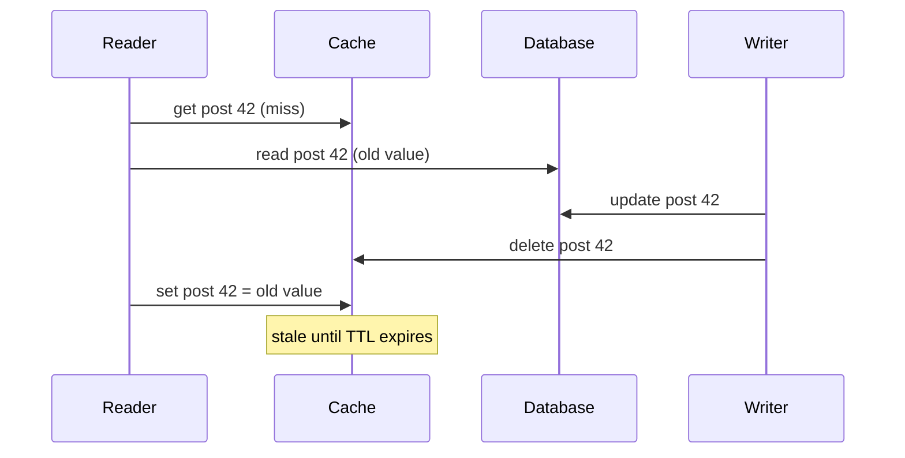

Pulse, the feed app from [§2](/c/system-design/02-estimation), serves 6,000 feed reads per second at peak. Rendering a feed page needs ~20 posts; fetching them from Postgres takes ~5 ms per query (illustrative: an indexed multi-get plus a 0.5 ms intra-DC round trip). Six thousand of those per second is a large, expensive primary. A Redis lookup costs one 0.5 ms round trip. How much memory do we need, what hit rate will it give, how much database load is left, and how stale will the feed be? This section answers each with a formula and a number.

:::key[First principle]
A cache works because popularity is skewed: a small fraction of keys gets most requests. **Hit rate is a function of cache size and the popularity curve; database load is (1 − hit rate) × traffic; staleness is bounded by the TTL.** Everything else — eviction, invalidation, stampede control — is about keeping those three numbers where you put them.
:::

## 7.1 Why caches work: skewed popularity

Real request streams are close to a **Zipf** distribution: the $i$-th most popular item is requested with probability

$$
P(i) = \frac{i^{-s}}{H_{N,s}}, \qquad H_{N,s} = \sum_{j=1}^{N} j^{-s}
$$

where $N$ is the number of distinct items and $s$ (typically 0.6–1.2) measures skew. A cache that holds the $k$ most popular items — the best any cache of size $k$ can do with a static popularity — has hit rate

$$
h(k) = \frac{H_{k,s}}{H_{N,s}} \approx \frac{\ln k}{\ln N} \quad (s = 1)
$$

The logarithm is the whole story: with $s = 1$, each 10× more memory adds roughly the same *absolute* hit rate. The first gigabyte is worth far more than the hundredth.

:::example[Worked example · how much memory for Pulse's posts]
Pulse creates 10M × 2 = 20M posts a day, so a 7-day catalogue is 140M posts. At 1 KB each, caching everything is 140 GB. Computing $H_{k,s}/H_{N,s}$ exactly for $N$ = 140M:

| Cache size | Share of posts | $s = 0.8$ | $s = 1.0$ | $s = 1.2$ |
|---:|---:|---:|---:|---:|
| 0.14 GB | 0.1% | 23.5% | 64.3% | 93.6% |
| 1.4 GB | 1% | 38.5% | 76.2% | 96.8% |
| 14 GB | 10% | 62.3% | 88.1% | 98.7% |
| 44 GB | 31% | 78.9% | 94.0% | 99.4% |
| 140 GB | 100% | 100% | 100% | 100% |

With $s = 1$, 14 GB — one mid-sized cache node — serves 88% of reads; tripling it to 44 GB gets 94%. The skew exponent matters more than the memory: at $s = 0.8$, the same 14 GB serves only 62%. **Measure $s$ from your access logs** (fit a line to log rank vs log count) before you size anything.
:::

:::chart[Ideal hit rate vs cache size, Zipf over 140M posts (1 KB each)]{type="line" x="cache size (GB)" y="hit rate" xlog="true" yfmt="pct" ymin="0" ymax="1" points="true"}
GB, s=0.8, s=1.0, s=1.2
0.14, 0.235, 0.643, 0.936
0.44, 0.301, 0.702, 0.954
1.4, 0.385, 0.762, 0.968
4.4, 0.490, 0.821, 0.979
14, 0.623, 0.881, 0.987
44, 0.789, 0.940, 0.994
140, 1.000, 1.000, 1.000
:::

Two terms worth naming. The **working set** is the set of items requested within some window; if it is larger than the cache, hit rate falls toward the curve's lower end and "add more cache" buys little. A **one-hit wonder** is an item requested once in its lifetime — no cache can hit on it, so it caps hit rate regardless of size.

## 7.2 Effective latency and database load

Let $h$ be the hit rate, $t_{hit}$ the cache lookup time and $t_{miss} = t_{hit} + t_{db}$ (cache-aside checks the cache first). Then

$$
\bar t = h\,t_{hit} + (1-h)\,t_{miss} = t_{hit} + (1-h)\,t_{db}, \qquad \text{DB QPS} = (1-h)\cdot \text{QPS}
$$

:::example[Worked example · Pulse at 6,000 reads/s, t_hit = 0.5 ms, t_db = 5 ms (illustrative)]
| Hit rate | Mean latency | DB QPS at peak | DB QPS average |
|---:|---:|---:|---:|
| 0% | 5.50 ms | 6,000 | 2,000 |
| 80% | 1.50 ms | 1,200 | 400 |
| 90% | 1.00 ms | 600 | 200 |
| 95% | 0.75 ms | 300 | 100 |
| 99% | 0.55 ms | 60 | 20 |
| 99.9% | 0.505 ms | 6 | 2 |

From 90% to 99% the mean latency improves only 1.00 → 0.55 ms, but database load falls **10×**, 600 → 60 QPS. The reason to chase hit rate is capacity, not average latency: each lost "nine" of hit rate multiplies the database by 10. It is also why losing the cache is an outage — Postgres sized for 60 QPS meets 6,000 ([§6.4](/c/system-design/06-availability)).
:::

:::chart[Database load at Pulse's 6,000 reads/s peak vs cache hit rate]{type="line" x="hit rate" y="DB queries per second" xfmt="pct" ylog="true" yfmt="int" points="true" marks="0.9:90%;0.99:99%"}
hit rate, DB QPS
0.5, 3000
0.6, 2400
0.7, 1800
0.8, 1200
0.85, 900
0.9, 600
0.95, 300
0.98, 120
0.99, 60
0.995, 30
0.999, 6
:::

:::tip[Watch the miss rate, not the hit rate]
"Hit rate fell from 99% to 98%" sounds like 1%; it is a **doubling** of database load (60 → 120 QPS). Dashboards and alerts should show misses per second.
:::

## 7.3 Real caches: LRU against the ideal

The ideal top-$k$ cache in §7.1 knows the popularity ranking in advance. A real cache must learn it from the stream, and it cannot hit on an item's first request. The simulation below replays a Zipf trace through an LRU cache and compares it with the ideal.

```python run
from collections import OrderedDict
import numpy as np

rng = np.random.default_rng(42)
N = 1_000_000            # distinct posts (scaled-down Pulse catalogue)
REQS = 600_000           # feed-item reads in the trace
s = 1.0                  # Zipf exponent: P(rank i) ∝ i^-s

p = np.arange(1, N + 1, dtype=float) ** -s
p /= p.sum()
trace = rng.choice(N, size=REQS, p=p)


def lru_hit_rate(capacity, warmup=100_000):
    cache, hits = OrderedDict(), 0
    for t, key in enumerate(trace):
        if key in cache:
            cache.move_to_end(key)
            hits += t >= warmup
        else:
            cache[key] = True
            if len(cache) > capacity:
                cache.popitem(last=False)          # evict least recently used
    return hits / (REQS - warmup)


seen, first = set(), 0
for t, key in enumerate(trace):
    first += t >= 100_000 and key not in seen
    seen.add(key)
print("first-ever requests after warm-up: %.3f of traffic" % (first / (REQS - 100_000)))

print("%8s %11s %8s" % ("cache %", "ideal top-k", "LRU"))
for frac in (0.001, 0.01, 0.05, 0.10, 0.20, 0.40):
    k = int(frac * N)
    ideal = p[:k].sum()                            # pin the k most popular forever
    print("%8.1f %11.3f %8.3f" % (100 * frac, ideal, lru_hit_rate(k)))
```

```output
first-ever requests after warm-up: 0.226 of traffic
 cache % ideal top-k      LRU
     0.1       0.520    0.404
     1.0       0.680    0.586
     5.0       0.792    0.718
    10.0       0.840    0.763
    20.0       0.888    0.774
    40.0       0.936    0.774
```

Three lessons:

1. **LRU trails the ideal by 7–12 points at small sizes** because recency is a noisy estimate of popularity: a burst of cold items evicts warm ones.
2. **Above 20% of the catalogue, LRU stops improving at 77.4%** — exactly $1 - 0.226$, the share of requests that are first-ever. Those compulsory misses are a property of the workload, not the cache. More memory cannot fix them; only fewer distinct items (or a longer-lived cache) can.
3. **One-hit wonders also waste space**: each evicts something useful. That is why modern caches add an *admission* filter (W-TinyLFU in Caffeine, for example) that only admits items seen more than once.

## 7.4 TTLs: the staleness/hit-rate trade

A TTL bounds staleness: a cached value is at most $T$ seconds old (if invalidation never fires). It also caps hit rate per key. For a key requested at rate $\lambda$ with a TTL of $T$ counted from the fill: each miss refills the key, after which you get on average $\lambda T$ hits before it expires. So

$$
h_{\text{key}} = \frac{\lambda T}{1 + \lambda T}, \qquad \text{misses per second} = \frac{\lambda}{1 + \lambda T} \le \frac{1}{T}
$$

:::example[Worked example · TTL per key]
| Key popularity | $T$ = 5 s | $T$ = 30 s | $T$ = 300 s |
|---|---:|---:|---:|
| Viral post, 10 req/s | 98.0% | 99.7% | ~100% |
| Popular post, 1 req/s | 83.3% | 96.8% | 99.7% |
| Ordinary post, 1 req/min | 7.7% | 33.3% | 83.3% |
| Long-tail post, 1 req/10 min | 0.8% | 4.8% | 33.3% |

Short TTLs are free for hot keys and ruinous for the tail. The miss bound gives a **database refresh floor**: with 50,000 actively read keys and $T$ = 30 s, the database sees at most 50,000 / 30 ≈ 1,667 refreshes/s even at a 100% "hit rate" on everything else; at $T$ = 300 s, 167/s.
:::

:::chart[Per-key hit ratio vs request rate for three TTLs]{type="line" x="requests per minute for the key" y="hit ratio" xlog="true" yfmt="pct" ymin="0" ymax="1"}
req/min, TTL 5 s, TTL 30 s, TTL 300 s
0.1, 0.008, 0.048, 0.333
0.2, 0.016, 0.091, 0.500
0.5, 0.040, 0.200, 0.714
1, 0.077, 0.333, 0.833
2, 0.143, 0.500, 0.909
5, 0.294, 0.714, 0.962
10, 0.455, 0.833, 0.980
20, 0.625, 0.909, 0.990
50, 0.806, 0.962, 0.996
100, 0.893, 0.980, 0.998
200, 0.943, 0.990, 0.999
600, 0.980, 0.997, 1.000
:::

The design move that follows: **pair a long TTL with explicit invalidation on write.** The TTL then only bounds the damage when an invalidation is lost, and you get the hit rate of the long TTL with the freshness of invalidation.

:::warn[Cache invalidation is a schedule, not a joke]
Every cached item type needs a *maximum staleness* the product owner has agreed to. "Five seconds" and "five minutes" are different designs: per the table above, they differ by up to 10× in database refresh load. Ask for that number before deciding to cache.
:::

## 7.5 Write policies

| Policy | Flow | Staleness | Cost |
|---|---|---|---|
| **Cache-aside** (lazy) | Read cache; on miss read DB and fill | Up to TTL if an invalidation is lost | Simple; first read after a miss pays $t_{miss}$ |
| **Read-through** | Cache library fills on miss | Same as cache-aside | Less application code |
| **Write-through** | Write DB and cache together | Low | Every write pays twice; caches cold data |
| **Write-behind** | Write cache, flush DB later | None for readers | Writes lost if the cache dies before flushing |
| **Write-around** | Write DB, delete cache key | Low | Next read misses |

Cache-aside with delete-on-write and a TTL backstop is the default, and the honest interview answer. Delete rather than update: a delete is idempotent and cannot install a value computed from an old read. It still has one race:



The window is the reader's database read time (milliseconds), so it is rare — but at 6,000 reads/s it happens. Defences: the TTL backstop, a short "recently written" marker that blocks fills for a second, or versioned values (only set if the version is newer).

## 7.6 Failure modes, sized

### Stampede (thundering herd)

When a hot key expires, every request that arrives while the value is being recomputed also misses. By Little's law the number of concurrent misses is arrival rate × recompute time:

$$
\text{concurrent misses} = \lambda \cdot t_{recompute}
$$

A key read 2,000 times a second with a 50 ms recompute (illustrative) sends 100 identical queries to the database; with a 200 ms recompute, 400. **Single-flight** (one caller recomputes, the rest wait for its result) cuts that to 1. **Probabilistic early refresh** — refresh slightly before expiry with probability rising as expiry approaches — avoids the miss altogether for hot keys.

### Synchronised expiry

Keys filled together expire together. A deploy that warms 10,000 keys with a 60 s TTL sends all 10,000 refills to the database in the same second. Adding a random ±$j$ to each TTL spreads them over $2j \cdot T$ seconds:

:::chart[Expirations per second for 10,000 keys with TTL 60 s (simulated)]{type="line" x="seconds after fill" y="expirations per second" yfmt="int"}
second, no jitter, ±5%, ±10%, ±20%
46, 0, 0, 0, 0
47, 0, 0, 0, 0
48, 0, 0, 0, 418
49, 0, 0, 0, 422
50, 0, 0, 0, 395
51, 0, 0, 0, 400
52, 0, 0, 0, 383
53, 0, 0, 0, 423
54, 0, 0, 799, 438
55, 0, 0, 830, 446
56, 0, 0, 803, 450
57, 0, 1696, 860, 419
58, 0, 1736, 863, 407
59, 0, 1646, 831, 436
60, 10000, 1633, 862, 420
61, 0, 1646, 839, 386
62, 0, 1643, 828, 410
63, 0, 0, 847, 445
64, 0, 0, 833, 413
65, 0, 0, 805, 412
66, 0, 0, 0, 398
67, 0, 0, 0, 423
68, 0, 0, 0, 424
69, 0, 0, 0, 436
70, 0, 0, 0, 393
71, 0, 0, 0, 403
72, 0, 0, 0, 0
:::

Peak refills per second fall from 10,000 to 1,736 (±5%), 863 (±10%) and 450 (±20%) — roughly $K / (2jT)$. Ten percent jitter is a one-line change worth a 10× smaller spike.

### Penetration

Requests for keys that do not exist miss the cache *and* the database, every time — typically a scraper enumerating IDs. Two fixes: cache the "not found" with a short TTL (good when the same missing IDs repeat), or put a **Bloom filter** of existing IDs in front. A Bloom filter with $b$ bits per key and $k$ hash functions has false-positive rate

$$
p_{fp} \approx \left(1 - e^{-k/b}\right)^{k}
$$

| Bits per key | Hashes $k$ | False positives | Memory for 140M post IDs |
|---:|---:|---:|---:|
| 8 | 6 | 2.16% | 140 MB |
| 10 | 7 | 0.82% | 175 MB |
| 14 | 10 | 0.12% | 245 MB |

At 10 bits per key, a scraper sending 1,000 random IDs/s lets through ~8 queries/s instead of 1,000, for 175 MB of memory.

### Hot key

One key can exceed a single cache node. A post read 30,000 times a second (the photo service's whole peak, as an extreme) on a node that serves, say, 100,000 simple ops/s (illustrative) uses 30% of it on one key. Replicate the key under $r$ suffixes (`post:42#0` … `post:42#15`) and read a random one: per-node load is $\lambda / r$ — 1,875/s at $r = 16$. Or keep the very hottest keys in-process on each API server for a second or two.

## 7.7 Where caches live

| Layer | Example | What it saves |
|---|---|---|
| Client / browser | `Cache-Control: max-age=60` | The whole request; nearly impossible to invalidate |
| CDN edge | Images, video segments, public responses | A cross-region round trip (~150 ms) plus origin load |
| In-process | Small LRU map with TTL | The network hop; ~100 ns RAM vs 0.5 ms RTT |
| Distributed | Redis, Memcached | The database query; shared by all instances |
| Database buffer pool | Pages in RAM | An SSD read (~100 µs) per page |
| Materialised view | Precomputed feed or aggregate | The computation itself |

Each layer up the stack saves more and is harder to invalidate. In-process caches are fast but $n$ servers hold $n$ inconsistent copies — keep their TTLs short.

## 7.8 Eviction policies

- **LRU** — the default; good when recency predicts reuse. One large scan flushes the hot set.
- **LFU** — better when popularity is stable; slow to forget yesterday's viral post.
- **W-TinyLFU / segmented LRU** — what modern libraries use: a small admission window plus frequency sketch, robust to scans and one-hit wonders (§7.3).
- **TTL** — not an eviction policy but a correctness backstop; always set one.

## 7.9 Sizing Pulse's cache, end to end

1. Feed timelines: 10M users × 20 post IDs × 8 B = 1.6 GB — trivial; cache all of them.
2. Post bodies: from §7.1 with $s = 1$, 14 GB gives 88% and 44 GB gives 94%. Choose ~44 GB of data, plus per-key overhead (budget ~1.5×, illustrative) ≈ 66 GB across two or three nodes.
3. Database load at peak: (1 − 0.94) × 6,000 = 360 QPS, and Postgres must still be able to survive a cache restart — either size it for more, or warm the cache before taking traffic.
4. Staleness: product agrees on 30 s for feed pages; use delete-on-write for post edits, TTL 300 s plus ±10% jitter on bodies, single-flight on misses.

## 7.10 Rules of thumb

- **Each 10× less miss rate is 10× less database load** — the reason caches exist.
- **Measure skew before buying memory.** At $s = 1$, 10% of the items serves ~88% of reads; at $s = 0.8$, ~62%.
- **Know your compulsory miss rate.** If 20% of requests are first-ever, the hit rate ceiling is 80% at any size.
- **Long TTL + delete-on-write + jitter + single-flight** is the default recipe.
- **Never cache** authorisation decisions longer than the revocation window, per-user data under a shared key, or anything a user must see right after their own write (unless you handle read-your-writes, [§8](/c/system-design/08-consistency)).
- **Plan for the cache being empty**: a cold start or failover sends 100% of reads to the database.

## 7.11 Check yourself

:::qa[Pulse's hit rate drops from 99% to 97% after a release. What happened to database load at peak?]
Misses go from 1% to 3%: \(0.03 \times 6{,}000\) = 180 QPS instead of 60 — 3× the load, from a "2-point" drop. Alert on misses per second.
:::

:::qa[Your access logs fit Zipf with s = 1 over 140M posts. Doubling the cache from 14 GB to 28 GB — roughly what hit-rate gain do you expect?]
With $h \approx \ln k / \ln N$, doubling $k$ adds \(\ln 2 / \ln(1.4\times10^8) \approx 0.693/18.8 \approx 3.7\) points: from ~88% to ~91–92%. Each doubling buys about the same few points, so check whether those ~3 points of DB load are worth the memory.
:::

:::qa[A key is read once a minute. With TTL 30 s, what fraction of its reads hit? What TTL gives 90%?]
\(\lambda T = 0.5\), so \(h = 0.5/1.5\) = 33%. For 90% you need \(\lambda T/(1+\lambda T) = 0.9\), i.e. \(\lambda T = 9\), so $T$ = 540 s (9 minutes) — acceptable only if the product tolerates that staleness or writes invalidate the key.
:::

:::qa[A trending post is read 3,000 times a second and takes 100 ms to rebuild. Its key expires. What happens without single-flight?]
\(3{,}000 \times 0.1\) = 300 concurrent identical database queries, each slowing the others, so the rebuild takes longer and even more requests pile up. With single-flight, one query runs and 299 requests wait ~100 ms for its result.
:::

:::qa[Why can't adding memory push the LRU hit rate in §7.3 above 77%?]
22.6% of requests are for items never seen before; no cache can hit them. The fix is workload-side (fewer distinct keys, e.g. cache whole feed pages rather than items) or time-side (a longer-lived cache sees each item's first request once and reuses it more).
:::

Next: [§8 Consistency models](/c/system-design/08-consistency) — what a reader may see when the cache or a replica lags the write.
