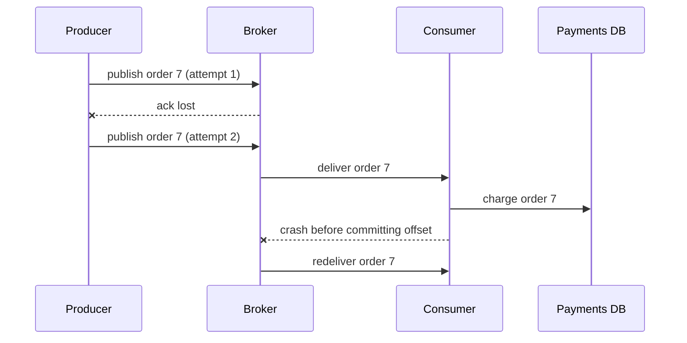

Checkout publishes an `OrderPlaced` event for every order; a consumer captures the payment, another writes the ledger, a third sends the email. In a flash sale that is 2,000 events a second. Lose one and an order ships unpaid; deliver one twice and a customer is charged twice. Neither is acceptable, and the network will produce both. This section shows why, how often, and how to make the duplicate harmless.

:::key[First principle]
When an acknowledgement doesn't arrive, the sender can't know whether the message or the ack was lost. **It must either not resend (at-most-once: some messages lost) or resend (at-least-once: some messages duplicated).** "Effectively once" is not a delivery mode; it is at-least-once delivery plus an effect that is idempotent — applying it twice equals applying it once.
:::

## 9.1 Why duplicates are unavoidable



Two independent places create duplicates: the **producer** resends after a lost ack, and the **consumer** reprocesses after a crash between "apply the effect" and "commit the offset". The effect (a row in a payments database) and the offset (a number in the broker) live in different systems, so no broker setting can make them commit atomically. Brokers that offer exactly-once (Kafka transactions, for example) guarantee it for read-from-Kafka, write-to-Kafka pipelines; the moment the effect is an external call or a different database, you are back to at-least-once.

## 9.2 The three options, with numbers

Let $p$ be the probability a send attempt is lost and $q$ the probability a delivered message's ack is lost.

**At-most-once** — send once, never retry. Each message is lost with probability $p$:

$$
\text{lost per second} = p \cdot \lambda
$$

**At-least-once** — retry until acked. Each attempt both delivers and gets acked with probability $(1-p)(1-q)$, so the number of attempts is geometric, and the number of *deliveries* is

$$
E[\text{deliveries}] = \frac{1-p}{(1-p)(1-q)} = \frac{1}{1-q}, \qquad E[\text{duplicates}] = \frac{q}{1-q} \approx q
$$

Loss rate on the wire doesn't create duplicates; only lost acks do.

**Effectively-once** — at-least-once plus a deduplicating, idempotent consumer: duplicates arrive and are discarded.

:::example[Worked example · checkout at 2,000 events/s, p = q = 0.1% (illustrative)]
| Mode | Bad outcomes per second | Per 10-minute flash sale |
|---|---:|---:|
| At-most-once | 2 orders lost | 1,200 lost |
| At-least-once, naive consumer | ~2 double charges (from lost acks alone) | ~1,200 double charges |
| Effectively-once | 0 | 0 |

Per-message rates look tiny; at scale they are certainties. With $q$ = 0.1%, the probability of *at least one* duplicate among $n$ messages is $1 - (1-q)^n$: 63% by 1,000 messages, 95% by 3,000 — about 1.5 s of flash-sale traffic.
:::

:::chart[P(at least one duplicate) vs messages sent, for three ack-loss rates]{type="line" x="messages sent" y="P(≥1 duplicate)" xlog="true" yfmt="pct" ymin="0" ymax="1"}
messages, q=0.01%, q=0.1%, q=1%
10, 0.001, 0.010, 0.096
100, 0.010, 0.095, 0.634
300, 0.030, 0.259, 0.951
1000, 0.095, 0.632, 1.000
3000, 0.259, 0.950, 1.000
10000, 0.632, 1.000, 1.000
30000, 0.950, 1.000, 1.000
100000, 1.000, 1.000, 1.000
:::

| Guarantee | Use when | Examples |
|---|---|---|
| At-most-once | Losing a few is cheaper than handling duplicates | Metrics samples, debug logs, presence pings |
| At-least-once + idempotent consumer | The effect matters | Orders, payments, ledger entries, notifications |
| At-least-once, naive | Duplicates are harmless by nature | Cache invalidations, "recompute X" triggers |

## 9.3 The consumer's commit point decides the failure

A consumer reads a batch, processes it, and commits the offset. Where the commit sits decides what a crash does:

- **Commit before processing** → at-most-once: a crash loses the rest of the batch.
- **Commit after processing** → at-least-once: a crash replays every message processed since the last commit — on average about half the commit interval, at most all of it.

Commit intervals are usually time-based. Committing every 5 s at 2,000 events/s means an unclean restart replays up to 10,000 events. A deploy that kills consumers without a graceful shutdown is an unclean restart.

The simulation pushes 200,000 checkout events (100 s of flash sale) through a producer and consumer with illustrative failure rates, and counts lost orders and extra charges for three consumers.

```python run
import numpy as np

N = 200_000          # order events (100 s of flash sale at 2,000/s)
P_SEND_LOSS = 0.001  # illustrative: publish attempt lost in transit
P_ACK_LOSS = 0.001   # illustrative: publish delivered but its ack lost
P_CRASH = 2e-5       # illustrative: consumer dies before processing a given message


def run(mode, batch, seed=1):
    rng = np.random.default_rng(seed)
    log = []                                     # what the broker stores
    for oid in range(N):
        while True:
            delivered = rng.random() >= P_SEND_LOSS
            if delivered:
                log.append(oid)
            if mode == "at-most-once":
                break                            # fire and forget: never resend
            if delivered and rng.random() >= P_ACK_LOSS:
                break                            # ack received
    charges, seen, committed = {}, set(), 0      # seen = idempotency keys, stored with the charge
    while committed < len(log):
        chunk = log[committed:committed + batch]
        if mode == "at-most-once":
            committed += len(chunk)              # commit offset BEFORE processing
        crashed = False
        for oid in chunk:
            if rng.random() < P_CRASH:
                crashed = True                   # restart from the last committed offset
                break
            if mode == "idempotent":
                if oid in seen:
                    continue
                seen.add(oid)
            charges[oid] = charges.get(oid, 0) + 1
        if not crashed and mode != "at-most-once":
            committed += len(chunk)              # commit offset AFTER processing
    lost = N - len(charges)
    doubles = sum(c - 1 for c in charges.values())
    return lost, doubles


print("%-14s %6s %8s %14s" % ("consumer", "batch", "lost", "extra charges"))
for mode in ("at-most-once", "at-least-once", "idempotent"):
    for batch in (1, 100, 1000):
        lost, doubles = run(mode, batch)
        print("%-14s %6d %8d %14d" % (mode, batch, lost, doubles))
```

```output
consumer        batch     lost  extra charges
at-most-once        1      194              0
at-most-once      100      527              0
at-most-once     1000     1827              0
at-least-once       1        0            193
at-least-once     100        0            264
at-least-once    1000        0           1364
idempotent          1        0              0
idempotent        100        0              0
idempotent       1000        0              0
```

Read it in two parts. At batch size 1, the numbers are the wire: ~200 losses or ~200 duplicates out of 200,000, matching $p\lambda$ and $q\lambda$ (0.1%). As the batch grows, crashes add whole half-batches of losses (at-most-once) or replays (at-least-once). The idempotent consumer has neither, at any batch size — the only design whose correctness does not depend on tuning.

:::chart[Lost orders and extra charges per 200,000 events vs commit batch size (mean of 3 seeds, same model)]{type="line" x="messages per offset commit" y="bad outcomes per 200,000 events" xlog="true" ylog="true" yfmt="int" points="true"}
batch, lost (at-most-once), extra charges (at-least-once)
1, 204, 200
10, 217, 217
30, 251, 260
100, 427, 353
300, 961, 720
1000, 1794, 2087
3000, 5461, 6497
:::

## 9.4 Building effectively-once

The consumer must make "apply the effect" and "remember that I applied it" one atomic step:

```sql
BEGIN;
INSERT INTO processed_events (event_id) VALUES (:event_id);  -- unique key; fails on a duplicate
INSERT INTO charges (order_id, amount) VALUES (:order_id, :amount);
COMMIT;                                     -- then commit the broker offset
```

If the first insert hits the unique constraint, the transaction rolls back and the consumer just commits the offset. Variants of the same idea:

| Technique | When it fits |
|---|---|
| Dedupe table in the same transaction as the effect | The effect is a write to your own database (most cases) |
| Natural idempotency: `UPSERT`, `SET status = 'paid' WHERE status = 'pending'` | The effect is a state transition |
| Idempotency key passed to the external API | The effect is a call to a payment provider that supports keys |
| Store the offset in the same database as the effect | Single-consumer pipelines; restart from the stored offset |

The key must be **stable across retries**: generated once by the producer (an order ID or a UUID created with the order), never per attempt. On the producer side, the **transactional outbox** solves the mirror problem — writing the order and publishing its event atomically — by inserting the event into an outbox table in the same transaction and having a relay publish it at-least-once.

## 9.5 Sizing the dedupe window

The idempotency store must remember a key for at least the longest gap between two deliveries of the same message:

$$
\text{TTL} \ge \max(\text{producer retry window},\ \text{broker redelivery timeout},\ \text{replay horizon})
$$

$$
\text{store size} = \text{key rate} \times \text{TTL} \times \text{bytes per key}
$$

:::example[Worked example · checkout's idempotency store]
Producer retries use exponential backoff of 1, 2, 4 … 128 s — 8 retries, a window of 1 + 2 + … + 128 = 255 s. A 24-hour TTL covers that with a wide margin, and also covers a same-day replay after a bad deploy.

Steady traffic is 50 orders/s × 86,400 s = 4.32M keys per day; a 10-minute flash sale adds 2,000 × 600 = 1.2M. At ~100 bytes per entry (key, status, pointer to the stored response; illustrative), that's 432 MB + 120 MB ≈ 0.55 GB — a small table or one Redis instance. Undersizing the TTL is the dangerous direction: a 60 s TTL would let any retry after the 60th second through as a second charge.
:::

:::warn[Replays outlive every TTL]
Resetting a consumer group to "7 days ago" to recover from a bug replays a week of events. Either the dedupe store covers the broker's retention, or replays go through a path that checks business state (`order already charged?`) rather than the dedupe table.
:::

## 9.6 Ordering and concurrency

- **Ordering is per partition**: events with the same key land on the same partition, in order. Choose the key from what must be ordered — `order_id` for an order's lifecycle, `conversation_id` for chat.
- **Global ordering means one partition**, which caps throughput at one consumer.
- **Parallelism ≤ partitions** per consumer group; extra consumers sit idle.

How much concurrency? Little's law: in-flight work $L = \lambda W$. The payment consumer calls a provider with p50 300 ms and p99 2 s (illustrative):

$$
L = 2{,}000 \times 0.3 = 600 \text{ calls in flight at p50}, \qquad 2{,}000 \times 2 = 4{,}000 \text{ if every call took the p99}
$$

A single consumer handling one message at a time does ~3 per second. Reaching 2,000/s needs hundreds of partitions, or — more practically — concurrent processing within a partition across *different* keys while preserving per-key order. Size for the tail, or the queue grows whenever the provider slows down ([§10](/c/system-design/10-latency-and-throughput)).

## 9.7 Backpressure: alert on age, not depth

When arrivals exceed drain rate, the backlog grows at $(\lambda - \mu)$ per second, and the age of the oldest message is backlog ÷ drain rate.

:::example[Worked example · a flash sale against a slow consumer]
Arrivals 2,000/s for 10 minutes; consumers drain 1,000/s. Backlog after the sale: \((2{,}000 - 1{,}000) \times 600\) = 600,000 events. Afterwards, with steady arrivals of 50/s, it drains at 950/s: \(600{,}000 / 950\) ≈ 632 s — the last flash-sale order waits ~10 minutes for its payment capture.
:::

| Signal | Meaning | Response |
|---|---|---|
| Oldest-message age rising | User-visible delay | Page on it; it maps directly to user pain |
| Consumer lag (messages) rising | Arrivals exceed capacity | Scale consumers up to partition count, or speed up the handler |
| Same message failing repeatedly | Poison message | After 3–5 attempts, move it to a dead-letter queue with the error |
| Error rate × retries rising together | Retry storm | Backoff with jitter, retry budget, circuit breaker ([§30](/c/system-design/30-retry)) |

A million tiny messages drained in ten seconds is healthy; ten messages stuck for an hour is an outage. Age is the metric.

**Dead-letter queues** keep one malformed event from blocking its partition forever (at-least-once retries it endlessly) or being silently dropped. Every consumer needs one, an alert on its size, and a replay tool.

## 9.8 Rules of thumb

- **Assume at-least-once everywhere** and make every consumer with a side effect idempotent on a producer-generated key.
- **Duplicates ≈ ack-loss rate × volume**; at 0.1% and 2,000/s, that's ~2 a second.
- **A crash replays up to one commit interval** — 5 s at 2,000/s is 10,000 events.
- **Dedupe TTL ≥ longest retry or replay window**; size the store as rate × TTL × ~100 B.
- **Partition by the entity that needs ordering**; size concurrency with $L = \lambda W$ at the tail latency.
- **Page on oldest-message age; dead-letter after 3–5 failures.**

## 9.9 Check yourself

:::qa[Ack loss is 0.05% and you publish 2,000 messages/s with retries. How many duplicates per hour, and how many messages are lost?]
Duplicates ≈ \(q\lambda = 0.0005 \times 2{,}000\) = 1 per second, ~3,600 per hour. Lost: zero — retries continue until acked; wire loss only adds attempts.
:::

:::qa[A consumer commits offsets every 2 s and processes 2,000 events/s. A deploy kills it uncleanly. What happens?]
Up to \(2 \times 2{,}000\) = 4,000 events processed since the last commit are redelivered (≈ 2,000 on average). Harmless if the consumer is idempotent; otherwise each is a duplicate side effect. Graceful shutdown (stop fetching, finish, commit) avoids most of it.
:::

:::qa[Why doesn't enabling the broker's exactly-once mode stop double charges?]
It makes Kafka-to-Kafka read-process-write atomic. The charge is a call to a payment provider and a write to your database, outside the broker's transaction, so a crash between charge and commit still redelivers. You need an idempotency key on the charge.
:::

:::qa[The payment consumer must keep each order's events in order and sustain 2,000 events/s with provider p99 of 2 s. How much concurrency do you provision?]
$L = \lambda W$ = 2,000 × 2 = 4,000 in-flight calls at the tail (600 at p50). Partition by `order_id`, process different orders concurrently within each partition, and cap concurrency so the provider isn't overloaded — plus a circuit breaker for when its latency spikes.
:::

Next: [§10 Latency and throughput](/c/system-design/10-latency-and-throughput) — why that queue grows so fast once utilisation nears 100%.
