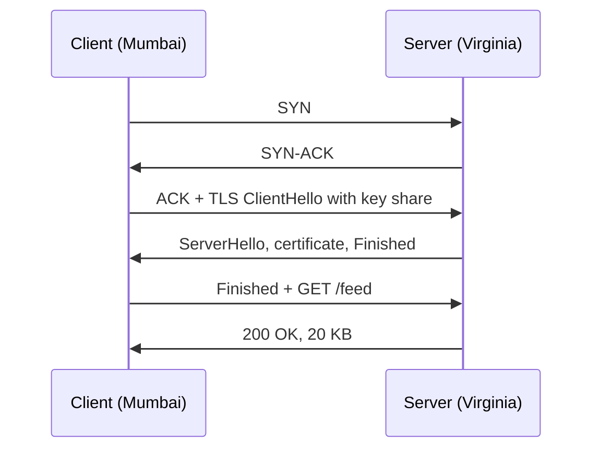

A Pulse user in Mumbai opens the app. The feed API lives in northern Virginia, the page is 20 KB of JSON, and the server needs 20 ms to assemble it. On a laptop on the office network the request takes 21 ms. From Mumbai, on a fresh connection, it takes almost half a second — and a 2 MB photo takes well over a second more. None of that time is spent computing. It is spent waiting for packets to cross an ocean, several times, before the first useful byte moves. This section turns that waiting into arithmetic you can do in an interview.

:::key[First principle]
Network time is **round trips × RTT + bytes ÷ throughput**, and over long distances the first term dominates. Every design choice in this section — connection reuse, TLS 1.3, HTTP/3, CDNs, regional replicas — either removes round trips or shortens the RTT they are paid at.
:::

## 11.1 The round-trip floor is physics

Light in optical fibre travels at about two-thirds of its vacuum speed, roughly 200 km per millisecond. A round trip covers the distance twice, so for a path of length $d$:

$$
\text{RTT} \;\ge\; \frac{2d}{v_{\text{fibre}}} = \frac{2d}{200\ \text{km/ms}}.
$$

Real paths are longer than the great circle (cables follow coasts and landing points) and add router queueing, so measured RTTs sit above the floor. That is why the course's latency table (from [estimation](/c/system-design/02-estimation)) uses ~150 ms for cross-region and ~0.5 ms inside a datacenter.

:::example[Worked example · Mumbai to northern Virginia]
Great-circle distance ≈ 12,855 km (computed below). Floor: \(2 \times 12{,}855 / 200\) ≈ 129 ms. The course figure of 150 ms is the floor plus ~16% for routing — plausible, and no engineering effort will get under 129 ms. The only ways to go faster are fewer round trips or a server closer to the user.
:::

## 11.2 Counting round trips before the first byte

A request on a new connection pays for setup before it can send anything:

| Step | Round trips | Why |
|---|---:|---|
| DNS lookup | 0–1 | Usually cached; a miss costs a trip to the resolver (and maybe beyond) |
| TCP handshake | 1 | SYN → SYN-ACK; the client can send data with the final ACK |
| TLS 1.2 | 2 | Two exchanges to agree keys |
| TLS 1.3 | 1 | Key share sent in the first message |
| QUIC (HTTP/3) | 1 total | Transport and TLS 1.3 handshakes are combined |
| 0-RTT resumption | 0 extra | A returning client sends the request with its first flight (replay-safe requests only) |
| Request / response | 1 | The actual work |



So a cold HTTPS request over TCP + TLS 1.3 costs **3 RTTs** plus server time; a request on a reused connection costs **1 RTT**. With $k$ setup round trips:

$$
T_{\text{first byte}} \approx (k + 1)\cdot \text{RTT} + T_{\text{server}}.
$$

```python run
"""Cold vs warm time-to-first-byte, counted in round trips, plus slow-start RTTs for the body."""
import math

def great_circle_km(lat1, lon1, lat2, lon2):
    p1, p2 = math.radians(lat1), math.radians(lat2)
    dp, dl = p2 - p1, math.radians(lon2 - lon1)
    a = math.sin(dp / 2) ** 2 + math.cos(p1) * math.cos(p2) * math.sin(dl / 2) ** 2
    return 2 * 6371 * math.asin(math.sqrt(a))

km = great_circle_km(19.08, 72.88, 39.04, -77.49)       # Mumbai -> northern Virginia
fibre_km_per_ms = 200                                     # light in glass ~ 2/3 c
print(f"Mumbai-Virginia {km:,.0f} km; fibre floor RTT {2 * km / fibre_km_per_ms:.0f} ms")

# round trips before the first response byte (DNS assumed cached)
SETUPS = {
    "TCP + TLS 1.2 (cold)": 1 + 2,
    "TCP + TLS 1.3 (cold)": 1 + 1,
    "QUIC / HTTP/3 (cold)": 1,
    "TLS 1.3 resumption 0-RTT": 1,     # TCP still needs its handshake
    "QUIC 0-RTT resumption": 0,
    "reused connection": 0,
}
SERVER_MS = 20                                            # feed assembly, illustrative
print(f"\n{'setup':26s} {'RTTs':>4s} {'0.5 ms':>8s} {'30 ms':>8s} {'150 ms':>8s}")
for name, k in SETUPS.items():
    cells = [(k + 1) * rtt + SERVER_MS for rtt in (0.5, 30, 150)]   # +1 for request/response
    print(f"{name:26s} {k:4d} " + " ".join(f"{c:7.1f}ms" for c in cells))

def slow_start_rtts(nbytes, init_segments=10, mss=1460):
    """Round trips to deliver nbytes from a fresh window that doubles every RTT (no loss)."""
    sent, cwnd, rtts = 0, init_segments, 0
    while sent * mss < nbytes:
        sent, cwnd, rtts = sent + cwnd, cwnd * 2, rtts + 1
    return rtts

print()
for label, size in [("feed page 20 KB", 20_000), ("thumbnail 200 KB", 200_000),
                    ("photo 2 MB", 2_000_000), ("video chunk 10 MB", 10_000_000)]:
    r = slow_start_rtts(size)
    print(f"{label:18s} {r} RTTs -> {r * 150:5.0f} ms at 150 ms RTT, {r * 30:4.0f} ms at 30 ms")
```

```output
Mumbai-Virginia 12,855 km; fibre floor RTT 129 ms

setup                      RTTs   0.5 ms    30 ms   150 ms
TCP + TLS 1.2 (cold)          3    22.0ms   140.0ms   620.0ms
TCP + TLS 1.3 (cold)          2    21.5ms   110.0ms   470.0ms
QUIC / HTTP/3 (cold)          1    21.0ms    80.0ms   320.0ms
TLS 1.3 resumption 0-RTT      1    21.0ms    80.0ms   320.0ms
QUIC 0-RTT resumption         0    20.5ms    50.0ms   170.0ms
reused connection             0    20.5ms    50.0ms   170.0ms

feed page 20 KB    2 RTTs ->   300 ms at 150 ms RTT,   60 ms at 30 ms
thumbnail 200 KB   4 RTTs ->   600 ms at 150 ms RTT,  120 ms at 30 ms
photo 2 MB         8 RTTs ->  1200 ms at 150 ms RTT,  240 ms at 30 ms
video chunk 10 MB  10 RTTs ->  1500 ms at 150 ms RTT,  300 ms at 30 ms
```

Read the 150 ms column: TLS 1.2 on a cold connection costs 620 ms for a 20 ms page, TLS 1.3 brings it to 470 ms, and a warm connection to 170 ms. The 30 ms column is what a regional edge or replica buys: the same cold request drops to 110 ms. Inside a datacenter (0.5 ms) the handshakes are almost free in latency — but not in CPU, which is why connection reuse still matters there (§11.4).

:::warn[0-RTT data can be replayed]
A 0-RTT request can be captured and resent by an attacker. Servers should accept it only for idempotent requests (`GET /feed`), never for `POST /checkout`.
:::

## 11.3 Bandwidth-delay product and slow start

TCP only lets a sender have one *window* of unacknowledged bytes in flight. The window drains once per round trip, so

$$
\text{throughput} \;\le\; \frac{W}{\text{RTT}},
\qquad
\text{BDP} = \text{bandwidth} \times \text{RTT}.
$$

To fill a link, the window must be at least the bandwidth-delay product (BDP). Anything smaller and the link idles while the sender waits for ACKs.

:::example[Worked example · a 1 Gbps link to Virginia]
BDP = \(10^9\ \text{bit/s} \times 0.15\ \text{s} = 1.5 \times 10^8\) bit = 18.75 MB. A 64 KB window — the maximum without the window-scaling option — gives at most \(65{,}535 \times 8 / 0.15\) = 3.5 Mbit/s: **0.35% of the link**. A 1 MB window reaches 55.9 Mbit/s; only a window near 16 MB gets close to line rate (894.8 Mbit/s). Inside a datacenter (0.5 ms RTT) a 64 KB window already exceeds 1 Gbit/s.
:::

:::chart[Throughput ceiling = window ÷ RTT, capped by a 1 Gbps link]{type="line" x="round-trip time (ms)" y="max throughput (Mbit/s)" xlog="true" ylog="true" marks="150:Mumbai-Virginia" dash="link 1 Gbps"}
rtt_ms, 64 KB window, 1 MB window, 16 MB window, link 1 Gbps
1, 524.3, 1000.0, 1000.0, 1000
2, 262.1, 1000.0, 1000.0, 1000
5, 104.9, 1000.0, 1000.0, 1000
10, 52.4, 838.9, 1000.0, 1000
20, 26.2, 419.4, 1000.0, 1000
50, 10.5, 167.8, 1000.0, 1000
100, 5.2, 83.9, 1000.0, 1000
150, 3.5, 55.9, 894.8, 1000
200, 2.6, 41.9, 671.1, 1000
300, 1.7, 28.0, 447.4, 1000
:::

**Slow start.** A new connection does not know the path's capacity, so it starts with a small congestion window (commonly 10 segments ≈ 14.6 KB) and doubles it every round trip until loss or the receive window stops it. Delivering $B$ bytes from a fresh window $w_0$ takes about

$$
r \approx \left\lceil \log_2\!\left(\frac{B}{w_0} + 1\right) \right\rceil \text{ round trips.}
$$

The block above computed it: a 20 KB feed page needs 2 RTTs, a 2 MB photo 8 RTTs (1.2 s at 150 ms), a 10 MB video chunk 10 RTTs. A warm connection whose window has already grown skips most of that:

:::chart[Round trips to deliver a response: fresh connection vs a warm one (window already 640 KB)]{type="line" x="response size (KB)" y="round trips" xlog="true" points="true" marks="20:feed page;2000:photo"}
response KB, round trips (fresh connection), round trips (warm cwnd 640 KB)
10, 1, 1
20, 2, 1
50, 3, 1
100, 3, 1
200, 4, 1
500, 6, 1
1000, 7, 2
2000, 8, 3
5000, 9, 4
10000, 10, 5
:::

Two design consequences fall out:

- **Big objects belong at the edge.** The photo service pushes ≈ 20 GB/s of egress on average. At 150 ms each photo costs 1.2 s of slow start; from an edge at 30 ms it costs 240 ms. That is the quantitative case for a [CDN](/c/system-design/19-cdn).
- **Small first responses win.** Anything that fits in the first window (~14 KB) arrives in one round trip. Keep the above-the-fold payload under that and lazy-load the rest.

## 11.4 Connection reuse and pool sizing

A connection is busy for as long as a call is in flight, so by Little's law ($L = \lambda W$) the number of connections a caller needs is

$$
\text{connections in use} = \text{calls per second} \times \text{seconds each call holds a connection}.
$$

```python run
"""Connection pools from Little's law, and how fast one-connection-per-request runs out of ports."""
CALLS = [  # (caller -> callee, calls per second at peak, time a connection is busy per call in s)
    ("Pulse feed API -> Postgres", 6_000, 0.002),      # 2 ms query incl. 0.5 ms RTT (illustrative)
    ("Checkout -> payment p50", 2_000, 0.300),
    ("Checkout -> payment p99", 2_000, 2.000),
]
print(f"{'call':28s} {'per s':>6s} {'busy s':>7s} {'connections in use':>19s}")
for name, rate, busy in CALLS:
    print(f"{name:28s} {rate:6,d} {busy:7.3f} {rate * busy:19,.0f}")

ports = 60_999 - 32_768 + 1          # Linux default ephemeral port range
time_wait = 60                       # seconds a closed connection holds its port
max_new = ports / time_wait
print(f"\nephemeral ports {ports:,}; TIME_WAIT {time_wait} s -> at most {max_new:,.0f} new "
      f"connections/s to one destination ip:port")
rate = 2_000
print(f"one new connection per payment call at {rate:,}/s: ports gone after "
      f"{ports / (rate - max_new):.1f} s")
for rtt_ms in (0.5, 150):
    print(f"handshake cost per new TCP+TLS 1.3 connection at {rtt_ms} ms RTT: {2 * rtt_ms:g} ms")
```

```output
call                          per s  busy s  connections in use
Pulse feed API -> Postgres    6,000   0.002                  12
Checkout -> payment p50       2,000   0.300                 600
Checkout -> payment p99       2,000   2.000               4,000

ephemeral ports 28,232; TIME_WAIT 60 s -> at most 471 new connections/s to one destination ip:port
one new connection per payment call at 2,000/s: ports gone after 18.5 s
handshake cost per new TCP+TLS 1.3 connection at 0.5 ms RTT: 1 ms
handshake cost per new TCP+TLS 1.3 connection at 150 ms RTT: 300 ms
```

What the numbers say:

- **Pulse → Postgres needs ~12 connections at peak**, not 6,000. A pool of 20–30 per database covers bursts; hundreds of idle connections only cost database memory.
- **Checkout → payment needs 600 at p50 and 4,000 when the provider slows to its p99.** Size the pool for the slow case or the pool becomes the outage: when the provider degrades, every request waits for a connection. Cap it deliberately and fail fast past the cap ([circuit breaker](/c/system-design/20-circuit-breaker)).
- **Opening a connection per call is a time bomb.** With the default Linux port range and a 60 s TIME_WAIT, one client IP can open about 471 new connections per second to one destination. At the 2,000 orders/s flash-sale peak the ports run out in under 20 seconds and `connect()` starts failing.
- **Reuse also saves handshakes**: 1 ms per call inside the datacenter (plus TLS CPU), 300 ms per call across regions.

:::tip[Defaults that avoid most connection trouble]
HTTP keep-alive on every client; one shared pool per destination; pool size ≈ peak rate × p99 call time, with a hard cap; idle timeout on the client shorter than the server's (so the client never sends on a connection the server just closed).
:::

## 11.5 Head-of-line blocking: HTTP/1.1, HTTP/2, HTTP/3

A page that needs many objects — the Pulse feed loads 20 thumbnails — exposes how each HTTP version shares connections:

- **HTTP/1.1** sends one request at a time per connection (pipelining is effectively unused). Browsers open ~6 connections per host, so 20 objects take $\lceil 20/6 \rceil = 4$ sequential rounds.
- **HTTP/2** multiplexes all 20 streams over **one** TCP connection. One round, but TCP delivers bytes strictly in order: one lost packet stalls *every* stream until it is retransmitted — head-of-line blocking moved from HTTP into TCP.
- **HTTP/3** runs streams over QUIC on UDP. Ordering is per stream, so a loss stalls only the stream it belongs to.

The simulation sends 20 objects of 10 packets each over a 50 ms RTT link; a lost packet arrives one RTT late (a simplification of loss detection and retransmission).

```python run
"""20 objects over HTTP/1.1 (6 connections), HTTP/2 (1 TCP connection) and HTTP/3 (QUIC streams)."""
import numpy as np

OBJ, PKTS, TX, RTT = 20, 10, 0.12, 50.0   # objects, packets each, ms per packet, ms round trip

def one_trial(loss, rng):
    delay = (rng.random((OBJ, PKTS)) < loss) * RTT     # a lost packet arrives ~1 RTT late
    # HTTP/1.1: 6 connections, one request at a time per connection, in-order per connection
    h1, free = np.empty(OBJ), np.zeros(6)
    for j in range(OBJ):
        c = j % 6
        arrive = free[c] + RTT + np.arange(PKTS) * TX + delay[j]
        h1[j] = free[c] = np.maximum.accumulate(arrive)[-1]
    # HTTP/2 and HTTP/3: all requests at t=0, packets interleaved round-robin across streams
    order = np.arange(OBJ * PKTS)
    obj, k = order % OBJ, order // OBJ
    arrive = RTT + order * TX + delay[obj, k]
    tcp = np.maximum.accumulate(arrive)                # TCP releases bytes strictly in order
    h2 = np.array([tcp[obj == j][-1] for j in range(OBJ)])
    h3 = np.array([np.maximum.accumulate(arrive[obj == j])[-1] for j in range(OBJ)])
    return h1.mean(), h2.mean(), h3.mean(), h1.max(), h2.max(), h3.max()

print("loss   mean object ms (H1 / H2 / H3)    page complete ms (H1 / H2 / H3)")
for loss in (0.0, 0.005, 0.01, 0.02, 0.05):
    rng = np.random.default_rng(7)
    r = np.mean([one_trial(loss, rng) for _ in range(400)], axis=0)
    print(f"{loss:4.1%}   {r[0]:6.1f} {r[1]:6.1f} {r[2]:6.1f}          {r[3]:6.1f} {r[4]:6.1f} {r[5]:6.1f}")
```

```output
loss   mean object ms (H1 / H2 / H3)    page complete ms (H1 / H2 / H3)
0.0%    112.4   72.7   72.7           204.3   73.9   73.9
0.5%    117.7   97.9   74.7           223.1   99.6   99.6
1.0%    122.8  109.2   76.5           239.4  111.0  111.0
2.0%    131.9  116.6   79.9           264.1  117.8  117.8
5.0%    155.1  120.6   88.6           311.1  121.7  121.7
```

:::chart[Mean time until an object is usable, 20 objects at 50 ms RTT (simulated)]{type="line" x="packet loss (%)" y="mean object completion (ms)" points="true" marks="1:1% loss"}
packet loss %, HTTP/1.1 (6 conns), HTTP/2 (1 TCP conn), HTTP/3 (QUIC)
0.00, 112.4, 72.7, 72.7
0.25, 115.0, 87.8, 73.7
0.50, 117.7, 97.9, 74.7
1.00, 122.8, 109.2, 76.5
1.50, 127.5, 113.6, 78.2
2.00, 131.9, 116.6, 79.9
3.00, 140.2, 118.7, 83.0
4.00, 148.0, 119.9, 85.9
5.00, 155.1, 120.6, 88.6
:::

How to read it:

- **No loss:** HTTP/2 and HTTP/3 tie (72.7 ms) and both beat HTTP/1.1 (112.4 ms) because they avoid the extra request rounds.
- **1% loss:** HTTP/2's mean object time jumps to 109.2 ms — one lost packet anywhere holds back everything behind it — while HTTP/3 stays at 76.5 ms.
- **Whole-page time is the same for HTTP/2 and HTTP/3** in this model (the last object waits for all bytes either way). HTTP/3's win is *progressive* rendering on lossy links — mobile networks, not datacenter links.

| Situation | Use | Why |
|---|---|---|
| Browser/mobile clients, many small objects, lossy last mile | HTTP/3 with HTTP/2 fallback | Per-stream loss recovery, 1-RTT setup |
| Service-to-service in one DC (loss ≈ 0) | HTTP/2 (gRPC) | Multiplexing; HOL blocking rarely triggers |
| Large single downloads | Any; tune the window | Throughput is BDP-bound, not HOL-bound |
| Clients or middleboxes that block UDP | HTTP/2 | QUIC needs UDP 443 open |

## 11.6 Timeouts, deadlines and the four network failures

A missing timeout is an unbounded resource leak: the thread, the connection and the memory stay held for a call that may never return. Set timeouts from the callee's latency distribution and nest them so that inner calls give up before outer ones:

$$
t_{\text{callee}} < t_{\text{caller}} - t_{\text{caller's own work}}.
$$

:::example[Worked example · a checkout deadline budget (illustrative)]
The client gives checkout 5 s. Checkout spends ~100 ms on its own work and calls inventory (p99 20 ms) and the payment provider (p50 300 ms, p99 2 s). Budget: inventory timeout 100 ms (5× p99), payment timeout 2.5 s (just above p99), leaving \(5 - 0.1 - 0.1 - 2.5\) = 2.3 s for one retry of inventory and a response. Pass the remaining deadline downstream in a header so a service never works on a request its caller has already abandoned.
:::

The four failures to design for:

1. **Latency spikes.** Network p99 is far above p50. Timeouts bound the damage; hedged requests (send a second copy after the p95) cut the tail at the cost of a few percent more load. See [latency and throughput](/c/system-design/10-latency-and-throughput).
2. **Partial failure.** The request succeeded but the response was lost. The client cannot tell this from a failure, so every retried write needs an [idempotency key](/c/system-design/22-idempotency).
3. **Connection exhaustion.** A slow dependency holds every pooled connection (the 4,000-connection p99 case above). Bulkheads (separate pools per dependency) and breakers contain it.
4. **Asymmetric partitions.** A can reach B but B cannot reach A. Health checks from one direction pass while real traffic fails; check the path the traffic actually uses.

## 11.7 DNS: the failover lever and its delay

DNS answers are cached for their TTL by resolvers and clients. That makes DNS cheap and makes failover slow:

$$
T_{\text{failover}} \approx T_{\text{detect}} + \text{TTL} + T_{\text{client reconnect}}.
$$

:::example[Worked example · DNS failover for the Pulse API]
Health checks every 10 s, 3 failures to declare an endpoint dead: 30 s. TTL 300 s. Worst case ≈ 330 s ≈ 5.5 minutes before the last client resolves the new address — longer for clients that cache beyond the TTL. Dropping the TTL to 30 s gives ≈ 60 s at ten times the resolver query volume. Anything faster needs an anycast address or a load balancer that fails over behind a stable IP ([load balancer](/c/system-design/24-load-balancer)).
:::

GeoDNS routes users to the nearest region by resolver location, which is coarse: a user behind a distant public resolver gets the wrong region.

| Protocol | Use it for | Round trips / cost notes |
|---|---|---|
| HTTPS (HTTP/2, HTTP/3) | All request/response APIs | 1 RTT per request on a warm connection |
| gRPC (HTTP/2) | Typed service-to-service calls, streaming | Long-lived pooled connections |
| WebSocket | Bidirectional push: chat, collaboration | One handshake, then frames; holds a connection per client |
| Server-sent events | One-way server push | Plain HTTP; simpler than WebSocket |
| Long polling | Fallback where WebSocket is blocked | ≥ 1 RTT per message batch |
| UDP / QUIC | Real-time media, games, HTTP/3 | No TCP HOL; app handles loss |

## 11.8 Practical rules

- **Count round trips first.** Cold request on TCP + TLS 1.3 = 3 RTTs; warm = 1. At 150 ms, that is 450 ms vs 150 ms before server time.
- **Put the RTT near the user.** Moving from 150 ms to 30 ms cuts every round trip 5×; a CDN or regional read replica is the biggest single latency win for distant users.
- **Reuse connections everywhere.** Pool size ≈ peak calls/s × p99 hold time, capped. Never one connection per request above a few hundred requests/s to one destination.
- **Size windows from the BDP** for bulk transfers across regions: 18.75 MB for 1 Gbps at 150 ms.
- **HTTP/3 for lossy clients, HTTP/2 inside the datacenter.**
- **Every outbound call has a timeout**, nested below its caller's, and writes carry idempotency keys.
- **Compress text responses above ~1 KB** and keep first responses under ~14 KB so they fit the initial window.
- **DNS TTL = failover delay.** 300 s TTL means minutes of failover.

## 11.9 Check yourself

:::qa[A user in Mumbai calls an API in Virginia (150 ms RTT) on a new connection with TCP and TLS 1.3. Server time is 20 ms. What is the time to first byte, and what is it on a reused connection?]
Two setup round trips (TCP, TLS 1.3) plus one for the request: \(3 \times 150 + 20\) = 470 ms. Reused: \(150 + 20\) = 170 ms. With TLS 1.2 it would be 620 ms.
:::

:::qa[A backup job copies data between regions at 80 ms RTT with a 1 MB window. What is its throughput ceiling, and what window would fill a 10 Gbit/s link?]
\(1{,}048{,}576 \times 8 / 0.08\) ≈ 105 Mbit/s. BDP = \(10^{10} \times 0.08\) = \(8 \times 10^8\) bit = 100 MB, so the window must be ~100 MB (or run ~95 parallel streams of 1 MB).
:::

:::qa[Checkout calls a fraud-scoring service at 2,000 requests/s; its p99 is 150 ms. How many pooled connections, and what happens if checkout opens a new connection per call?]
Little's law: \(2{,}000 \times 0.15\) = 300 connections at p99. Per-call connections exceed the ~471 new connections/s that one client IP can sustain to one destination with default ports and a 60 s TIME_WAIT, so ports run out within seconds — and each call also pays 2 extra RTTs of handshake.
:::

:::qa[Your mobile app loads 30 small images and users on 2% loss networks complain the feed fills in slowly even after moving to HTTP/2. Why, and what helps?]
HTTP/2 multiplexes all images on one TCP connection; each lost packet stalls every stream until retransmitted (TCP head-of-line blocking). The simulation shows the mean object time at 2% loss rising from 72.7 to 116.6 ms under HTTP/2 vs 79.9 ms under HTTP/3. Enable HTTP/3 (QUIC) with HTTP/2 fallback, and serve the images from a nearby edge to cut the RTT each loss costs.
:::

:::qa[You need regional failover within 2 minutes. Health checks run every 15 s and need 2 failures. What DNS TTL can you afford?]
Detection takes 30 s, so TTL ≤ 120 − 30 = 90 s, less a margin for reconnects and resolvers that over-cache: use ~60 s, or fail over behind an anycast or load-balancer IP so DNS does not change at all.
:::

Next: [Replication and partitioning](/c/system-design/12-replication-and-partitioning) — what to do with the data once requests reach it.
