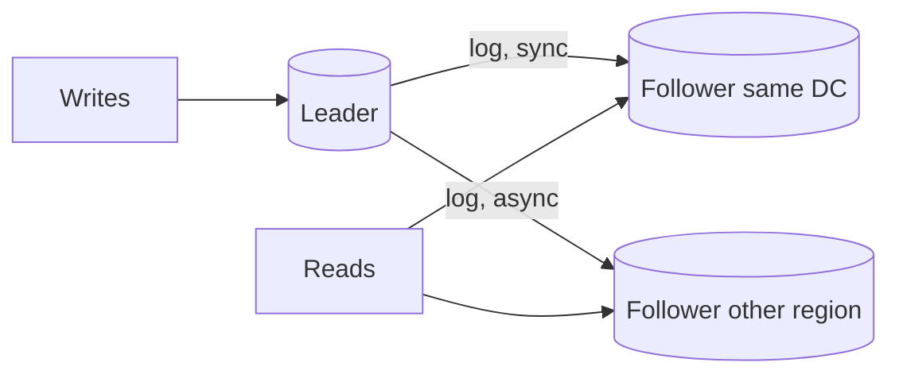

Pulse runs on one Postgres primary. Peak reads are 6,000 QPS, peak writes 600 QPS, and the posts table grows by 20 GB a day. The team wants two things that sound alike and are not: more copies (so a dead disk loses nothing and reads spread out) and more pieces (so writes and storage exceed one machine). The first is replication, the second partitioning. Meanwhile the checkout ledger is about to take 2,000 orders/s in a flash sale, and someone has asked what happens if the primary dies mid-sale. This section answers each question with a number.

:::key[First principle]
Replication copies the **same** data to more nodes: it scales reads and survives failures, and costs you agreement time (lag or slower writes). Partitioning gives each node **different** data: it scales writes and size, and costs you every query that spans partitions. Replicate first — it is reversible; partition only when one node's write rate or storage is genuinely exceeded.
:::

## 12.1 Why copies, and what they cost

| Topology | Writes go to | Conflicts | Typical use |
|---|---|---|---|
| Single-leader | One leader; followers replay its log | None | Most OLTP databases, Pulse's primary + replicas |
| Multi-leader | A leader per region | Yes — must be resolved | Multi-region writes, offline-first clients |
| Leaderless (quorum) | Any W of N replicas | Yes — versioned values | Dynamo-style stores, high write availability |



"Last write wins" conflict resolution silently discards one of two concurrent writes; use it only where losing a write is acceptable (a profile picture), never for counters or balances.

## 12.2 Sync, semi-sync, async: latency vs data at risk

The leader can acknowledge a write after it is durable on $k$ of its $N$ copies. Waiting for $k$ copies means the write's latency is the **$k$-th fastest** of the replica response times — an order statistic. Losing the leader loses whatever had not reached a surviving copy:

$$
\text{writes lost on failover} \approx \lambda_{\text{write}} \times \text{lag}_{\text{at failure}}.
$$

The block below puts two replicas in one datacenter (median ~1 ms) and the third in another region (+150 ms), each up 99% of the time (illustrative):

```python run
"""Quorums on N=3 replicas: availability of a W-write / R-read, and how a quorum's latency is an order statistic."""
import numpy as np
from math import comb

N, A = 3, 0.99                       # replicas, per-replica availability (illustrative)

def p_at_least(k, n=N, a=A):
    return sum(comb(n, i) * a**i * (1 - a)**(n - i) for i in range(k, n + 1))

rng = np.random.default_rng(0)
# per-replica response time: intra-DC lognormal, median ~1 ms, heavy-ish tail (illustrative)
lat = rng.lognormal(mean=np.log(1.0), sigma=0.6, size=(200_000, N))
lat[:, 2] += 150                                     # third replica is in another region (150 ms RTT)
lat.sort(axis=1)                                     # column k-1 = time until k replicas answered

print(f"{'W or R':>6s} {'available':>10s} {'downtime/yr':>12s} {'p50 ms':>7s} {'p99 ms':>7s}")
for k in (1, 2, 3):
    av = p_at_least(k)
    t = lat[:, k - 1]
    print(f"{k:6d} {av:10.6f} {(1 - av) * 525_600:9.1f} min "
          f"{np.percentile(t, 50):7.1f} {np.percentile(t, 99):7.1f}")

print("\nR+W>N  config         reads can miss the latest write?")
for r, w in [(1, 1), (1, 2), (2, 2), (1, 3), (3, 1)]:
    print(f"{r + w > N!s:5s}  R={r} W={w}        {'no' if r + w > N else 'yes'}")
```

```output
W or R  available  downtime/yr  p50 ms  p99 ms
     1   0.999999       0.5 min     0.7     2.2
     2   0.999702     156.6 min     1.4     4.7
     3   0.970299   15610.8 min   151.0   154.0

R+W>N  config         reads can miss the latest write?
False  R=1 W=1        yes
False  R=1 W=2        yes
True   R=2 W=2        no
True   R=1 W=3        no
True   R=3 W=1        no
```

| Mode | Copies durable before the ack (k) | Write latency (k-th fastest, from the table) | Lost on failover |
|---|---|---|---|
| Async | 1 — the leader's own log | p50 0.7 ms | everything in the lag window |
| Semi-sync | 2 — leader + one same-DC follower | p50 1.4 ms, p99 4.7 ms | nothing, if that follower is promoted |
| Sync to all | 3 — including the remote region | p50 151 ms | nothing; but writes stop when any copy is down |

:::example[Worked example · what a failover costs]
Pulse at 600 writes/s with 1 s of async lag loses ~600 posts if the primary dies — annoying, recoverable from client retries. The checkout ledger during the flash sale writes 2,000 orders/s; §12.3 shows its async replica can fall 20 s behind, so a failover then loses up to \(2{,}000 \times 20\) = 40,000 acknowledged orders. The ledger gets semi-sync to a same-DC follower (+~1 ms per write); the cross-region copy stays async for disaster recovery.
:::

Sync to *all* replicas is also an availability trap: the W=3 row is up only 97.0% of the time (15,611 min/yr down), because any one replica failing blocks writes.

## 12.3 Replication lag is a queue

An async follower applies the leader's log at some rate $\mu$ (often one thread, so far below what the leader can write). While writes arrive faster than that, a backlog builds; once they slow down, it drains:

$$
\frac{dB}{dt} = \lambda(t) - \mu \quad (B \ge 0),
\qquad
\text{lag}(t) = \frac{B(t)}{\mu}.
$$

:::example[Worked example · the flash sale on an async replica]
Steady 50 orders/s; the sale runs at 2,000 orders/s for 60 s; the replica applies 1,500 entries/s (illustrative). Backlog grows at 500/s → 30,000 entries after 60 s → lag \(30{,}000 / 1{,}500\) = 20 s. After the sale it drains at \(1{,}500 - 50\) = 1,450/s, taking ~21 s. Any "read from replica" during those 80 s can be up to 20 s stale.
:::

:::chart[Async replica during a 60 s flash sale: lag builds while writes exceed the apply rate]{type="area" x="seconds" y="replica lag (s)" band="10:70:sale at 2,000 orders/s" hmarks="1:1 s read-your-writes window"}
seconds, lag seconds
0, 0.0
5, 0.0
10, 0.0
15, 1.7
20, 3.3
25, 5.0
30, 6.7
35, 8.3
40, 10.0
45, 11.7
50, 13.3
55, 15.0
60, 16.7
65, 18.3
70, 20.0
75, 15.2
80, 10.3
85, 5.5
90, 0.7
95, 0.0
100, 0.0
110, 0.0
120, 0.0
:::

Everything users notice about replicas follows from lag ([consistency](/c/system-design/08-consistency) has the models):

- **Read-your-writes.** A user posts, then reads a replica that has not applied the post. Fixes: read from the leader for $T$ seconds after the user's last write with $T \ge$ p99 lag; or record the log position (LSN) of the user's write and read only from replicas at or past it.
- **Monotonic reads.** A user bouncing between replicas sees time go backwards. Pin a session to one replica.
- **Alert on lag, not just liveness.** A replica that is up but 20 s behind is serving wrong answers. Take it out of the read pool past a threshold (e.g. 5 s).

## 12.4 Quorums: when R + W > N guarantees overlap

In a leaderless store with $N$ replicas, a write succeeds after $W$ acknowledgements and a read queries $R$ replicas. If

$$
R + W > N,
$$

then any read set and any write set share at least one replica (pigeonhole: they cannot fit into $N$ slots without overlapping), so the read sees the latest acknowledged write — provided versions let it pick the newest. The availability column in the table above is the probability that at least $k$ of 3 replicas are up: W=2 survives one failure (99.97%), W=3 none.

How stale is a read when $R + W \le N$? Model each replica applying the write after an exponential delay (mean 10 ms, illustrative) and read $R$ random replicas some time after the client's ack:

```python run
"""P(stale read) after an acknowledged write, N=3, for different (R, W)."""
import numpy as np

def p_stale(r, w, t_ms, n=3, mean_ms=10.0, trials=100_000, seed=1):
    rng = np.random.default_rng(seed)
    d = rng.exponential(mean_ms, size=(trials, n))   # when each replica applies the write
    d.sort(axis=1)
    has = d <= (d[:, [w - 1]] + t_ms)                # client is acked once W replicas have it
    pick = np.argsort(rng.random((trials, n)), axis=1)[:, :r]   # read R random replicas
    hit = np.take_along_axis(has, pick, axis=1).any(axis=1)
    return 1 - hit.mean()

configs = [(1, 1), (1, 2), (2, 1), (2, 2)]
print("ms after ack " + "".join(f"  R={r},W={w}" for r, w in configs))
for t in (0, 5, 10, 20, 50):
    print(f"{t:11d} " + "".join(f"  {p_stale(r, w, t):7.1%}" for r, w in configs))
```

```output
ms after ack   R=1,W=1  R=1,W=2  R=2,W=1  R=2,W=2
          0     67.0%    33.6%    33.5%     0.0%
          5     40.5%    20.2%    12.3%     0.0%
         10     24.6%    12.2%     4.5%     0.0%
         20      8.9%     4.4%     0.6%     0.0%
         50      0.4%     0.2%     0.0%     0.0%
```

:::chart[Probability a read misses an acknowledged write (N = 3, simulated)]{type="line" x="ms since the write was acknowledged" y="stale reads (%)" points="true" dash="R=2 W=2 (R+W>N)"}
ms since ack, R=1 W=1, R=1 W=2, R=2 W=1, R=2 W=2 (R+W>N)
0, 67.01, 33.55, 33.54, 0.00
2, 54.92, 27.42, 22.45, 0.00
5, 40.53, 20.17, 12.32, 0.00
10, 24.57, 12.19, 4.48, 0.00
15, 14.84, 7.39, 1.69, 0.00
20, 8.90, 4.44, 0.63, 0.00
30, 3.20, 1.58, 0.08, 0.00
40, 1.15, 0.56, 0.01, 0.00
60, 0.14, 0.07, 0.00, 0.00
80, 0.02, 0.01, 0.00, 0.00
:::

R=1, W=1 is fast and stale two times in three immediately after the ack; R=2, W=2 is never stale in this model. Choose by what a stale read costs:

| N=3 setting | Overlap | Survives | Use for |
|---|---|---|---|
| R=1, W=1 | No | 2 failures | Metrics, likes counts, caches |
| R=2, W=2 | Yes | 1 failure for both | Default for user-visible state |
| R=1, W=3 | Yes | Reads: 2; writes: none | Read-heavy, rarely written config |
| R=3, W=1 | Yes | Writes: 2; reads: none | Write-heavy logs read rarely |

:::warn[R + W > N is necessary, not sufficient]
Overlap guarantees you *contact* a replica with the latest write. You still need versions to know which value is newest, and "sloppy" quorums (writing to substitute nodes during failures), concurrent writes and partial write failures can each return old data. If you need linearizable reads, use a consensus-based store, not quorum arithmetic.
:::

## 12.5 Partitioning: hash vs range

One node has a ceiling on write throughput and on storage. Partitioning gives each node a slice of the keys:

| Strategy | Key → partition | Good at | Bad at |
|---|---|---|---|
| **Range** | sorted key ranges (`a–f`, `g–m`) | Range scans, ordered reads | Sequential keys: all new writes hit the last range |
| **Hash** | `hash(key) mod P` | Even spread of distinct keys | Range scans become scatter-gather; resizing moves almost everything |
| **Consistent hashing** | keys and nodes on a ring | Adding a node moves ~1/N of keys | Needs virtual nodes for even load |
| **Directory** | lookup table key → partition | Arbitrary placement, easy moves | The directory is a dependency |

:::example[Worked example · range partitioning on a timestamp]
Partition Pulse posts by `created_at` into 16 ranges and every new post lands in the newest range: one partition takes all 600 writes/s while 15 sit idle. Hash on `post_id` and each takes \(600/16\) = 37.5 writes/s — but "posts in the last hour" now queries all 16.
:::

**Resizing.** With `hash mod P`, a key stays put only if $h \bmod P = h \bmod (P+1)$. Going from 16 to 17 partitions moves \(16/17 \approx 94\%\) of keys (93.9% measured on 100,000 hashed keys). Consistent hashing moves ~\(1/17 \approx 5.9\%\); the [consistent hashing implementation](/c/system-design/64-consistent-hashing) measures the load spread with virtual nodes.

:::tip[The cheapest rebalancing trick]
Create many more logical shards than nodes — 1,024 logical shards on 16 nodes — and keep a small table mapping logical → physical. Moving load is moving whole logical shards: at a year of Pulse posts (7.3 TB) each logical shard is ~7 GB, so a move is a bounded copy plus a metadata flip.
:::

**Should Pulse shard?** Not yet. Peak writes are 600/s and the first year is 7.3 TB — both inside what one well-provisioned primary handles (illustrative; confirm with a load test). Replicas cover the 6,000 reads/s. Revisit when write rate or storage approaches one node's tested limit. See [sharding](/c/system-design/34-sharding) for the operational version.

## 12.6 Hot partitions: skew beats hashing

Hashing spreads *keys* evenly, not *traffic*. Real access is skewed — a celebrity's posts, a flash-sale SKU. If the hottest key carries a share $p_{\max}$ of traffic, its partition carries at least that much, so with $P$ partitions:

$$
\frac{\text{max partition load}}{\text{mean partition load}} \;\ge\; p_{\max} \cdot P.
$$

More partitions make this ratio *worse*: the mean shrinks while the hot key's load does not. Simulate a Zipf workload (key of rank $i$ gets weight \(1/i^s\)) over 100,000 keys:

```python run
"""Hot partitions: hash-partition a Zipf-skewed key space and measure max/mean partition load."""
import numpy as np

def max_over_mean(s, parts, keys=100_000, reqs=1_000_000, salt_top=0, seed=3):
    rng = np.random.default_rng(seed)
    w = 1.0 / np.arange(1, keys + 1) ** s
    k = rng.choice(keys, size=reqs, p=w / w.sum())
    part = (k * 2654435761 % 2**32) % parts               # stand-in for hash(key) mod parts
    if salt_top:                                          # split the hottest key across salt_top sub-keys
        hot = k == 0
        part[hot] = (np.arange(hot.sum()) % salt_top * 7919 + 13) % parts
    load = np.bincount(part, minlength=parts)
    return load.max() / load.mean(), (k == 0).mean()

for s in (0.0, 0.8, 1.0, 1.2):
    r16, top = max_over_mean(s, 16)
    r64, _ = max_over_mean(s, 64)
    salted, _ = max_over_mean(s, 64, salt_top=16)
    print(f"zipf s={s:.1f}  hottest key {top:6.2%} of traffic  max/mean: "
          f"16 parts {r16:5.2f}  64 parts {r64:5.2f}  64 parts + salt hot key x16 {salted:5.2f}")
```

```output
zipf s=0.0  hottest key  0.00% of traffic  max/mean: 16 parts  1.01  64 parts  1.02  64 parts + salt hot key x16  1.02
zipf s=0.8  hottest key  2.17% of traffic  max/mean: 16 parts  1.27  64 parts  2.27  64 parts + salt hot key x16  1.68
zipf s=1.0  hottest key  8.25% of traffic  max/mean: 16 parts  2.08  64 parts  5.93  64 parts + salt hot key x16  3.29
zipf s=1.2  hottest key 19.62% of traffic  max/mean: 16 parts  3.65  64 parts 12.94  64 parts + salt hot key x16  5.85
```

:::chart[Hottest partition ÷ average partition under Zipf skew (simulated, 1M requests)]{type="line" x="partitions" y="max / mean load" xlog="true" ylog="true" points="true" hmarks="1:perfectly even"}
partitions, s=0 (uniform), s=0.8, s=1.0, s=1.2
2, 1.00, 1.01, 1.06, 1.14
4, 1.00, 1.04, 1.19, 1.46
8, 1.00, 1.12, 1.47, 2.17
16, 1.01, 1.27, 2.08, 3.65
32, 1.01, 1.59, 3.34, 6.72
64, 1.02, 2.27, 5.93, 12.94
128, 1.03, 3.61, 11.16, 25.43
:::

:::example[Worked example · reading the skew]
At $s = 1.0$ the hottest key gets 8.25% of traffic. With 64 partitions the bound is \(0.0825 \times 64\) = 5.3; the simulation measures 5.93 (the hot key's partition also holds other keys). If you sized each partition for the mean, the hot one runs at ~6× its budget. Going to 128 partitions makes it 11.2×.
:::

Fixes, in order of cost:

1. **Cache the hot keys** in front of the partitions ([caching](/c/system-design/07-caching)): reads of one hot key become memory hits.
2. **Replicate hot partitions for reads** — more copies of the same slice.
3. **Salt hot keys for writes**: write to `key#0 … key#15` and aggregate on read. In the simulation, salting the single hottest key 16 ways cuts the 64-partition ratio from 5.93 to 3.29 — the remaining skew comes from the next-hottest keys. Reads now fan out 16 ways, so salt only keys you have measured as hot.
4. **Split the stock itself** for counters like flash-sale inventory: 8 buckets of 25 units instead of one row of 200 ([transactions](/c/system-design/15-transactions) computes why).

## 12.7 Choosing a shard key

Ask, in order:

1. **Does the dominant query include it?** If not, every query fans out to all partitions.
2. **Is traffic per key bounded?** A celebrity user or a giant tenant becomes the hot partition above.
3. **Is it stable?** Re-keying later is a migration.
4. **Does it keep related rows together?** `tenant_id` keeps a customer's transactions single-partition.

Common answers: `user_id` for social data, `tenant_id` for B2B SaaS, `conversation_id` for chat, `hash(short_code)` for a URL shortener. Avoid a timestamp as the leading partition key.

What you accept once partitioned:

- Cross-partition joins move to the application or an analytical store.
- Cross-partition transactions become [sagas](/c/system-design/31-sagas) or are designed away by the key choice.
- Aggregates (`COUNT(*)`) are scatter-gather or precomputed.
- Secondary indexes are local (queries fan out) or global (maintained asynchronously, so they lag).

## 12.8 Practical rules

| Need | Do | Number to check |
|---|---|---|
| More read throughput | Add replicas (or cache) | replicas ≈ peak reads ÷ per-replica QPS at 60% |
| No acknowledged-write loss | Semi-sync to one same-DC follower | +1–5 ms per write |
| Regional disaster recovery | Async cross-region replica | RPO = lag at failure; alert above a threshold |
| Read-your-writes | Leader reads for $T \ge$ p99 lag, or LSN-aware reads | p99 lag under peak writes |
| More write throughput or storage | Partition by the dominant query's key | peak writes vs one node's tested ceiling |
| Hot key | Cache, replicate, then salt | $p_{\max} \cdot P$ vs partition headroom |
| Resize without moving everything | Consistent hashing or logical shards | fraction of data moved per node added |

## 12.9 Check yourself

:::qa[An async replica applies 3,000 entries/s. A burst writes 5,000/s for 30 s, then traffic returns to 500/s. What is the peak lag and how long does it take to recover?]
Backlog grows at 2,000/s → 60,000 entries after 30 s → lag \(60{,}000/3{,}000\) = 20 s. It drains at \(3{,}000 - 500\) = 2,500/s, so ~24 s more. Reads from that replica can be up to 20 s stale, and a failover at the peak loses up to \(5{,}000 \times 20\) = 100,000 writes.
:::

:::qa[N = 5. Which R and W give overlapping quorums while tolerating 2 failed replicas for both reads and writes?]
Tolerating 2 failures means R ≤ 3 and W ≤ 3. Overlap needs R + W > 5, so R = W = 3. Any smaller pair either fails to overlap or cannot survive two failures.
:::

:::qa[A semi-sync primary waits for the fastest of two followers: one in the same DC (~1 ms), one in another region (~150 ms). Why is write latency ~1 ms, and what happens when the local follower dies?]
The ack waits for the first follower, which is the local one. If it dies, the fastest remaining follower is the remote one, so every write suddenly costs ~150 ms. Keep two same-DC followers so losing one doesn't change the order statistic.
:::

:::qa[Traffic is Zipf with the top key at 8% of requests. You plan 64 partitions sized for the average load. What utilisation does the hottest partition hit if the average partition runs at 15%?]
Max/mean ≥ \(0.08 \times 64\) = 5.1 (the simulation at a similar skew measured 5.9), so the hot partition runs at roughly \(15\% \times 5.9\) ≈ 89% — into the steep part of the queueing curve. Cache or salt the hot key before adding partitions.
:::

:::qa[Why is hash mod N a bad partition function if you expect to grow from 16 to 17 nodes?]
A key stays only if its hash mod 16 equals its hash mod 17, so ~16/17 ≈ 94% of keys move. Consistent hashing (or logical shards mapped to nodes) moves ~1/17 ≈ 6%.
:::

Next: [Scalability](/c/system-design/13-scalability) — why adding nodes stops helping, and how many to buy.
