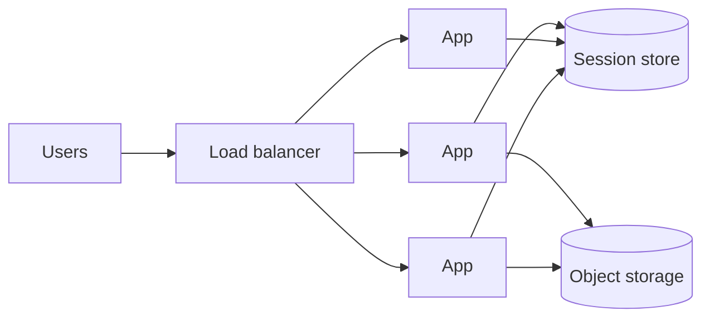

The Pulse team load-tests the feed API before launch. One node serves 908 QPS. Eight nodes serve 5,588 — fine. Thirty-two nodes serve 9,404: four times the hardware of the 8-node run for 68% more throughput. Somebody proposes 64 nodes "to be safe". The model in this section says 64 nodes would serve *less* than 32. Scaling is not adding servers; it is finding the part of each request that cannot run in parallel and removing it — then buying exactly enough servers, at a utilisation where queues stay short.

:::key[First principle]
Throughput scales linearly only for the part of the work that is independent. A **serial fraction** $\sigma$ (a lock, a single primary, a sequence generator) caps speedup at \(1/\sigma\); **coordination** $\kappa$ between nodes (cache invalidation, all-to-all chatter) makes throughput fall past a peak. Measure both, remove the bigger one, then size for peak load at ~60% utilisation.
:::

## 13.1 Scale up, scale out, and the state that blocks scaling out

- **Vertical (scale up):** a bigger machine. No code change, no new failure modes, and a hard ceiling at the largest machine you can buy. Often the right first move for a database.
- **Horizontal (scale out):** more machines. Effectively unbounded, *if* any request can go to any instance — which means no request may depend on state held in one process.

| State | Why it blocks scale-out | Fix |
|---|---|---|
| Session in process memory | The next request lands elsewhere and the user is logged out | Shared session store or a signed cookie |
| Files written to local disk | Invisible to other servers | [Object storage](/c/system-design/26-object-storage) |
| Authoritative in-process cache | Servers disagree about the truth | Shared cache; the database stays authoritative |



Once the app tier is stateless, scaling it is arithmetic. The rest of this section is that arithmetic.

## 13.2 Amdahl's law: the serial fraction sets a ceiling

Split each unit of work into a serial fraction $\sigma$ that only one node can do at a time and a parallel fraction \(1-\sigma\). On $N$ nodes the time per unit falls from 1 to $\sigma + (1-\sigma)/N$, so the speedup is

$$
S(N) = \frac{1}{\sigma + \dfrac{1-\sigma}{N}}
\;\xrightarrow{\;N \to \infty\;}\;
\frac{1}{\sigma}.
$$

:::example[Worked example · 5% serial work]
With $\sigma = 0.05$: 2 nodes → 1.90×, 8 → 5.93×, 32 → 12.55×, 1,000 → 19.63×. The ceiling is \(1/0.05\) = 20× no matter how much you spend. Doubling from 16 to 32 nodes buys only 37% more (9.14× → 12.55×).
:::

The serial fraction hides in places that look parallel: one primary database that every request writes to, a global lock around a counter, a single-threaded log appender, a leader that every request consults. When a system "does not scale", someone has found its $\sigma$.

## 13.3 The Universal Scalability Law: coordination makes throughput fall

Amdahl assumes nodes never talk to each other. Real nodes do: caches invalidate each other, locks hand off, membership gossip is all-to-all. If each of the $N(N-1)$ node pairs adds a small cost $\kappa$, Gunther's Universal Scalability Law (USL) gives the relative capacity

$$
C(N) = \frac{N}{1 + \sigma (N-1) + \kappa\, N (N-1)},
\qquad
N^{*} = \sqrt{\frac{1-\sigma}{\kappa}}.
$$

With $\kappa = 0$ it is Amdahl. With $\kappa > 0$ there is a peak at $N^*$, and past it **adding nodes reduces throughput**.

:::details[Show the derivation of the peak]
Write $C = N/D$ with $D = 1 + \sigma(N-1) + \kappa N(N-1)$. Setting $dC/dN = (D - N D')/D^2 = 0$ gives $D = N D'$ with $D' = \sigma + \kappa(2N - 1)$:

$$
1 + \sigma N - \sigma + \kappa N^2 - \kappa N = \sigma N + 2\kappa N^2 - \kappa N
\;\Longrightarrow\;
1 - \sigma = \kappa N^2
\;\Longrightarrow\;
N^* = \sqrt{(1-\sigma)/\kappa}.
$$
:::

:::chart[Relative capacity vs nodes: linear, Amdahl (σ = 0.04) and USL (σ = 0.04, κ = 0.0008)]{type="line" x="nodes" y="capacity (× one node)" marks="34.6:USL peak N*" dash="linear"}
nodes, linear, Amdahl sigma=0.04, USL sigma=0.04 kappa=0.0008
1, 1, 1.00, 1.00
2, 2, 1.92, 1.92
4, 4, 3.57, 3.54
8, 8, 6.25, 6.04
12, 12, 8.33, 7.76
16, 16, 10.00, 8.93
24, 24, 12.50, 10.16
32, 32, 14.29, 10.55
40, 40, 15.62, 10.50
48, 48, 16.67, 10.25
64, 64, 18.18, 9.49
80, 80, 19.23, 8.68
96, 96, 20.00, 7.94
128, 128, 21.05, 6.71
:::

With $\sigma = 0.04$, $\kappa = 0.0008$: $N^* = \sqrt{0.96/0.0008} = 34.6$ nodes, where capacity is ~10.5× one node. At 128 nodes it is back down to 6.7× — the same as about 10 nodes, at 13 times the cost.

## 13.4 Fit the USL to a load test

You don't guess $\sigma$ and $\kappa$; you fit them. Divide each measured throughput by the 1-node value to get $C(N)$, then the USL rearranges into a linear model with no intercept:

$$
\frac{N}{C(N)} - 1 = \sigma\,(N-1) + \kappa\, N(N-1).
$$

The data below are the Pulse load test (synthetic: generated from known parameters with 3% noise, so the fit can be checked):

```python run
"""Fit the Universal Scalability Law to a load test and find where adding nodes stops helping."""
import numpy as np

# synthetic load test (illustrative): true sigma=0.04, kappa=0.0008, 1 node = 900 QPS, 3% noise
rng = np.random.default_rng(42)
nodes = np.array([1, 2, 4, 8, 12, 16, 24, 32])
true = 900 * nodes / (1 + 0.04 * (nodes - 1) + 0.0008 * nodes * (nodes - 1))
qps = true * rng.normal(1, 0.03, nodes.size)

# linearise: N/C(N) - 1 = sigma*(N-1) + kappa*N*(N-1), where C(N) = X(N)/X(1)
c = qps / qps[0]
y = nodes / c - 1
A = np.column_stack([nodes - 1, nodes * (nodes - 1)])
(sigma, kappa), *_ = np.linalg.lstsq(A, y, rcond=None)
n_star = np.sqrt((1 - sigma) / kappa)

def usl(n):
    return qps[0] * n / (1 + sigma * (n - 1) + kappa * n * (n - 1))

print(f"fitted sigma={sigma:.4f} kappa={kappa:.5f}  ->  peak at N*={n_star:.1f} nodes, "
      f"{usl(n_star):,.0f} QPS")
print(f"Amdahl ceiling with kappa=0: {qps[0] / sigma:,.0f} QPS (1/sigma = {1 / sigma:.0f}x one node)")
print(f"{'nodes':>5s} {'measured':>9s} {'USL fit':>8s} {'efficiency':>10s}")
for n, q in zip(nodes, qps):
    print(f"{n:5d} {q:9,.0f} {usl(n):8,.0f} {usl(n) / (n * qps[0]):10.0%}")
for n in (48, 64):
    print(f"{n:5d} {'-':>9s} {usl(n):8,.0f} {usl(n) / (n * qps[0]):10.0%}   <- extrapolated")
```

```output
fitted sigma=0.0465 kappa=0.00064  ->  peak at N*=38.6 nodes, 9,537 QPS
Amdahl ceiling with kappa=0: 19,525 QPS (1/sigma = 21x one node)
nodes  measured  USL fit efficiency
    1       908      908       100%
    2     1,674    1,734        95%
    4     3,259    3,167        87%
    8     5,588    5,337        73%
   12     6,579    6,829        63%
   16     7,722    7,851        54%
   24     9,181    8,998        41%
   32     9,404    9,450        33%
   48         -    9,422        22%   <- extrapolated
   64         -    8,935        15%   <- extrapolated
```

What the fit tells the team:

- **The fit recovers the parameters** (σ ≈ 0.047, κ ≈ 0.00064 vs true 0.04, 0.0008) from eight noisy points — enough to make decisions.
- **64 nodes would serve 8,935 QPS**, less than 32 nodes (9,404 measured). The "to be safe" proposal buys negative capacity.
- **The ceiling is 9,537 QPS at ~39 nodes**, only 59% above the 6,000 QPS peak. Growth cannot be bought with nodes.
- **The fix is removing σ, not adding nodes.** Profile what all nodes share. In this scenario, every request incremented a global "feed views" counter under a lock in one Redis key; batching the increments per node removes most of σ and the coherency traffic with it. Re-run the test: the capacity plan below assumes near-linear scaling *after* that fix, and the re-test is what proves it.

:::warn[Efficiency below ~70% is a smell]
Efficiency = $C(N)/N$. The table shows 73% at 8 nodes and 33% at 32. When a load test shows efficiency dropping below ~70% at your planned size, find the shared resource before buying more nodes.
:::

## 13.5 Capacity at 60% utilisation

Once scaling is near linear, the fleet size is arithmetic — with one twist. A server at utilisation $\rho$ queues requests, and in the M/M/1 model the mean wait is $\rho/(1-\rho)$ service times ([latency and throughput](/c/system-design/10-latency-and-throughput) derives it): 1.5× at 60%, 4× at 80%, 9× at 90%. So plan for a **target utilisation** of about 60% at peak, and make sure it still holds after losing a zone:

$$
n_{\text{base}} = \left\lceil \frac{\text{peak QPS}}{\text{per-server QPS} \times \rho_{\text{target}}} \right\rceil,
\qquad
n_{\text{zone}} = \left\lceil \frac{n_{\text{base}}}{Z - 1} \right\rceil,
\qquad
n_{\text{total}} = Z \cdot n_{\text{zone}}.
$$

With $Z = 3$ zones, the two survivors must carry the full peak, so each zone holds half the base count.

```python run
"""Capacity plan: servers for a peak at a target utilisation, surviving the loss of one of 3 zones."""
import math

def plan(name, peak, per_server, target=0.6, zones=3):
    base = math.ceil(peak / (per_server * target))
    per_zone = math.ceil(base / (zones - 1))          # survivors must stay at or below the target
    total = per_zone * zones
    normal = peak / (total * per_server)
    degraded = peak / ((total - per_zone) * per_server)
    wait = lambda rho: rho / (1 - rho)                # M/M/1 queueing delay, in service times
    print(f"{name:24s} {base:3d} -> {per_zone:2d}/zone x {zones} = {total:3d} | normal {normal:4.0%} "
          f"({wait(normal):.1f}x) | zone down {degraded:4.0%} ({wait(degraded):.1f}x)")

# photo uploads are bandwidth-bound: a 10 Gbps NIC moves 1.25 GB/s; each upload is 2.2 MB
upload_per_server = 10e9 / 8 / 2.2e6
print(f"photo upload server ceiling: {upload_per_server:.0f} uploads/s (NIC-bound)\n")
print(f"{'service (per-server QPS)':24s} servers at 60%            normal util (wait) | one zone down")
plan("Pulse feed API (1,000)", 6_000, 1_000)           # per-server QPS illustrative: measure at target p99
plan("Photo uploads (568)", 1_200, upload_per_server)
plan("Checkout (250)", 2_000, 250)

print("\nM/M/1 wait multiplier:",
      "  ".join(f"{r:.0%}->{r / (1 - r):.1f}x" for r in (0.5, 0.6, 0.7, 0.8, 0.9, 0.95)))
# Little's law: requests in flight per server = per-server QPS x time in system
for name, qps, servers, w in (("Pulse feed", 6_000, 15, 0.050), ("Checkout", 2_000, 21, 0.400)):
    print(f"{name}: {qps:,} QPS x {w * 1000:.0f} ms = {qps * w:,.0f} in flight -> "
          f"{qps * w / servers:.0f} per server")
```

```output
photo upload server ceiling: 568 uploads/s (NIC-bound)

service (per-server QPS) servers at 60%            normal util (wait) | one zone down
Pulse feed API (1,000)    10 ->  5/zone x 3 =  15 | normal  40% (0.7x) | zone down  60% (1.5x)
Photo uploads (568)        4 ->  2/zone x 3 =   6 | normal  35% (0.5x) | zone down  53% (1.1x)
Checkout (250)            14 ->  7/zone x 3 =  21 | normal  38% (0.6x) | zone down  57% (1.3x)

M/M/1 wait multiplier: 50%->1.0x  60%->1.5x  70%->2.3x  80%->4.0x  90%->9.0x  95%->19.0x
Pulse feed: 6,000 QPS x 50 ms = 300 in flight -> 20 per server
Checkout: 2,000 QPS x 400 ms = 800 in flight -> 38 per server
```

:::example[Worked example · reading the plan]
**Pulse feed:** 6,000 peak ÷ (1,000 × 0.6) = 10 servers; 5 per zone × 3 = 15. Normally at 40%; with a zone down, 10 servers carry the peak at exactly 60%. **Photo uploads** are limited by the network card, not the CPU: a 10 Gbit/s NIC moves 1.25 GB/s, which is 568 uploads/s at 2.2 MB each (the 2 MB photo plus 10% for thumbnails, a conservative round-up); 1,200 peak uploads need 4 at 60%, so 6 across three zones. **Checkout** at the 2,000 orders/s flash sale with 250 orders/s per server (illustrative — each order does several downstream calls) needs 21. With an illustrative 400 ms average order (the payment call's 300 ms p50 plus the rest), Little's law puts ~38 requests in flight per server, so thread or connection limits per server must be well above that.
:::

:::chart[Pulse feed API servers needed for 6,000 peak QPS at 1,000 QPS per server]{type="bar" x="target utilisation at peak" y="servers" labels="true"}
target utilisation, servers (no zone headroom), servers (survive 1 of 3 zones)
40%, 15, 24
50%, 12, 18
60%, 10, 15
70%, 9, 15
80%, 8, 12
90%, 7, 12
:::

The bar chart is the trade: going from 60% to 80% saves 3 of 15 servers and quadruples (\(1.5\times \to 4\times\)) the queueing delay at peak — and leaves no slack for a bad deploy, a retry storm or a zone failure. 60% is a default, not a law: use a higher target for batch work that tolerates queueing and a lower one for latency-critical paths with bursty arrivals.

## 13.6 Reads scale by copying, writes by splitting

Reads and writes are different scaling problems:

- **Reads** scale by duplication — caches, [read replicas](/c/system-design/29-read-replicas), CDNs. A duplicated read is harmless.
- **Writes** scale by partitioning — [sharding](/c/system-design/34-sharding), queues, batching. A duplicated write is a correctness bug, so writes are split, not copied. Every copy of the data must still apply every write, so replicas add nothing to write capacity.

:::example[Worked example · Pulse's database tier]
Reads: 6,000 QPS peak. With a 90% cache hit rate only \(0.1 \times 6{,}000\) = 600 reach the database — one primary handles that; without the cache, at 2,000 reads/s per replica at 60% (illustrative), you'd need \(\lceil 6{,}000 / 1{,}200 \rceil\) = 5 replicas. Writes: 600 QPS peak, all on the primary, well under one node's write ceiling. Conclusion: cache first, replicas for availability, no sharding ([replication and partitioning](/c/system-design/12-replication-and-partitioning)).
:::

## 13.7 Practical rules

:::warn[The order that avoids pain]
Index and cache before replicating. Replicate before sharding. Shard only when write volume or data size genuinely exceeds one node. Each step adds roughly an order of magnitude of operational complexity.
:::

| Symptom in a load test | Likely cause | Fix |
|---|---|---|
| Efficiency falls steadily, throughput flattens | Serial fraction σ (one lock, one primary) | Remove or partition the shared resource |
| Throughput *falls* past some N | Coherency κ (all-to-all invalidation, lock handoff) | Reduce cross-node chatter; batch; partition ownership |
| p99 climbs long before CPU is high | Queueing at high ρ or a pool limit | Lower target utilisation; size pools by Little's law |
| One node hot, others idle | Skewed routing or a hot key | Fix the balancer or the key ([hot partitions](/c/system-design/12-replication-and-partitioning)) |

- **Measure per-server capacity at your p99 target**, not at maximum throughput.
- **Plan at ~60% peak utilisation** with one zone lost; check the zone-down column, not the normal one.
- **Fit the USL to 5–8 load-test points** before buying more than ~2× the current fleet.
- **Scale the tier that is the constraint.** More app servers in front of a saturated primary is expensive theatre.

## 13.8 Check yourself

:::qa[A batch job has 10% serial work. What is its maximum speedup, and what does going from 16 to 64 workers buy?]
Ceiling \(1/0.1\) = 10×. $S(16) = 1/(0.1 + 0.9/16) = 6.4$; $S(64) = 1/(0.1 + 0.9/64) = 8.77$. Four times the workers for 37% more throughput.
:::

:::qa[A load test fits σ = 0.02 and κ = 0.0002. Where does throughput peak, and what does that say about a plan for 100 nodes?]
$N^* = \sqrt{0.98/0.0002} = 70$ nodes. At 100 nodes capacity is lower than at 70: $C(70) = 70/(1 + 1.38 + 0.966) \approx 20.9$ vs $C(100) = 100/(1 + 1.98 + 1.98) \approx 20.2$. Don't buy past 70; reduce κ first.
:::

:::qa[Peak is 12,000 QPS, each server does 800 QPS at your p99 target, and you run in 3 zones. How many servers at a 60% target?]
Base = ⌈12,000 / 480⌉ = 25. Per zone ⌈25 / 2⌉ = 13, total 39. Normal utilisation \(12{,}000 / (39 \times 800)\) = 38%; with a zone down \(12{,}000 / (26 \times 800)\) = 58%.
:::

:::qa[Why does adding read replicas not help a database whose primary is saturated by writes?]
Every replica must apply every write too, so replicas add read capacity but zero write capacity — and replication itself adds load on the primary. Write capacity needs fewer writes (batching, queues) or partitioning.
:::

:::qa[Your team wants to run servers at 85% to save money. What happens to queueing delay at peak, and what happens when a zone fails?]
M/M/1 wait at 85% is \(0.85/0.15\) ≈ 5.7 service times vs 1.5 at 60%. Losing one of three zones pushes the survivors to \(0.85 \times 3/2\) = 127% — overload, growing queues and timeouts.
:::

Next: [Data storage models](/c/system-design/14-storage-models) — the shape of the store under all this capacity.
