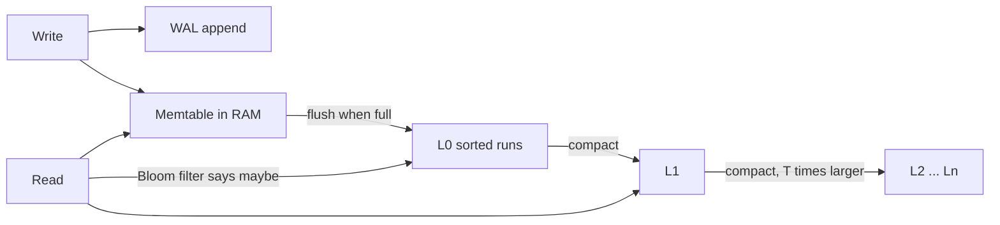

Pulse writes 20 million posts a day at ~1 KB each: 20 GB/day, 7.3 TB a year. Three queries dominate. The app fetches a post by id, and a user's posts newest first. The growth team asks "posts per day for the last 30 days", which today scans 600 GB and takes ten minutes. Meanwhile the photo service stores 88 TB of image bytes every day. No single store is good at all of this — and the reason is not brand names but layout: how bytes sit on disk and which index finds them.

:::key[First principle]
Choose the store from the **dominant access pattern**. Row layouts make "fetch one whole record" cheap; column layouts make "scan one field over billions of rows" cheap; B-trees give predictable reads with in-place updates; LSM trees turn random writes into sequential ones and pay for it on reads and compaction. Size every choice from bytes per row × rows.
:::

## 14.1 Five data models, one Pulse post

The same post looks different in each model, and the shape decides which queries are cheap:

| Model | The post stored as | Cheap | Expensive | Examples |
|---|---|---|---|---|
| **Relational (row)** | a row in `posts(post_id, user_id, created_at, likes, lang, body)` | joins, transactions, constraints, ad-hoc queries | horizontal write scale | PostgreSQL, MySQL |
| **Key-value** | `post:{id}` → opaque blob | get/put by exact key at any scale | anything needing a scan or join | Redis, DynamoDB |
| **Document** | `{id, user, body, comments: [...]}` | whole nested object in one read | cross-document joins, updates to shared sub-objects | MongoDB, Couchbase |
| **Wide-column** | partition `user_id`, rows clustered by `created_at` desc | append-heavy writes, range scan within a partition | ad-hoc queries, joins | Cassandra, HBase, ScyllaDB |
| **Columnar (OLAP)** | each field in its own compressed column file | aggregates over billions of rows | point lookups, frequent updates | ClickHouse, BigQuery, Redshift |

Around these sit specialised stores: search indexes (full text, faceting), time-series databases, graph databases (multi-hop traversals), object storage (large immutable bytes) and logs/queues (ordered append and replay).

## 14.2 Size it from bytes per row

Every storage decision starts with

$$
\text{size} = \text{rows} \times \text{bytes per row},
\qquad
\text{index size} \approx \frac{\text{rows} \times \text{bytes per entry}}{\text{page fill factor}}.
$$

:::example[Worked example · a year of Pulse and the photo service]
**Pulse posts:** \(20 \times 10^6\) posts/day × 1 KB = 20 GB/day → 7.3 TB/year. An index on `(user_id, created_at)` at ~32 B per entry (8 B user, 8 B timestamp, pointer and overhead — illustrative) over \(7.3 \times 10^9\) entries is 234 GB raw, ~334 GB at 70% page fill.
**Photo service:** 88 TB/day of image bytes is ~32 PB/year — object storage only. Its metadata is \(20 \times 10^6\) DAU × 2 uploads = 40M rows/day; at ~500 B per row (illustrative) that is 20 GB/day, the same scale as Pulse, and fits a relational database.
:::

Rough thresholds: ~100 GB fits anywhere; ~10 TB is one large node or a few; ~100 TB forces partitioning; petabytes of blobs force object storage plus a metadata database.

## 14.3 Row vs column layout

A row store keeps each record's fields together, so a point lookup reads one place. A column store keeps each field together, so a query that touches 1 of 6 fields reads ~1/6 of the bytes — less, after compression, because a column holds one type with similar values. Sorted columns compress best: store differences between neighbours (delta encoding) and a column of increasing timestamps becomes a column of small numbers.

```python run
"""Row vs column layout: how well each compresses, and what an analytic query has to read."""
import zlib
import numpy as np

rng = np.random.default_rng(5)
n = 200_000                                                     # a slice of the Pulse posts table
cols = {
    "post_id":    np.arange(10**9, 10**9 + n, dtype=np.int64),
    "user_id":    rng.integers(0, 10_000_000, n).astype(np.int64),
    "created_at": np.sort(rng.integers(1_700_000_000, 1_700_086_400, n)).astype(np.int64),
    "likes":      rng.geometric(0.2, n).astype(np.int32),
    "lang":       rng.choice([0, 1, 2, 3], n, p=[0.6, 0.25, 0.1, 0.05]).astype(np.int8),
}
DELTA = ("post_id", "created_at")                               # sorted columns: store differences

rows = np.rec.fromarrays(list(cols.values()), names=list(cols)).tobytes()
row_z = len(zlib.compress(rows, 6))
print(f"fixed-width fields, row-major: {len(rows):>9,} B -> {row_z:>9,} B ({len(rows) / row_z:.1f}x)")
total_z, ratio = 0, {}
for name, a in cols.items():
    raw = np.diff(a, prepend=a[:1]).tobytes() if name in DELTA else a.tobytes()
    z = len(zlib.compress(raw, 6))
    total_z, ratio[name] = total_z + z, a.nbytes / z
    print(f"  column {name:10s} {a.nbytes:>9,} B -> {z:>9,} B ({ratio[name]:6.1f}x)"
          + ("  delta-encoded" if name in DELTA else ""))
print(f"fixed-width fields, columnar:  {len(rows):>9,} B -> {total_z:>9,} B ({len(rows) / total_z:.1f}x)")

# 'posts per day for the last 30 days' only needs created_at; Pulse writes 20M posts/day
q_rows = 30 * 20_000_000
row_gb = q_rows * 1_000 / 1e9                                   # row store reads whole 1 KB rows
col_gb = q_rows * 8 / 1e9                                       # column store reads one 8 B column
print(f"\nquery over {q_rows:,} rows, scanning at 1 GB/s (illustrative):")
print(f"  row store    {row_gb:8.1f} GB -> {row_gb:7.1f} s")
print(f"  column store {col_gb:8.1f} GB raw, {col_gb / ratio['created_at']:.2f} GB compressed "
      f"-> {col_gb / ratio['created_at']:5.2f} s  ({row_gb / (col_gb / ratio['created_at']):,.0f}x less I/O)")
```

```output
fixed-width fields, row-major: 5,800,000 B -> 1,812,642 B (3.2x)
  column post_id    1,600,000 B ->     2,352 B ( 680.3x)  delta-encoded
  column user_id    1,600,000 B ->   775,614 B (   2.1x)
  column created_at 1,600,000 B ->    65,574 B (  24.4x)  delta-encoded
  column likes        800,000 B ->   145,869 B (   5.5x)
  column lang         200,000 B ->    49,883 B (   4.0x)
fixed-width fields, columnar:  5,800,000 B -> 1,039,292 B (5.6x)

query over 600,000,000 rows, scanning at 1 GB/s (illustrative):
  row store       600.0 GB ->   600.0 s
  column store      4.8 GB raw, 0.20 GB compressed ->  0.20 s  (3,050x less I/O)
```

The same fixed-width fields compress 3.2× laid out by row and 5.6× by column; the sorted, delta-encoded `created_at` column compresses 24×, while random `user_id`s barely compress (2.1×) — compression rewards order and low cardinality. The analytic query drops from 600 GB to 0.2 GB of I/O: ten minutes to a fraction of a second. That gap is why analytics belongs in a column store fed from the OLTP database, not in the OLTP database ([batch and stream](/c/system-design/17-batch-and-stream)).

The reverse holds for point reads: fetching one post from a column store touches every column file. Row stores serve the app; column stores serve the analysts.

## 14.4 B-trees: shallow, predictable, update in place

A B-tree index stores sorted keys in fixed-size pages. Each internal page holds up to $f$ child pointers (the **fanout**), so $N$ entries need

$$
\text{depth} = \lceil \log_f N \rceil,
\qquad
f \approx \frac{\text{page size}}{\text{entry size}} \times \text{fill factor}.
$$

Internal pages are a ~\(1/f\) sliver of the tree, small enough to keep in RAM, so a lookup costs about **one** SSD read (the leaf) — ~100 µs from the latency table.

A B-tree updates in place: changing a 1 KB row dirties its whole page, which must eventually be rewritten, plus a write-ahead log record. That page-sized write per small change is the B-tree's write amplification.

## 14.5 LSM trees: sequential writes, compaction, Bloom filters

A log-structured merge (LSM) tree never updates in place:



Writes go to a log and an in-memory sorted table; full memtables flush to immutable sorted files; background **compaction** merges files into levels, each $T$ times larger than the last (the size ratio). With data size $D$ and memtable size $m$:

$$
L = \left\lceil \log_T \frac{D}{m} \right\rceil,
\qquad
\text{WA}_{\text{leveled}} \approx 2 + L\cdot\frac{T+1}{2}\ \ (\text{rule of thumb}),
\qquad
\text{runs per miss} \approx L.
$$

The write-amplification model counts one WAL write, one flush, and each byte being rewritten about $(T+1)/2$ times as it is merged into each level. Real numbers depend on compaction policy and workload — read them from the engine's statistics. A read may check every level; **Bloom filters** let it skip runs that certainly lack the key. With $b$ bits per key and the optimal $k = b \ln 2$ hash functions, the false-positive rate is

$$
\text{fp} = \left(1 - e^{-k/b}\right)^{k} \approx 0.6185^{\,b}.
$$

```python run
"""B-tree depth vs LSM levels for an index over one year of Pulse posts (7.3B entries)."""
import math

N = 20_000_000 * 365            # 20M posts/day for a year
ENTRY, FILL = 32, 0.7           # bytes per index entry, typical page fill (both illustrative)

print("B-tree index on (user_id, created_at)")
for page in (8_192, 16_384):
    f = int(page / ENTRY * FILL)                    # effective fanout
    depth = math.ceil(math.log(N, f))
    leaves = N / f
    internal = leaves / (f - 1)                     # leaves/f + leaves/f^2 + ...
    print(f"  {page // 1024:2d} KB pages: fanout {f}, depth {depth}, leaves {leaves * page / 1e9:,.0f} GB, "
          f"internal pages {internal * page / 1e9:.2f} GB")
print(f"  lookup with internal pages cached: 1 SSD read ~ 100 us; cold: {depth} reads ~ {depth * 100} us")
print(f"  updating one 1 KB row dirties a 16 KB page: up to {16_384 / 1_000:.0f}x write amplification "
      f"(less when many rows on a page change before it is flushed)")

data_gb, mem_mb = N * 1_000 / 1e9, 64
print(f"\nleveled LSM over {data_gb:,.0f} GB of posts, 64 MB memtable (rule-of-thumb model)")
print(f"{'T':>3s} {'levels':>6s} {'write amp':>9s} {'runs a miss checks':>18s}")
for T in (4, 10, 20):
    L = math.ceil(math.log(data_gb * 1_000 / mem_mb, T))
    print(f"{T:3d} {L:6d} {2 + L * (T + 1) / 2:9.0f} {L:18d}")

L = 6
print(f"\nBloom filters per run (T=10, {L} levels): SSD reads for a key that is absent")
for bits in (0, 5, 10, 15):
    k = max(1, round(bits * math.log(2)))
    fp = (1 - math.exp(-k / bits)) ** k if bits else 1.0
    print(f"  {bits:2d} bits/key: false positive {fp:7.2%} -> {L * fp:4.2f} reads; "
          f"filter RAM {bits * N / 8 / 1e9:5.1f} GB")
```

```output
B-tree index on (user_id, created_at)
   8 KB pages: fanout 179, depth 5, leaves 334 GB, internal pages 1.88 GB
  16 KB pages: fanout 358, depth 4, leaves 334 GB, internal pages 0.94 GB
  lookup with internal pages cached: 1 SSD read ~ 100 us; cold: 4 reads ~ 400 us
  updating one 1 KB row dirties a 16 KB page: up to 16x write amplification (less when many rows on a page change before it is flushed)

leveled LSM over 7,300 GB of posts, 64 MB memtable (rule-of-thumb model)
  T levels write amp runs a miss checks
  4      9        24                  9
 10      6        35                  6
 20      4        44                  4

Bloom filters per run (T=10, 6 levels): SSD reads for a key that is absent
   0 bits/key: false positive 100.00% -> 6.00 reads; filter RAM   0.0 GB
   5 bits/key: false positive   9.18% -> 0.55 reads; filter RAM   4.6 GB
  10 bits/key: false positive   0.82% -> 0.05 reads; filter RAM   9.1 GB
  15 bits/key: false positive   0.07% -> 0.00 reads; filter RAM  13.7 GB
```

:::example[Worked example · one year of Pulse posts]
**B-tree:** 16 KB pages at 70% fill give fanout 358 and depth 4 over 7.3B entries. Leaves take 334 GB; internal pages only 0.94 GB — cache them and every lookup is one ~100 µs SSD read. **LSM** with $T = 10$: 6 levels, write amplification ~35 by the rule of thumb, and up to 6 runs to check for a key — but 10 bits/key of Bloom filter (9.1 GB of RAM) cuts the expected wasted reads for an absent key from 6 to 0.05.
:::

:::chart[Leveled LSM over 7.3 TB: a larger size ratio T means fewer levels but more rewriting (rule-of-thumb model)]{type="line" x="size ratio T" y="count" points="true" marks="10:common default"}
size ratio T, levels (runs a lookup may check), write amplification
2, 17, 27.5
3, 11, 24.0
4, 9, 24.5
5, 8, 26.0
6, 7, 26.5
8, 6, 29.0
10, 6, 35.0
12, 5, 34.5
16, 5, 44.5
20, 4, 44.0
:::

:::chart[Bloom filter: false-positive rate and wasted SSD reads for a missing key across 6 runs]{type="line" x="bits per key" y="value" ylog="true" points="true" marks="10:10 bits/key"}
bits per key, false positive %, expected wasted reads (6 runs)
1, 63.21, 3.793
2, 39.35, 2.361
4, 14.69, 0.8813
6, 5.606, 0.3363
8, 2.158, 0.1295
10, 0.8194, 0.04916
12, 0.3142, 0.01885
14, 0.1201, 0.007207
16, 0.04587, 0.002752
20, 0.006714, 0.0004028
:::

Each extra bit per key divides the false-positive rate by ~1.6; 10 bits/key is the usual sweet spot (0.82%).

## 14.6 B-tree or LSM?

| Factor | B-tree (PostgreSQL, MySQL InnoDB) | LSM (RocksDB, Cassandra, ScyllaDB) |
|---|---|---|
| Point read | ~1 SSD read with internals cached; predictable | memtable + Bloom checks + ~1 read; more variance |
| Range scan | contiguous leaves; fast | merge across levels; slower |
| Write path | random page writes + WAL; WA up to ~page/row | sequential appends; WA ~25–45 by the rule of thumb in §14.5 |
| Write throughput | bounded by random I/O and page contention | high; absorbs bursts in the memtable |
| Space | fragmentation, ~30% empty page space | old versions until compaction; extra space during it |
| Latency hazards | page splits, vacuum/checkpoint | compaction stalls, write stalls when L0 backs up |
| Pick when | read-heavy OLTP, transactions, ad-hoc queries | write-heavy, append-mostly, time-ordered keys |

For Pulse — 6,000 reads vs 600 writes per second at peak — a B-tree OLTP database is the natural fit. A chat or metrics system writing 100,000 small rows per second leans LSM. The [indexes](/c/system-design/23-indexes) section covers composite-index design on top of either.

## 14.7 Choosing a store

Three questions, in order:

1. **What is the dominant query?** Write it down with filters and sort order. "Get by exact key" → key-value. "A user's posts, newest first" → a composite index `(user_id, created_at)` in a relational table, or a wide-column partition per user. "Aggregate over all rows" → columnar.
2. **What must be transactional?** Balances, inventory, uniqueness — anything with an invariant — want a relational engine with constraints ([transactions](/c/system-design/15-transactions)).
3. **How big, and how fast does it grow?** Use the thresholds in §14.2.

**Polyglot persistence, honestly.** Real systems end up with several stores — relational core, cache, search, object storage, an analytics warehouse, a log. Each one is a consistency boundary, a backup story, an on-call rotation and a schema to keep in sync. The rule: **one store until it hurts; then add exactly one more, for exactly one access pattern.**

:::warn[Derived stores are not sources of truth]
A search index, a cache or an analytics copy is rebuilt from the source of truth, can lag it, and must never be the only place a record exists. Make the rebuild path real and tested ([search index](/c/system-design/32-search-index)).
:::

Patterns that separate the write shape from the read shape:

- **Materialised views** — precomputed query results refreshed on write or on a schedule. The simplest denormalisation.
- **CQRS** — writes go to a normalised model; reads come from projections built from it. Powerful, and it doubles the schemas you maintain.
- **Event sourcing** — store the events, derive current state. Perfect audit trail; costs snapshotting, event-schema evolution and simple `SELECT`s.

## 14.8 Practical rules

- **Size first:** rows/day × bytes/row × retention, plus each index at ~32–64 B/entry ÷ fill factor.
- **OLTP in a row store, analytics in a column store** — single-column aggregates read orders of magnitude less (3,050× in §14.3).
- **Keep B-tree internal pages in RAM**: ~(index size ÷ fanout). For Pulse, under 1 GB.
- **LSM for write-heavy, append-mostly data**; budget Bloom memory at ~10 bits/key and watch compaction debt.
- **Blobs in object storage, metadata in a database** — never 2 MB photos in table rows.
- **Add a store only for a measured access pattern** the current one cannot serve.

## 14.9 Check yourself

:::qa[A table gets 5M rows/day of 400 B and keeps 2 years. An index has 40 B entries at 70% fill. How big are the table and the index?]
Rows: \(5 \times 10^6 \times 730\) = 3.65B. Table: \(3.65 \times 10^9 \times 400\) B = 1.46 TB. Index: \(3.65 \times 10^9 \times 40 / 0.7\) ≈ 209 GB.
:::

:::qa[A dashboard sums one 4-byte column over 1B rows of 500-byte records. How much does a row store read vs a column store with 8× compression on that column?]
Row store: \(10^9 \times 500\) B = 500 GB. Column store: \(10^9 \times 4 / 8\) = 0.5 GB — 1,000× less I/O.
:::

:::qa[A B-tree has 8 KB pages and 50-byte entries at 70% fill. What depth for 1B entries, and how much RAM keeps internal pages cached?]
Fanout ≈ \(8{,}192/50 \times 0.7\) ≈ 114. Depth = ⌈log₁₁₄ 10⁹⌉ = ⌈4.38⌉ = 5. Leaves ≈ \(10^9/114\) ≈ 8.8M pages ≈ 72 GB; internal pages ≈ leaves/113 ≈ 78K pages ≈ 0.64 GB of RAM.
:::

:::qa[Your LSM store has 6 levels and point lookups for absent keys are slow. What do Bloom filters at 10 bits/key buy, and what do they cost for 2B keys?]
False positives fall to 0.82%, so an absent key costs ~\(6 \times 0.0082\) ≈ 0.05 wasted reads instead of up to 6. Memory: \(2 \times 10^9 \times 10 / 8\) B = 2.5 GB.
:::

:::qa[A metrics service ingests 200,000 small points per second and mostly queries recent time ranges per series. B-tree or LSM, and how do you key it?]
LSM: the write rate is high and append-only, so sequential writes and memtable absorption matter more than read predictability. Key by `(series_id, time)` so a series' recent points are one contiguous range; downsample and expire old data so levels stay shallow.
:::

Next: [ACID, BASE and transactions](/c/system-design/15-transactions) — keeping invariants true when writes race.
