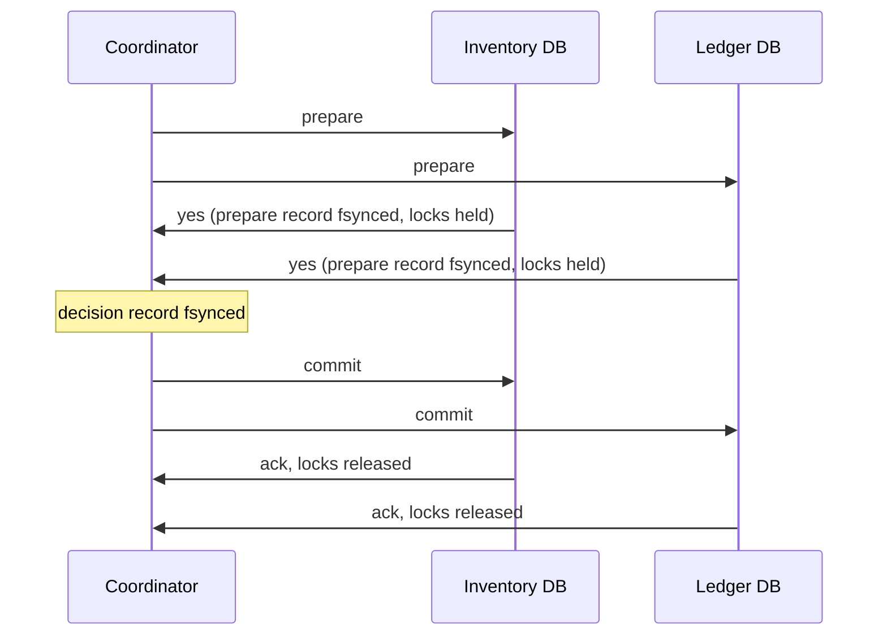
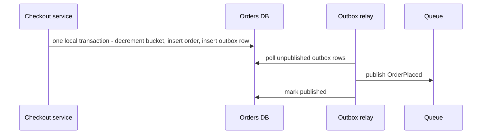

The flash sale opens. One SKU has 200 units, checkout is taking 2,000 orders/s, and every order runs the same code: read the stock, check it is positive, write stock − 1, create the order, charge the card. In testing it was perfect. In production the sale sells 321 units of a 200-unit item, and support spends a week apologising. Nothing crashed; two requests simply read the same stock value before either wrote. This section shows exactly which races each isolation level lets through, what each fix costs under contention, and why the payment call must never sit inside the database transaction.

:::key[First principle]
A transaction is only as safe as its **isolation level** and only as fast as the **time it holds contended data**. Keep each invariant inside one database, enforce it with a conditional write, and make the hot section short: a row locked for $T$ seconds can serve at most \(1/T\) transactions per second, whatever the hardware.
:::

## 15.1 ACID and BASE in one table

| Property | Promise | Who actually provides it |
|---|---|---|
| **Atomicity** | All writes commit or none do | The database's log (undo/redo) |
| **Consistency** | Invariants hold after commit | *Your* constraints and code — the database only checks what you declare |
| **Isolation** | Concurrent transactions don't see each other's partial work — at the level you chose | Locks or multi-version snapshots |
| **Durability** | Committed data survives a crash | A forced (fsync'd) log write before acknowledging |

**BASE** (basically available, soft state, eventually consistent) is the deliberate trade the other way: accept temporary disagreement between copies for availability and scale ([consistency](/c/system-design/08-consistency)). Most systems need ACID for a small core — money, stock, uniqueness — and BASE everywhere else.

## 15.2 Isolation levels and the anomalies they allow

| Anomaly | What happens | Read committed | Snapshot isolation | Serializable |
|---|---|---|---|---|
| Dirty read | See another transaction's uncommitted write | prevented | prevented | prevented |
| Non-repeatable read | Same row read twice, different values | **allowed** | prevented | prevented |
| Phantom | Same query twice, different set of rows | **allowed** | prevented for reads | prevented |
| Lost update | Two read-modify-writes; one overwrites the other | **allowed** | prevented (second writer aborts) | prevented |
| Write skew | Two transactions read overlapping data, write *different* rows, jointly break an invariant | **allowed** | **allowed** | prevented |

Engine names don't map cleanly onto these columns. PostgreSQL defaults to READ COMMITTED; its REPEATABLE READ is snapshot isolation, and its SERIALIZABLE adds conflict detection on top. MySQL InnoDB defaults to REPEATABLE READ, but an `UPDATE` reads the latest committed row, so a read in the application followed by a blind write can still lose an update. Know your engine's behaviour; "we use transactions" says nothing until you name the level.

## 15.3 Watch the anomalies happen

A tiny multi-version store makes the rules concrete. Each transaction reads either the latest committed data (read committed) or a snapshot taken at its start; at commit, snapshot isolation aborts a transaction if a concurrent one already committed a write to the same row (first committer wins); the serializable mode also aborts if anything it *read* was changed by a concurrent commit.

```python run
"""Lost update and write skew on a tiny multi-version store, under three isolation levels."""

class Store:
    def __init__(self, rows):
        self.rows, self.clock, self.log = dict(rows), 0, []    # log: (commit time, keys written)

class Txn:
    def __init__(self, db, level):
        self.db, self.level, self.start = db, level, db.clock
        self.snapshot, self.reads, self.writes = dict(db.rows), set(), {}

    def get(self, key):
        self.reads.add(key)
        if key in self.writes:
            return self.writes[key]
        # read committed sees the latest commit; the other two read their start snapshot
        return (self.db.rows if self.level == "read committed" else self.snapshot)[key]

    def put(self, key, value):
        self.writes[key] = value

    def commit(self):
        since = set().union(*[keys for t, keys in self.db.log if t > self.start])
        if self.level != "read committed" and since & set(self.writes):
            return False                     # first committer wins on the same row
        if self.level == "serializable" and since & self.reads:
            return False                     # something I read changed under me
        self.db.clock += 1
        self.db.rows.update(self.writes)
        self.db.log.append((self.db.clock, set(self.writes)))
        return True

def lost_update(level):
    """Two buyers, one unit left. Each reads stock, then writes stock - 1."""
    db = Store({"stock": 1})
    a, b = Txn(db, level), Txn(db, level)
    sa, sb = a.get("stock"), b.get("stock")
    a.put("stock", sa - 1)
    b.put("stock", sb - 1)
    sold = a.commit() + b.commit()
    return f"sold {sold}, stock {db.rows['stock']}" + ("  <- oversold" if sold > 1 else "")

def write_skew(level):
    """Two on-call engineers; rule: at least one stays on call. Each checks, then leaves."""
    db = Store({"alice": 1, "bob": 1})
    a, b = Txn(db, level), Txn(db, level)
    if a.get("alice") + a.get("bob") >= 2:
        a.put("alice", 0)
    if b.get("alice") + b.get("bob") >= 2:
        b.put("bob", 0)
    a.commit(), b.commit()
    on_call = db.rows["alice"] + db.rows["bob"]
    return f"on call {on_call}" + ("  <- rule broken" if on_call == 0 else "")

print(f"{'isolation':16s} {'lost update':28s} write skew")
for level in ("read committed", "snapshot", "serializable"):
    print(f"{level:16s} {lost_update(level):28s} {write_skew(level)}")
```

```output
isolation        lost update                  write skew
read committed   sold 2, stock 0  <- oversold on call 0  <- rule broken
snapshot         sold 1, stock 0              on call 0  <- rule broken
serializable     sold 1, stock 0              on call 1
```

Read the two columns:

- **Lost update** — both buyers read stock 1 and both write 0. Under read committed both commit: two sales of one unit. Snapshot isolation sees both transactions writing the same row and aborts the second.
- **Write skew** — each engineer checks "two on call", then removes *themselves*. The writes touch different rows, so snapshot isolation sees no conflict and lets both commit: nobody is on call. Only serializable validation, which notices that each transaction read a row the other wrote, stops it. Booking systems hit the same shape: "this seat has no booking" checked by two transactions that each insert a different booking row.

## 15.4 The flash-sale race and its fixes

The read-then-write pattern breaks long before "high" concurrency. The simulation interleaves 800 buyers for 200 units at statement granularity, with a given number of requests in flight:

```python run
"""Flash sale: 200 units, 800 buyers, randomly interleaved. Read-then-write vs a conditional update."""
import numpy as np

def run(concurrency, conditional, units=200, buyers=800, seed=0):
    rng = np.random.default_rng(seed)
    stock, sold, waiting, active = units, 0, buyers, []      # active: [step, value read]
    while waiting or active:
        while waiting and len(active) < concurrency:
            active.append([0, None])
            waiting -= 1
        i = rng.integers(len(active))                       # the scheduler picks any in-flight request
        step, seen = active[i]
        if conditional:                                     # UPDATE ... SET stock = stock - 1 WHERE stock > 0
            if stock > 0:
                stock, sold = stock - 1, sold + 1
            active.pop(i)
        elif step == 0:                                     # SELECT stock
            active[i] = [1, stock]
        else:                                               # UPDATE ... SET stock = :seen - 1
            if seen > 0:
                stock, sold = seen - 1, sold + 1
            active.pop(i)
    return sold

print("in-flight requests   units sold (read-then-write)   units sold (conditional update)")
for c in (1, 2, 8, 32, 128):
    naive = np.mean([run(c, False, seed=s) for s in range(20)])
    cond = np.mean([run(c, True, seed=s) for s in range(20)])
    print(f"{c:17d}   {naive:28.1f}   {cond:31.1f}")
```

```output
in-flight requests   units sold (read-then-write)   units sold (conditional update)
                1                          200.0                             200.0
                2                          321.1                             200.0
                8                          800.0                             200.0
               32                          800.0                             200.0
              128                          800.0                             200.0
```

With just two requests in flight the sale oversells by 60%. By eight, the blind writes keep overwriting each other's decrements — the stock counter keeps climbing back up — and every one of the 800 buyers "gets" a unit. The conditional update sells exactly 200 at every level of concurrency, because the check and the decrement are one atomic statement. Three correct fixes:

```sql
-- 1. Conditional (atomic) update: the database checks and decrements in one step
UPDATE inventory SET stock = stock - 1 WHERE sku = :sku AND stock > 0;   -- 0 rows -> sold out

-- 2. Pessimistic: lock the row, then read-modify-write
SELECT stock FROM inventory WHERE sku = :sku FOR UPDATE;

-- 3. Optimistic: version check (compare-and-set); 0 rows -> someone else won, retry
UPDATE inventory SET stock = :new, version = version + 1
 WHERE sku = :sku AND version = :seen_version;
```

Option 1 is the default whenever the invariant fits in one `WHERE` clause. Options 2 and 3 are for logic that cannot — which raises the question of which one to use.

## 15.5 Optimistic vs pessimistic: decide from contention

Let one hot row receive $\lambda$ transactions per second, each needing the row for $T$ seconds. The **contention** is

$$
\rho = \lambda T.
$$

- **Pessimistic** (lock, then work): transactions queue for the lock. With a fixed hold time this is an M/D/1 queue, mean response $T\left(1 + \frac{\rho}{2(1-\rho)}\right)$.
- **Optimistic** (work on a snapshot, validate at commit, retry on conflict): nobody waits, but an attempt is wasted whenever another transaction commits the row during its window. Wasted work turns into more attempts, which raise contention further.

Both hit the same wall: the row can serve at most \(1/T\) transactions per second. The simulation measures them on one row with Poisson arrivals, time in units of $T$:

```python run
"""One hot row: optimistic (validate at commit, retry) vs pessimistic (lock, queue). Time unit = T."""
import heapq
import numpy as np

def optimistic(rho, n=20_000, seed=1):
    arrivals = np.cumsum(np.random.default_rng(seed).exponential(1 / rho, n))
    heap = [(a + 1.0, a, a) for a in arrivals]            # (finish, start of attempt, arrival)
    heapq.heapify(heap)
    last_commit, attempts, resp = -1.0, 0, []
    while heap:
        end, start, arr = heapq.heappop(heap)
        attempts += 1
        if last_commit > start:                            # someone committed the row meanwhile
            heapq.heappush(heap, (end + 1.0, end, arr))    # retry at once
        else:
            last_commit = end
            resp.append(end - arr)
    return 1 - n / attempts, np.mean(resp)

def pessimistic(rho, n=20_000, seed=1):
    arrivals = np.cumsum(np.random.default_rng(seed).exponential(1 / rho, n))
    free, resp = 0.0, []
    for a in arrivals:                                     # FIFO lock queue, hold time T = 1
        free = max(free, a) + 1.0
        resp.append(free - a)
    return np.mean(resp)

print("rho=lambda*T  wasted attempts  attempts/commit  optimistic resp/T  pessimistic resp/T  M/D/1")
for rho in (0.05, 0.1, 0.2, 0.3, 0.5, 0.7, 0.8, 0.9):
    ab, ro = optimistic(rho)
    print(f"{rho:12.2f}  {ab:15.1%}  {1 / (1 - ab):15.2f}  "
          f"{ro:17.2f}  {pessimistic(rho):18.2f}  {1 + rho / (2 * (1 - rho)):5.2f}")
```

```output
rho=lambda*T  wasted attempts  attempts/commit  optimistic resp/T  pessimistic resp/T  M/D/1
        0.05             5.0%             1.05               1.05                1.03   1.03
        0.10            10.4%             1.12               1.12                1.06   1.06
        0.20            20.4%             1.26               1.26                1.13   1.12
        0.30            30.4%             1.44               1.44                1.22   1.21
        0.50            50.4%             2.02               2.02                1.51   1.50
        0.70            70.5%             3.39               3.39                2.22   2.17
        0.80            80.0%             5.01               5.01                3.08   3.00
        0.90            90.1%            10.08              10.08                5.33   5.50
```

:::chart[Mean response time on one hot row, in units of the work time T (simulated)]{type="line" x="contention ρ = λT" y="response time (× T)" points="true" ylog="true" marks="0.1:ρ = 0.1;0.5:ρ = 0.5"}
contention rho, optimistic (validate + retry), pessimistic (lock queue)
0.05, 1.05, 1.03
0.1, 1.12, 1.06
0.2, 1.26, 1.13
0.3, 1.44, 1.22
0.4, 1.68, 1.34
0.5, 2.02, 1.51
0.6, 2.55, 1.77
0.7, 3.39, 2.22
0.8, 5.01, 3.08
0.85, 6.68, 3.84
0.9, 10.08, 5.33
:::

:::chart[Optimistic concurrency: share of attempts thrown away (simulated)]{type="area" x="contention ρ = λT" y="wasted attempts (%)" xmin="0" xmax="1"}
rho, wasted attempts %
0.05, 5.0
0.1, 10.4
0.2, 20.4
0.3, 30.4
0.4, 40.5
0.5, 50.4
0.6, 60.7
0.7, 70.5
0.8, 80.0
0.85, 85.0
0.9, 90.1
:::

In this model the wasted share is almost exactly $\rho$: at $\rho = 0.5$ half of all attempts are thrown away and the optimistic response is 2.02 $T$ against 1.51 $T$ for locking (whose simulated values track the M/D/1 formula). Rules that follow:

| Contention | Choose | Why |
|---|---|---|
| $\rho \lesssim 0.1$ (most rows, most of the time) | Optimistic | ≤ 10% wasted work, no lock waits, no deadlocks, no locks held across slow steps |
| \(0.1 \lesssim \rho \lesssim 0.7\) | Pessimistic or conditional update | Waiting is cheaper than redoing work |
| $\rho \to 1$ | Neither — reduce $T$ or split the row | Both saturate at \(1/T\) per second |

:::example[Worked example · the flash-sale SKU]
2,000 orders/s on one inventory row. **If the transaction holds the row across the payment call** (p50 300 ms): $\rho = 2{,}000 \times 0.3 = 600$. The row can serve \(1/0.3\) ≈ 3.3 orders/s; the sale collapses. **If it holds the row until the commit is durable** (~1 ms fsync, illustrative): $\rho = 2$ — still saturated, at most 1,000 orders/s. **Split the stock into 8 buckets of 25 units** and route each order to a random bucket with stock: 250 orders/s per bucket, $\rho = 0.25$, and a locking response of ~1.17 ms (M/D/1). The payment happens *after* the stock transaction commits, via the outbox in §15.7; if it fails, a compensating update returns the unit.
:::

## 15.6 Two-phase commit: count the round trips

When one transaction must commit atomically across several databases, two-phase commit (2PC) does it with a coordinator:



Each participant holds its locks from the prepare until the commit arrives and is logged. With round-trip time $r$ between coordinator and participants and a durable log write costing $f$:

$$
T_{\text{client}} \approx r + 2f,
\qquad
T_{\text{locks held}} \approx r + 3f,
\qquad
A_{\text{2PC}} = A^{\,n+1}.
$$

```python run
"""Two-phase commit cost: latency, lock hold time, hot-row ceiling and availability."""
FSYNC_MS = 1.0          # durable log write on SSD, illustrative
A = 0.999               # availability of each participant, illustrative

def local():
    hold = FSYNC_MS                                     # lock held until the commit record is durable
    return FSYNC_MS, hold, A

def two_pc(rtt, participants):
    # prepare -> participants force a prepare record -> vote -> coordinator forces the decision
    client = rtt + FSYNC_MS + FSYNC_MS                  # client can be answered once the decision is durable
    # a participant holds locks from prepare until it has applied and logged the commit
    hold = FSYNC_MS + rtt + FSYNC_MS + FSYNC_MS
    return client, hold, A ** (participants + 1)        # every participant and the coordinator must be up

print(f"{'commit protocol':34s} {'client ms':>9s} {'locks held ms':>13s} {'max tx/s on a hot row':>21s} "
      f"{'availability':>12s}")
rows = [("local transaction, one database", *local())]
for rtt, where in ((0.5, "same DC"), (150, "cross-region")):
    rows.append((f"2PC, 3 participants, {where}", *two_pc(rtt, 3)))
for name, client, hold, av in rows:
    print(f"{name:34s} {client:9.1f} {hold:13.1f} {1000 / hold:21,.0f} {av:12.4%}")

print(f"\nmessages per 2PC commit with 3 participants: {4 * 3} (prepare, vote, commit, ack each)")
print(f"downtime/yr at {A ** 4:.4%}: {(1 - A ** 4) * 525_600:,.0f} min vs {(1 - A) * 525_600:,.0f} min local")
```

```output
commit protocol                    client ms locks held ms max tx/s on a hot row availability
local transaction, one database          1.0           1.0                 1,000     99.9000%
2PC, 3 participants, same DC             2.5           3.5                   286     99.6006%
2PC, 3 participants, cross-region      152.0         153.0                     7     99.6006%

messages per 2PC commit with 3 participants: 12 (prepare, vote, commit, ack each)
downtime/yr at 99.6006%: 2,099 min vs 526 min local
```

What 2PC costs, from the table:

- **Locks held 3.5× longer in one datacenter, 153× longer across regions**, so a hot row's ceiling drops from 1,000 to 286 or 7 transactions/s — this is the \(1/T\) wall from §15.5, moved closer.
- **Availability multiplies down**: four parties at 99.9% each give 99.6% — about 2,099 minutes a year when commits cannot complete, four times the single database's 526.
- **It blocks.** If the coordinator dies after participants vote yes, they cannot decide alone: their locks stay held, "in doubt", until it recovers. That is the failure mode that turns a coordinator restart into a stock-table outage.

2PC is reasonable inside one database cluster (some distributed SQL databases use it internally, over short RTTs) and between two systems that both support it and are co-located. Across services and regions, use the patterns below.

## 15.7 What to use instead of distributed transactions

| Pattern | How it works | Cost |
|---|---|---|
| **One local transaction** | Put the data behind the invariant in one database | Constrains the data model; usually worth it |
| **Conditional write** | `UPDATE … WHERE stock > 0` or `WHERE version = n` | Callers handle "0 rows" (sold out or retry) |
| **Outbox** | Write the change and an event row in one local transaction; a relay publishes the event | At-least-once delivery; consumers deduplicate |
| **Idempotent steps + retries** | Each step keyed so repeating it is harmless | A key store with a TTL ([idempotency](/c/system-design/22-idempotency)) |
| **Saga** | A sequence of local transactions with compensations on failure | Compensations must exist; intermediate states are visible ([sagas](/c/system-design/31-sagas)) |

The **outbox** solves the most common everyday version of the problem — change the database *and* publish an event without a distributed transaction:



The event is never lost (it committed with the order) and never published for a rolled-back order. The relay may publish twice after a crash, so the payment consumer deduplicates by order id — exactly-once *effect* from at-least-once delivery ([delivery semantics](/c/system-design/09-delivery-semantics)).

:::example[Worked example · the checkout flow without 2PC]
1. One local transaction: conditional decrement of a stock bucket, insert the order as `PENDING`, insert an outbox row. Locks held ~1 ms.
2. The relay publishes `OrderPlaced`; the payment worker charges the card with idempotency key = order id (p50 300 ms, no database locks held).
3. On success: mark the order `PAID`. On failure: mark it `FAILED` and increment the bucket back — the saga's compensation.

Inventory can never oversell (step 1 is atomic), payment retries can never double-charge (step 2 is idempotent), and the only lock is held for a millisecond.
:::

## 15.8 Practical rules

You genuinely need strong, transactional consistency for: money moving between accounts, stock where overselling is unacceptable, uniqueness (usernames, seat assignments, idempotency keys), and anything an auditor will inspect. For those:

- **Keep each invariant inside one database** and enforce it with a constraint or a conditional write.
- **Name the isolation level.** Read committed + conditional writes covers most OLTP; use serializable for invariants spanning rows (write skew), and retry on serialization failures.
- **Never hold a lock or open transaction across a network call** to another service — it multiplies $T$ by the callee's latency.
- **Compute ρ = λT for hot rows.** Above ~0.1 prefer locking or conditional updates over optimistic retries; near 1, split the row.
- **Avoid 2PC across services**; it costs ≥ 1 extra RTT of lock time, multiplies unavailability, and blocks on coordinator failure. Use outbox + idempotency + sagas.
- **Make every retried step idempotent**; at-least-once delivery is the norm.

## 15.9 Check yourself

:::qa[Two transfers each read an account balance of 100, subtract their amount (30 and 50) in the application, and write the result. What can happen under read committed, and what two fixes work?]
A lost update: both write their own result, so the final balance is 70 or 50 instead of 20. Fix with an atomic `UPDATE accounts SET balance = balance - :amt WHERE id = :id AND balance >= :amt`, or lock the row with `SELECT … FOR UPDATE` before computing.
:::

:::qa[A booking rule says a doctor may hold at most one shift per day. Two transactions each check "no shift today" and insert a different shift row. Does snapshot isolation stop it? What does?]
No — the transactions write different rows, so first-committer-wins sees no conflict: write skew. Serializable isolation (which detects the read/write dependency) stops it, or a unique constraint on `(doctor_id, day)` turns the race into a constraint violation — the cheaper and more robust fix.
:::

:::qa[A hot counter row gets 400 updates/s and each transaction holds it for 2 ms. Optimistic or pessimistic?]
ρ = \(400 \times 0.002\) = 0.8. Optimistic would waste ~80% of attempts (response ~5 T); locking gives ~3 T. Better still: make the update a single atomic increment to shrink T, or shard the counter into buckets so each sees ρ ≤ 0.2.
:::

:::qa[2PC between two databases 40 ms apart with 1 ms log writes. What is the lock hold time and the hot-row ceiling, compared with a local transaction?]
Hold ≈ \(40 + 3 \times 1\) = 43 ms → ~23 transactions/s on a hot row, versus ~1,000/s with a 1 ms local commit. Client latency ≈ 42 ms.
:::

:::qa[Why is the outbox pattern safe against both "event lost" and "event published for a rolled-back write"?]
The event row is written in the same local transaction as the business change, so they commit or roll back together. The relay only publishes committed rows; a crash after publishing but before marking may republish, which consumers absorb by deduplicating on the event or order id.
:::

Next: [API gateway](/c/system-design/16-api-gateway) — the first building block, where the requests from all of these sections arrive.
