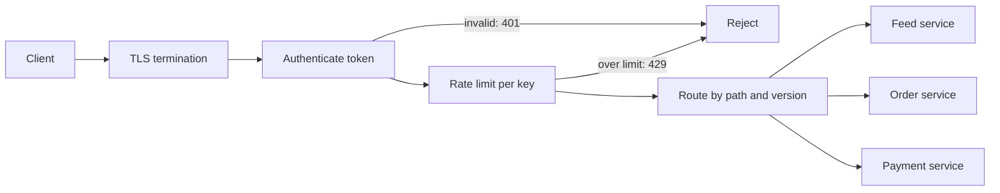
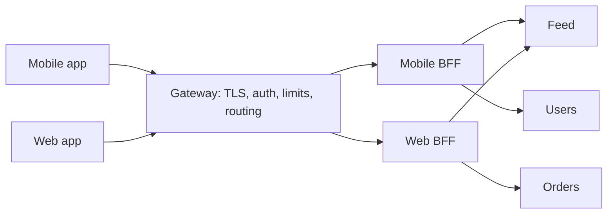

Pulse's mobile app talks to a feed service, a post service and a user service; checkout's web page talks to cart, order and payment services. Without a gateway, each service terminates TLS, validates tokens, enforces rate limits and emits access logs — six copies of the same code, six chances to get authentication wrong. An API gateway moves those concerns to one tier. The price is that **100% of requests now pass through one more component**, so its latency, capacity and configuration multiply everything behind it.

:::key[First principle]
A gateway is a shared reverse proxy for the concerns every API has in common. Its cost is one hop plus queueing on every request — about 1.5 ms if it runs at 60% utilisation, far more near saturation — and a common-mode failure domain for all services. Size it for the **offered** load (including what it rejects) with zone-loss headroom, keep it stateless, and keep business logic out.
:::

## 16.1 What it does on each request



Each stage is cheap in isolation; the order matters. Reject as early and as cheaply as possible: a request with a bad token should never cost a rate-limiter lookup, and a request over its limit should never reach a service.

| Concern | In the gateway? | Notes |
| --- | --- | --- |
| TLS termination, HTTP/2 | Yes | Re-encrypt to services (mTLS) if the network is not trusted |
| Authentication (token validation) | Yes | Local JWT check or a cached introspection call (§16.3) |
| Coarse authorisation (scopes) | Yes | "May this token call `/orders`?" Fine-grained checks stay in the service |
| Rate limits and quotas | Yes | Per API key, per user, per tenant ([rate limiter](/c/system-design/28-rate-limiter)) |
| Routing and versioning | Yes | `/v1/orders` → order service; canary 1% to a new version |
| Request validation, size limits | Yes | Reject a 50 MB JSON body before it reaches a service |
| Response aggregation | Sometimes | In a backend-for-frontend (§16.6), not the shared gateway |
| Business logic | No | It turns the gateway into a distributed monolith every team must deploy through |

A **load balancer** spreads connections across replicas of one service ([§24](/c/system-design/24-load-balancer)); a **gateway** understands the API — paths, tokens, keys. A **service mesh** applies similar policies to service-to-service traffic inside the cluster; the gateway is the north–south edge, the mesh is east–west.

## 16.2 The latency it adds

A request through the gateway pays one extra intra-DC round trip plus the gateway's own processing, which queues like any server ([§10.3](/c/system-design/10-latency-and-throughput)):

$$
t_{gw} = t_{hop} + \frac{S}{1-\rho}, \qquad t_{gw,\,p99} \approx t_{hop} + \frac{S \ln 100}{1-\rho}
$$

With $t_{hop}$ = 0.5 ms (the intra-DC RTT from [§2](/c/system-design/02-estimation)) and an illustrative $S$ = 0.4 ms of CPU per proxied request (TLS record processing, header parsing, a JWT signature check, a route lookup), modelled as M/M/1 per core — conservative, since cores share one queue:

:::example[Worked example · what Pulse's gateway costs per request]
| Utilisation $\rho$ | Mean added | p99 added |
|---:|---:|---:|
| 0.3 | 1.07 ms | 3.13 ms |
| 0.5 | 1.30 ms | 4.18 ms |
| 0.6 | 1.50 ms | 5.11 ms |
| 0.8 | 2.50 ms | 9.71 ms |
| 0.9 | 4.50 ms | 18.92 ms |
| 0.95 | 8.50 ms | 37.34 ms |

[§10.6](/c/system-design/10-latency-and-throughput) gave Pulse's feed a 200 ms p95 budget with 5 ms for auth. At 60% utilisation the gateway uses ~1.5 ms mean and ~5 ms at p99 — affordable. At 90% it takes ~19 ms of p99, the database's entire allocation. The gateway's own utilisation is the number to alert on.
:::

:::chart[Latency added by the gateway vs its utilisation (S = 0.4 ms, hop 0.5 ms, illustrative)]{type="line" x="gateway utilisation ρ" y="added latency (ms)" xfmt="pct" band="0.5:0.7:target zone" points="true"}
rho, mean added, p99 added
0.10, 0.94, 2.55
0.20, 1.00, 2.80
0.30, 1.07, 3.13
0.40, 1.17, 3.57
0.50, 1.30, 4.18
0.60, 1.50, 5.11
0.70, 1.83, 6.64
0.75, 2.10, 7.87
0.80, 2.50, 9.71
0.85, 3.17, 12.78
0.90, 4.50, 18.92
0.95, 8.50, 37.34
:::

Two things make it worse than the formula: a synchronous call per request (token introspection, a remote rate-limit counter) adds its own round trip, and a gateway that **buffers** whole request or response bodies adds transfer time for large payloads. Stream bodies; never buffer a 2 MB photo upload in the gateway.

## 16.3 Authentication: introspection vs local JWT verification

There are two ways to check a token:

- **Introspection** — ask the auth service "is this token valid?" Revocation is instant, but each check is a network call. Caching the answer for $T$ seconds cuts the calls and delays revocation by up to $T$.
- **Self-contained token (JWT)** — verify a signature locally with the issuer's public key. No call, no auth-service load; but a stolen token works until it expires.

How much does introspection cost Pulse? Active sessions follow from Little's law: 10M DAU × 2 sessions a day (illustrative) × 300 s each, over a day of ~10⁵ s, is 60,000 concurrent sessions on average and **180,000 at peak** (3×). Peak traffic is 6,000 reads + 600 writes = 6,600 req/s, so each token makes \(6{,}600 / 180{,}000\) = 0.037 requests per second — one every ~27 s. A token cache is a per-key TTL cache, so [§7.4](/c/system-design/07-caching)'s formula applies: $h = \lambda T / (1 + \lambda T)$.

:::example[Worked example · introspection load at Pulse's peak (miss = 0.5 ms RTT + 0.5 ms auth service, illustrative)]
| Cache TTL $T$ | Hit per token | Introspection QPS | Mean auth cost per request |
|---:|---:|---:|---:|
| 5 s | 15.5% | 5,577 | 0.85 ms |
| 30 s | 52.4% | 3,143 | 0.48 ms |
| 60 s | 68.8% | 2,062 | 0.31 ms |
| 300 s | 91.7% | 550 | 0.08 ms |

Tokens are requested too rarely for a short cache to help: with a 30 s revocation promise, half of all requests still call the auth service — 3,143 QPS, a service as big as Pulse's database. A JWT check costs zero calls. The usual design: **JWTs with a 5-minute expiry**, a refresh token to renew them, and a small deny-list of revoked token IDs pushed to every gateway node. The deny-list only holds revocations younger than the token lifetime, so it stays tiny.
:::

:::warn[Revocation promise = the longest of three delays]
A revoked session stops working after min(token expiry, cache TTL) + deny-list propagation time. Write that number down ("logout takes effect within 60 s") and check each delay against it. A 24-hour JWT with no deny-list means a stolen phone keeps access for a day.
:::

## 16.4 Rate limiting and admission at the edge

The gateway is where per-key limits belong: a token bucket per API key or user (rate $r$, burst $b$; derivation in [§28](/c/system-design/28-rate-limiter)). With $n$ gateway nodes there are two placements:

| Placement | Cost per request | Accuracy |
|---|---|---|
| Local bucket per node, each allowing $r/n$ | ~µs, no network | Exact only if the load balancer spreads each key evenly; a key pinned to one node gets $r/n$ |
| Shared counter in Redis | +0.5 ms RTT (batch or pipeline to amortise) | Exact across nodes; a Redis outage must fail open or closed — decide which |

Checkout's flash sale shows why admission belongs here. Downstream can take 2,000 orders/s. The **offered** load can be far higher: bots and impatient clients retrying can send, say, 200,000 requests/s (illustrative, 100× the admitted rate). Every one of those reaches the gateway, so the gateway must be sized for them — but a rejection is cheaper than a proxied request (no upstream call, ~0.1 ms of CPU, illustrative). Return `429` with `Retry-After`, and limit per user *and* globally so one abuser cannot spend everyone's share.

## 16.5 Sizing for peak

$$
\text{nodes} = \max\left(\left\lceil \frac{\text{CPU at offered load}}{\text{cores} \times \rho_{target}} \right\rceil,\ \text{zone redundancy}\right)
$$

The block below computes §16.2–16.4 for Pulse and checkout with 8-core nodes (20,000 proxied req/s flat out at 0.4 ms each), a 60% target, and the rule that losing one of three zones must leave the rest under 75% ([§10.4](/c/system-design/10-latency-and-throughput)).

```python run
import math

# All per-request costs are illustrative assumptions, not measurements.
HOP_MS = 0.5          # extra intra-DC round trip gateway -> service (§2 latency table)
CPU_MS = 0.4          # gateway CPU per proxied request: TLS records, parsing, JWT check, routing
CORES = 8
CAP = CORES * 1000 / CPU_MS          # requests/s one node can process flat out

print("1) Latency the gateway adds (M/M/1 per core, §10.3)")
print("  rho | mean added | p99 added")
for rho in (0.3, 0.5, 0.6, 0.7, 0.8, 0.9, 0.95):
    mean = HOP_MS + CPU_MS / (1 - rho)
    p99 = HOP_MS + math.log(100) * CPU_MS / (1 - rho)
    print("%5.2f | %7.2f ms | %6.2f ms" % (rho, mean, p99))

print("\n2) Token introspection load vs cache TTL (Pulse peak)")
sessions_day = 10e6 * 2                  # 2 sessions per DAU (illustrative)
session_s = 300                          # 5-minute sessions (illustrative)
active_peak = 3 * sessions_day * session_s / 1e5   # Little's law, 1 day ~ 1e5 s, 3x peak
qps = 6000 + 600                         # Pulse peak reads + writes
lam = qps / active_peak                  # requests per second per active token
print("  active sessions at peak %.0f, %.3f req/s per token" % (active_peak, lam))
print("  TTL s | hit/token | introspection QPS | mean auth cost")
for T in (5, 30, 60, 300):
    h = lam * T / (1 + lam * T)          # per-key TTL hit ratio (§7.4)
    miss_qps = qps * (1 - h)
    cost = (1 - h) * (HOP_MS + 0.5)      # miss = RTT + 0.5 ms auth-service time
    print("%7d | %8.1f%% | %17.0f | %8.2f ms" % (T, 100 * h, miss_qps, cost))

print("\n3) Fleet size: offered load, 60% target, survive losing 1 of 3 zones")
REJECT_MS = 0.1                          # CPU to reject at the rate limiter (illustrative)
for name, admitted, offered in (("Pulse peak", 6600, 6600),
                                ("Pulse + checkout flash sale", 12600, 12600),
                                ("flash sale with bots", 12600, 200000)):
    cpu = (admitted * CPU_MS + (offered - admitted) * REJECT_MS) / 1000  # cores busy
    per_zone = 1
    while cpu / (2 * per_zone * CORES) > 0.75 or cpu / (3 * per_zone * CORES) > 0.6:
        per_zone += 1
    n = 3 * per_zone
    print("  %-28s %6d req/s -> %5.1f cores -> %d nodes (rho %.2f, zone down %.2f)" % (
        name, offered, cpu, n, cpu / (n * CORES), cpu / ((n - per_zone) * CORES)))

print("\n4) Connections at peak: %.0f sessions x 50 KB = %.1f GB; handshakes %.0f/s" % (
    active_peak, active_peak * 50e3 / 1e9, 3 * sessions_day / 1e5))
```

```output
1) Latency the gateway adds (M/M/1 per core, §10.3)
  rho | mean added | p99 added
 0.30 |    1.07 ms |   3.13 ms
 0.50 |    1.30 ms |   4.18 ms
 0.60 |    1.50 ms |   5.11 ms
 0.70 |    1.83 ms |   6.64 ms
 0.80 |    2.50 ms |   9.71 ms
 0.90 |    4.50 ms |  18.92 ms
 0.95 |    8.50 ms |  37.34 ms

2) Token introspection load vs cache TTL (Pulse peak)
  active sessions at peak 180000, 0.037 req/s per token
  TTL s | hit/token | introspection QPS | mean auth cost
      5 |     15.5% |              5577 |     0.85 ms
     30 |     52.4% |              3143 |     0.48 ms
     60 |     68.8% |              2062 |     0.31 ms
    300 |     91.7% |               550 |     0.08 ms

3) Fleet size: offered load, 60% target, survive losing 1 of 3 zones
  Pulse peak                     6600 req/s ->   2.6 cores -> 3 nodes (rho 0.11, zone down 0.17)
  Pulse + checkout flash sale   12600 req/s ->   5.0 cores -> 3 nodes (rho 0.21, zone down 0.32)
  flash sale with bots         200000 req/s ->  23.8 cores -> 6 nodes (rho 0.50, zone down 0.74)

4) Connections at peak: 180000 sessions x 50 KB = 9.0 GB; handshakes 600/s
```

What the numbers say:

1. **For Pulse, redundancy sets the fleet, not CPU.** 6,600 req/s needs 2.6 cores; three nodes (one per zone) run at 11%. Don't shrink below one node per zone to "save" money.
2. **Abuse sets it for checkout.** 200,000 offered req/s, mostly rejected, needs 23.8 cores → 6 nodes, 74% with a zone down. Size the edge for the attack you expect, and autoscale on CPU — but scaling takes minutes, so keep the baseline above a normal flash sale.
3. **Connections cost memory, not CPU.** 180,000 open HTTP/2 connections at ~50 KB each (illustrative TLS and stream buffers) is 9 GB across the fleet. Full TLS handshakes run at ~600/s (20M sessions/day × 3 peak ÷ 10⁵ s); TLS session resumption keeps reconnecting phones cheap.

## 16.6 Routing, versioning and backends-for-frontends

Routing is a table: path prefix and version → upstream cluster. Two uses beyond the obvious:

- **Canary releases.** Send 1% of `/v2/feed` to the new build, compare error rate and p99 against the 99%, then ramp. This shrinks a bad release's blast radius — the common-mode fraction $\beta$ of [§6.3](/c/system-design/06-availability).
- **Versioning.** Keep `/v1` routed until its traffic drops below an agreed floor; the gateway's access logs tell you who still calls it.

Rather than one gateway shape for every client, give each client type a thin **backend-for-frontend** (BFF) behind the shared gateway: the mobile BFF returns one small aggregated payload per screen; the web BFF returns page-shaped data.



The win is round trips: a phone on a 100 ms mobile RTT that makes 5 sequential calls per screen spends 500 ms on the network; one BFF call that fans out inside the data centre (0.5 ms RTTs) spends ~100 ms. The cost is one more deployable per client and the temptation to grow business logic in it.

## 16.7 Configuration with numbers

| Setting | Starting point | Why |
|---|---|---|
| Upstream timeout | Service p99 × 2–3, below the client's timeout | A gateway timeout longer than the client's wastes work nobody waits for |
| Retries | 0 for non-idempotent; 1 for idempotent GETs, within a 10% retry budget | Retries multiply across layers (below) |
| Max request body | 1 MB for JSON APIs; uploads go straight to object storage via signed URLs | Stops memory exhaustion; keeps 2 MB photos off the gateway |
| Idle connection timeout | 60–120 s | Bounds the open-connection memory of §16.5 |
| Token cache / JWT expiry | ≤ the revocation promise (e.g. 5 min) | §16.3 |
| Rate limit | Per key: steady rate + burst sized from real traffic percentiles | §16.4, [§28](/c/system-design/28-rate-limiter) |
| Utilisation alert | Page above 70% sustained | §16.2: p99 added doubles from 60% to 80% |

**Retries multiply.** If the client, the gateway and the service each retry a failed call $r$ times, the deepest dependency sees up to $(1+r)^d$ attempts for $d$ layers:

:::chart[Worst-case attempts at the deepest dependency per user action]{type="bar" x="layers that retry" y="attempts" ylog="true" yfmt="int"}
layers, 1 retry each, 2 retries each, 3 retries each
1, 2, 3, 4
2, 4, 9, 16
3, 8, 27, 64
4, 16, 81, 256
:::

Three layers with two retries each turn one failing payment call into 27 — during exactly the incident when the payment provider is already struggling. Retry in **one** layer, with backoff, jitter and a budget ([retry](/c/system-design/30-retry)), and let the others fail fast ([circuit breaker](/c/system-design/20-circuit-breaker)).

## 16.8 Failure modes

| Failure | Mechanism | Detect with | Mitigation |
|---|---|---|---|
| Gateway saturation | CPU > ~80%: added p99 climbs from 5 ms to 19 ms+ | Gateway CPU and added-latency p99 | Autoscale on CPU; baseline sized for flash sales |
| Bad config push | One routing or auth change applies to every service at once | Error rate by route right after a deploy | Config as code, canary the config, one-click rollback |
| Retry storm | Retries at several layers, $(1+r)^d$ | Upstream request rate ÷ client request rate | Retry in one layer with a budget |
| Auth service as hidden dependency | Introspection on the hot path | Auth-service QPS tracks gateway QPS | Local JWT verification + deny-list |
| Stale revocation | Token cache or JWT longer than the promise | Test: revoke and measure time to 401 | Shorter expiry, pushed deny-list |
| Global limit locks out everyone | One tenant exhausts a shared bucket | 429s by key: one key dominates | Per-key limits under the global one |
| Body buffering | Large uploads held in gateway memory | Gateway memory vs request size | Size limits; uploads via signed URL to object storage |

## 16.9 Rules of thumb

- **Budget ~1.5 ms mean, ~5 ms p99** for a gateway at 60% utilisation; alert above 70%.
- **One node per zone minimum**; beyond that, size for offered load including rejected requests.
- **Verify tokens locally**; introspection at 30 s TTL still calls the auth service for half of Pulse's requests.
- **Retry in one layer only.** Three layers × two retries = 27 attempts.
- **No business logic, no body buffering, no per-request remote calls** you can avoid.

## 16.10 Check yourself

:::qa[Pulse's gateway runs at 85% CPU during peak. What does it add to p99, and what would you change?]
\(0.5 + 4.6 \times 0.4/(1-0.85)\) ≈ 12.8 ms at p99 (mean ≈ 3.2 ms), against ~5 ms at 60%. Add nodes or cores until peak utilisation is ≤ 60%, and check the zone-down case still stays under 75%.
:::

:::qa[Security asks that a logged-out session stop working within 60 seconds. Introspection with a 60 s cache, or JWTs?]
Introspection with $T$ = 60 s meets the promise but, at 0.037 requests per token per second, misses 31% of requests: ~2,060 auth calls/s at peak. JWTs with a 5-minute expiry plus a deny-list pushed to the gateways within seconds meet the same 60 s promise with zero calls — the deny-list holds only revocations from the last 5 minutes.
:::

:::qa[A flash sale admits 2,000 orders/s but the edge sees 200,000 req/s. Why size the gateway for 200,000?]
Every request costs gateway CPU before it can be rejected: \(12{,}600 \times 0.4 + 187{,}400 \times 0.1\) ms ≈ 23.8 cores. Sized for admitted traffic (3 nodes, 24 cores), the gateway itself saturates and the legitimate 2,000 orders/s queue behind the bots.
:::

:::qa[The mobile client, the gateway and the order service each retry twice. The payment provider is down. How many calls per checkout click reach it?]
\((1+2)^3\) = 27. At 2,000 clicks/s that is 54,000 calls/s at a failing provider. Keep one retry layer (the order service, which knows the call is idempotent via its key) and make the client and gateway fail fast.
:::

Next: [§17 Batch and stream processing](/c/system-design/17-batch-and-stream) — what happens to the events these requests produce.
