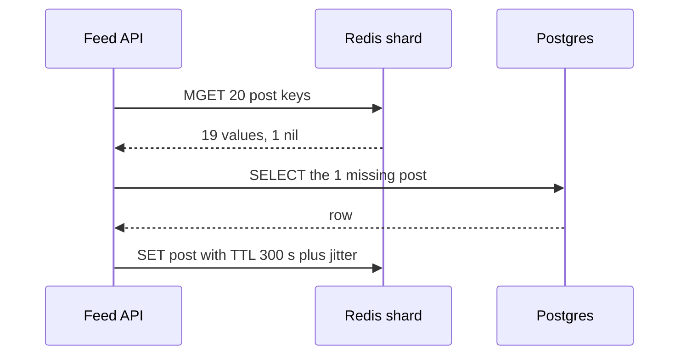

[§7](/c/system-design/07-caching) gave Pulse's cache its targets: 44 GB of post bodies for a 94% hit rate, 360 database queries per second left at the 6,000 reads/s peak, delete-on-write with a TTL backstop. It did not say what runs on the cache machines, how many of them there are, or what happens when one dies. The feed also needs a second, larger structure: the fan-out-on-write **timeline** — 800 post IDs per user, 128 GB raw ([§54](/c/system-design/54-news-feed)). This section turns those numbers into a Redis cluster: bytes per key, eviction policy, shard count, configuration and failure modes.

:::key[First principle]
A distributed cache is a hash table in RAM behind a 0.5 ms round trip. Its **latency** is round trips, so batch them; its **capacity** is RAM after per-key overhead, fragmentation and fork headroom — often 2× the raw bytes; its **throughput** is operations per shard per second. Its hit rate comes from the eviction policy meeting the workload's skew, and losing a shard sends that shard's whole share of traffic to the database.
:::

## 18.1 What runs inside: Redis and Memcached

Both are in-memory key–value servers reached over TCP. The server-side work for a GET is a hash lookup and a memory copy — microseconds. The client sees the intra-DC round trip (~0.5 ms, [§2](/c/system-design/02-estimation)) plus queueing on the server.

| | Redis | Memcached |
|---|---|---|
| Execution | One thread runs all commands per instance (I/O threads optional since 6.0) | Multi-threaded; scales up on one box |
| Values | Strings, lists, hashes, sets, sorted sets, streams, bitmaps, HyperLogLog | Opaque byte strings (CAS for optimistic updates) |
| Memory layout | `malloc` (jemalloc); compact *listpack* encoding for small collections | Slab allocator: fixed chunk sizes growing 1.25× per class |
| Eviction | Sampled LRU or LFU, configurable (§18.3) | LRU per slab class |
| Persistence | Optional RDB snapshots (fork) and AOF log | None |
| Replication, sharding | Async replicas; Redis Cluster with 16,384 hash slots | Client-side consistent hashing |
| Use beyond caching | Locks, rate limits, queues, leaderboards | Caching only |

Two internals change designs:

- **Single-threaded execution means one slow command stalls everyone.** `KEYS *`, deleting a 1M-element list synchronously, or `LRANGE` over a huge list holds the thread for milliseconds to seconds, and every client on that shard waits. Use `SCAN`, `UNLINK` (lazy free) and bounded ranges.
- **Encodings decide memory.** A list or hash under a size threshold is stored as one contiguous *listpack* (a few bytes of overhead per element); above it, or as a sorted set, each element becomes separately allocated nodes. §18.4 shows a 4.4× difference for the same timeline.

**Round trips dominate latency.** A Pulse feed page needs 20 post bodies. Twenty sequential GETs cost \(20 \times 0.5\) = 10 ms; one `MGET` or a pipelined batch costs one round trip, ~0.5 ms. With Redis Cluster the 20 keys live on different shards, so the client sends one batch per shard in parallel. Over 6 shards (§18.4) that is a fan-out, and the page waits for the slowest: if each shard exceeds its p99 1% of the time, \(1 - 0.99^6\) ≈ 5.9% of pages see a p99-or-worse cache latency ([§10.5](/c/system-design/10-latency-and-throughput)). Hash tags (`{user:42}:timeline`) put related keys in one slot when a single round trip matters more than spreading load.

:::tip[Two tiers for the hottest keys]
An in-process map with a 1–2 s TTL in front of Redis turns a 0.5 ms round trip into a ~100 ns RAM read and absorbs hot keys entirely. Each of $n$ API servers holds its own copy, so staleness is bounded by the local TTL. Use it for small, hot, drift-tolerant data: feature flags, config, the top 1,000 posts.
:::

## 18.2 Where the cache sits on the read path



This is cache-aside with a batched read; the write policies, the delete-on-write race and stampede control are in [§7.5–7.6](/c/system-design/07-caching). The operational rule that follows from the diagram: **a cache error is a miss.** If Redis times out, the API reads Postgres — which is only safe if Postgres has the headroom (§18.4) or a load shedder protects it.

## 18.3 Eviction policies, measured

When memory is full, the cache must pick a victim. The policy decides how close a real cache gets to the ideal "keep the $k$ most popular" of [§7.1](/c/system-design/07-caching):

- **FIFO** evicts the oldest *inserted* key; a popular key is evicted as soon as it is old.
- **LRU** evicts the least recently *used*; recency stands in for popularity.
- **Sampled LRU** (Redis): pick 5 random keys (`maxmemory-samples`), evict the least recently used of them. No linked list, ~24 bits of clock per key.
- **LFU** evicts the least frequently used. Redis approximates counts with an 8-bit logarithmic counter that decays over time (`lfu-log-factor`, `lfu-decay-time`).

The block replays a scaled-down Pulse trace (100,000 posts, Zipf $s$ = 1) through all four, then repeats it with the hot set replaced halfway through — what a news cycle does to a feed.

```python run
from collections import OrderedDict, defaultdict
import random
import numpy as np

rng = np.random.default_rng(42)
N, REQS, WARM = 100_000, 200_000, 50_000   # distinct posts, requests, warm-up (scaled-down Pulse)
p = 1.0 / np.arange(1, N + 1)              # Zipf s = 1
p /= p.sum()
static = rng.choice(N, REQS, p=p)
shifted = static.copy()                    # halfway through, a different set of posts becomes hot
shifted[REQS // 2:] = rng.permutation(N)[static[REQS // 2:]]


def run(trace, cap, policy):
    hits = np.zeros(len(trace), bool)
    if policy == "LFU":                    # exact LFU, oldest evicted among equal counts
        freq, buckets, lo = {}, defaultdict(OrderedDict), 0
        for t, k in enumerate(trace):
            if k in freq:
                f = freq[k]; del buckets[f][k]
                if lo == f and not buckets[f]: lo = f + 1
                freq[k] = f + 1; buckets[f + 1][k] = None; hits[t] = True
                continue
            if len(freq) >= cap:
                old, _ = buckets[lo].popitem(last=False); del freq[old]
            freq[k] = 1; buckets[1][k] = None; lo = 1
        return hits
    if policy == "sampled LRU":            # Redis-style: evict the oldest of 5 random keys
        rnd, last, keys, pos = random.Random(1), {}, [], {}
        for t, k in enumerate(trace):
            if k in last:
                hits[t] = True
            else:
                if len(keys) >= cap:
                    victim = min(rnd.sample(keys, 5), key=last.get)
                    i = pos.pop(victim); keys[i] = keys[-1]; pos[keys[i]] = i; keys.pop()
                    del last[victim]
                pos[k] = len(keys); keys.append(k)
            last[k] = t
        return hits
    cache = OrderedDict()                  # FIFO and LRU both evict the front
    for t, k in enumerate(trace):
        if k in cache:
            if policy == "LRU": cache.move_to_end(k)
            hits[t] = True
            continue
        cache[k] = None
        if len(cache) > cap: cache.popitem(last=False)
    return hits


POL = ("FIFO", "LRU", "sampled LRU", "LFU")
print("Static Zipf (s = 1): hit rate after warm-up")
print("cache % |  FIFO |   LRU | samp5 |   LFU | ideal top-k")
for frac in (0.005, 0.01, 0.02, 0.05, 0.10, 0.20):
    cap = int(frac * N)
    r = [run(static, cap, pol)[WARM:].mean() for pol in POL]
    print("%7.1f | %.3f | %.3f | %.3f | %.3f | %.3f" % (100 * frac, *r, p[:cap].sum()))

print("\nHot set changes at request 100k, cache = 5% of posts: hit rate per 20k requests")
res = {pol: run(shifted, 5_000, pol) for pol in ("FIFO", "LRU", "LFU")}
print("requests |  FIFO |   LRU |   LFU")
for i in range(REQS // 20_000):
    s = slice(i * 20_000, (i + 1) * 20_000)
    print("%7dk | %.3f | %.3f | %.3f" % ((i + 1) * 20, *(res[q][s].mean() for q in res)))
```

```output
Static Zipf (s = 1): hit rate after warm-up
cache % |  FIFO |   LRU | samp5 |   LFU | ideal top-k
    0.5 | 0.399 | 0.441 | 0.437 | 0.537 | 0.562
    1.0 | 0.466 | 0.508 | 0.504 | 0.593 | 0.619
    2.0 | 0.534 | 0.575 | 0.571 | 0.647 | 0.676
    5.0 | 0.628 | 0.666 | 0.662 | 0.714 | 0.752
   10.0 | 0.701 | 0.737 | 0.733 | 0.763 | 0.810
   20.0 | 0.780 | 0.810 | 0.807 | 0.816 | 0.867

Hot set changes at request 100k, cache = 5% of posts: hit rate per 20k requests
requests |  FIFO |   LRU |   LFU
     20k | 0.599 | 0.617 | 0.618
     40k | 0.624 | 0.660 | 0.680
     60k | 0.625 | 0.666 | 0.697
     80k | 0.629 | 0.665 | 0.704
    100k | 0.629 | 0.668 | 0.714
    120k | 0.605 | 0.624 | 0.576
    140k | 0.632 | 0.670 | 0.620
    160k | 0.622 | 0.661 | 0.621
    180k | 0.629 | 0.666 | 0.633
    200k | 0.632 | 0.668 | 0.639
```

:::chart[Hit rate vs cache size by eviction policy (Zipf s = 1, 100,000 posts, simulated)]{type="line" x="cache size (% of posts)" y="hit rate" xlog="true" yfmt="pct" ymin="0.3" ymax="0.9" points="true" dash="ideal top-k"}
cache %, FIFO, LRU, sampled LRU (5), LFU, ideal top-k
0.5, 0.399, 0.441, 0.437, 0.537, 0.562
1, 0.466, 0.508, 0.504, 0.593, 0.619
2, 0.534, 0.575, 0.571, 0.647, 0.676
5, 0.628, 0.666, 0.662, 0.714, 0.752
10, 0.701, 0.737, 0.733, 0.763, 0.810
20, 0.780, 0.810, 0.807, 0.816, 0.867
:::

:::chart[After the hot set changes: LFU keeps yesterday's posts (cache = 5%, simulated)]{type="line" x="requests (thousands)" y="hit rate per 20k requests" yfmt="pct" ymin="0.5" ymax="0.75" marks="100:hot set changes" points="true"}
requests k, FIFO, LRU, LFU
20, 0.599, 0.617, 0.618
40, 0.624, 0.660, 0.680
60, 0.625, 0.666, 0.697
80, 0.629, 0.665, 0.704
100, 0.629, 0.668, 0.714
120, 0.605, 0.624, 0.576
140, 0.632, 0.670, 0.620
160, 0.622, 0.661, 0.621
180, 0.629, 0.666, 0.633
200, 0.632, 0.668, 0.639
:::

What the numbers say (the absolute values differ from §7.3's 1M-post run; the gaps are what matter):

1. **With stable popularity, LFU wins at small sizes**: 59.3% vs LRU's 50.8% at 1% of the catalogue — 9 points closer to the ideal 61.9%. At 20% the policies converge (81–82%).
2. **Redis's sampled LRU costs ~0.4 points** against exact LRU (50.4% vs 50.8%) and saves a linked list per key. Not worth tuning above `maxmemory-samples 5` for most workloads.
3. **FIFO trails LRU by 3–4 points** everywhere. It is still what many CDN and SSD caches use, because it never reorders on a hit.
4. **LFU backfires when popularity shifts.** After the change its hit rate drops from 71.4% to 57.6% and is still 63.9% after 100,000 requests — below LRU's 66.8%. Old counts keep dead posts resident. Redis LFU's counter decay exists for exactly this; a feed, where yesterday's posts go cold, wants LRU or LFU with fast decay.

## 18.4 Sizing Pulse's cache

$$
\text{memory} = \sum_{\text{key types}} n_{\text{keys}} \times (\text{key overhead} + \text{encoded value}) \times \text{fragmentation},
\qquad
\text{shards} = \left\lceil \frac{\text{memory}}{\text{maxmemory per shard}} \right\rceil
$$

**maxmemory is not RAM.** A snapshot (RDB) or a replica's full resync forks the process; pages written during the fork are copied, so the worst case is ~2× the dataset. Leave room for that plus client buffers: the block uses a 40 GB `maxmemory` on a 64 GB node (illustrative). Per-key overheads below are illustrative too — measure your own with `MEMORY USAGE key` on a sample.

```python run
import math

# Pulse cache sizing. Per-entry overheads are illustrative: measure yours with MEMORY USAGE.
USERS, ENTRIES, ENTRY_B = 10e6, 800, 16    # timeline: 800 (post id, timestamp) pairs per user
KEY_OVERHEAD = 80                          # bytes per top-level key: dict entry, object header, key name
FRAG = 1.2                                 # allocator fragmentation ratio (illustrative)

layouts = {
    "timeline as list (listpack, ~2 B/entry)": USERS * (KEY_OVERHEAD + ENTRIES * (ENTRY_B + 2)),
    "timeline as sorted set (~64 B/entry)": USERS * (KEY_OVERHEAD + ENTRIES * (ENTRY_B + 64)),
    "post bodies, 44M x 1 KB (94% hit, §7.9)": 44e6 * (KEY_OVERHEAD + 1000),
}
print("raw timeline data: %.0f GB" % (USERS * ENTRIES * ENTRY_B / 1e9))
for name, b in layouts.items():
    print("%-40s %4.0f GB -> %4.0f GB with fragmentation" % (name, b / 1e9, b * FRAG / 1e9))

total = (layouts["timeline as list (listpack, ~2 B/entry)"]
         + layouts["post bodies, 44M x 1 KB (94% hit, §7.9)"]) * FRAG
MAXMEM = 40e9                              # per shard on a 64 GB node: room for fork copy-on-write
shards = math.ceil(total / MAXMEM)
print("\nlist layout: %.0f GB -> %d primaries at %.0f GB maxmemory, + %d replicas" % (
    total / 1e9, shards, MAXMEM / 1e9, shards))

reads = 6000 * (1 + 20)                    # peak: 1 timeline + 20 post bodies per feed read
writes = 120_000                           # peak timeline inserts/s from fan-out on write
per = (reads + writes) / shards
print("peak key ops: %d reads + %d writes = %d/s -> %.0f per shard (%.0f%% of 100k/s)" % (
    reads, writes, reads + writes, per, per / 1e3))

for lost in (0, 1):                        # a lost shard misses on its whole key range
    miss = (shards - lost) / shards * 0.06 + lost / shards
    print("primaries lost %d: miss rate %.3f -> Postgres %4.0f QPS at peak" % (lost, miss, miss * 6000))

# Memcached slab classes: chunk sizes grow by 1.25x from 96 B (default -f 1.25, 8-byte aligned)
chunks, c = [], 96
while c < 4096:
    chunks.append(c)
    c = int(c * 1.25 + 7) // 8 * 8
item = 1000 + 40 + 50                      # value + key + item header (illustrative)
chunk = next(x for x in chunks if x >= item)
print("\nmemcached chunks: %s ..." % chunks[:13])
print("1,090 B item -> %d B chunk, %.0f%% wasted" % (chunk, 100 * (chunk - item) / chunk))
```

```output
raw timeline data: 128 GB
timeline as list (listpack, ~2 B/entry)   145 GB ->  174 GB with fragmentation
timeline as sorted set (~64 B/entry)      641 GB ->  769 GB with fragmentation
post bodies, 44M x 1 KB (94% hit, §7.9)    48 GB ->   57 GB with fragmentation

list layout: 231 GB -> 6 primaries at 40 GB maxmemory, + 6 replicas
peak key ops: 126000 reads + 120000 writes = 246000/s -> 41000 per shard (41% of 100k/s)
primaries lost 0: miss rate 0.060 -> Postgres  360 QPS at peak
primaries lost 1: miss rate 0.217 -> Postgres 1300 QPS at peak

memcached chunks: [96, 120, 152, 192, 240, 304, 384, 480, 600, 752, 944, 1184, 1480] ...
1,090 B item -> 1184 B chunk, 8% wasted
```

:::example[Worked example · reading Pulse's cache plan]
- **Encoding is the biggest lever.** The same 128 GB of timeline data is 174 GB as compact lists and 769 GB as sorted sets — 4.4×. A timeline only needs "newest 800, append at the head, trim the tail" (`LPUSH` + `LTRIM`), so a list is enough; pay for a sorted set only if you need out-of-order inserts or score ranges.
- **Raw bytes × ~2.2 ≈ RAM.** 128 GB + 44 GB = 172 GB of data becomes 231 GB of `maxmemory` (key overhead and fragmentation, ×1.34) and 6 × 64 GB = 384 GB of primary RAM once fork headroom is added — plus 6 replicas, 12 nodes in all (illustrative sizes).
- **Throughput is not the constraint.** 246,000 key operations/s at peak is ~41,000 per shard, 41% of an illustrative 100,000 simple ops/s per Redis thread. Memory sets the shard count; ops set it only for small-value, high-QPS caches.
- **A lost primary sets the database's floor.** Without a replica, one of 6 shards gone takes the miss rate from 6% to 21.7%: Postgres goes from 360 to 1,300 QPS at peak — and lost timeline shards must be rebuilt from the posts table, a heavier query than a post lookup. With a replica it is the failover window (seconds), and the replica must be warm.
- **Memcached's slab classes waste memory per item**: a 1,090 B item lands in a 1,184 B chunk — 8% unused. Values that cluster just above a chunk boundary waste up to ~20%.
:::

## 18.5 Configuration with numbers

| Setting | Starting point | Why |
|---|---|---|
| `maxmemory` | ~60–65% of RAM if snapshots or replica resyncs fork; ~85% if not | Fork copy-on-write can double touched pages (§18.4) |
| `maxmemory-policy` | `allkeys-lru` for feeds; `allkeys-lfu` for stable catalogues | §18.3; the default `noeviction` returns errors on writes when full |
| `maxmemory-samples` | 5 | 0.4 points from exact LRU in §18.3 |
| TTL | Agreed max staleness, ±10% jitter | [§7.4, §7.6](/c/system-design/07-caching): jitter cuts the expiry spike ~10× |
| Client timeout | 5–10× cache p99, e.g. 20–50 ms (illustrative) | A slow cache must turn into a miss, not a hung request |
| Connection pool | A few connections per server (e.g. 4–16) | Little's law: 6,000 batched feed reads/s × 0.5 ms ≈ 3 busy connections fleet-wide |
| Replicas | 1 per primary, in another zone | Failover in seconds instead of a cold shard |
| Persistence | Off, or RDB for a warm restart | A cache that needs AOF is being used as a database |
| `slowlog-log-slower-than` | 10 ms | Finds the commands that stall the single thread |
| Value size limit | ≤ ~100 KB; split larger values | One 10 MB value blocks the thread and the network |

## 18.6 Failure modes

| Failure | Mechanism | Detect with | Mitigation |
|---|---|---|---|
| Shard lost, no replica | Its key range misses 100%: Postgres 360 → 1,300 QPS | Miss rate per shard, DB QPS | Replicas; DB headroom or load shedding behind the cache |
| Full cache with `noeviction` | Writes fail; fills stop; hit rate decays | `used_memory` vs `maxmemory`, OOM errors | Set an `allkeys-*` policy |
| Fork memory spike | Snapshot during heavy writes doubles pages; kernel OOM-kills Redis | RSS vs `maxmemory` during `BGSAVE` | maxmemory ≤ ~65% of RAM, or disable snapshots |
| Slow command | `KEYS`, big `DEL`, unbounded `LRANGE` hold the only thread | Slowlog, p99 spikes on one shard | `SCAN`, `UNLINK`, bounded ranges, value size limits |
| Hot key | One key's QPS exceeds one shard | Per-key ops (sampled), one hot shard | Key replicas or in-process tier ([§7.6](/c/system-design/07-caching)) |
| Stampede on expiry | Concurrent misses = rate × recompute time | DB QPS spike at TTL boundaries | Single-flight, jitter, early refresh |
| Popularity shift under LFU | Stale counts keep dead keys | Hit rate falls after a news cycle | LRU, or LFU with fast decay (§18.3) |
| Cache as database | Data only in Redis, lost on eviction or failover | Keys with no TTL, `noeviction` | Source of truth elsewhere; TTL on everything |

## 18.7 Rules of thumb

- **Batch every multi-key read**: 20 GETs = 10 ms, one MGET ≈ 0.5 ms.
- **Budget ~2× raw bytes** of RAM (overhead, fragmentation, fork headroom: 2.2× for Pulse), and check the encoding — it moved Pulse's timelines 4.4×.
- **LRU for shifting popularity, LFU for stable catalogues**; sampled LRU with 5 samples is within half a point of exact.
- **Memory sets shard count**; check ops per shard stays under ~50% of what one thread does.
- **Every shard needs a replica or a database that survives its misses.**

## 18.8 Check yourself

:::qa[A Pulse feed page does 1 timeline read and 20 post GETs sequentially. What does pipelining save, and what does sharding add back?]
Sequential: \(21 \times 0.5\) = 10.5 ms of round trips. Pipelined against 6 shards: one parallel round trip, ~0.5 ms, but the page now waits for the slowest of up to 6 shards — \(1 - 0.99^6\) ≈ 5.9% of pages see a shard's p99. Still a large win; hash tags can cut the fan-out where it matters.
:::

:::qa[You store the timelines as sorted sets "for flexibility". What does it cost?]
769 GB instead of 174 GB of `maxmemory` in §18.4: 20 shards of 40 GB instead of 5 for the timelines alone, plus replicas. Use sorted sets only for score-range queries; a newest-800 timeline is a list with `LTRIM`.
:::

:::qa[A cache node has 64 GB of RAM and snapshots every hour. Why not set maxmemory to 60 GB?]
`BGSAVE` forks; every page written during the snapshot is copied. Under Pulse's 120,000 timeline inserts/s most pages get touched, so the process can approach 2× its dataset and the kernel OOM-kills it — losing the whole shard. Keep maxmemory near 40 GB, or turn snapshots off for a pure cache.
:::

:::qa[A breaking-news event replaces the hot set. Your cache runs allkeys-lfu. What do you expect, and what do you change?]
Hit rate drops and recovers slowly: in §18.3 LFU fell from 71.4% to 57.6% and was still below LRU after 100,000 requests, because old counts protect dead keys. Every lost point is more database load. Switch to `allkeys-lru`, or shorten `lfu-decay-time` so counts age quickly.
:::

Next: [§19 CDN](/c/system-design/19-cdn) — the same idea, for bytes, at the edge of the network.
