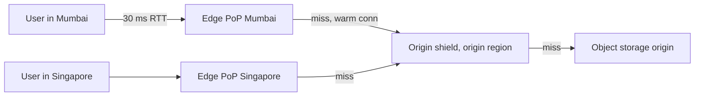

The photo service serves 10,000 photo views a second on average and 30,000 at peak, 2 MB each: 20 GB/s, 480 Gbit/s at peak, about 52 PB a month ([§2](/c/system-design/02-estimation)). Served straight from object storage in one region, that is an illustrative USD 1.0M a month in egress ([§26](/c/system-design/26-object-storage)), 20 saturated 25 Gbit/s NICs at peak, and 1.2 s of TCP slow start per photo for a user 150 ms away ([§11.3](/c/system-design/11-networking)). A content delivery network fixes all three by caching the bytes near the user. This section puts numbers on how much it fixes — and on why the answer is lower than the single-cache hit ratios of [§7](/c/system-design/07-caching).

:::key[First principle]
A CDN is a cache whose capacity and traffic are **split across points of presence (PoPs)**. Latency depends on the *edge* hit ratio; origin load and egress depend on the *total* hit ratio after the edges and the shield. Splitting traffic across $P$ PoPs divides each object's request rate by $P$, so the edge hit ratio falls as you add PoPs; an origin shield re-aggregates the misses and wins most of it back.
:::

## 19.1 What happens on a request

1. **Routing.** DNS (GeoDNS) or anycast IP routing sends the user to a nearby PoP — typically 10–40 ms away rather than 150 ms (illustrative).
2. **TLS at the edge.** The handshake round trips are paid at the edge RTT, not the origin RTT.
3. **Lookup.** The edge computes the **cache key** (§19.4) and serves the object if it holds a fresh copy.
4. **Miss.** The edge fetches from the next tier — an **origin shield** (a designated PoP near the origin) or the origin itself — over long-lived, already-warm connections, stores the response, and streams it on.



The edge-to-origin leg is where the CDN earns latency even on a miss: its connection is warm, so the congestion window is already open. From [§11.3](/c/system-design/11-networking), a 2 MB photo needs 8 round trips on a fresh connection but about 3 on a warm one with a 640 KB window.

$$
t_{\text{photo}} = h_{\text{edge}} \cdot t_{\text{hit}} + (1 - h_{\text{edge}}) \cdot t_{\text{miss}},
\qquad
t_{\text{hit}} = 8 \times 30\ \text{ms},
\quad
t_{\text{miss}} = t_{\text{hit}} + 3 \times 150\ \text{ms}
$$

The miss figure is pessimistic — it assumes the edge receives the whole object before sending, whereas real edges stream — but it shows the shape: a hit costs 240 ms, a miss 690 ms, direct-from-origin 1,200 ms.

## 19.2 What the hit ratio buys: egress, servers, money

Origin traffic is the miss ratio times total traffic, so every quantity at the origin scales with $1 - h$:

$$
\text{origin egress} = (1 - h)\cdot 20\ \text{GB/s},
\qquad
\text{origin GETs} = (1 - h)\cdot 30{,}000/\text{s at peak},
\qquad
\text{bill} = V \cdot c_{\text{CDN}} + (1 - h)\cdot V \cdot c_{\text{origin}}
$$

where $V$ is GB delivered per month. Prices below are illustrative: USD 0.02/GB origin egress (as in §26) and USD 0.005/GB CDN delivery (a committed-volume rate; list prices are higher — substitute your quote).

```python run
# Photo service: origin load, monthly bill and photo latency vs CDN hit ratio. Prices are illustrative.
AVG_GBS, PEAK_GBS = 20.0, 60.0          # GB/s of photo views (§2: 10,000/s x 2 MB, 3x peak)
PEAK_VIEWS = 30_000                     # photo views/s at peak (§2)
MONTH_GB = AVG_GBS * 86_400 * 30        # GB delivered per month
CDN_USD, ORIGIN_USD = 0.005, 0.02       # USD per GB: CDN delivery (committed volume), origin egress
NIC_GBIT = 25                           # origin server NIC (§2)
EDGE_RTT, FAR_RTT = 30, 150             # ms: user to a nearby edge; to the origin region
HIT_MS = 8 * EDGE_RTT                   # 2 MB on a fresh connection: 8 round trips (§11.3)
MISS_MS = HIT_MS + 3 * FAR_RTT          # plus the edge's fetch over a warm connection: 3 round trips

print("no CDN: %.1f PB/month -> USD %.0fk egress, %.0f Gbit/s at peak (%d NICs), %d ms per photo" % (
    MONTH_GB / 1e6, MONTH_GB * ORIGIN_USD / 1e3, PEAK_GBS * 8, -(-PEAK_GBS * 8 // NIC_GBIT), 8 * FAR_RTT))
print("\n hit | origin Gbit/s | NICs | origin GET/s | CDN $k | origin $k | total $k | mean ms")
for hit in (0.5, 0.8, 0.9, 0.95, 0.98, 0.99):
    miss = 1 - hit
    gbit = miss * PEAK_GBS * 8          # peak
    cdn, org = MONTH_GB * CDN_USD / 1e3, miss * MONTH_GB * ORIGIN_USD / 1e3
    print("%3.0f%% | %13.0f | %4.0f | %12.0f | %6.0f | %9.0f | %8.0f | %7.0f" % (
        100 * hit, gbit, max(1, -(-gbit // NIC_GBIT)), miss * PEAK_VIEWS, cdn, org, cdn + org,
        hit * HIT_MS + miss * MISS_MS))
```

```output
no CDN: 51.8 PB/month -> USD 1037k egress, 480 Gbit/s at peak (20 NICs), 1200 ms per photo

 hit | origin Gbit/s | NICs | origin GET/s | CDN $k | origin $k | total $k | mean ms
 50% |           240 |   10 |        15000 |    259 |       518 |      778 |     465
 80% |            96 |    4 |         6000 |    259 |       207 |      467 |     330
 90% |            48 |    2 |         3000 |    259 |       104 |      363 |     285
 95% |            24 |    1 |         1500 |    259 |        52 |      311 |     262
 98% |            10 |    1 |          600 |    259 |        21 |      280 |     249
 99% |             5 |    1 |          300 |    259 |        10 |      270 |     244
```

:::chart[Photo service monthly bill vs CDN hit ratio (illustrative prices, USD thousands)]{type="line" x="CDN hit ratio" y="USD thousands per month" xfmt="pct" prefix="$" unit="k" points="true" ymin="0" ymax="1100" hmarks="1037:no CDN, origin egress only"}
hit, CDN delivery, origin egress, total
0.5, 259, 518, 778
0.8, 259, 207, 467
0.9, 259, 104, 363
0.95, 259, 52, 311
0.98, 259, 21, 280
0.99, 259, 10, 270
:::

:::example[Worked example · reading the table]
- **The CDN line is flat; the origin line is $(1-h)$.** At 95% the bill is USD 311k against 1,037k with no CDN (illustrative). Going from 95% to 99% saves another 41k a month — worth an engineer's time, but the first 90% is where the money is.
- **Origin servers follow the miss ratio.** At 50% hit the origin still pushes 240 Gbit/s at peak (10 NICs) and 15,000 GETs/s; at 95% it is 24 Gbit/s and 1,500 GETs/s — one NIC and well inside one object-storage prefix's read rate (§26).
- **Latency follows the *edge* hit ratio only.** Mean photo time goes from 1,200 ms (no CDN) to 465 ms at a 50% edge hit and 262 ms at 95%. A shield hit is still a 150 ms trip from Mumbai, so it lowers origin load but not this number.
:::

## 19.3 What hit ratio to expect

Photos are immutable, so nothing expires them; an edge keeps a photo until its LRU-like eviction pushes it out. Call the average time a photo stays resident after a fill its **residence time** $T$ — set by edge capacity, not by a TTL. Then [§7.4](/c/system-design/07-caching)'s per-key result applies, with one change: a PoP only sees its share of each photo's traffic.

$$
h_{\text{edge}} = \sum_i s_i \cdot \frac{(\lambda_i / P)\,T}{1 + (\lambda_i / P)\,T},
\qquad
\text{edge misses}_i = \frac{\lambda_i}{1 + (\lambda_i/P)\,T}
$$

where $\lambda_i$ is photo $i$'s view rate, $s_i$ its share of views and $P$ the number of PoPs. The shield sees the sum of all edges' misses per photo and applies the same formula with its own, much longer residence time. Cache capacity follows from Little's law: objects resident = fill rate × residence time.

The block assumes the 1.2B photos uploaded in the last 30 days (40M a day) carry the views, with Zipf popularity of skew $s$ = 1 — an assumption to replace with a skew fitted from your access logs.

```python run
import numpy as np

# Expected CDN hit ratios for the photo service. Popularity skew and residence times are illustrative.
VIEWS, MB, H = 10_000, 2.0, 3600     # photo views/s (§2), MB per photo, seconds per hour
N = 40e6 * 30                        # photos still being viewed: 30 days of uploads (2 x 20M DAU)
edges = np.unique(np.geomspace(1, N + 1, 4000).astype(np.int64))   # bin 1.2B ranks geometrically
count = (edges[1:] - edges[:-1]).astype(float)
rank = np.sqrt(edges[:-1] * (edges[1:] - 1.0))                     # representative rank per bin


def cdn(pops, T, s=1.0, variants=1, T_shield=7 * 24 * H):
    w = count * rank ** -s
    share = w / w.sum()                                # share of all views per bin (Zipf s)
    lam = VIEWS * share / count / variants             # views/s for one photo variant
    per_pop = lam / pops                               # each PoP sees a slice of every key
    edge_hit = (share * per_pop * T / (1 + per_pop * T)).sum()      # §7.4, per key and PoP
    to_shield = lam / (1 + per_pop * T)                # edge misses/s per key, all PoPs together
    origin = (count * variants * to_shield / (1 + to_shield * T_shield)).sum() / VIEWS
    per_pop_tb = VIEWS * (1 - edge_hit) / pops * T * MB / 1e6       # Little: fills/s x T x size
    return edge_hit, origin, per_pop_tb


print("residence T | PoPs | edge hit | origin share: no shield | 7-day shield | cache per PoP")
for T in (1 * H, 24 * H):
    for pops in (1, 10, 50, 200):
        h, o, tb = cdn(pops, T)
        print("%9.0f h | %4d | %7.1f%% | %22.1f%% | %11.1f%% | %8.1f TB" % (
            T / H, pops, 100 * h, 100 * (1 - h), 100 * o, tb))

h, o, _ = cdn(50, 24 * H)
print("\nshield: %.0f fills/s x 7 days x 2 MB = %.2f PB resident" % (
    VIEWS * o, VIEWS * o * 7 * 24 * H * MB / 1e9))
print("50 PoPs, T = 24 h: skew s | edge hit | origin share with shield")
for s in (0.8, 1.0, 1.2):
    h, o, _ = cdn(50, 24 * H, s=s)
    print("%25.1f | %7.1f%% | %6.1f%%" % (s, 100 * h, 100 * o))
print("50 PoPs, T = 24 h: variants per photo | edge hit | origin share with shield")
for v in (1, 2, 6, 50):
    h, o, _ = cdn(50, 24 * H, variants=v)
    print("%37d | %7.1f%% | %6.1f%%" % (v, 100 * h, 100 * o))
print("\nchart: PoPs, edge hit T=1h, 6h, 24h, edge+shield T=24h")
for pops in (1, 2, 5, 10, 20, 50, 100, 200, 500):
    r = [cdn(pops, T) for T in (H, 6 * H, 24 * H)]
    print("%d, %s, %.3f" % (pops, ", ".join("%.3f" % x[0] for x in r), 1 - r[2][1]))
```

```output
residence T | PoPs | edge hit | origin share: no shield | 7-day shield | cache per PoP
        1 h |    1 |    69.4% |                   30.6% |         7.7% |     22.0 TB
        1 h |   10 |    58.7% |                   41.3% |         7.7% |      3.0 TB
        1 h |   50 |    51.2% |                   48.8% |         7.7% |      0.7 TB
        1 h |  200 |    44.7% |                   55.3% |         7.7% |      0.2 TB
       24 h |    1 |    84.0% |                   16.0% |         7.2% |    275.8 TB
       24 h |   10 |    73.5% |                   26.5% |         7.7% |     45.9 TB
       24 h |   50 |    66.0% |                   34.0% |         7.7% |     11.8 TB
       24 h |  200 |    59.5% |                   40.5% |         7.7% |      3.5 TB

shield: 772 fills/s x 7 days x 2 MB = 0.93 PB resident
50 PoPs, T = 24 h: skew s | edge hit | origin share with shield
                      0.8 |    24.7% |   13.3%
                      1.0 |    66.0% |    7.7%
                      1.2 |    93.5% |    1.6%
50 PoPs, T = 24 h: variants per photo | edge hit | origin share with shield
                                    1 |    66.0% |    7.7%
                                    2 |    62.8% |   10.5%
                                    6 |    57.6% |   15.3%
                                   50 |    47.8% |   25.0%

chart: PoPs, edge hit T=1h, 6h, 24h, edge+shield T=24h
1, 0.694, 0.777, 0.840, 0.928
2, 0.662, 0.745, 0.809, 0.925
5, 0.619, 0.702, 0.767, 0.924
10, 0.587, 0.670, 0.735, 0.923
20, 0.555, 0.638, 0.702, 0.923
50, 0.512, 0.595, 0.660, 0.923
100, 0.480, 0.563, 0.628, 0.923
200, 0.447, 0.531, 0.595, 0.923
500, 0.405, 0.488, 0.553, 0.923
```

:::chart[Edge hit ratio vs number of PoPs, and edge + 7-day shield (photo service, Zipf s = 1, model)]{type="line" x="PoPs" y="hit ratio" xlog="true" yfmt="pct" ymin="0.3" ymax="1" points="true" dash="edge + shield T 24 h"}
PoPs, edge T 1 h, edge T 6 h, edge T 24 h, edge + shield T 24 h
1, 0.694, 0.777, 0.840, 0.928
2, 0.662, 0.745, 0.809, 0.925
5, 0.619, 0.702, 0.767, 0.924
10, 0.587, 0.670, 0.735, 0.923
20, 0.555, 0.638, 0.702, 0.923
50, 0.512, 0.595, 0.660, 0.923
100, 0.480, 0.563, 0.628, 0.923
200, 0.447, 0.531, 0.595, 0.923
500, 0.405, 0.488, 0.553, 0.923
:::

What the model says:

1. **More PoPs, lower edge hit ratio.** With 24 h residence, one giant cache would hit 84.0%; 50 PoPs hit 66.0% and 200 PoPs 59.5%. Each PoP must see a photo's request before it can serve it, and the long tail is not viewed often enough per PoP.
2. **The shield recovers the split.** With a 7-day shield, origin share is ~7.7% whatever the PoP count — a 92.3% total hit ratio — because the shield sees every PoP's misses for a photo as one stream. Without it, 50 PoPs send 34.0% of traffic to the origin: 163 Gbit/s at peak instead of 37.
3. **Residence time is bought with disk.** 24 h at 50 PoPs needs ~11.8 TB per PoP; the shield holds 0.93 PB. Tiered cache sizing is a storage budget, priced per PoP.
4. **Skew dominates everything.** At $s$ = 0.8 the same setup hits 24.7% at the edge; at $s$ = 1.2, 93.5%. Measure skew before promising a hit ratio; §26 assumed 95% total, which this model reaches only with skew a little above 1.
5. **Variants divide the rate again.** Six versions of each photo (§19.4) cut the edge hit to 57.6% and double origin share to 15.3%; fifty — what `Vary: User-Agent` does — leave a 47.8% edge hit and 25.0% at the origin.

## 19.4 The cache key

The edge stores one response per **cache key**: by default scheme + host + path + query string, plus the value of every request header named in the response's `Vary`. Anything not in the key cannot change the response; anything in the key that does not change the response splits the cache.

| Input | Problem | Rule |
|---|---|---|
| Query string | `?utm_source=x`, reordered params, cache-busters: each is a new key | Allow-list the params that change the bytes (`w`, `fmt`); drop or sort the rest |
| `Vary: Accept` | Hundreds of distinct browser `Accept` strings → hundreds of variants | Normalise at the edge to a small class (`avif`, `webp`, `jpeg`) and key on that |
| `Vary: User-Agent` | Effectively per-browser-build variants (~50 in §19.3 → 25% origin share) | Never; normalise to device class if you must |
| Image variants | format × density (3 × 2 = 6) = 6 keys per photo | Generate only the variants clients request; measure each one's hit ratio |
| Signed-URL params | A per-user signature makes every URL unique: per-user cache | Validate the signature at the edge, then strip it from the key |
| `Authorization`, cookies | Per-user responses | Do not cache publicly (`private` / `no-store`), or strip cookies for static paths |

:::warn[Two incidents the cache key causes]
**Leaking personal data.** A per-user response (an account page, a private photo list) served with `Cache-Control: public` and a key that omits the user is served to everyone who asks for that URL. Default API responses to `private`, and require an explicit opt-in to public caching.

**Cache poisoning.** If the origin reflects an **unkeyed** header — `X-Forwarded-Host` in a generated URL, say — an attacker sends one crafted request, the poisoned response is cached under the normal key and served to every user. Either key on every input the response uses, or strip those headers at the edge.
:::

## 19.5 TTLs, versioning and purges

For immutable bytes, never invalidate — **version the URL**. A photo's URL contains its content hash (`/p/9f2c41e7.jpg`) and is served with `Cache-Control: public, max-age=31536000, immutable`. An edit writes a new object with a new URL; the API response that points at it is the only thing that changes, and that is small, short-TTL or uncacheable.

For mutable URLs (an avatar at a fixed path, a public JSON document), staleness is bounded by the TTL, and [§7.4](/c/system-design/07-caching)'s miss bound applies per PoP: each PoP refetches a key at most $1/T$ times a second, so the origin sees at most $P/T$ per key without a shield and $1/T$ with one. `stale-while-revalidate` lets an edge keep serving the old copy while one background request refreshes it; `stale-if-error` keeps serving it if the origin is failing.

**Purges** remove an object from every PoP. They propagate in seconds to minutes depending on the provider, are rarely instantaneous everywhere, and always create a herd.

:::example[Worked example · the herd after purging a viral photo]
Under Zipf $s$ = 1 over 1.2B photos, the top photo gets $1 / H_N \approx 1 / (\ln(1.2 \times 10^9) + 0.577) \approx 1/21.5$ of views: about 465 views/s at the 10,000/s average. Purge it and every edge misses at once. Concurrent origin fetches ≈ request rate × fetch time (Little's law), with a fetch of \(3 \times 150\) = 450 ms:

| Protection | Concurrent origin fetches of the same 2 MB object |
|---|---:|
| None | \(465 \times 0.45\) ≈ 209 |
| Request collapsing at each edge | one per PoP: 50 |
| Collapsing + origin shield | 1 |

209 parallel fetches of one object is ~420 MB of egress for one photo and a hot spot on one storage key. Request collapsing (one in-flight fill per key per PoP, others wait) and a shield turn it into one request.
:::

## 19.6 Configuration with numbers

| Setting | Starting point | Why |
|---|---|---|
| Immutable assets | `public, max-age=31536000, immutable` + content-hashed URL | Never purge; edits are new URLs |
| Mutable public responses | `s-maxage` = agreed staleness (e.g. 60 s), `stale-while-revalidate=30`, `stale-if-error=86400` | Bounded staleness, no herd on refresh, survives origin outages |
| Personal responses | `private, no-store` (default for APIs) | Prevents the leak in §19.4 |
| Origin shield | On, in the origin's region | 34.0% → 7.7% origin share at 50 PoPs (§19.3) |
| Request collapsing | On (often the default) | 209 → 50 fetches after a purge (§19.5) |
| Cache-key query params | Allow-list | Each stray param is a new key |
| Format negotiation | Normalise to ≤ 3 classes | 6 variants already cost 8 points of edge hit |
| Private media | Signed URLs or cookies, expiry 5–15 min (illustrative), signature stripped from the key | Access control without per-user caching |
| Origin timeouts | Connect 1–2 s, first byte 10–30 s for large objects (illustrative) | A hung origin should turn into `stale-if-error`, not a hung edge |
| Observability | `X-Cache` / `Age` headers, hit ratio per path prefix and PoP, origin GETs/s | You do not operate the cache — the logs are your only view |

## 19.7 Failure modes

| Failure | Mechanism | Detect with | Mitigation |
|---|---|---|---|
| Hit ratio collapse after a key change | New header or param splits keys; origin load × several | Hit ratio and origin GETs/s per deploy | Review cache keys like schema changes; canary on one PoP |
| Personal data cached publicly | `public` on a per-user response | Synthetic check with two users | `private` by default; separate static and API hostnames |
| Cache poisoning | Unkeyed header reflected in the body | Security review of every header the origin reads | Key on it or strip it at the edge |
| Purge herd | Every PoP misses a hot object at once | Origin spike after purges | Versioned URLs; collapsing; shield |
| Origin outage | Misses fail; cold content unavailable | Origin 5xx, edge 5xx by PoP | `stale-if-error`; multi-region origin |
| Egress bill spike | Miss storm or a scraper of the long tail | Origin GB/day vs baseline | Shield; rate limit at the edge; alert on egress |
| Stale content after a purge | Purge not yet propagated to some PoPs | `Age` header from several regions | Version URLs instead of purging |

## 19.8 Rules of thumb

- **Origin load is $(1 - h_{\text{total}})$, latency is $h_{\text{edge}}$.** Optimise them separately: shield for the first, more and fuller PoPs for the second.
- **Every 2× in miss ratio is 2× origin egress**: 95% → 90% doubles it (USD 52k → 104k a month here, illustrative).
- **Version immutable bytes; purge only what cannot be versioned.**
- **Count the variants per URL** before shipping a `Vary` or a new query parameter: each one divides each PoP's per-key rate.
- **Always run a shield** when PoPs × long tail is large: here it is the difference between 34.0% and 7.7% origin share.

## 19.9 Check yourself

:::qa[The CDN dashboard says 66% hit ratio but the origin team says they serve under 8% of requests. Who is wrong?]
Neither. 66% is the *edge* hit ratio; misses go to the shield, which hits most of them. In §19.3 at 50 PoPs and 24 h residence, the edge hits 66.0% and the origin sees 7.7% — a 92.3% total. Users feel the 66% (latency), the origin feels the 7.7% (egress, GETs).
:::

:::qa[Product wants to add 150 more PoPs "to make it faster". What happens to the origin and to latency?]
Users near the new PoPs get shorter RTTs. Per-PoP traffic per photo falls, so the edge hit ratio drops: 66.0% at 50 PoPs to 59.5% at 200 with 24 h residence, and more requests pay the miss path. With a shield, origin share stays ~7.7%; without one it rises from 34.0% to 40.5% (≈ 163 → 194 Gbit/s at peak).
:::

:::qa[A developer adds `Vary: Accept` to serve AVIF to browsers that support it. Why might the hit ratio drop sharply, and what do you do instead?]
`Accept` strings differ across browsers and versions, so the edge stores one copy per distinct string — dozens of variants per photo. §19.3's model: 50 variants take the edge hit from 66.0% to 47.8% and origin share from 7.7% to 25.0%. Normalise `Accept` at the edge into ≤ 3 format classes and key on the class.
:::

:::qa[Private photos use signed URLs that expire after 10 minutes. The hit ratio for private photos is near zero. Why?]
The signature and expiry are query parameters, so every viewer — and every 10-minute window — produces a new cache key. Have the edge validate the signature, then strip those parameters from the cache key so all authorised viewers share one cached copy.
:::

Next: [§20 Circuit breaker](/c/system-design/20-circuit-breaker) — what to do when the thing you depend on stops answering.
