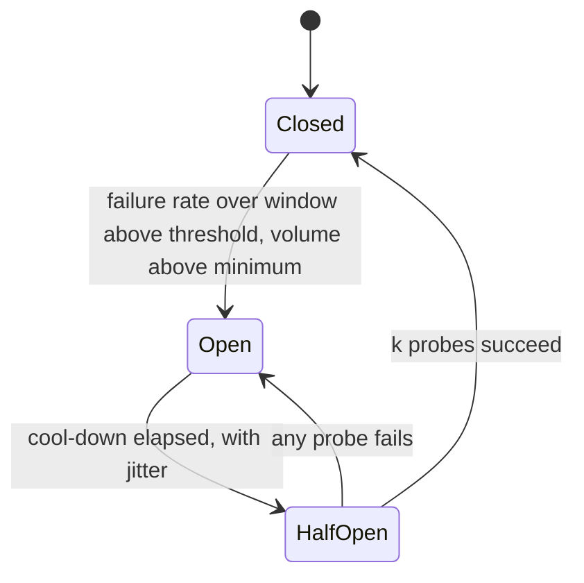

Checkout's flash sale sends 2,000 payment calls a second to an external provider (p50 300 ms, p99 2 s, illustrative — [§2](/c/system-design/02-estimation)). The same API servers also answer 1,000 cart requests a second that never touch the provider. At 40 s into the sale the provider stops answering — connections open, no response. Every payment call now waits for its full 2.5 s timeout while holding a worker, and within a third of a second there are no workers left for anyone, including the cart. This section measures that failure and the three tools that contain it: **timeouts** bound one call, **bulkheads** bound one dependency's share of workers, and a **circuit breaker** stops calling a dependency that is clearly down.

:::key[First principle]
A dead dependency costs you its error *plus the time you wait for it*. Little's law turns that time into occupied workers: $L = \lambda \times W$. A circuit breaker sets $W \approx 0$ for a dependency that is failing, so it consumes no workers; a bulkhead caps $L$ for one dependency so the rest keep theirs. The breaker's cost is detection delay on the way in and recovery delay on the way out — both set by its window, timeout and cool-down.
:::

## 20.1 The state machine



- **Closed** — calls pass through; outcomes go into a rolling window of $W$ seconds (or the last $n$ calls).
- **Open** — calls fail immediately into the fallback (§20.6) without touching the dependency, for a cool-down $C$.
- **Half-open** — up to $k$ probe calls go through; the rest still take the fallback. All $k$ succeed → closed; any failure → open again.

The trip condition, evaluated on each call:

$$
\frac{F_W}{N_W} \ge \theta \quad\text{and}\quad N_W \ge n_{\min}
$$

where $F_W$ and $N_W$ are failures and calls completed in the window, $\theta$ the threshold (typically 50%) and $n_{\min}$ the minimum volume. **Failures** are timeouts, connection errors, 5xx and 429 — not other 4xx, which mean the caller sent something wrong to a healthy service. A call is only counted when it *completes*, which matters in §20.4.

## 20.2 What a hung dependency costs: Little's law

Healthy, the provider's latency is lognormal with p50 0.3 s and p99 2 s, so its mean is \(0.3 \times e^{\sigma^2/2}\) = 0.418 s ($\sigma$ = 0.8156). Payment calls in flight:

$$
L = \lambda W = 2{,}000/\text{s} \times 0.418\ \text{s} \approx 837 \text{ workers}
$$

Plus 1,000 cart calls/s × 20 ms = 20, that fits comfortably in a pool of 1,500 (illustrative: e.g. 15 instances × 100 workers). When the provider hangs, every call waits the full timeout:

$$
L_{\text{hung}} = 2{,}000 \times 2.5\ \text{s} = 5{,}000 \text{ workers wanted}
$$

The pool fills in \((1{,}500 - 837) / 2{,}000\) ≈ 0.33 s. After that, a worker frees only when a hung call times out — \(1{,}500 / 2.5\) = 600 a second — and those 600 freed workers are contested by 2,000 payment and 1,000 cart arrivals a second. Most cart requests find no worker: an outage in a dependency the cart never calls takes the cart down. A longer timeout makes it worse in proportion; a shorter one only shrinks it.

## 20.3 Simulating the outage

The block replays 120 s of the flash sale with the provider hung from 40 s to 80 s, under five configurations:

- **no protection** — a 2.5 s timeout only;
- **bulkhead 1,000 only** — payment calls may hold at most 1,000 of the 1,500 workers;
- **breaker, 10 s window** and **breaker, 2 s window** — open at ≥ 50% failures over ≥ 20 calls, cool-down 5 s + U(0, 1) s jitter, 5 half-open probes;
- **breaker 2 s + bulkhead** — both.

```python run
import heapq
from collections import deque
import numpy as np

rng = np.random.default_rng(20)
END, DOWN, UP = 120, 40.0, 80.0          # payment provider hangs from 40 s to 80 s
TIMEOUT, POOL = 2.5, 1500                # client timeout (s); worker slots shared by all calls
pay = np.cumsum(rng.exponential(1 / 2000, 250_000))   # 2,000 payment calls/s (flash sale)
cart = np.cumsum(rng.exponential(1 / 1000, 125_000))  # 1,000 cart calls/s, 20 ms each
ev = sorted([(t, 1) for t in pay[pay < END]] + [(t, 0) for t in cart[cart < END]])
lat = rng.lognormal(np.log(0.3), 0.8156, len(ev))     # provider p50 300 ms, p99 2 s
err = rng.random(len(ev)) < 0.005                     # 0.5% background errors


def simulate(window, pay_cap):
    """window=0: no breaker. Else >= 50% failures over >= 20 calls in `window` s opens it."""
    busy = pay_busy = nfail = probes = probe_ok = 0
    heap, win, state, until, opened, closed = [], deque(), "closed", 0.0, None, None
    st = np.zeros((END, 7), int)         # ok, short-circuited, failed, 503, cart ok, cart 503, busy
    for i, (t, is_pay) in enumerate(ev):
        while heap and heap[0][0] <= t:  # complete finished calls, update the breaker
            done, k, failed, probe = heapq.heappop(heap)
            busy -= 1; pay_busy -= k
            if not k: continue
            win.append((done, failed)); nfail += failed
            if probe and failed: state, until = "open", done + 5 + rng.uniform(0, 1)
            probe_ok += probe and not failed
            if probe and probe_ok == 5: state, win, nfail, closed = "closed", deque(), 0, done
        while win and win[0][0] < t - window:
            nfail -= win.popleft()[1]
        s = st[int(t)]
        s[6] = max(s[6], busy)
        if not is_pay:
            if busy < POOL: busy += 1; s[4] += 1; heapq.heappush(heap, (t + 0.02, 0, 0, False))
            else: s[5] += 1
            continue
        if window and state == "closed" and len(win) >= 20 and nfail >= 0.5 * len(win):
            state, until, opened = "open", t + 5 + rng.uniform(0, 1), opened or t
        if state == "open" and t >= until:
            state, probes, probe_ok = "half", 0, 0
        probe = state == "half" and probes < 5
        if state != "closed" and not probe:
            s[1] += 1; continue          # fail fast to the fallback
        if busy >= POOL or pay_busy >= pay_cap:
            s[3] += 1; continue          # no free slot: immediate 503
        probes += probe
        hung = DOWN <= t < UP
        failed = hung or lat[i] > TIMEOUT or err[i]
        busy += 1; pay_busy += 1; s[2 if failed else 0] += 1
        heapq.heappush(heap, (t + (TIMEOUT if hung else min(lat[i], TIMEOUT)), 1, int(failed), probe))
    return st, opened, closed


runs = {"no protection": simulate(0, POOL), "bulkhead 1,000 only": simulate(0, 1000),
        "breaker, 10 s window": simulate(10, POOL), "breaker, 2 s window": simulate(2, POOL),
        "breaker 2 s + bulkhead": simulate(2, 1000)}
print("40-80 s outage         | opened | closed | waited 2.5 s | short-circuit | 503 | cart served"
      " | short-circuit after 80 s")
for name, (st, opened, closed) in runs.items():
    o = st[40:80].sum(0)
    print("%-22s | %6s | %6s | %12d | %13d | %5d | %10.1f%% | %d" % (
        name, "%.1f" % opened if opened else "-", "%.1f" % closed if closed else "-",
        o[2], o[1], o[3], 100 * o[4] / (o[4] + o[5]), st[80:, 1].sum()))
print("healthy (0-40 s): peak busy slots %d, 503s %d, short-circuited %d" % (
    max(r[0][:40, 6].max() for r in runs.values()), sum(r[0][:40, 3].sum() for r in runs.values()),
    sum(r[0][:40, 1].sum() for r in runs.values())))
```

```output
40-80 s outage         | opened | closed | waited 2.5 s | short-circuit | 503 | cart served | short-circuit after 80 s
no protection          |      - |      - |        23999 |             0 | 55944 |       29.9% | 0
bulkhead 1,000 only    |      - |      - |        16000 |             0 | 63943 |      100.0% | 0
breaker, 10 s window   |   48.2 |   86.2 |         5748 |         63592 | 10603 |       86.4% | 12566
breaker, 2 s window    |   42.6 |   88.4 |         1618 |         74827 |  3498 |       95.6% | 16916
breaker 2 s + bulkhead |   42.6 |   81.6 |         1132 |         74832 |  3979 |      100.0% | 3241
healthy (0-40 s): peak busy slots 941, 503s 0, short-circuited 0
```

:::chart[Busy workers during a 40 s payment-provider hang (pool 1,500, simulated)]{type="line" x="time (s)" y="max busy workers in the second" marks="40:provider hangs;80:provider back" hmarks="1500:pool size" ymin="0"}
second, no protection, bulkhead 1000 only, breaker 10 s, breaker 2 s, breaker 2 s + bulkhead
36, 874, 874, 874, 874, 874
38, 879, 879, 879, 879, 879
40, 1500, 1035, 1500, 1500, 1035
42, 1500, 1033, 1500, 1500, 1033
44, 1500, 1034, 1500, 151, 167
46, 1500, 1038, 1500, 38, 38
48, 1500, 1032, 1490, 37, 37
50, 1500, 1037, 1244, 37, 42
52, 1500, 1030, 30, 30, 30
54, 1500, 1032, 37, 32, 32
56, 1500, 1037, 37, 42, 42
58, 1500, 1032, 32, 32, 34
60, 1500, 1032, 37, 32, 32
62, 1500, 1032, 42, 37, 37
64, 1500, 1033, 33, 38, 37
66, 1500, 1032, 32, 32, 37
68, 1500, 1033, 33, 33, 33
70, 1500, 1032, 38, 33, 33
72, 1500, 1033, 37, 42, 37
74, 1500, 1035, 35, 40, 40
76, 1500, 1032, 37, 32, 32
78, 1500, 1036, 41, 36, 36
80, 1500, 1028, 33, 38, 35
82, 892, 892, 40, 45, 851
84, 892, 892, 35, 34, 892
86, 888, 888, 750, 30, 888
88, 890, 890, 884, 703, 890
90, 906, 906, 906, 895, 906
92, 920, 920, 920, 920, 920
94, 877, 877, 877, 877, 877
:::

:::example[Worked example · reading the outage]
- **No protection: the provider's outage becomes the cart's.** The pool sits at 1,500 for the whole 40 s; 24,000 payment calls each hold a worker for 2.5 s, 55,944 get an immediate 503 for lack of a worker, and only 29.9% of cart requests are served — in waves (1–79% per second in the run), as batches of timeouts free workers.
- **A bulkhead alone saves the cart, not the payment users.** Capping payments at 1,000 workers leaves 500 for everything else: cart 100%. But 16,000 payment users still wait 2.5 s to be told no.
- **A breaker turns waiting into failing fast.** With a 2 s window it opens at 42.6 s; from then on busy workers drop to ~35 and 74,827 payment requests get an immediate fallback. Only 1,618 users waited the timeout. Cart served: 95.6% (the misses are the 2.6 s before it opened).
- **The window sets the detection delay.** The 10 s window opens at 48.2 s — 8.2 s of full pool, 5,748 waits, cart 86.4%. §20.4 derives both numbers.
- **Breaker + bulkhead is the only configuration where nothing else is touched**: cart 100%, 1,132 waits.
- **The breaker's price is paid after recovery.** The provider is back at 80 s, but the breakers close at 86.2, 88.4 and 81.6 s: 12,566, 16,916 and 3,241 payments fail fast against a healthy provider. Without a breaker, payments succeed again at 80 s.
:::

Nothing here makes payments *succeed* during the outage — every configuration fails ~80,000 payment attempts between 40 and 80 s. What the breaker buys is that the failure is fast, contained, and does not take unrelated features with it.

## 20.4 Tuning: detection delay and false opens

**Detection delay.** A hung call is only counted when it times out, so nothing can be detected before $\tau$ (the timeout). After that, failures complete at $r_f$ = workers ÷ $\tau$ (600/s with 1,500 workers, 400/s behind a 1,000 bulkhead), while the window still holds the successes from just before the outage, ~$\lambda (W - x)$ at time $x$ after it began. The breaker opens when failures catch up:

$$
r_f\,(x - \tau) = \lambda\,(W - x)
\;\Rightarrow\;
x_{\text{open}} \approx \max\!\left(\tau,\; \frac{\lambda W + r_f\,\tau}{\lambda + r_f}\right)
$$

For $W$ = 10 s: \((2{,}000 \times 10 + 600 \times 2.5) / 2{,}600\) = 8.3 s — the simulation opened 8.2 s after the hang. For $W$ = 2 s the bound is $\tau$: 2.5 s (simulated: 2.6 s).

**False opens.** A short window holds fewer calls, and a healthy dependency with baseline error rate $p_0$ trips a 50% threshold over $n$ calls with probability

$$
P(\text{false open}) = \sum_{i=\lceil \theta n \rceil}^{n} \binom{n}{i}\, p_0^{\,i}\,(1-p_0)^{n-i}
$$

```python run
import math

# Checkout payment client during a flash sale. Provider latency is illustrative (lognormal).
LAM, P50, SIGMA = 2000, 0.3, 0.8156      # calls/s; p50 300 ms; sigma chosen so p99 = 2 s
TIMEOUT, POOL, BULKHEAD = 2.5, 1500, 1000

mean = P50 * math.exp(SIGMA ** 2 / 2)
print("p99 %.2f s, mean %.3f s -> healthy in-flight %.0f (Little: %d/s x mean)" % (
    P50 * math.exp(2.326 * SIGMA), mean, LAM * mean, LAM))
print("provider hangs: %d/s x %.1f s = %.0f slots wanted; pool of %d full after %.2f s" % (
    LAM, TIMEOUT, LAM * TIMEOUT, POOL, (POOL - LAM * mean) / LAM))
for cap in (POOL, BULKHEAD):
    print("  %d slots held by hung calls -> failures complete at %.0f/s" % (cap, cap / TIMEOUT))

print("\nbreaker detection delay after the outage starts (>= 50% failed in window W)")
for cap in (POOL, BULKHEAD):
    rf = cap / TIMEOUT
    row = ["W=%g s: %.1f s" % (W, max(TIMEOUT, (LAM * W + rf * TIMEOUT) / (LAM + rf)))
           for W in (2, 5, 10, 30)]
    print("  slots %d: %s" % (cap, ", ".join(row)))

print("\nfalse opens: P(>= 50% of n calls fail) when the dependency is healthy")
print("baseline error |   n=5   |  n=10   |  n=20   |  n=30   | per day at n=20")
for p0 in (0.01, 0.05, 0.10, 0.20):
    ps = []
    for n in (5, 10, 20, 30):
        k = math.ceil(0.5 * n)
        ps.append(sum(math.comb(n, i) * p0 ** i * (1 - p0) ** (n - i) for i in range(k, n + 1)))
    print("%13.0f%% | %s | %.2g" % (100 * p0, " | ".join("%.1e" % p for p in ps), ps[2] * 8640))

print("\nchart: n, P(false open) at baseline 5%, 10%, 20%")
for n in (5, 10, 15, 20, 25, 30):
    k = math.ceil(0.5 * n)
    print("%d, %s" % (n, ", ".join("%.2g" % sum(math.comb(n, i) * p ** i * (1 - p) ** (n - i)
                                              for i in range(k, n + 1)) for p in (0.05, 0.10, 0.20))))
```

```output
p99 2.00 s, mean 0.418 s -> healthy in-flight 837 (Little: 2000/s x mean)
provider hangs: 2000/s x 2.5 s = 5000 slots wanted; pool of 1500 full after 0.33 s
  1500 slots held by hung calls -> failures complete at 600/s
  1000 slots held by hung calls -> failures complete at 400/s

breaker detection delay after the outage starts (>= 50% failed in window W)
  slots 1500: W=2 s: 2.5 s, W=5 s: 4.4 s, W=10 s: 8.3 s, W=30 s: 23.7 s
  slots 1000: W=2 s: 2.5 s, W=5 s: 4.6 s, W=10 s: 8.8 s, W=30 s: 25.4 s

false opens: P(>= 50% of n calls fail) when the dependency is healthy
baseline error |   n=5   |  n=10   |  n=20   |  n=30   | per day at n=20
            1% | 9.9e-06 | 2.4e-08 | 1.7e-15 | 1.3e-22 | 1.5e-11
            5% | 1.2e-03 | 6.4e-05 | 1.1e-08 | 2.3e-12 | 9.8e-05
           10% | 8.6e-03 | 1.6e-03 | 7.2e-06 | 3.6e-08 | 0.062
           20% | 5.8e-02 | 3.3e-02 | 2.6e-03 | 2.3e-04 | 22

chart: n, P(false open) at baseline 5%, 10%, 20%
5, 0.0012, 0.0086, 0.058
10, 6.4e-05, 0.0016, 0.033
15, 1.8e-07, 3.4e-05, 0.0042
20, 1.1e-08, 7.2e-06, 0.0026
25, 3.6e-11, 1.6e-07, 0.00037
30, 2.3e-12, 3.6e-08, 0.00023
```

:::chart[Probability a healthy dependency trips a 50% breaker, by calls in the window]{type="line" x="calls in the window n" y="P(false open) per window" ylog="true" points="true"}
n, baseline 5%, baseline 10%, baseline 20%
5, 0.0012, 0.0086, 0.058
10, 6.4e-05, 0.0016, 0.033
15, 1.8e-07, 3.4e-05, 0.0042
20, 1.1e-08, 7.2e-06, 0.0026
25, 3.6e-11, 1.6e-07, 0.00037
30, 2.3e-12, 3.6e-08, 0.00023
:::

How to read it:

1. **Window: shorter than you think, but it must hold volume.** Checkout makes 2,000 calls/s, so even a 2 s window holds ~4,000 completed calls; detection is then bounded by the timeout. A dependency called 5 times a second has only 10 calls in a 2 s window — at a 10% baseline error rate that is a false-open probability of 1.6e-03 per window, about 70 a day if it is checked every 2 s (43,200 windows). Size the window so $N_W \ge n_{\min}$ at normal traffic: $W \ge n_{\min} / \lambda$.
2. **Minimum volume: 20 is a good default.** At $n$ = 20, over 8,640 ten-second windows a day, a dependency with a 10% baseline error rate falsely opens 0.062 times a day; at 20% baseline, 22 times a day — which means 50% is too close to normal for that dependency. Keep $\theta$ well above the baseline (≥ 2–3×) and $n_{\min}$ ≥ 20.
3. **Detection is bounded by the timeout.** A tighter timeout ([§16](/c/system-design/16-api-gateway): p99 × 2–3) or counting **slow calls** as failures (any call slower than a threshold below the timeout, such as the healthy p99) brings $\tau$ in the formula down, and the breaker opens sooner — without waiting for the timeouts to land.

## 20.5 Recovery: cool-down and probes

During an outage each half-open phase costs one probe timeout (2.5 s) plus a cool-down of 5–6 s, so the breaker re-checks the provider roughly every 8 s. When the provider recovers, the wait until the next successful probe is anywhere in that cycle — the simulation measured 1.6–8.4 s, costing up to 16,916 fail-fast payments. The knobs:

| Knob | Effect | Starting point |
|---|---|---|
| Cool-down $C$ | Shorter = faster recovery, more probes into a dead service | 5 s + U(0, 1) s jitter; probes are tiny load (15 instances × 5 probes ÷ 8 s ≈ 9 calls/s vs 2,000) |
| Probe count $k$ | More = surer the dependency is back | 3–5, all must succeed |
| Probe timeout | Shorter = the failed half of the cycle is shorter | Can be below the normal timeout, e.g. the healthy p99 |
| Ramp after closing | Avoids sending 2,000 calls/s at a service that just restarted | 10% → 25% → 50% → 100% over ~30 s, or a token bucket on the closed state |
| Jitter | Without it, every instance probes at the same moment | Always; it costs nothing |

Breaker state is **per instance**: 15 instances open and close at slightly different times. That is acceptable — each sees enough traffic (~133 calls/s here) to decide on its own. Centralising state adds a network call to every call, to protect a network call.

## 20.6 The fallback decides what the user sees

A breaker without a fallback still returns an error — it only makes it fast. Decide per dependency:

| Dependency (checkout) | Fallback when open | Why |
|---|---|---|
| Payment provider | Fast, honest failure with `Retry-After`; or accept the order as *pending payment* and charge later, if the business accepts that risk | You cannot fake an authorisation; deferring it moves fraud and stock risk to later |
| Inventory | Fail the order clearly | Selling stock you might not have creates refunds |
| Ledger writes | Queue them ([§25](/c/system-design/25-message-queue)) and apply on recovery | Writes can wait; the order cannot be lost |
| Recommendations, reviews | Cached or empty widget | The page should render without them |
| Fraud score | A conservative default (e.g. hold high-value orders for review) | Fail closed for risk, open for low-value orders |

Every fallback needs a metric and an alert. A breaker open for a week, quietly serving an empty widget, is a feature that has been down for a week.

## 20.7 Where it sits, and retries

Wrap **each** dependency at the call site, inside the calling service, in this order: request deadline → bulkhead → breaker → timeout → call. Retries go *outside* the breaker, so an open circuit stops them, and a `CircuitOpen` result is never retried. Without that, three layers retrying twice each turn one failing payment into 27 attempts during exactly the incident the breaker is meant to contain ([§16.7](/c/system-design/16-api-gateway), [§30](/c/system-design/30-retry)). Breakers also turn a hard series dependency into a soft one where a fallback exists, which is how [§6.4](/c/system-design/06-availability) keeps path availability up.

## 20.8 Configuration with numbers

| Setting | Starting point | Why |
|---|---|---|
| Timeout | Healthy p99 × 1.25–3 (2.5 s here); below the caller's deadline | Bounds $W$ in Little's law and the detection delay |
| Window $W$ | 2–10 s by time, or last 50–100 calls | Holds ≥ $n_{\min}$ calls at normal traffic; shorter detects faster |
| Threshold $\theta$ | 50%, and ≥ 2–3× the baseline error rate | 20% baseline at $n$ = 20 → 22 false opens/day (10 s windows) |
| Minimum volume $n_{\min}$ | 20 | 10% baseline → 0.062 false opens/day (10 s windows) |
| Slow-call threshold | Count calls slower than ~healthy p99 as failures (optional) | Detects hangs before timeouts land; ~1% slow when healthy is far below θ |
| Cool-down $C$ | 5–30 s with ±20% jitter | Recovery delay ≈ one cycle of $\tau + C$ |
| Half-open probes $k$ | 3–5 | One lucky probe should not close it |
| Bulkhead | Max workers per dependency = healthy $L$ × ~1.2–2 (837 → 1,000 here) | Keeps the rest of the pool for everything else |
| Counted failures | Timeouts, connection errors, 5xx, 429 | Not 4xx: a client bug must not open the circuit |

## 20.9 Failure modes

| Failure | Mechanism | Detect with | Mitigation |
|---|---|---|---|
| Breaker without a timeout | Closed state still hangs; nothing is counted until calls end | Busy workers at pool size | Timeout on every call |
| Window too long | Opens after the pool is gone (48.2 s vs 42.6 s) | Pool saturation before open | Shorter window or slow-call threshold |
| Window too thin | Few calls → false opens | Opens without dependency errors | $n_{\min}$ ≥ 20; longer window for low-traffic calls |
| Counting 4xx | A client bug opens the circuit on a healthy service | Opens with 4xx-dominated failures | Count only timeouts, connection errors, 5xx |
| Synchronised probes | All instances probe and ramp together | Spikes at the dependency every $C$ seconds | Jitter; ramp after closing |
| Silent fallback | Feature dead for days | Time spent open, fallback rate | Alert on open > ~5 min |
| Retries inside the breaker | Each failure multiplied before it is counted | Attempts ≫ requests | Retries outside; never retry `CircuitOpen` |
| Shared pool, no bulkhead | Breaker opens, but the seconds before it already starved others | Cart 503s in the first seconds | Bulkhead per dependency |

## 20.10 Rules of thumb

- **Workers held = call rate × wait.** A hung dependency at 2,000 calls/s with a 2.5 s timeout wants 5,000 workers; it filled a 1,500 pool in 0.33 s.
- **Timeout + bulkhead + breaker + fallback**, per dependency. Each alone leaves a hole the simulation showed.
- **Detection ≥ timeout**; with a long window, $(\lambda W + r_f \tau)/(\lambda + r_f)$.
- **$n_{\min}$ = 20, $\theta$ = 50% and ≥ 2–3× baseline errors**, window long enough to hold $n_{\min}$.
- **Recovery costs one cool-down cycle**; keep it short and jittered and ramp traffic after closing.

## 20.11 Check yourself

:::qa[Your service calls a dependency at 500 calls/s with a 10 s timeout and has 400 workers. The dependency hangs. How long until you are out of workers, and what changes with a 1 s timeout?]
Healthy in-flight is small; hung, you need \(500 \times 10\) = 5,000 workers, so 400 are gone in under a second. With a 1 s timeout you still need 500 — the pool still fills, but each stuck worker frees 10× sooner, so 400 workers turn over at 400/s instead of 40/s. The timeout shrinks the damage; only a breaker (or a bulkhead) removes it.
:::

:::qa[The breaker uses a 30 s window. How long does it take to open in the checkout scenario, and what happens meanwhile?]
From §20.4: \((2{,}000 \times 30 + 600 \times 2.5) / 2{,}600\) ≈ 23.7 s. For those 23.7 s the pool is full, cart requests mostly fail and ~600 payment users a second wait 2.5 s each. Use a 2–5 s window at this traffic; it still holds thousands of calls.
:::

:::qa[A low-traffic dependency (3 calls/s) with a normal 10% error rate keeps tripping a breaker with a 2 s window and minimum volume 5. Why, and what do you change?]
A 2 s window holds ~6 calls. At $n$ = 5 and $p_0$ = 10%, the probability of ≥ 50% failures is 8.6e-03 per window — about 370 false opens a day if checked every 2 s. Raise $n_{\min}$ to 20 and the window to ≥ 20 / 3 ≈ 7 s (or count the last 20 calls): the false-open probability drops to 7.2e-06.
:::

:::qa[The breaker on the payment client is open. Should the API retry the payment, and what does the user see?]
No retry: an open circuit means the provider is known to be failing, and retries only add attempts against it ([§30](/c/system-design/30-retry)). The user gets a fast, explicit "payments are unavailable, try again in a minute" with `Retry-After`, or — if the business accepts the risk — an order accepted as pending payment. The idempotency key ([§22](/c/system-design/22-idempotency)) makes the later retry safe.
:::

Implementation: [§63 Circuit breaker in code](/c/system-design/63-circuit-breaker); the pattern view: [§38 One service failing → breaker](/c/system-design/38-one-service-failing-breaker).

Next: [§21 Distributed locks](/c/system-design/21-distributed-locks) — making sure only one worker does a thing at a time.
