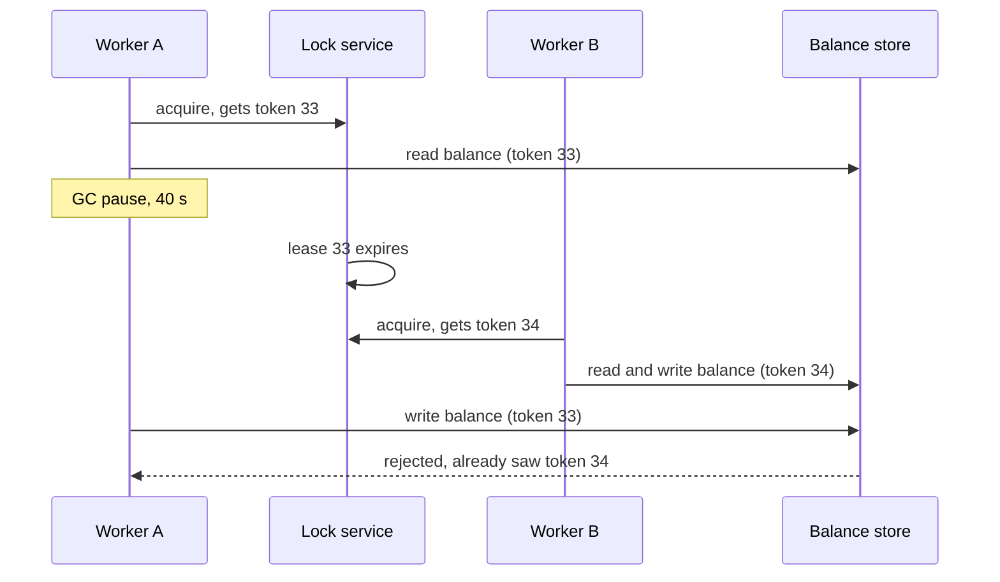

Checkout's settlement job runs every 10 minutes: it reads newly captured payments and credits each merchant's balance. Three replicas of the worker run for availability, and exactly one of them must do each run — two concurrent runs read the same balance and both write `balance + amount`, and one credit disappears. The obvious answer is a lock in Redis with a 10-second expiry. This section shows why that alone loses money, how often, and what to add or use instead.

:::key[First principle]
A distributed lock is a **lease**: it expires so a crashed holder can't block everyone forever, which means a holder that merely *paused* can wake up believing it still holds it. **Mutual exclusion is enforced where the data lives, not by the lock**: the lock service hands out an increasing fencing token, and the storage rejects any operation carrying a token older than one it has already seen.
:::

## 21.1 A lock across machines is a lease

On one machine, a mutex is released when its holder dies because the kernel knows. Across machines nobody knows: a holder that stops responding may have crashed, be stuck in a garbage-collection pause, have its VM frozen during live migration, or be cut off by a partition. So every practical lock has a **time to live**:

```text
acquire:  SET lock:settlement <my-token> NX PX 10000     # only if absent, expires in 10 s
renew:    every TTL/3, extend expiry if the value is still <my-token>
release:  delete only if the value is still <my-token>   # compare-and-delete, atomically (Lua or CAS)
```

The holder renews while it runs. If it crashes, the lease lapses and another worker takes over after at most one TTL. The catch is the same mechanism in reverse: if the holder *pauses* for longer than the time left on its lease, the lease lapses while the holder is still mid-job. When it resumes, its next instruction is the write it was about to do. Nothing in the holder's code can check "do I still hold the lock?" and then write atomically — the pause can land between the check and the write.



## 21.2 How long should the lease be?

Let the holder renew every $TTL/3$. A pause that starts $u$ seconds after the last renewal makes the lease lapse if it lasts longer than $TTL - u$, so per job

$$
P(\text{lapse}) = p_{\text{pause}} \cdot \mathbb{E}_{u \sim U(0,\,TTL/3)}\big[\,P(\text{pause} > TTL - u)\,\big].
$$

Pauses are heavy-tailed: most are milliseconds, a few are tens of seconds (full GCs on big heaps, VM migration, swap). Model it illustratively as a 1% chance per job of a pause with tail $P(\text{pause} > x) = (1 + x/2)^{-1.5}$ — median ~1.2 s, but a 1-in-10 chance of exceeding 7.5 s. The other side of the trade is recovery: after a holder *crashes*, nobody runs the job until the lease lapses — up to one TTL, \(5/6\) of a TTL on average with renewals every \(TTL/3\).

:::example[Worked example · TTL for the settlement job (pause model illustrative)]
| TTL | Lapses per 1M jobs | Mean stall after a crash | Worst stall |
|---:|---:|---:|---:|
| 2 s | 4,049 | 1.7 s | 2 s |
| 10 s | 866 | 8.3 s | 10 s |
| 30 s | 206 | 25 s | 30 s |
| 60 s | 77 | 50 s | 60 s |
| 120 s | 28 | 100 s | 120 s |

Going from 10 s to 120 s makes recovery 12× slower and cuts lapses only 31×, because the tail falls like \(TTL^{-1.5}\). No finite TTL reaches zero. Pick the TTL for **recovery time** (10–30 s for a job that runs every 10 minutes) and make lapses *harmless* with fencing (§21.3), rather than trying to make them impossible.
:::

:::chart[Lease lapses per million jobs vs TTL (renew every TTL/3, illustrative heavy-tailed pauses)]{type="line" x="lease TTL (s)" y="lapses per 1M jobs" xlog="true" ylog="true" points="true" marks="10:10 s;30:30 s"}
TTL, lapses per 1M jobs
2, 4049
3, 2986
5, 1868
10, 865.6
15, 522
20, 357.9
30, 206
45, 116.6
60, 77.23
90, 42.89
120, 28.14
:::

## 21.3 Fencing tokens: watch a pause break the lock

The lock service increments a counter on every grant and returns it as the **fencing token** (etcd's key revision and ZooKeeper's zxid/sequence numbers serve this role). Every operation on the protected data carries the token, and the data store keeps the highest token it has seen and refuses anything lower.

The simulation runs 20,000 settlement jobs on 3 workers with a 10 s lease. Each job reads the merchant balance, works for ~1 s, and writes `balance + 1`; pauses follow §21.2's model. It compares no fencing, fencing checked only on writes, and fencing checked on every access (reads included).

```python run
"""Lease lock + process pauses: what happens to a read-modify-write with and without fencing tokens."""
import heapq
import numpy as np

TTL, RENEW = 10.0, 10.0 / 3      # lease seconds; holder renews every TTL/3 while it is running
JOBS, WORKERS = 20_000, 3        # settlement jobs, each credits the merchant balance by 1


def run(fence, seed=7):
    rng = np.random.default_rng(seed)
    lock = {"token": 0, "holder": None, "expires": -1.0}
    store = {"balance": 0, "max_token": 0}
    done = stale = rejected = 0
    events = [(0.0, w, "acquire", None) for w in range(WORKERS)]
    while events:
        t, w, what, job = heapq.heappop(events)
        if what == "acquire":
            if done >= JOBS:
                continue
            if lock["holder"] is not None and t < lock["expires"]:
                heapq.heappush(events, (t + rng.uniform(0.1, 0.5), w, "acquire", None))
                continue
            lock.update(token=lock["token"] + 1, holder=w, expires=t + TTL)
            tok = lock["token"]
            if fence == "reads+writes":
                store["max_token"] = max(store["max_token"], tok)   # storage sees the token on the read
            seen = store["balance"]                                 # read
            work = rng.lognormal(np.log(1.0), 0.5)                  # ~1 s of work (illustrative)
            pause = rng.pareto(1.5) * 2.0 if rng.random() < 0.01 else 0.0   # GC / VM freeze, heavy tail
            # renewals happen while running; a pause stops them, so the lease can lapse mid-job
            since = rng.uniform(0, RENEW)                           # pause starts this long after a renewal
            if pause > TTL - since:
                lock["expires"] = t + work / 2 - since + TTL        # last renewal + TTL, then it lapses
            else:
                lock["expires"] = t + work + pause + TTL
            heapq.heappush(events, (t + work + pause, w, "write", (tok, seen)))
        else:
            tok, seen = job
            if fence != "none" and tok < store["max_token"]:
                rejected += 1                                       # stale holder: write refused
            else:
                if lock["token"] != tok:
                    stale += 1                                      # wrote after losing the lease
                store["balance"] = seen + 1
                store["max_token"] = max(store["max_token"], tok)
                done += 1
            if lock["token"] == tok:
                lock["holder"] = None                               # release only our own lease
            heapq.heappush(events, (t, w, "acquire", None))
    return done, store["balance"], stale, rejected


print("fencing         jobs done   balance   lost credits   stale writes   rejected")
for fence in ("none", "writes only", "reads+writes"):
    done, bal, stale, rej = run(fence)
    print("%-13s %11d %9d %14d %14d %10d" % (fence, done, bal, done - bal, stale, rej))
```

```output
fencing         jobs done   balance   lost credits   stale writes   rejected
none                20000     19987             13             13          0
writes only         20000     19999              1              1         12
reads+writes        20000     20000              0              0         13
```

Read the three rows:

- **No fencing:** 13 jobs lost their lease mid-run (the model predicts ~17 per 20,000 at a 10 s TTL) and every one of them overwrote a newer balance: 13 credits vanished. The lock "worked" 99.94% of the time; settlement needs 100%.
- **Fencing on writes only:** 12 stale writes refused, but 1 credit still lost. Worker B took the lease and *read* the balance, then A woke and wrote before B did — A's token was still the highest the store had seen. B then wrote its own `read + 1` over A's credit.
- **Fencing on every access:** the store learns token 34 when B reads, so A's write with 33 is refused. Zero lost credits. The rejected jobs are simply retried.

The general version of the last row is a **conditional write**: `UPDATE balances SET amount = :new, version = version + 1 WHERE merchant = :m AND version = :seen` (compare-and-set, [§15.4](/c/system-design/15-transactions)). If the store supports that, the version *is* the fence, and you may not need the lock at all.

:::warn[Fencing needs the storage's cooperation]
A token only helps if every system the holder writes to checks it. A payment provider API, an email sender or a file on S3 won't. For those effects, use an idempotency key ([§22](/c/system-design/22-idempotency)) so a stale holder's duplicate call is absorbed by the receiver.
:::

## 21.4 A lock has a throughput ceiling

Only one holder at a time, so one lock completes at most

$$
\text{acquisitions/s} \le \frac{1}{t_{\text{hold}} + 2\,t_{\text{RTT}}}
$$

(acquire and release each cost a round trip; ~0.5 ms intra-DC from §2). Equivalently, its utilisation is $\rho = \lambda\,(t_{\text{hold}} + 2t_{\text{RTT}})$ and must stay well below 1 ([§15.5](/c/system-design/15-transactions)).

:::example[Worked example · a per-SKU lock in a flash sale]
The tempting design: lock `sku:123`, read stock, decrement, unlock. The critical section is one read and one write to the database, ~5 ms (illustrative). Ceiling: 1,000 ms ÷ (5 + 2 × 0.5) ms = 167 acquisitions/s. The flash sale sends 2,000 orders/s at the hot SKU: \(\rho = 2{,}000 \times 0.006 = 12\). The queue for the lock grows by ~1,800 requests every second.

Fix it without a distributed lock: one conditional `UPDATE inventory SET stock = stock - 1 WHERE sku = :sku AND stock > 0`, whose row lock is held inside the database for the statement only, with no network round trips while held. If even that row is too hot, split the stock into 10 sub-rows and pick one at random.
:::

:::chart[Maximum acquisitions per second for one lock vs time held (0.5 ms RTT)]{type="line" x="time held (ms)" y="acquisitions/s" xlog="true" ylog="true" points="true" hmarks="2000:flash-sale demand on one SKU"}
hold ms, max acquisitions/s
0.5, 666.7
1, 500
2, 333.3
5, 166.7
10, 90.9
20, 47.6
50, 19.6
:::

## 21.5 Do you need a lock at all?

Work down this list; most problems stop before the last row.

| Situation | Use instead of a lock | Why it's better |
|---|---|---|
| Duplicate work is harmless or can be absorbed | Idempotent operation keyed on the work item ([§22](/c/system-design/22-idempotency)) | Two workers doing it is fine; nothing to coordinate |
| Invariant fits one row | Conditional update / unique constraint ([§15.4](/c/system-design/15-transactions)) | Atomic in the database, no lease, no pause problem |
| Workers claim items from a table | `SELECT … FOR UPDATE SKIP LOCKED` | Row locks die with the transaction; no separate service |
| All changes to one entity must be serial | Partition a queue by entity id, one consumer per partition ([§25](/c/system-design/25-message-queue)) | Single writer per key by construction |
| One process must run a recurring job | Leader election with a lease (etcd, ZooKeeper, Kubernetes Lease) + fencing | One lease for many runs, not a lock per run |
| Genuinely exclusive external resource | Lease lock **with** fencing or idempotent effects | The remaining case |

For the settlement job, the second row wins: give each credit a unique `payment_id` in the ledger (`INSERT … ON CONFLICT DO NOTHING`) and update the balance from the ledger in the same transaction. Two workers running concurrently then produce the same result as one — no lock needed for correctness, and a lease becomes a mere efficiency optimisation.

## 21.6 Implementations

| Backend | Acquire | Fencing token | Failure behaviour | Use for |
|---|---|---|---|---|
| Redis `SET NX PX` (single primary) | 1 RTT | Not built in (use `INCR` on a counter, or a version) | Async replication: failover can lose the key and grant it twice | Efficiency locks (avoid duplicate work) |
| Redlock (majority of 5 Redis nodes) | ~1 RTT to 5 nodes | No | Relies on bounded pauses and clock drift; contested for safety | Same as above; not for correctness |
| etcd / ZooKeeper | Consensus write (a disk sync on a majority) | Yes: revision / zxid | Linearizable; a minority partition can't grant | Leader election, correctness locks |
| Database (`pg_try_advisory_lock`, row lock) | 1 RTT | Use the row's version | Released when the session or transaction ends | Jobs already using that database |

Split locks into two kinds (Martin Kleppmann's framing): **efficiency locks** prevent wasted duplicate work, and a rare double grant costs only some CPU — Redis is fine. **Correctness locks** protect an invariant — use a consensus store *and* fencing, or redesign so the invariant lives in the database.

## 21.7 Knobs, failure modes and rules

| Knob | Starting point | Reasoning |
|---|---|---|
| Lease TTL | 10–30 s, and ≥ 10× the p99 critical section | Sets recovery time after a crash (§21.2) |
| Renewal interval | TTL/3 | Two missed renewals still leave margin |
| Acquire retry | Poll every 100–500 ms with jitter, or give up | Avoid a thundering herd when a lease lapses |
| Release | Compare-and-delete own token | Never delete a lease someone else now holds |
| Local timing | Monotonic clock | Wall-clock jumps (NTP) shorten or lengthen leases |

| Failure mode | Symptom | Fix |
|---|---|---|
| Pause outlives the lease | Two holders, lost update (13 per 20,000 jobs in §21.3) | Fencing on every access, or conditional writes |
| Lock without TTL, holder crashes | Job never runs again | Always set a TTL |
| Release deletes another's lease | Third holder appears | Compare-and-delete on the token |
| Lock on a hot path | Latency rises, queue on the lock | Check the ceiling (§21.4); use a conditional update |
| Failover drops the lock key | Two holders after a Redis failover | Consensus store for correctness locks |
| Lock service down | All guarded work stops | Decide explicitly: fail closed (safety) or open (availability) |

## 21.8 Check yourself

:::qa[A job holds a 30 s lease, its critical section takes 2 s at p99, and a stop-the-world GC pauses it for 40 s just before its write. What happens with and without fencing?]
The lease lapses after at most 30 s of silence, another worker acquires it (token n+1) and runs. Without fencing, the paused worker wakes and writes based on its old read — a lost update or a double effect. With fencing on every access, the store has seen n+1, so the old worker's write with token n is rejected and it retries from scratch.
:::

:::qa[Why did fencing on writes alone still lose a credit in the simulation?]
The new holder had read but not yet written when the old holder woke, so the store's highest token was still the old one and accepted the stale write. The new holder then wrote `read + 1` over it. The store must see the token on reads too, or the write must be a compare-and-set on a version.
:::

:::qa[You lock each SKU in Redis for 4 ms around an inventory update. What is the most orders/s one SKU can take, and what do you do for a 2,000/s flash sale?]
1,000 ms ÷ (4 + 2 × 0.5) ms = 200 per second. At 2,000/s the lock would be 10× oversubscribed. Drop the lock: a conditional `UPDATE … WHERE stock > 0` in the database, and split the stock across sub-rows if one row is still too hot.
:::

:::qa[When is a Redis single-node lock acceptable?]
When it is an efficiency lock: a double grant after a failover only causes duplicate work that is harmless (an idempotent cache rebuild, a report regenerated twice). For anything where two holders corrupt data, use a consensus store with fencing, or put the invariant in the database.
:::

Next: [§22 Idempotency](/c/system-design/22-idempotency) — the tool that makes most locks unnecessary.
