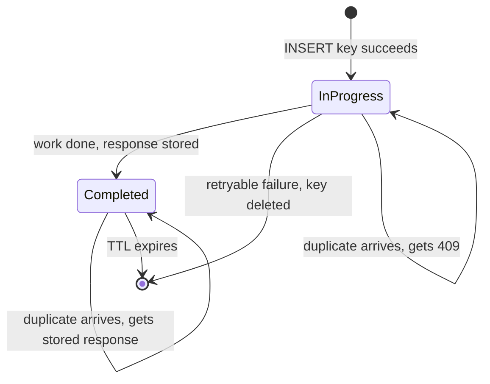

A shopper taps **Pay** during the flash sale. The payment provider takes 300 ms at p50 and 2 s at p99 (illustrative), the app's request times out at 1 s, and the app retries; the shopper, seeing a spinner, taps again. Three requests now carry the same intent. Exactly one charge must happen, and all three must get the same answer. [§9](/c/system-design/09-delivery-semantics) showed why duplicates are unavoidable; this section is the mechanism that makes them harmless at the API.

:::key[First principle]
An operation is idempotent when applying it twice equals applying it once: $f(f(x)) = f(x)$. Charges, emails and order creation aren't, so you make them so: **the client names the intent with a key, the server atomically claims the key before doing any work, and every later request with that key gets the stored result of the first.** The claim must be a single atomic step — a unique-constraint insert — or concurrent duplicates race straight through it.
:::

## 22.1 What is and isn't naturally idempotent

| Operation | Idempotent? | Why |
|---|---|---|
| `SET status = 'paid' WHERE id = 7` | Yes | Second application changes nothing |
| `UPDATE … SET stock = stock - 1` | No | Each application decrements again |
| HTTP `PUT /carts/7` (full replace), `DELETE /carts/7` | Yes, by the HTTP spec | Same final state however often it runs |
| HTTP `POST /payments` | No | Each call creates a new payment |
| `INSERT … ON CONFLICT (id) DO NOTHING` | Yes | The primary key absorbs duplicates |

Turn "no" into "yes" in one of two ways: rewrite the operation as a state transition or upsert (cheapest, use it when you can), or add an **idempotency key** that records "this intent was already handled, here is what we answered".

## 22.2 Designing the key

**Who generates it.** The client, once per *intent* — one checkout attempt — and reuses it on every retry of that attempt. A key generated per HTTP request is unique every time and therefore useless; a key generated by the server can't link a retry to its original.

**How big.** A random UUIDv4 has 122 random bits. Checkout creates 50 orders/s × 86,400 s = 4.32M keys/day plus 1.2M per flash sale, ~2.0 × 10⁹ a year. The birthday bound gives the chance of *any* collision in a year as

$$
P \approx \frac{n^2}{2 \cdot 2^{122}} = \frac{(2.0 \times 10^9)^2}{2^{123}} \approx 3.8 \times 10^{-19}.
$$

Not a design concern. Scope keys anyway — `(merchant_id, endpoint, key)` — so one buggy client can't collide with another.

**Fingerprint.** Store a hash (SHA-256) of the canonicalised request body with the key. Same key, different body is a client bug: reject with `422` instead of silently replaying a response that belongs to a different request.

**Deterministic keys** — `hash(user_id, cart_id)` derived on the server — work when the business intent has a natural identity ("this cart becomes one order"). They fail when the same inputs legitimately repeat (buying the same item twice in a day), so prefer a client nonce and use the natural identity as a second guard (§22.5).

## 22.3 The protocol: claim first, then work



```sql
-- 1. Claim the key. The unique constraint makes exactly one request win.
INSERT INTO idempotency_keys (merchant_id, key, fingerprint, status, created_at)
VALUES (:m, :key, :sha256, 'in_progress', now());
-- unique violation -> SELECT the row: 'completed' -> replay its response, 'in_progress' -> 409

-- 2. Do the work, passing :key to the payment provider as its idempotency key too.

-- 3. Record the result in the same transaction as the business write.
BEGIN;
INSERT INTO orders (...) VALUES (...);
UPDATE idempotency_keys SET status = 'completed', response = :json WHERE merchant_id = :m AND key = :key;
COMMIT;
```

| Duplicate finds | Respond with | Why |
|---|---|---|
| No row | Process normally | First request |
| `completed`, same fingerprint | Stored status and body | A retry must see exactly the original answer |
| `in_progress` | `409 Conflict` + `Retry-After: 1` (or wait briefly) | The first copy is still working; never start a second |
| Same key, different fingerprint | `422 Unprocessable` | Client reused a key for a new request |
| Original failed with a retryable error | Key deleted → process normally | A genuine retry must be able to succeed |

Step 2 calls an external system, so a crash between 2 and 3 leaves the key `in_progress` while the charge may have happened. Two defences: pass the same key to the provider (most payment APIs accept one, so the provider deduplicates), and run a sweeper that resolves `in_progress` keys older than a few minutes by asking the provider what happened.

## 22.4 Concurrent duplicates: why check-then-act fails

Three ways to implement "have I seen this key?", run against the flash sale: 200,000 requests, 2% of them sent twice (illustrative). Most second copies follow 0.5 s later on average; 10% are near-simultaneous (a proxy retry, two tabs). The first copy takes the provider's latency: lognormal, p50 300 ms, p99 2 s.

```python run
"""Concurrent duplicates at checkout: which idempotency pattern double-charges?"""
import numpy as np

rng = np.random.default_rng(22)
N = 200_000                     # 100 s of flash sale at 2,000 orders/s
DUP = 0.02                      # illustrative: share of requests sent twice (double-click, client retry)
SIGMA = np.log(2000 / 300) / 2.326          # provider latency: p50 300 ms, p99 2 s (illustrative)

dups = int(N * DUP)
near = rng.random(dups) < 0.1               # 10% near-simultaneous: proxy retry, two tabs
gap = np.where(near, rng.uniform(0, 5, dups), rng.exponential(500, dups))   # ms between copies
latency = rng.lognormal(np.log(300), SIGMA, dups)                            # ms the first copy takes
WINDOW = 1.0                    # ms between SELECT and INSERT in check-then-insert (2 round trips)

patterns = {
    # look up the key, charge, write the key at the end: copy 2 races the whole charge
    "check, charge, record": gap < latency,
    # look up the key, then insert it before charging: copy 2 races two round trips
    "check, then insert": gap < WINDOW,
    # INSERT the key first under a unique constraint: the database picks exactly one winner
    "insert-first (unique)": np.zeros(dups, bool),
}
print(f"{dups:,} duplicated requests out of {N:,}")
print("%-24s %15s" % ("pattern", "double charges"))
for name, charged_twice in patterns.items():
    print("%-24s %15d" % (name, charged_twice.sum()))

in_flight = gap < latency                   # with insert-first, what does copy 2 see?
print(f"insert-first: copy 2 finds the key 'in progress' (409, retry later) {in_flight.sum():,} times,"
      f" 'completed' (replay stored response) {(~in_flight).sum():,} times")
```

```output
4,000 duplicated requests out of 200,000
pattern                   double charges
check, charge, record               2168
check, then insert                    91
insert-first (unique)                  0
insert-first: copy 2 finds the key 'in progress' (409, retry later) 2,168 times, 'completed' (replay stored response) 1,832 times
```

- **Check, charge, record** double-charges more than half the duplicates (2,168 of 4,000): the second copy arrives while the first is still waiting on the provider, finds no key, and charges. Duplicates arrive *during* slow requests — that's what triggers the retry — so this pattern fails exactly when it matters.
- **Check, then insert** shrinks the race to two round trips (~1 ms), and still lets 91 near-simultaneous copies through: a smaller window is not a closed one.
- **Insert-first** charges nobody twice. Note the split: 54% of second copies find the key `in_progress` and must be told to wait — the `409` path is common, not an edge case.

The probability a second copy double-charges under check-charge-record is $P(\text{latency} > \text{gap})$:

:::chart[P(double charge) vs gap between the two copies (provider p50 300 ms, p99 2 s)]{type="line" x="gap between copies (ms)" y="P(double charge)" xlog="true" yfmt="pct" ymin="0" ymax="1" marks="300:provider p50"}
gap ms, check-charge-record, check-then-insert (1 ms window), insert-first
0.5, 1.000, 1, 0
1, 1.000, 0, 0
2, 1.000, 0, 0
5, 1.000, 0, 0
10, 1.000, 0, 0
20, 1.000, 0, 0
50, 0.986, 0, 0
100, 0.911, 0, 0
200, 0.690, 0, 0
300, 0.500, 0, 0
500, 0.266, 0, 0
1000, 0.070, 0, 0
2000, 0.010, 0, 0
5000, 0.000, 0, 0
:::

## 22.5 Sizing the TTL and the store

The key must outlive every way a retry can arrive ([§9.5](/c/system-design/09-delivery-semantics) has the general rule):

$$
\text{TTL} \ge \max(\text{retry delays}), \qquad \text{store} = \text{keys/day} \times \frac{\text{TTL}}{1\text{ day}} \times \text{bytes per entry}.
$$

Retry delays for checkout, illustrative mixture: 70% double-clicks and immediate retries (0.05–2 s), 25% SDK backoff of 1, 2 … 128 s (cumulative delay up to 255 s), 5% offline mobile replays (lognormal, median 1 h). With 2% of 5.52M daily orders retried, that's 110,400 retries a day; any arriving after the TTL is a duplicate charge that the key store misses.

:::chart[Retries per day arriving after the key expired vs TTL (checkout, illustrative retry mix)]{type="line" x="key TTL (minutes)" y="escaped retries per day" xlog="true" ylog="true" points="true" marks="1440:24 h"}
TTL min, escaped retries per day
0.17, 22820
0.5, 19350
1, 15870
2, 12360
5, 5235
10, 4866
30, 3740
60, 2757
120, 1774
240, 981.6
720, 271.8
1440, 94.67
2880, 25.67
4320, 12.14
10080, 1.877
:::

:::example[Worked example · checkout's key store]
Each entry holds the key, scope, fingerprint, status and the stored response — ~500 B with a small JSON body (illustrative; §9.5's ~100 B entry stored no response).

| TTL | Escaped retries/day | Store size |
|---:|---:|---:|
| 5 min | 5,235 | 0.01 GB |
| 1 h | 2,757 | 0.12 GB |
| 24 h | 95 | 2.8 GB |
| 72 h | 12 | 8.3 GB |
| 7 days | 1.9 | 19 GB |

A 5-minute TTL covers every SDK retry and still misses 5,235 a day — the offline replays. 24 h costs 2.8 GB and leaves ~95; 72 h costs 8.3 GB for ~12. Storage is cheap, so take **24–72 h**, and catch the tail with a second, business-level guard: a unique constraint on `orders(cart_id)` so a cart converts to at most one order no matter how late the retry.

**Write cost.** A separate key table adds an insert and an update per order: at the 2,000 orders/s peak, +4,000 writes/s on top of the 8,000 the order path already does (+50%). Putting the key on the order itself — `orders(merchant_id, idem_key) UNIQUE` — makes the claim and the business write one insert, and the order row *is* the stored response. Use a separate table only for operations that don't create a row.
:::

## 22.6 Where the key lives

| Option | Atomic with the effect? | Extra writes | Use when |
|---|---|---|---|
| Unique column on the business row | Yes, one insert | 0 | The operation creates a row (orders, payments) |
| Key table in the same database | Yes, same transaction | 2 per request | Operations without a natural row; need stored responses |
| Redis `SET key NX EX` | No — separate system | 1–2 | Rate-limited or low-stakes endpoints; accept a small gap |
| Pass the key to the provider | Provider-side dedupe | 0 | Always, in addition, for external side effects |

If the key store and the business data are in different systems, a crash between them reopens the window: you are back to a distributed transaction ([§15](/c/system-design/15-transactions)). Keep them in one database, or reconcile.

## 22.7 Failure modes and rules

| Failure mode | Effect | Fix |
|---|---|---|
| Check-then-act | Double charge under concurrency (2,168 of 4,000 duplicates in §22.4) | Insert-first under a unique constraint |
| Key generated per request | Every retry looks new | Generate once per intent, on the client |
| Response not stored | Replay returns a different body or status | Store status + body; replay verbatim |
| Key deleted on success | Next retry re-processes | Delete only on retryable failure; expire by TTL |
| TTL shorter than the retry tail | Late retries charge again (5,235/day at 5 min) | 24–72 h plus a business-level unique guard |
| Stuck `in_progress` after a crash | Retries get 409 forever | Sweeper reconciles with the provider after N minutes |
| Same key, different body accepted | Wrong response replayed | Fingerprint check → 422 |

Rules of thumb: client-generated UUID per intent; claim with an insert before any side effect; pass the key downstream; store the response; TTL ≥ longest retry path (24–72 h for checkout); a natural-identity unique constraint as the backstop.

## 22.8 Check yourself

:::qa[The handler checks Redis for the key, calls the provider, then writes the key. Duplicates arrive on average 500 ms apart and the provider's p50 is 300 ms. Roughly what share of duplicates double-charge?]
A duplicate charges twice whenever it arrives before the first call finishes, $P(\text{latency} > \text{gap})$. The simulation's mix of gaps gives 2,168 of 4,000 — more than half. Claiming the key with an atomic insert first brings it to zero.
:::

:::qa[Why must the key be generated by the client and not the API server?]
The server sees each retry as a new HTTP request and can't tell it apart from a new intent. Only the client knows "this is the same checkout attempt", so it must create the key once and resend it with every retry.
:::

:::qa[Checkout creates 5.52M keys a day at ~500 B each. What does a 72-hour TTL cost, and what does it buy over 24 h?]
\(5.52 \times 10^6 \times 3 \times 500\) B ≈ 8.3 GB, versus 2.8 GB for 24 h. Under the illustrative retry mix it cuts escaped late retries from ~95 to ~12 a day. Cheap insurance; still pair it with a unique constraint on `cart_id`.
:::

:::qa[A duplicate arrives while the first request is still calling the provider. What should the server answer, and why not just process it?]
`409 Conflict` with a short `Retry-After` (or hold the request briefly and then replay). Processing it would start a second charge; the whole point of the in-progress state is that only one copy ever does the work.
:::

Next: [§23 Database indexes](/c/system-design/23-indexes) — making the lookups behind all of this fast.
