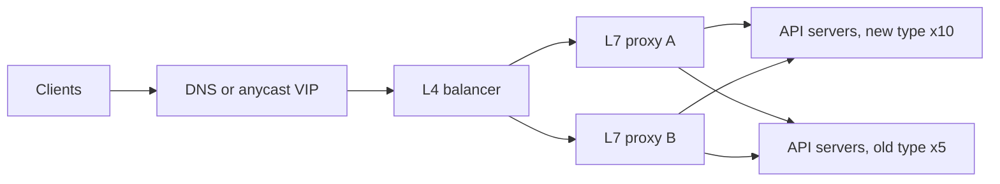

Pulse's API tier serves 6,000 requests/s at peak on 15 servers, 5 per zone ([§10.4](/c/system-design/10-latency-and-throughput)). Midway through a hardware migration, 10 servers are the new type (8 cores, 10 ms per request: 800 req/s each) and 5 are the old type at half the speed (400 req/s each) — illustrative. Total capacity is 10,000 req/s, so the fleet is 60% busy: comfortable on paper. With round robin in front, the five old servers are at 100% and their queues grow without bound. The load balancer, not the fleet size, decides whether this works.

:::key[First principle]
Response time explodes as a server's utilisation nears 1 ([§10.3](/c/system-design/10-latency-and-throughput)), so **a balancer must equalise utilisation, not request counts.** Round robin equalises counts, which is the same thing only when every backend is identical. Policies that route by **requests in flight** — least-connections, power of two random choices — measure each server's actual speed and adapt without being told.
:::

## 24.1 L4 or L7

| | L4 (TCP/UDP) | L7 (HTTP, gRPC) |
|---|---|---|
| Decides per | Connection | Request |
| Sees | IPs, ports | Paths, headers, cookies, status codes |
| Can do | Forward packets at very high rates; pass TLS through | Route by path, terminate TLS, retry, rate-limit, add headers, eject on 5xx |
| Weak spot | Long-lived connections pin load: one HTTP/2 or gRPC connection carries thousands of requests to one backend | CPU per request (TLS, parsing); it can become the bottleneck |
| Typical | Cloud network LBs, IPVS, Maglev-style front ends | Envoy, NGINX, HAProxy, cloud application LBs |

A common layout uses both: an L4 tier spreads connections across L7 proxies, and the proxies balance requests across services. If clients hold long-lived HTTP/2 or gRPC connections, an L4-only balancer balances *connections* evenly and *load* not at all — balance at L7, or cap connection age so clients reconnect.



## 24.2 Policies

| Policy | Picks | Needs | Good when | Fails when |
|---|---|---|---|---|
| Round robin | Next in rotation | Nothing | Identical servers, uniform requests | Mixed hardware, a slow or degraded server |
| Weighted round robin | Rotation with weights | Correct weights | Known, stable capacity ratios | Capacity drifts (GC, noisy neighbours) |
| Random | Uniform random | Nothing | Many balancers, identical servers | Same as round robin, plus noise |
| Least connections | Fewest in flight | Live in-flight counts | Variable request cost, mixed servers | Many balancer instances each see only their own traffic |
| Power of two choices | Better of 2 random servers | In-flight counts for 2 servers | Many balancers, stale info | Rarely; slightly worse than least-connections |
| Consistent hashing | Hash of a key | Key per request | Cache affinity ([§64](/c/system-design/64-consistent-hashing)) | Hot keys |

With round robin, server $i$ receives $\lambda/n$ and runs at $\rho_i = \lambda / (n\,\mu_i)$. Pulse's mix: \(6{,}000/15\) = 400 req/s to every server — 50% on a new server, **100%** on an old one. Weighted round robin with weights 2:1 sends 480 and 240 req/s: 60% everywhere. Least-connections gets there without weights, because a slow server finishes requests more slowly, so its in-flight count rises and it gets picked less.

## 24.3 Simulate the mixed fleet

Each server has 8 cores and a FIFO queue; service times are exponential (mean 10 ms new, 20 ms old); arrivals are Poisson at 6,000 req/s for 20 s.

```python run
"""15 app servers, 5 of them half-speed. Route 6,000 req/s with four load-balancing policies."""
import heapq
from collections import deque
import numpy as np

CORES = 8
SVC = [10.0] * 10 + [20.0] * 5           # mean ms per request: 10 new (800 req/s), 5 old (400 req/s)
WEIGHT = [2] * 10 + [1] * 5


def simulate(policy, rate=6_000, secs=20, seed=3):
    rng = np.random.default_rng(seed)
    n = int(rate * secs)
    arrive = np.cumsum(rng.exponential(1000 / rate, n))           # ms
    work = rng.exponential(1.0, n)                                # x mean service time of the server
    picks = rng.integers(0, len(SVC), (n, 2))
    wrr = [s for s in range(len(SVC)) for _ in range(WEIGHT[s])]
    busy, waiting = [0] * len(SVC), [deque() for _ in SVC]
    done, lat = [], np.empty(n)

    def start(s, i, now):
        busy[s] += 1
        heapq.heappush(done, (now + work[i] * SVC[s], s, i))

    for i, t in enumerate(arrive):
        while done and done[0][0] <= t:                           # finish requests up to now
            tc, s, j = heapq.heappop(done)
            lat[j], busy[s] = tc - arrive[j], busy[s] - 1
            if waiting[s]:
                start(s, waiting[s].popleft(), tc)
        load = [busy[s] + len(waiting[s]) for s in range(len(SVC))]   # requests in flight per server
        if policy == "round robin":
            s = i % len(SVC)
        elif policy == "weighted RR 2:1":
            s = wrr[i % len(wrr)]
        elif policy == "least connections":
            s = int(np.argmin(load))
        else:                                                     # power of two random choices
            a, b = picks[i]
            s = a if load[a] <= load[b] else b
        if busy[s] < CORES:
            start(s, i, t)
        else:
            waiting[s].append(i)
    while done:
        tc, s, j = heapq.heappop(done)
        lat[j], busy[s] = tc - arrive[j], busy[s] - 1
        if waiting[s]:
            start(s, waiting[s].popleft(), tc)
    return np.percentile(lat, 50), np.percentile(lat, 99), lat.max()


print("total capacity 10,000 req/s, offered 6,000 req/s (60%)")
print("%-18s %8s %8s %9s" % ("policy", "p50 ms", "p99 ms", "max ms"))
for policy in ("round robin", "weighted RR 2:1", "least connections", "two choices"):
    p50, p99, mx = simulate(policy)
    print("%-18s %8.1f %8.1f %9.0f" % (policy, p50, p99, mx))
```

```output
total capacity 10,000 req/s, offered 6,000 req/s (60%)
policy               p50 ms   p99 ms    max ms
round robin            12.8    339.4       528
weighted RR 2:1         8.0     63.2       200
least connections       7.8     62.2       195
two choices             8.1     65.7       208
```

Round robin's p99 is 5× the others at only 60% fleet utilisation, and it isn't a stable number: the old servers' queues grow for as long as the peak lasts, so a longer run gives a worse p99. The other three land within a few milliseconds of each other. Their ~62 ms p99 floor is the old servers' own service time (exponential with a 20 ms mean has a 92 ms p99); no routing policy removes that — only retiring or down-weighting the slow machines does.

Sweeping the offered load with the same model shows where each policy breaks:

:::chart[p99 latency vs offered load, 10 new + 5 half-speed servers (simulated, 30 s per point)]{type="line" x="offered load (req/s, capacity 10,000)" y="p99 latency (ms)" ylog="true" points="true" marks="6000:Pulse peak"}
load, round robin, weighted RR 2:1, least connections, two choices
3000, 71.08, 62.56, 61.63, 66.82
4000, 71.12, 63.02, 61.6, 66.42
5000, 75.19, 62.83, 62.17, 66.31
5500, 89.18, 62.79, 62.46, 65.96
6000, 364.8, 62.93, 62.37, 65.51
6500, 2457, 63.06, 62.35, 65.32
7000, 4797, 63.49, 62.49, 65.88
7500, 7261, 64.06, 62.59, 65.7
8000, 9722, 65.32, 62.41, 66.12
8500, 12170, 67.54, 63.1, 67.06
9000, 14580, 73.85, 63.15, 68.88
9500, 17060, 98, 64.87, 72.62
:::

- **Round robin** fails at 6,000 req/s — 60% of fleet capacity — because that's 100% of the old servers. Its usable capacity is $n \cdot \min_i \mu_i$ = 15 × 400 = 6,000, not 10,000.
- **Weighted round robin** holds until ~90%, then degrades: static weights can't react to random bursts landing on one server.
- **Least connections** is best throughout, with a global view of every server's in-flight count.
- **Two choices** tracks it within ~5–8 ms using only two samples per request. That matters when 10 proxies each balance independently: least-connections on each proxy sees only its own tenth of the traffic, and all of them pile onto whichever server looked emptiest a moment ago; random sampling avoids that herd.

## 24.4 Health checks: how many requests does a dead server eat?

An **active** check probes every server every $I$ seconds and ejects it after $k$ consecutive failures. A server that dies keeps receiving its share until then:

$$
\text{detection} \approx I \times k, \qquad \text{failed requests} \approx \frac{\lambda}{n} \times I \times k.
$$

:::example[Worked example · one Pulse server dies at peak]
Each server gets \(6{,}000 / 15\) = 400 req/s.

| Check interval × threshold | Detection | Requests sent to the dead server |
|---|---:|---:|
| 2 s × 2 | 4 s | 1,600 |
| 5 s × 3 | 15 s | 6,000 |
| 10 s × 3 | 30 s | 12,000 |
| 30 s × 2 | 60 s | 24,000 |

**Passive** checks (outlier detection) watch real traffic and eject a server after, say, 5 consecutive errors: at 400 req/s that's \(5/400\) s = 12.5 ms. Use both: passive to react in milliseconds to real failures, active to bring a server back once it recovers. Idempotent requests that hit the dead server can be retried on another ([§30](/c/system-design/30-retry)).
:::

What the check probes matters as much as how often:

| Check | Probes | Too shallow | Too deep |
|---|---|---|---|
| Liveness | Process responds | — | Restarting on a slow dependency kills healthy pods |
| Readiness | Can serve: pools warm, config loaded, local dependencies OK | `/health` returns 200 while the DB pool is dead | Checks a shared DB: one DB blip marks **every** server unhealthy and the LB ejects the whole fleet |

Guard against the second case with a cap on ejection (e.g. never eject more than 10–50% of a pool) — proxies such as Envoy have a "panic" mode that routes to all backends once too many look unhealthy, on the theory that a fleet-wide failure is more likely a bad check than a fleet-wide outage.

## 24.5 Draining and rolling deploys

Removing a server from rotation without **draining** cuts the requests it's serving; users see 502s. Draining means: stop sending new requests, wait for in-flight ones to finish (deregistration delay ≥ p99 request time; minutes for WebSockets and streaming), then stop the process. New servers should **slow-start** — ramp traffic over 30–60 s — so cold caches and JIT warm-up don't land at full load.

How many servers can a rolling deploy take out at once? Keep the remaining servers under a ceiling, say 75%:

$$
\frac{6{,}000}{800\,(15 - k)} \le 0.75 \;\Rightarrow\; 15 - k \ge 10 \;\Rightarrow\; k \le 5.
$$

| Servers out ($k$) | 0 | 1 | 3 | 5 | 6 | 7 |
|---|---:|---:|---:|---:|---:|---:|
| Utilisation of the rest | 50% | 54% | 63% | **75%** | 83% | 94% |

With ~90 s per batch (30 s drain + 60 s start and warm-up, illustrative), one server at a time takes 22.5 minutes; batches of 5 take 4.5 minutes. Five is also the size of one zone — the same headroom that survives losing a zone pays for fast deploys.

## 24.6 Knobs and failure modes

| Knob | Starting point | Why |
|---|---|---|
| Policy | Least-requests / power of two choices | Adapts to mixed and degraded servers |
| Active health check | Every 5 s, eject after 2–3 failures, 1–2 s timeout | ~10–15 s detection (§24.4) |
| Outlier ejection | 5 consecutive 5xx, eject 30 s, max 10–50% of the pool | Millisecond reaction, bounded blast radius |
| Drain (deregistration delay) | ≥ p99 request time; 30 s for APIs | No cut requests on deploy |
| Slow start | 30–60 s ramp | New servers warm caches first |
| Max connection age (HTTP/2, gRPC) | Minutes | Lets L4 and client-side balancing re-spread load |

| Failure mode | Symptom | Fix |
|---|---|---|
| Round robin on mixed or degraded servers | p99 rises on a fraction of servers; fleet looks only 60% busy | Least-requests or P2C; weights at minimum |
| Health check too deep | Whole fleet ejected during a DB blip | Readiness checks local state; cap ejection; panic mode |
| Health check too shallow | Errors from a server that "looks healthy" | Passive outlier detection on real responses |
| No draining | 502s on every deploy | Deregistration delay ≥ p99 |
| Long-lived connections behind L4 | One server hot, others idle | Balance at L7; cap connection age |
| Balancer as a single point of failure | Everything down with it | Redundant pair or fleet behind DNS/anycast |
| Sticky sessions | Uneven load; state lost on deploy | Keep servers stateless; session in a shared store |

## 24.7 Check yourself

:::qa[Round robin over 12 servers at 800 req/s and 4 at 400 req/s, total load 6,000 req/s. What is each type's utilisation, and what's the usable capacity?]
Each server gets 6,000 / 16 = 375 req/s: 47% on the fast ones, 94% on the slow ones — the slow ones are in the hockey stick. Usable capacity under round robin is 16 × 400 = 6,400 req/s, not 12 × 800 + 4 × 400 = 11,200.
:::

:::qa[Why prefer power of two choices over least-connections when there are 10 proxy instances?]
Each proxy only counts its own in-flight requests, so least-connections on every proxy chases the same "emptiest" server at once and overloads it. Sampling two random servers and taking the better one spreads choices out while still avoiding the busy servers — near-least-connections latency without the herd.
:::

:::qa[A server crashes. Health checks run every 10 s and eject after 3 failures; the server normally gets 400 req/s. How many requests fail, and how do you cut that?]
~30 s × 400 = 12,000. Add passive outlier detection (eject after 5 consecutive errors: ~12.5 ms at 400 req/s) and retry idempotent requests on another server.
:::

:::qa[Your readiness check queries the primary database. What happens during a 20 s database failover?]
Every server's check fails at once, the balancer ejects the whole fleet, and a 20 s database blip becomes a full outage that lasts until checks pass again. Readiness should check local state only, and ejection should be capped so the balancer keeps routing when everything looks unhealthy.
:::

Next: [§25 Message queue](/c/system-design/25-message-queue) — absorbing load the servers can't take right now.
