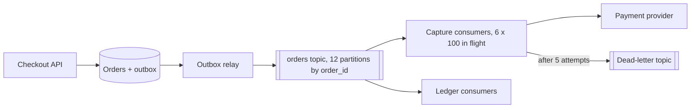

The flash sale sends 2,000 orders/s for 10 minutes. Each order must have its payment captured through a provider that takes 300 ms at p50 and 2 s at p99 (illustrative), and whose contract may cap the request rate. If checkout waits for the capture, the shopper's latency is the provider's latency and checkout's throughput is the provider's throughput. Instead, checkout writes the order and an `OrderPlaced` event, returns, and a pool of consumers captures payments from a queue. This section sizes that queue and its consumers.

:::key[First principle]
A queue decouples **arrival rate** λ from **service rate** μ. While λ > μ the excess becomes backlog, growing at $\lambda - \mu$ per second, and every message waits roughly backlog ÷ μ. So you size consumers for the **delay you're willing to accept**, not for the peak — and because delivery is at-least-once ([§9](/c/system-design/09-delivery-semantics)), every consumer must be idempotent.
:::

## 25.1 Queue or log

| | Queue (SQS, RabbitMQ) | Log (Kafka, Pulsar, Kinesis) |
|---|---|---|
| Consumption | Competing consumers; a message is deleted when acked | Consumers track an offset; messages stay for the retention period |
| Redelivery trigger | Visibility timeout / ack deadline expires | Consumer restarts from its last committed offset |
| Ordering | None, or FIFO per group key with throughput limits | Per partition |
| Parallelism | Add consumers freely | At most one consumer per partition per group |
| Replay and fan-out | No replay; fan-out via topics → queues | Rewind offsets; any number of independent groups |
| Fits | Task distribution, per-message retries | Event streams, ordered per-entity processing, reprocessing after a bug |

Checkout uses a log partitioned by `order_id`: capture, ledger and email are separate consumer groups reading the same events, and an order's events (placed, paid, cancelled) must be processed in order.



The outbox (write the event in the same transaction as the order, publish it afterwards) keeps "order saved" and "event published" from disagreeing ([§9.4](/c/system-design/09-delivery-semantics)).

## 25.2 At-least-once in practice: the visibility timeout

A queue hides a delivered message for a **visibility timeout** (an *ack deadline*); if the consumer doesn't ack in time, the message is delivered again — to another consumer, while the first may still be working on it. With processing time $L$:

$$
P(\text{redelivered while still in progress}) = P(L > \text{timeout}).
$$

:::example[Worked example · timeout for payment capture (provider p50 300 ms, p99 2 s, lognormal)]
| Visibility timeout | $P(L > \text{timeout})$ | Duplicate deliveries/s at 2,000/s |
|---:|---:|---:|
| 0.5 s | 26.6% | 531 |
| 1 s | 7.0% | 140 |
| 2 s | 1.0% | 20 |
| 5 s | 0.028% | 0.56 |
| 30 s | 8 × 10⁻⁹ | ~0 |

A 1 s timeout — "the p99 is 2 s, so a second is plenty for most" — redelivers 140 messages a second *while the first copy is still running*. Those duplicates hit the provider concurrently, which is exactly the race §22.4 showed. Set the timeout to ~10× the p99 (here 30 s), or have the consumer extend it while it works (heartbeating). A crashed consumer's messages then reappear after 30 s, which the delay budget below must absorb.
:::

Kafka's equivalent is the commit interval and `max.poll.interval.ms`: commit after processing, and a consumer that stalls past the poll interval is evicted and its partitions reassigned — so its in-flight messages are processed again.

## 25.3 Sizing consumers for the spike

Arrivals λ = 2,000/s for $T$ = 600 s; consumers drain μ/s. Treat it as fluid (it's [§10.3](/c/system-design/10-latency-and-throughput)'s queue far above saturation, where randomness no longer matters):

$$
\text{backlog at the end} = (\lambda - \mu)\,T, \qquad \text{max age} \approx \frac{(\lambda - \mu)\,T}{\mu}, \qquad
\text{max age} \le A \iff \mu \ge \frac{\lambda T}{T + A}.
$$

For a 5-minute capture target ($A$ = 300 s): \(\mu \ge 2{,}000 \times 600 / 900\) = 1,333/s — two-thirds of the peak rate. The simulation checks the formula with Poisson arrivals (steady 50/s, sale from t = 300 s to 900 s) and FIFO consumers at three capacities:

```python run
"""Checkout flash sale through a queue: depth and oldest-message age for three consumer capacities."""
from collections import deque
import numpy as np

STEADY, PEAK, START, SALE, HORIZON = 50, 2_000, 300, 600, 2_700   # orders/s, seconds


def run(capacity, seed=25):
    rng = np.random.default_rng(seed)
    q, depth, age = deque(), [], []                 # q holds [arrival second, messages]
    for t in range(HORIZON):
        rate = PEAK if START <= t < START + SALE else STEADY
        q.append([t, rng.poisson(rate)])
        budget = capacity                           # messages the consumers can finish this second
        while q and budget:
            take = min(budget, q[0][1])
            q[0][1] -= take
            budget -= take
            if q[0][1] == 0:
                q.popleft()
        depth.append(sum(c for _, c in q))
        age.append(t - q[0][0] if q else 0)
    return np.array(depth), np.array(age)


for mu in (1_000, 1_334, 2_200):
    d, a = run(mu)
    drained = START + SALE + int(np.argmax(d[START + SALE:] == 0))
    print(f"capacity {mu:>5,}/s: peak depth {d.max():>9,} msgs, max age {a.max():>4} s,"
          f" empty again at t = {drained:,} s")

# Closed form: backlog (λ - μ)T at the end of the sale, oldest message waits backlog / μ
T, A = SALE, 300                                    # want every order captured within 5 minutes
print(f"μ needed for max age {A} s: λT/(T + A) = {PEAK * T / (T + A):,.0f}/s")
W = 300 * np.exp((np.log(2000 / 300) / 2.326) ** 2 / 2) / 1000   # mean of p50 300 ms / p99 2 s lognormal
print(f"mean provider latency {W * 1000:.0f} ms -> in-flight slots for 1,334/s: {1_334 * W:.0f}")
```

```output
capacity 1,000/s: peak depth   599,701 msgs, max age  599 s, empty again at t = 1,531 s
capacity 1,334/s: peak depth   399,301 msgs, max age  299 s, empty again at t = 1,211 s
capacity 2,200/s: peak depth         0 msgs, max age    0 s, empty again at t = 900 s
μ needed for max age 300 s: λT/(T + A) = 1,333/s
mean provider latency 418 ms -> in-flight slots for 1,334/s: 558
```

The closed form holds: at 1,000/s the backlog peaks at \((2{,}000 - 1{,}000) \times 600\) ≈ 600,000 and the oldest order waits 10 minutes, with the queue empty 631 s after the sale ends (matching [§9.7](/c/system-design/09-delivery-semantics)); at 1,334/s the oldest order waits 5 minutes; above the peak rate there's no backlog at all.

:::chart[Queue depth during the flash sale (sale from minute 5 to 15, simulated)]{type="line" x="minutes" y="messages waiting" yfmt="int" band="5:15:sale at 2,000 orders/s"}
minutes, μ = 1,000/s, μ = 1,334/s, μ = 2,200/s
0, 0, 0, 0
2, 0, 0, 0
4, 0, 0, 0
5, 1015, 681, 0
6, 61965, 41591, 0
7, 121975, 81561, 0
8, 182041, 121587, 0
9, 242446, 161952, 0
10, 301933, 201399, 0
11, 361911, 241337, 0
12, 421298, 280684, 0
13, 481129, 320475, 0
14, 540627, 359933, 0
15, 598761, 398027, 0
16, 541718, 320944, 0
17, 484748, 243934, 0
18, 427742, 166888, 0
19, 370727, 89833, 0
20, 313808, 12874, 0
21, 256839, 0, 0
22, 199875, 0, 0
23, 142824, 0, 0
24, 85852, 0, 0
25, 28925, 0, 0
26, 0, 0, 0
28, 0, 0, 0
30, 0, 0, 0
:::

:::chart[Age of the oldest waiting order (minutes), same runs]{type="line" x="minutes" y="oldest message age (min)" hmarks="5:5-minute capture target" band="5:15:sale"}
minutes, μ = 1,000/s, μ = 1,334/s, μ = 2,200/s
0, 0, 0, 0
4, 0, 0, 0
5, 0, 0, 0
6, 0.50, 0.33, 0
7, 1.00, 0.67, 0
8, 1.52, 1.00, 0
9, 2.00, 1.33, 0
10, 2.50, 1.67, 0
11, 3.02, 2.00, 0
12, 3.52, 2.33, 0
13, 4.02, 2.67, 0
14, 4.52, 3.00, 0
15, 5.00, 3.33, 0
16, 5.50, 3.67, 0
17, 6.00, 4.00, 0
18, 6.52, 4.32, 0
19, 7.00, 4.65, 0
20, 7.50, 4.25, 0
21, 8.00, 0, 0
22, 8.50, 0, 0
23, 9.00, 0, 0
24, 9.50, 0, 0
25, 9.57, 0, 0
26, 0, 0, 0
28, 0, 0, 0
30, 0, 0, 0
:::

Depth and age tell different stories: depth peaks when the sale ends, but age keeps climbing for minutes afterwards, because the oldest messages are the ones from the sale's start.

:::example[Worked example · from μ to consumers]
Mean provider latency for the lognormal with p50 300 ms and p99 2 s is ~418 ms. By Little's law ([§10.2](/c/system-design/10-latency-and-throughput)), 1,334 captures/s need \(1{,}334 \times 0.418\) ≈ 558 calls in flight. With 100 concurrent calls per consumer instance (async I/O, illustrative): **6 instances, 600 slots, ~1,435 captures/s** — a worst case of \((2{,}000 - 1{,}435) \times 600 / 1{,}435\) ≈ 236 s, inside the 5-minute target. Steady traffic (50/s) needs only ~21 slots, so autoscaling on lag can run 1 instance most of the day.

Sizing for the peak instead (2,000 × 0.418 ≈ 836 slots, 9 instances) removes the delay but sends 2,000 calls/s to the provider. If its contract allows, say, 1,500/s (illustrative), the queue is what lets you respect that limit while still accepting every order.
:::

## 25.4 Partitions, ordering and parallelism

- **Ordering is per partition.** Key by the entity whose events must stay ordered: `order_id`.
- **Parallelism ≤ partitions** per consumer group; extra consumers idle.
- **Bytes rarely decide.** 2,000 events/s × 1 KB = 2 MB/s, far below what one partition of a typical broker handles. Partition count comes from consumer parallelism and growth: 6 consumers today, room for 12 → **12 partitions**, ~167 events/s each at peak. Adding partitions later remaps keys to partitions and breaks per-key ordering across the change, so start with headroom.
- **Within a partition**, process different keys concurrently and the same key serially. That's how 100 in-flight calls per consumer coexist with per-order ordering; a partition processed strictly one message at a time manages only \(1/0.418\) ≈ 2.4 captures/s.
- **Retention**: 7 days of steady traffic is \(50 \times 1 \text{ KB} \times 604{,}800\) s ≈ 30 GB, 91 GB with 3 replicas; a flash sale adds 1.2 GB. Long enough to replay after a bad deploy, which also means your idempotency store must cover replays ([§9.5](/c/system-design/09-delivery-semantics)).

## 25.5 Poison messages and the dead-letter queue

A message that always fails (malformed payload, a bug for one edge case) is retried forever under at-least-once. In an ordered partition, it also blocks everything behind it:

$$
\text{blocked messages} \approx \frac{\lambda}{\text{partitions}} \times \sum \text{backoff delays}.
$$

:::example[Worked example · one bad event during the sale]
5 attempts with backoff 1, 2, 4, 8, 16 s = 31 s. At 167 events/s per partition, ~5,200 orders queue behind it, and that partition's age jumps by 31 s while the other 11 are fine. Retrying forever blocks the partition forever.
:::

After 3–5 attempts, move the message to a **dead-letter queue** with the error and attempt count, and continue. If ordering matters, the consumer must then treat later events for the same `order_id` as blocked too (park them, or check state: "capture requested for an order that isn't placed yet" → park). Alert on DLQ size > 0 and keep a redrive tool that replays dead-lettered messages once the bug is fixed — through the same idempotent handler.

## 25.6 Alert on age, autoscale on lag

**Lag** (messages behind) says how much work is queued; **age** (seconds the oldest message has waited) says how late users' work is. They're related by $\text{age} \approx \text{lag}/\mu$: 400,000 messages is 5 minutes at 1,334/s and 7 seconds for a consumer group that drains 60,000/s. Page on age against the delay target (here: page at 3 minutes, before the 5-minute target); autoscale on lag, up to the partition count.

## 25.7 Knobs and failure modes

| Knob | Checkout setting | Why |
|---|---|---|
| Consumer capacity μ | ≥ λT/(T + A) = 1,333/s for a 5-min target | §25.3 |
| In-flight slots | μ × mean latency ≈ 560; 6 × 100 | Little's law |
| Partitions | 12 (2× today's consumers) | Parallelism with growth headroom |
| Visibility timeout / ack deadline | 30 s (~10× p99), or heartbeat | 1 s would redeliver 140 msgs/s mid-flight |
| Max attempts before DLQ | 5, exponential backoff | Bounds blocking to ~31 s |
| Offset commit | After processing, every ≤ 5 s | Replay on crash ≤ one interval ([§9.3](/c/system-design/09-delivery-semantics)) |
| Retention | 7 days | Replay after a bad deploy |

| Failure mode | Symptom | Fix |
|---|---|---|
| Timeout below the latency tail | Duplicate side effects, extra load | Timeout ≫ p99, heartbeats, idempotent consumer |
| Under-provisioned consumers | Age grows for the whole spike and after | Size μ from the delay target |
| Poison message in an ordered partition | One partition's age climbs; others fine | Max attempts → DLQ, alert, redrive |
| Hot key | One partition lags | Better key; split the hot entity |
| Rebalance storms | All consumption pauses repeatedly | Stable membership, cooperative rebalancing, tuned session timeouts |
| Assuming exactly-once | Double charges on redelivery | Idempotency keys ([§22](/c/system-design/22-idempotency)) |
| Alerting on depth | Pages at harmless bursts, silence on a stuck message | Alert on oldest-message age |

## 25.8 Check yourself

:::qa[Arrivals of 2,000/s for 10 minutes; you accept a 2-minute worst-case delay. What consumer rate do you need?]
\(\mu \ge \lambda T/(T + A) = 2{,}000 \times 600 / 720\) ≈ 1,667/s. Check: backlog \((2{,}000 - 1{,}667) \times 600\) ≈ 200,000, waiting 200,000 / 1,667 ≈ 120 s.
:::

:::qa[Processing takes p50 300 ms and p99 2 s. The visibility timeout is 1 s. What goes wrong at 2,000 msgs/s?]
7% of messages are still in progress when they become visible again, so ~140/s are delivered a second time while the first copy runs — concurrent duplicate payment calls. Raise the timeout to ~30 s or extend it while working, and keep the handler idempotent.
:::

:::qa[Why can't you just add 30 consumers to a 12-partition topic to drain faster?]
A consumer group assigns each partition to one consumer, so 18 of the 30 sit idle. Raise concurrency inside each consumer (different keys in parallel), or create more partitions — ideally before you need them, since repartitioning remaps keys.
:::

:::qa[Lag is 50,000 messages on one queue and 500 on another. Which is worse?]
Can't tell from lag. Divide by drain rate: 50,000 at 20,000/s is 2.5 s old; 500 at 1/s is over 8 minutes. Age is the metric users feel.
:::

Next: [§26 Object storage](/c/system-design/26-object-storage) — where the photo service's 88 TB a day goes.
