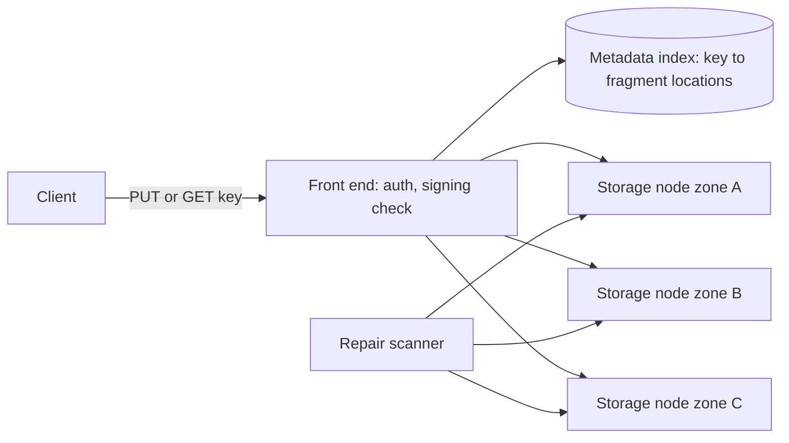
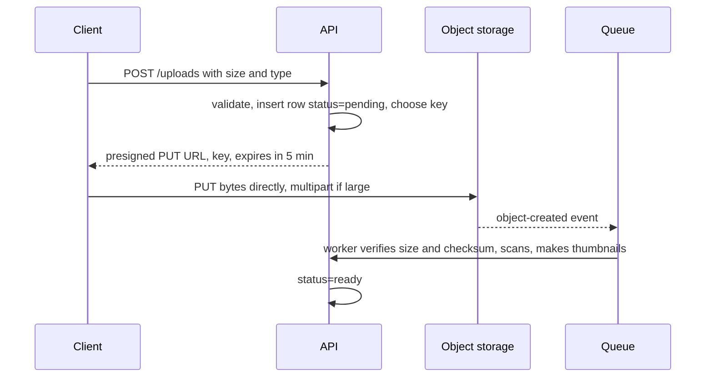

The photo service from [§2](/c/system-design/02-estimation) stores **88 TB a day** — 40M uploads of 2 MB plus 10% for thumbnails — and serves 10,000 views a second (20 GB/s) on average. No database is the right home for 32 PB a year of opaque bytes that are written once and read whole. Object storage is: a flat namespace of keys mapping to immutable blobs, spread across thousands of disks and several zones. This section sizes the four decisions that matter: how objects survive disk failures, how clients upload large files over bad networks, what the bill looks like, and how to hand out access without handing out keys.

:::key[First principle]
Object storage trades **per-request latency and mutability** for **per-byte cost and durability**. Objects are immutable and addressed by key; durability comes from spreading redundant fragments across independent disks and repairing them faster than they fail. Treat it as the system of record for bytes, keep the *metadata* (owner, status, size, checksum) in a database, and never put an object read inside a per-row loop.
:::

## 26.1 How it works inside



- **Write**: the front end splits the object into fragments (or copies), writes them to nodes in different zones, records locations in a metadata index, and acknowledges only after enough fragments are durable. Many providers now give read-after-write consistency for new objects; check yours rather than assuming, and never rely on `LIST` as an index.
- **Read**: look up the key, fetch the fragments, return bytes (a byte range is fine). First byte typically takes tens of milliseconds — two orders of magnitude slower than a cache hit, so a page that reads 20 objects one by one pays for it ([§10](/c/system-design/10-latency-and-throughput)).
- **No partial update**: changing one byte rewrites the object. Mutable fields belong in the database.
- **Repair**: a background scanner notices lost fragments (dead disk, bad checksum) and rebuilds them elsewhere. Durability is a race between failure and repair.

## 26.2 Durability: replication versus erasure coding

Two ways to survive disk loss:

- **Replication** keeps $r$ full copies: overhead $r\times$, survives $r-1$ failures.
- **Erasure coding** $k+m$ splits the object into $k$ data fragments and adds $m$ parity fragments; *any* $k$ of the $n = k+m$ reconstruct it. Overhead $n/k$, survives $m$ failures.

An object is lost only when $m+1$ of its fragments are dead at the same time. Let each disk fail at rate $\lambda$ (annual failure rate ÷ 8,760 h) and each lost fragment be rebuilt in about $T$ hours. A first failure arrives at rate $n\lambda$; with $j$ fragments down, another fails before one is repaired with probability ≈ $(n-j)\lambda T / j$. Chaining these:

$$
P(\text{loss per year}) \approx 8{,}760\; n\lambda \prod_{j=1}^{m} \frac{(n-j)\,\lambda T}{j}
$$

Each extra parity fragment multiplies durability by roughly $1/(\lambda T)$ — and $T$ appears to the power $m$, so **repair speed matters as much as redundancy**.

```python run
"""Durability of replication vs erasure coding: Markov-chain approximation, checked by simulation."""
import numpy as np
from math import prod

HOURS = 8760


def p_loss_year(n, m, afr, repair_h):
    """n fragments, survives m failures. Each disk fails at rate lam/h; each failed fragment is
    rebuilt in ~repair_h. Loss needs m+1 concurrent failures:
    P(year) ~= hours * n*lam * prod_{j=1..m} (n-j)*lam*T / j."""
    lam = afr / HOURS
    x = lam * repair_h
    return HOURS * n * lam * prod((n - j) * x / j for j in range(1, m + 1))


def sim_episode_loss(n, m, x, trials, rng):
    """Embedded chain from 1 failed fragment: up w.p. (n-j)x / ((n-j)x + j), else one repair."""
    lost = 0
    for _ in range(trials):
        j = 1
        while 0 < j <= m:
            up = (n - j) * x / ((n - j) * x + j)
            j += 1 if rng.random() < up else -1
        lost += j > m
    return lost / trials


schemes = [("3 replicas", 3, 2, 3.0), ("EC 6+3", 9, 3, 1.5), ("EC 10+4", 14, 4, 1.4)]

# 1) check the approximation at exaggerated failure rates (x = lam*T = 0.05)
rng = np.random.default_rng(42)
print("check at lam*T = 0.05: P(loss | one fragment failed)")
for name, n, m, _ in schemes[:2]:
    approx = prod((n - j) * 0.05 / j for j in range(1, m + 1))
    print("  %-10s formula %.5f  simulated %.5f" % (name, approx, sim_episode_loss(n, m, 0.05, 400_000, rng)))

# 2) realistic, illustrative: 2% annual disk failure rate, 24 h to rebuild a fragment
objects = 40e6 * 365                     # photo uploads per year
print("\nAFR 2%%, repair 24 h (illustrative); %.1fB objects/yr" % (objects / 1e9))
print("%-10s %8s %9s %12s %8s %14s" % ("scheme", "overhead", "survives", "P(loss)/yr", "nines", "objects lost/yr"))
for name, n, m, ovh in schemes:
    p = p_loss_year(n, m, 0.02, 24)
    print("%-10s %7.1fx %9d %12.1e %8.1f %14.3f" % (name, ovh, m, p, -np.log10(p), p * objects))
```

```output
check at lam*T = 0.05: P(loss | one fragment failed)
  3 replicas formula 0.00250  simulated 0.00247
  EC 6+3     formula 0.00700  simulated 0.00615

AFR 2%, repair 24 h (illustrative); 14.6B objects/yr
scheme     overhead  survives   P(loss)/yr    nines objects lost/yr
3 replicas     3.0x         2      1.8e-10      9.7          2.630
EC 6+3         1.5x         3      1.7e-12     11.8          0.024
EC 10+4        1.4x         4      1.8e-15     14.7          0.000
```

The simulation agrees with the formula for replication and shows it is slightly pessimistic for 6+3 (0.0070 vs 0.0062) — fine for a bound.

:::example[Worked example · a year of photos]
14.6 billion photos a year. With three replicas, 9.7 nines means ~2.6 photos lost a year and **3.0×** raw storage: 32 PB → 96 PB, about 4,600 nodes at 21 TB usable ([§2](/c/system-design/02-estimation)). Erasure coding 6+3 stores **1.5×** (48 PB, ~2,300 nodes), survives three failures instead of two, and loses ~0.02 photos a year. Same hardware budget, half the disks, 100× better modelled durability.
:::

:::chart[Modelled durability vs fragment repair time (2% disk AFR, independent failures)]{type="line" x="repair time per fragment (hours)" y="nines of annual durability" xlog="true" points="true" hmarks="11:eleven nines"}
hours, 3 replicas, EC 6+3, EC 10+4
1, 12.5, 15.9, 20.3
6, 10.9, 13.6, 17.2
24, 9.7, 11.8, 14.7
72, 8.8, 10.3, 12.8
168, 8.1, 9.2, 11.4
:::

What erasure coding costs:

| | 3 replicas | EC 6+3 | EC 10+4 |
|---|---:|---:|---:|
| Storage overhead | 3.0× | 1.5× | 1.4× |
| Failures survived | 2 | 3 | 4 |
| Bytes read to rebuild one lost fragment | 1 fragment | 6 fragments | 10 fragments |
| Disks touched per read | 1 | 6 | 10 |
| Good for | small, hot objects (thumbnails, metadata) | large objects | large, cold objects |

Repair traffic is the hidden bill: rebuilding a dead 20 TB disk under 6+3 reads 6 × 20 TB = 120 TB across the cluster. Spread that across many nodes and it finishes in hours; funnel it through one and $T$ grows to days — which the chart turns into lost nines.

:::warn[Independent failures are the optimistic case]
The model assumes disks fail independently. A firmware bug, a power event, or a bad deploy that deletes objects (the most common real loss) hits many fragments at once — the common-mode term from [§6.3](/c/system-design/06-availability). Place fragments across zones, enable versioning or object lock for deletes, and keep a delayed copy for the data you cannot lose. Eleven nines of hardware durability says nothing about `rm`.
:::

## 26.3 Uploads: presigned URLs and multipart

Uploads never go through the application tier. The photo service peaks at 1,200 uploads/s × 2.2 MB ≈ 2.6 GB/s; [§13](/c/system-design/13-scalability) showed a 10 Gbit/s NIC caps a proxy at ~568 uploads/s. Let clients write straight to storage:



The API only touches metadata. The object-created event (or a client `complete` call, verified server-side) drives processing through a [queue](/c/system-design/25-message-queue).

**Multipart** splits a large object into parts uploaded independently (in parallel, retried individually) and stitched together at the end. On S3 the limits are 5 MB minimum part size (except the last), 10,000 parts and 5 TB per object; other providers are similar. A 2 MB photo is a single PUT. A 1 GB video from a phone is where part size matters.

Model the link as dropping at random, on average once every $M$ bytes. A drop restarts only the current part, so pushing a part of size $s$ costs $(e^{s/M}-1)\,M$ bytes in expectation; each part also costs one round trip. Too small and round trips dominate; too large and retries do. Minimising gives $s_{\text{opt}} \approx \sqrt{2hM}$, where $h$ is the round trip expressed in bytes (RTT × bandwidth).

```python run
"""Multipart upload: expected time vs part size on a flaky link (illustrative)."""
import math

S = 1e9            # 1 GB video upload
BW = 2.5e6         # 2.5 MB/s uplink (20 Mbit/s), illustrative mobile
RTT = 0.15         # s per part request round trip (cross-region, from the latency table)
H = RTT * BW       # per-part overhead expressed in bytes of lost sending time


def cost(part, mtbf_bytes):
    """A drop restarts only the current part; drops arrive at 1/mtbf_bytes per byte sent.
    Expected bytes to push one part = (e^{f s} - 1)/f; plus one round trip per part."""
    f = 1 / mtbf_bytes
    parts = math.ceil(S / part)
    sent = parts * (math.expm1(f * part) / f)
    return parts, sent / S, (sent / BW + parts * RTT) / 60


print("%16s %15s %15s" % ("drop every:", "50 MB", "200 MB"))
print("%9s %6s %9s %5s %9s %5s" % ("part", "parts", "sent/size", "min", "sent/size", "min"))
for mb in (1, 5, 8, 16, 32, 64, 128):
    n, x50, t50 = cost(mb * 1e6, 50e6)
    _, x200, t200 = cost(mb * 1e6, 200e6)
    print("%6d MB %6d %9.2f %5.1f %9.2f %5.1f" % (mb, n, x50, t50, x200, t200))
for M in (50e6, 200e6):
    print("sqrt(2*H*M) at M = %d MB: %.0f MB" % (M / 1e6, math.sqrt(2 * H * M) / 1e6))
print("ideal (no drops, no overhead): %.1f min" % (S / BW / 60))
```

```output
     drop every:           50 MB          200 MB
     part  parts sent/size   min sent/size   min
     1 MB   1000      1.01   9.2      1.00   9.2
     5 MB    200      1.05   7.5      1.01   7.3
     8 MB    125      1.08   7.5      1.02   7.1
    16 MB     63      1.19   8.1      1.05   7.2
    32 MB     32      1.43   9.6      1.11   7.5
    64 MB     16      2.08  13.9      1.21   8.1
   128 MB      8      4.77  31.8      1.43   9.6
sqrt(2*H*M) at M = 50 MB: 6 MB
sqrt(2*H*M) at M = 200 MB: 12 MB
ideal (no drops, no overhead): 6.7 min
```

:::chart[Upload time for 1 GB over a 2.5 MB/s link with 150 ms per part request (model)]{type="line" x="part size (MB)" y="expected upload time (min)" xlog="true" ymax="20" marks="5:S3 minimum part"}
part MB, mean 50 MB between drops, mean 200 MB between drops, no failures
1, 9.2, 9.2, 9.2
2, 8.1, 8.0, 7.9
3, 7.7, 7.6, 7.5
5, 7.5, 7.3, 7.2
8, 7.5, 7.1, 7.0
12, 7.8, 7.1, 6.9
16, 8.1, 7.2, 6.8
24, 8.7, 7.2, 6.8
32, 9.6, 7.5, 6.7
48, 11.3, 7.6, 6.7
64, 13.9, 8.1, 6.7
96, 21.4, 9.1, 6.7
128, 31.8, 9.6, 6.7
:::

Without parts, the same 1 GB on the 200 MB link costs $(e^{5}-1)/5$ ≈ 29.5× the file size in expected bytes — over three hours. Rules: **8–16 MB parts on mobile, 64–128 MB on a datacenter link** (where $M$ is effectively huge and fewer requests win), 4–8 parts in flight, and a lifecycle rule that aborts incomplete multipart uploads after 1–7 days, or their orphaned parts are billed forever.

## 26.4 What it costs: storage, requests, egress

All prices below are illustrative, list-price-shaped numbers — substitute your provider's. Storage is billed per GB-month and *accumulates*; egress is billed per GB served and scales with views.

```python run
"""Photo service monthly object-storage bill over the first year (all prices illustrative)."""
GB_PER_DAY = 88e3                      # 88 TB/day stored (2 MB + 10% thumbnails x 40M uploads)
STD, COLD = 0.020, 0.005               # USD per GB-month: standard vs infrequent-access tier
EGRESS = 0.02                          # USD per GB to the internet
PUT, GET = 5.0, 0.4                    # USD per million requests
UPLOADS = 40e6                         # per day; 2 PUTs each (original + thumbnail set)
VIEWS = 10_000                         # per second average, 2 MB each
DAYS = 30

egress_gb = VIEWS * 86_400 * DAYS * 2e6 / 1e9
print("egress %.0f PB/month" % (egress_gb / 1e6))
print("%5s %10s %10s %10s %10s %9s" % ("month", "stored PB", "std $k", "tiered $k", "egress $k", "req $k"))
for m in (1, 3, 6, 9, 12):
    stored = GB_PER_DAY * DAYS * m
    hot = min(stored, GB_PER_DAY * DAYS)                 # last 30 days stay standard
    std = stored * STD
    tiered = hot * STD + (stored - hot) * COLD
    direct = egress_gb * EGRESS
    reqs = (2 * UPLOADS * DAYS * PUT + VIEWS * 86_400 * DAYS * GET) / 1e6
    print("%5d %10.1f %10.0f %10.0f %10.0f %9.1f" % (m, stored / 1e6, std / 1e3, tiered / 1e3, direct / 1e3, reqs / 1e3))

for hit in (0.0, 0.9, 0.95, 0.99):
    print("CDN hit %.0f%% -> origin egress %.2f PB, $%.0fk/month, origin GET/s %.0f"
          % (hit * 100, egress_gb * (1 - hit) / 1e6, egress_gb * (1 - hit) * EGRESS / 1e3, VIEWS * (1 - hit)))
```

```output
egress 52 PB/month
month  stored PB     std $k  tiered $k  egress $k    req $k
    1        2.6         53         53       1037      22.4
    3        7.9        158         79       1037      22.4
    6       15.8        317        119       1037      22.4
    9       23.8        475        158       1037      22.4
   12       31.7        634        198       1037      22.4
CDN hit 0% -> origin egress 51.84 PB, $1037k/month, origin GET/s 10000
CDN hit 90% -> origin egress 5.18 PB, $104k/month, origin GET/s 1000
CDN hit 95% -> origin egress 2.59 PB, $52k/month, origin GET/s 500
CDN hit 99% -> origin egress 0.52 PB, $10k/month, origin GET/s 100
```

:::chart[Photo service monthly bill components in year one (illustrative prices, USD thousands)]{type="line" x="month" y="USD thousands per month" points="true" prefix="$" unit="k"}
month, storage all standard, storage tiered after 30 days, egress direct from storage, origin egress behind 95% CDN
1, 53, 53, 1037, 52
3, 158, 79, 1037, 52
6, 317, 119, 1037, 52
9, 475, 158, 1037, 52
12, 634, 198, 1037, 52
:::

Read it as two separate problems:

- **Egress dominates on day one**: about USD 1.0M a month served directly. A [CDN](/c/system-design/19-cdn) at 95% hit cuts origin egress 20× (the CDN bills its own delivery — price it separately) and origin GETs from 10,000/s to 500/s.
- **Storage dominates by year two** because it compounds: USD 634k a month after 12 months on the standard tier. Photos are viewed mostly in their first days, so a lifecycle rule moving objects older than 30 days to an infrequent-access tier cuts that to USD 198k — check the tier's retrieval fee and minimum storage duration before moving anything that is still read.
- Requests (USD 22k a month here) matter only for small objects: a 2 KB object costs the same PUT as a 2 GB one.

## 26.5 Presigned URLs: access without credentials

A presigned URL is a request the server has already authorised: method, key, expiry and conditions, signed with a server-held secret (an HMAC over a canonical form of the request). Storage recomputes the signature and refuses anything that differs. The block below models the mechanism — not any provider's exact format:

```python run
"""A presigned URL is an HMAC over (method, key, expiry, limits). Model of the mechanism, not a provider's format."""
import hashlib
import hmac
import secrets
from urllib.parse import parse_qs, urlencode, urlparse

SIGNING_KEY = secrets.token_bytes(32)        # server-side secret; never sent to clients


def presign(method, key, now, ttl_s, max_bytes):
    exp = now + ttl_s
    msg = f"{method}\n{key}\n{exp}\n{max_bytes}".encode()
    sig = hmac.new(SIGNING_KEY, msg, hashlib.sha256).hexdigest()
    return f"https://store.example/{key}?" + urlencode({"exp": exp, "max": max_bytes, "sig": sig})


def check(method, url, now, body_bytes):
    u = urlparse(url)
    q = {k: v[0] for k, v in parse_qs(u.query).items()}
    key, exp, mx = u.path.lstrip("/"), int(q["exp"]), int(q["max"])
    msg = f"{method}\n{key}\n{exp}\n{mx}".encode()
    good = hmac.compare_digest(hmac.new(SIGNING_KEY, msg, hashlib.sha256).hexdigest(), q["sig"])
    if not good:
        return "403 bad signature"
    if now > exp:
        return "403 expired"
    if body_bytes > mx:
        return "403 too large"
    return "200 ok"


t0 = 1_700_000_000                                   # fixed clock for a reproducible run
url = presign("PUT", "u/8812/p/5f3a.jpg", t0, ttl_s=300, max_bytes=10_000_000)
cases = [
    ("upload 2 MB at t+10 s", "PUT", url, t0 + 10, 2_000_000),
    ("same URL at t+301 s", "PUT", url, t0 + 301, 2_000_000),
    ("upload 50 MB", "PUT", url, t0 + 10, 50_000_000),
    ("use it to GET", "GET", url, t0 + 10, 0),
    ("edit key in URL", "PUT", url.replace("5f3a", "0000"), t0 + 10, 2_000_000),
    ("raise max in URL", "PUT", url.replace("max=10000000", "max=99000000"), t0 + 10, 50_000_000),
]
for label, method, u, now, size in cases:
    print("%-22s -> %s" % (label, check(method, u, now, size)))
```

```output
upload 2 MB at t+10 s  -> 200 ok
same URL at t+301 s    -> 403 expired
upload 50 MB           -> 403 too large
use it to GET          -> 403 bad signature
edit key in URL        -> 403 bad signature
raise max in URL       -> 403 bad signature
```

Everything signed is a limit the holder cannot change. Least privilege, then, means signing as much as possible:

- **One method, one key.** The server chooses the key (`u/<user>/p/<random id>`), never the client — a client-chosen path can overwrite someone else's object.
- **Short expiry.** Uploads: 5–15 minutes (enough to start; an in-progress upload is not cut off). Private downloads: 1–5 minutes, re-issued per page view. A leaked URL is a leaked file for exactly its lifetime.
- **Size and type conditions.** Cap content length (10 MB for a 2 MB photo), and then *verify* type and checksum after upload — the declared content type is client input.
- **Bucket policy default-deny**, public access blocked at the account level, and the signing credential scoped to one bucket prefix with write-only permission.
- **Treat the uploaded object as untrusted** until a worker has validated it (size, magic bytes, malware scan) and flipped the row to `ready`.

## 26.6 Configuration defaults

| Knob | Default | Why |
|---|---|---|
| Durability scheme | Provider default; for self-hosted, EC 6+3 large objects, 3× small (< ~1 MB) | 1.5× overhead, 3-failure tolerance (§26.2) |
| Multipart threshold / part size | > 16 MB; 8–16 MB parts on mobile, 64–128 MB server-side | §26.3 model |
| Abort incomplete multipart | 1–7 days | Orphaned parts are billed |
| Upload URL expiry | 5–15 min | Bounds a leak |
| Download URL expiry | 1–5 min | Re-issued per view |
| Tier transition | 30 days to infrequent access (photos) | Storage compounds (§26.4) |
| Versioning + noncurrent expiry | On; delete old versions after 30 days | Recover from bad deletes, cap cost |
| Request rate per key prefix | S3 documents 3,500 writes and 5,500 reads per second per prefix | 1,200 uploads/s fits one prefix; spread hot reads behind a CDN |

## 26.7 Failure modes

| Failure | Symptom | Fix |
|---|---|---|
| Public bucket or over-broad policy | Data exposed; often found by outsiders | Account-level public-access block, default-deny, policy audits |
| Long-lived signed URLs | Links shared or indexed keep working | Minutes, not days; sign per view |
| Orphans: row deleted, object kept (or the reverse) | Storage grows; broken images | Write row first as `pending`, reconcile daily by listing vs DB |
| No lifecycle rules | Bill grows forever with versions and parts | Expire noncurrent versions and incomplete uploads |
| Per-row object reads | Page latency = N × tens of ms | Batch, cache, or store small fields in the DB |
| Proxying uploads through the API | API NICs saturate at peak | Presigned direct upload |
| Slow repair | Durability nines fall with $T$ | Spread rebuild across many nodes, alert on degraded fragments |

## 26.8 Check yourself

:::qa[Your self-hosted store uses 3 replicas with 72 h repair. A colleague proposes EC 6+3 with the same repair time. What changes in overhead and modelled durability?]
Overhead drops from 3.0× to 1.5×. From the table, 72 h repair gives 8.8 nines for 3 replicas and 10.3 for 6+3 — 30× fewer expected losses with half the disks. Cutting repair to 24 h adds another 1.5 nines to 6+3 (11.8); speeding repair is often cheaper than more parity.
:::

:::qa[Users on poor mobile networks report 1 GB uploads taking forever. Measured: a drop every ~50 MB, 2.5 MB/s, 150 ms per request. You use 128 MB parts. What do you change?]
The model gives 31.8 minutes at 128 MB parts versus ~7.5 at 5–8 MB ($\sqrt{2 \times 0.375\,\text{MB} \times 50\,\text{MB}}$ ≈ 6 MB). Drop the part size to 8 MB and upload 4 parts in parallel to hide round trips.
:::

:::qa[The photo CDN hit rate falls from 95% to 90%. What happens to origin egress and origin GETs?]
Origin traffic is the miss rate, which doubles from 5% to 10%: egress 2.6 → 5.2 PB/month (USD 52k → 104k, illustrative) and GETs 500 → 1,000/s. Small changes in hit rate move origin load by multiples.
:::

:::qa[A presigned PUT URL is valid for 7 days and signs only the key. List what an attacker who obtains it can do, and fix each.]
Upload arbitrary content of any size to that key for a week, replacing the user's photo with something malicious. Fix: 5–15 minute expiry, sign a content-length cap, server-chosen random key, verify the object (size, type, scan) before marking it ready, and keep versioning on so a replacement can be rolled back.
:::

Next: [Observability](/c/system-design/27-observability) — how you would notice any of these failures before users do.
