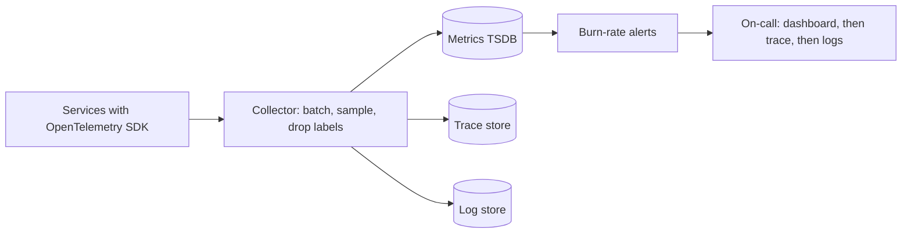

Pulse serves 2,000 feed reads and 200 posts a second through 15 API servers, a Redis cache and a Postgres primary with replicas. Its feed SLO is 99.9% good requests over 28 days — 40.3 minutes, or 4.84 million bad requests, of error budget ([§6.7](/c/system-design/06-availability)). At 03:10 the error rate goes to 2%. How soon does someone get paged, how much budget is gone by then, and does the on-call engineer have the telemetry to find the cause — without the telemetry bill exceeding the compute it watches? Every one of those has a number.

:::key[First principle]
Alert on **symptoms users feel** — SLO burn rate — and diagnose with **causes** — RED for request paths, USE for resources, traces for where, logs for what. Each signal has a cost law: metrics cost per **time series** (the product of label cardinalities), traces per **sampled request**, logs per **byte**. Spend deliberately on all three.
:::

## 27.1 Three signals, three cost laws

| Signal | Answers | Cost grows with | Typical retention |
|---|---|---|---|
| **Metrics** | Is something wrong, how much, since when? | Series = ∏ label cardinalities | 13 months, downsampled |
| **Traces** | Which hop spent the time or threw the error? | Requests × spans × bytes × sample rate | 7–14 days |
| **Logs** | What exactly happened to *this* request? | Requests × lines × bytes | 14–30 days |
| **Change events** (deploys, flags, config) | What changed just before? | Negligible | 13 months |



All three carry the same **trace ID** (W3C `traceparent` header), so the path from an alert to a slow trace to its log lines is a click, not a grep across services. The collector is where cost is controlled: sampling, dropping labels, routing.

## 27.2 What to measure: RED and USE, with thresholds

**RED** for anything that serves requests: **R**ate, **E**rrors, **D**uration. **USE** for anything that is a resource: **U**tilisation, **S**aturation, **E**rrors. On Pulse:

| Component | Metric | Alert or watch at | Why that number |
|---|---|---|---|
| Feed API (RED) | Good-request ratio (200 within 300 ms) | Burn rate, §27.3 | The SLI is what users feel |
| Feed API (RED) | p99 latency from a histogram | 300 ms SLI threshold | Averages hide the tail ([§10.1](/c/system-design/10-latency-and-throughput)) |
| API servers (USE) | CPU utilisation | > 75% sustained (dashboard) | 75% is the zone-down design point; above it the queueing curve steepens ([§10.4](/c/system-design/10-latency-and-throughput)) |
| Postgres (USE) | Connection-pool wait time | > 0 for minutes | Saturation shows before errors |
| Redis | Hit rate | < 85% (from 90%) | DB load = (1 − h) × 6,000: 600 → 900 QPS at peak ([§7](/c/system-design/07-caching)) |
| Replicas | Lag in seconds | > 5 s: remove from pool | Read-your-writes breaks ([§12.3](/c/system-design/12-replication-and-partitioning)) |
| Queues | Age of oldest message | > the processing SLO | Depth lies when consumers speed up or slow down |

Two measurement rules. **Use histograms, not pre-computed percentiles**: a p99 cannot be averaged across 15 instances, but histogram buckets can be summed and the p99 computed from the total. **Measure at the client too**: a server that is down reports no errors at all.

## 27.3 SLOs and burn-rate alerts

Burn rate $b$ is the error rate divided by the budget rate: $b = e/(1-\text{SLO})$. At $b = 1$ the 28-day budget lasts exactly 28 days; at $b = 20$ (2% errors on a 99.9% SLO) it lasts 1.4 days.

An alert rule averages $b$ over a window of $w$ hours and fires above a threshold $B$. After a sudden jump to burn $b$, the window average after $t$ hours is $b\,t/w$, so the rule fires at

$$
t_{\text{fire}} = \frac{w\,B}{b}, \qquad
\text{budget burnt by then} = \frac{b \cdot t_{\text{fire}}}{672\ \text{h}} = \frac{w\,B}{672\ \text{h}}
$$

The second result is the design handle: **each rule fires after a fixed fraction of budget is gone, regardless of how bad the incident is.** A 1-hour window at $B = 14.4$ always fires at 2.1% of the budget. Pairing it with a short window (5 minutes) at the same threshold makes the alert clear within minutes of recovery and suppresses one-off spikes.

```python run
"""Burn-rate alerts for Pulse's feed SLO (99.9% good over 28 days): how fast does each rule fire?"""
SLO = 0.999
WINDOW_H = 28 * 24                       # 672 h budget window
RULES = [                                # (name, burn threshold, long window h, short window h)
    ("page fast", 14.4, 1, 5 / 60),
    ("page slow", 6.0, 6, 0.5),
    ("ticket", 1.0, 72, 6),
]


def detect_min(burn, threshold, long_h, short_h):
    """Error rate jumps from ~0 to a constant. A window of w hours averages burn*t/w after t < w,
    so it crosses the threshold at t = w*threshold/burn. Both windows must exceed it."""
    if burn < threshold:
        return None
    return 60 * max(long_h, short_h) * threshold / burn


print("budget: %.1f min, %.2fM failed requests at 2,000 req/s" %
      ((1 - SLO) * WINDOW_H * 60, (1 - SLO) * 2000 * 3600 * WINDOW_H / 1e6))
print("%7s %6s %10s %10s %10s %13s %12s" %
      ("errors", "burn", "page fast", "page slow", "ticket", "first alert", "budget used"))
for err in (0.0015, 0.003, 0.006, 0.01, 0.02, 0.05, 0.2, 1.0):
    b = err / (1 - SLO)
    times = [detect_min(b, *r[1:]) for r in RULES]
    first = min(t for t in times if t is not None)
    used = b * first / 60 / WINDOW_H              # fraction of the 28-day budget burnt by then
    cells = ["%8.1f m" % t if t is not None else "%10s" % "-" for t in times]
    print("%6.2f%% %6.1f %s %s %s %11.1f m %11.2f%%" % (err * 100, b, *cells, first, used * 100))
```

```output
budget: 40.3 min, 4.84M failed requests at 2,000 req/s
 errors   burn  page fast  page slow     ticket   first alert  budget used
  0.15%    1.5          -          -   2880.0 m      2880.0 m       10.71%
  0.30%    3.0          -          -   1440.0 m      1440.0 m       10.71%
  0.60%    6.0          -          -    720.0 m       720.0 m       10.71%
  1.00%   10.0          -    216.0 m    432.0 m       216.0 m        5.36%
  2.00%   20.0     43.2 m    108.0 m    216.0 m        43.2 m        2.14%
  5.00%   50.0     17.3 m     43.2 m     86.4 m        17.3 m        2.14%
 20.00%  200.0      4.3 m     10.8 m     21.6 m         4.3 m        2.14%
100.00% 1000.0      0.9 m      2.2 m      4.3 m         0.9 m        2.14%
```

:::chart[Time to first alert vs time until the 28-day budget is gone (99.9% SLO, three-rule policy)]{type="line" x="error rate (%)" y="minutes" xlog="true" ylog="true" points="true" marks="2:the 03:10 incident"}
error rate %, first alert, budget exhausted
0.15, 2880, 26880
0.2, 2160, 20160
0.3, 1440, 13440
0.5, 864, 8064
0.7, 309, 5760
1, 216, 4032
1.5, 57.6, 2688
2, 43.2, 2016
3, 28.8, 1344
5, 17.3, 806
10, 8.64, 403
20, 4.32, 202
50, 1.73, 80.6
100, 0.864, 40.3
:::

:::example[Worked example · the 03:10 incident]
At 2% errors, $b = 20$. The fast page fires at \(60 \times 14.4 / 20\) = 43.2 minutes, having spent 2.1% of the budget (~100,000 failed requests); the budget would be gone in \(672 / 20\) = 33.6 hours. A total outage pages in under a minute. A slow leak at 0.15% only opens a ticket after two days and 10.7% of the budget — acceptable, because at that rate the budget lasts \(672 / 1.5\) = 448 hours ≈ 18.7 days.

If 43 minutes is too slow for 2% errors, the honest fix is a tighter rule (say $B = 14.4$ on a 30-minute window: 21.6 minutes, 1.1% of budget) — and accepting that it will also page more often on short blips.
:::

:::warn[Low traffic breaks ratio alerts]
At 2 requests/s, a 5-minute window holds 600 requests; nine errors is 1.5%, a burn of 15 — a page from noise. Require a minimum request count in the window, use longer windows, or add synthetic probes so the ratio has a denominator.
:::

## 27.4 Telemetry volume: series, spans, bytes

The block sizes all three signals for Pulse. Per-series memory (~4 KB), bytes per compressed sample (~1.5 B), span size (400 B), log line size (300 B) and ingest price (USD 0.50/GB) are illustrative — measure yours.

```python run
"""Pulse telemetry volume: metric series, trace bytes, log bytes per day (sizes and prices illustrative)."""
RPS = 2_200                       # 2,000 feed reads + 200 posts per second, average
DAY = 86_400
INSTANCES, ROUTES = 15, 30        # API servers (3 zones x 5), HTTP routes
BUCKETS = 12 + 2                  # latency histogram buckets + _sum + _count
SCRAPE_S, B_PER_SAMPLE, B_PER_SERIES_RAM = 15, 1.5, 4_000

print("request-latency histogram, by label set")
for name, extra in [("route x status class(5)", 5), ("route x status code(20)", 20),
                    ("+ customer tier(4)", 20 * 4), ("+ user_id(10M DAU)", 20 * 10_000_000)]:
    series = ROUTES * INSTANCES * BUCKETS * extra
    disk = series / SCRAPE_S * DAY * B_PER_SAMPLE
    print("  %-25s %17s series  RAM %8.3g GB  disk %8.3g GB/day" %
          (name, f"{series:,}", series * B_PER_SERIES_RAM / 1e9, disk / 1e9))

SPANS, B_SPAN = 8, 400            # spans per request, bytes per span
ERR, SLOW = 0.001, 0.01           # error rate, fraction slower than p99
full = RPS * DAY * SPANS * B_SPAN
print("\ntraces at 100%%: %.0f GB/day" % (full / 1e9))
for r in (0.001, 0.01, 0.1):
    tail = r + (1 - r) * (ERR + SLOW)
    print("  base %4.1f%%: head-only %5.1f GB/day | tail keeps %5.2f%% = %5.1f GB/day"
          % (r * 100, full * r / 1e9, tail * 100, full * tail / 1e9))
print("  tail buffer for 30 s decisions: %.0f MB" % (RPS * 30 * SPANS * B_SPAN / 1e6))
rare = RPS * DAY / 1e6
print("  a 1-in-a-million path happens %.0f times/day; 1%% head sampling keeps %.1f" % (rare, rare * 0.01))

LINES, B_LINE, USD_GB = 4, 300, 0.50
for name, lines in [("4 lines/request", LINES), ("+ debug line per post (20)", LINES + 20),
                    ("call logs sampled 10%", 1 + 0.1 * (LINES - 1))]:
    gb = RPS * DAY * lines * B_LINE / 1e9
    print("logs %-27s %6.0f GB/day  14-day store %5.1f TB  ingest $%6.0f/month" %
          (name, gb, gb * 14 / 1e3, gb * 30 * USD_GB))
```

```output
request-latency histogram, by label set
  route x status class(5)              31,500 series  RAM    0.126 GB  disk    0.272 GB/day
  route x status code(20)             126,000 series  RAM    0.504 GB  disk     1.09 GB/day
  + customer tier(4)                  504,000 series  RAM     2.02 GB  disk     4.35 GB/day
  + user_id(10M DAU)        1,260,000,000,000 series  RAM 5.04e+06 GB  disk 1.09e+07 GB/day

traces at 100%: 608 GB/day
  base  0.1%: head-only   0.6 GB/day | tail keeps  1.20% =   7.3 GB/day
  base  1.0%: head-only   6.1 GB/day | tail keeps  2.09% =  12.7 GB/day
  base 10.0%: head-only  60.8 GB/day | tail keeps 10.99% =  66.8 GB/day
  tail buffer for 30 s decisions: 211 MB
  a 1-in-a-million path happens 190 times/day; 1% head sampling keeps 1.9
logs 4 lines/request                228 GB/day  14-day store   3.2 TB  ingest $  3421/month
logs + debug line per post (20)    1369 GB/day  14-day store  19.2 TB  ingest $ 20529/month
logs call logs sampled 10%           74 GB/day  14-day store   1.0 TB  ingest $  1112/month
```

### Metrics: cardinality is multiplication

$$
\text{series} = \prod_{\text{labels}} |\text{values}| \times (\text{buckets} + 2)
$$

One latency histogram on 30 routes × 15 instances × 5 status classes is 31,500 series — trivial. Exact status codes instead of classes: 4×. A bounded `tier` label: another 4×, still fine at 504,000. A `user_id` label multiplies by 10 million: 1.26 trillion series in the worst case, and even the realistic number (only combinations that occur) is hundreds of millions — no time-series database survives it.

- Labels must be **bounded and known in advance**: route template (`/feed/{id}`, not the raw path), status class, region, tier.
- Never label with user IDs, request IDs, emails, raw URLs or error messages. Per-entity detail is a trace or a log.
- Put a series limit per metric in the collector (e.g. 10,000) and drop or alert on overflow.

### Traces: sample on purpose

At 100%, Pulse's traces are 608 GB a day. **Head sampling** decides at the first span (cheap, stateless): 1% is 6.1 GB/day, but it keeps only 1% of errors and slow requests too — a code path hit once per million requests appears ~1.9 times a day. **Tail sampling** buffers every span until the trace completes, then keeps *all* errors and all requests slower than p99 plus a 1% baseline: 2.1% of traces, 12.7 GB/day, and every interesting trace kept. Its price is a 211 MB buffer for 30-second decisions and a collector tier that must see all spans of a trace (route by trace ID).

:::chart[Trace storage per day vs baseline sampling rate (Pulse, 8 spans × 400 B per request, illustrative)]{type="line" x="baseline sample rate (%)" y="GB per day" xlog="true" ylog="true" points="true" marks="1:1% baseline"}
baseline sample %, head sampling only, tail: baseline + all errors + all slow
0.1, 0.608, 7.29
0.2, 1.22, 7.89
0.5, 3.04, 9.7
1, 6.08, 12.7
2, 12.2, 18.7
5, 30.4, 36.8
10, 60.8, 66.8
20, 122, 127
50, 304, 307
100, 608, 608
:::

Below ~2% baseline, tail sampling's cost is set by the errors and slow requests it keeps (the flat floor at ~7 GB/day), not by the baseline — so the baseline can drop further without losing anything you would debug with.

### Logs: structure, correlate, sample the boring ones

Four structured lines per request (inbound, two outbound calls, one state change) at 300 B is 228 GB/day and ~USD 3,400/month ingest (illustrative). A debug line per post rendered in the feed adds 20 lines per request — 6× the volume, USD 20,500/month — from one forgotten `log.debug` in a loop. Keeping every access line plus all errors, and sampling successful outbound-call lines at 10%, cuts it to 74 GB/day.

```json
{"ts":"2026-11-06T03:10:42.118Z","level":"error","route":"/feed","status":503,
 "duration_ms":2004,"trace_id":"4bf92f3577b34da6a3ce929d0e0e4736",
 "user":"h:7c1e9a","dep":"postgres-replica-2","err":"pool timeout after 2000ms"}
```

- **Structured** (JSON), with `trace_id` on every line; **hashed** user identifiers; no tokens, passwords, card numbers or request bodies — a log store full of personal data is a breach waiting for an export.
- **Log at boundaries** (requests in, calls out, state transitions), not in every function.
- **Sample successes, never errors**, and make the rate a runtime setting so you can raise it during an incident.

## 27.5 Configuration defaults

| Knob | Default | Why |
|---|---|---|
| SLO window | 28 days | Four whole weeks, so weekday cycles compare cleanly |
| Page rules | $b > 14.4$ over 1 h and 5 min; $b > 6$ over 6 h and 30 min | Fire at 2.1% and 5.4% of budget (§27.3) |
| Ticket rule | $b > 1$ over 3 days and 6 h | Slow leaks, 10.7% of budget |
| Scrape interval | 15 s | Resolution vs samples stored |
| Histogram buckets | 10–15, spanning 5 ms to 10 s | Enough resolution around the 300 ms SLI |
| Series limit per metric | ~10,000 | Stops a bad label at the collector |
| Trace sampling | Tail: all errors + all > p99 + 1% baseline | 12.7 GB/day vs 608 at 100% |
| Tail decision wait | 10–30 s | Longer than p99.9 trace duration |
| Log retention | 14 days hot, 90 days archive for audit logs only | Cost vs incident look-back |

## 27.6 Failure modes

| Failure | Symptom | Fix |
|---|---|---|
| Cause-based paging ("CPU > 80%") | Pages with no user impact; real outages missed | Page on burn rate; keep resource metrics on dashboards |
| Unbounded label | TSDB memory explodes, metrics bill jumps | Series limits, label allow-lists in the collector |
| Averaged percentiles | p99 "improves" when traffic shifts between hosts | Aggregate histogram buckets, then compute quantiles |
| Head sampling only | The one failing request has no trace | Tail sampling, or always-sample errors at the edge |
| Debug logging left on | Log volume 6× overnight | Rate limits per logger, volume alerts, sampling |
| Monitoring shares fate with the system | Outage takes dashboards down too | Separate failure domain, external synthetic probes |
| Secrets or PII in logs | Compliance incident | Redaction in the collector, structured fields only |

## 27.7 Check yourself

:::qa[Your SLO is 99.9% over 28 days and you page on burn > 14.4 over a 1-hour window. What fraction of the budget is gone when a full outage pages, and when a 5% error rate pages?]
Both $wB/672$ = \(1 \times 14.4 / 672\) = 2.1%. The outage pages in 0.9 minutes, the 5% incident in 17.3 — the rule spends the same budget either way, which is what makes it a policy rather than a guess.
:::

:::qa[A developer adds `customer_id` (50,000 customers) as a label to the request histogram that today has 126,000 series. What happens?]
126,000 × 50,000 = 6.3 billion potential series — about 25 TB of RAM at 4 KB each. Reject it at the collector; if per-customer latency is needed, compute it from traces or logs, or add a bounded `tier` label instead.
:::

:::qa[Why does tail sampling at a 0.1% baseline still store ~7 GB/day for Pulse, and is that money well spent?]
It keeps every error (0.1% of requests) and every request above p99 (1%) regardless of the baseline: about 1.1% of 608 GB ≈ 7 GB/day. Yes — those are exactly the traces used in incidents; the baseline only serves to show what normal looks like.
:::

:::qa[Log ingest doubled overnight. Name the likeliest causes and the first metric you check.]
A new log line in a hot path (a loop or per-item log), a raised log level left on, or a retry storm producing error lines. Check log volume broken down by logger or source file and by level, then compare with request rate: if requests are flat and lines per request rose, it is a code change; if both rose, it is traffic or retries.
:::

Next: [Rate limiter](/c/system-design/28-rate-limiter) — protecting capacity before the burn-rate alert fires.
