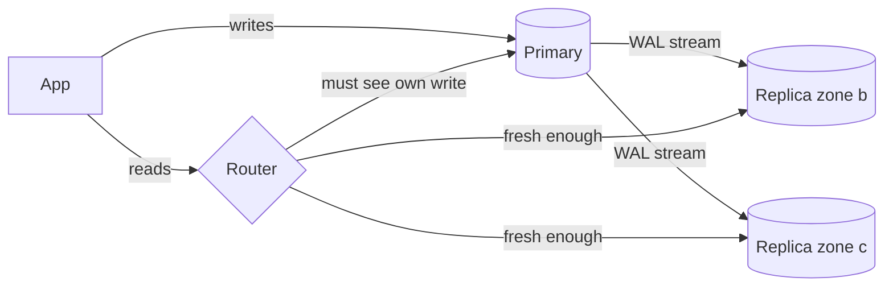

Pulse runs on one Postgres primary. At peak it serves 6,000 reads/s and 600 writes/s ([§2](/c/system-design/02-estimation)); the cache in [§18](/c/system-design/18-cache) absorbs most feed reads, but profiles, cold timelines, search filters and every cache miss still land on the database — and if the primary dies, so does the app. Read replicas answer both problems with one mechanism: copies that replay the primary's log, serve reads, and can be promoted. This section sizes them, measures what their lag does to users, and works out what a failover costs.

:::key[First principle]
A replica multiplies **read** capacity, never write capacity — it replays every write — and every read it serves comes from slightly in the past. Size the count from database reads at a target utilisation that survives a lost zone; send any read that must see a particular write to a copy known to have it (by log position, not by a timer); and price failover as writes/s × lag at the moment of failure.
:::

## 29.1 How a replica works

The primary appends every change to its write-ahead log (WAL in Postgres, binlog in MySQL) and streams it to each replica, which replays it in order. Three choices decide the behaviour ([§12.2](/c/system-design/12-replication-and-partitioning) derives the latencies):

| Mode | Primary commits after | Added write latency | Writes lost on failover |
|---|---|---|---|
| Asynchronous | its own log is durable | 0 | everything in the lag window |
| Semi-synchronous / one sync standby | one replica has the log | one round trip, ~0.5 ms in-region | ~0 if that replica is promoted |
| Synchronous to all | every replica has the log | the slowest replica | 0, but any replica down blocks writes |



Two consequences follow directly from "every replica replays every write":

- **Apply headroom.** A replica must apply writes as fast as the primary produces them. Replay is often less parallel than the primary's many concurrent writers (Postgres replays WAL with a single process), so a replica's apply rate $\mu$ can sit well below what the primary can absorb. When $\lambda_{\text{write}} > \mu$, lag grows as a queue: $\text{lag} = \text{backlog}/\mu$ ([§12.3](/c/system-design/12-replication-and-partitioning)).
- **No write scaling.** Adding the tenth replica adds read capacity and a tenth copy of the write load. If writes are the bottleneck, the answer is batching, a queue or [sharding](/c/system-design/34-sharding).

## 29.2 How many replicas

$$
n_{\text{load}} = \left\lceil \frac{\text{peak DB reads}}{c \cdot \rho} \right\rceil, \qquad
n \ge n_{\text{load}} \ \text{ and } \ \frac{\text{peak DB reads}}{(n - \lceil n/3 \rceil)\, c} \le 0.75
$$

with $c$ = reads/s one replica serves at saturation (measure it with a load test), $\rho$ = 0.6 target utilisation (the knee of the latency curve, [§10](/c/system-design/10-latency-and-throughput)), and the second condition keeping the survivors below 75% when the biggest of three zones is lost. "Peak DB reads" is what the cache does *not* absorb: $(1 - h) \times 6{,}000$.

```python run
"""How many read replicas does Pulse need? Peak 6,000 reads/s, 600 writes/s, 3 zones (capacities illustrative)."""
import math

PEAK_READS, PEAK_WRITES = 6_000, 600
CAP = 2_000            # reads/s one replica serves (measure with a load test)
TARGET, ZONE_DOWN = 0.60, 0.75
APPLY = 1_500          # log entries/s one replica can apply (single-threaded apply, illustrative)


def replicas_for(reads):
    normal = math.ceil(reads / (CAP * TARGET))
    n = max(2, normal)                         # at least 2: one can fail or be rebuilt
    while reads / ((n - math.ceil(n / 3)) * CAP) > ZONE_DOWN:   # lose the biggest of 3 zones
        n += 1
    return normal, n


print("cache hit  DB reads/s  for 60%  zone-safe  util normal  util zone down")
for hit in (0.0, 0.5, 0.8, 0.9, 0.95, 0.99):
    reads = PEAK_READS * (1 - hit)
    normal, n = replicas_for(reads)
    print("%8.0f%% %11.0f %8d %10d %11.0f%% %14.0f%%" % (
        hit * 100, reads, normal, n, 100 * reads / (n * CAP),
        100 * reads / ((n - math.ceil(n / 3)) * CAP)))

print("\nevery replica also applies all %d writes/s: apply headroom %.1fx" % (PEAK_WRITES, APPLY / PEAK_WRITES))
for burst in (1_000, 2_000):
    lag = (burst - APPLY) * 60 / APPLY if burst > APPLY else 0
    print("a 60 s write burst at %d/s -> replica lag %.0f s" % (burst, lag))
```

```output
cache hit  DB reads/s  for 60%  zone-safe  util normal  util zone down
       0%        6000        5          6          50%             75%
      50%        3000        3          3          50%             75%
      80%        1200        1          2          30%             60%
      90%         600        1          2          15%             30%
      95%         300        1          2           8%             15%
      99%          60        1          2           2%              3%

every replica also applies all 600 writes/s: apply headroom 2.5x
a 60 s write burst at 1000/s -> replica lag 0 s
a 60 s write burst at 2000/s -> replica lag 20 s
```

:::chart[Replicas Pulse needs vs cache hit rate (2,000 reads/s per replica, illustrative)]{type="bar" x="cache hit rate" y="replicas" labels="true"}
cache hit, for 60% utilisation, zone-safe (survivors ≤ 75%)
0%, 5, 6
50%, 3, 3
80%, 1, 2
90%, 1, 2
95%, 1, 2
99%, 1, 2
:::

:::example[Worked example · Pulse with and without the cache]
**No cache.** 6,000 reads/s ÷ (2,000 × 0.6) = 5 replicas; losing a zone of 2 leaves 4 × 2,000 = 8,000 reads/s of capacity for 6,000 — 75%. So 6 replicas, 2 per zone.

**With the §18 cache at 90%.** 600 reads/s reach the database: one replica at 30% would do. Keep two anyway, in different zones from the primary — one to take reads while the other is rebuilt, and both as failover candidates. Past a ~80% hit rate, replicas are an *availability* decision, not a capacity one.

**Apply headroom.** Every replica replays all 600 writes/s against an apply rate of 1,500/s (illustrative): 2.5× headroom. A backfill writing 2,000 rows/s for 60 s builds a backlog of \(500 \times 60\) = 30,000 entries — 20 s of lag on *every* replica at once, the same queue as §12.3's flash sale.
:::

## 29.3 Lag is a distribution with a tail

Lag is the time between a commit on the primary and its replay on the replica. Most of the time it is the network plus apply time — tens to hundreds of milliseconds. The tail comes from events: a backfill or migration (the burst above), a long query on the replica that conflicts with replay (Postgres pauses replay for up to `max_standby_streaming_delay`, 30 s by default, before cancelling the query), a replica restart catching up, vacuum or checkpoint I/O. The mean barely notices; the p99 does.

The simulation models Pulse's lag as exponential with a 100 ms mean, then lets 2% of posts land in a spike with a 5 s mean (illustrative mixture — measure yours from replica metrics). Each poster reloads the feed 0.2 s after posting, once more within 5 s and once within 5–30 s ([§8.2](/c/system-design/08-consistency) uses the same reload pattern). The strategies are compared on the stale reads posters see and the reads they push back onto the primary:

```python run
"""Read-your-writes on Pulse: how often a poster misses their own post, and what each fix costs."""
import numpy as np

rng = np.random.default_rng(29)
POSTS, RATE, FEED_READS = 200_000, 200, 2_000       # simulated posts; avg posts/s; avg feed reads/s
SPIKE_P, BASE, SPIKE = 0.02, 0.1, 5.0                 # illustrative: 2% of posts land in a lag spike

spike = rng.random(POSTS) < SPIKE_P
lag = np.where(spike, rng.exponential(SPIKE, POSTS), rng.exponential(BASE, POSTS))
calm = rng.exponential(BASE, POSTS)                    # same traffic, no spikes
# each poster reloads at 0.2 s, once more within 5 s, once within 5-30 s (illustrative, as in section 8)
reads = np.stack([np.full(POSTS, 0.2), rng.uniform(0.2, 5, POSTS), rng.uniform(5, 30, POSTS)], axis=1)

print("lag percentiles (s)   p50    p99   p99.9")
for name, l in (("calm", calm), ("with spikes", lag)):
    print("  %-16s %6.2f %6.2f %7.2f" % (name, *np.percentile(l, [50, 99, 99.9])))


def row(name, primary, stale, wait_ms=0.0):
    per_s = primary.sum() / POSTS * RATE
    print("  %-19s stale %5.2f%%  primary %4.0f/s (%2.0f%% of reads)  wait %3.1f ms" % (
        name, 100 * stale.mean(), per_s, 100 * per_s / FEED_READS, wait_ms))


print("\nstrategy (with spikes)")
stale = reads < lag[:, None]
row("replica always", np.zeros_like(stale), stale)
for T in (1, 2, 5, 10, 30):
    pin = reads < T
    row("pin to primary %2d s" % T, pin, stale & ~pin)
WAIT = 0.05                                            # LSN token: replica may wait 50 ms, else primary
caught = lag[:, None] <= reads + WAIT
row("LSN token, 50 ms", ~caught, np.zeros_like(stale), 1000 * np.clip(lag[:, None] - reads, 0, WAIT).mean())
```

```output
lag percentiles (s)   p50    p99   p99.9
  calm               0.07   0.46    0.70
  with spikes        0.07   3.52   14.76

strategy (with spikes)
  replica always      stale  5.63%  primary    0/s ( 0% of reads)  wait 0.0 ms
  pin to primary  1 s stale  0.37%  primary  233/s (12% of reads)  wait 0.0 ms
  pin to primary  2 s stale  0.27%  primary  275/s (14% of reads)  wait 0.0 ms
  pin to primary  5 s stale  0.05%  primary  400/s (20% of reads)  wait 0.0 ms
  pin to primary 10 s stale  0.02%  primary  440/s (22% of reads)  wait 0.0 ms
  pin to primary 30 s stale  0.00%  primary  600/s (30% of reads)  wait 0.0 ms
  LSN token, 50 ms    stale  0.00%  primary   23/s ( 1% of reads)  wait 2.3 ms
```

Two per cent of spiky posts move the median not at all (0.07 s) but push the p99 from 0.46 s to 3.52 s and the p99.9 from 0.70 s to 14.76 s. A 1 s alert on *average* lag would never fire.

## 29.4 Read-your-writes: pick by stale rate and primary load

:::chart[Pinning posters to the primary: stale reads fall, primary load climbs (simulated, illustrative lag)]{type="line" x="pin window after a write (s)" y="% of reads" points="true" marks="5:5 s window"}
pin window s, stale poster reads (calm lag), stale poster reads (2% lag spikes), feed reads sent to primary
0, 4.66, 5.63, 0.0
0.5, 0.01, 0.43, 10.6
1, 0.00, 0.37, 11.7
2, 0.00, 0.27, 13.8
3, 0.00, 0.18, 15.8
5, 0.00, 0.05, 20.0
10, 0.00, 0.02, 22.0
20, 0.00, 0.00, 26.0
30, 0.00, 0.00, 30.0
:::

What the numbers say:

- **Doing nothing** makes 5.6% of a poster's reads miss their own post — about 15% of the immediate 0.2 s reloads. That's the "my post disappeared" bug.
- **A pin window** works only if it covers the lag tail. With calm lag, 0.5 s is enough; with spikes, even 10 s leaves 0.02% stale, because the window is a guess about lag rather than a fact. And every second of window is more primary load: 5 s costs 400 reads/s on average — 20% of feed reads — which at the 3× peak is **1,200 reads/s on the node that also takes every write**. Note these reads must bypass the cache too, or the cache becomes the stale copy.
- **An LSN token** is exact and cheap: 0 stale, 23 reads/s fall back to the primary (~70/s at peak), and the average added wait is 2.3 ms. It keys on what the replica has *actually applied*, so a lag spike makes it slower, never wrong.

How the token works in Postgres: after a write, read `pg_current_wal_lsn()` on the primary and return it to the client (a cookie or response header). Before serving that user's read, a replica compares it with `pg_last_wal_replay_lsn()`; if behind, it waits up to a short budget, then the router sends the read to the primary.

```python
def read_feed(user, token_lsn, replicas, primary, wait_s=0.05):
    replica = pick_least_lagged(replicas)        # router keeps replay LSN per replica, refreshed every ~100 ms
    if token_lsn is None or replica.wait_for_lsn(token_lsn, timeout=wait_s):
        return replica.query(FEED_SQL, user)
    return primary.query(FEED_SQL, user)         # rare: replica still behind after the wait
```

The other session guarantees are routing rules, not strategies:

| Need | Rule | Cost |
|---|---|---|
| Read your own writes | LSN token (above); pin window only if you can't carry a token | 1% of reads to primary vs 20% for a 5 s pin |
| Monotonic reads (never see time go backwards) | Hash `user_id` to one replica; on failover pass the last LSN seen | 0 |
| Reads inside a transaction | Whole transaction on the primary | All its reads |
| Read-modify-write (stock, balance) | Primary, with the check in the write ([§8](/c/system-design/08-consistency)) | All such reads |
| Analytics, exports, search indexing | Dedicated replica outside the serving pool | One replica, and its lag is allowed to grow |

## 29.5 Failover: what promotion costs

When the primary dies, a replica is promoted. The cost has two parts ([§6](/c/system-design/06-availability) has RPO and RTO):

$$
\text{writes lost (RPO)} \approx \lambda_{\text{write}} \times \text{lag}_{\text{at failure}}, \qquad
\text{writes refused (RTO)} \approx \lambda_{\text{write}} \times (t_{\text{detect}} + t_{\text{promote}} + t_{\text{reroute}})
$$

:::example[Worked example · Pulse's primary dies at peak]
**RPO with async replicas.** At 600 writes/s and the calm p99 lag of 0.46 s, ~280 recent posts and likes are lost; if it happens during a 15 s lag spike, ~9,000. For a feed that is tolerable (clients retry unacknowledged posts); for the checkout ledger it is not, which is why [§6](/c/system-design/06-availability) puts a synchronous standby in a second zone there (+~0.5 ms per write, RPO ≈ 0).

**RTO.** Detect with health checks every 5 s and 3 misses (15 s), promote (~5 s), and let clients reconnect through a proxy or DNS with a short TTL (~10 s) — ~30 s, all illustrative. Writes are refused for that time: \(600 \times 30\) = 18,000 failed writes that become [retries](/c/system-design/30-retry), so the new primary takes a burst on top of normal load. Reads continue from the surviving replicas throughout.
:::

Rules that keep promotion safe:

1. **Promote the most caught-up replica** (highest replay LSN), and re-point the others to it. A replica that applied *more* than the new primary must be rewound or rebuilt.
2. **Fence the old primary.** If it comes back believing it is still primary, two nodes accept writes — split-brain. Revoke its access (storage, network, or a fencing token checked on write, as in [distributed locks](/c/system-design/21-distributed-locks)) before the new one takes writes.
3. **Don't fail over on a blip.** 15 s of detection avoids promoting on a GC pause; a promotion costs a few seconds of refused writes and a rebuild of the old primary.
4. **Rehearse it.** An untested failover path is a manual procedure at 3 a.m.

## 29.6 Configuration defaults

| Knob | Default | Why |
|---|---|---|
| Replica count | max(load at 60%, zone-safe at 75%), at least 2 | §29.2: 6 for Pulse with no cache, 2 with it |
| Placement | Replicas in zones other than the primary's | A zone loss must not take primary and candidates together |
| Replication mode | Async for feeds; one sync standby for money | RPO by data type (§29.5) |
| Remove from read pool | Lag > 5 s (Pulse); re-add below 1 s | A lagging replica serves wrong answers while healthy |
| Lag alert | p99 lag > 2 s for 5 min; page on > 30 s | Mean lag hides the tail (§29.3) |
| Read-your-writes | LSN token, 50 ms wait, fall back to primary | 0 stale, ~1% of reads to primary |
| Replica query timeout | Below the replay-conflict delay (e.g. 10 s vs 30 s) | Long queries pause replay and become lag |
| Failover detection | 3 missed checks × 5 s | Avoid promoting on a blip |

## 29.7 Failure modes

| Failure | Symptom | Fix |
|---|---|---|
| Lag spike from a backfill | Every replica minutes behind; posts "missing" | Throttle bulk writes below apply headroom (1,500/s here); run them off-peak |
| Long analytics query on a serving replica | Replay paused up to 30 s; lag spike on one node | Dedicated analytics replica; statement timeout |
| Pin window shorter than lag tail | Read-your-writes bug returns during spikes | LSN tokens |
| Pin window too long | Primary saturated by pinned reads at peak (1,200/s for 5 s) | LSN tokens; shorter window |
| Replicas as a write fix | Write latency unchanged, replicas all lagging | Batch, queue or shard writes |
| Replica of a replica | Lag adds per hop | Keep replication one level deep |
| Failover without fencing | Two primaries, diverging data | Fence before promote |
| Read pool includes the lagging node | Some users see old data, others new | Remove by lag threshold, not liveness |

## 29.8 Check yourself

:::qa[Pulse's cache hit rate drops from 90% to 50% after a bad deploy. Do two replicas still cope?]
Database reads go from 600/s to 3,000/s at peak. Two replicas at 2,000/s each (illustrative) run at 75% with both up and 150% if one fails. §29.2 asks for 3 at 50% utilisation. Short term: fix the cache; structurally: size for the hit rate you can lose, or shed load when the database saturates.
:::

:::qa[A replica applies 1,500 entries/s and Pulse writes 600/s. A migration backfills at 3,000 rows/s for 2 minutes. How much lag, and what should routing do?]
Backlog grows at \(3{,}600 - 1{,}500\) = 2,100/s → 252,000 entries after 120 s → 168 s of lag, then drains at \(1{,}500 - 600\) = 900/s, another ~280 s. Every replica exceeds the 5 s threshold and leaves the pool, so all reads go to the primary. Throttle the backfill to under 900 rows/s and it adds no lag at all.
:::

:::qa[Why does a 5 s pin window still leave stale reads, and why does an LSN token not?]
The window guesses that lag is under 5 s; during spikes the p99.9 lag is 14.8 s, so some reads after the window still hit an unapplied write (0.05% of poster reads). The token checks the replica's replay position against the write's position, so it serves only from a copy that has the write — slower during a spike, never stale.
:::

:::qa[The primary dies at peak with 2 s of replica lag. How many writes are lost and how many refused, with a 30 s RTO?]
Lost ≈ \(600 \times 2\) = 1,200 writes that were acknowledged but never reached a replica. Refused ≈ \(600 \times 30\) = 18,000 during the promotion, which clients retry — with backoff and jitter, or the new primary starts life under a retry storm.
:::

Next: [Retry and backoff](/c/system-design/30-retry) — turning those 18,000 refused writes into successes without a storm.
