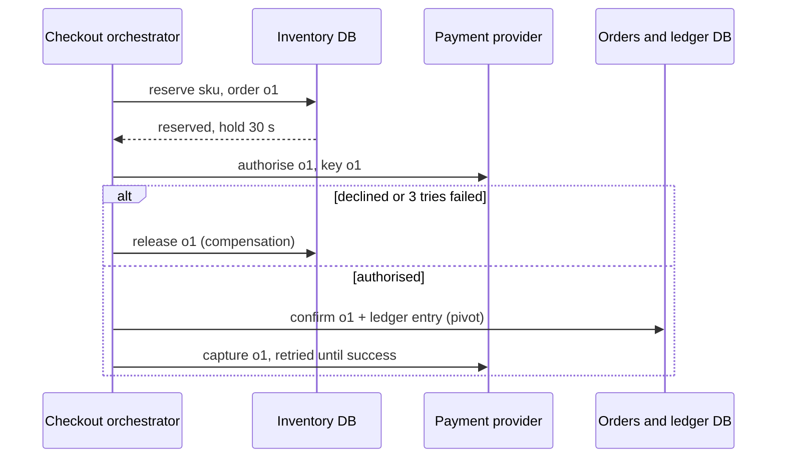
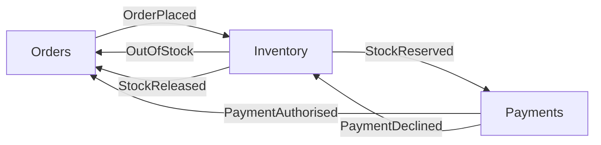

Checkout touches three systems that can't share a transaction: the inventory database, the payment provider (p50 300 ms, p99 2 s, illustrative) and the ledger. During the flash sale 2,000 orders/s arrive. If the card is declined after stock was reserved, the reservation must be released; if the provider is down, the order must end somewhere definite rather than hang. [Two-phase commit](/c/system-design/15-transactions) is out — the provider will never join your transaction, and 2PC holds locks across a network call. A saga is what's left.

:::key[First principle]
A saga is a sequence of **local** transactions, each with a **compensation** — a new action that semantically undoes it (release, void, refund). Steps after a **pivot** can't be undone, so they must be retried until they succeed. Every saga ends in exactly one terminal state: completed, compensated, or "needs a human" — and you size each path.
:::

## 31.1 The checkout saga

| # | Step | Kind | Compensation | Retry policy |
|---:|---|---|---|---|
| 1 | Reserve stock (conditional decrement, hold TTL) | Compensable, local | Release reservation | Local, rarely fails except "sold out" |
| 2 | Authorise card with provider | Compensable, remote | Void authorisation | 3 tries, 3 s timeout each |
| 3 | Confirm order + ledger entry | **Pivot**, local | — | Local transaction |
| 4 | Capture payment | Retriable, remote | None needed — must succeed | Retry with backoff until it does |
| 5 | Email, shipment request | Retriable | Send a correction (can't unsend) | Queue, DLQ after N |

Two design rules fall out of the table:

- **Put the risky, irreversible steps after the pivot, and the ones likely to fail before it.** Authorise-then-capture exists for exactly this: authorisation is cheap to void, a capture would need a refund the customer sees.
- **Compensations are steps too**: idempotent, retried, logged. A void that fails must be retried; one that fails for good (authorisation already expired) goes to a manual queue.



## 31.2 How often will you compensate?

If each of $N$ remote steps fails independently with probability $p$, and failure means compensate:

$$
P(\text{saga fails}) = 1 - (1 - p)^N \approx Np \quad (Np \ll 1).
$$

Retries change $p$ only for **transient** failures: $k$ tries turn $p_t$ into $p_t^{\,k}$. **Business** failures (a declined card, sold out) don't go away on retry, so they set the floor.

:::chart[P(saga fails somewhere) vs number of remote steps, no retries]{type="line" x="remote steps N" y="P(fail)" ymin="0" points="true" unit="%"}
N, p = 0.1%, p = 1%, p = 2%, p = 5%
1, 0.10, 1.00, 2.00, 5.00
2, 0.20, 1.99, 3.96, 9.75
3, 0.30, 2.97, 5.88, 14.26
4, 0.40, 3.94, 7.76, 18.55
5, 0.50, 4.90, 9.61, 22.62
6, 0.60, 5.85, 11.42, 26.49
7, 0.70, 6.79, 13.19, 30.17
8, 0.80, 7.73, 14.92, 33.66
9, 0.90, 8.65, 16.63, 36.98
10, 1.00, 9.56, 18.29, 40.13
11, 1.09, 10.47, 19.93, 43.12
12, 1.19, 11.36, 21.53, 45.96
:::

Ten remote steps at 1% transient failure each make 9.6% of sagas compensate — unusable. With 3 tries each, the same steps fail \(1 - (1 - 10^{-6})^{10} \approx 10^{-5}\) of the time. The simulation runs the flash sale through the saga with illustrative rates: 10% sold out, 4% declined, 1% transient provider error per attempt, and 1 in 10,000 compensations rejected for good.

```python run
"""Checkout saga during the flash sale: outcomes, compensations and the manual queue."""
import numpy as np

rng = np.random.default_rng(31)
ORDERS = 1_200_000            # 2,000 orders/s for 10 minutes
SOLD_OUT = 0.10               # reserve finds no stock: nothing to undo (illustrative)
DECLINE = 0.04                # issuer declines the authorisation (illustrative)
TRANSIENT = 0.01              # per-attempt timeout or 5xx from the provider (illustrative)
ATTEMPTS = 3                  # tries per remote step before the saga gives up on it
COMP_FAIL = 1e-4              # compensation rejected for good, e.g. void after expiry (illustrative)

sold_out = rng.random(ORDERS) < SOLD_OUT
auth_err = (rng.random((ORDERS, ATTEMPTS)) < TRANSIENT).all(axis=1)   # every attempt failed
declined = rng.random(ORDERS) < DECLINE
compensate = ~sold_out & (auth_err | declined)        # reservation must be released
completed = ~sold_out & ~compensate                   # passed the pivot: order confirmed
manual = compensate & (rng.random(ORDERS) < COMP_FAIL)
capture_retries = (rng.random(ORDERS) < TRANSIENT) & completed   # after the pivot: retry, never undo

print(f"{ORDERS:,} sagas in 10 minutes")
for name, m in (("rejected at step 1 (sold out)", sold_out), ("compensated (released stock)", compensate),
                ("completed", completed), ("compensation failed -> human", manual),
                ("capture retried after the pivot", capture_retries)):
    print(f"  {name:33s} {m.sum():>9,}  {m.mean():7.3%}")
print(f"  of compensations: declined {(compensate & declined).sum():,},"
      f" provider unavailable after {ATTEMPTS} tries {(compensate & auth_err & ~declined).sum():,}")
print(f"with {ATTEMPTS} tries a 1% transient step fails {TRANSIENT ** ATTEMPTS:.0e} of the time;"
      f" 10 such steps: {1 - (1 - TRANSIENT ** ATTEMPTS) ** 10:.0e}")
```

```output
1,200,000 sagas in 10 minutes
  rejected at step 1 (sold out)       119,931   9.994%
  compensated (released stock)         43,001   3.583%
  completed                         1,037,068  86.422%
  compensation failed -> human              3   0.000%
  capture retried after the pivot      10,422   0.869%
  of compensations: declined 42,998, provider unavailable after 3 tries 3
with 3 tries a 1% transient step fails 1e-06 of the time; 10 such steps: 1e-05
```

:::example[Worked example · what the flash sale asks of each path]
- **Compensation path**: 43,001 releases in 10 minutes ≈ 72/s, almost all from declines. Retries removed the transient failures (3 of 1.2M). The release path must handle 72/s at peak — it's not a rare edge case, it's 3.6% of traffic.
- **Post-pivot retries**: 10,422 captures (0.87%) need a second try. They never compensate, so they go through a queue with backoff ([§25](/c/system-design/25-message-queue), [§30](/c/system-design/30-retry)).
- **Manual queue**: 3 per sale — the assumed 1 in 10,000 compensations. Someone has to own that queue, and an alert must fire when it's non-empty.
:::

## 31.3 Orchestration or choreography

**Orchestration**: one component (a service with a state table, or a workflow engine such as Temporal or AWS Step Functions) calls each step and decides what happens on failure — the sequence diagram above. **Choreography**: services react to each other's events and no one holds the whole flow:



| | Orchestration | Choreography |
|---|---|---|
| Where the flow lives | One state machine you can read | Spread across subscriptions in N services |
| "Where is order o1 stuck?" | One row in the saga table | Correlate events across N logs |
| Adding a step | Change the orchestrator | Change who publishes and who subscribes |
| Coupling | Orchestrator knows every participant's API | Participants know only event schemas |
| Failure handling | Central: timeouts, retries, compensation order | Each service must react to others' failure events |
| Fits | Checkout, payments, anything with ≥ 3 steps and compensations | 2–3 step reactions, fan-out notifications |

Checkout uses orchestration: five steps, a pivot, compensations in a specific order, and support staff who need to answer "what happened to my order" from one place. Choreography stays for the side effects after the pivot (email, analytics, search indexing), which are independent consumers of `OrderConfirmed`.

## 31.4 Make the orchestrator crash-safe

The orchestrator itself crashes. Three things make that a non-event:

1. **Persist state before and after each step** — a saga table (`order_id, step, state, updated_at`), written in the same local transaction as an **outbox** row for the command it sends ([§15.7](/c/system-design/15-transactions)). A restarted orchestrator reloads unfinished sagas and resumes.
2. **Make every step and compensation idempotent**, keyed by order id ([§22](/c/system-design/22-idempotency)). A crash between "do the work" and "log it" means the step runs twice.
3. **Give every step a timeout and every saga a deadline**, so nothing stays `IN_PROGRESS` forever.

The sketch below keeps the log in memory to stay self-contained; a real one is a database table. It shows a decline compensating (and the compensation running twice harmlessly), a crash after a step's work but before it was logged, and a sold-out order rejected with nothing to undo:

```python run
"""A tiny saga orchestrator: persisted state, crash and resume, idempotent steps and compensations."""
stock = {"sku-7": 3}
reservations, log = {}, []                     # log stands in for the saga table + outbox


def reserve(o):                                # idempotent: keyed by order id
    if o not in reservations:
        if stock["sku-7"] == 0:
            raise RuntimeError("sold out")
        stock["sku-7"] -= 1
        reservations[o] = 1


def release(o):                                # compensation, also idempotent
    if reservations.pop(o, 0):
        stock["sku-7"] += 1


def authorise(o, declined):
    if declined:
        raise RuntimeError("card declined")


def void(o):
    pass                                       # provider call keyed by order id in real life


STEPS = [("reserve", reserve, release), ("authorise", authorise, void)]


def run(o, declined=False, crash_after=None):
    done = [e["step"] for e in log if e["order"] == o and e["state"] == "done"]
    for name, do, undo in STEPS:
        if name in done:
            continue                           # resumed saga: skip finished steps
        try:
            do(o, declined) if name == "authorise" else do(o)
        except RuntimeError as err:
            if not done and name == STEPS[0][0]:
                return f"rejected ({err}), nothing to undo"
            for prev, _, comp in reversed(STEPS[:STEPS.index((name, do, undo))]):
                comp(o)
                comp(o)                        # a retried compensation must be harmless
                log.append({"order": o, "step": prev, "state": "compensated"})
            log.append({"order": o, "step": name, "state": f"failed: {err}"})
            return "compensated"
        if crash_after == name:
            return "crashed before logging " + name     # work done, state not yet persisted
        log.append({"order": o, "step": name, "state": "done"})
    log.append({"order": o, "step": "confirm", "state": "done"})   # the pivot
    return "confirmed"


print("o1:", run("o1"), "| stock", stock["sku-7"])
print("o2:", run("o2", declined=True), "| stock", stock["sku-7"])
print("o3:", run("o3", crash_after="reserve"), "| stock", stock["sku-7"])
print("o3 resumed:", run("o3"), "| stock", stock["sku-7"], "| reservations", sorted(reservations))
print("o4:", run("o4"), "| stock", stock["sku-7"])
print("o5:", run("o5"), "| stock", stock["sku-7"])
for o in ("o2", "o3"):
    print(o, "log:", ", ".join(f"{e['step']}={e['state']}" for e in log if e["order"] == o))
```

```output
o1: confirmed | stock 2
o2: compensated | stock 2
o3: crashed before logging reserve | stock 1
o3 resumed: confirmed | stock 1 | reservations ['o1', 'o3']
o4: confirmed | stock 0
o5: rejected (sold out), nothing to undo | stock 0
o2 log: reserve=done, reserve=compensated, authorise=failed: card declined
o3 log: reserve=done, authorise=done, confirm=done
```

When o3 resumed, `reserve` ran a second time — the log didn't say it was done — and the idempotent implementation left stock at 1 instead of taking a second unit. Without the order-id key, every orchestrator crash during the sale would leak a unit of stock.

:::warn[The dual write inside the orchestrator]
"Update the saga table, then call the provider" is the same dual-write problem as "update the DB, then publish". Write the state change and an outbox row in one transaction, and let a relay send the command ([§9.4](/c/system-design/09-delivery-semantics)). Then a crash can cause a duplicate command (handled by idempotency keys) but never a lost one.
:::

## 31.5 How long should a reservation live?

The reservation's hold TTL is a backstop: if the saga is lost, the stock comes back on its own. Too short and a **live** saga's reservation expires while it's still authorising — another order takes the unit and the first one oversells or must be cancelled after payment. Too long and a **lost** saga strands stock. The lower bound comes from the saga's worst-case duration, which timeouts make finite:

$$
T_{\text{saga}} \le t_{\text{local}} + k \cdot t_{\text{timeout}} + \sum \text{backoff}.
$$

```python run
"""How long must a stock reservation live? Saga duration with timeouts and retries vs the hold TTL."""
import numpy as np

rng = np.random.default_rng(310)
N = 1_000_000
MU, SIGMA = np.log(0.300), np.log(2.0 / 0.300) / 2.326     # provider p50 300 ms, p99 2 s (illustrative)
TIMEOUT, BACKOFF, ATTEMPTS = 3.0, (0.2, 0.4), 3             # per-call timeout and retry backoff (s)


def authorise_time():
    total = np.zeros(N)
    pending = np.ones(N, bool)
    for a in range(ATTEMPTS):
        lat = rng.lognormal(MU, SIGMA, N)
        ok = pending & (lat <= TIMEOUT)
        total[ok] += lat[ok]
        slow = pending & ~ok
        total[slow] += TIMEOUT + (BACKOFF[a] if a < len(BACKOFF) else 0)
        pending = slow
    return total, pending                                  # pending: gave up -> compensate


auth, _ = authorise_time()
saga = 0.005 + auth + 0.005 + 0.002                       # reserve + authorise + confirm + relay (s)
print(f"saga p50 {np.percentile(saga, 50):.2f} s, p99 {np.percentile(saga, 99):.2f} s,"
      f" p99.99 {np.percentile(saga, 99.99):.2f} s, max {saga.max():.2f} s")
bound = 0.012 + ATTEMPTS * TIMEOUT + sum(BACKOFF)
print(f"upper bound from timeouts: 0.012 + {ATTEMPTS} x {TIMEOUT:.0f} + {sum(BACKOFF):.1f} = {bound:.2f} s")
for ttl in (1, 2, 5, 10, 30, 600):
    print(f"hold TTL {ttl:>4} s: sagas outliving their reservation {np.mean(saga > ttl):9.5%}")

# Stuck stock if the orchestrator loses in-flight sagas (no persisted state): units stay held until TTL.
RATE, IN_FLIGHT = 2_000, 2_000 * saga.mean()               # Little's law: sagas in flight at peak
print(f"in flight at 2,000/s: {IN_FLIGHT:,.0f} sagas -> a crash without persisted state strands"
      f" {IN_FLIGHT:,.0f} reservations for the full TTL")
```

```output
saga p50 0.31 s, p99 2.01 s, p99.99 4.44 s, max 7.06 s
upper bound from timeouts: 0.012 + 3 x 3 + 0.6 = 9.61 s
hold TTL    1 s: sagas outliving their reservation  7.19880%
hold TTL    2 s: sagas outliving their reservation  1.01100%
hold TTL    5 s: sagas outliving their reservation  0.00310%
hold TTL   10 s: sagas outliving their reservation  0.00000%
hold TTL   30 s: sagas outliving their reservation  0.00000%
hold TTL  600 s: sagas outliving their reservation  0.00000%
in flight at 2,000/s: 858 sagas -> a crash without persisted state strands 858 reservations for the full TTL
```

:::chart[Share of sagas still running when their stock reservation expires (simulated, 1M sagas)]{type="line" x="hold TTL (s)" y="sagas outliving reservation" unit="%" marks="2:p99 of provider;9.61:timeout bound"}
TTL, % of sagas
0.5, 27.481
0.75, 13.402
1, 7.199
1.25, 4.138
1.5, 2.477
2, 1.011
2.5, 0.470
3, 0.239
3.5, 0.124
4, 0.029
5, 0.003
6, 0.001
8, 0.000
10, 0.000
:::

:::example[Worked example · picking the hold TTL]
A TTL equal to the provider's p99 (2 s) lets 1% of live sagas lose their reservation — 20 orders/s at peak racing for stock they already "hold". The timeout bound is 9.61 s, so any TTL above ~10 s makes this impossible rather than rare. **30 s** leaves room for a slow local step. The other side of the trade: by Little's law ~858 sagas are in flight at 2,000/s; if the orchestrator loses them all (no persisted state), 858 units sit reserved for 30 s — or for 10 minutes with a cart-style TTL, which for a 200-unit flash-sale SKU means "sold out" while stock is actually free. Persisted state makes the TTL a backstop that almost never fires; the short TTL bounds the damage when it does.
:::

## 31.6 No isolation: design for visible intermediate states

Between steps, other transactions see a reserved-but-unpaid unit and a `PENDING` order. That's the price of not holding locks across the saga. Countermeasures:

- **Semantic lock**: the `PENDING` state *is* the lock. Other flows check it — a cancel request on a `PENDING` order waits or is queued; the UI says "confirming payment".
- **Commutative updates**: release and reserve are increments/decrements, so their order doesn't matter.
- **Re-read and re-validate at the pivot**: confirm only if the reservation still exists (`UPDATE … WHERE order_id = ? AND state = 'RESERVED'`), which catches an expired TTL.
- **Report on terminal states only**: revenue dashboards count `CONFIRMED`, not `PENDING`.

## 31.7 Knobs and failure modes

| Knob | Checkout setting | Why |
|---|---|---|
| Tries per remote step | 3, timeout 3 s, backoff 0.2 s / 0.4 s | 1% transient → 10⁻⁶ residual |
| Saga deadline | ~10 s to the pivot | Bound from timeouts (§31.5) |
| Reservation hold TTL | 30 s | > deadline; bounds stranded stock |
| Post-pivot capture | Retry from a queue until success, alert on age | Can't compensate after the pivot |
| Compensation tries | 5, then manual queue | ~3 per sale need a human |
| Saga table retention | ≥ the dispute window | Answer "what happened to o1" |

| Failure mode | Symptom | Fix |
|---|---|---|
| Orchestrator crash without persisted state | Reservations stranded until TTL, orders stuck `PENDING` | Saga table + outbox, resume on start |
| Non-idempotent step re-run on resume | Two units reserved, double authorisation | Key every step by order id |
| Hold TTL below the saga's worst case | Live sagas lose stock, oversell or post-payment cancels | TTL > timeout bound |
| Irreversible step before the pivot | Refunds customers can see, emails you can't unsend | Reorder: authorise early, capture/email after |
| Compensation fails for good | Money held, stock not returned | Manual queue with an owner and an alert |

Before writing a saga at all, check whether the data can live in one database (one local transaction) or the steps can be reordered so only one remote call remains ([§15.7](/c/system-design/15-transactions)).

## 31.8 Check yourself

:::qa[A saga has 6 remote steps, each failing transiently 2% of the time. How often does it compensate without retries, and with 3 tries per step?]
Without retries: \(1 - 0.98^6\) ≈ 11.4%. With 3 tries: each step fails \(0.02^3 = 8 \times 10^{-6}\), so \(1 - (1 - 8 \times 10^{-6})^6 \approx 4.8 \times 10^{-5}\) — about 1 in 21,000. Business failures (declines) are unaffected by retries.
:::

:::qa[Why must capture come after the pivot rather than before it?]
A capture moves money; undoing it is a refund the customer sees, which may itself fail. Authorisation can be voided invisibly. Putting the pivot (confirm + ledger) before capture means capture is never compensated — only retried until it succeeds.
:::

:::qa[Per-call timeout 2 s, 4 tries, backoff 0.5 + 1 + 2 s. What's the minimum safe reservation TTL?]
Worst case ≈ \(4 \times 2 + 3.5\) = 11.5 s plus local steps. Choose ≥ ~15 s; 30 s is comfortable. A TTL set from the p99 latency alone would expire under live sagas whenever a retry happens.
:::

:::qa[The orchestrator restarts and re-runs "reserve" for 800 in-flight orders. What prevents 800 extra units being reserved?]
The reserve step is keyed by order id: it checks for an existing reservation for that order before decrementing, in the same local transaction. Re-running it is a no-op.
:::

Next: [§32 Search index](/c/system-design/32-search-index) — a derived store kept in sync with the same outbox.
