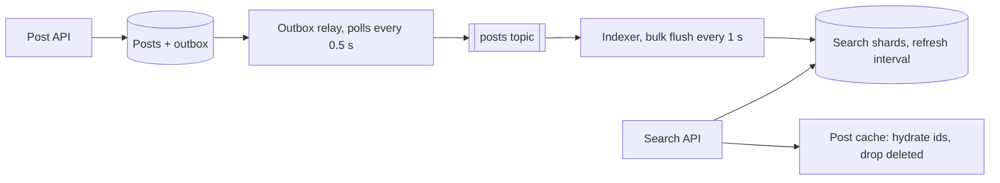

Pulse users want to search posts: "coffee in berlin". Pulse stores 20M posts a day (10M DAU × 2) in a relational database with B-tree indexes ([§23](/c/system-design/23-indexes)). A B-tree on `body` answers "body starts with …", not "body contains *coffee* and *berlin*, best matches first" — that's `LIKE '%coffee%'`, a scan over every post. A search index is a second, derived copy of the posts organised by word, fed from the database and allowed to lag it by a second or two.

:::key[First principle]
Invert the data: for each **term**, store the sorted list of documents that contain it (a **posting list**). A query reads only the lists for its terms, intersects or unions them, and ranks the survivors with a score like **BM25**. The index is derived from the source of truth, so it can always be rebuilt — and it is always slightly stale.
:::

## 32.1 From text to terms: analysis

Every document and every query passes through the same **analyser**: tokenise, lowercase, drop stop words, stem. "Best coffee in Berlin? This tiny roastery in Kreuzberg wins." becomes `best coffee berlin tiny roastery kreuzberg win`. Query and document must be analysed identically, or "Wins" never matches "win".

| Stage | Example | Decide |
|---|---|---|
| Tokeniser | split on non-letters; keep `#hashtags`, `@mentions` as tokens | Language and domain (hashtags, code, CJK) |
| Normalise | lowercase, strip accents | Case-sensitive fields (ids) skip this |
| Stop words | drop `the`, `in`, `is` | Keep them if phrase search matters |
| Stemming | `wins` → `win`, `running` → `run` | Recall up, precision down |
| Field mapping | `body`: text; `author_id`, `created_at`: keyword/date | Changing an analyser means reindexing everything |

## 32.2 Posting lists: sizes follow Zipf

Word frequencies are Zipf-like: the term of rank $r$ appears in proportion to \(1/r\). So a few posting lists are huge (they contain almost every post) and the long tail is tiny. Doc ids in a list are sorted, so the index stores the **gaps** between them in a variable-length encoding: dense lists have small gaps and cost ~1 byte per entry.

```python run
"""Posting lists for a Zipf-distributed corpus of short posts: sizes, delta+varint bytes, query cost."""
import numpy as np

rng = np.random.default_rng(32)
DOCS, VOCAB, TOKENS = 200_000, 50_000, 35        # posts, distinct terms, terms per post after analysis
w = 1.0 / np.arange(1, VOCAB + 1)                # Zipf: term of rank r appears ~1/r as often
terms = rng.choice(VOCAB, size=(DOCS, TOKENS), p=w / w.sum())
docs = np.repeat(np.arange(DOCS), TOKENS)
pairs = np.unique(terms.ravel().astype(np.int64) * DOCS + docs)   # (term, doc) once each, sorted
term, doc = pairs // DOCS, pairs % DOCS
df = np.bincount(term, minlength=VOCAB)          # posting-list length per term

new_list = np.r_[True, term[1:] != term[:-1]]
gaps = np.where(new_list, doc, np.diff(doc, prepend=0))           # store doc-id differences
varint = 1 + (gaps >= 2**7) + (gaps >= 2**14) + (gaps >= 2**21)   # bytes per gap
print(f"{DOCS:,} posts, {TOKENS} terms each -> {len(pairs) / DOCS:.1f} distinct terms per post,"
      f" {len(pairs):,} postings, {np.count_nonzero(df):,} terms used")
print(f"doc ids as 4-byte ints: {4 * len(pairs) / 1e6:.1f} MB;"
      f" as delta+varint: {varint.sum() / 1e6:.1f} MB ({varint.mean():.2f} B per posting)")
for lo, hi, name in ((0, 10, "top 10 terms"), (10, 1000, "ranks 11-1,000"), (1000, VOCAB, "rank > 1,000")):
    m = (term >= lo) & (term < hi)
    print(f"  {name:15s} {m.mean():6.1%} of postings, {varint[m].mean():.2f} B each")
print("\nrank  posting-list length  share of posts")
for r in (1, 2, 10, 100, 1_000, 10_000):
    print(f"{r:>6,} {df[r - 1]:>12,} {df[r - 1] / DOCS:>14.2%}")

# An AND query walks both lists; cost ~ shorter list x log(longer) with skipping, ~ sum without.
for a, b in ((1, 2), (1, 5_000), (3_000, 5_000)):
    print(f"query ranks {a:>5,} AND {b:>5,}: lists {df[a - 1]:>7,} + {df[b - 1]:>4,} entries")
```

```output
200,000 posts, 35 terms each -> 30.6 distinct terms per post, 6,124,069 postings, 50,000 terms used
doc ids as 4-byte ints: 24.5 MB; as delta+varint: 8.9 MB (1.45 B per posting)
  top 10 terms     16.5% of postings, 1.00 B each
  ranks 11-1,000   44.4% of postings, 1.16 B each
  rank > 1,000     39.2% of postings, 1.96 B each

rank  posting-list length  share of posts
     1      191,906         95.95%
     2      158,360         79.18%
    10       53,181         26.59%
   100        6,042          3.02%
 1,000          646          0.32%
10,000           68          0.03%
query ranks     1 AND     2: lists 191,906 + 158,360 entries
query ranks     1 AND 5,000: lists 191,906 +  129 entries
query ranks 3,000 AND 5,000: lists     215 +  129 entries
```

:::chart[Posting-list length by term rank (simulated, 200,000 posts)]{type="line" x="term rank" y="posts containing the term" xlog="true" ylog="true" points="true" yfmt="int"}
rank, posting-list length
1, 191906
2, 158360
5, 92862
10, 53181
50, 11826
100, 6042
500, 1240
1000, 646
5000, 129
10000, 68
50000, 11
:::

What this means for queries:

- **Rare terms are cheap, common terms are expensive.** The rank-1 term is in 96% of posts — reading its list is a near-full scan. That's why stop words are dropped and why a query's cost is driven by its most common term.
- **AND queries are driven by the shortest list.** "rank 1 AND rank 5,000" walks the 129-entry list and *skips* through the 191,906-entry one using skip pointers stored in the list, so it costs hundreds of lookups, not 192,000.
- **Compression is ~3× here** (24.5 → 8.9 MB) and better on dense lists (1.00 B per entry for the top 10 terms). Postings also store term frequency and, for phrase queries, positions — more bytes per entry.

## 32.3 Ranking: BM25

Matching documents need an order. **BM25** scores a document $D$ for query $Q$ as a sum over query terms:

$$
\text{score}(D, Q) = \sum_{t \in Q} \text{IDF}(t)\cdot\frac{f_{t,D}\,(k_1 + 1)}{f_{t,D} + k_1\left(1 - b + b\,\frac{|D|}{\text{avgdl}}\right)},
\qquad
\text{IDF}(t) = \ln\!\left(\frac{N - n_t + 0.5}{n_t + 0.5} + 1\right).
$$

Three ideas: **rare terms count more** (IDF falls as $n_t$, the number of documents containing $t$, grows); **repetition saturates** (the fraction tends to $k_1 + 1$ as $f_{t,D}$ grows); **long documents are penalised** ($b$ scales the penalty, typically $k_1 = 1.2$, $b = 0.75$).

```python run
"""BM25 from scratch over a handful of Pulse posts."""
import math
import re
from collections import Counter

POSTS = [
    "Best coffee in Berlin? This tiny roastery in Kreuzberg wins.",
    "Berlin marathon done! Coffee first, then sleep.",
    "Coffee coffee coffee. Monday needs all the coffee.",
    "Flat white vs cortado: a coffee nerd explains, with diagrams, the milk ratios, "
    "the cup sizes and why your barista sighs at you every morning in every city.",
    "Moving to Berlin next month, any tips on neighbourhoods?",
    "Tea is better than coffee. Fight me.",
    "Our Berlin office is hiring backend engineers.",
    "Rainy Sunday in Munich, perfect for a long breakfast.",
]
STOP = {"a", "the", "in", "is", "of", "to", "on", "then", "this", "and", "with", "at", "for",
        "any", "all", "our", "vs", "me", "your", "why", "you", "every", "than", "first", "done"}


def analyse(text):                               # lowercase, split, drop stop words, crude stemming
    words = re.findall(r"[a-z]+", text.lower())
    return [w[:-1] if w.endswith("s") and len(w) > 3 else w for w in words if w not in STOP]


docs = [Counter(analyse(p)) for p in POSTS]
lengths = [sum(d.values()) for d in docs]
N, avgdl = len(docs), sum(lengths) / len(docs)
df = Counter(t for d in docs for t in d)         # in how many posts each term appears


def idf(t):
    return math.log((N - df[t] + 0.5) / (df[t] + 0.5) + 1)


def bm25(query, k1=1.2, b=0.75):
    scores = []
    for i, d in enumerate(docs):
        norm = k1 * (1 - b + b * lengths[i] / avgdl)          # long posts need more hits
        s = sum(idf(t) * d[t] * (k1 + 1) / (d[t] + norm) for t in analyse(query) if t in d)
        scores.append((s, i))
    return sorted(scores, reverse=True)


print(f"N = {N} posts, average length {avgdl:.2f} terms")
for t in ("coffee", "berlin", "kreuzberg", "munich"):
    print(f"idf({t}) = {idf(t):.3f}   (in {df[t]} of {N} posts)")
print("\nquery: 'coffee in berlin'")
for s, i in bm25("coffee in berlin"):
    if s > 0:
        print(f"{s:6.3f}  len={lengths[i]:>2}  tf(coffee)={docs[i]['coffee']}  {POSTS[i][:44]}")
```

```output
N = 8 posts, average length 6.62 terms
idf(coffee) = 0.492   (in 5 of 8 posts)
idf(berlin) = 0.693   (in 4 of 8 posts)
idf(kreuzberg) = 1.792   (in 1 of 8 posts)
idf(munich) = 1.792   (in 1 of 8 posts)

query: 'coffee in berlin'
 1.415  len= 4  tf(coffee)=1  Berlin marathon done! Coffee first, then sle
 1.159  len= 7  tf(coffee)=1  Best coffee in Berlin? This tiny roastery in
 0.847  len= 6  tf(coffee)=4  Coffee coffee coffee. Monday needs all the c
 0.770  len= 5  tf(coffee)=0  Our Berlin office is hiring backend engineer
 0.721  len= 6  tf(coffee)=0  Moving to Berlin next month, any tips on nei
 0.588  len= 4  tf(coffee)=1  Tea is better than coffee. Fight me.
 0.325  len=15  tf(coffee)=1  Flat white vs cortado: a coffee nerd explain
```

:::example[Worked example · reading the ranking]
- **Both terms beat one term repeated.** The marathon post (both terms, 4 terms long) scores 1.415; "coffee" four times scores 0.847 — repetition saturates and it never mentions Berlin.
- **Length penalty.** The roastery post also has both terms but is 7 terms long against an average of 6.62, so it scores 1.159, below the 4-term marathon post. The 15-term coffee-nerd post scores 0.325, the lowest of all matches.
- **Rarer terms weigh more.** Berlin-only posts (0.770, 0.721) outrank the coffee-only post (0.588) because `berlin` is in 4 of 8 posts (IDF 0.693) and `coffee` in 5 (IDF 0.492).

Hand check of the marathon post: norm \(= 1.2 \times (0.25 + 0.75 \times 4/6.62)\) = 0.844, per-term factor \(2.2/(1 + 0.844)\) = 1.193, score \((0.492 + 0.693) \times 1.193\) ≈ 1.41 ✓ (1.415 before rounding).
:::

:::chart[BM25 term contribution vs term frequency (÷ IDF; b = 0.75)]{type="line" x="occurrences of the term in the post" y="contribution / IDF" ymin="0"}
tf, k1=1.2 avg length, k1=1.2 2× avg length, k1=1.2 half avg length, k1=2.0 avg length
0, 0.000, 0.000, 0.000, 0.000
1, 1.000, 0.710, 1.257, 1.000
2, 1.375, 1.073, 1.600, 1.500
3, 1.571, 1.294, 1.760, 1.800
4, 1.692, 1.443, 1.853, 2.000
5, 1.774, 1.549, 1.913, 2.143
6, 1.833, 1.630, 1.956, 2.250
7, 1.878, 1.692, 1.987, 2.333
8, 1.913, 1.743, 2.011, 2.400
9, 1.941, 1.784, 2.031, 2.455
10, 1.964, 1.818, 2.047, 2.500
:::

With $k_1 = 1.2$ the tenth occurrence adds almost nothing (ceiling 2.2) — keyword stuffing doesn't pay. Real ranking adds signals BM25 knows nothing about: recency, engagement, the author's follower graph. A common shape is BM25 to fetch the top ~1,000 candidates per shard, then a cheaper-per-document re-ranker on those.

## 32.4 Sizing the Pulse search cluster

Assumptions (illustrative): 30.6 distinct terms per post (the simulated corpus), ~4 bytes per posting once term frequencies and positions are added, the ~1 KB post stored for display and highlighting, 30 GB primary shards, one replica, one year searchable.

```python run
"""Pulse search: index size, shards, fan-out tail and deep-pagination cost (sizing calculator)."""
POSTS_DAY = 10_000_000 * 2            # 10M DAU x 2 posts
TERMS = 30.6                          # distinct terms per post after analysis (simulated corpus)
B_POSTING = 4.0                       # doc-id gap + term freq + positions, bytes (illustrative)
B_STORED = 1_000                      # stored post for highlighting/display, ~1 KB
SHARD_GB = 30                         # target primary shard size (illustrative)
RETAIN_DAYS = 365
REPLICAS = 1                          # one replica per primary

postings = POSTS_DAY * TERMS
inv_gb = postings * B_POSTING / 1e9
stored_gb = POSTS_DAY * B_STORED / 1e9
day_gb = inv_gb + stored_gb
total_tb = day_gb * RETAIN_DAYS / 1e3
primaries = day_gb * RETAIN_DAYS / SHARD_GB
print(f"postings/day {postings / 1e6:,.0f}M -> inverted lists {inv_gb:.1f} GB + stored posts {stored_gb:.0f} GB"
      f" = {day_gb:.1f} GB/day")
print(f"{RETAIN_DAYS} days: {total_tb:.1f} TB primary, {total_tb * (1 + REPLICAS):.1f} TB with {REPLICAS} replica,"
      f" ~{primaries:.0f} primary shards of {SHARD_GB} GB")
print(f"daily indices: one {day_gb:.0f} GB primary shard per day")

print("\nfan-out tail: a query over the last D days touches D shards")
for days in (1, 7, 30, 365):
    print(f"  {days:>3} shards, each slow 1% of the time: P(query waits on a slow shard) = "
          f"{1 - 0.99 ** days:6.1%}")
```

```output
postings/day 612M -> inverted lists 2.4 GB + stored posts 20 GB = 22.4 GB/day
365 days: 8.2 TB primary, 16.4 TB with 1 replica, ~273 primary shards of 30 GB
daily indices: one 22 GB primary shard per day

fan-out tail: a query over the last D days touches D shards
    1 shards, each slow 1% of the time: P(query waits on a slow shard) =   1.0%
    7 shards, each slow 1% of the time: P(query waits on a slow shard) =   6.8%
   30 shards, each slow 1% of the time: P(query waits on a slow shard) =  26.0%
  365 shards, each slow 1% of the time: P(query waits on a slow shard) =  97.4%
```

:::example[Worked example · what the numbers decide]
- **Stored documents dominate**: 20 of 22.4 GB/day is the post itself. Storing only the fields you display (or none, and hydrating from the post cache by id) shrinks the cluster ~9×.
- **Shard by time**: one ~22 GB index per day. Retention is "drop yesterday's oldest index" — no deletes, no merges — and a search over "recent posts" only touches recent shards.
- **Bound the fan-out**: searching all 365 daily shards means 97% of queries wait for at least one slow shard ([§10](/c/system-design/10-latency-and-throughput)'s fan-out tail). Default to the last 30 days (26%) and roll older indices into weekly or monthly ones for an explicit "search all time".
- **Query load**: at an assumed 2 searches per DAU per day — 20M/day ≈ 200 QPS average, 600 peak (illustrative) — 30 shards per query is 18,000 shard-queries/s at peak, spread over the replicas.
:::

Every shard holds its own complete inverted index for its documents (**document partitioning**), so every query goes to every shard in range. The alternative, partitioning by term, sends a query only to the shards owning its terms but turns every document write into a multi-shard write; search engines almost always partition by document.

The same fan-out makes **deep pagination** expensive: to return results 10,000–10,020, each of 30 shards must return its top \(10{,}000 + 20\) hits and the coordinator merges \(30 \times 10{,}020\) = 300,600 of them to keep 20. A cursor (`search_after`: "the next 20 after this sort value") costs \(30 \times 20\) = 600 on every page.

## 32.5 Freshness: the index is always behind

A post becomes searchable after it travels the sync pipeline **and** the index refreshes — makes buffered documents visible by opening a new searchable segment (default 1 s in Elasticsearch/OpenSearch):



```python run
"""Freshness: time from a post's commit to being searchable, vs the index refresh interval."""
import numpy as np

rng = np.random.default_rng(320)
N = 200_000
POLL, BATCH = 0.5, 1.0                # outbox relay poll interval, indexer bulk flush interval (s)
queue = rng.lognormal(np.log(0.02), 0.8, N)        # relay -> queue -> indexer, median 20 ms
index = rng.lognormal(np.log(0.01), 0.5, N)        # bulk write into the in-memory buffer
base = rng.uniform(0, POLL, N) + queue + rng.uniform(0, BATCH, N) + index

print(f"pipeline before refresh: p50 {np.percentile(base, 50):.2f} s, p99 {np.percentile(base, 99):.2f} s")
print("refresh | visible p50 | p99    | new segments per shard per hour")
for r in (0.2, 0.5, 1, 2, 5, 10, 30, 60):
    lag = base + rng.uniform(0, r, N)                  # wait for the next refresh to open a segment
    print(f"{r:>5} s | {np.percentile(lag, 50):>9.2f} s | {np.percentile(lag, 99):>5.2f} s |"
          f" {3600 / r:>8,.0f}")
```

```output
pipeline before refresh: p50 0.79 s, p99 1.44 s
refresh | visible p50 | p99    | new segments per shard per hour
  0.2 s |      0.89 s |  1.56 s |   18,000
  0.5 s |      1.04 s |  1.80 s |    7,200
    1 s |      1.29 s |  2.23 s |    3,600
    2 s |      1.79 s |  3.15 s |    1,800
    5 s |      3.28 s |  6.01 s |      720
   10 s |      5.78 s | 10.87 s |      360
   30 s |     15.79 s | 30.54 s |      120
   60 s |     30.87 s | 60.21 s |       60
```

:::chart[Commit-to-searchable lag vs refresh interval (simulated pipeline, 200,000 posts)]{type="line" x="refresh interval (s)" y="lag (s)" xlog="true" ylog="true" points="true" marks="1:default refresh"}
refresh, p50, p99
0.2, 0.89, 1.56
0.5, 1.04, 1.80
1, 1.29, 2.23
2, 1.79, 3.15
5, 3.28, 6.01
10, 5.78, 10.87
30, 15.79, 30.54
60, 30.87, 60.21
:::

Below ~1 s the pipeline (0.79 s median) dominates and a faster refresh buys little while creating 5× more tiny segments to merge. Above ~5 s the refresh dominates. For Pulse, 1 s refresh gives p99 ≈ 2.2 s — fine for search, where users don't expect their own post in results instantly. For the "I just posted" moment, show the post from the write path, not from search. During a bulk reindex, set refresh to 30–60 s (or off) to cut segment churn.

How the index is fed matters more than the refresh:

| Approach | Mechanism | Lag | What goes wrong |
|---|---|---|---|
| **Dual write** | App writes DB, then index | ms | Index write fails after DB commit → divergence that no retry repairs |
| **Outbox + consumer** | Post and outbox row in one transaction; indexer consumes events | ~1–2 s (above) | At-least-once: index by `post_id` so replays overwrite ([§9](/c/system-design/09-delivery-semantics)) |
| **Change data capture** | Tail the DB's replication log | ~1 s | Schema changes in the log; same ordering rules as the outbox |
| **Batch rebuild** | Periodic export into a fresh index, swap an alias | Hours | Stale; but the only way to change an analyser |

Use the outbox (or CDC) for steady state and keep the batch rebuild working: changing an analyser or mapping means building a new index from the database and atomically switching an alias.

## 32.6 Knobs and failure modes

| Knob | Pulse setting | Why |
|---|---|---|
| Index granularity | Daily indices, 1 primary (~22 GB) + 1 replica | Retention by dropping indices |
| Default search window | Last 30 days | 26% vs 97% fan-out tail |
| Refresh interval | 1 s; 30–60 s during bulk loads | p99 lag ~2.2 s |
| Stored fields | Only what results display | Stored posts are 89% of bytes |
| BM25 | $k_1 = 1.2$, $b = 0.75$, re-rank top candidates | Defaults; tune with judged queries |
| Pagination | `search_after` cursor, cap page depth | Offset 10,000 merges 300,600 hits |

| Failure mode | Symptom | Fix |
|---|---|---|
| Index drift | Posts in DB not in search, or deleted posts still found | Outbox, idempotent upserts by id, nightly count reconciliation, filter on hydration |
| Deep pagination | Page 500 times out, coordinator memory spikes | Cursor (`search_after`): each shard returns only `size` hits per page |
| Mapping explosion | Thousands of fields from user-supplied JSON keys; cluster unstable | Strict mappings, never dynamic on user keys |
| Hot common term | Queries containing a near-universal term are slow | Stop words, query rewriting, AND before OR |
| Fan-out to every shard | p99 tracks the slowest of hundreds of shards | Time-sharded indices, bounded default window |
| Treating it as the source of truth | Data lost on reindex | Always rebuildable from the database |

## 32.7 Check yourself

:::qa[A term appears in 2 of 8 posts. What is its IDF, and why does a query term in every post contribute almost nothing?]
\(\ln((8 - 2 + 0.5)/(2 + 0.5) + 1) = \ln(3.6)\) ≈ 1.281. A term in all 8 posts gets \(\ln(0.5/8.5 + 1) = \ln(1.059)\) ≈ 0.057 — it doesn't distinguish documents, so it barely moves the score.
:::

:::qa[Two posts both contain "coffee" once. One has 4 terms, the other 15; the average is 6.62. Compare their per-term factor at k₁ = 1.2, b = 0.75.]
4 terms: norm 0.844, factor \(2.2/1.844\) ≈ 1.193. 15 terms: norm \(1.2 \times (0.25 + 0.75 \times 15/6.62)\) ≈ 2.339, factor \(2.2/3.339\) ≈ 0.659. The short post gets 1.8× the credit for the same match.
:::

:::qa[Search must cover 2 years of Pulse posts. How many daily shards does a query hit, and what fraction wait on a slow shard if each is slow 1% of the time?]
730 shards; \(1 - 0.99^{730}\) ≈ 99.9%. Merge old days into monthly indices (24 shards → \(1 - 0.99^{24}\) ≈ 21%) and default to recent data.
:::

:::qa[Product wants posts searchable within 0.5 s. Is lowering the refresh interval enough?]
No. With a 0.5 s outbox poll and 1 s indexer batch, the pipeline alone is 0.79 s median and 1.44 s p99 before any refresh. Shorten the poll and batch (or push events directly), and show the author's own post from the write path.
:::

Next: [§33 Service discovery](/c/system-design/33-service-discovery) — how the search API finds a live search node.
